# Lecture 2 — Training Deep Neural Networks: slide-by-slide

Text and figures of all 95 slides of
[`mit15_773_s24_lec02.pdf`](https://ocw.mit.edu/courses/15-773-hands-on-deep-learning-spring-2024/mit15_773_s24_lec02.pdf)
(MIT 15.773 Hands-On Deep Learning, Spring 2024; lecturer Rama Ramakrishnan), transcribed from the deck. Cite these as "slide N" — N is the PDF page number; slide 95 is OCW's appended end page. Diagrams, plots and photographs are described in prose since the KB is read as text.

Many slides are **build steps** — the same slide re-shown with one more element revealed. They are transcribed individually so that a citation to any one of them resolves, with a note of what each adds relative to the previous one.

**Images.** Fifteen figure slides carry a 1400px render under their heading: 2, 10, 27, 33, 46, 47, 55–58, 66, 69, 79, 93 and 94. The other figure-bearing slides are not rendered because a rendered slide supersedes them (the network drawings and Keras build steps 7–26 → 10 and 27; the loss curves 42–45 → 46; the $g(w)$ plots 52–54 and 68 → 55 and 69), because they are tables this file reproduces exactly (4, 61–64), or because they carry an OCW exclusion notice (75).

## Numbering: slide numbers vs PDF pages

Headings use the PDF page number. Pages 2–49 print their own page number in the bottom-right corner. Pages 50–94 print the PDF page number plus one (PDF page 50 prints "51", PDF page 60 prints "61", ... PDF page 94 prints "95"), because a hidden slide numbered 50 was never exported from the original deck. Pages 1 and 95 print no number. A reader who opens PDF page 60 therefore sees "61" printed there: cite and look up by PDF page.

## Contents

| Slides | Section |
| ------ | ------- |
| 1 | Title |
| 2 | Recap from lecture 1: designing a DNN (the user chooses the number of hidden layers, units per layer and activations) |
| 3–10 | Application: predicting heart disease from the Cleveland Clinic dataset (13 columns one-hot-encoded to 29 inputs); one hidden layer of 16 ReLU units and a sigmoid output; counting its 497 parameters |
| 11–28 | Translating that network into Keras, one piece at a time: `keras.Input`, `keras.layers.Dense`, feeding each layer the previous layer's output, `keras.Model` |
| 29–34 | Training a deep network: recap of fitting linear and logistic regression with `lm` and `glm`; trained versus untrained 2-3-1 network; training means minimizing a loss function |
| 35–40 | Loss functions: what a loss measures; sum of squared errors; mean squared error for numerical outputs |
| 41–49 | A loss for a probability output: −log(predicted probability) when y = 1, −log(1 − predicted probability) when y = 0, combined and averaged into the binary cross-entropy loss |
| 50–58 | Minimizing a function of one variable: the quartic $g(w)$, its derivative, and what the derivative's sign tells you |
| 59–69 | The gradient descent algorithm and its update rule; Cauchy, 1847; the learning rate; gradient descent run on $g(w)$ from $w = 2.5$ with $\alpha = 1$ |
| 70–76 | Functions of several variables: partial derivatives, the gradient $\nabla g$, the vector update rule, gradient descent in two dimensions; local minima and saddle points |
| 77–81 | Minimizing the binary cross-entropy loss: the weights $w_1, \ldots, w_{13}$ hidden inside $model(x^i)$ are the variables; the data are fixed |
| 82–87 | Backpropagation: computational graph, matrix multiplications, GPUs; pointer to the handwritten worked example |
| 88–92 | Stochastic gradient descent: gradients from a random minibatch; minibatch versus "true" SGD; approximation and escaping local minima; Adam |
| 93–94 | A visualization of a real loss landscape; summary of the overall training flow (layers, loss, optimizer, weight update) |
| 95 | MIT OpenCourseWare end page |

---

## Slide 1 — Lecture 2: Training Deep Neural Networks

Title (red, bold): "Lecture 2:" and "Training Deep Neural Networks" on two lines.

Bottom: MIT Management Sloan School logo (red/grey "MIT" above "MANAGEMENT" and "SLOAN SCHOOL"). Text beside it: "15.S04: Hands-on Deep Learning", "Spring 2024", and in red "Farias, Ramakrishnan".

*Figure: no*

## Slide 2 — Recap: Designing a DNN

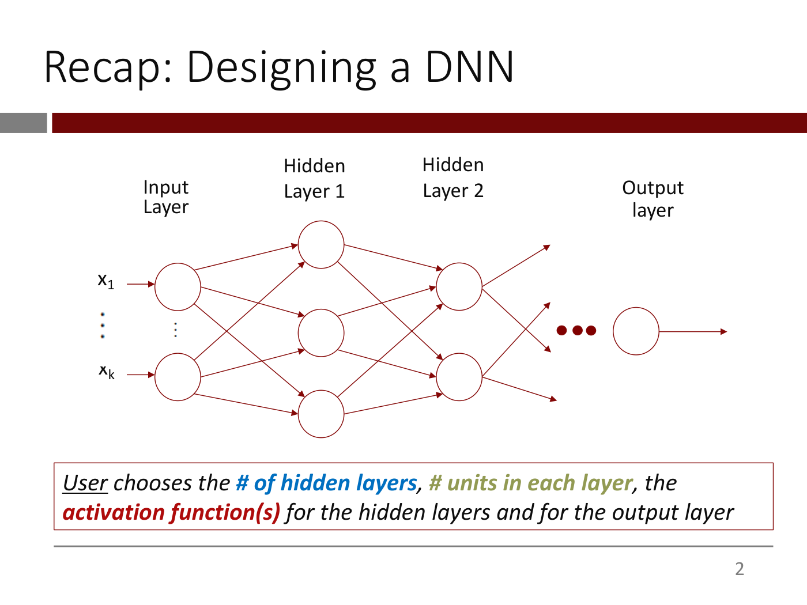

Network diagram: columns labelled "Input Layer", "Hidden Layer 1", "Hidden Layer 2", "Output layer". Input layer: two circles with inputs $x_1$ and $x_k$ (arrows in from the left), with vertical dots between. Hidden layer 1: three circles. Hidden layer 2: two circles. Every node is connected by arrows to every node of the next layer. Hidden layer 2's nodes have outgoing arrows that point to a gap marked with three red dots ("•••"), followed by a single output-layer circle with an arrow out to the right.

Boxed text at bottom: "*User* chooses the **# of hidden layers** (blue), **# units in each layer** (olive green), the **activation function(s)** (red) for the hidden layers and for the output layer" ("User" underlined).

*Figure: yes — generic deep network diagram (input, two hidden layers, output)*

## Slide 3 — Application: Predicting heart disease

Section divider: white text "Application: Predicting heart disease" on a dark red band with a grey block at the left.

*Figure: no*

## Slide 4 — Predicting Heart Disease

"Using a dataset of patients made available by the Cleveland Clinic, we will build our first NN model to predict if a patient has been diagnosed with heart disease from demographics and bio-markers"

Right: a table of the dataset's columns (reproduced below). The last row ("Target") is circled by a red ellipse. At the bottom left, in italics: "What we want to predict" (pointing to the circled Target row).

| Column | Description | Feature Type |
| --- | --- | --- |
| Age | Age in years | Numerical |
| Sex | (1 = male; 0 = female) | Categorical |
| CP | Chest pain type (0, 1, 2, 3, 4) | Categorical |
| Trestbpd | Resting blood pressure (in mm Hg on admission) | Numerical |
| Chol | Serum cholesterol in mg/dl | Numerical |
| FBS | fasting blood sugar in 120 mg/dl (1 = true; 0 = false) | Categorical |
| RestECG | Resting electrocardiogram results (0, 1, 2) | Categorical |
| Thalach | Maximum heart rate achieved | Numerical |
| Exang | Exercise induced angina (1 = yes; 0 = no) | Categorical |
| Oldpeak | ST depression induced by exercise relative to rest | Numerical |
| Slope | Slope of the peak exercise ST segment | Numerical |
| CA | Number of major vessels (0-3) colored by fluoroscopy | Both numerical & categorical |
| Thal | 3 = normal; 6 = fixed defect; 7 = reversible defect | Categorical |
| Target | Diagnosis of heart disease (1 = true; 0 = false) | Target |

*Figure: yes — dataset column table with the Target row circled*

## Slide 5 — Let's design our NN

- We design i.e., "lay out" the network
  - Choose *the number of hidden layers* (blue bold italic) and *the number of 'neurons' in each layer* (olive green bold italic)
  - Pick the *right output layer* (red bold italic) based on the type of the output

*Figure: no*

## Slide 6 — Let's design our NN

Same bullets as slide 5:
- We design i.e., "lay out" the network
  - Choose *the number of hidden layers* and *the number of 'neurons' in each layer* — red text to the right: "1 hidden layer with 16 ReLU neurons"
  - Pick the *right output layer* based on the type of the output — red text below, to the right: "Sigmoid"

*Build step: adds the red answers "1 hidden layer with 16 ReLU neurons" and "Sigmoid" relative to slide 5.*

*Figure: no*

## Slide 7 — Let's visualize this NN

Left: label "Input Layer" above two circles, $x_1$ at top and $x_{29}$ at bottom, with three vertical red dots between them. Right: the dataset table of slide 4 (same 14 rows, Age ... Target) with a red rectangle drawn around the first 13 rows (Age through Thal), excluding the Target row.

Text below: "There are only 13 input variables but some of them are categorical so we one-hot-encode them, resulting in 29 inputs (details in colab)."

*Figure: yes — 29 input nodes beside the dataset table with the 13 input rows boxed in red*

## Slide 8 — Let's visualize this NN

Three columns, no edges drawn. "Input Layer": circles $x_1$ ... $x_{29}$ with three vertical red dots between. "Hidden layer (16 units)": two visible circles, each containing a ReLU hinge icon, with three vertical red dots between them. "Output layer": one circle containing a sigmoid S-curve icon with an output arrow labelled "y".

*Build step: replaces the dataset table of slide 7 with the hidden layer (16 ReLU units) and the sigmoid output node.*

*Figure: yes — input, 16-unit ReLU hidden layer and sigmoid output nodes (no edges)*

## Slide 9 — Let's visualize this NN

Same drawing as slide 8. Red text at bottom: "How many parameters (i.e., weights and biases) does this network have?"

*Build step: adds the parameter-count question relative to slide 8.*

*Figure: yes — input, 16-unit ReLU hidden layer and sigmoid output nodes (no edges)*

## Slide 10 — Let's visualize this NN

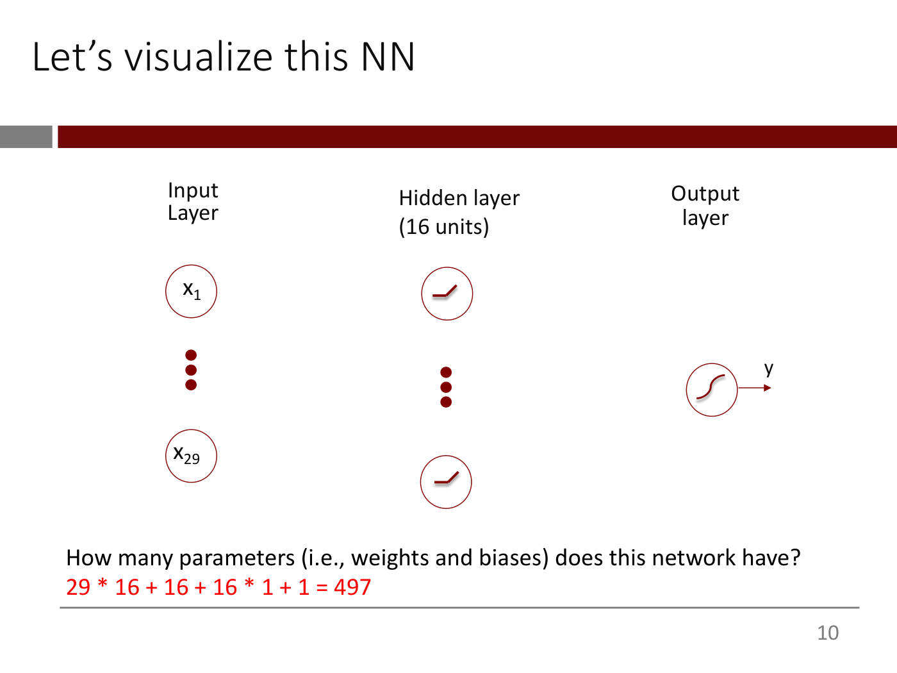

Same drawing as slide 8. Text at bottom: "How many parameters (i.e., weights and biases) does this network have?" (black) and, in red below: "29 * 16 + 16 + 16 * 1 + 1 = 497".

*Build step: adds the answer 497 relative to slide 9.*

*Figure: yes — input, 16-unit ReLU hidden layer and sigmoid output nodes (no edges)*

## Slide 11 — We will now "translate" this network into Keras code

"We will now "translate" this network into Keras code to demonstrate how easy it is."

"We will give a fuller intro to Keras/Tensorflow <u>and</u> train this model in Colab soon." ("and" underlined).

*Figure: no*

## Slide 12 — Typically, we define each layer from left to right

The three-column drawing of slide 8 (Input Layer $x_1$ ... $x_{29}$; Hidden layer (16 units) with ReLU icons; Output layer with sigmoid icon and "y"), no code yet.

*Figure: yes — input, 16-unit ReLU hidden layer and sigmoid output nodes (no edges)*

## Slide 13 — Let's start with the input layer

Same drawing. Red code under the input layer:

```python
input = keras.Input(shape=29)
```

*Build step: adds the input-layer code relative to slide 12.*

*Figure: yes — network drawing with input-layer code*

## Slide 14 — We specify the shape of the input

Same drawing and code; in `keras.Input(shape=29)` the argument `shape=29` is red (the rest black).

```python
input = keras.Input(shape=29)
```

*Build step: highlights `shape=29` in red relative to slide 13.*

*Figure: yes — network drawing with input-layer code*

## Slide 15 — Next, we define the hidden layer

Same drawing. The input code is greyed out. New red code, placed under the hidden layer:

```python
input = keras.Input(shape=29)
keras.layers.Dense(16, activation="relu")
```

(The first line is grey, the second red; the slide prints the quotes as curly quotes “relu”.)

*Build step: adds the hidden-layer line relative to slide 14.*

*Figure: yes — network drawing with hidden-layer code*

## Slide 16 — Since this layer is fully connected to the previous and later layers, we use 'Dense'

Same drawing and code as slide 15; the word `Dense` is red, the rest of the line black, the input line grey.

```python
keras.layers.Dense(16, activation="relu")
```

*Build step: highlights `Dense` relative to slide 15.*

*Figure: yes — network drawing with hidden-layer code*

## Slide 17 — We specify the number of neurons we want in this layer ...

Same; the number `16` is red.

```python
keras.layers.Dense(16, activation="relu")
```

*Build step: highlights `16` relative to slide 16.*

*Figure: yes — network drawing with hidden-layer code*

## Slide 18 — ... and the activation function

Same; `activation="relu"` is red.

```python
keras.layers.Dense(16, activation="relu")
```

*Build step: highlights `activation="relu"` relative to slide 17.*

*Figure: yes — network drawing with hidden-layer code*

## Slide 19 — Next, we "feed" the input to this layer ...

Same; the code now ends with `(input)`, in red.

```python
keras.layers.Dense(16, activation="relu")(input)
```

*Build step: adds the call `(input)` (red) relative to slide 18.*

*Figure: yes — network drawing with hidden-layer code*

## Slide 20 — ... and give a name to the output of this layer

Same; the code now begins with `h = ` where `h` is red.

```python
h = keras.layers.Dense(16, activation="relu")(input)
```

*Build step: adds the name `h =` (red) relative to slide 19.*

*Figure: yes — network drawing with hidden-layer code*

## Slide 21 — Finally, we come to the output layer

Same three-column drawing as slide 12 (Input Layer $x_1$ ... $x_{29}$; Hidden layer (16 units) with ReLU icons; Output layer with sigmoid icon and output arrow "y"). The two earlier code lines are greyed out; a new red line sits under the output layer:

```python
input = keras.Input(shape=29)
h = keras.layers.Dense(16, activation="relu")(input)
keras.layers.Dense(1, activation="sigmoid")
```

(Grey: the first two lines. Red: the third. The slide prints mixed quotes: a straight opening quote and a curly closing quote around sigmoid.)

*Build step: adds the output-layer line relative to slide 20.*

*Figure: yes — network drawing with output-layer code*

## Slide 22 — We have just one unit in this layer ...

Same drawing and code as slide 21, the new line now black with the number `1` in red; the first two lines stay grey.

```python
keras.layers.Dense(1, activation="sigmoid")
```

*Build step: highlights `1` relative to slide 21.*

*Figure: yes — network drawing with output-layer code*

## Slide 23 — ... and indicate that we need a sigmoid activation function

Same; `activation="sigmoid"` is red.

```python
keras.layers.Dense(1, activation="sigmoid")
```

*Build step: highlights `activation="sigmoid"` relative to slide 22.*

*Figure: yes — network drawing with output-layer code*

## Slide 24 — As we did before, we "feed" the output of the hidden layer to this layer ...

Same; the line now ends with `(h)` in red.

```python
keras.layers.Dense(1, activation="sigmoid")(h)
```

*Build step: adds the call `(h)` (red) relative to slide 23.*

*Figure: yes — network drawing with output-layer code*

## Slide 25 — ... and give the output of this layer a name.

Same; the line now begins with `output = ` where `output` is red.

```python
output = keras.layers.Dense(1, activation="sigmoid")(h)
```

*Build step: adds the name `output =` (red) relative to slide 24.*

*Figure: yes — network drawing with output-layer code*

## Slide 26 — We have defined and connected the layers

The same drawing, positioned slightly higher, with all three code lines now in black (none greyed):

```python
input = keras.Input(shape=29)
h = keras.layers.Dense(16, activation="relu")(input)
output = keras.layers.Dense(1, activation="sigmoid")(h)
```

*Build step: all three lines shown in black relative to slide 25.*

*Figure: yes — network drawing with the three layer-definition lines*

## Slide 27 — We have defined and connected the layers. The final step is to formally define a model.


The title's first sentence ("We have defined and connected the layers.") is greyed, the second ("The final step is to formally define a model.") is black. Same drawing. The code is enclosed in a thin red-bordered box; the last line is new and red:

```python
input = keras.Input(shape=29)
h = keras.layers.Dense(16, activation="relu")(input)
output = keras.layers.Dense(1, activation="sigmoid")(h)
model = keras.Model(input, output)
```

*Build step: adds the box and the `model = keras.Model(input, output)` line (red) relative to slide 26.*

*Figure: yes — network drawing with complete model code*

## Slide 28 — That's it!

Italic caption: "A Neural Model for Heart Disease Prediction". Boxed code (red border, all black):

```python
input = keras.Input(shape=29)
h = keras.layers.Dense(16, activation="relu")(input)
output = keras.layers.Dense(1, activation="sigmoid")(h)
model = keras.Model(input, output)
```

Large text below: "We will show how to train this model with real data and use it for prediction after we cover some *conceptual* building blocks" ("conceptual" in italics).

*Figure: no*

## Slide 29 — Training a Deep Neural Network

Section divider: white text "Training a Deep Neural Network" on a dark red band with a grey block at the left.

*Figure: no*

## Slide 30 — Recap: Training Linear and Logistic Regression Models

Label "Linear Regression". A boxed equation on the left, the text "+ Data", a dark red right-pointing arrow labelled "lm", and a boxed equation on the right:

$$y = \beta_0 + \beta_1 x_1 + \beta_2 x_2 + \ldots + \beta_n x_n$$

$$y = 2.8 + 0.89 x_1 - 3.9 x_2 + \ldots + 1.06 x_n$$

*Figure: no*

## Slide 31 — Recap: Training Linear and Logistic Regression Models

Same as slide 30, with a second row. Label "Logistic Regression". Left box, "+ Data", a dark red arrow labelled "glm", right box:

$$y = \frac{1}{1 + e^{-(\beta_0 + \beta_1 x_1 + \beta_2 x_2 + \ldots + \beta_n x_n)}}$$

$$y = \frac{1}{1 + e^{-(2.8 + 0.89 x_1 - 3.9 x_2 + \ldots + 1.06 x_n)}}$$

*Build step: adds the logistic regression row relative to slide 30.*

*Figure: no*

## Slide 32 — Recap: Training Linear and Logistic Regression Models

Same two rows as slide 31 (linear regression with "lm", logistic regression with "glm"). New text below: "Recall"

- Training is finding values for the weights/coefficients so that the model's predictions come as close to the actual values as possible
- 'lm' and 'glm' use optimization algorithms under the hood to find these "best" values

*Build step: adds the "Recall" bullets relative to slide 31.*

*Figure: no*

## Slide 33 — Training a DNN

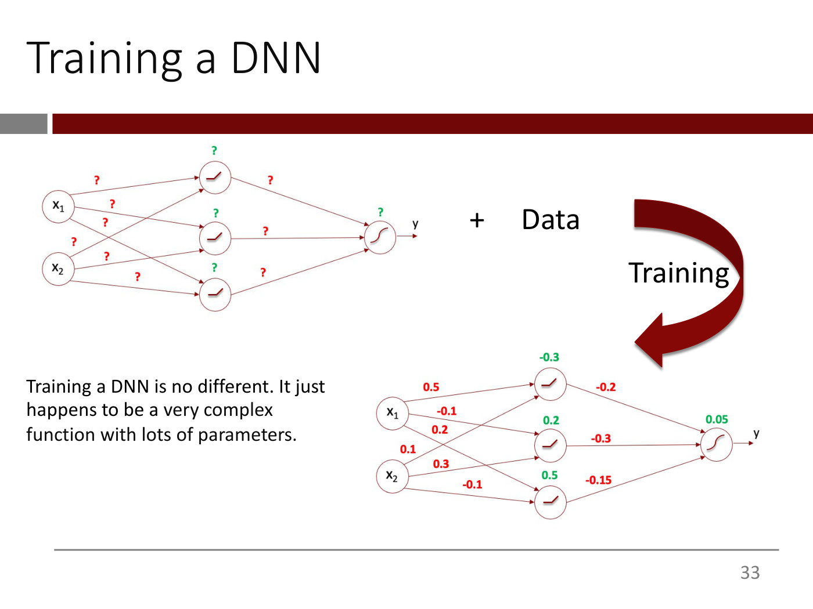

Top left: a network with inputs $x_1$, $x_2$; three hidden units (ReLU icons); one sigmoid output unit with an arrow "y". Every input connects to every hidden unit, every hidden unit to the output. Each of the nine edges is labelled with a red "?" and each of the four neurons (three hidden, one output) has a green "?" above it. To its right: "+" and "Data". A large dark red curved arrow labelled "Training" runs from the top network down to a second network at the bottom right, which has the same structure with the "?" replaced by numbers: red edge weights and green neuron biases.

Bottom network: green values above the hidden units: -0.3 (top), 0.2 (middle), 0.5 (bottom); green value above the output unit: 0.05. Red edge labels from the inputs to the hidden units, as placed on the page: 0.5, -0.1, 0.2, 0.1, 0.3, -0.1. These are exactly the values of the trained network on lecture 1's slide 100, whose transcription assigns them as $x_1$ → top, middle, bottom hidden = 0.5, −0.1, 0.2 and $x_2$ → top, middle, bottom hidden = 0.1, 0.3, −0.1. Red edge labels from hidden units to output: -0.2 (top), -0.3 (middle), -0.15 (bottom).

Text at left: "Training a DNN is no different. It just happens to be a very complex function with lots of parameters."

*Figure: yes — untrained network (all weights/biases "?") and trained network with numeric weights/biases, linked by a "Training" arrow*

## Slide 34 — (untitled)

Large text, with red emphasis shown here in bold: "The essence of training is to find the "**best**" values for the weights and biases i.e., those that **minimize a function that measures the discrepancy** between the actual and predicted values"

"These functions are called **loss functions** in the DL world"

*Figure: no*

## Slide 35 — Loss Functions

Section divider: white text "Loss Functions" on a dark red band with a grey block at the left.

*Figure: no*

## Slide 36 — Loss functions

- A "loss function" is a function that quantifies the error in a model's prediction.
  - If the predictions are close to the actual values, the "loss" would be _____. (blank in red)
  - A perfect model would have a loss of _____. (blank in red)

*Figure: no*

## Slide 37 — Loss functions

- A "loss function" is a function that quantifies the error in a model's prediction.
  - If the predictions are close to the actual values, the "loss" would be small. ("small" in red)
  - A perfect model would have a loss of zero. ("zero" in red)

*Build step: fills the blanks with "small" and "zero" relative to slide 36.*

*Figure: no*

## Slide 38 — Loss functions

The three bullets of slide 37 are greyed out. A new black bullet:

- In linear regression, you will recall that we quantify this error using "sum of squared errors". So, "sum of squared errors" is the loss function used in linear regression

*Build step: adds the linear regression bullet relative to slide 37.*

*Figure: no*

## Slide 39 — Loss functions

The earlier bullets are greyed out. A new black bullet:

- The loss function we chose must be matched well with the kind of output that comes out of the model.

*Build step: adds the matching bullet relative to slide 38.*

*Figure: no*

## Slide 40 — Mean Squared Error (MSE) Loss is commonly used for general numerical outputs

Centred formula:

$$\frac{1}{n}\sum_{i=1}^{n}\left(y^i - model(x^i)\right)^2$$

Two red arrows point up at the formula from labels below: under $y^i$, "Actual value of i^th data point"; under $model(x^i)$, "Predicted value of i^th data point" ("th" superscript in both).

*Figure: no*

## Slide 41 — (untitled)

Large text: "In the Heart Disease Prediction Model the prediction is a probability number and the actual output is 0-1."

"What is a good loss function in this situation?"

*Figure: no*

## Slide 42 — For data points with y = 1 (i.e., patients with heart disease), lower predicted probabilities should have higher loss

Title with "with" underlined, and "lower" and "higher" in red. A line plot (axes drawn in the style of a Mathematica plot): y-axis label "Loss" (placed left of the axis), y ticks -1, 1, 2, 3; x-axis label "Predicted" (placed below the axis), x ticks at the far left (printed "1", presumably a clipped "-1") and at the right end "1".

- One curve (blue/purple): starts near $y \approx 2.9$ at $x = 0$ (hugging the y-axis, just right of it) and falls steeply then more gently, convex, to $y = 0$ at $x = 1$ on the right.

Caption below in italics: "For data points with y = 1".

*Figure: yes — plot of loss against predicted probability for y = 1, decreasing from about 3 at 0 to 0 at 1*

## Slide 43 — We can capture this requirement using the log function

Same plot as slide 42, with its x-axis label now "Predicted probability" (y-axis label "Loss"; same single decreasing curve from about 2.9 at $x=0$ to 0 at $x=1$). Right: a table.

| Predicted probability | -log(predicted probability) |
| --- | --- |
| 1/1000 | 9.97 |
| 1/10 | 3.32 |
| 1/2 | 1.0 |
| 1 | 0.0 |

Caption below: "For data points with y = 1," (black italic) and "loss = -log(predicted probability)" (red italic).

*Build step: adds the table and the loss formula caption, and renames the x-axis label, relative to slide 42.*

*Figure: yes — decreasing loss curve for y = 1 beside a table of -log values*

## Slide 44 — For data points with y = 0 (i.e., patients without heart disease), higher predicted probabilities should have higher loss

Title with "without" underlined, and both "higher" in red. A plot on the right side of the slide: y-axis label "Loss" (left of axis, no numbered ticks), x-axis label "Predicted probability" (below), a single tick labelled "1" on the x-axis.

- One curve (blue/purple): starts at $y = 0$ at $x = 0$ (the origin) and rises, convex, slowly at first and then very steeply, going off the top of the plot as $x$ approaches 1.

Caption below in italics: "For data points with y = 0".

*Figure: yes — plot of loss against predicted probability for y = 0, increasing from 0 at 0 and rising steeply near 1*

## Slide 45 — We can capture this requirement as well using the log function

Left: a table.

| Predicted probability | -log(1 - predicted probability) |
| --- | --- |
| 1/1000 | 0.001 |
| 1/10 | 0.15 |
| 1/2 | 1.0 |
| 0.999999 | 19.93 |

Right: the same y = 0 plot as slide 44 (increasing curve from the origin, steep near $x = 1$; labels "Loss", "Predicted probability"). Caption below: "For data points with y = 0," (black italic) and "loss = -log(1 - predicted probability" (red italic; the closing bracket is cut off by the right edge of the slide) [sic: closing parenthesis not visible].

*Build step: adds the table and loss formula caption relative to slide 44.*

*Figure: yes — increasing loss curve for y = 0 beside a table of -log(1 - p) values*

## Slide 46 — Summary

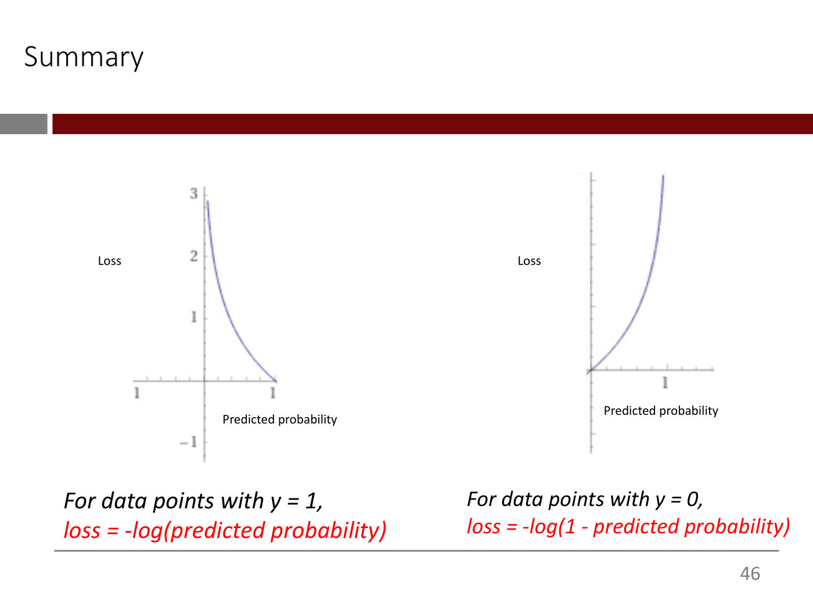

Two plots side by side, as on slides 43 and 45 (without the tables).

- Left plot: "Loss" y-axis (ticks -1, 1, 2, 3), "Predicted probability" x-axis; one decreasing curve from about 2.9 at $x = 0$ to 0 at $x = 1$. Caption: "For data points with y = 1," (black italic), "loss = -log(predicted probability)" (red italic).
- Right plot: "Loss" y-axis, "Predicted probability" x-axis with tick "1"; one increasing curve from 0 at $x = 0$ rising steeply toward the top as $x$ approaches 1. Caption: "For data points with y = 0," (black italic), "loss = -log(1 - predicted probability)" (red italic).

*Figure: yes — the two loss curves (y = 1 decreasing, y = 0 increasing) side by side*

## Slide 47 — This can be compactly written as a single expression

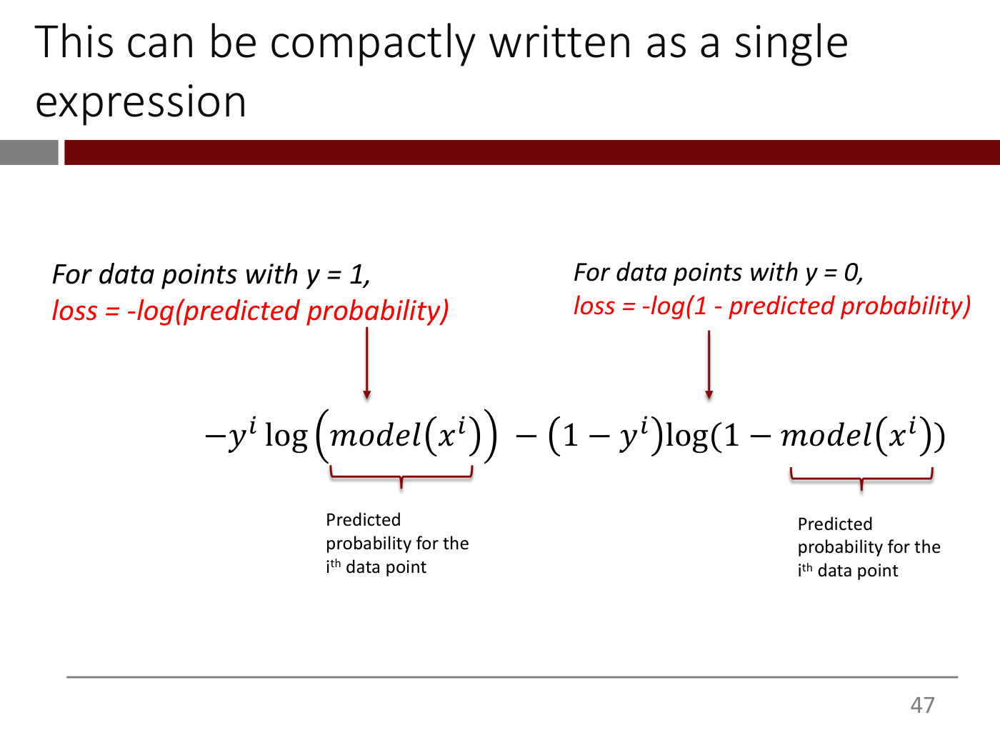

Top left (italic): "For data points with y = 1," and, in red, "loss = -log(predicted probability)". Top right: "For data points with y = 0," and, in red, "loss = -log(1 - predicted probability)". A dark red arrow runs down from each caption to the corresponding term of the formula:

$$-y^i \log\left(model(x^i)\right) - (1 - y^i)\log\left(1 - model(x^i)\right)$$

A red brace under $model(x^i)$ in the first term is labelled "Predicted probability for the i^th data point"; another red brace under $model(x^i)$ in the second term has the same label ("th" superscript in both). The first caption's arrow points at the first term, the second caption's arrow at the second term.

*Figure: yes — formula with captions, arrows and braces annotating its two terms*

## Slide 48 — We can now average this across all n data points

Formula, with the prefactor $\frac{1}{n}\sum_{i=1}^{n}$ enclosed in a red dashed rounded box:

$$\frac{1}{n}\sum_{i=1}^{n} -y^i \log\left(model(x^i)\right) - (1 - y^i)\log\left(1 - model(x^i)\right)$$

*Build step: adds the averaging (1/n)Σ (boxed in red dashes) to the expression of slide 47, and removes the captions.*

*Figure: no*

## Slide 49 — This is the Binary Cross-Entropy Loss function!

Title with "Binary Cross-Entropy" in red. Formula, with no box:

$$\frac{1}{n}\sum_{i=1}^{n} -y^i \log\left(model(x^i)\right) - (1 - y^i)\log\left(1 - model(x^i)\right)$$

*Figure: no*

## Slide 50 — Minimizing loss functions

Section divider: white text "Minimizing loss functions" on a dark red band with a grey block at the left. (Printed page number: 51.)

*Figure: no*

## Slide 51 — Minimizing functions

- Loss functions are just a particular kind of function so we will first consider the general problem of minimizing an arbitrary function
- After we develop some intuition about how to do this, we will return to the specific task of minimizing a loss function

(Printed page number: 52.)

*Figure: no*

## Slide 52 — Minimizing a single-variable function

"Let's say we want to minimize the function:"

$$g(w) = \frac{1}{50}\left(w^4 + w^2 + 10w\right)$$

"How can we go about this?"

Right: a plot of $g(w)$ with axes labelled $y$ (ticks 1 to 6) and $w$ (ticks -4, -2, 2, 4), and the note "(w from -3.9 to 3.9)" at its right.

- One curve (blue/purple): a U shape, about 4.5 at $w = -4$ (left edge), falling to a shallow minimum just below zero near $w \approx -1.3$ (by the formula, $g \approx -0.17$ at $w \approx -1.23$), crossing 0 near $w = 0$, then rising slowly and then steeply to about 6 at $w = 4$.

Footer URL (printed as text): https://kenndanielso.github.io/mlrefined/blog_posts/6_First_order_methods/6_4_Gradient_descent.html (Printed page number: 53.)

*Figure: yes — plot of g(w) = (w^4 + w^2 + 10w)/50 over w from -3.9 to 3.9*

## Slide 53 — Minimizing a single-variable function

Same text, equation and $g(w)$ plot as slide 52, but the question now reads "Can we use its derivative?" Below it:

$$\frac{\partial}{\partial w} g(w) = \frac{2}{25}w^3 + \frac{1}{25}w + \frac{1}{5}$$

To the right, below the first plot, a second smaller plot of the derivative, with axes $y$ (ticks -1.0, -0.5, 0.5, 1.0, 1.5) and $w$ (ticks -2, -1, 1, 2) and the note "(w from -2.5 to 2.5)".

- One curve (blue/purple), the derivative: negative at the left edge (about $-1.1$ at $w = -2.5$), crossing 0 near $w \approx -1.3$, flattening to about 0.2 near $w = 0$, then rising to about 1.5 at the right edge ($w = 2.5$).

Footer URL as on slide 52. (Printed page number: 54.)

*Build step: replaces the question and adds the derivative equation and derivative plot relative to slide 52.*

*Figure: yes — plots of g(w) and of its derivative*

## Slide 54 — Minimizing a single-variable function

Same as slide 53, but the question is in red: "What does the derivative at a point tell us?" Same $g(w)$ equation and plot, same derivative equation and plot, same footer URL. (Printed page number: 55.)

*Build step: changes the question to "What does the derivative at a point tell us?" (red) relative to slide 53.*

*Figure: yes — plots of g(w) and of its derivative*

## Slide 55 — Minimizing a single-variable function

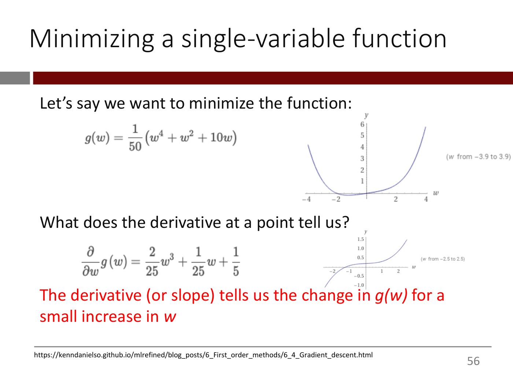

Same as slide 54 (the question is now black), with a new red sentence below the derivative equation: "The derivative (or slope) tells us the change in *g(w)* for a small increase in *w*" ($g(w)$ and $w$ in italics). Same plots and footer URL. (Printed page number: 56.)

*Build step: adds the red sentence about the derivative relative to slide 54.*

*Figure: yes — plots of g(w) and of its derivative*

## Slide 56 — The value of knowing the derivative

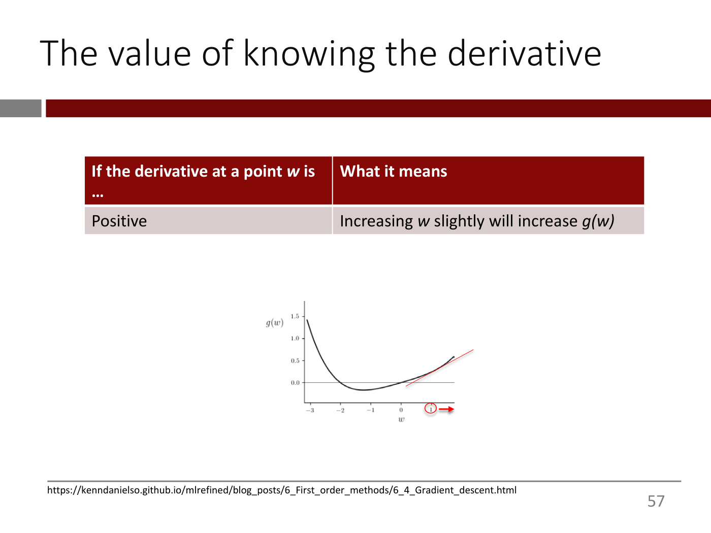

Table:

| If the derivative at a point *w* is ... | What it means |
| --- | --- |
| Positive | Increasing *w* slightly will increase *g(w)* |

Below, centred, a plot of $g(w)$ (y-axis label $g(w)$, ticks 0.0, 0.5, 1.0, 1.5; x-axis label $w$, ticks -3, -2, -1, 0, 1).

- One black curve: about 1.4 at $w = -3$, falling to a minimum of about $-0.2$ near $w \approx -1.3$, crossing 0 near $w = 0$ and rising to about 0.6 at the right edge.
- A thin red line tangent to the curve at a point on the right branch (around $w \approx 1.5$), sloping upward.
- A red circle on the x-axis below that point, with a red arrow beside it pointing right (towards increasing $w$).

Footer URL as on slide 52. (Printed page number: 57.)

*Figure: yes — plot of g(w) with an upward-sloping tangent at a right-hand point and an arrow towards increasing w*

## Slide 57 — The value of knowing the derivative

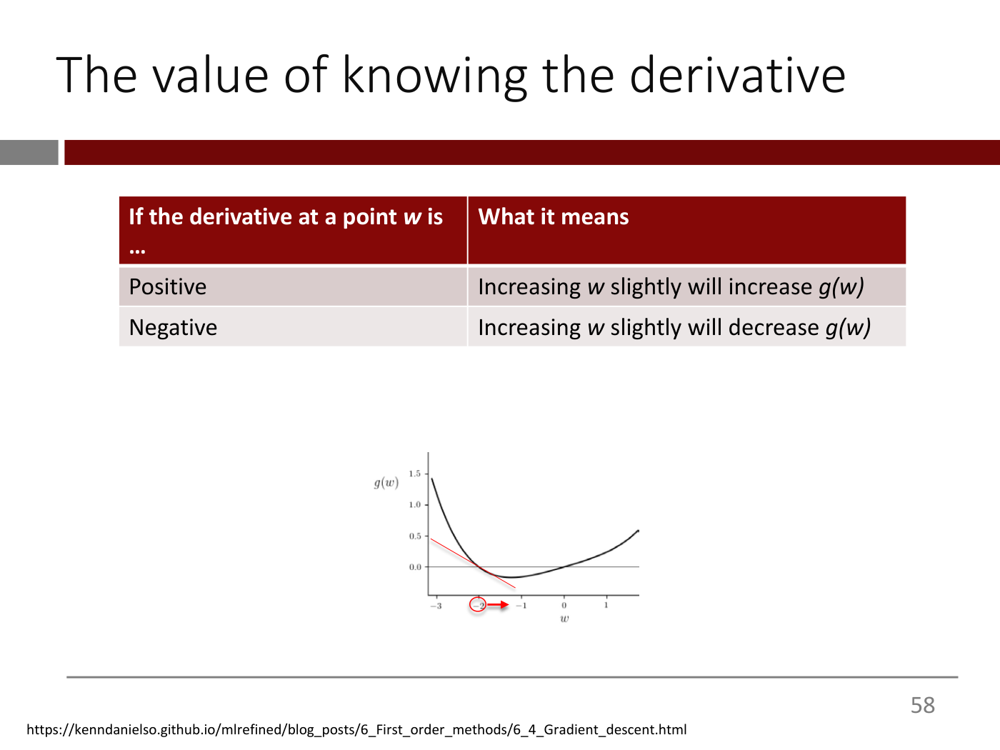

Table:

| If the derivative at a point *w* is ... | What it means |
| --- | --- |
| Positive | Increasing *w* slightly will increase *g(w)* |
| Negative | Increasing *w* slightly will decrease *g(w)* |

Same $g(w)$ plot as slide 56 (same black curve, axes and ticks), but now:

- A thin red tangent line, sloping downward, touches the curve at a point on the left branch (around $w \approx -2$, where $g \approx 0$).
- A red circle on the x-axis below that point (around $w \approx -2$) with a red arrow beside it pointing right.

Footer URL as on slide 52. (Printed page number: 58.)

*Build step: adds the "Negative" row and moves the tangent, circle and arrow to the left branch relative to slide 56.*

*Figure: yes — plot of g(w) with a downward-sloping tangent at a left-hand point and an arrow towards increasing w*

## Slide 58 — The value of knowing the derivative

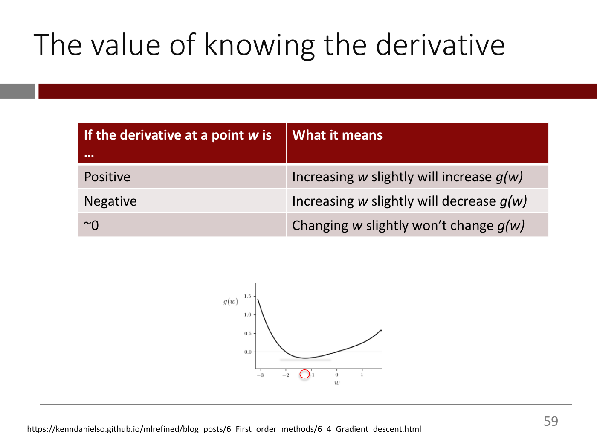

Table:

| If the derivative at a point *w* is ... | What it means |
| --- | --- |
| Positive | Increasing *w* slightly will increase *g(w)* |
| Negative | Increasing *w* slightly will decrease *g(w)* |
| ~0 | Changing *w* slightly won't change *g(w)* |

Same $g(w)$ plot as slide 56, but now:

- A short horizontal red line touches the curve at its minimum (around $w \approx -1.3$, $g \approx -0.2$).
- A red circle on the x-axis below that point (around $w \approx -1.3$); no arrow.

Footer URL as on slide 52. (Printed page number: 59.)

*Build step: adds the "~0" row and moves the marker to the minimum, with a horizontal tangent, relative to slide 57.*

*Figure: yes — plot of g(w) with a horizontal tangent at the minimum*

## Slide 59 — This suggests an algorithm for minimizing g(w)

Title: "This suggests an algorithm for minimizing $g(w)$" (two lines).

1. Start with some point $w$

*Figure: no*

## Slide 60 — This suggests an algorithm for minimizing g(w)

1. Start with some point $w$
2. Calculate the derivative (i.e., slope) of $g(w)$ at $w$

*Build step: adds item 2 relative to slide 59.*

*Figure: no*

## Slide 61 — This suggests an algorithm for minimizing g(w)

1. Start with some point $w$
2. Calculate the derivative (i.e., slope) of $g(w)$ at $w$

Below item 2, a table with a dark red header row:

| If the derivative is … | What it means | Since we want to minimize loss, do this … |
| --- | --- | --- |
| Positive | Increasing *w* will increase the loss function | _______ w slightly |
| Negative | Increasing *w* will decrease the loss function | _______ w slightly |
| ~0 | Changing *w* won't change the loss function | _______ |

*Build step: adds the table, with the third column left as blanks, relative to slide 60.*

*Figure: yes — three-column table with blanks to fill in (derivative sign, meaning, action)*

## Slide 62 — This suggests an algorithm for minimizing g(w)

Same list and table as slide 61, with the blanks filled in (red text):

1. Start with some point $w$
2. Calculate the derivative (i.e., slope) of $g(w)$ at $w$

| If the derivative is … | What it means | Since we want to minimize loss, do this … |
| --- | --- | --- |
| Positive | Increasing *w* will increase the loss function | Reduce w slightly |
| Negative | Increasing *w* will decrease the loss function | Increase w slightly |
| ~0 | Changing *w* won't change the loss function | Stop |

(In the third column "Reduce", "Increase" and "Stop" are red.)

*Build step: fills the blanks with "Reduce", "Increase" and "Stop" (red) relative to slide 61.*

*Figure: yes — three-column table of derivative sign, meaning and action*

## Slide 63 — This suggests an algorithm for minimizing g(w)

Same list and table as slide 62, now all black. Adds, in red:

3. If you have reached max iterations or run out of time, stop. Else, go to step 2

*Build step: adds item 3 (red) relative to slide 62.*

*Figure: yes — three-column table of derivative sign, meaning and action*

## Slide 64 — This is Gradient Descent!

1. Start with some point $w$
2. Calculate the derivative (i.e., slope) of $g(w)$ at $w$

Left, text: "This can be written compactly as", with a large curved dark-red arrow pointing from the text down to the equation below. The table of slide 63 is shown smaller (same three rows: Positive / Negative / ~0, same text as slide 63), and below it the displayed equation:

$$w \leftarrow w - \alpha \frac{dg(w)}{dw}$$

3. If you have reached max iterations or run out of time, stop. Else, go to step 2

*Figure: yes — the derivative table with a curved arrow to the gradient descent update rule*

## Slide 65 — Any guesses when Gradient Descent was invented?

Title-only slide: "Any guesses when Gradient Descent was invented?"

*Figure: no*

## Slide 66 — Gradient descent was invented in 1847 by Cauchy!

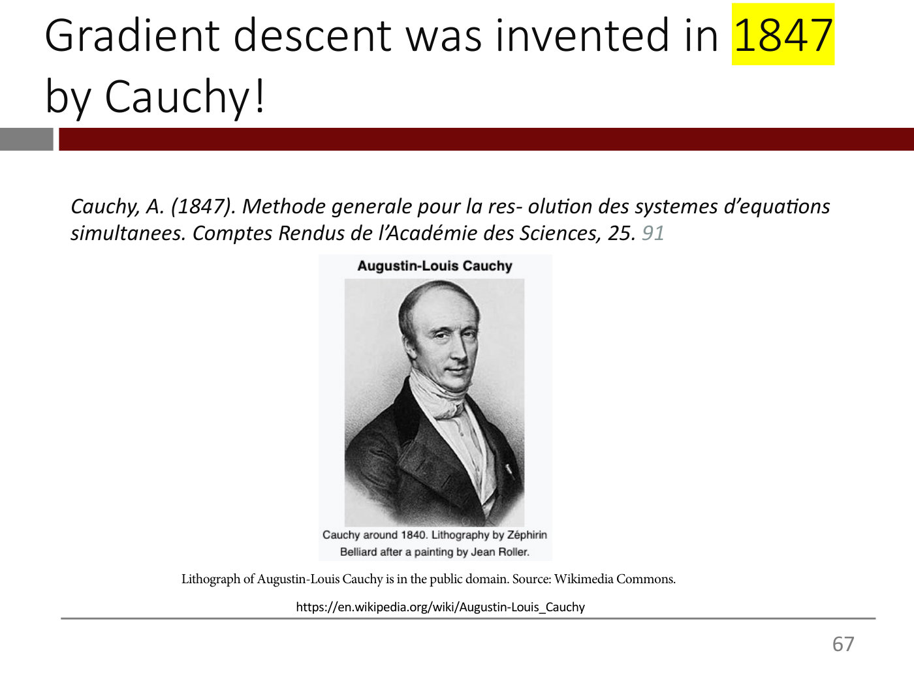

Title: "Gradient descent was invented in 1847 by Cauchy!" ("1847" highlighted yellow).

Citation (italic): "Cauchy, A. (1847). Methode generale pour la res- olution des systemes d'equations simultanees. Comptes Rendus de l'Académie des Sciences, 25. 91" (the "91" in grey).

Centre: a black-and-white lithograph portrait of Augustin-Louis Cauchy, head and shoulders, a man with swept-back hair in a dark coat and white cravat. Header text above the picture: "Augustin-Louis Cauchy". Caption under it: "Cauchy around 1840. Lithography by Zéphirin Belliard after a painting by Jean Roller."

Below: "Lithograph of Augustin-Louis Cauchy is in the public domain. Source: Wikimedia Commons." and the URL "https://en.wikipedia.org/wiki/Augustin-Louis_Cauchy".

*Figure: yes — portrait lithograph of Augustin-Louis Cauchy*

## Slide 67 — Gradient Descent

$$w \leftarrow w - \alpha \frac{dg(w)}{dw}$$

"α is called the "learning rate" and is our way of ensuring that we increase or decrease $w$ slightly" ("learning rate" and "slightly" in red).

"Typically set to small values (e.g., 0.1, 0.001, 0.0001) and determined by trial and error"

*Figure: no*

## Slide 68 — Let's apply this algorithm to g(w)

Left, two formulas:

$$g(w) = \frac{1}{50}\left(w^4 + w^2 + 10w\right)$$

$$\frac{\partial}{\partial w} g(w) = \frac{2}{25}w^3 + \frac{1}{25}w + \frac{1}{5}$$

Right, a small plot: horizontal axis $w$ labelled at −4, −2, 2, 4; vertical axis $y$ labelled 1 to 6. One thin blue-purple curve: starts at about $y = 4$ at $w = -4$, falls to a shallow minimum just below zero near $w \approx -1.5$, passes through the origin, then rises steeply to about $y = 6$ at $w \approx 4$. Grey annotation beside it: "(w from −3.9 to 3.9)".

Below, centred:

$$w \leftarrow w - \alpha \frac{dg(w)}{dw}$$

Footer URL: https://kenndanielso.github.io/mlrefined/blog_posts/6_First_order_methods/6_4_Gradient_descent.html

*Figure: yes — plot of the quartic g(w) for w from −3.9 to 3.9, with a shallow minimum near w = −1.5*

## Slide 69 — Gradient Descent in action

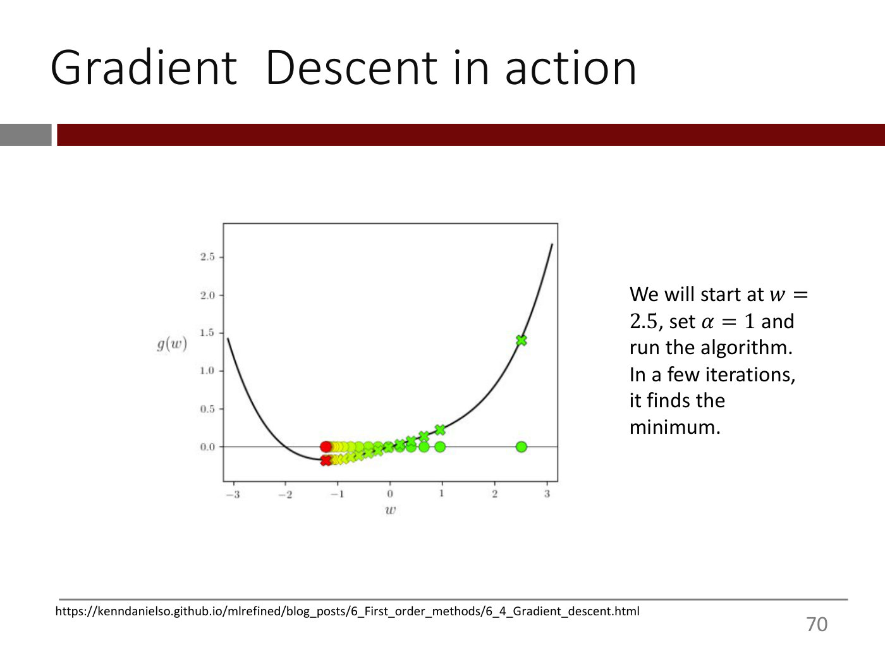

Left, a plot titled by the vertical axis label $g(w)$ (range 0.0 to about 2.5, ticks every 0.5) against horizontal axis $w$ (ticks −3 to 3). A black curve: from about 1.4 at $w = -3$, down to a minimum of about −0.17 near $w \approx -1.25$, then rising to about 2.6 at $w \approx 3$. A thin horizontal line at $g = 0$. Gradient descent steps are drawn twice, with the same colour scale (green at the start, through yellow, to red at the end):
- Circle markers lying on the $g = 0$ line, at $w = 2.5$ (green), then about 0.95, 0.65, 0.4, 0.15 (green), and crowding together through yellow towards $w \approx -1.25$, where the last circle is red.
- X markers on the curve itself at the same $w$ positions: green at about $(2.5, 1.4)$, then $(0.95, 0.22)$, $(0.65, 0.13)$, $(0.4, 0.07)$, and crowding through yellow down to a red X at about $(-1.25, -0.17)$.

Right, text: "We will start at $w = 2.5$, set $\alpha = 1$ and run the algorithm. In a few iterations, it finds the minimum."

Footer URL: https://kenndanielso.github.io/mlrefined/blog_posts/6_First_order_methods/6_4_Gradient_descent.html

*Figure: yes — gradient descent iterates (green to red) descending the 1-D curve g(w) to its minimum near w = −1.25*

## Slide 70 — Minimizing a multi-variable function

Title: "Minimizing a multi-variable function" ("multi" red).

$$g(w_1, w_2) = w_1^2 + w_2^2 + 2$$

"We can calculate the partial derivative of $g(w_1, w_2)$"

$$\left[\frac{\partial g}{\partial w_1}, \frac{\partial g}{\partial w_2}\right] = [2w_1, 2w_2]$$

"How should we interpret this?"

Footer URL: https://kenndanielso.github.io/mlrefined/blog_posts/6_First_order_methods/6_4_Gradient_descent.html

*Figure: no*

## Slide 71 — Minimizing a multi-variable function

$$g(w_1, w_2) = w_1^2 + w_2^2 + 2$$

$$\nabla g = \left[\frac{\partial g}{\partial w_1}, \frac{\partial g}{\partial w_2}\right] = [2w_1, 2w_2]$$

Red italic text: "The first number is the change in *g(w)* for a small increase in *w₁, with w₂ kept unchanged.* The second number is the change in *g(w)* for a small increase in *w₂, with w₁ kept unchanged*"

Footer URL: https://kenndanielso.github.io/mlrefined/blog_posts/6_First_order_methods/6_4_Gradient_descent.html

*Build step: replaces "How should we interpret this?" with the ∇g notation and the red interpretation, relative to slide 70.*

*Figure: no*

## Slide 72 — Minimizing a multi-variable function

Same as slide 71, plus, in red below the explanation: "This is called the "gradient" of $g(w_1, w_2)$ and written as $\nabla g$". A thin dark-red arrow runs from the $\nabla g$ equation's left bracket down-left into the explanation text.

$$g(w_1, w_2) = w_1^2 + w_2^2 + 2$$

$$\nabla g = \left[\frac{\partial g}{\partial w_1}, \frac{\partial g}{\partial w_2}\right] = [2w_1, 2w_2]$$

Footer URL: https://kenndanielso.github.io/mlrefined/blog_posts/6_First_order_methods/6_4_Gradient_descent.html

*Build step: adds the red "gradient" sentence and the arrow relative to slide 71.*

*Figure: no*

## Slide 73 — Minimizing a multi-variable function

$$\nabla g = \left[\frac{\partial g}{\partial w_1}, \frac{\partial g}{\partial w_2}\right] = [2w_1, 2w_2]$$

"We can simply do gradient descent on <u>each</u> coordinate by using the corresponding partial derivative." ("each" underlined)

$$w_1 \leftarrow w_1 - \alpha \left(\frac{\partial g}{\partial w_1}\right)$$

$$w_2 \leftarrow w_2 - \alpha \left(\frac{\partial g}{\partial w_2}\right)$$

Footer URL: https://kenndanielso.github.io/mlrefined/blog_posts/6_First_order_methods/6_4_Gradient_descent.html

*Figure: no*

## Slide 74 — Minimizing a multi-variable function

$$\nabla g = [2w_1, 2w_2]$$

$$w_1 \leftarrow w_1 - \alpha \left(\frac{\partial g}{\partial w_1}\right)$$

$$w_2 \leftarrow w_2 - \alpha \left(\frac{\partial g}{\partial w_2}\right)$$

"As before, this whole thing can be summarized compactly as:"

$$w \leftarrow w - \alpha \nabla g(w)$$

Footer URL: https://kenndanielso.github.io/mlrefined/blog_posts/6_First_order_methods/6_4_Gradient_descent.html

*Figure: no*

## Slide 75 — Gradient Descent in two dimensions

*OCW notice: © Jeremy Watt/neonwatty on GitHub (gradient descent figures). All rights reserved — excluded from the CC license.*

$$g(w_0, w_1) = w_0^2 + w_1^2 + 2$$

Left: a 3D surface plot titled $g(w_0, w_1)$, a bowl-shaped paraboloid drawn as a black wireframe, vertical axis ticks 0 to 20 (labelled 0, 5, 10, 15, 20); horizontal axes $w_1$ (−3 to 3) and $w_0$ (−3 to 3). On the floor plane under the bowl, a short diagonal run of green circles (starting green, ending red near the centre) marks the gradient descent path.

Right: a contour plot, axes $w_0$ (horizontal, −3 to 3) and $w_1$ (vertical, −3 to 3), concentric circular contours on a blue background (dark blue outside, lighter blue towards the centre, white-blue near the middle). A path of circles runs from about $(1.5, 2)$ at upper right toward the origin: green circles at about $(1.5, 2)$, $(0.9, 1.2)$, $(0.5, 0.7)$, then yellow-green circles crowding together, with a red circle at the centre $(0, 0)$. Open arrowheads between the first few points show the direction of each step.

Footer URL: https://kenndanielso.github.io/mlrefined/blog_posts/6_First_order_methods/6_4_Gradient_descent.html

Printed notice at the bottom: "Gradient descent figures © Jeremy Watt/neonwatty on GitHub. All rights reserved. This content is excluded from our Creative Commons license. For more information, see https://ocw.mit.edu/help/faq-fair-use."

*Figure: yes — 3D bowl surface and contour plot with the gradient descent path converging to the origin*

## Slide 76 — GD may stop near a local minimum

"GD may stop near a local minimum (not necessarily a global minimum) or a saddle point but we don't worry about this in practice."

*Figure: no*

## Slide 77 — Minimizing a loss function with gradient descent

Title: "Minimizing a loss function with gradient descent" ("loss function" red).

"*Minimize*" followed by

$$\frac{1}{n}\sum_{i=1}^{n} -y^i \log\left(model(x^i)\right) - (1 - y^i)\log(1 - model(x^i))$$

"What are the variables we need to change to minimize this function?"

*Figure: no*

## Slide 78 — Minimizing a loss function with gradient descent

Same as slide 77, plus in red: "They are the parameters "hiding" inside $model(x_i)$" [sic: subscript $x_i$ here, where the loss and slides 79–81 write $x^i$]

$$\frac{1}{n}\sum_{i=1}^{n} -y^i \log\left(model(x^i)\right) - (1 - y^i)\log(1 - model(x^i))$$

*Build step: adds the red answer relative to slide 77.*

*Figure: no*

## Slide 79 — Minimizing a loss function with gradient descent

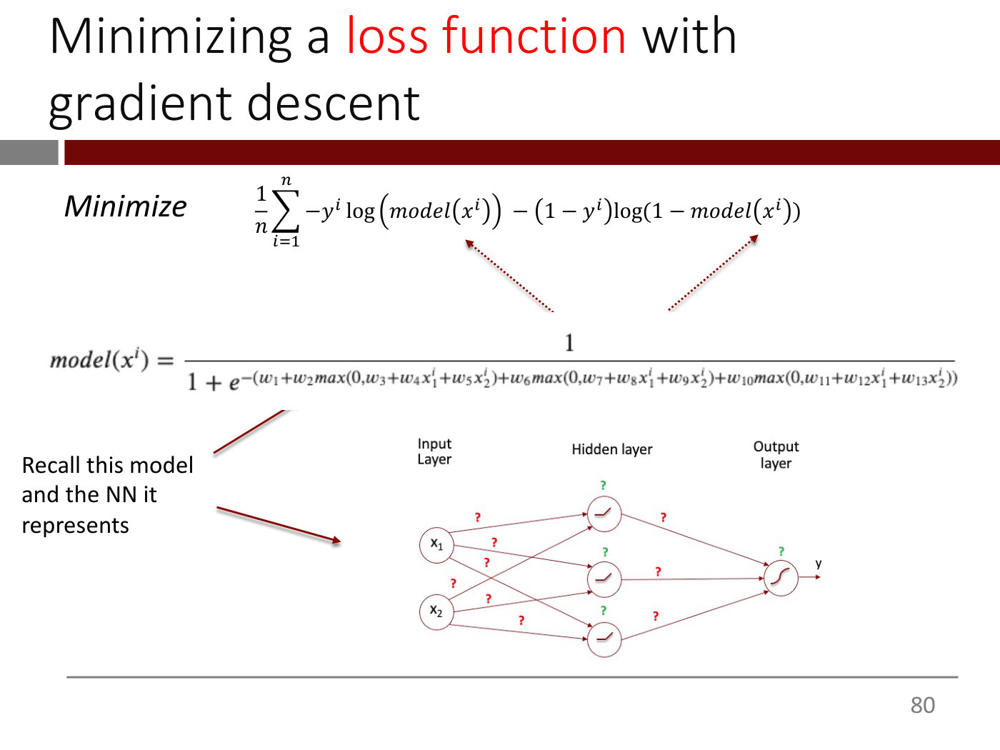

Title: "Minimizing a loss function with gradient descent" ("loss function" red).

"*Minimize*" followed by

$$\frac{1}{n}\sum_{i=1}^{n} -y^i \log\left(model(x^i)\right) - (1 - y^i)\log(1 - model(x^i))$$

Two dotted red arrows run up from the model expression below to the two occurrences of $model(x^i)$ in the loss.

Below, the model:

$$model(x^i) = \frac{1}{1 + e^{-(w_1 + w_2 \max(0, w_3 + w_4 x_1^i + w_5 x_2^i) + w_6 \max(0, w_7 + w_8 x_1^i + w_9 x_2^i) + w_{10}\max(0, w_{11} + w_{12} x_1^i + w_{13} x_2^i))}}$$

Left, text: "Recall this model and the NN it represents", with two dark-red arrows, one pointing at the model equation and one at the network diagram.

Network diagram (bottom right): column labels "Input Layer", "Hidden layer", "Output layer". Input layer: two circles $x_1$ and $x_2$. Hidden layer: three circles, each with a ReLU hinge icon. Output layer: one circle with a sigmoid icon and an arrow out labelled "y". Every input connects to every hidden node and every hidden node to the output; each arrow carries a red "?" (weight) and each hidden and output node has a green "?" (bias) beside it.

*Figure: yes — the 2-input, 3-hidden-ReLU, 1-sigmoid-output network with "?" on every weight and bias, beside the model equation*

## Slide 80 — Minimizing a loss function with gradient descent

Same loss, same model equation and the same two dotted red arrows as slide 79 (the network diagram and the "Recall this model" text are gone). Two red text blocks below the equation:

Left: "w₁, w₂, …, w₁₃ are the <u>variables</u> we can change to minimize the loss function" ("variables" underlined).

Right: "The values of x₁, x₂ and y, on the other hand, are just <u>data</u>" ("data" underlined).

$$\frac{1}{n}\sum_{i=1}^{n} -y^i \log\left(model(x^i)\right) - (1 - y^i)\log(1 - model(x^i))$$

$$model(x^i) = \frac{1}{1 + e^{-(w_1 + w_2 \max(0, w_3 + w_4 x_1^i + w_5 x_2^i) + w_6 \max(0, w_7 + w_8 x_1^i + w_9 x_2^i) + w_{10}\max(0, w_{11} + w_{12} x_1^i + w_{13} x_2^i))}}$$

*Build step: replaces the network diagram of slide 79 with the two red explanations of variables versus data.*

*Figure: no*

## Slide 81 — Minimizing a loss function with gradient descent

Same loss, model equation and dotted arrows as slide 80. Red text below:

"Imagine replacing $model(x^i)$ with the mathematical expression above wherever $model(x^i)$ appears in the loss function"

"Now, your loss function is just a "good old" function of w₁, w₂, …, w₁₃ and you can apply gradient descent to it as we normally would."

*Build step: replaces the two red blocks of slide 80 with these two paragraphs.*

*Figure: no*

## Slide 82 — Backpropagation (aka 'backprop')

- Backpropagation is an efficient way to compute the gradient of the loss function
- The efficiency stems from exploiting the layer-by-layer architecture of NNs

*Figure: no*

## Slide 83 — Backpropagation (aka 'backprop')

Earlier bullets greyed out; new bullet in black:

- (grey) Backpropagation is an efficient way to compute the gradient of the loss function
- (grey) The efficiency stems from exploiting the layer-by-layer architecture of NNs
- By organizing the computation in the form of a "computational graph", we can incrementally calculate the gradient one layer at a time using matrix multiplications (and other simple operations). This approach also eliminates redundant calculations

*Build step: adds the third bullet relative to slide 82.*

*Figure: no*

## Slide 84 — Backpropagation (aka 'backprop')

Earlier three bullets greyed out; new bullet in black:

- It turns out that Graphic Processing Units (GPUs), originally invented to speed up video games, are perfectly suited for matrix multiplications!

*Build step: adds the fourth bullet relative to slide 83.*

*Figure: no*

## Slide 85 — Backpropagation (aka 'backprop')

Earlier four bullets greyed out; new bullet in black:

- Backprop + GPUs ➔ Fast calculation of loss function gradients!

Footnote: "Sections 2.4.3 and 2.4.4 of textbook have more detail. Also see HODL-SP24-Lec-2-Backprop_Example.pdf for a worked-out example"

*Build step: adds the fifth bullet and the footnote relative to slide 84.*

*Figure: no*

## Slide 86 — Backpropagation (aka 'backprop')

All five bullets in black, with key phrases red:

- Backpropagation is an efficient way to compute the gradient of the loss function
- The efficiency stems from exploiting the layer-by-layer architecture of NNs
- By organizing the computation in the form of a "computational graph", we can incrementally calculate the gradient one layer at a time using **matrix multiplications** (red) (and other simple operations). This approach also eliminates redundant calculations
- It turns out that Graphic Processing Units (**GPUs**, red), originally invented to speed up video games, are **perfectly suited for matrix multiplications** (red)!
- **Backprop + GPUs ➔ Fast calculation of loss function gradients!** (whole bullet red)

Footnote: "Sections 2.4.3 and 2.4.4 of textbook have more detail."

*Build step: un-greys all bullets, highlights key phrases in red and shortens the footnote (drops the reference to the worked example) relative to slide 85.*

*Figure: no*

## Slide 87 — (untitled)

Text only: "Please see HODL-SP24-Lec-2-Backprop_Example.pdf for a step-by-step example"

*Figure: no*

## Slide 88 — Gradient Descent ➔ Stochastic Gradient Descent

Section divider: white text "Gradient Descent ➔ <u>Stochastic</u> Gradient Descent" ("Stochastic" underlined) on a dark red band with a grey block at the left.

*Figure: no*

## Slide 89 — Making Gradient Descent work with large datasets

- <u>Problem</u>: For large datasets (e.g., *n* in the millions), computing the gradient of the loss function can be very expensive

*Figure: no*

## Slide 90 — Making Gradient Descent work with large datasets

The Problem bullet is greyed out. Between the bullets, the equation, with a dark-red arrow from "The Solution:" up to it:

$$w \leftarrow w - \alpha \nabla g(w)$$

- <u>The Solution</u>:
  - At each <u>iteration</u>, instead of using all the n data points in the calculation of the gradient of the loss function, randomly choose just a few of the n observations (called a *minibatch*) and use only these observations to compute the partial derivatives.

("iteration" underlined.)

*Build step: adds the equation, the arrow and "The Solution" with its sub-bullet relative to slide 89.*

*Figure: no*

## Slide 91 — Making Gradient Descent work with large datasets

The Problem bullet, "The Solution:" and its first sub-bullet are greyed out (the equation of slide 90 is gone). New sub-bullet in black:

- <u>Problem</u>: For large datasets (e.g., *n* in the millions), computing the gradient of the loss function can be very expensive
- <u>The Solution</u>:
  - At each iteration, instead of using all the n data points in the calculation of the gradient of the loss function, randomly choose just a few of the n observations (called a *minibatch*) and use only these observations to compute the partial derivatives.
  - This is called Stochastic Gradient Descent (SGD)*

Footnote: "* Strictly speaking, SGD chooses just <u>one</u> observation. What we are describing here is Minibatch Gradient Descent but the term SGD is widely used in the field to describe the latter so we will do the same" ("one" underlined)

*Build step: removes the equation and adds the SGD sub-bullet and footnote relative to slide 90.*

*Figure: no*

## Slide 92 — Making Gradient Descent work with large datasets

Earlier bullets greyed out (including the SGD one, now without the asterisk or footnote); two new sub-bullets in black:

- <u>Problem</u>: For large datasets (e.g., *n* in the millions), computing the gradient of the loss function can be very expensive
- <u>The Solution</u>:
  - At each iteration, instead of using all the n data points in the calculation of the gradient of the loss function, randomly choose just a few of the n observations (called a *minibatch*) and use only these observations to compute the partial derivatives.
  - This is called Stochastic Gradient Descent (SGD)
  - Because not all n data points are used in the calculation, this only approximates the true gradient but nevertheless works well in practice. In fact, because it is only an approximation of the true gradient, it can sometimes escape local minima.
  - SGD comes in many "flavors" and we will use a flavor called "Adam" as our default in HODL

*Build step: adds the last two sub-bullets and removes the footnote relative to slide 91.*

*Figure: no*

## Slide 93 — Visualization of an actual DL loss function landscape

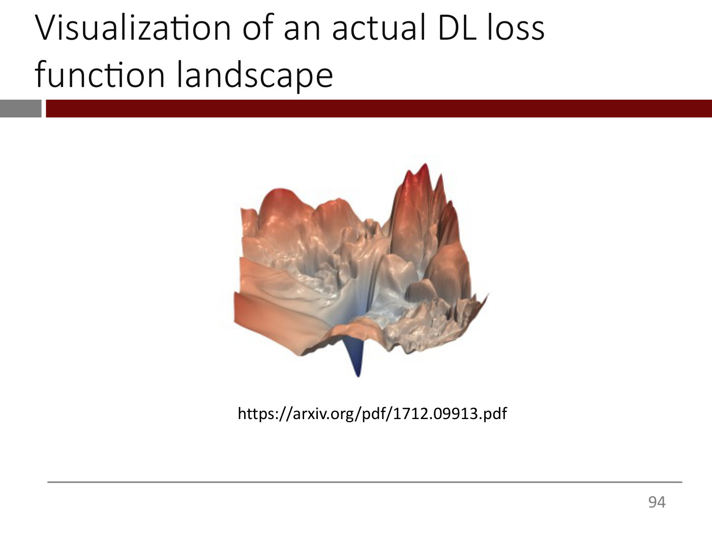

A single 3D rendered surface, no axes or labels: a rugged landscape coloured on a red-to-blue scale. Left and right sides are raised ridges and spiky peaks in red/orange-brown and pink (the tallest cluster of sharp peaks at upper right), the middle is a pale grey-white bumpy plateau, and at the bottom centre there is a single narrow deep blue spike pointing downward (the minimum).

Below: "https://arxiv.org/pdf/1712.09913.pdf"

*Figure: yes — 3D rendering of a rugged real neural-network loss surface with one narrow deep blue minimum*

## Slide 94 — Summary of overall training flow

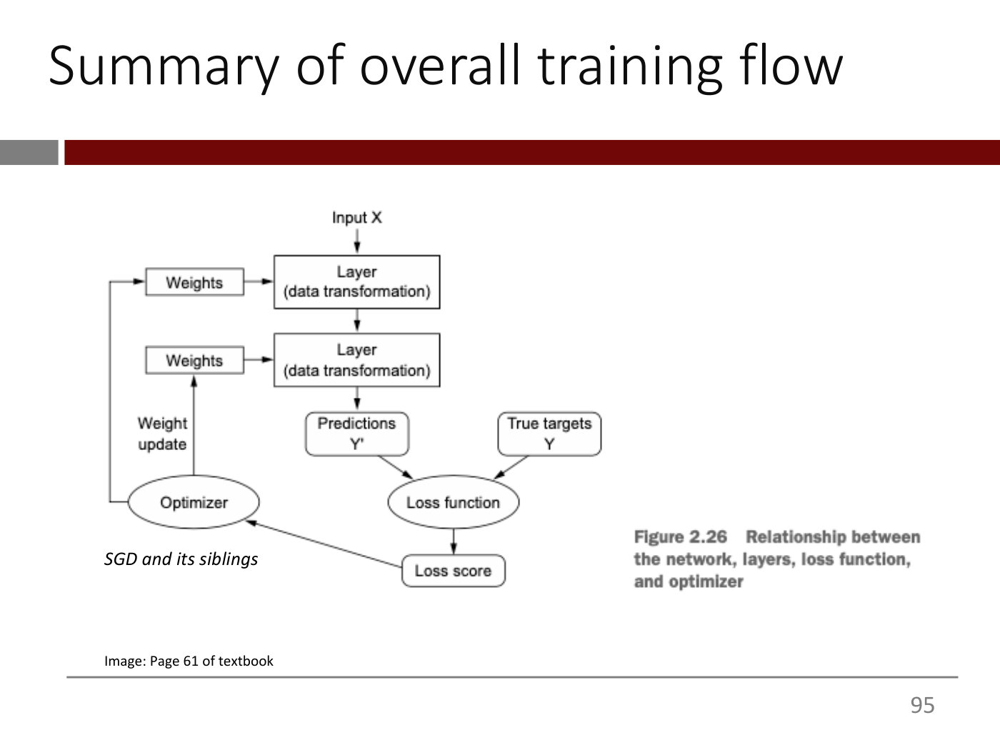

A block diagram (from a textbook). Text on the slide: "Input X" at top with an arrow down into a box "Layer (data transformation)"; to its left a box "Weights" with an arrow into the layer. That layer has an arrow down to a second box "Layer (data transformation)" with a box "Weights" to its left feeding it. The second layer has an arrow down to a rounded box "Predictions Y'". Beside it a rounded box "True targets Y". Arrows from "Predictions Y'" and "True targets Y" converge on an oval "Loss function". An arrow goes down from "Loss function" to a rounded box "Loss score". An arrow from "Loss score" goes up-left to an oval "Optimizer". From the optimizer, an arrow labelled "Weight update" goes up to the lower "Weights" box, and a line leaves the optimizer to the left, goes up along the left edge and enters the upper "Weights" box. Italic note beneath the optimizer: "SGD and its siblings".

Caption (bold, right): "Figure 2.26 Relationship between the network, layers, loss function, and optimizer"

Bottom left: "Image: Page 61 of textbook"

*Figure: yes — block diagram of the training loop: layers and weights, predictions versus true targets, loss function, loss score, optimizer and weight update*

## Slide 95 — OCW end page

OCW's appended end page, not lecture content. Text: "MIT OpenCourseWare", "https://ocw.mit.edu", "15.773 Hands-on Deep Learning", "Spring 2024", and "For information about citing these materials or our Terms of Use, visit: https://ocw.mit.edu/terms."

*Figure: no*

