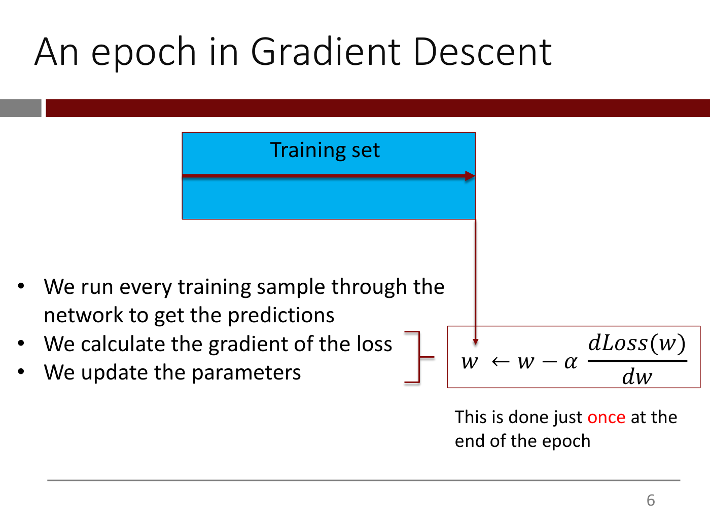
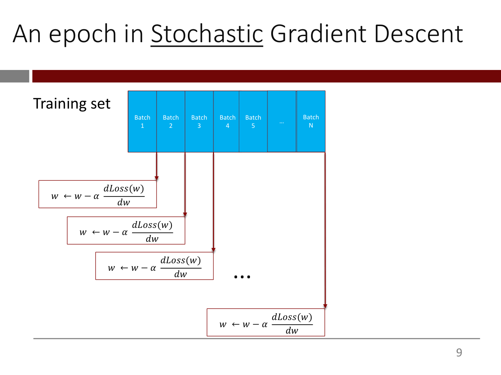
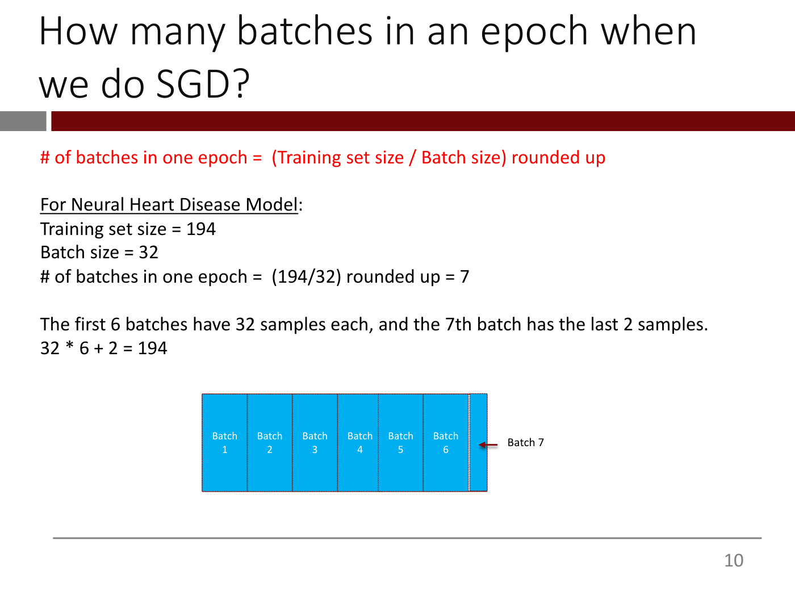
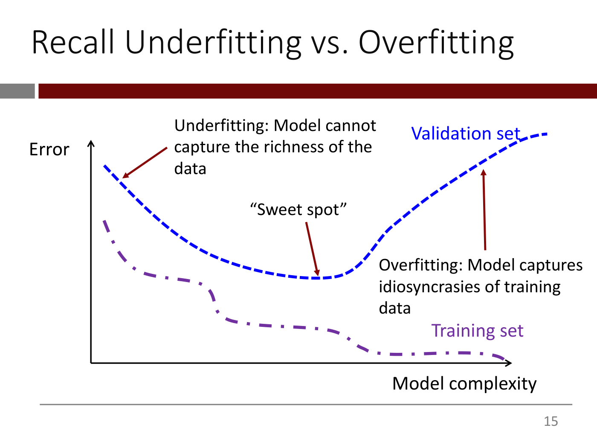
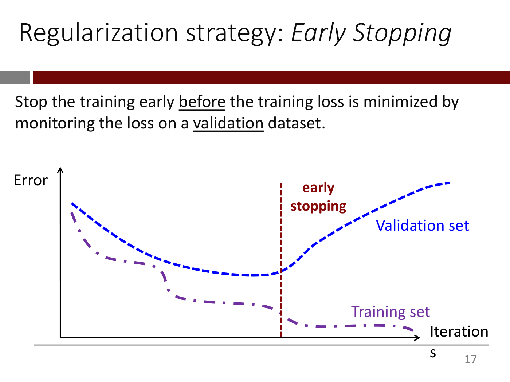
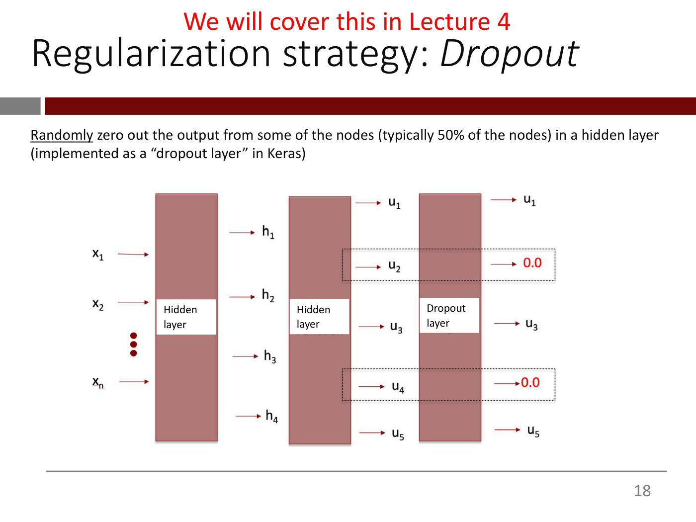
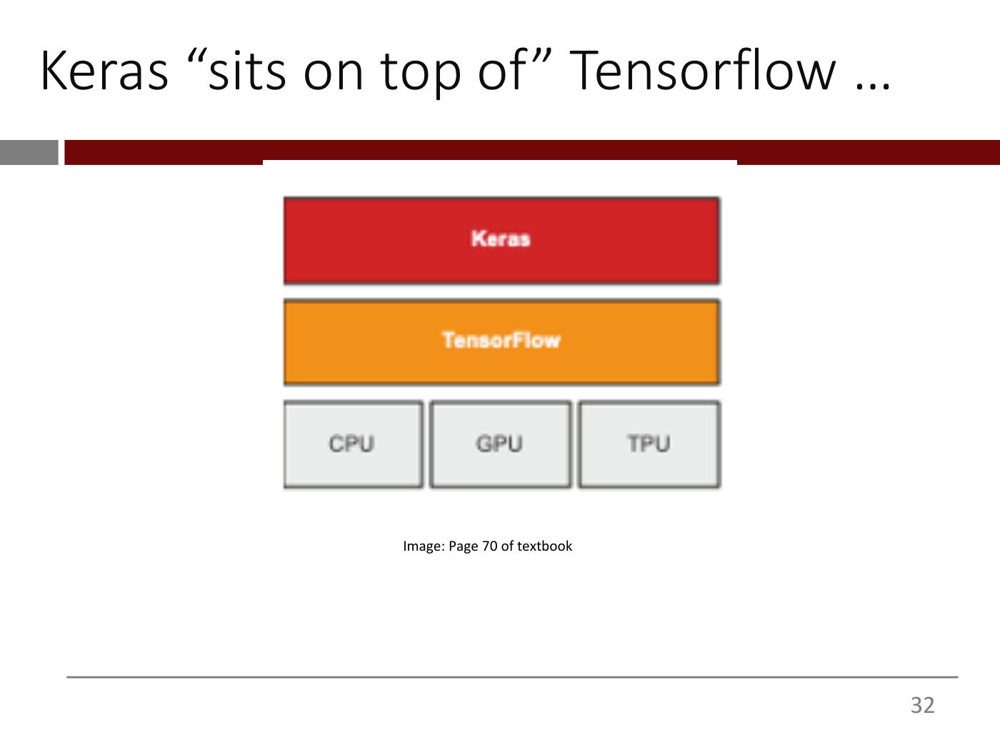
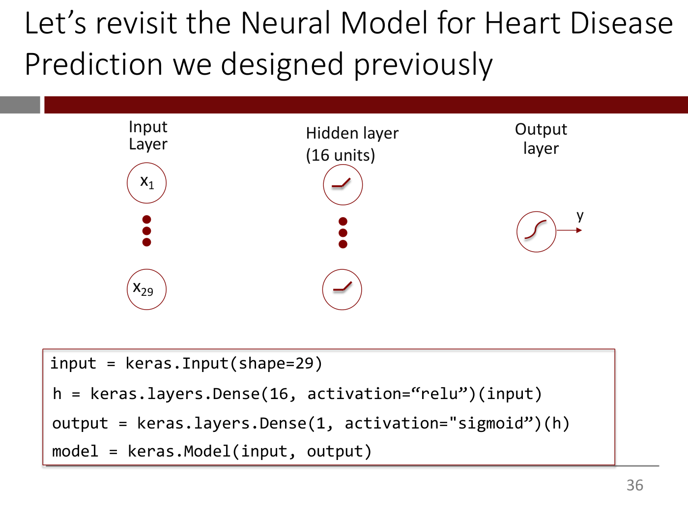
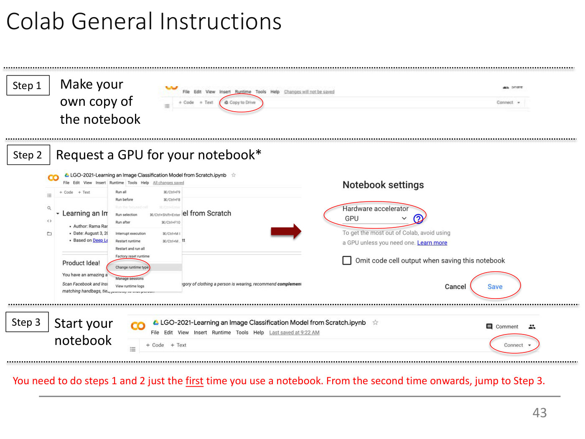

# Lecture 3A — Lightning Introduction to Keras/TF; Training a DL Model for a Structured Data Problem: slide-by-slide

Text and figures of all 44 slides of
[`mit15_773_s24_lec03a.pdf`](https://ocw.mit.edu/courses/15-773-hands-on-deep-learning-spring-2024/mit15_773_s24_lec03a.pdf)
(MIT 15.773 Hands-On Deep Learning, Spring 2024; lecturer Rama Ramakrishnan), transcribed from the deck. This is the first of the two decks that lecture 3's video covers; the second is deck 3B, [`03-vision-basics.md`](03-vision-basics.md). Cite these slides as "deck 3A, slide N", where N is the PDF page number; slide 44 is OCW's appended end page. Diagrams, plots, screenshots and photographs are described in prose since the KB is read as text.

Many slides are **build steps** — the same slide re-shown with one more element revealed. They are transcribed individually so that a citation to any one of them resolves, with a note of what each adds relative to the previous one.

Code is reproduced in fenced blocks as printed, with curly quotes normalized to straight quotes.

**Images.** Nine figure slides carry a 1400px render under their heading, saved as `3a-N`: 6, 9, 10, 15, 17, 18, 32, 36 and 43. The other figure-bearing slides are not rendered for one of three reasons. A rendered slide supersedes them: the epoch builds 5, 7 and 8 → 6 and 9, the error curves 12–14 → 15, and the small TensorFlow stack on 31 → 32. Slide 2 is the same textbook figure as lecture 2's slide 94, already rendered at [`../images/02-training-deep-nns/slide-94.jpg`](../images/02-training-deep-nns/slide-94.jpg). Slides 24–25 reproduce the fast.ai pixel matrix and the RGB matrices that OCW excludes from its licence on deck 3B (slides 3, 4 and 6), although this deck prints no notice for them.

## Numbering: slide numbers vs PDF pages

Headings use the PDF page number. Pages 2–43 print their own page number in the bottom-right corner; pages 1 and 44 print none.

## Contents

| Slides | Section |
| ------ | ------- |
| 1 | Title |
| 2–3 | Recap: overall training flow (layers, loss, optimizer); gradient descent versus stochastic gradient descent |
| 4–10 | Epochs and batches: an epoch in gradient descent (one update) and in SGD (one update per batch); number of batches per epoch (194 training samples, batch size 32, 7 batches) |
| 11–19 | Overfitting and regularization: underfitting versus overfitting curves; early stopping; dropout (covered in lecture 4); summary of creating and training a DNN |
| 20–35 | Lightning intro to TensorFlow/Keras: tensors of rank 0 to 3; what TensorFlow provides; Keras on top of TensorFlow; Keras APIs; pointers to tensorflow.org and keras.io |
| 36 | The heart disease network (29 inputs, 16 ReLU units, sigmoid output) and its Keras code |
| 37–40 | Training checklist filled in for the heart disease model: binary crossentropy, adam, early stopping |
| 41–43 | Colab: link to the Predicting Heart Disease notebook; advice before coding; general Colab instructions (copy, GPU, connect) |
| 44 | MIT OpenCourseWare end page |

---

## Slide 1 — Lecture 3A: Lightning Introduction to Keras/TF; Training a DL Model for a Structured Data Problem

Title (red, bold; "Lecture 3A" underlined): "Lecture 3A" / "Lightning Introduction to Keras/TF", then after a blank line "Training a DL Model for a Structured Data Problem".

Bottom: MIT Management Sloan School logo. Text beside it: "15.S04: Hands-on Deep Learning", "Spring 2024", and in red "Farias, Ramakrishnan".

*Figure: no*

## Slide 2 — (Recap) Summary of overall training flow

Block diagram. "Input X" has an arrow down into a box "Layer (data transformation)"; an arrow goes down from it into a second box "Layer (data transformation)"; an arrow goes down from that into a rounded box "Predictions Y'". A rounded box "True targets Y" sits to its right. Arrows from "Predictions Y'" and "True targets Y" converge on an oval "Loss function", which has an arrow down to a rounded box "Loss score". An arrow from "Loss score" points to an oval "Optimizer" at the left (annotated in italics "SGD and its siblings"). From the Optimizer, an arrow labelled "Weight update" goes up to a box "Weights" feeding the second Layer, and a second arrow loops up along the left edge to a box "Weights" feeding the first Layer. Caption to the right: "Figure 2.26 Relationship between the network, layers, loss function, and optimizer".

Credit at bottom: "Image: Page 61 of textbook (Deep Learning with Python, Francois Chollet, 2nd Edition)".

The same figure as lecture 2's slide 94 ([`02-training-deep-nns.md`](02-training-deep-nns.md)), whose render is [`../images/02-training-deep-nns/slide-94.jpg`](../images/02-training-deep-nns/slide-94.jpg).

*Figure: yes — flow diagram of layers, weights, predictions, loss function, loss score and optimizer feeding back weight updates*

## Slide 3 — (Recap) Gradient Descent vs Stochastic Gradient Descent

("Stochastic" underlined in the title.)

- At each iteration, use **all** (red) data points to calculate the gradient of the loss function
- At each iteration, **randomly choose just a few** (red) of the data points and use only these to compute the gradient of the loss function

*Figure: no*

## Slide 4 — Epochs and Batches

Section divider: white text "Epochs and Batches" on a dark red band with a grey block at the left.

*Figure: no*

## Slide 5 — What is an epoch?

Label "Training set" above a red curly brace spanning a blue rectangle; a dark red arrow runs left to right across the rectangle.

Text below: "An epoch is one **pass** (red) through the full training set." Then: "But this plays out differently for Gradient Descent vs *Stochastic* Gradient Descent."

*Figure: yes — blue rectangle (training set) with an arrow sweeping across it, one pass*

## Slide 6 — An epoch in Gradient Descent



A blue rectangle labelled "Training set" with a dark red arrow running left to right across it. A dark red line descends from its right end to a boxed formula at the lower right:

$$w \leftarrow w - \alpha \frac{dLoss(w)}{dw}$$

At left, bullets: "We run every training sample through the network to get the predictions"; "We calculate the gradient of the loss"; "We update the parameters". A red bracket groups the last two bullets and points at the formula box. Text below the box: "This is done just **once** (red) at the end of the epoch".

*Figure: yes — training-set bar with arrow into a single weight-update formula box*

## Slide 7 — An epoch in Stochastic Gradient Descent

("Stochastic" underlined.) Label "Training set" above a red curly brace spanning a row of seven adjacent blue boxes labelled "Batch 1", "Batch 2", "Batch 3", "Batch 4", "Batch 5", "…", "Batch N".

Text below (italic): "But when we do Stochastic Gradient Descent (SGD), we process the data in **minibatches\*** (red), one after the other" ("Stochastic" underlined). Footnote: "*we will refer to minibatches as batches from now on for simplicity".

*Figure: yes — training set split into a row of batches 1 to N*

## Slide 8 — An epoch in Stochastic Gradient Descent

("Stochastic" underlined.) "Training set" at left beside the same row of blue boxes "Batch 1" ... "Batch 5", "…", "Batch N".

Italic text: "For each batch:" ("each" underlined); bullets "We run the training samples in that batch through the network to get predictions" ("in that batch" underlined); "We calculate the gradient of the loss"; "We update the parameters". A red bracket groups the last two bullets and points at the boxed formula

$$w \leftarrow w - \alpha \frac{dLoss(w)}{dw}$$

*Build step: adds the per-batch procedure and the update formula relative to slide 7.*

*Figure: yes — batch row beside the per-batch procedure and update formula*

## Slide 9 — An epoch in Stochastic Gradient Descent



("Stochastic" underlined.) "Training set" at left beside the row of blue boxes "Batch 1" ... "Batch N" at the top. Dark red arrows drop from the boundaries between batches (the left edge of batch 2, the left edge of batch 3, the left edge of batch 4, and the right edge of batch N) to four boxes arranged in a staircase, each stepping down and to the right, each containing the update formula $w \leftarrow w - \alpha \frac{dLoss(w)}{dw}$. A large "…" sits between the third and fourth boxes.

*Build step: relative to slide 8, shows one weight update per batch, so many updates in one epoch, in place of the procedure text.*

*Figure: yes — each batch produces its own weight update, staircase of formula boxes*

## Slide 10 — How many batches in an epoch when we do SGD?



Red text: "# of batches in one epoch = (Training set size / Batch size) rounded up".

"For Neural Heart Disease Model:" (underlined), then "Training set size = 194", "Batch size = 32", "# of batches in one epoch = (194/32) rounded up = 7".

"The first 6 batches have 32 samples each, and the 7th batch has the last 2 samples." and "32 * 6 + 2 = 194".

Diagram: a row of blue boxes "Batch 1" to "Batch 6" followed by a very narrow seventh box; an arrow from the label "Batch 7" points at the narrow box.

*Figure: yes — six full batch boxes plus a narrow seventh batch*

## Slide 11 — Overfitting and Regularization

Section divider: white text "Overfitting and Regularization" on a dark red band with a grey block at the left.

*Figure: no*

## Slide 12 — Recall Underfitting vs. Overfitting

Empty axes: y-axis labelled "Error" (arrow up), x-axis labelled "Model complexity" (arrow right). A purple label "Training Data" sits near the bottom right inside the plot. No curve is drawn yet.

*Build step: first of four slides; axes and the label only.*

*Figure: yes — blank error versus model complexity axes*

## Slide 13 — Recall Underfitting vs. Overfitting

Same axes (y "Error", x "Model complexity"). One series:

- Training set (purple, dash-dot, label "Training set" at lower right): starts fairly high at the left, falls in steps with plateaus, to near the x-axis at the right end and stays near zero.

*Build step: adds the training-set curve relative to slide 12 (the label now reads "Training set").*

*Figure: yes — training error falling as model complexity increases*

## Slide 14 — Recall Underfitting vs. Overfitting

Same axes. Two series:

- Training set (purple, dash-dot): as on slide 13, decreasing stepwise to near zero.
- Validation set (blue, dashed, label "Validation set" at upper right): starts above the training curve at the left, falls to a minimum about 60 percent of the way along the x-axis, then rises steadily toward the upper right.

*Build step: adds the validation-set curve relative to slide 13.*

*Figure: yes — training error keeps falling while validation error is U-shaped*

## Slide 15 — Recall Underfitting vs. Overfitting



Same plot as slide 14 (training set purple dash-dot; validation set blue dashed) with three annotations (not additional series):

- A dark red arrow from the text "Underfitting: Model cannot capture the richness of the data" to the left, falling part of the validation curve.
- A dark red arrow from the text ""Sweet spot"" to the minimum of the validation curve.
- A dark red arrow from the text "Overfitting: Model captures idiosyncrasies of training data" up to the rising right-hand part of the validation curve.

*Build step: adds the three annotations relative to slide 14.*

*Figure: yes — error versus model complexity with underfitting, sweet spot and overfitting regions marked*

## Slide 16 — Overfitting in Neural Networks

- To learn smart representations of complex, unstructured data, the NN needs to have large "capacity" i.e., many layers and many neurons in each layer
- But this raises the likelihood of overfitting so we need to add *regularization*
- Several regularization methods have been developed to address this problem

*Figure: no*

## Slide 17 — Regularization strategy: Early Stopping



Text: "Stop the training early before the training loss is minimized by monitoring the loss on a validation dataset." ("before" and "validation" underlined).

Plot: y-axis "Error", x-axis "Iterations" (the label wraps onto two lines as "Iteration" / "s" and overlaps the footer line). Two series:

- Validation set (blue, dashed): falls to a minimum then rises toward the upper right.
- Training set (purple, dash-dot): falls in steps to near zero.

A vertical dark red dashed line at about the validation minimum is labelled "early stopping" (dark red, bold).

*Figure: yes — training and validation error versus iterations with a vertical early-stopping line at the validation minimum*

## Slide 18 — Regularization strategy: Dropout



Red text above the title: "We will cover this in Lecture 4".

Text: "Randomly zero out the output from some of the nodes (typically 50% of the nodes) in a hidden layer (implemented as a "dropout layer" in Keras)" ("Randomly" underlined).

Diagram: three tall dark-red vertical bars. The first, labelled "Hidden layer", receives arrows from inputs $x_1$, $x_2$, vertical dots, $x_n$ at the left, and emits arrows labelled $h_1$, $h_2$, $h_3$, $h_4$. The second, labelled "Hidden layer", emits arrows labelled $u_1$, $u_2$, $u_3$, $u_4$, $u_5$. The third, labelled "Dropout layer", emits arrows labelled $u_1$, 0.0 (red), $u_3$, 0.0 (red), $u_5$. Dotted boxes enclose the $u_2 \to 0.0$ and $u_4 \to 0.0$ rows.

*Figure: yes — hidden layer outputs u1..u5 passing through a dropout layer that zeroes u2 and u4*

## Slide 19 — Summary: Creating and training a DNN from scratch

- We get the data ready
- We design i.e., "lay out" the network
  - Choose the number of hidden layers and the number of 'neurons' in each layer
  - Pick the right output layer based on the type of the output (more on this shortly)
- We pick
  - An appropriate loss function based on the type of the output (more on this shortly)
  - An optimizer from the many SGD flavors that are available and a "good" learning rate
- We decide on a regularization strategy
- We set things up in Keras/Tensorflow and start training!

*Figure: no*

## Slide 20 — Lightning Intro to Tensorflow/Keras

Section divider: white text "Lightning Intro to Tensorflow/Keras" on a dark red band with a grey block at the left.

*Figure: no*

## Slide 21 — What's a Tensor?

Title only; the body is blank (the first state of a build that follows on slides 22–25).

*Figure: no*

## Slide 22 — What's a Tensor?

Red text: "Tensor of rank 0 ( Scalar)". Below it, the value "42".

*Build step: adds the rank-0 entry relative to slide 21.*

*Figure: no*

## Slide 23 — What's a Tensor?

Red text: "Tensor of rank 0 ( Scalar)" with "42" below it. Lower left, red text "Tensor of rank 1 (aka Vector)" with "(42, 23.4, 11.2)" below it.

*Build step: adds the rank-1 entry relative to slide 22.*

*Figure: no*

## Slide 24 — What's a Tensor?

Left column as on slide 23 (rank 0: "42"; rank 1: "(42, 23.4, 11.2)"). Upper right, red text "Tensor of rank 2 (aka Matrix)" above a small picture of a numeric matrix printed as an R-style array: column headers "[,1] [,2] ..." across the top and row headers "[1,] [2,] ..." down the left, about 28 rows and 28 columns, filled mostly with 0 and with a cluster of larger values (up to 255) in the middle, i.e. the pixel values of a small greyscale handwritten-digit image. The numbers are too small to read individually. Credit under the picture: "Image credit: fast.ai".

*Build step: adds the rank-2 entry relative to slide 23.*

*Figure: yes — a 28 by 28 grid of pixel values shown as a rank-2 tensor (matrix)*

## Slide 25 — What's a Tensor?

Same as slide 24 (rank 0, rank 1, and the rank-2 matrix picture with "Image credit: fast.ai"). Lower right, red text "Tensor of rank 3 (aka "cube")" above three overlapping, offset printouts of numeric matrices, stacked like a deck of cards. The front matrix has column headers "[,1] [,2] ... [,10]" and row headers "[1,]" to "[10,]" and holds integers between about 46 and 255, for example first row "251 232 233 237 230 243 255 255 250 246" and second row "248 234 239 245 238 246 255 251 246 243"; the two matrices behind it are partly hidden (e.g. a first-row start "147 131 138 144 131 134 144 135 133 145").

*Build step: adds the rank-3 entry relative to slide 24.*

*Figure: yes — three stacked numeric matrices illustrating a rank-3 tensor*

## Slide 26 — Can you give an example of a rank-4 tensor?

Title (a question) only; the body is blank.

*Figure: no*

## Slide 27 — What's a Tensor?

"See Chapter 2.2 of text for more detail"

*Figure: no*

## Slide 28 — Tensorflow

"Tensorflow (TF) is a library that provides"

- "Automatic" (underlined) calculation of the gradient of (complicated) loss functions

Formula:

$$\nabla Loss(w) = \left[\frac{\partial Loss}{\partial w_1}, \frac{\partial Loss}{\partial w_2}, \ldots, \frac{\partial Loss}{\partial w_n}\right]$$

*Figure: no*

## Slide 29 — Tensorflow

"Tensorflow (TF) is a library that provides"

- (greyed out) Automatic calculation of the gradient of (complicated) loss functions
- Library of state-of-the-art optimizers

*Build step: adds the optimizers bullet; the previous bullet is greyed out and the gradient formula is gone.*

*Figure: no*

## Slide 30 — Tensorflow

"Tensorflow (TF) is a library that provides"

- (greyed out) Automatic calculation of the gradient of (complicated) loss functions
- (greyed out) Library of state-of-the-art optimizers
- Automatic distribution of computational load across servers

*Build step: adds the distribution-across-servers bullet.*

*Figure: no*

## Slide 31 — Tensorflow

"Tensorflow (TF) is a library that provides"

- (greyed out) Automatic calculation of the gradient of (complicated) loss functions
- (greyed out) Library of state-of-the-art optimizers
- (greyed out) Automatic distribution of computational load across servers
- Automatic adaptation of code to work on parallel hardware (GPUs and TPUs)

Beneath the last bullet, a small diagram: an orange box "TensorFlow" above three grey boxes side by side, "CPU", "GPU", "TPU".

*Build step: adds the parallel-hardware bullet and the small stack diagram.*

*Figure: yes — TensorFlow box sitting on CPU, GPU and TPU boxes*

## Slide 32 — Keras "sits on top of" Tensorflow …



A three-layer stack diagram: a red box "Keras" on top, an orange box "TensorFlow" below it, and three grey boxes side by side at the bottom, "CPU", "GPU", "TPU". Caption: "Image: Page 70 of textbook".

*Figure: yes — Keras above TensorFlow above CPU, GPU and TPU*

## Slide 33 — … and provides "convenience" features

- Pre-defined **layers** (red)
- Incredibly flexible ways to specify network **architectures** (red)
- Easy ways to **preprocess** (red) data
- Easy ways to **train** (red) models and **report** (red) metrics
- **Pre-trained models** (red) you can download and customize

*Figure: no*

## Slide 34 — Keras APIs

- There are three broad ways to build DL models with Keras
  - Sequential
  - Functional API
  - Subclassing
- **We will almost exclusively use the Functional API** (red). The model we built for heart disease prediction is an example.
- Please read 7.2.2 of the textbook to understand in detail how the Keras Functional API works

*Figure: no*

## Slide 35 — (untitled)

Large text: "Check out the wealth of introductory and advanced material, with accompanying colabs, at **tensorflow.org** (red) and **keras.io** (red)"

*Figure: no*

## Slide 36 — Let's revisit the Neural Model for Heart Disease Prediction we designed previously



Network diagram in three columns. "Input Layer": circles $x_1$ (top) and $x_{29}$ (bottom) with three dark red vertical dots between. "Hidden layer (16 units)": two circles, each containing a small ReLU icon, with three vertical dots between. "Output layer": one circle containing a sigmoid (S-shaped) icon with an arrow out to the right labelled $y$. No connecting arrows are drawn between the columns.

Boxed code at the bottom:

```
input = keras.Input(shape=29)
h = keras.layers.Dense(16, activation="relu")(input)
output = keras.layers.Dense(1, activation="sigmoid")(h)
model = keras.Model(input, output)
```

*Figure: yes — input (29), hidden (16 ReLU units) and sigmoid output layers beside the Keras code that builds them*

## Slide 37 — (untitled)

Text in the middle of the slide: "Let's train this model!"

*Figure: no*

## Slide 38 — Training Checklist

- We get the data ready (will cover in the colab)
- We design i.e., "lay out" the network — red text to the right: "1 hidden layer with 16 ReLU neurons"
  - Choose *the number of hidden layers* (blue bold italic) and *the number of 'neurons' in each layer* (olive bold italic)
  - Pick the *right output layer* (dark red bold italic) based on the type of the output — red text to the right: "Sigmoid"
- We pick
  - An appropriate *loss function* (orange bold italic) based on the type of the output — a red blank line "__________" to the right
  - An *optimizer from the many SGD flavors* (olive bold italic) that are available
- We decide on a *regularization strategy* (purple bold italic)
- We set things up in Keras/Tensorflow and start training!

*Figure: no*

## Slide 39 — Training Checklist

Same checklist as slide 38, with the blank after the loss-function bullet now filled with red text "binary crossentropy".

*Build step: fills in the loss function relative to slide 38.*

*Figure: no*

## Slide 40 — Training Checklist

Same checklist as slide 39, with two more red answers: next to the optimizer bullet, ""adam"" (as printed, opening curly quote and closing straight quote), and next to the regularization-strategy bullet, "Early stopping". The other red answers remain: "1 hidden layer with 16 ReLU neurons", "Sigmoid", "binary crossentropy".

*Build step: fills in the optimizer and the regularization strategy relative to slide 39.*

*Figure: no*

## Slide 41 — Colab

Section divider: white text "Colab" on a dark red band with a grey block at the left. Below it, centred, an orange underlined hyperlink: "Predicting Heart Disease" (link target not visible on the slide).

*Figure: no*

## Slide 42 — Before we start coding …

- Don't worry if you don't understand **every** (underlined) detail of what we will do in class.
- But go through the Colab notebooks carefully later, play around with the code and make sure you understand **every** (underlined) line

*Figure: no*

## Slide 43 — Colab General Instructions



Three horizontal bands separated by dotted lines, each with a boxed step label, plus a footer sentence.

- Step 1, "Make your own copy of the notebook": a cropped screenshot of the Colab toolbar (menu "File Edit View Insert Runtime Tools Help", the note "Changes will not be saved", and buttons "+ Code", "+ Text", "Copy to Drive") with the "Copy to Drive" button circled in red.
- Step 2, "Request a GPU for your notebook*": at left a screenshot of a notebook titled "LGO-2021-Learning an Image Classification Model from Scratch.ipynb" with the Runtime menu open (items include Run all, Run before, Run selection, Run after, Interrupt execution, Restart runtime, Factory reset runtime, Change runtime type, Manage sessions, View runtime logs) and "Change runtime type" circled in red. A dark red arrow points right to a "Notebook settings" dialog showing "Hardware accelerator" with the drop-down set to "GPU" (circled in red, with a blue "?" icon), the hint "To get the most out of Colab, avoid using a GPU unless you need one. Learn more", an unticked checkbox "Omit code cell output when saving this notebook", and buttons "Cancel" and "Save" (Save circled in red).
- Step 3, "Start your notebook": a screenshot of the notebook header with "File Edit View Insert Runtime Tools Help", "Last saved at 9:22 AM", "+ Code", "+ Text", and a "Connect" button circled in red at the right.

Footer, in red: "You need to do steps 1 and 2 just the first (underlined) time you use a notebook. From the second time onwards, jump to Step 3." (The "*" after "notebook" in Step 2 has no footnote on the slide.)

*Figure: yes — three-step Colab screenshots (Copy to Drive, change runtime type to GPU, Connect)*

## Slide 44 — MIT OpenCourseWare end page

OCW's appended end page, not lecture content. Text: "MIT OpenCourseWare", "https://ocw.mit.edu", "15.773 Hands-on Deep Learning", "Spring 2024", and "For information about citing these materials or our Terms of Use, visit: https://ocw.mit.edu/terms."

*Figure: no*
