# Lecture 4 — Deep Learning for Computer Vision: Convolutional Neural Networks and Transfer Learning: slide-by-slide

Text and figures of all 84 slides of
[`mit15_773_s24_lec04.pdf`](https://ocw.mit.edu/courses/15-773-hands-on-deep-learning-spring-2024/mit15_773_s24_lec04.pdf)
(MIT 15.773 Hands-On Deep Learning, Spring 2024; lecturer Rama Ramakrishnan), transcribed from the deck. Lecture 4's video presents slides 2–81. It points to the appendix (slides 82–83) at about 27:18 without presenting it. Cite these slides as "slide N", where N is the PDF page number. Diagrams, plots and photographs are described in prose since the KB is read as text.

Slides marked with an `*OCW notice: …*` line carry third-party material excluded from the Creative Commons licence. They are described in prose and never rendered as images. Slide 77 has no notice of its own but redraws the ResNet 34 diagram that slides 70–73 exclude, so it is not rendered either. Code is reproduced as printed, with any curly quotes normalized to straight quotes inside code fences. Words the slides print in red are given plainly, with a note in parentheses. The three Colab hyperlinks (slides 56, 59 and 81) point to notebooks that are not published on OCW; their targets are not printed on the slides.

**Images.** Sixteen figure slides carry a 1400px render under their heading: 14, 18, 19, 21, 24, 29, 31, 32, 40, 44, 45, 47, 75, 78, 79 and 80. The other figure-bearing slides are not rendered for one of four reasons. The fourteen with an OCW exclusion notice (41, 52–55, 58 and 66–73) are never rendered, and neither is slide 77, which redraws the ResNet 34 diagram those notices exclude. A rendered slide supersedes a build step: the single filter and the filter stacks on 11, 12 and 23 → 14 and 24; the convolution steps 15–17 → 18 and 20 → 21; the two-filter layer 25–28 → 29; slide 30 → 18 and 31; and slide 46, which repeats 45's figure. Slide 2's Fashion MNIST mosaic is the same image as deck 3B's slide 14, already rendered at [`../images/03-keras-and-vision-basics/3b-14.jpg`](../images/03-keras-and-vision-basics/3b-14.jpg). Everything else is text.

## Numbering: slide numbers vs PDF pages

Headings use the PDF page number, and the deck agrees with it: every page that prints a number bottom-right prints its own page number. Pages 1 (title), 78–80 (the three model-hub screenshots) and 84 (OCW's end page) print none.

## Contents

| Slides | Section |
| ------ | ------- |
| 1 | Title |
| 2 | Fashion MNIST recap: a network with a single hidden layer reaches 85%+ accuracy; how can we do better? |
| 3–9 | Handling images "naturally": flattening into a dense layer needs too many parameters (about 2.7 billion for a 3024 × 3024 colour photo into 100 neurons), loses local spatial adjacency, and does not learn once and reuse; convolutional layers address these |
| 10–22 | Convolutional filters and the convolution operation: horizontal- and vertical-line filters, a worked 7x7 example (overlay, multiply and add, ReLU, slide), the Excel demo and setosa.io |
| 23–29 | Convolutional layers: one or more filters, each a specialist; two filters give a 5 x 5 x 2 tensor |
| 30–33 | Colour images: a 3x3x3 filter on a 6x6x3 input gives 4x4; f filters give 4 x 4 x f; textbook chapter 8.1 |
| 34–39 | The big idea: learn the numbers in the filter as weights, because a filter is just a neuron |
| 40–41 | Later layers see more of the input; many layers learn increasingly complex features (lines → edges → faces) |
| 42–50 | Pooling layers: 2x2 max and average pooling worked on a 4x4 grid; 224x224x64 → 112x112x64; max pooling as an "OR" condition and feature detector |
| 51–55 | The architecture of a basic CNN: convolutional blocks that get deeper but smaller, then flatten, fully connected layers and the output layer |
| 56 | Colab: Fashion MNIST with convolutional layers |
| 57–60 | Colour images: a handbags-shoes classifier from fewer than 100 images per class; its Colab; can we do better? |
| 61–65 | Transfer learning with pre-trained networks: two research trends, customizing a pre-trained network, looking for networks trained on everyday objects |
| 66–73 | ImageNet; the hierarchical features of an ImageNet-trained network; ResNet 34; stopping before the last layer ("headless" ResNet) |
| 74–77 | The headless ResNet's output as a smart representation for a one-hidden-layer network; fine-tuning the whole network end to end |
| 78–80 | Where to find pre-trained models: TensorFlow Hub, PyTorch Hub, Hugging Face Hub (505,594 models, February 13, 2024) |
| 81 | Back to Colab |
| 82–83 | Appendix: the convolutional filter is a slightly modified neuron |
| 84 | MIT OpenCourseWare end page |

---

## Slide 1 — Lecture 4

Lecture 4
Deep Learning for Computer Vision – Convolutional Neural Networks and Transfer Learning

15.S04: Hands-on Deep Learning
Spring 2024
Farias, Ramakrishnan

(The MIT Management Sloan School logo appears at the bottom left.)

*Figure: no*

## Slide 2 — Fashion MNIST

- We saw previously that an NN with a single hidden layer can get to 85% + accuracy on this dataset.

How can we do better? (red)

Right: a large grayscale mosaic of many small Fashion MNIST thumbnail images (clothing and footwear items on black backgrounds) arranged in a dense grid, with items of the same kind grouped in horizontal bands.

Caption: Sample of the Fashion MNIST images by Yuzamei. Source: Wikimedia Commons. License: CC BY-SA.

Source: https://www.kaggle.com/datasets/zalando-research/fashionmnist

The same mosaic as deck 3B's slide 14 ([`03-vision-basics.md`](03-vision-basics.md)), whose render is [`../images/03-keras-and-vision-basics/3b-14.jpg`](../images/03-keras-and-vision-basics/3b-14.jpg).

*Figure: yes — a dense grayscale mosaic of many small Fashion MNIST clothing and footwear thumbnails*

## Slide 3 — Handling Images "Naturally"

- When we flatten the image matrix into a long vector and feed it to a dense layer, several "undesirable" things happen:

*Figure: no*

## Slide 4 — Handling Images "Naturally"

- When we flatten the image matrix into a long vector and feed it to a dense layer, several "undesirable" things happen: (greyed out)
  - We need to learn "too many" parameters
    - Flattening a 3024 × 3024 – pixel color image (from your phone) and connecting to a <u>single</u> 100-neuron dense layer generates approximately ? parameters.

("single" is underlined; the "?" is red.)

*Figure: no*

## Slide 5 — Handling Images "Naturally"

Same text as slide 4, except the red "?" is replaced by "2.7 billion" (red):

- When we flatten the image matrix into a long vector and feed it to a dense layer, several "undesirable" things happen: (greyed out)
  - We need to learn "too many" parameters
    - Flattening a 3024 × 3024 – pixel color image (from your phone) and connecting to a <u>single</u> 100-neuron dense layer generates approximately 2.7 billion parameters.

*Figure: no*

## Slide 6 — Handling Images "Naturally"

Same text as slide 5, plus:

    - This is computationally demanding, very data-hungry and increases the risk of overfitting

*Figure: no*

## Slide 7 — Handling Images "Naturally"

- When we flatten the image matrix into a long vector and feed it to a dense layer, several "undesirable" things happen: (greyed out)
  - We need to learn "too many" parameters (greyed out)
  - We lose the *local spatial adjacency* relationships between pixels that define features of the image.

*Figure: no*

## Slide 8 — Handling Images "Naturally"

- When we flatten the image matrix into a long vector and feed it to a dense layer, several "undesirable" things happen: (greyed out)
  - We need to learn "too many" parameters (greyed out)
  - We lose the *local spatial adjacency* relationships between pixels that define features of the image. (greyed out)
  - We don't learn once and reuse repeatedly
    - If a feature of the image (e.g., a vertical line or a circle) appears in different places in the image, the network should "learn it once and use it again and again" rather learn it separately each time.

(The slide prints "rather learn it separately".)

*Figure: no*

## Slide 9 — Handling Images "Naturally"

- When we flatten the image matrix into a long vector and feed it to a dense layer, several "undesirable" things happen: (greyed out)
  - We need to learn "too many" parameters (greyed out)
  - We lose the *local spatial adjacency* relationships between pixels that define features of the image. (greyed out)
  - We don't learn once and reuse repeatedly (greyed out)
- Convolutional layers were developed to address these shortcomings

("Convolutional layers" is red.)

*Figure: no*

## Slide 10 — Convolutional Layers

(Section divider slide; title only.)

*Figure: no*

## Slide 11 — Convolutional Layers and Filters

- *A convolutional filter* is a small square matrix of numbers

Right: a 3x3 matrix of numbers on a light grey background:

| | | |
| --- | --- | --- |
| 1 | 1 | 1 |
| 0 | 0 | 0 |
| -1 | -1 | -1 |

*Figure: yes — a 3x3 filter matrix with rows 1 1 1, 0 0 0, -1 -1 -1*

## Slide 12 — Convolutional Layers and Filters

- *A convolutional filter* is a small square matrix of numbers
- A *convolutional layer* is composed of one or more *convolutional filters*

Top right: the same 3x3 matrix as slide 11:

| | | |
| --- | --- | --- |
| 1 | 1 | 1 |
| 0 | 0 | 0 |
| -1 | -1 | -1 |

Bottom right: a stack of three overlapping grey 3x3 matrices, each offset down-left from the one behind it so that the top-left corners form a staircase. The back matrix is fully visible in its top three rows and the two front ones peek out at the bottom. The back matrix reads:

| | | |
| --- | --- | --- |
| 1 | 0 | -1 |
| 1 | 0 | -1 |
| 1 | 0 | -1 |

Below it, the visible bottom edges of the two matrices in front show only their lower rows: a row "1 0 -1" (offset slightly left) and a row "-1 -1 -1" (offset further left); the remaining entries of those matrices are hidden.

*Figure: yes — a single 3x3 filter (1 1 1 / 0 0 0 / -1 -1 -1) and a stack of three overlapping 3x3 filters, the back one 1 0 -1 in every row*

## Slide 13 — The Convolutional Filter

By choosing the numbers in a filter carefully and "applying" the filter to an image, different features of the image can be detected (as we will demonstrate shortly)

*Figure: no*

## Slide 14 — The Convolutional Filter

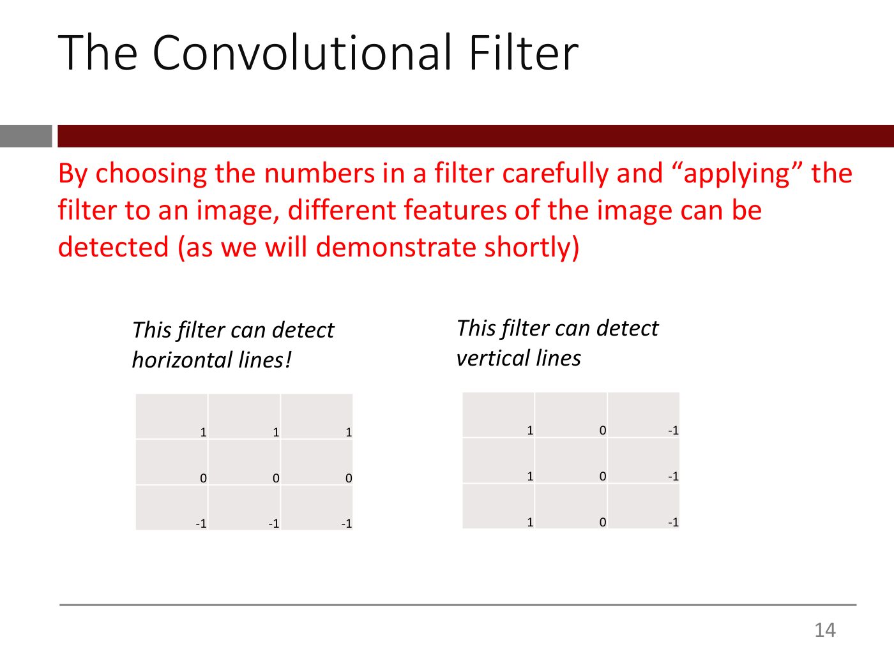

Same red text as slide 13, plus two labelled filters:

Left, labelled *This filter can detect horizontal lines!*:

| | | |
| --- | --- | --- |
| 1 | 1 | 1 |
| 0 | 0 | 0 |
| -1 | -1 | -1 |

Right, labelled *This filter can detect vertical lines*:

| | | |
| --- | --- | --- |
| 1 | 0 | -1 |
| 1 | 0 | -1 |
| 1 | 0 | -1 |

*Figure: yes — two 3x3 filter matrices, a horizontal-line detector (1 1 1 / 0 0 0 / -1 -1 -1) and a vertical-line detector (1 0 -1 in each row)*

## Slide 15 — Applying a convolutional filter to an image is called the "convolution operation"
Layout: the column headings "Input", "Filter" and "Output" sit above, left to right, the 7x7 input grid, "*", the 3x3 filter, "=" and the output area (a 5x5 grid frame).

Input (7x7), rows are constant across columns:

| | | | | | | |
| --- | --- | --- | --- | --- | --- | --- |
| 0 | 0 | 0 | 0 | 0 | 0 | 0 |
| 5 | 5 | 5 | 5 | 5 | 5 | 5 |
| 10 | 10 | 10 | 10 | 10 | 10 | 10 |
| 15 | 15 | 15 | 15 | 15 | 15 | 15 |
| 10 | 10 | 10 | 10 | 10 | 10 | 10 |
| 5 | 5 | 5 | 5 | 5 | 5 | 5 |
| 0 | 0 | 0 | 0 | 0 | 0 | 0 |

Filter (3x3):

| | | |
| --- | --- | --- |
| 1 | 1 | 1 |
| 0 | 0 | 0 |
| -1 | -1 | -1 |
The output area is empty (nothing printed after "=").

*Figure: yes — Input (7x7 grid with rows 0,5,10,15,10,5,0), Filter (3x3: 1 1 1 / 0 0 0 / -1 -1 -1) and an empty Output, joined by * and =*

## Slide 16 — Applying a convolutional filter to an image is called the "convolution operation"

Same figure as slide 15, plus a dark-red rectangle outlining the top-left 3x3 block of the input (rows 1-3, columns 1-3: 0 0 0 / 5 5 5 / 10 10 10). Output still empty.

### The convolution operation

- "Overlay" the filter onto the top-left of the image

*Figure: yes — the slide 15 input/filter/output with a red box on the input's top-left 3x3 block*

## Slide 17 — Applying a convolutional filter to an image is called the "convolution operation"

Same figure as slide 16 (red box on the top-left 3x3 block of the input; output empty).

### The convolution operation

- "Overlay" the filter onto the top-left of the image (greyed out)
- Multiply matching elements and add up:
  - 0\*1 + 0\*1 + 0\*1 + 5\*0 + 5\*0 + 5\*0 + 10\* -1 + 10\* -1 + 10\*-1 = -30

*Figure: yes — the slide 15 input/filter/output with a red box on the input's top-left 3x3 block*

## Slide 18 — Applying a convolutional filter to an image is called the "convolution operation"

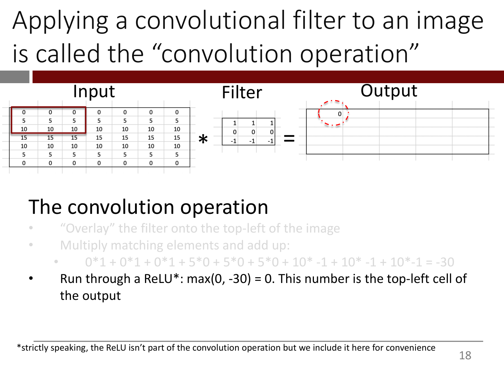

Same figure as slide 17, except the Output area now shows a 5x5 grid frame whose top-left cell contains 0, circled with a red dashed ellipse; all other output cells are empty.

### The convolution operation

- "Overlay" the filter onto the top-left of the image (greyed out)
- Multiply matching elements and add up: (greyed out)
  - 0\*1 + 0\*1 + 0\*1 + 5\*0 + 5\*0 + 5\*0 + 10\* -1 + 10\* -1 + 10\*-1 = -30 (greyed out)
- Run through a ReLU\*: max(0, -30) = 0. This number is the top-left cell of the output

\*strictly speaking, the ReLU isn't part of the convolution operation but we include it here for convenience

*Figure: yes — the slide 15 input/filter with a red box on the input's top-left 3x3 block and an output grid whose top-left cell is 0 (circled)*

## Slide 19 — The Convolution Operation

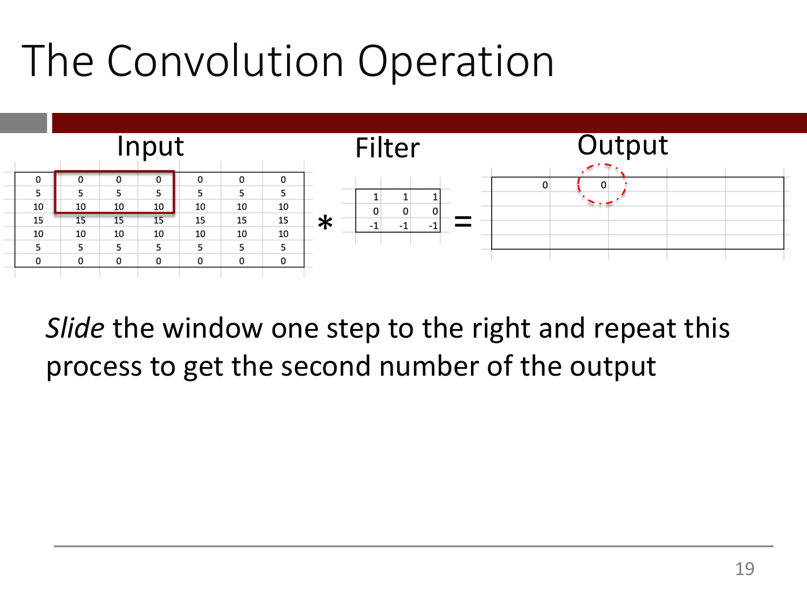

Same layout as slide 15. The red box on the input has moved one column right (rows 1-3, columns 2-4: 0 0 0 / 5 5 5 / 10 10 10). The output's first row now contains 0 and 0 (the second 0 circled with a red dashed ellipse); all other output cells are empty.

*Slide* the window one step to the right and repeat this process to get the second number of the output

*Figure: yes — input/filter/output with the red window moved one step right and two output cells filled (0, 0)*

## Slide 20 — The Convolution Operation

Same layout as slide 15. The red box on the input is now at the start of the second row (rows 2-4, columns 1-3: 5 5 5 / 10 10 10 / 15 15 15). The output's first row is complete, five 0s; the other output rows are empty:

| | | | | |
| --- | --- | --- | --- | --- |
| 0 | 0 | 0 | 0 | 0 |

- *Slide* the window one step to the right and repeat this process to get the second number of the output (greyed out)

When done with the first row, move to the start of the second row and continue as before …

*Figure: yes — input/filter/output with the red window at the start of the second row and the output's first row filled with five 0s*

## Slide 21 — The Convolution Operation

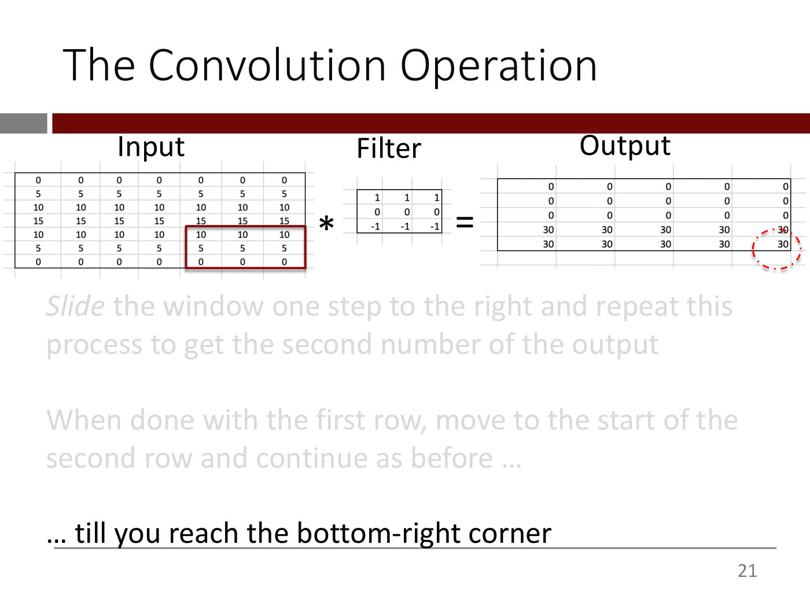

Same layout as slide 15. The red box on the input is now at the bottom-right (rows 5-7, columns 5-7: 10 10 10 / 5 5 5 / 0 0 0). The output is complete, with its bottom-right cell (30) circled by a red dashed ellipse:

| | | | | |
| --- | --- | --- | --- | --- |
| 0 | 0 | 0 | 0 | 0 |
| 0 | 0 | 0 | 0 | 0 |
| 0 | 0 | 0 | 0 | 0 |
| 30 | 30 | 30 | 30 | 30 |
| 30 | 30 | 30 | 30 | 30 |

- *Slide* the window one step to the right and repeat this process to get the second number of the output (greyed out)

When done with the first row, move to the start of the second row and continue as before … (greyed out)

… till you reach the bottom-right corner

*Figure: yes — input/filter/output with the red window at the input's bottom-right 3x3 block and the full 5x5 output (three rows of 0, two rows of 30), bottom-right cell circled*

## Slide 22 — By choosing the numbers in a filter carefully and applying the convolution operation, different features of the image can be detected

Switch to HODL-Lec-3-Convolution-Example.xlsx

<u>Optional</u>:

Check out https://setosa.io/ev/image-kernels/ to practice with different filters

(The URL is printed as an orange hyperlink.)

*Figure: no*

## Slide 23 — Convolutional Layers

A *convolutional layer* is composed of one or more convolutional filters

Centre: A stack of three overlapping grey 3x3 matrices, each offset down-left from the one behind it so the top-left corners form a staircase. The back matrix is fully visible in its top three rows:

| | | |
| --- | --- | --- |
| 1 | 0 | -1 |
| 1 | 0 | -1 |
| 1 | 0 | -1 |

Below it, the visible bottom edges of the two matrices in front show only a row "1 0 -1" (offset slightly left) and a row "-1 -1 -1" (offset further left); their other entries are hidden.

*Figure: yes — a stack of three overlapping 3x3 filter matrices (back one 1 0 -1 in every row, front rows visible as 1 0 -1 and -1 -1 -1)*

## Slide 24 — Convolutional Layers

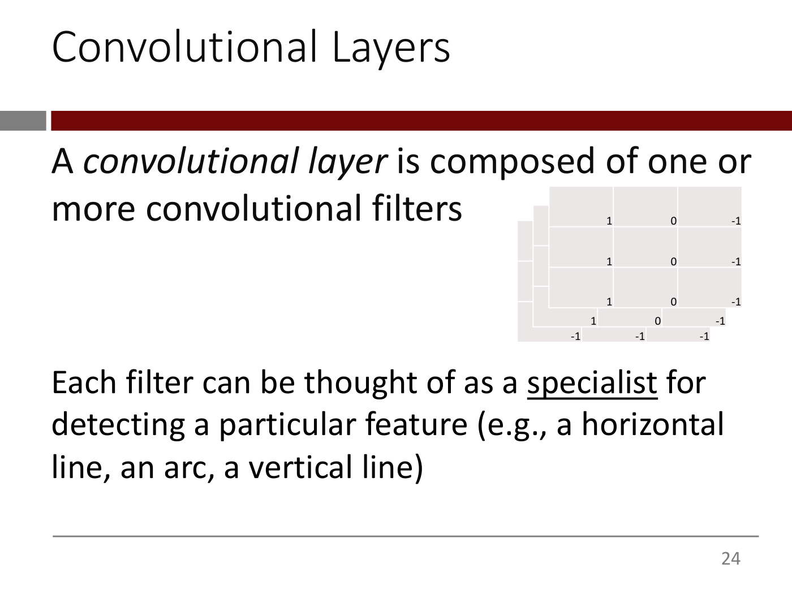

A *convolutional layer* is composed of one or more convolutional filters

Right: the same stack of three overlapping filter matrices as slide 23 (back matrix 1 0 -1 in every row; the visible bottom rows of the two in front read "1 0 -1" and "-1 -1 -1").

Each filter can be thought of as a <u>specialist</u> for detecting a particular feature (e.g., a horizontal line, an arc, a vertical line)

*Figure: yes — the stack of three overlapping 3x3 filter matrices from slide 23*

## Slide 25 — Applying a Convolutional *Layer* to an image

Underlined labels: "Input image" (left), "Conv layer with 2 filters" (centre), "Output" (right). The Output area is empty.

Input image (7x7), rows constant across columns, outlined in black:

| | | | | | | |
| --- | --- | --- | --- | --- | --- | --- |
| 0 | 0 | 0 | 0 | 0 | 0 | 0 |
| 5 | 5 | 5 | 5 | 5 | 5 | 5 |
| 10 | 10 | 10 | 10 | 10 | 10 | 10 |
| 15 | 15 | 15 | 15 | 15 | 15 | 15 |
| 10 | 10 | 10 | 10 | 10 | 10 | 10 |
| 5 | 5 | 5 | 5 | 5 | 5 | 5 |
| 0 | 0 | 0 | 0 | 0 | 0 | 0 |

Two red arrows point from the input image's left edge, one to each of two stacked 3x3 filters:

Top filter:

| | | |
| --- | --- | --- |
| 1 | 1 | 1 |
| 0 | 0 | 0 |
| -1 | -1 | -1 |

Bottom filter:

| | | |
| --- | --- | --- |
| 1 | 0 | -1 |
| 1 | 0 | -1 |
| 1 | 0 | -1 |

*Figure: yes — a 7x7 input image with arrows to two 3x3 filters (horizontal-line 1 1 1/0 0 0/-1 -1 -1 and vertical-line 1 0 -1 in each row), output area empty*

## Slide 26 — Applying a Convolutional Layer to an image

Same as slide 25 (the title prints "Layer" without italics), plus: A red arrow points from the top filter to a 5x5 output matrix (top):

| | | | | |
| --- | --- | --- | --- | --- |
| 0 | 0 | 0 | 0 | 0 |
| 0 | 0 | 0 | 0 | 0 |
| 0 | 0 | 0 | 0 | 0 |
| 30 | 30 | 30 | 30 | 30 |
| 30 | 30 | 30 | 30 | 30 |

*Figure: yes — slide 25's input and two filters, with the top filter's 5x5 output (three rows of 0, two rows of 30) shown*

## Slide 27 — Applying a Convolutional Layer to an image

Same as slide 26, plus:
A second red arrow points from the bottom filter to a second 5x5 output matrix placed below the first (bottom), all zeros:

| | | | | |
| --- | --- | --- | --- | --- |
| 0 | 0 | 0 | 0 | 0 |
| 0 | 0 | 0 | 0 | 0 |
| 0 | 0 | 0 | 0 | 0 |
| 0 | 0 | 0 | 0 | 0 |
| 0 | 0 | 0 | 0 | 0 |

*Figure: yes — input, two filters and both 5x5 outputs (top: three rows of 0 then two rows of 30; bottom: all 0)*

## Slide 28 — Applying a Convolutional Layer to an image

Same figure as slide 27 (top output: three rows of 0 then two rows of 30; bottom output: all 0), plus red text under the outputs:

These two 5x5 matrices can be represented as a tensor of shape ______?

*Figure: yes — input, two filters and both 5x5 outputs, with a red question about the tensor shape*


## Slide 29 — Applying a Convolutional Layer to an image

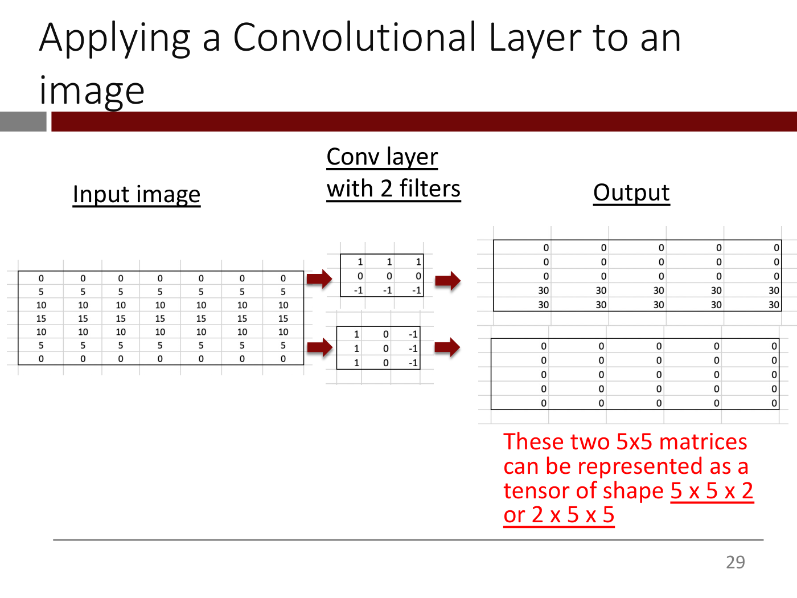

Same figure as slide 28 (underlined labels "Input image", "Conv layer with 2 filters", "Output"; the 7x7 input; the two 3x3 filters 1 1 1 / 0 0 0 / -1 -1 -1 and 1 0 -1 in each row; the top 5x5 output with three rows of 0 then two rows of 30; the bottom 5x5 output all 0), with the red text completed:

These two 5x5 matrices can be represented as a tensor of shape <u>5 x 5 x 2 or 2 x 5 x 5</u>

("5 x 5 x 2 or 2 x 5 x 5" is underlined.)

*Figure: yes — input, two filters and both 5x5 outputs, with the answer "5 x 5 x 2 or 2 x 5 x 5"*

## Slide 30 — Applying a Convolutional Filter to a color image

(The word "color" in the title is red.)

We know how to apply a convolutional filter to a 2-d tensor (e.g., a grayscale image)

Upper figure (a picture of the slide 15–18 example): headings "Input", "Filter", "Output". The 7x7 input (rows 0, 5, 10, 15, 10, 5, 0, constant across columns) has a red box on its top-left 3x3 block. Then "*", the 3x3 filter (1 1 1 / 0 0 0 / -1 -1 -1), "=", and a 5x5 output frame whose top-left cell shows 0, circled with a red dashed ellipse.

How should we apply a convolutional filter to a rank-3 tensor (e.g., a color image)?

Lower figure: three overlapping 6x6 grids stacked like cards, red in front, green behind it, blue at the back, labelled "6 x 6 x 3" underneath. To the right of a "*" is a single small yellow 3x3 grid (no label).

Image source: deeplearning.ai

*Figure: yes — upper: a 7x7 input / 3x3 filter / 5x5 output convolution example with the first output cell (0) circled; lower: a 6x6x3 red/green/blue stack convolved with a flat yellow 3x3 filter*

## Slide 31 — Applying a Convolutional Filter to a color image

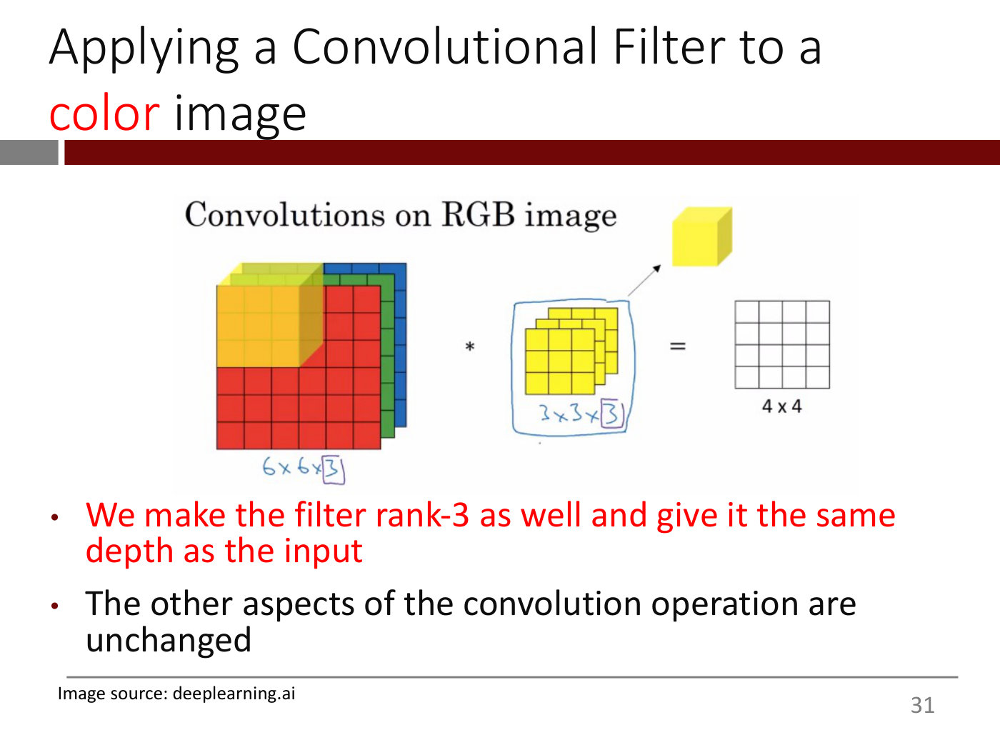

(The word "color" in the title is red.)

Figure titled "Convolutions on RGB image": on the left a 6x6x3 stack (red front, green middle, blue back) with the top-left 3x3x3 block highlighted in translucent orange/yellow and a handwritten blue label "6x6x[3]" (the 3 boxed) beneath. In the middle, after "*", a stack of three yellow 3x3 grids, outlined in a blue hand-drawn rounded box labelled "3x3x[3]" (the 3 boxed); an arrow runs from this stack to a solid yellow cube drawn above and to its right. After "=" on the right, a single empty 4x4 grid labelled "4 x 4".

- We make the filter rank-3 as well and give it the same depth as the input
- The other aspects of the convolution operation are unchanged

Image source: deeplearning.ai

*Figure: yes — a 6x6x3 RGB stack convolved with a 3x3x3 yellow filter stack (shown as a cube) to give a 4x4 output, with the highlighted top-left block and handwritten depth labels*

## Slide 32 — Applying a Convolutional <u>Layer</u> to a color image

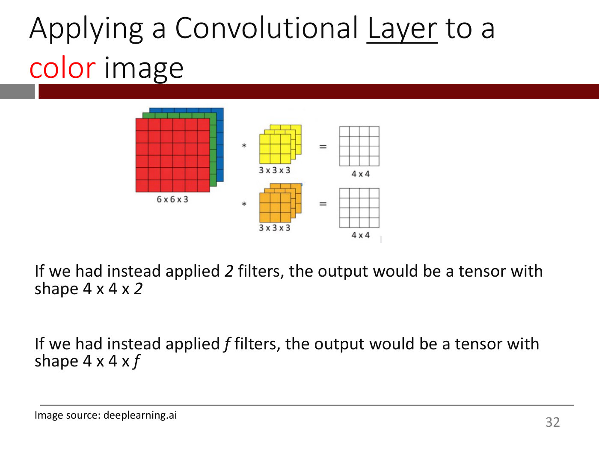

(The word "Layer" is underlined; "color" is red.)

Figure: a 6x6x3 stack (red, green, blue) labelled "6 x 6 x 3" on the left. Two rows to its right: top, "*" then a stack of three yellow 3x3 grids labelled "3 x 3 x 3", "=" and an empty 4x4 grid labelled "4 x 4"; bottom, "*" then a stack of three orange 3x3 grids labelled "3 x 3 x 3", "=" and a second empty 4x4 grid labelled "4 x 4".

If we had instead applied *2* filters, the output would be a tensor with shape 4 x 4 x *2*

If we had instead applied *f* filters, the output would be a tensor with shape 4 x 4 x *f*

Image source: deeplearning.ai

*Figure: yes — a 6x6x3 input convolved with two 3x3x3 filters (yellow and orange), each giving a 4x4 output*

## Slide 33 — [Pointer to textbook chapter 8.1]

Please see Chapter 8.1 of the textbook for more detail on how convolutional filters and layers work

*Figure: no*

## Slide 34 — The Big Idea

- These filters seem excellent but how are we supposed to come up with the numbers in each filter?

*Figure: no*

## Slide 35 — The Big Idea

- These filters seem excellent but how are we supposed to come up with the numbers in each filter? (greyed out)
- In fact, convolutional filters used to be designed by hand. Computer Vision researchers invested a lot of effort in devising filters that could detect various types of image features

*Figure: no*

## Slide 36 — The Big Idea

- These filters seem excellent but how are we supposed to come up with the numbers in each filter? (greyed out)
- In fact, convolutional filters used to be designed by hand. Computer Vision researchers invested a lot of effort in devising filters that could detect various types of image features (greyed out)
- As we figured out how to train deep networks with lots of weights, a big idea emerged**: think of the numbers in the filter as <u>weights</u> and simply learn them from the data, just like we learn all the other weights**

(The bold red part starts at the colon; "weights" is underlined.)

*Figure: no*

## Slide 37 — The Big Idea

Same text as slide 36 (first two bullets greyed out), plus:

  - This is possible because a convolutional filter is just a neuron like we saw in previous lectures, <u>albeit a special one </u>(see appendix)

*Figure: no*

## Slide 38 — The Big Idea

Same text as slide 37 (the first two bullets and the sub-bullet about "just a neuron" greyed out), plus:

  - Therefore, our entire machinery – neurons, layers, loss functions, gradient descent – is perfectly applicable

*Figure: no*

## Slide 39 — The Big Idea

- These filters seem excellent but how are we supposed to come up with the numbers in each filter? (greyed out)
- In fact, convolutional filters used to be designed by hand. Computer Vision researchers invested a lot of effort in devising filters that could detect various types of image features (greyed out)
- As we figured out how to train deep networks with lots of weights, a big idea emerged**: think of the numbers in the filter as <u>weights</u> and simply learn them from the data, just like we learn all the other weights** (greyed out)
- This turned out to be a turning point in the Computer Vision field and led to massive improvements in algorithmic capabilities

*Figure: no*

## Slide 40 — Later conv layers "see" more of the original input than the earlier layers

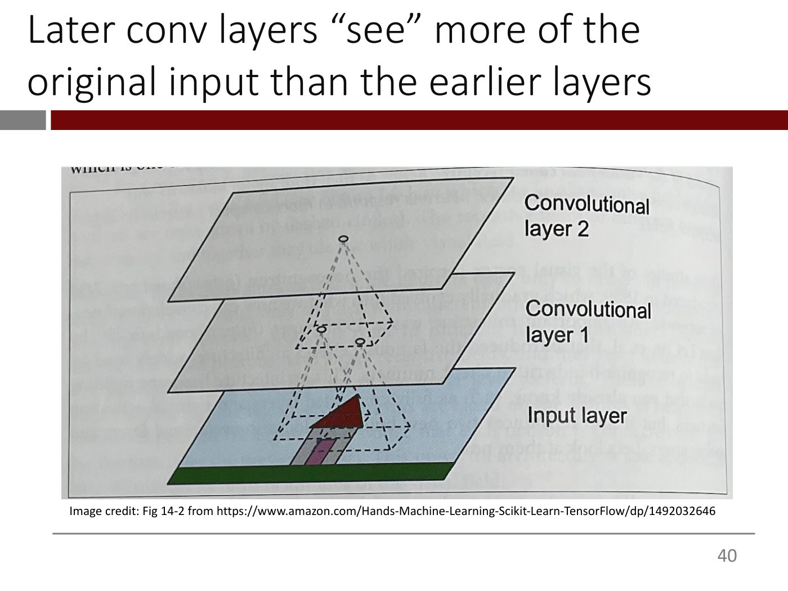

A photograph of a printed book page showing a 3D diagram of three stacked tilted rectangular planes, labelled on the right from top to bottom "Convolutional layer 2", "Convolutional layer 1" and "Input layer". The bottom (input) plane is light blue with a green strip along its bottom edge and a small drawing of a house (red triangular roof, pink and grey walls). Dashed lines form pyramids projecting downward: a single point on layer 2 connects to a small dashed rectangle on layer 1, and two points inside that rectangle connect to a larger dashed region of the input plane covering the house's roof and walls. A unit in a later layer therefore depends on a larger area of the input. Faint text of the book page shows through the background.

Image credit: Fig 14-2 from https://www.amazon.com/Hands-Machine-Learning-Scikit-Learn-TensorFlow/dp/1492032646

*Figure: yes — a photographed textbook diagram of an input layer (with a house drawing) and two convolutional layers linked by dashed pyramids showing growing receptive fields*

## Slide 41 — As a result, a network with *many* convolutional layers can learn increasingly complex features

*OCW notice: Convolutional layers images © Honglak Lee, Roger Grosse, Rajesh Ranganath, Andrew Y. Ng. All rights reserved. This content is excluded from our Creative Commons license. For more information, see https://ocw.mit.edu/help/faq-fair-use.*

Three grids of small grayscale image tiles (each about 6 columns by 4 rows) are shown left to right, joined by red arrows (a red arrow also enters the first grid from the left). The first grid holds small oriented-line and edge patterns, the second holds more complex part-like patterns, and the third holds face-like images.

lines => edges, circles => faces!

Convolutional layers images © Honglak Lee, Roger Grosse, Rajesh Ranganath, Andrew Y. Ng. All rights reserved. This content is excluded from our Creative Commons license. For more information, see https://ocw.mit.edu/help/faq-fair-use.

Convolutional Deep Belief Networks for Scalable Unsupervised Learning of Hierarchical Representations by Lee at al (2009)

(The paper title is an orange hyperlink. The slide prints "Lee at al".)

*Figure: yes — three grids of grayscale feature tiles linked by arrows, from line/edge patterns to part patterns to face-like images (excluded third-party image)*

## Slide 42 — Pooling Layers

(Section divider slide; title only.)

*Figure: no*

## Slide 43 — Pooling Layers

**Pooling layers** (also called down-sampling or subsampling layers) reduce the size of the tensor coming out of a convolutional layer

*Figure: no*

## Slide 44 — Pooling Layers

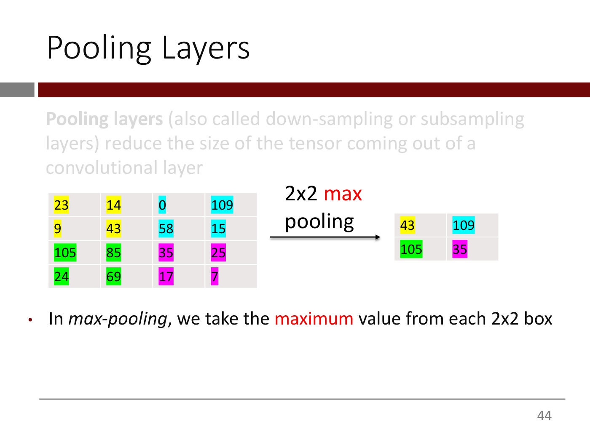

Same text as slide 43 (greyed out), plus a worked 2x2 max pooling example. Left: a 4x4 grid of numbers, in which each 2x2 box has its own highlight colour. An arrow labelled "2x2 max pooling" (the word "max" in red) points to a 2x2 output grid on the right.

Input grid (colour of each cell in brackets):

| | col 1 | col 2 | col 3 | col 4 |
| --- | --- | --- | --- | --- |
| row 1 | 23 (yellow) | 14 (yellow) | 0 (cyan) | 109 (cyan) |
| row 2 | 9 (yellow) | 43 (yellow) | 58 (cyan) | 15 (cyan) |
| row 3 | 105 (green) | 85 (green) | 35 (magenta) | 25 (magenta) |
| row 4 | 24 (green) | 69 (green) | 17 (magenta) | 7 (magenta) |

Output grid (max of each coloured 2x2 box):

| | col 1 | col 2 |
| --- | --- | --- |
| row 1 | 43 (yellow) | 109 (cyan) |
| row 2 | 105 (green) | 35 (magenta) |

- In *max-pooling*, we take the maximum value from each 2x2 box

("maximum" is in red on the slide.)

*Figure: yes — a 4x4 number grid split into four colour-coded 2x2 boxes, an arrow labelled "2x2 max pooling", and the resulting 2x2 grid of box maxima (43, 109, 105, 35)*

## Slide 45 — Pooling Layers

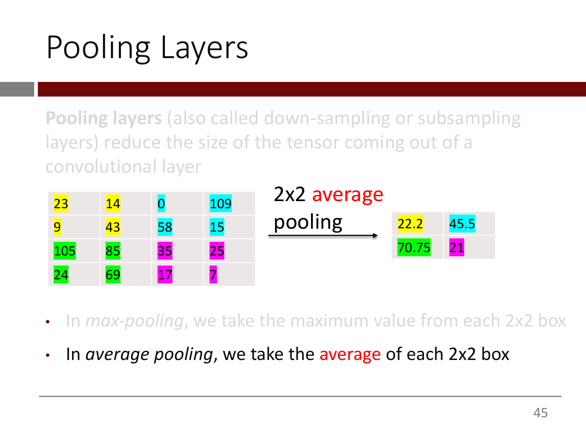

Same text and input grid as slide 44, but the arrow is now labelled "2x2 average pooling" (the word "average" in red) and the output grid holds the averages of the coloured boxes:

| | col 1 | col 2 |
| --- | --- | --- |
| row 1 | 22.2 (yellow) | 45.5 (cyan) |
| row 2 | 70.75 (green) | 21 (magenta) |

- In *max-pooling*, we take the maximum value from each 2x2 box (greyed out)
- In *average pooling*, we take the average of each 2x2 box

("average" is in red on the slide. The input grid is identical to slide 44: row 1 = 23, 14, 0, 109; row 2 = 9, 43, 58, 15; row 3 = 105, 85, 35, 25; row 4 = 24, 69, 17, 7, with the same yellow/cyan/green/magenta box colouring.)

*Figure: yes — the same colour-coded 4x4 number grid with an arrow labelled "2x2 average pooling" and a 2x2 output grid of box averages (22.2, 45.5, 70.75, 21)*

## Slide 46 — Pooling Layers

Same text as slide 43 (greyed out). Same input grid and colouring as slide 44, arrow labelled "2x2 average pooling" (no red text on this slide), output grid 22.2, 45.5 / 70.75, 21 as on slide 45.

- Reduces the number of entries significantly (e.g., 75% for 2x2 pooling)
- The output from the pooling layer is fed to the next layer as usual

*Figure: yes — the same colour-coded 4x4 grid, "2x2 average pooling" arrow and 2x2 output grid (22.2, 45.5, 70.75, 21) as slide 45*

## Slide 47 — Pooling Layers

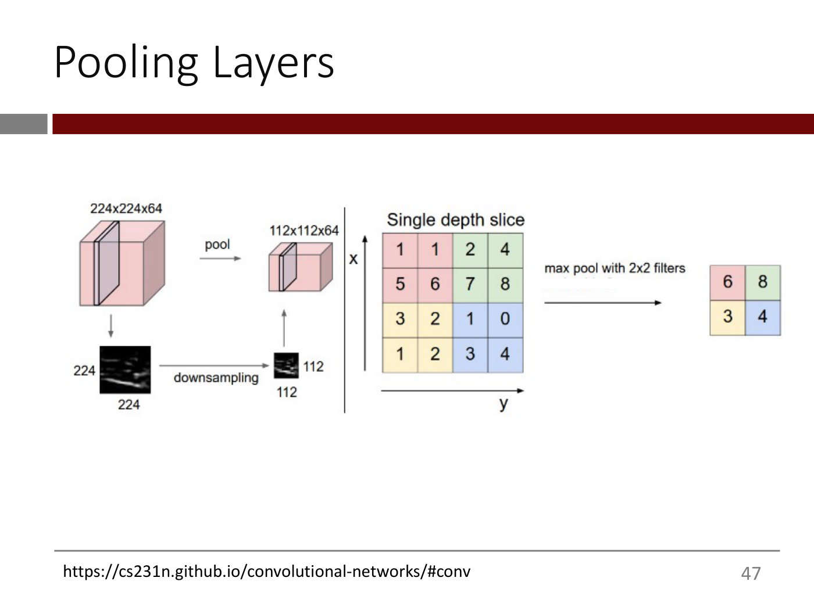

Source line at the bottom left: https://cs231n.github.io/convolutional-networks/#conv

Left: a pink 3D block labelled "224x224x64" with one thin slice highlighted. An arrow labelled "pool" points right to a smaller pink block labelled "112x112x64", also with one slice highlighted. Below, a down arrow from the large block leads to a black-and-white image of one slice labelled "224" (height) and "224" (width); an arrow labelled "downsampling" points right to a much smaller version of the image labelled "112" and "112"; an up arrow connects it to the small block.

Middle: a titled grid "Single depth slice" with axes x (vertical, up arrow) and y (horizontal, right arrow), a 4x4 grid of numbers split into four coloured 2x2 boxes:

| | col 1 | col 2 | col 3 | col 4 |
| --- | --- | --- | --- | --- |
| row 1 | 1 (pink) | 1 (pink) | 2 (green) | 4 (green) |
| row 2 | 5 (pink) | 6 (pink) | 7 (green) | 8 (green) |
| row 3 | 3 (yellow) | 2 (yellow) | 1 (blue) | 0 (blue) |
| row 4 | 1 (yellow) | 2 (yellow) | 3 (blue) | 4 (blue) |

An arrow labelled "max pool with 2x2 filters" (a faint, unreadable line of residual text sits beneath the label) points to the right-hand 2x2 output:

| | col 1 | col 2 |
| --- | --- | --- |
| row 1 | 6 (pink) | 8 (green) |
| row 2 | 3 (yellow) | 4 (blue) |

*Figure: yes — a 224x224x64 block pooled to 112x112x64 with a downsampled slice image, and a 4x4 "Single depth slice" grid max-pooled with 2x2 filters to 6, 8 / 3, 4*

## Slide 48 — Intuition behind max pooling

- Max pooling acts like an "OR" condition: if a feature exists anywhere in its input, max-pooling will pick it up i.e., max-pooling acts like a *feature detector*

*Figure: no*

## Slide 49 — Intuition behind max pooling

- Max pooling acts like an "OR" condition: if a feature exists anywhere in its input, max-pooling will pick it up i.e., max-pooling acts like a *feature detector*

*Switch to Notability*

*Figure: no*

## Slide 50 — Intuition behind max pooling

- Max pooling acts like an "OR" condition: if a feature exists anywhere in its input, max-pooling will pick it up i.e., max-pooling acts like a *feature detector* (greyed out)
- Since successive convolutional layers can "see" more and more of the original input image, the max-pooling layers that follow them can detect if a feature exists in more and more of the original input image as well

*Figure: no*

## Slide 51 — The Architecture of a Basic CNN

(Section-divider slide: title only.)

*Figure: no*

## Slide 52 — The architecture of a basic CNN

*OCW notice: Convolutional blocks image by Faisal Alshuwaier, Ali Areshey, Josiah Poon. License: CC BY-NC-ND. This content is excluded from our Creative Commons license. For more information, see https://ocw.mit.edu/help/faq-fair-use.*

Source line: https://towardsdatascience.com/a-comprehensive-guide-to-convolutional-neural-networks-the-eli5-way-3bd2b1164a53

A diagram of a CNN drawn left to right: an input image (a stack of sheets showing a blue car silhouette), followed by a sequence of 3D blocks connected by thin pyramid-shaped lines showing each small patch feeding the next block. Labels under the diagram: "INPUT", "CONVOLUTION + RELU", "POOLING", "CONVOLUTION + RELU", "POOLING", with "..." before a last block. A red dashed rectangle encloses everything from the first convolution block to the final block shown. Caption below, with "convolutional blocks" in red: "A series of convolutional blocks". (A cropped fragment of further faint text sits under the caption, unreadable.)

*Figure: yes — a CNN diagram (input car image, alternating convolution + ReLU and pooling blocks) with a red dashed box around the convolutional part, captioned "A series of convolutional blocks"*

## Slide 53 — The architecture of a basic CNN

*OCW notice: Convolutional blocks image by Faisal Alshuwaier, Ali Areshey, Josiah Poon. License: CC BY-NC-ND. This content is excluded from our Creative Commons license. For more information, see https://ocw.mit.edu/help/faq-fair-use.*

Source line: https://towardsdatascience.com/a-comprehensive-guide-to-convolutional-neural-networks-the-eli5-way-3bd2b1164a53

Same CNN diagram and red dashed box as slide 52. Caption: "Each *convolutional block* typically has 1-2 convolutional layers followed by a pooling layer" (the words "convolutional block" are in red italics).

*Figure: yes — the same CNN diagram as slide 52 with the caption about each convolutional block having 1-2 convolutional layers followed by a pooling layer*

## Slide 54 — The architecture of a basic CNN

*OCW notice: Convolutional blocks image by Faisal Alshuwaier, Ali Areshey, Josiah Poon. License: CC BY-NC-ND. This content is excluded from our Creative Commons license. For more information, see https://ocw.mit.edu/help/faq-fair-use.*

Source line: https://towardsdatascience.com/a-comprehensive-guide-to-convolutional-neural-networks-the-eli5-way-3bd2b1164a53

Same CNN diagram and red dashed box as slide 52, with two dark-red arrows drawn from the caption text: one pointing at the first pooled block (the one just after the first convolution block) and one pointing at a later, smaller block near the "..." in the diagram. Caption: "Each block will typically have more depth than the previous block but lower height/width. Compare this to this"

*Figure: yes — the same CNN diagram as slide 52 with two red arrows from the caption pointing at an early block and a later block, to compare their depth and height/width*

## Slide 55 — At the end, we flatten the tensor, run it through fully-connected layers, and then the output layer

*OCW notice: Convolutional blocks image by Faisal Alshuwaier, Ali Areshey, Josiah Poon. License: CC BY-NC-ND. This content is excluded from our Creative Commons license. For more information, see https://ocw.mit.edu/help/faq-fair-use.*

Source line: https://towardsdatascience.com/a-comprehensive-guide-to-convolutional-neural-networks-the-eli5-way-3bd2b1164a53

The full CNN diagram: input car image, then blocks labelled "INPUT", "CONVOLUTION + RELU", "POOLING", "CONVOLUTION + RELU", "POOLING", "...", and on the right the final tensor feeding a column of boxes labelled "FLATTEN", then a column labelled "FULLY CONNECTED", then a column labelled "SOFTMAX" whose output units are labelled "CAR", "TRUCK", "VAN", "...", "BICYCLE". A bracket beneath the last three labels reads "CLASSIFICATION". A red dashed rectangle encloses the flatten / fully connected / softmax part. Caption: "The final tensor gets flattened into a long vector and sent through 0 or more hidden layers to the output layer"

*Figure: yes — the full CNN diagram ending in flatten, fully connected and softmax layers with car/truck/van/bicycle outputs, with the classification part boxed in red*

## Slide 56 — Colab: Let's solve Fashion MNIST with Convolutional layers!

"Link to colab" (an underlined hyperlink; its target is not printed on the slide).

*Figure: no*

## Slide 57 — Next: We will work with <u>color</u> images

(Section-divider slide: title only; "color" is underlined.)

*Figure: no*

## Slide 58 — Motivating application: A Handbags-Shoes Classifier based on less than 100 images!

*OCW notice: Generic images of handbags and shoes © unknown. All rights reserved. This content is excluded from our Creative Commons license. For more information, see https://ocw.mit.edu/help/faq-fair-use.*

Web-scraped dataset of < 100 color images of handbags and shoes

With this tiny dataset, we will build a deep learning network to classify <u>your</u> shoe or handbag <u>in class</u> with high accuracy!

("tiny dataset" is in red; "your" and "in class" are underlined.)

On the right, a 3x3 grid of product photographs on white backgrounds: top row a dark brown flat clutch-like bag, a black and grey sneaker, a tan backpack; middle row a pair of black lace-up boots, a flat rectangular dark brown/grey textured item, a grey sneaker; bottom row a grey patchwork handbag, a black sneaker pair in front of a green card, a navy blue high-top sneaker.

*Figure: yes — a 3x3 grid of web-scraped photos of handbags and shoes*

## Slide 59 — Colab: Let's build a shoes-handbags classifier with Convolutional layers!

"Link to colab" (an underlined hyperlink; its target is not printed on the slide).

*Figure: no*

## Slide 60 — Can we do better? We only have 100 examples of each class

(Section-divider slide: title only.)

*Figure: no*

## Slide 61 — Transfer Learning with Pre-trained Networks

(Section-divider slide: title only.)

*Figure: no*

## Slide 62 — Transfer learning takes advantage of two research trends

<u>Trend 1</u>: Researchers have designed NN architectures that are well-matched to different *types* of data. For example:

| Type of data | Architecture |
| --- | --- |
| All | Residual connections |
| Images | Convolutional layers |
| Sequences (e.g., natural language, audio, video, gene sequences) | Transformers |

*Figure: no*

## Slide 63 — Transfer learning takes advantage of two research trends

Same text and table as slide 62, plus:

<u>Trend 2</u>: Using these architectural innovations, researchers have trained high-performance DNNs on a variety of large real-world datasets. Numerous pretrained models are available!

("Numerous pretrained models are available!" is in red.)

*Figure: no*

## Slide 64 — [Transfer learning definition]

Transfer learning involves **customizing** such a pre-trained network to your problem, rather than designing and training a network from scratch.

(No printed title; "customizing such a pre-trained network to your problem," is in red, "customizing" bold.)

*Figure: no*

## Slide 65 — Can we apply Transfer Learning to build a better Handbags/Shoes Classifier?*

Handbags and shoes are "everyday objects" and you can look around and see if there are any networks that have been trained on a dataset of images of "everyday objects"

Footnote: *The first thing to do, of course, is to see if someone has already built such a classifier and put it on GitHub :) (the slide prints a smiley-face symbol)

*Figure: no*

## Slide 66 — Can we apply Transfer Learning to build a better Handbags/Shoes Classifier?

*OCW notice: ImageNet training image © unknown. All rights reserved. This content is excluded from our Creative Commons license. For more information, see https://ocw.mit.edu/help/faq-fair-use.*

Handbags and shoes are "everyday objects" and you can look around and see if there are any networks that have been trained on a dataset of images of "everyday objects" (greyed out)

Turns out the ImageNet dataset has millions of images of <u>1000 categories</u> of everyday objects. We can look for networks that have been trained on ImageNet

("1000 categories" is underlined; the whole sentence from "1000 categories" on is in red.)

On the right, an image with the "IMAGENET" logo, the bullets "1,000 object classes (categories)." and "Images:" with sub-bullets "1.2 M train" and "100k test.", and a 4x2 mosaic of photographs (top row: a close-up of a red/water-drop object, a ship, a person on a motor scooter, a leopard; bottom row: a red car, a mushroom, a dog among cherries, a lemur-like animal) each with a small column of predicted class names and bars beneath (e.g. "mite", "container ship", "motor scooter", "leopard", "grille", "mushroom", "cherry", "Madagascar cat"; the smaller labels are too small to read). Link: https://www.slideshare.net/xavigiro/image-classification-on-imagenet-d1l4-2017-upc-deep-learning-for-computer-vision/

*Figure: yes — an ImageNet summary graphic (1,000 classes, 1.2 M train, 100k test) with a mosaic of example photographs and predicted-class bars*

## Slide 67 — A network trained on ImageNet and that does well on it has essentially developed a smart, hierarchical representation of these objects across its layers

*OCW notice: ImageNet trained network images © Matthew D. Zeiler and Rob Fergus/Springer. All rights reserved. This content is excluded from our Creative Commons license. For more information, see https://ocw.mit.edu/help/faq-fair-use.*

Title with "smart, hierarchical representation" and "across its layers" in red. Source line: https://cs.nyu.edu/~fergus/papers/zeilerECCV2014.pdf

Left: a small 3x3 grid of coloured filter patches labelled "Layer 1", and below it a larger grid of colourful small image patches (blocks of edges, colours and gradients). Right: a grid of 4 rows x 5 columns of grey visualisation tiles (each a 3x3 set of small grey feature maps showing edges, circles and curves) labelled "Layer 2" at the bottom-left, next to a matching grid of 4 rows x 6 columns of natural-image patches (textures, stripes, circles, colour blocks) that activate those features.

*Figure: yes — Layer 1 and Layer 2 feature visualisations (grey feature maps beside the matching image patches) from an ImageNet-trained network*

## Slide 68 — A network trained on ImageNet and that does well on it has essentially developed a smart, hierarchical representation of these objects across its layers

*OCW notice: ImageNet trained network images © Matthew D. Zeiler and Rob Fergus/Springer. All rights reserved. This content is excluded from our Creative Commons license. For more information, see https://ocw.mit.edu/help/faq-fair-use.*

Same title and source line as slide 67. Left: a grid of 4 rows x 4 blocks of grey visualisation tiles labelled "Layer 3" (edge and pattern shapes, more complex than layer 2). Right: a matching grid of natural-image patches (honeycomb and mesh textures, wheels and cars, people, birds, text, orange objects, flowers).

*Figure: yes — Layer 3 feature visualisations beside the matching image patches*

## Slide 69 — A network trained on ImageNet and that does well on it has essentially developed a smart, hierarchical representation of these objects across its layers

*OCW notice: ImageNet trained network images © Matthew D. Zeiler and Rob Fergus/Springer. All rights reserved. This content is excluded from our Creative Commons license. For more information, see https://ocw.mit.edu/help/faq-fair-use.*

Same title as slide 67. Source line: https://cs.nyu.edu/~fergus/papers/zeilerECCV2014.pdf. Two pairs of grids side by side. Left pair labelled "Layer 4": grey feature-visualisation tiles beside image patches (dogs, spirals, wheels, birds, water birds, cameras). Right pair labelled "Layer 5": grey feature-visualisation tiles beside image patches (dogs, flowers, people, bicycles, reptile faces, typewriters).

*Figure: yes — Layer 4 and Layer 5 feature visualisations beside the matching image patches*

## Slide 70 — The ResNet family of networks was trained on ImageNet and did very well in the associated ImageNet competition

*OCW notice: ResNet34 layers image © Kaiming He, Xiangyu Zhang, Shaoqing Ren, Jian Sun/arXiv. All rights reserved. This content is excluded from our Creative Commons license. For more information, see https://ocw.mit.edu/help/faq-fair-use.*

Label "ResNet 34*". Footnote: *https://arxiv.org/abs/1512.03385

A diagram of ResNet 34 ("34-layer residual"), drawn left to right: "image" enters a box "7x7 conv, 64, /2" (orange), then "pool, /2", then a long row of vertical boxes: six "3x3 conv, 64" (lilac), then one "3x3 conv, 128, /2" and seven "3x3 conv, 128" (green), then one "3x3 conv, 256, /2" and eleven "3x3 conv, 256" (pink), then one "3x3 conv, 512, /2" and five "3x3 conv, 512" (light blue), then "avg pool", then a final white box "fc 1000". Curved skip arrows (solid; dotted where the number of filters changes) arch over successive pairs of boxes.

We'd expect the (learned) weights and biases of ResNet layers to embody "knowledge" (like illustrated in the previous slides) about the characteristics of the millions of everyday images that the network was trained on

(The slide text is in red. The title runs slightly past the right edge and the bottom of the slide title band; transcribed as shown.)

*Figure: yes — the ResNet 34 layer diagram (7x7 conv, pool, 3x3 conv blocks of 64/128/256/512 filters with skip arrows, avg pool, fc 1000)*

## Slide 71 — But we can't use ResNet as is

*OCW notice: ResNet34 layers image © Kaiming He, Xiangyu Zhang, Shaoqing Ren, Jian Sun/arXiv. All rights reserved. This content is excluded from our Creative Commons license. For more information, see https://ocw.mit.edu/help/faq-fair-use.*

Label "ResNet 34*". Footnote: *https://arxiv.org/abs/1512.03385

Same ResNet 34 diagram as slide 70: A diagram of ResNet 34 ("34-layer residual"), drawn left to right: "image" enters a box "7x7 conv, 64, /2" (orange), then "pool, /2", then a long row of vertical boxes: six "3x3 conv, 64" (lilac), then one "3x3 conv, 128, /2" and seven "3x3 conv, 128" (green), then one "3x3 conv, 256, /2" and eleven "3x3 conv, 256" (pink), then one "3x3 conv, 512, /2" and five "3x3 conv, 512" (light blue), then "avg pool", then a final white box "fc 1000". Curved skip arrows (solid; dotted where the number of filters changes) arch over successive pairs of boxes.

Remember that ResNet was designed to classify the image into 1000 categories. Our problem is different – we only care about two categories: handbags and shoes.

("1000" and "two" are red.)

*Figure: yes — the same ResNet 34 layer diagram as slide 70*

## Slide 72 — So we take ResNet and stop just before the last layer

*OCW notice: ResNet34 layers image © Kaiming He, Xiangyu Zhang, Shaoqing Ren, Jian Sun/arXiv. All rights reserved. This content is excluded from our Creative Commons license. For more information, see https://ocw.mit.edu/help/faq-fair-use.*

Label "ResNet 34" (no asterisk). Footnote: *https://arxiv.org/abs/1512.03385

Same ResNet 34 diagram as slide 70, now with a red dashed rectangle around everything from the "34-layer residual" label through "avg pool", excluding the final "fc 1000" box.

*Figure: yes — the ResNet 34 diagram with a red dashed box around all layers except the final fc 1000 layer*

## Slide 73 — We can run our images through this "headless" ResNet

*OCW notice: ResNet34 layers image © Kaiming He, Xiangyu Zhang, Shaoqing Ren, Jian Sun/arXiv. All rights reserved. This content is excluded from our Creative Commons license. For more information, see https://ocw.mit.edu/help/faq-fair-use.*

Label "ResNet 34". Footnote: *https://arxiv.org/abs/1512.03385

Same ResNet 34 diagram and red dashed rectangle as slide 72. A dark-red arrow points down from the right end of the dashed box (just after avg pool) to a dark-red-outlined text box reading: "What comes out here will be a "smart representation" of the (everyday) image that can be used for different kinds of categorization." and "Imagine that the image gets "tagged" with lots of general tags and we can use the tags any way we wish."

*Figure: yes — the headless ResNet 34 diagram (red dashed box, arrow from the avg pool output to a text box about a smart representation)*

## Slide 74 — We can think of the output of "headless ResNet" as a smart representation of the raw image and use it to train a simple one-hidden-layer NN

(Title only; the body is empty.)

*Figure: no*

## Slide 75 — We can think of the output of "headless ResNet" as a smart representation of the raw image and use it to train a simple one-hidden-layer NN

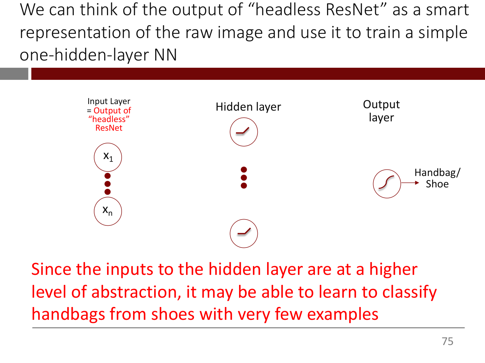

A network diagram with three columns. Left, labelled "Input Layer = Output of "headless" ResNet" (the words "Output of "headless" ResNet" in red): two circles labelled x1 and xn separated by three vertical dots. Middle, labelled "Hidden layer": two circles each containing a ReLU-shaped icon, separated by three vertical dots. Right, labelled "Output layer": one circle containing a sigmoid-shaped icon, with an arrow to the label "Handbag/ Shoe". (No connecting lines between layers are drawn on this slide.)

Since the inputs to the hidden layer are at a higher level of abstraction, it may be able to learn to classify handbags from shoes with very few examples

(The sentence is in red.)

*Figure: yes — a one-hidden-layer network diagram: inputs x1..xn (output of headless ResNet), ReLU hidden units, one sigmoid output labelled Handbag/Shoe*

## Slide 76 — That's the basic idea behind transfer learning ...

(Title only; the body is empty.)

*Figure: no*

## Slide 77 — That's the basic idea behind transfer learning but you can get fancier

(Title: "but you can get fancier" is in red.)

A wide diagram inside a thin red-bordered box: the ResNet 34 diagram ("34-layer residual", "image" in, "7x7 conv, 64, /2", "pool, /2", then the rows of "3x3 conv" boxes with 64, 128 (first "/2"), 256 (first "/2") and 512 (first "/2") filters and skip arrows; the avg pool and fc 1000 boxes are not shown) followed on the right by the small network from slide 75: a column labelled "Hidden layer" (two ReLU-icon circles separated by three dots) and a column labelled "Output layer" (one sigmoid-icon circle) with an arrow to "Handbag/ Shoe". The text in the diagram is very small.

- You can connect up "headless ResNet" with our little network and train the entire network end-to-end. This is called <u>fine-tuning</u>.
- However, you MUST start the training with the weights and biases that came with ResNet, rather than start from scratch.
- You will explore this in HW 1

("end-to-end" is in red; "fine-tuning" is underlined; the last two bullets are in red.)

*Figure: yes — the headless ResNet 34 diagram joined to the small hidden-layer/output network (Handbag/Shoe), all inside a red box, illustrating end-to-end fine-tuning*

## Slide 78 — You can find pretrained models in the Tensorflow Hub ...

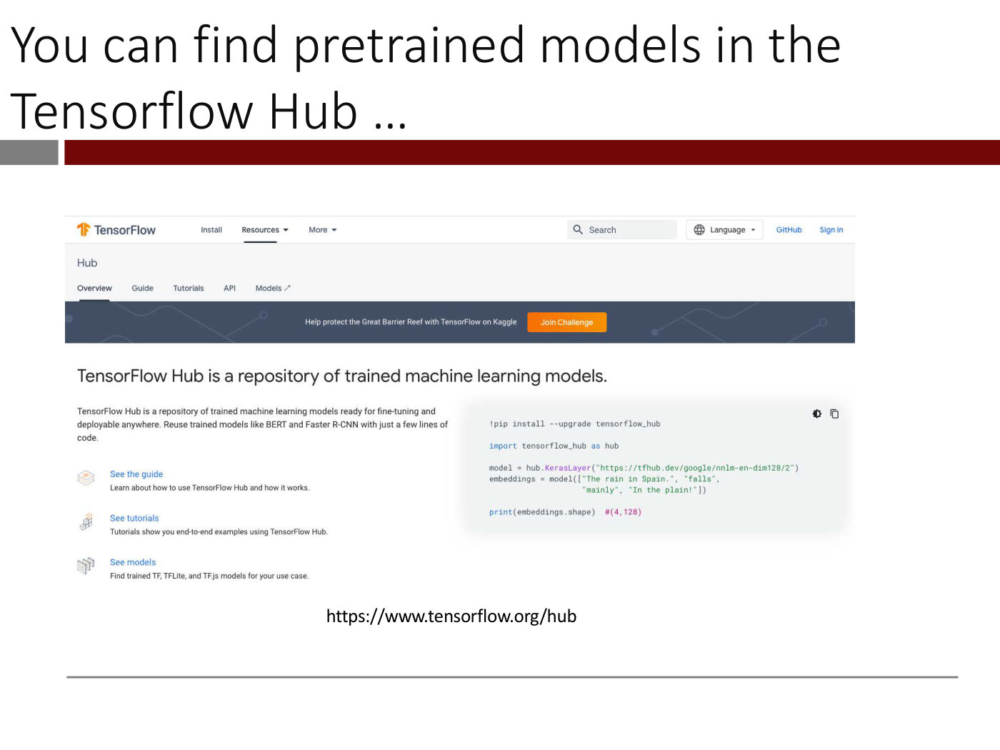

A screenshot of the TensorFlow Hub web page. Top bar: "TensorFlow", "Install", "Resources", "More", "Search", "Language", "GitHub", "Sign In". Sub-navigation: "Hub", "Overview", "Guide", "Tutorials", "API", "Models". A dark banner reads "Help protect the Great Barrier Reef with TensorFlow on Kaggle" with an orange "Join Challenge" button. Heading: "TensorFlow Hub is a repository of trained machine learning models." Left text: "TensorFlow Hub is a repository of trained machine learning models ready for fine-tuning and deployable anywhere. Reuse trained models like BERT and Faster R-CNN with just a few lines of code." followed by three links: "See the guide" (Learn about how to use TensorFlow Hub and how it works.), "See tutorials" (Tutorials show you end-to-end examples using TensorFlow Hub.), "See models" (Find trained TF, TFLite, and TF.js models for your use case.). Right, a code panel:

```
!pip install --upgrade tensorflow_hub

import tensorflow_hub as hub

model = hub.KerasLayer("https://tfhub.dev/google/nnlm-en-dim128/2")
embeddings = model(["The rain in Spain.", "falls",
                    "mainly", "In the plain!"])

print(embeddings.shape)  #(4,128)
```

URL below the screenshot: https://www.tensorflow.org/hub

*Figure: yes — screenshot of the TensorFlow Hub overview page with an example tensorflow_hub code snippet*

## Slide 79 — ... the PyTorch Hub, ...


A screenshot of the PyTorch Hub web page. Top bar: "PyTorch", "Get Started", "Ecosystem", "Mobile", "Blog", "Tutorials", "Docs", "Resources", "GitHub", search icon. Large heading "PYTORCH HUB". Text: "Discover and publish models to a pre-trained model repository designed for research exploration. Check out the models for Researchers, or learn How It Works." Link "Contribute Models". Italic note: "*This is a beta release - we will be collecting feedback and improving the PyTorch Hub over the coming months." Section heading "FOR RESEARCHERS — EXPLORE AND EXTEND MODELS FROM THE LATEST CUTTING EDGE RESEARCH". A row of filter buttons: "All" (selected), "Audio", "Generative", "Nlp", "Scriptable", "Vision", and a search icon.

URL below the screenshot: https://pytorch.org/hub/

*Figure: yes — screenshot of the PyTorch Hub landing page with model-category filter buttons*

## Slide 80 — ... and the Hugging Face Hub


A screenshot of the Hugging Face models page. Top bar: Hugging Face logo and name, search box "Search models, datasets, users...", "Models", "Datasets". Left sidebar tabs "Tasks" (selected), "Libraries", "Datasets", "Languages", "Licenses", "Other", a "Filter Tasks by name" box, and under "Multimodal" the task chips: Feature Extraction, Text-to-Image, Image-to-Text, Image-to-Video, Text-to-Video, Visual Question Answering, Document Question Answering, Graph Machine Learning, Text-to-3D, Image-to-3D. Main area: a heading "Models 505,594" circled by a red dashed rounded rectangle, a "Filter by name" box, and a list of model cards: "metavoiceio/metavoice-1B-v0.1" (Text-to-Speech, Updated 3 days ago, 1.81k downloads, 434 likes); "briaai/RMBG-1.4" (Image-to-Image, Updated about 17 hours ago, 68, 386); "openbmb/MiniCPM-2B-sft-fp32" (Text Generation, Updated 10 days ago, 33.6k, 226); "abacusai/Smaug-72B-v0.1" (Text Generation, Updated 4 days ago, 3.62k, 246).

Source line: https://huggingface.co/models (as of February 13, 2024)

*Figure: yes — screenshot of the Hugging Face models listing with the model count (505,594) circled in red*

## Slide 81 — Back to Colab

"Link to colab" (an underlined hyperlink; its target is not printed on the slide).

*Figure: no*

## Slide 82 — Appendix

(Section-divider slide: title only.)

*Figure: no*

## Slide 83 — The convolutional filter is just a slightly modified neuron

- A "traditional" neuron (in the first hidden layer) is connected to all pixels of the input image. In contrast, a "convolutional filter" neuron is connected only to pixels in a small *region* of the input image
- Sliding the filter across the image ⇔ can be thought of as a different filter for each window *but with the same weights*
- Benefits
  - Preserves local adjacency
  - Far fewer parameters
  - Translation invariance – can detect the same pattern regardless of where it appears in an image

*Figure: no*

## Slide 84 — MIT OpenCourseWare end page

MIT OpenCourseWare
https://ocw.mit.edu

15.773 Hands-on Deep Learning
Spring 2024

For information about citing these materials or our Terms of Use, visit: https://ocw.mit.edu/terms.

*Figure: no*
