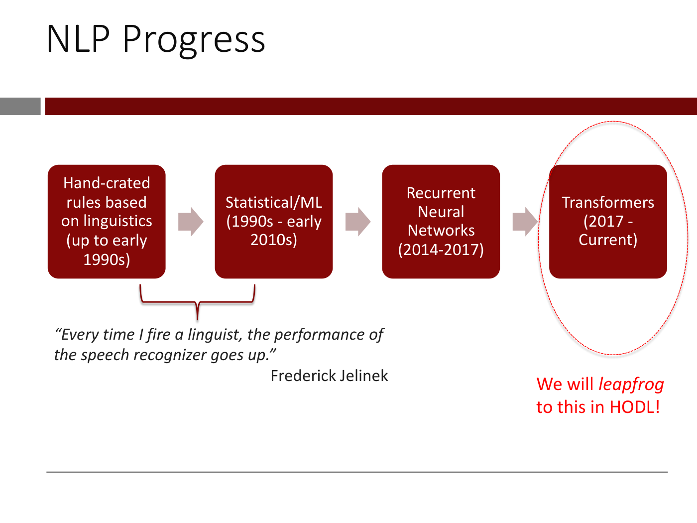
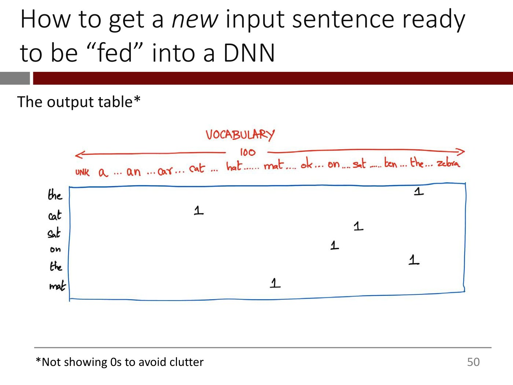
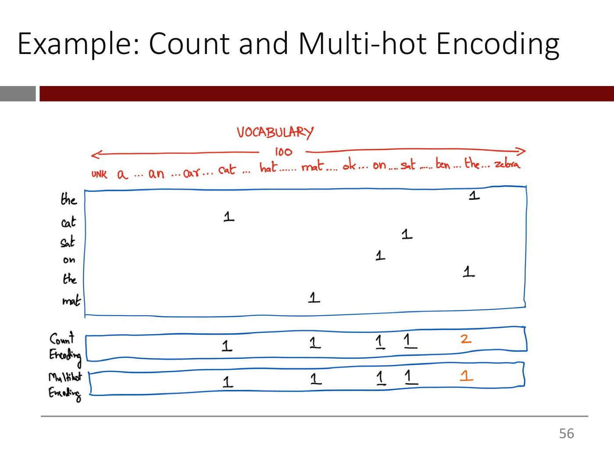
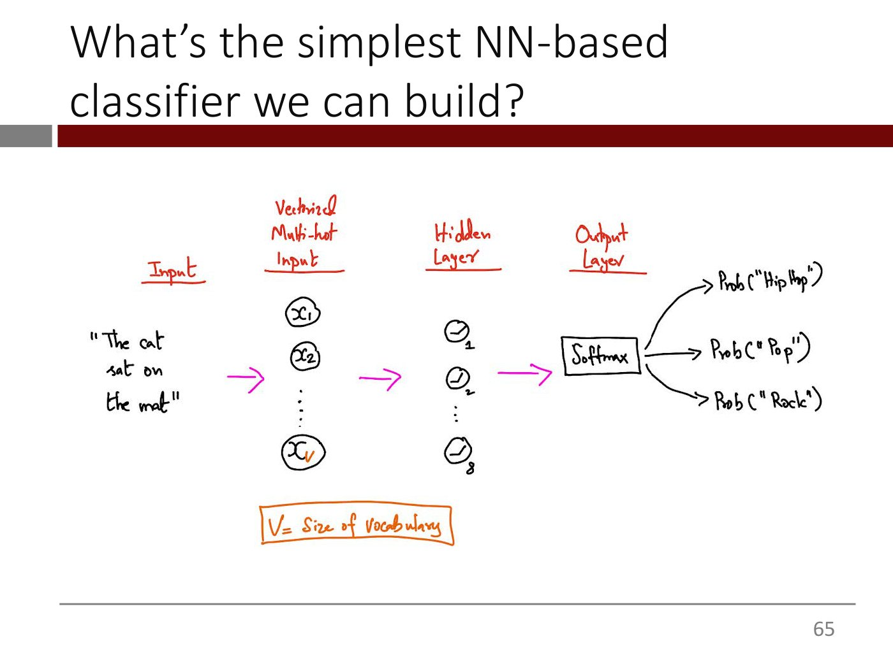

# Lecture 5 — Text Vectorization and the Bag-of-Words Model: slide-by-slide

Text and figures of all 67 slides of
[`mit15_773_s24_lec05.pdf`](https://ocw.mit.edu/courses/15-773-hands-on-deep-learning-spring-2024/mit15_773_s24_lec05.pdf)
(MIT 15.773 Hands-On Deep Learning, Spring 2024; lecturer Rama Ramakrishnan), transcribed from the deck. Lecture 5's video presents all of it, slides 1–66, and then runs the Colab. Cite these slides as "slide N", where N is the PDF page number. Diagrams, handwritten tables and screenshots are described in prose since the KB is read as text.

Slides marked with an `*OCW notice: …*` line (15 and 17) carry third-party material excluded from the Creative Commons licence. They are described in prose and never rendered as images. Words the slides print in red are given plainly, with a note in parentheses. Slide 63 prints eight lines of song lyrics; they are copyrighted and are described here rather than reproduced. The Colab hyperlink on slide 66 points to a notebook that is not published on OCW; its target is not printed on the slide. Byte-pair encoding, which slide 33 says "we will describe later", is in deck 09 (slides 58–60), not in this deck.

**Images.** Seven figure slides carry a 1400px render under their heading: 21, 27, 43, 47, 50, 56 and 65. The other figure-bearing slides are not rendered. Slides 15 and 17 carry OCW exclusion notices. Slides 3, 4 and 16 are third-party screenshots and logo graphics (Google autocomplete, a ChatGPT exchange, a Y Combinator startup landscape) of the kind OCW excluded on 15 and 17, and their text is transcribed below. Slides 6–14 and 22–25 are single-box "text → NLP → text" and "x → box → y" diagrams. Build steps are superseded by a rendered slide: 19–20 → 21; 28, 34, 35 and 44 → 27; 29–32 and 36–42, whose pipeline icon is 27's and whose vectors are 43's; 46, 48 and 49 → 47; 51 and 52 → 50. Slides 30, 32, 36 and 37 are examples and tables reproduced exactly below. Everything else is text.

## Numbering: slide numbers vs PDF pages

Headings use the PDF page number, and the deck agrees with it: every page that prints a number bottom-right prints its own page number. Pages 1 (the roadmap title), 15–17 (LLM logos, the startup landscape, the Salesforce press release), 19–21 (the arc of NLP progress) and 67 (OCW's end page) print none.

## Contents

| Slides | Section |
| ------ | ------- |
| 1 | Roadmap of the "Deep Learning for NLP" lectures 5–10 |
| 2–5 | Why NLP: human knowledge, the internet, communication and culture are mostly text; autocomplete; a ChatGPT limerick |
| 6–14 | Text in, text out covers a vast range of applications: classification, extraction, summarization, generation, code generation, question-answering; call-center optimization |
| 15–17 | LLMs in public discourse; the startup "gold rush"; enterprise vendors (Salesforce Einstein GPT) |
| 18–21 | The arc of NLP progress: hand-crafted rules, statistical/ML, recurrent neural networks, transformers; the Jelinek quote; "we will leapfrog to this in HODL" |
| 22–25 | 20,000-foot view: text as "fancy regression", $y = f(x, w)$; how to represent $x$ |
| 26–33 | Processing basics: the four steps of text vectorization (Standardize, Tokenize, Index, Encode); standardization and tokenization with an example; their disadvantages for text generation |
| 34–44 | The vocabulary; indexing (`<UNK>` = 0, a = 1, … zebra = 50000); encoding with one-hot vectors; vocabulary size = distinct tokens + one for `<UNK>` |
| 45–52 | A new sentence: "The cat sat on the mat" through STIE against a 100-token vocabulary gives a 6 x 100 table |
| 53–57 | Varying length; aggregating the one-hot vectors: count encoding (sum) and multi-hot encoding (OR); the Bag of Words model |
| 58–61 | Shortcomings of Bag of Words: lost word order; every input as long as the vocabulary |
| 62–65 | Task: song-genre prediction (hip-hop, rock or pop); the simplest neural classifier, drawn |
| 66 | Colab: text pre-processing, bag-of-words and bigrams |
| 67 | MIT OpenCourseWare end page |

---

## Slide 1 — Lecture 5: Text Vectorization and the Bag-of-Words Model

The "Deep Learning for NLP" Lecture Roadmap (underlined)

Lecture 5: Text Vectorization and the Bag-of-Words Model (large, red)

(Greyed out, listing the lectures that follow:)

- Lecture 6: Embeddings
- Lecture 7: Transformers – Theory
- Lecture 8: Transformers – Applications, Self-Supervised Learning
- Lectures 9-10: LLMs

15.S04: Hands-on Deep Learning
Spring 2024
Farias, Ramakrishnan ("Farias, Ramakrishnan" is red.)

Bottom left: the MIT Management Sloan School of Management logo.

*Figure: no*

## Slide 2 — Why Natural Language Processing (NLP)?

- Human knowledge is (mostly) natural language text
- The Internet is (mostly) natural language text
- Human communication is (mostly) natural language text
- Cultural production is (mostly) natural language text

A dark red downward arrow points to the line below:

*Imagine if a system could read and "understand" all this automatically*

*Figure: no*

## Slide 3 — NLP is in action all around us

The Google logo at top. Below it, two screenshots of the Google search box with autocomplete suggestions. Left: query "san f" with suggestions san francisco weather, san francisco, san francisco giants, san fernando valley, san francisco state university, san francisco hotels, san francisco 49ers, san fernando, san fernando mission, san francisco zip code. Right: query "san fe" with suggestions san fernando valley, san fernando mission, san fernando, san fernando high school, san felipe, san fernando weather, san felipe mexico, san fernando valley news, san fernando court, san fernando brewery. Each box has "Google Search" and "I'm Feeling Lucky" buttons. The figure shows the suggestions changing as one more letter is typed.

According to Google, *Autocomplete* ("Autocomplete" is red italic.)

- Saves 200 *years* of typing time, every *day*
- Made mobile possible

*Figure: yes — Google logo and two search-box screenshots showing autocomplete suggestions for "san f" and "san fe"*

## Slide 4 — NLP is in action all around us

(The title is followed by a smiling-face emoji.)

A screenshot of a ChatGPT conversation. The user (avatar "RA") asks: "Write a limerick about the beauty and power of deep learning". ChatGPT replies:

> In a world where data flows like a stream,
> Deep learning's more than a dream.
> It sifts through the noise,
> With an elegant poise,
> Unveiling insights that gleam!

Small copy, regenerate and thumbs-down icons sit under the reply. No OCW notice or credit line is visible on this page.

*Figure: yes — screenshot of a ChatGPT exchange producing a limerick about deep learning*

## Slide 5 — (untitled statement slide)

NLP has extraordinary potential for making products and services smarter ("extraordinary" is red.)

*Figure: no*

## Slide 6 — This seemingly simple capability covers a vast range of applications

A diagram: the word "text", a red arrow into a dark red rounded box labelled "NLP", a red arrow out to the word "text". It shows NLP as a text-in, text-out capability.

*Figure: yes — diagram text -> NLP box -> text*

## Slide 7 — Example applications: *Text Classification*

Diagram: "text" -> dark red box labelled "LLM" -> output list. (The box says "LLM" on this slide, where the others say "NLP".)

Classification of text for

- Sentiment
- Routing
- Intent
- Filtering
- …

*Figure: yes — diagram text -> LLM box -> list of classification uses*

## Slide 8 — Example applications: Text *Extraction*

Diagram: "text" -> dark red box labelled "NLP" -> output list.

Extract data out from free-form text

- Company financials from news article
- Customer name and contact info from chat
- Disease and medication codes from doctor's notes
- …

*Figure: yes — diagram text -> NLP box -> list of extraction uses*

## Slide 9 — Example applications: Text *Summarization*

Diagram: "text" -> dark red box labelled "NLP" -> output list.

Summarize long-form text into

- Bullet points
- Abstracts
- Titles
- …

*Figure: yes — diagram text -> NLP box -> list of summary formats*

## Slide 10 — Example applications: Text *Generation*

Diagram: "text" -> dark red box labelled "NLP" -> output list (no lead-in line).

- Marketing copy
- Sales emails
- Market summaries
- Job descriptions
- Social media posts
- College application essays (followed by a thinking-face emoji)
- …

*Figure: yes — diagram text -> NLP box -> list of generated text types*

## Slide 11 — Example applications: *Code Generation*

Diagram: "text" -> dark red box labelled "NLP" -> "Code that implements the input text".

*Figure: yes — diagram text -> NLP box -> code that implements the input text*

## Slide 12 — Example applications: *Question-Answering*

Diagram: input "Question text + Documents" -> dark red box labelled "NLP" -> output list.

Chatbots for:

- Medical/legal
- Call centers
- Compliance
- Form filling
- Workflow automation
- …

*Figure: yes — diagram (question text + documents) -> NLP box -> list of chatbot uses*

## Slide 13 — Example applications: *Question-Answering*

Same as slide 12, except the bullet "Call centers" is shown in red (bullet and text).

*Figure: yes — same diagram as slide 12 with "Call centers" highlighted red*

## Slide 14 — Example domain: *Call Center Optimization*

Diagram: input "Call center transcripts + Internal documents, FAQs etc" -> dark red box labelled "NLP" -> output list (no lead-in line):

- Top reasons why customers are upset
- What interventions seem to work?
- What characterizes the best support agents vs the rest?
- How should we grade this agent's interaction with customer X?
- How should we change the call center script for a situation?
- How should we coach the agent in real-time?
- …

*Figure: yes — diagram (call center transcripts + internal documents) -> NLP box -> list of questions answered*

## Slide 15 — NLP's potential is now widely recognized in public discourse due to the meteoric rise of Large Language Models

*OCW notice: Various AI logos © respective copyright holders. All rights reserved. This content is excluded from our Creative Commons license. For more information, see https://ocw.mit.edu/help/faq-fair-use.*

(The title runs to three lines and its last line, "Models", overlaps the red banner.)

A collage of logos and screenshots: the OpenAI logo (white knot on a green-grey rounded square); a "Google Gemini" banner (dark blue circuit-board background); an Anthropic "Meet Claude" web-page screenshot, with the URL https://www.anthropic.com/index/introducing-claude beneath it. At right, a screenshot titled "LMSYS Chatbot Arena Leaderboard" (trophy icon) with a table of Rank, Model and Arena Elo, rows 1–15: 1 GPT-4-1106-preview 1254; 2 GPT-4-0125-preview 1253; 3 Bard (Gemini Pro) 1218; 4 GPT-4-0314 1191; 5 GPT-4-0613 1164; 6 Mistral Medium 1152; 7 Claude-1 1150; 8 Qwen1.5-72B-Chat 1147; 9 Claude-2.0 1132; 10 Gemini Pro (Dev API) 1122; 11 Claude-2.1 1120; 12 Mixtral-8x7b-Instruct-v0.1 1120; 13 GPT-3.5-Turbo-0613 1118; 14 Gemini Pro 1115; 15 Yi-34B-Chat 1111.

Source line: https://www.anthropic.com/index/introducing-claude
Source line: https://huggingface.co/spaces/lmsys/chatbot-arena-leaderboard

*Figure: yes — collage of AI company logos (OpenAI, Google Gemini, Anthropic Claude) and the LMSYS Chatbot Arena leaderboard table*

## Slide 16 — There's a startup "gold rush" under way to create NLP based products and services

A graphic titled "Y Combinator W23 Generative AI Landscape": a table with a vertical coloured band on the left (yellow-orange "Business Function" spanning the first six rows, orange "Engineering Function" spanning the last four), then columns "Example Use Case" and "YC W23 Startups" (company logos). Rows, with use case and startups legible:

- Accounting Finance: Automate bookkeeping, data categorization; truewind, ALPHAWATCH
- Marketing: Image, video, and content creation; Booth.ai, Speedy
- Sales: Summarize transcript, automate outbound; Perspectiva, Tennr, FABIUS
- Customer Success: Support agents, automated responses; Hazel, OpenSight, Buff, OfOne, Parabolic, Yumax (last name small, only partly legible)
- Knowledge Management: Collaboration, summarize meeting notes, project management; Credal.ai, type
- Media: Generate game assets; real-time voice change; Iliad, decoherence, Texel
- Data Analytics: Text to SQL, data transforms; lightski, turntable, Lume, Defog.ai, Merse
- ML Ops Platform: Customize and optimize LLMs; vellum, GRADIENTJ, Baseplate
- Infrastructure: Data platforms, integrations, LLM infrastructure; pya, stack, Helicone, BerriAI, ANARCHY
- Developer Tools: Observability, manage production, low code; CodeComplete, Meru, Lasso, Foundation, Second

Footer text under the graphic (very small): "Created by your friends at Truewind (YC W23)" and "This is a work in progress. Reach out to us if you want to be added to the next iteration". No OCW notice is visible on this page.

*Figure: yes — Y Combinator W23 Generative AI Landscape table of use-case categories with startup logos*

## Slide 17 — Enterprise vendors are rushing to add NLP features to their products

*OCW notice: Logo/image of Einstein GPT © Salesforce. All rights reserved. This content is excluded from our Creative Commons license. For more information, see https://ocw.mit.edu/help/faq-fair-use.*

A screenshot of a Salesforce press release: small label "ARTIFICIAL INTELLIGENCE", headline "Salesforce Announces Einstein GPT, the World's First Generative AI for CRM", and below it a purple-blue banner image of a cartoon Albert Einstein (the Einstein mascot) waving from inside a laptop screen, with trees and a butterfly.

Source line: https://www.salesforce.com/news/press-releases/2023/03/07/einstein-generative-ai/

*Figure: yes — Salesforce press-release screenshot with the Einstein GPT mascot image*

## Slide 18 — The Arc of NLP Progress – How did we get here?

(Section divider slide; title only, in a dark red band with a grey block at its left.)

*Figure: no*

## Slide 19 — The Arc of NLP Progress

A left-to-right flow of four dark red rounded boxes joined by light pink-grey block arrows:

1. Hand-crated rules based on linguistics (up to early 1990s) (The slide prints "Hand-crated".)
2. Statistical/ML (1990s - early 2010s)
3. Recurrent Neural Networks (2014-2017)
4. Transformers (2017 - Current)

*Figure: yes — four-box timeline: hand-crafted rules, statistical/ML, recurrent neural networks, transformers*

## Slide 20 — NLP Progress

Same four-box flow as slide 19 (the first box again prints "Hand-crated"), plus a red curly brace under the first two boxes (spanning the hand-crafted rules and Statistical/ML boxes), and below it the quote:

*"Every time I fire a linguist, the performance of the speech recognizer goes up."*

Frederick Jelinek

*Figure: yes — four-box timeline with a brace under the first two boxes and the Jelinek quote*

## Slide 21 — NLP Progress

Same as slide 20, plus a thin dotted red oval drawn around the "Transformers (2017 - Current)" box, and beneath it in red text:

We will *leapfrog* to this in HODL!

(The whole sentence is red; "leapfrog" is italic.)

*Figure: yes — the slide 20 timeline with the Transformers box circled in a dotted red oval*

## Slide 22 — 20,000 Foot View of the Problem

Like most things, fancy regression!

Diagram: the symbol $x$, a red arrow into an empty white rectangular box (no label), a red arrow out to $y$. (The PDF's text layer places $f(x, w)$ at the box's position, but it is hidden under the box's fill and not visible on the rendered page, here or on slides 23–25.)

*Figure: yes — diagram x -> empty box -> y*

## Slide 23 — 20,000 Foot View of the Problem

Same as slide 22, plus:

$x$ = text

$y$ = text, labels, numbers, …

$w$ = weights

$f(x, w)$ = A deep neural network

*Figure: yes — diagram x -> empty box -> y*

## Slide 24 — 20,000 Foot View of the Problem

Same as slide 22 (including the diagram), plus:

Key questions:

- How to represent $x$. We will focus on this today.

*Figure: yes — diagram x -> empty box -> y*

## Slide 25 — 20,000 Foot View of the Problem

Same as slide 24, with the first bullet greyed out, plus a second bullet:

Key questions:

- How to represent $x$. We will focus on this today. (greyed out)
- (Next week) What NN architecture is best for processing text?

*Figure: yes — diagram x -> empty box -> y*

## Slide 26 — Processing Basics

(Section divider slide; title only.)

*Figure: no*

## Slide 27 — Basic Pre-Processing

A flow of four dark red rounded boxes joined by block arrows: Standardize -> Tokenize -> Index -> Encode.

This process is called *text vectorization* ("text vectorization" is italic.)

*Figure: yes — four-box pipeline Standardize, Tokenize, Index, Encode*

## Slide 28 — Basic Pre-Processing

The same four-box pipeline, with a rounded outline drawn around the first two boxes (Standardize, Tokenize).

We first do these two steps for every sentence in our training dataset*

Footnote: *aka "training corpus"

*Figure: yes — four-box pipeline with the first two boxes (Standardize, Tokenize) outlined*

## Slide 29 — Basic Pre-Processing

At the top right, a small version of the four-box pipeline (Standardize, Tokenize, Index, Encode) with a red circle around Standardize, marking the current step.

Standardization

- Strip capitalization, often punctuation and accents *(almost always)*
- Strip 'stop words' e.g., a, the, it, .. *(often)*
- Stemming (e.g., ate, eaten, eating, eaten > [eats]) *(sometimes)*

(The slide prints "eaten" twice in the stemming example.)

*Figure: yes — small pipeline diagram at top right with Standardize circled*

## Slide 30 — Basic Pre-Processing

Same as slide 29 (small pipeline at top right with Standardize circled, same three bullets under "Standardization"), plus an example in blue text with a dark red down arrow between the two lines:

Hola! What do you picture when you think of traveling to Mexico? Sipping a real margarita while soaking up the sun on a laid-back beach in Puerto Vallarta?

(down arrow)

hola what do you picture when you [thinks] of [travels] to mexico [sips] real margarita while [soaks] up sun on laidback beach in puerto vallarta

*Figure: yes — small pipeline diagram with Standardize circled, and a before/after standardization example joined by a down arrow*

## Slide 31 — Basic Pre-Processing

At the top right, the small four-box pipeline with a red circle around Tokenize.

Tokenization

- *Typically*, split each string on whitespace i.e., each word is a token
- [design choice] decide how many consecutive words make up a *token*

Footnote: *Modern LLMs use other tokenization schemes (more on this shortly)

*Figure: yes — small pipeline diagram at top right with Tokenize circled*

## Slide 32 — Basic Pre-Processing

Same as slide 31 (small pipeline with Tokenize circled, same two bullets; no footnote), plus an example in blue text with a dark red down arrow between the two blocks:

hola what do you picture when you [thinks] of [travels] to mexico [sips] real margarita while [soaks] up sun on laidback beach in puerto vallarta

(down arrow)

"hola", "what", "do", "you", "picture", "when", "you", "[thinks]", "of", "[travels]", "to", "mexico", "[sips]", "real", "margarita", "while", "[soaks]", "up", "sun", "on", "laidback", "beach", "in", "puerto", "vallarta"

*Figure: yes — small pipeline diagram with Tokenize circled, and a before/after tokenization example joined by a down arrow*

## Slide 33 — (untitled statement slide)

The Standardization and Tokenization we have described is a good default for many NLP tasks but there are disadvantages, especially for text generation tasks. Modern LLMs use other schemes (e.g., Byte Pair Encoding) that we will describe later.

("disadvantages, especially for text generation tasks." is red.)

*Figure: no*

## Slide 34 — Basic Pre-Processing

A diagram of four dark-red boxes joined left to right by arrows: Standardize → Tokenize → Index → Encode. The first two boxes (Standardize, Tokenize) are enclosed by a rounded outline.

When this is done for every sentence in our training dataset, we have a list of <u>distinct</u> tokens = our vocabulary

("distinct" is underlined; "our vocabulary" is red.)

*Figure: yes — four-box pipeline Standardize → Tokenize → Index → Encode with the first two boxes outlined*

## Slide 35 — Basic Pre-Processing

The same four-box pipeline (Standardize → Tokenize → Index → Encode), now with the outline around the last two boxes (Index, Encode).

When this is done for every sentence in our training dataset, we have a list of distinct tokens = our vocabulary (greyed out)

Now we move to the third and fourth stages. In these stages, we only work with the vocabulary

(The last paragraph is red.)

*Figure: yes — four-box pipeline with the last two boxes (Index, Encode) outlined*

## Slide 36 — Basic Pre-Processing

A small copy of the four-box pipeline sits at top right with a circle around "Index".

<u>Indexing</u>: We assign a unique integer to each distinct token in the vocabulary

A two-column table:

| Token | Integer |
| --- | --- |
| \<UNK\> | 0* |
| a | 1 |
| aardvark | 2 |
| … | (blank) |
| zebra | 50000 |

Footnote: *we will come back to this special token later

*Figure: yes — token-to-integer table (indexing), with the pipeline icon circling Index*

## Slide 37 — Basic Pre-Processing

A small copy of the four-box pipeline sits at top right with a circle around "Encode".

<u>Encoding</u>: We assign a *vector* to each integer in our vocabulary

A table with a dark-red header row that has no text, and four columns: token, integer, an arrow, and a vector. Rows as drawn:

| Token | Integer | Arrow | Vector |
| --- | --- | --- | --- |
| (blank) | (blank) | → | (blank) |
| a | 1 | → | Vector |
| (blank) | 2 | – (a short stub of an arrow) | (blank) |
| … | | | |
| zebra | 50000 | → | Vector |

The first row's cells and the row for integer 2 are blank apart from what is listed; the table is a partly erased version of slide 36's table, showing that each integer maps by an arrow to a "Vector". The PDF's text layer also carries the header "Token, Integer, Encoding", a "<UNK> 0\*" row, "Vector" beside it and "aardvark" beside 2, none of which is visible on the rendered page (checked on a 1400px render).

*Figure: yes — table mapping tokens/integers (a → 1, zebra → 50000) by arrows to the word "Vector"*

## Slide 38 — Basic Pre-Processing

Pipeline icon at top right, circling "Encode".

<u>Encoding</u>: We assign a *vector* to each integer in our vocabulary (greyed out)

- The simplest way to do this is \_\_\_\_\_\_\_\_\_\_\_\_

*Figure: no*

## Slide 39 — Basic Pre-Processing

Pipeline icon at top right, circling "Encode".

<u>Encoding</u>: We assign a *vector* to each integer in our vocabulary (greyed out)

- The simplest way to do this is one-hot encoding

("one-hot encoding" is red.)

*Figure: no*

## Slide 40 — Basic Pre-Processing

Pipeline icon at top right, circling "Encode".

<u>Encoding</u>: We assign a *vector* to each integer in our vocabulary (greyed out)

- The simplest way to do this is one-hot encoding

Two column vectors are drawn, each in square brackets, followed by "…":

- "\<UNK\> →" then a column vector with entries $1, 0, 0, \vdots, 0$ (1 in the first position).
- "a →" then a column vector with entries $0, 1, 0, \vdots, 0$ (1 in the second position).
- Then "…" indicating the pattern continues for further tokens.

*Figure: yes — one-hot column vectors for \<UNK\> (1 in position 1) and "a" (1 in position 2), followed by an ellipsis*

## Slide 41 — Basic Pre-Processing

Same as slide 40 (the heading lines and bullet are greyed out, same two one-hot column vectors: \<UNK\> → $[1,0,0,\vdots,0]^T$ and a → $[0,1,0,\vdots,0]^T$, then "…"), plus:

- Dimension of encoding vector = # of distinct tokens in the text

*Figure: yes — one-hot column vectors for \<UNK\> and "a", followed by an ellipsis*

## Slide 42 — Basic Pre-Processing

Same as slide 41 (same two one-hot vectors), with the last bullet extended:

- Dimension of encoding vector = # of distinct tokens in the text + one for \<UNK\>

("+ one for \<UNK\>" is red.)

*Figure: yes — one-hot column vectors for \<UNK\> and "a", followed by an ellipsis*

## Slide 43 — Basic Pre-Processing

Same as slide 42 (same two one-hot vectors), with the previous bullets greyed out, plus:

- This is called the "vocabulary" size

(This bullet is red.)

*Figure: yes — one-hot column vectors for \<UNK\> and "a", followed by an ellipsis*

## Slide 44 — Basic Pre-Processing

The four-box pipeline (Standardize → Tokenize → Index → Encode), with no outline.

At this point,

- we have created a vocabulary from the training corpus and
- every distinct token in our vocabulary has been assigned a one-hot vector.

We are done with basic preprocessing.

*Figure: yes — four-box pipeline Standardize → Tokenize → Index → Encode*

## Slide 45 — (untitled)

Next: How to get a *new* input sentence\* ready to be "fed" into a DNN

Footnote: \*document = sentence = string

*Figure: no*

## Slide 46 — Next: How to get a *new* input sentence ready to be "fed" into a DNN

- Let's say we have completed STIE\* on the training corpus and our vocabulary size is 100.

Handwritten in red: the word "VOCABULARY" above a long double-headed arrow spanning the width of the slide, with "100" written at its middle. Below the arrow, a handwritten row of vocabulary entries in order: "UNK a … an … car … cat … hat …… mat …. ok … on …. sat ….. ten … the … zebra".

Footnote: \*change to lowercase, strip punctuation, leave stop words as is, no stemming

*Figure: yes — handwritten red vocabulary axis labelled VOCABULARY, 100, with sample entries from UNK to zebra*

## Slide 47 — Next: How to get a *new* input sentence ready to be "fed" into a DNN

- Let's say we have completed STIE on the training corpus and our vocabulary size is 100. (greyed out)

The same handwritten vocabulary axis as slide 46 (VOCABULARY, 100, UNK a … an … car … cat … hat …… mat …. ok … on …. sat ….. ten … the … zebra).

- This input text string arrives - "The cat sat on the mat" – and we run it through STIE

A diagram: the text "The cat sat on the mat" with a thick arrow pointing into the four-box pipeline Standardize → Tokenize → Index → Encode, with another thick arrow leaving the Encode box to the right.

*Figure: yes — handwritten vocabulary axis plus the sentence "The cat sat on the mat" entering the four-stage pipeline*

## Slide 48 — Next: How to get a *new* input sentence ready to be "fed" into a DNN

Same as slide 47 (earlier bullets greyed out; same handwritten vocabulary axis and sentence-into-pipeline diagram), plus:

- The output is a table with A rows and B columns. What are A and B?

*Figure: yes — handwritten vocabulary axis plus the sentence entering the four-stage pipeline*

## Slide 49 — Next: How to get a *new* input sentence ready to be "fed" into a DNN

Same as slide 48 (same vocabulary axis and pipeline diagram), with the last bullet replaced by:

- The output is a 6 x 100 table.

*Figure: yes — handwritten vocabulary axis plus the sentence entering the four-stage pipeline*

## Slide 50 — How to get a *new* input sentence ready to be "fed" into a DNN

The output table\*

Handwritten in red at top: "VOCABULARY" over a double-headed arrow labelled "100", with the same entries below it: "UNK a … an … car … cat … hat …… mat …. ok … on …. sat ….. ten … the … zebra". Beneath, a large blue hand-drawn rectangle (the table) with six handwritten row labels down its left side, top to bottom: the, cat, sat, on, the, mat. Inside the rectangle only the 1s are written (zeros not shown). Each row has a single 1, placed under the matching vocabulary entry:

- row "the": 1 at the far right, under the "the" entry
- row "cat": 1 under "cat"
- row "sat": 1 under "sat"
- row "on": 1 under "on"
- row "the" (second): 1 under "the" (same column as the first "the" row, drawn at slightly different horizontal position)
- row "mat": 1 under "mat"

So the table is 6 rows (one per token of the sentence) by 100 columns (the vocabulary), with exactly one 1 per row (a one-hot vector for each token).

Footnote: \*Not showing 0s to avoid clutter

*Figure: yes — hand-drawn 6 x 100 table of one-hot rows for "the cat sat on the mat" against the vocabulary, only the 1s shown*

## Slide 51 — How to get a *new* input sentence ready to be "fed" into a DNN

- What's the best way to "feed" this 6 x 100 table of numbers to a DNN?

Handwritten in red at top: "VOCABULARY" over a double-headed arrow labelled "100", with the vocabulary entries below it: "UNK a … an … car … cat … hat …… mat …. ok … on …. sat ….. ten … the … zebra". Beneath, a large hand-drawn blue rectangle (the table) with six handwritten row labels down its left side, top to bottom: the, cat, sat, on, the, mat. Only the 1s are written inside; zeros are not shown. Each row has a single 1: row "the" at the far right (under the "the" entry); row "cat" under "cat"; row "sat" under "sat"; row "on" under "on"; row "the" (second) at the far right, under "the"; row "mat" under "mat".

*Figure: yes — hand-drawn 6 x 100 table of one-hot rows for "the cat sat on the mat" against the vocabulary axis, only the 1s shown*

## Slide 52 — How to get a *new* input sentence ready to be "fed" into a DNN

- What's the best way to "feed" this 6 x 100 table of numbers to a DNN? (greyed out)
- Can we send this table as-is into a DNN?

The same hand-drawn vocabulary axis and 6 x 100 one-hot table as slide 51 (rows the, cat, sat, on, the, mat; one 1 per row; zeros not shown).

*Figure: yes — hand-drawn 6 x 100 one-hot table for "the cat sat on the mat" against the vocabulary axis*

## Slide 53 — How to get a *new* input sentence ready to be "fed" into a DNN

- What's the best way to "feed" this 8 x 100 table of numbers to a DNN? (greyed out; the slide prints "8 x 100" here, where slides 51 and 52 print "6 x 100")
- Can we send this table as-is into a DNN? (greyed out on later slides; black here)
- A complication: Each incoming sentence may have a different number of words i.e.. may have *varying length*. It will be nice to have a fixed-length input

*Figure: no*

## Slide 54 — How to get a *new* input sentence ready to be "fed" into a DNN

- What's the best way to "feed" this 8 x 100 table of numbers to a DNN? (greyed out)
- Can we send this table as-is into a DNN? (greyed out)
- A complication: Each incoming sentence may have a different number of words i.e.. may have *varying length*. It will be nice to have a fixed-length input (greyed out)
- What if we "aggregate" the vectors?

*Figure: no*

## Slide 55 — How to get a *new* input sentence ready to be "fed" into a DNN

Same as slide 54 (earlier bullets greyed out, still printing "8 x 100"), plus, under "What if we "aggregate" the vectors?":

  - Sum the vectors. This is called "count encoding" ("count encoding" is red.)
  - "OR" the vectors. This is called "multi-hot encoding" ("multi-hot encoding" is red.)

*Figure: no*

## Slide 56 — Example: Count and Multi-hot Encoding

Handwritten in red at top: "VOCABULARY" over a double-headed arrow labelled "100", with the entries "UNK a … an … car … cat … hat …… mat …. ok … on …. sat ….. ten … the … zebra" beneath it.

Beneath, a large blue hand-drawn rectangle with six row labels down its left side: the, cat, sat, on, the, mat. Only 1s are written; zeros are not shown. One 1 per row: "the" at the far right (under "the"); "cat" under "cat"; "sat" under "sat"; "on" under "on"; second "the" at the far right under "the"; "mat" under "mat". (This is the same table as slides 51–52; the slide itself prints no "6 x 100" or "8 x 100" text.)

Below the table are two narrow blue hand-drawn rectangles, each a single row, labelled at the left:

- "Count Encoding": 1 under "cat", 1 under "mat", 1 under "on", 1 under "sat", and a 2 (written in orange) at the far right under "the". Zeros not shown.
- "Multi-hot Encoding": 1 under "cat", 1 under "mat", 1 under "on", 1 under "sat", and a 1 (written in orange) at the far right under "the". Zeros not shown.

The only difference between the two rows is the orange entry for "the": 2 in the count encoding, 1 in the multi-hot encoding.

*Figure: yes — hand-drawn one-hot table for "the cat sat on the mat" with the aggregated count-encoding row (2 for "the") and multi-hot row (1 for "the") beneath it*

## Slide 57 — How to get a *new* input sentence ready to be "fed" into a DNN

Same as slide 55 (earlier bullets greyed out, still printing "8 x 100", including the two sub-bullets on count encoding and multi-hot encoding), plus:

- This aggregation approach is called the Bag of Words model (the whole bullet is red.)

*Figure: no*

## Slide 58 — Does the Bag of Words approach have any shortcomings?

The slide body is empty.

*Figure: no*

## Slide 59 — Does the Bag of Words approach have any shortcomings?

- We lose the meaning inherent in the *order* of the words (i.e., we lose "sequentiality")

*Figure: no*

## Slide 60 — Does the Bag of Words approach have any shortcomings?

Same as slide 59, plus:

- If the vocabulary is very long, each input – regardless of its number of tokens – will be a vector that's as long as the size of the vocabulary.

*Figure: no*

## Slide 61 — Does the Bag of Words approach have any shortcomings?

Same as slide 60, plus, nested under the vocabulary bullet:

  - This can be somewhat mitigated by choosing only the most-frequent words
  - Nevertheless, this increases the number of weights the model has to learn and thus also the compute time and the risk of overfitting.

*Figure: no*

## Slide 62 — Task For NLP 1

A section divider: the title "Task For NLP 1" in white on a dark-red band with a grey block at its left. No other text.

*Figure: no*

## Slide 63 — Application: Genre Prediction

The body is eight lines of song lyrics in blue text (copyrighted; not reproduced here), in two verses of four lines each, separated by a dashed rule. The slide does not label the verses' genres; they are lyrics in the styles the question names. At the bottom, in black:

Can you classify each verse above into *hip-hop*, rock or pop? ("hip-hop" is italic, "rock" is red, "pop" is italic and light blue.)

*Figure: no*

## Slide 64 — What's the simplest NN-based classifier we can build?

Blackboard

*Figure: no*

## Slide 65 — What's the simplest NN-based classifier we can build?

A hand-drawn network diagram, with red handwritten column headings underlined in red and pink arrows between columns, read left to right:

- Column "Input": the quoted text "The cat sat on the mat" written on three lines, with a pink arrow pointing right.
- Column "Vectorized Multi-hot Input" (heading written on three lines): a vertical stack of circled nodes labelled x1, x2, then a vertical ellipsis (three dots), then x with a subscript v (the "v" is in orange). A pink arrow points right to the next column.
- Column "Hidden Layer": a vertical stack of circled nodes, each containing a small hand-drawn ReLU-style tick or slash symbol, with subscripts 1 and 2 on the first two, a vertical ellipsis, and the last with subscript 8. A pink arrow points right.
- Column "Output Layer": a box labelled "Softmax" with three arrows fanning out to the right, ending in the labels Prob("Hip Hop") (top), Prob("Pop") (middle) and Prob("Rock") (bottom).

Below the input column, an orange box reads "V= Size of Vocabulary".

*Figure: yes — hand-drawn network: sentence, multi-hot input x1…xv, hidden layer of 8 ReLU units, softmax output over Hip Hop, Pop and Rock; V = size of vocabulary*

## Slide 66 — Colab (text pre-processing, bag-of-words and bigrams)

A section divider on a dark-red band: "Colab" and, on a second line, "(text pre-processing, bag-of-words and bigrams)". Below it, an underlined link: Link to Colab (target not printed on the slide)

*Figure: no*

## Slide 67 — MIT OpenCourseWare

MIT OpenCourseWare
https://ocw.mit.edu

15.773 Hands-on Deep Learning

Spring 2024

For information about citing these materials or our Terms of Use, visit: https://ocw.mit.edu/terms.

*Figure: no*
