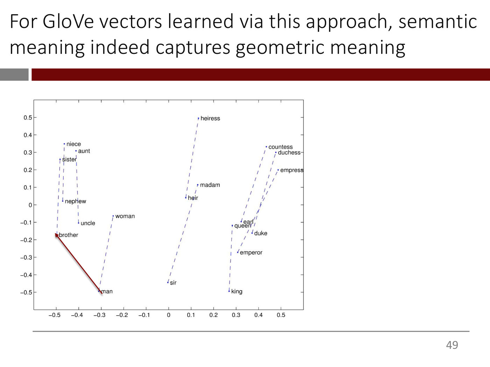
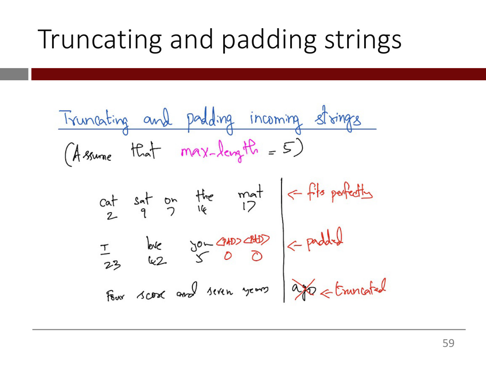
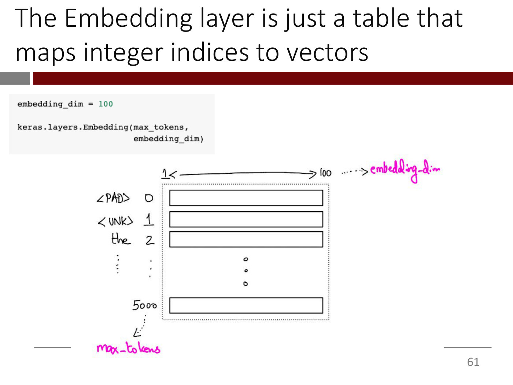
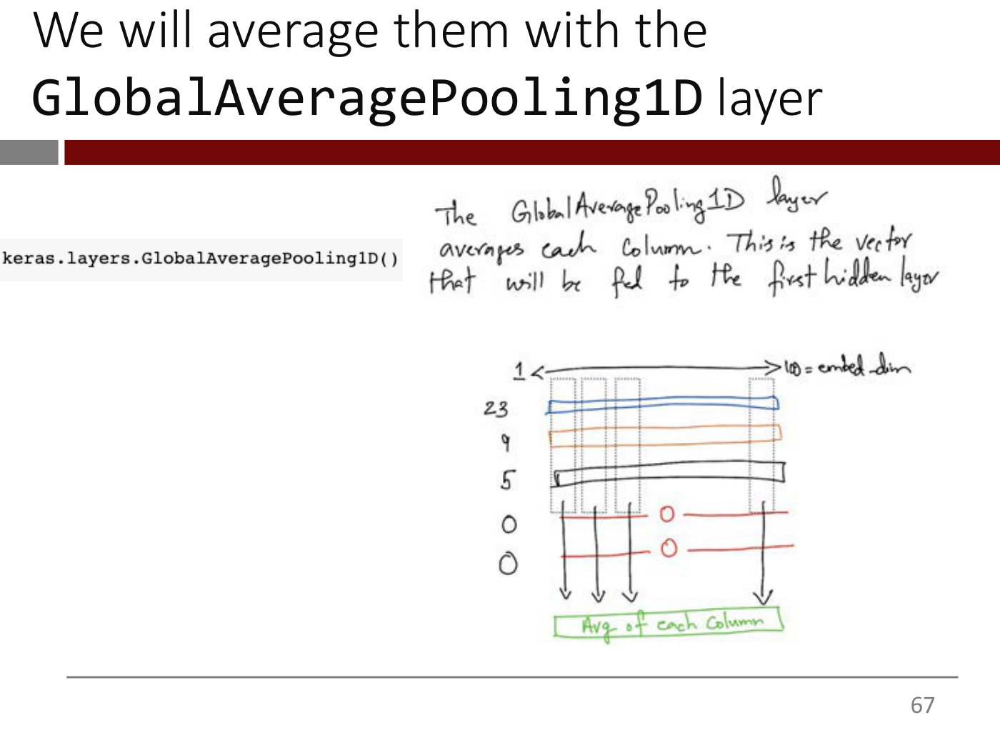
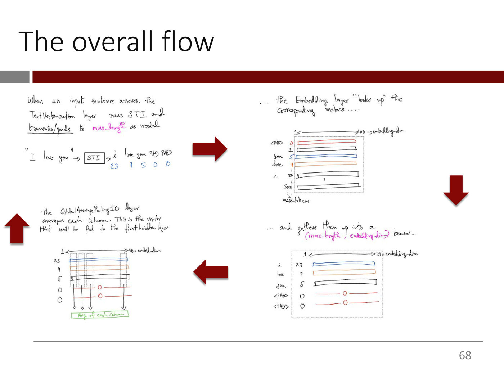

# Lecture 6 — Word Embeddings: slide-by-slide

Text and figures of all 70 slides of
[`mit15_773_s24_lec06.pdf`](https://ocw.mit.edu/courses/15-773-hands-on-deep-learning-spring-2024/mit15_773_s24_lec06.pdf)
(MIT 15.773 Hands-On Deep Learning, Spring 2024; lecturer Rama Ramakrishnan), transcribed from the deck. Lecture 6's video presents all of it, from slide 2 (0:49) to slide 68 (≈55:09), and then runs the Colab. Cite these slides as "slide N", where N is the PDF page number. Diagrams, handwritten tables and plots are described in prose since the KB is read as text.

Slides marked with an `*OCW notice: …*` line (14, 15, 17, 18, 19 and 47) carry third-party material excluded from the Creative Commons licence: Cohere's "embedding quizzes" and François Chollet's one-hot and embedding figures. They are described in prose and never rendered as images. Words the slides print in red are given plainly, with a note in parentheses. The Colab hyperlink on slide 69 points to a notebook that is not published on OCW; its target is not printed on the slide. The plot on slides 48–51 carries no credit or notice. The deck's GloVe slides cite the GloVe paper, https://nlp.stanford.edu/pubs/glove.pdf (slides 36–37 and 41).

**Images.** Eight figure slides carry a 1400px render under their heading: 37, 49, 51, 55, 59, 61, 67 and 68. The other figure-bearing slides are not rendered. Slides 14, 15, 17, 18, 19 and 47 carry OCW exclusion notices. Slide 3's handwritten one-hot table is the same image as lecture 5's slide 50, rendered with that lecture, and slide 2 is its build step. Build steps and repeats are superseded by a rendered slide: 48 and 50 → 49 and 51; 56 and 60 → 55; 62–65 → 68, which assembles slides 62, 63, 64 and 67 into one picture. Slides 57 and 58 are code screenshots reproduced exactly below. Everything else is text.

## Numbering: slide numbers vs PDF pages

Headings use the PDF page number, and the deck agrees with it: every page that prints a number bottom-right prints its own page number. Pages 1 (the roadmap title) and 70 (OCW's end page) print none.

## Contents

| Slides | Section |
| ------ | ------- |
| 1 | Roadmap of the "Deep Learning for NLP" lectures 5–10, with lecture 6, Embeddings, highlighted |
| 2–3 | Recap: text vectorization (Standardize, Tokenize, Index, Encode) and the one-hot table for "the cat sat on the mat" |
| 4–10 | The problem with one-hot vectors: as long as the vocabulary, and the same distance between any two words |
| 11–19 | "Wouldn't it be nice if …": synonyms close, unrelated words far, geometric relationship mirroring semantic relationship; Cohere's embedding quizzes (apple; cow) and the analogy parallelogram |
| 20–25 | Word embeddings; contextual word embeddings and transformers; today stand-alone embeddings, next week contextual |
| 26–35 | Learning embeddings from data: "You shall know a word by the company it keeps" (John Firth); "The acting in the ____ was superb"; related words appear in similar contexts |
| 36–40 | GloVe, the intuition: a word-word co-occurrence matrix from every sentence in Wikipedia; embeddings as weights, the matrix as data |
| 41–46 | The GloVe model: notation, $\log(X_{ij}) = b_i + b_j + w_i^T w_j$, least squares; throw away the biases |
| 47 | Choosing the vector length; dense embeddings against sparse one-hot vectors |
| 48–51 | GloVe vectors plotted: ten male/female word pairs; (brother – man) + woman = sister |
| 52–54 | Pros and cons of pretrained embeddings like GloVe |
| 55–68 | Working with embeddings in Keras: the TextVectorization layer stopping at the integers, truncating and padding, the Embedding layer as a lookup table, GlobalAveragePooling1D, and the overall flow |
| 69 | Colab |
| 70 | MIT OpenCourseWare end page |

---

## Slide 1 — Lecture 6: Embeddings

The "Deep Learning for NLP" Lecture Roadmap (red, underlined)

(Greyed out:) Lecture 5: Text Vectorization and the Bag-of-Words Model

Lecture 6: Embeddings (large, red)

(Greyed out, listing the lectures that follow:)

- Lecture 7: Transformers – Theory
- Lecture 8: Transformers – Applications, Self-Supervised Learning
- Lectures 9-10: LLMs

15.S04: Hands-on Deep Learning
Spring 2024
Farias, Ramakrishnan ("Farias, Ramakrishnan" is red.)

Bottom left: the MIT Management Sloan School of Management logo.

*Figure: no*

## Slide 2 — Until now, we encoded input text strings with one-hot vectors

A pipeline diagram. At left, the text "The cat sat on the mat" (in quotation marks) with a large dark red arrow pointing right into a chain of four dark red rounded boxes joined by small pink arrows: Standardize, Tokenize, Index, Encode. A large dark red arrow leaves the last box to the right, to nothing.

Footnote at bottom left: "\*more generally, text strings" (the text layer ends it with a stray backslash).

*Figure: yes — pipeline diagram: "The cat sat on the mat" into Standardize, Tokenize, Index, Encode boxes*

## Slide 3 — Until now, we encoded input text strings with one-hot vectors

The same pipeline as slide 2 (the sentence "The cat sat on the mat" into Standardize, Tokenize, Index, Encode, with an arrow out). New below it: a handwritten table. Above it, in red handwriting, the label "VOCABULARY" and a double-headed red arrow spanning the table's width with "100" at its centre. Beneath the arrow a row of red handwritten vocabulary tokens runs left to right: UNK, a, ..., an, ..., car, ..., cat, ..., hat, ......, mat, ..., ok, ..., on, ..., sat, ....., ten, ..., the, ..., zebra. Below is a large blue hand-drawn rectangle with six row labels at its left in black handwriting, top to bottom: the, cat, sat, on, the, mat. Each row holds a single handwritten "1" and nothing else, placed under the matching vocabulary column: row "the" has its 1 at the far right (under "the"); row "cat" has its 1 near the left (under "cat"); row "sat" has its 1 right of centre (under "sat"); row "on" has its 1 slightly left of that (under "on"); row "the" (fifth) has its 1 at the far right again, under "the"; row "mat" has its 1 left of centre (under "mat"). So the table is 6 rows by 100 columns of one-hot vectors.

*Figure: yes — handwritten 6 x 100 one-hot table for "the cat sat on the mat" under a 100-token VOCABULARY row*

## Slide 4 — The problem with one-hot vectors

Title only; the slide body is empty.

*Figure: no*

## Slide 5 — The problem with one-hot vectors (1/2)

If the vocabulary is very long, each token will have a one-hot vector that's as long as the size of the vocabulary.

- This can be somewhat mitigated by choosing only the most-frequent words
- Nevertheless, this increases the number of weights the model needs to learn and thus increases the compute time and the risk of overfitting as well.

*Figure: no*

## Slide 6 — The problem with one-hot vectors (2/2)

- Assume we have created a vocabulary from a training corpus.

*Figure: no*

## Slide 7 — The problem with one-hot vectors (2/2)

Build step: the first bullet is now greyed out and a second appears.

- (grey) Assume we have created a vocabulary from a training corpus.
- Consider the one-hot-encoded vectors for "movie" and "film".
  - Are these two vectors "close" to each other?

*Figure: no*

## Slide 8 — The problem with one-hot vectors (2/2)

Build step: the first two bullets are greyed out and a third appears.

- (grey) Assume we have created a vocabulary from a training corpus.
- (grey) Consider the one-hot-encoded vectors for "movie" and "film".
  - (grey) Are these two vectors "close" to each other?
- What about the one-hot-encoded vectors for "good" and "bad"?
  - Are they "far" from each other?

*Figure: no*

## Slide 9 — The problem with one-hot vectors (2/2)

Build step: all earlier bullets are greyed out (text slightly reflowed) and a new conclusion appears in red:

- (grey) Assume we have created a vocabulary from a training corpus.
- (grey) Consider the one-hot-encoded vectors for "movie" and "film".
  - (grey) Are these two vectors "close" to each other?
- (grey) What about the one-hot-encoded vectors for "good" and "bad"?
  - (grey) Are they "far" from each other?
- (red) The distance between any two one-hot-encoded vectors is the same, regardless of the words! It has got nothing to do with the "meaning" of the words.

*Figure: no*

## Slide 10 — Summary: The problem with one-hot vectors

- If the vocabulary is very long, each token will have a one-hot vector that's as long as the size of the vocabulary.
- There's no connection between the meaning of a word and its one-hot vector

*Figure: no*

## Slide 11 — Wouldn't it be nice if ...

Title only; the slide body is empty.

*Figure: no*

## Slide 12 — Wouldn't it be nice if ....

- The vectors that represent synonyms (e.g., movie and film) or related words (e.g., apple, banana) are close to each other.

(The text layer also holds the later bullets of slides 13 and 16, "The vectors for words that mean very different things are far from each other" and "More generally: Wouldn't it be nice if the geometric distance between word-vectors represents the "semantic distance" between the words?", plus "Word embeddings are word vectors that achieve exactly this", which the rendered page does not show yet.)

*Figure: no*

## Slide 13 — Wouldn't it be nice if ....

Build step: the first bullet is greyed out and a second appears.

- (grey) The vectors that represent synonyms (e.g., movie and film) or related words (e.g., apple, banana) are close to each other.
- The vectors for words that mean very different things are far from each other

*Figure: no*

## Slide 14 — Where will you place the word "apple": at a, b, c or d?

*OCW notice: Embeddings quizzes © Cohere. All rights reserved. This content is excluded from our Creative Commons license. For more information, see https://ocw.mit.edu/help/faq-fair-use.*

A Cohere screenshot headed "Embeddings Quiz 1:" with the question "Where would you put the word "apple"?" and, beside it, a small apple icon in a pale lavender circle. Below is a 2-D grid with light lavender gridlines; axes numbered 1 to 6 (y-axis labels up the left, x-axis labels along the bottom; positions below are approximate, read off the gridlines). Items are placed as pale lavender circles holding small line icons, plus four outlined circles labelled by letters:

- Top-left, sports cluster: a soccer ball (x 0, y 6) and a basketball (x 1, y 6); a tennis ball at (1, 5). The letter circle "a" is at (1, 4), just below the tennis ball.
- Upper right, fruit cluster: a cherry at (6, 5) and a strawberry at (5, 4) and a banana at (6, 4). The letter circle "c" is at (5, 5), adjacent to the cherry, strawberry and banana.
- Lower left, buildings: a factory at (1, 2), a house at (2, 2), an office building at (2, 1). The letter circle "b" is at (3, 1), beside the office building.
- Lower right, vehicles: a bicycle at (5, 1), a delivery truck at (6, 1), a car at (6, 0, just below the truck). The letter circle "d" is at about (7, 2.5), near the right edge and apart from every cluster, nearest the right edge.

So the four candidate positions are a (near sports), b (near buildings), c (inside the fruit cluster) and d (isolated, between the fruit and vehicle clusters). Source line below the figure: https://txt.cohere.com/sentence-word-embeddings/

*Figure: yes — Cohere "Embeddings Quiz 1" grid: sports, fruit, building and vehicle icon clusters with four candidate spots a, b, c, d for "apple"*

## Slide 15 — Where will you place the word "apple": at a, b, c or d?

*OCW notice: Embeddings quizzes © Cohere. All rights reserved. This content is excluded from our Creative Commons license. For more information, see https://ocw.mit.edu/help/faq-fair-use.*

The same Cohere "Embeddings Quiz 1" figure as slide 14 (same icons, same four letter circles a-d, same source URL). Change: a red dashed-dotted oval is drawn around the letter circle "c", the spot inside the fruit cluster (next to the cherry, strawberry and banana), marking it as the answer.

*Figure: yes — the Embeddings Quiz 1 grid with a red dashed oval around candidate c, in the fruit cluster*

## Slide 16 — Wouldn't it be nice if ....

Build step: the first two bullets are greyed out and a third appears, with two phrases in red.

- (grey) The vectors that represent synonyms (e.g., movie and film) or related words (e.g., apple, banana) are close to each other.
- (grey) The vectors for words that mean very different things are far from each other
- More generally: Wouldn't it be nice if the geometric relationship (red) between word-vectors represents the "semantic relationship" (red) between the words?

(The text layer's version of this bullet reads "geometric distance" and "semantic distance" and also holds "Word embeddings are word vectors that achieve exactly this"; the rendered page shows "relationship" in both places and not that line.)

*Figure: no*

## Slide 17 — Where will you place the word "cow"?

*OCW notice: Embeddings quizzes © Cohere. All rights reserved. This content is excluded from our Creative Commons license. For more information, see https://ocw.mit.edu/help/faq-fair-use.*

A Cohere screenshot headed "Embeddings Quiz 2:" with the question "Where would you put the word "cow"?" (a faint, nearly invisible icon sits beside it). Below is a 2-D grid with lavender gridlines; axes numbered 1 to 6 (y up the left, x along the bottom). Three words are plotted as solid lavender-purple dots with labels: "calf" at (1, 4) (label just above the dot), "puppy" at (1, 1) (label above the dot) and "dog" at (3, 1) (label above the dot). Three outlined circles with letters mark the candidate positions for "cow": "a" at (1, 5), directly above the calf dot and label; "c" at (3, 4), to the right of calf on the same row; "b" at (4, 1), just to the right of dog on the same row;. Source line: https://txt.cohere.com/sentence-word-embeddings/

*Figure: yes — Cohere "Embeddings Quiz 2" grid with calf, puppy and dog plotted as dots and candidate spots a, b, c for "cow"*

## Slide 18 — Where will you place the word "cow"?

*OCW notice: Embeddings quizzes © Cohere. All rights reserved. This content is excluded from our Creative Commons license. For more information, see https://ocw.mit.edu/help/faq-fair-use.*

The same Cohere "Embeddings Quiz 2" figure as slide 17 (calf at (1, 4), puppy at (1, 1), dog at (3, 1); candidates a, b, c). Change: a red dashed-dotted oval is drawn around the letter circle "c" at (3, 4), marking it as the answer: it sits in the calf row and the dog column, so that calf-to-cow is parallel to puppy-to-dog.

*Figure: yes — the Embeddings Quiz 2 grid with a red dashed oval around candidate c*

## Slide 19 — Semantic distance

*OCW notice: Embeddings quizzes © Cohere. All rights reserved. This content is excluded from our Creative Commons license. For more information, see https://ocw.mit.edu/help/faq-fair-use.*

A Cohere figure in two panels. Left panel caption: "A puppy is to a dog, like a calf is to a cow". It shows four lavender dots with labels: calf (upper left) and cow (upper right) joined by a horizontal dotted line; puppy (lower left) and dog (lower right) joined by a horizontal dotted line. The two dotted lines are parallel and the same length. Right panel caption: "A puppy is to calf, like a dog is to a cow". It shows calf (upper left) and cow (upper right) as dots, puppy (lower left, label below) and dog (lower right, label below) as dots; calf is joined to puppy by a vertical dotted line and cow is joined to dog by a vertical dotted line, parallel and the same length. So the four points form a parallelogram (here a rectangle) whichever way the analogy is read. Source line: https://txt.cohere.com/sentence-word-embeddings/

*Figure: yes — two parallelogram diagrams of calf, cow, puppy, dog dots illustrating the two readings of the analogy*

## Slide 20 — Word embeddings are word vectors designed to achieve exactly this ...

Title: "Word embeddings" (red italic) "are word vectors designed to achieve exactly this ..."

- The vectors that represent synonyms (e.g., movie and film) or related words (e.g., apple, banana) are close to each other.
- The vectors for words that mean very different things are far from each other
- More generally: The geometric relationship between word-vectors represents the "semantic relationship" between the words

*Figure: no*

## Slide 21 — ... and fix both these problems

Title in red: "... and fix both these problems"

- If the vocabulary is very long, each token will have a one-hot vector that's as long as the size of the vocabulary.
- There's no connection between the meaning of a word and its one-hot vector

*Figure: no*

## Slide 22 — "But we need to do one more thing."

No title; the slide is body text only, set in large type:

But we need to do one more thing.

The same word can mean different things depending on what the surrounding words are.

So, we need to find a way to make word embeddings *contextual* ("contextual" is red) (i.e., we need to consider the the other words in the sentence)

(The doubled "the the" is as printed.)

*Figure: no*

## Slide 23 — Contextual word embeddings are word vectors that achieve both these "requirements"

Title: "Contextual" (red) "word embeddings are word vectors that achieve" "both" (underlined) "these "requirements""

- The geometric relationship between word-vectors should represent the "semantic relationship" between the words
- The word-vector for a word should consider the the other words in the sentence i.e., it should take the context of the word into account

(The doubled "the the" is as printed.)

*Figure: no*

## Slide 24 — "The key to calculating contextual word embeddings = Transformers!!"

No title; large text: The key to calculating contextual word embeddings = Transformers!! ("Transformers" is red.)

*Figure: no*

## Slide 25 — "Today: ... Next week: ..."

No title; large text, with "Today" and "Next week" underlined:

Today: We will look at how to calculate *stand-alone* word embeddings. ("stand-alone" is italic.)

Next week: *Contextual* word embeddings via Transformers! ("Contextual" is italic.)

*Figure: no*

## Slide 26 — How word embeddings can be learned from data

- We can *manually* collect synonyms, antonyms, related words etc. and try to assign embedding vectors to them that satisfy our requirements.

*Figure: no*

## Slide 27 — How word embeddings can be learned from data

Build step: the first bullet is greyed out and a second appears.

- (grey) We can *manually* collect synonyms, antonyms, related words etc. and try to assign embedding vectors to them that satisfy our requirements.
- But is there a better way? Can we somehow just learn all this from data without manual effort?

*Figure: no*

## Slide 28 — We can!

The key insight:

"You shall know a word by the company it keeps" (red italic, centred)

John Firth (italic, centred, below the quote)

*Figure: no*

## Slide 29 — "You shall know a word by the company it keeps"

The title is the quotation (in quotation marks).

*The acting in the ____ was superb* (italic, centred; the blank is a printed underline)

What are some words that are likely to appear in the sentence?

*Figure: no*

## Slide 30 — "You shall know a word by the company it keeps"

Build step. Same title and the italic sentence *The acting in the ____ was superb*; the question "What are some words that are likely to appear in the sentence?" is now greyed out. Three filled-in versions appear below, each italic with the filled word in green:

- The acting in the movie (green) was superb
- The acting in the film (green) was superb
- The acting in the musical (green) was superb

*Figure: no*

## Slide 31 — "You shall know a word by the company it keeps"

*The acting in the ____ was superb* (italic, centred)

What are some words that are **unlikely** to appear in the sentence? ("unlikely" is bold.)

*Figure: no*

## Slide 32 — "You shall know a word by the company it keeps"

Build step. Same title, the italic sentence *The acting in the ____ was superb* and the question "What are some words that are **unlikely** to appear in the sentence?". Three filled-in versions appear below, each italic with a red "X" mark at the left and the filled word in red:

- X (red) The acting in the truck (red) was superb
- X (red) The acting in the banana (red) was superb
- X (red) The acting in the tensor (red) was superb

*Figure: no*

## Slide 33 — "You shall know a word by the company it keeps"

- If {movie, film and musical} appear in the same contexts (i.e., sentences) **very often**, they are likely to be related. (The braces are printed; "very often" is bold.)

*Figure: no*

## Slide 34 — "You shall know a word by the company it keeps"

Build step: the first bullet is greyed out and a second appears.

- (grey) If {movie, film and musical} appear in the same contexts (i.e., sentences) **very often**, they are likely to be related.
- *More generally, related words appear in similar contexts* (italic)

*Figure: no*

## Slide 35 — "You shall know a word by the company it keeps"

Build step: the first two bullets are greyed out and a third appears.

- (grey) If {movie, film and musical} appear in the same contexts (i.e., sentences) **very often**, they are likely to be related.
- (grey, italic) More generally, related words appear in similar contexts
- So, let's quantify how often words co-occur in similar contexts and try to learn embeddings from that data

*Figure: no*

## Slide 36 — Learning GloVe Vectors – The Intuition

Imagine that we look at every sentence in Wikipedia and do the following:

- Identify all the words that occur
- For each word pair, we count the number of times they appear in the same sentence*. This yields a word-word co-occurrence matrix

Footnote: *loosely speaking -see https://nlp.stanford.edu/pubs/glove.pdf for details (the URL is a hyperlink, shown in orange-brown underlined text)

*Figure: no*

## Slide 37 — Learning GloVe Vectors – The Intuition


Same title and text as slide 36 (the intro line and two bullets), now greyed out. New: a handwritten (black ink) square grid representing the word-word co-occurrence matrix. Column labels across the top: "cat", "sat", "deep", "learning" (hand-written, partly cursive), and then "HODL", an arrow, and a last handwritten word that is hard to read (it looks like "book"), suggesting the columns continue through the vocabulary. Row labels down the left side: "cat", "sat", "mat", "deep", "learning", "HODL", then a vertical dotted line of dots; to the lower left, the same hard-to-read word (as above) with a downward arrow, indicating the rows continue down the vocabulary. The "deep" row and the "learning" column are each drawn as a highlighted band (two nearly parallel lines each) crossing the grid. In red handwriting at the top right of the grid: "# of times 'deep' and 'learning' occur in the same context", with a red arrow pointing to the cell where the "deep" row crosses the "learning" column.

Footnote: *loosely speaking -see https://nlp.stanford.edu/pubs/glove.pdf for details

*Figure: yes — hand-drawn word-by-word co-occurrence matrix (rows and columns cat, sat, mat, deep, learning, HODL, …) with the deep/learning cell annotated in red as the count of times the two words occur in the same context*

## Slide 38 — Learning GloVe Vectors – The Intuition

- If we can learn embedding vectors that can be used to approximate the observed co-occurrence matrix, chances are those vectors do capture some notion of semantic distance

*Figure: no*

## Slide 39 — Learning GloVe Vectors – The Intuition

The bullet from slide 38 ("If we can learn embedding vectors that can be used to approximate the observed co-occurrence matrix, chances are those vectors do capture some notion of semantic distance") is greyed out. New text, in black:

- We can think of
  - the embeddings vectors as just **weights** in a model and
  - the co-occurrence matrix as just **data**

("weights" and "data" are bold.)

*Figure: no*

## Slide 40 — Learning GloVe Vectors – The Intuition

The earlier bullets (the slide 38 bullet and the "We can think of … weights … data" bullet with its two sub-bullets) are greyed out. New text, in black:

- We can then learn the values of the weights that minimize prediction error

*Figure: no*

## Slide 41 — The GloVe Model – Notation

- We denote the co-occurrence count of word i and word j as $X_{ij}$ (highlighted yellow)
- We denote an embedding vector $w_i$ (highlighted yellow) for each word i
- Each word has a natural frequency of occurring ("movie" vs "flick").
  - We want the vectors $w_i$ (highlighted yellow) to capture the co-occurrence pattern *independent of the natural frequency* (italic)
  - To capture natural frequency, we assign a "bias" $b_i$ (highlighted yellow) to each word.

Footnote: See https://nlp.stanford.edu/pubs/glove.pdf for details (the URL is a hyperlink)

*Figure: no*

## Slide 42 — The GloVe Model

- We assume that the co-occurrence count of a word pair is a (simple) linear function of the two biases and the two embedding vectors as follows:

$$X_{ij} = b_i + b_j + w_i^T w_j$$

*Figure: no*

## Slide 43 — The GloVe Model

The bullet and equation from slide 42 are greyed out. New text, in black:

- But the co-occurrence counts may have a wide range so we can shrink the range by using the log of the counts

$$\log(X_{ij}) = b_i + b_j + w_i^T w_j$$

*Figure: no*

## Slide 44 — Solving the GloVe Model

$$\log(X_{ij}) = b_i + b_j + w_i^T w_j$$

How can we learn the weights of this model?

*Figure: no*

## Slide 45 — Solving the GloVe Model

The equation and question from slide 44 are repeated:

$$\log(X_{ij}) = b_i + b_j + w_i^T w_j$$

How can we learn the weights of this model?

New (this build step): the line

Minimize $\sum_{i,j} [\log(X_{ij}) - (b_i + b_j + w_i^T w_j)]^2$

*Figure: no*

## Slide 46 — Solving the GloVe Model

The three items from slide 45 are greyed out: $\log(X_{ij}) = b_i + b_j + w_i^T w_j$; "How can we learn the weights of this model?"; and "Minimize $\sum_{i,j} [\log(X_{ij}) - (b_i + b_j + w_i^T w_j)]^2$". New text, in black:

When we are done, we throw away the biases b and use only the embedding vectors w.

*Figure: no*

## Slide 47 — We get to choose the length of these vectors. Turns out embedding vectors can be much smaller than one-hot vectors, because they can be dense (unlike one-hot vectors, which are sparse by definition)

*OCW notice: One-hot word vectors and word embeddings figures © François Chollet. All rights reserved. This content is excluded from our Creative Commons license. For more information, see https://ocw.mit.edu/help/faq-fair-use.*

(The slide has no separate title; the three-line sentence above stands in the title position, with "because they can be dense" in italics. The printed notice appears in small serif type to the right of the figure, with the URL as a hyperlink.)

A figure with two groups of vertical bars. Left group, four tall, narrow black bars side by side, each with a single white square at a different height (first bar: white square about a third of the way down; second: about halfway down; third: about two-thirds down; fourth: near the top). Caption beneath: "One-hot word vectors:" with the list "- Sparse", "- High-dimensional", "- Hardcoded". Right group, four much shorter bars side by side, each made of stacked squares in black, white and various greys (dense, no single marked cell). Caption beneath: "Word embeddings:" with the list "- Dense", "- Lower-dimensional", "- Learned from data".

Bottom left: "Image from textbook"

*Figure: yes — Chollet's illustration contrasting four tall sparse one-hot word vectors (one white cell each) with four short dense word-embedding vectors of grey-level cells*

## Slide 48 — For GloVe vectors learned via this approach, semantic meaning indeed captures geometric meaning

A scatter plot of word vectors projected to 2-D (a MATLAB-style plot with a box frame and tick marks). Horizontal axis ticks from −0.5 to 0.5 in steps of 0.1 (−0.5, −0.4, −0.3, −0.2, −0.1, 0, 0.1, 0.2, 0.3, 0.4, 0.5); vertical axis ticks from −0.5 to 0.5 in steps of 0.1 (printed values −0.5, −0.4, −0.3, −0.2, −0.1, 0, 0.1, 0.2, 0.3, 0.4, 0.5). Each word is a small blue dot with its label beside it. Ten pairs of words are joined by dashed blue lines, each pair a male/female (or masculine/feminine) pair, and the ten lines are all roughly parallel, running from lower left to upper right (male word lower, female word higher). Pairs, with approximate positions (x, y):

- brother (about −0.50, −0.17) – sister (about −0.48, 0.26), far left
- nephew (about −0.46, 0.02) – niece (about −0.46, 0.35), far left
- uncle (about −0.40, −0.10) – aunt (about −0.41, 0.31), far left
- man (about −0.31, −0.49) – woman (about −0.25, −0.06), left of centre
- sir (about 0, −0.44) – madam (about 0.13, 0.11), centre
- heir (about 0.08, 0.04) – heiress (about 0.14, 0.50), centre; its long line passes near "madam"
- king (about 0.27, −0.49) – queen (about 0.28, −0.12), right
- earl (about 0.32, −0.10) – countess (about 0.43, 0.33), right
- duke (about 0.37, −0.17) – duchess (about 0.45, 0.30), right
- emperor (about 0.31, −0.27) – empress (about 0.48, 0.20), right

There are 10 word pairs (20 words in all). No arrows, credit, source line or notice is printed on or around the plot (checked on the render; the right part of the slide is blank).

*Figure: yes — 2-D plot of GloVe vectors for ten male/female word pairs (brother–sister, nephew–niece, uncle–aunt, man–woman, sir–madam, heir–heiress, king–queen, earl–countess, duke–duchess, emperor–empress) joined by roughly parallel dashed lines*

## Slide 49 — For GloVe vectors learned via this approach, semantic meaning indeed captures geometric meaning



The same plot as slide 48, with one addition: a thick dark-red arrow drawn from "man" (lower left, at about (−0.31, −0.49)) to "brother" (at about (−0.50, −0.17)), the arrowhead at brother. No other change; no credit or notice is printed.

*Figure: yes — the slide 48 plot of ten word pairs with a dark-red arrow from "man" to "brother"*

## Slide 50 — For GloVe vectors learned using this approach, semantic meaning indeed captures geometric meaning

(The title wording differs from slide 49: "learned using this approach"; it runs to three lines and its last line, "meaning", overlaps the red banner.)

The same plot as slides 48–49, but the dark-red arrow from man to brother is gone. In its place is a dark-red arrow from "woman" (at about (−0.25, −0.06)) to "sister" (at about (−0.48, 0.26)), the arrowhead at sister; this arrow has the same length and direction as the earlier man-to-brother arrow. No credit or notice is printed.

*Figure: yes — the slide 48 plot with a dark-red arrow from "woman" to "sister"*

## Slide 51 — For GloVe vectors learned using this approach, semantic meaning indeed captures geometric meaning


The same plot and the same dark-red woman-to-sister arrow as slide 50 (title again three lines, the last overlapping the banner). New at right of the plot, in two lines:

(brother – man) + woman
= sister

*Figure: yes — the slide 50 plot (woman-to-sister arrow) with the equation "(brother – man) + woman = sister" beside it*

## Slide 52 — Pros/Cons of using pretrained embeddings like GloVe

- Using a pretrained word embedding (like GloVe) can be useful if you don't have enough data to learn a task-specific embedding of your vocabulary.

*Figure: no*

## Slide 53 — Pros/Cons of using pretrained embeddings like GloVe

The first bullet from slide 52 is greyed out. New bullet, in black:

- It has the drawback that this embedding will not be customized to your data, but they capture generic aspects of language structure. This is not necessarily bad since one would expect that in most cases word features to be fairly generic.

(The text layer holds this sentence cut off at "word features to be fairly gen"; the rendered page shows it in full, ending "fairly generic.")

*Figure: no*

## Slide 54 — Pros/Cons of using pretrained embeddings like GloVe

The first two bullets (slide 52's and slide 53's) are greyed out. New bullet, in black:

- We can also learn our own embeddings from scratch. We will demonstrate both options in the colab.

*Figure: no*

## Slide 55 — Working with embeddings in Keras


A flow diagram of four dark-red rounded boxes in a row, left to right: "Standardize", "Tokenize", "Index", "Encode", each joined to the next by a pale pink-grey right-pointing arrow. Beneath the first three boxes a dark-red curly brace spans Standardize, Tokenize and Index, labelled in monospace "TextVectorization" followed by "layer". Beneath the fourth box a second brace spans Encode alone, labelled "Embedding" (monospace) and "layer" on a second line.

*Figure: yes — Standardize → Tokenize → Index → Encode flow, with a brace labelling the first three steps as the TextVectorization layer and a brace labelling Encode as the Embedding layer*

## Slide 56 — Let's look at this first

The same four-box flow as slide 55 (Standardize → Tokenize → Index → Encode). Only the brace under the first three boxes, labelled "TextVectorization layer", is shown; the Embedding-layer brace and label of slide 55 are absent.

*Figure: yes — Standardize → Tokenize → Index → Encode flow with a brace labelling the first three steps as the TextVectorization layer*

## Slide 57 — Two key differences from before

A code screenshot (light grey background, monospace text):

```
max_length = 300 #90% of songs
max_tokens = 5000

text_vectorization = keras.layers.TextVectorization(
    max_tokens=max_tokens,
    output_mode="int",
    output_sequence_length=max_length
)
```

(In the image "300" and "5000" are green, the comment "#90% of songs" is green, and "int" in `"int"` is red-brown; there is a trailing comma after `output_sequence_length=max_length`.) Two lines are each enclosed in a red dotted rectangle: `output_mode="int",` and `output_sequence_length=max_length,`. A dark-red arrow starts at the right end of the `output_mode="int",` box and points down-left to the text below.

Text below the code: We want the layer to do only STI, so we tell it to stop after the indexing step (i.e., assigning an integer to each token) and output those integers

*Figure: yes — screenshot of the TextVectorization code with `output_mode="int"` and `output_sequence_length=max_length` boxed in red dotted lines and an arrow to the explanatory text*

## Slide 58 — Two key differences from before

The same code screenshot as slide 57 (`max_length = 300 #90% of songs`, `max_tokens = 5000`, the `keras.layers.TextVectorization(` call with `max_tokens=max_tokens,`, `output_mode="int",`, `output_sequence_length=max_length,` and the closing `)`). Now only the `output_sequence_length=max_length,` line is enclosed in a red dotted rectangle; the `output_mode` box is gone. A short dark-red arrow points straight down from the code.

Text below the code: Since input sentences have varying lengths, we choose a `max_length` (monospace) and tell the layer to truncate/pad each sentence to that length (next slide)

*Figure: yes — the TextVectorization code screenshot with `output_sequence_length=max_length` boxed in red dotted lines and an arrow down to the explanatory text*

## Slide 59 — Truncating and padding strings



A handwritten slide. Heading in blue, underlined: "Truncating and padding incoming strings". Below it: "(Assume that max_length = 5)" with "max_length" in magenta. Three handwritten rows, separated from red annotations on the right by a vertical black line:

Row 1: the five words "cat", "sat", "on", "the", "mat", each with its integer index written beneath it: 2, 9, 7, 14, 17. Red annotation: "<= fits perfectly" (underlined).

Row 2: the words "I" (underlined), "love", "you", with indices 23, 62, 5 beneath them, followed by two red "<PAD>" tokens with a red 0 beneath each. So the three-word string is padded to five entries: I 23, love 62, you 5, <PAD> 0, <PAD> 0. Red annotation: "<= padded".

Row 3: the words "Four", "score", "and", "seven", "years" (no indices written), followed on the other side of the vertical line by the word "ago" crossed out in red. Red annotation: "<= truncated". So the sentence "Four score and seven years ago" is cut to its first five words, and "ago" is dropped.

*Figure: yes — handwritten examples with max_length = 5 showing a five-word string that fits exactly (cat sat on the mat = 2 9 7 14 17), a short string padded with two <PAD> tokens (I love you = 23 62 5 0 0) and a six-word string truncated by dropping "ago"*

## Slide 60 — Working with embeddings in Keras

The same four-box flow as slide 55 (Standardize → Tokenize → Index → Encode), but now only the brace under the fourth box, Encode, is shown, labelled "Embedding" (monospace) and "layer" on a second line. The TextVectorization brace and label are absent.

*Figure: yes — Standardize → Tokenize → Index → Encode flow with a brace labelling Encode as the Embedding layer*

## Slide 61 — The Embedding layer is just a table that maps integer indices to vectors



At top left, a code screenshot (light grey background, monospace):

```
embedding_dim = 100

keras.layers.Embedding(max_tokens,
                       embedding_dim)
```

(`100` is green.) Below it, a hand-drawn table diagram. A dotted rectangle contains a column of wide, thin empty boxes (rows). Row labels on the left, each with its index: "<PAD>" 0, "<UNK>" 1 (the 1 underlined), "the" 2, then vertical dots in both the word column and the index column (and three small circles as vertical dots in the middle of the box column), and finally the last row labelled 5000. Above the boxes an arrow runs left to right, labelled "1" at its left end and "100" at its right end, followed by a dotted arrow to the magenta label "embedding_dim". Below the last row, a dotted arrow leads from "5000" down to the magenta label "max_tokens".

*Figure: yes — code for keras.layers.Embedding(max_tokens, embedding_dim) beside a hand-drawn lookup table: rows <PAD> 0, <UNK> 1, the 2, … 5000 (max_tokens), each row a vector of length 1 to 100 (embedding_dim)*

## Slide 62 — The overall flow

A handwritten slide. Text: "When an input sentence arrives, the TextVectorization layer runs STI and truncates/pads to max_length as needed" (the words "truncates/pads" are underlined; "max_length" is magenta; "STI" has the I underlined). Below it, a flow: the quoted sentence "I love you" (with the I underlined) → a box labelled "STI" → the output tokens "i love you PAD PAD" (the first token written as a lowercase "i"), with blue integers beneath them: 23, 9, 5, 0, 0. (Note: slide 59 writes 62 for "love"; this slide writes 9.)

*Figure: yes — handwritten flow of the sentence "I love you" through an STI box to "i love you PAD PAD" with indices 23 9 5 0 0*

## Slide 63 — The overall flow

A handwritten slide. Text: "The Embedding layer "looks up" the corresponding vectors ..." Below it, the lookup-table diagram of slide 61 redrawn, with the rows for the sentence's tokens coloured. An arrow across the top runs from "1" to "100", followed by a dotted arrow to "embedding_dim". A dotted rectangle holds a column of wide empty bars, with labels on the left in the form word / index:

- "<PAD>" 0: bar drawn in red
- (no word) 1 (underlined): bar drawn in black
- "you" 5: bar drawn in blue
- "love" 9: bar drawn in orange
- "i" 23: bar drawn in black
- vertical dots between the rows, and in the box column
- 5000: bar drawn in black, with a dotted arrow below it to "max_tokens"

(Index 5 and 9 are in blue and orange respectively, matching the coloured bars; indices 0 is in red.)

*Figure: yes — hand-drawn Embedding lookup table with the rows for <PAD> 0 (red), you 5 (blue), love 9 (orange) and i 23 picked out, rows 1 and 5000 shown too, width 1 to 100 = embedding_dim, last row labelled max_tokens*

## Slide 64 — The overall flow

A handwritten slide. Text: "... and gathers them up into a (max_length, embedding_dim) tensor..." (the parenthesised "(max_length, embedding_dim)" is magenta). Below it, a dotted rectangle drawn as a table, with an arrow across the top from "1" to "100" followed by "= embedding_dim". Five rows, each with a word and its index at left and a bar to the right:

- "i" 23: bar in blue
- "love" 9: bar in orange
- "you" 5: bar in black
- "<PAD>" 0: a red line with a small red circle "o" in the middle (instead of a box)
- "<PAD>" 0: a second such red line with a red circle

*Figure: yes — hand-drawn 5-row table (i 23, love 9, you 5, <PAD> 0, <PAD> 0), each row a vector of length 1 to 100 = embedding_dim, the two <PAD> rows drawn as red lines with a circle; labelled as a (max_length, embedding_dim) tensor*

## Slide 65 — This table has to be converted into a vector that can be "fed" to the first hidden layer

What are some options?

Below the question, the same handwritten table as slide 64, without the "(max_length, embedding_dim)" text: arrow "1" to "100 = embedding_dim" across the top; rows i 23 (blue bar), love 9 (orange bar), you 5 (black bar), <PAD> 0 and <PAD> 0 (each a red line with a red circle). A faint pale-blue vertical line is at the right of the image area.

*Figure: yes — the hand-drawn five-row embedding table (i 23, love 9, you 5, <PAD> 0, <PAD> 0) of slide 64*

## Slide 66 — This table has to be converted into a vector that can be "fed" to the first hidden layer

What are some options?

- Flatten into a long vector
- Sum/average the embedding vectors
- ....

*Figure: no*

## Slide 67 — We will average them with the GlobalAveragePooling1D layer



(In the title, `GlobalAveragePooling1D` is in monospace.)

At left, a code screenshot (light grey background, monospace, running off the left edge): `keras.layers.GlobalAveragePooling1D()`.

At the top right, handwritten text: "The GlobalAveragePooling1D layer averages each column. This is the vector that will be fed to the first hidden layer".

Below it, the table diagram from slide 64 without word labels: arrow "1" to "100 = embed_dim" across the top; rows labelled by indices at left: 23 (blue bar), 9 (orange bar), 5 (black bar), 0 (red line with a red circle), 0 (red line with a red circle). Four tall dotted-outline vertical column strips run down through the rows (three adjacent at the left and one at the right). Under each strip a black downward arrow points from the bottom of the rows to a green rectangle labelled "Avg of each Column", which lies beneath the table and spans the width of the bars.

*Figure: yes — handwritten 5 x 100 embedding table with each column averaged (downward arrows into a green "Avg of each Column" box), beside the code keras.layers.GlobalAveragePooling1D()*

## Slide 68 — The overall flow



A single slide combining four earlier handwritten pictures in a loop of four large dark-red block arrows. Starting at the top left and going clockwise:

1. Top left: the slide 62 picture ("When an input sentence arrives, the TextVectorization layer runs STI and truncates/pads to max_length as needed" with the "I love you" → STI → "i love you PAD PAD", 23 9 5 0 0 example). A dark-red arrow pointing right leads from it to
2. Top right: the slide 63 picture ("The Embedding layer "looks up" the corresponding vectors ....") showing the lookup table with rows <PAD> 0, 1, you 5, love 9, i 23, … 5000 and the max_tokens and embedding_dim labels. A dark-red arrow pointing down, at the right edge, leads from it to
3. Bottom right: the slide 64 picture ("... and gathers them up into a (max_length, embedding_dim) tensor...") with the five-row table i 23, love 9, you 5, <PAD> 0, <PAD> 0. A dark-red arrow pointing left leads from it to
4. Bottom left: the slide 67 picture ("The GlobalAveragePooling1D layer averages each column. This is the vector that will be fed to the first hidden layer") with the column-averaging diagram and green "Avg of each Column" box. A dark-red arrow pointing up, at the left edge, points back toward the top-left picture.

*Figure: yes — four-panel cycle of the earlier handwritten pictures (STI and truncate/pad; Embedding lookup; gather into a (max_length, embedding_dim) tensor; GlobalAveragePooling1D average of each column) joined by four dark-red block arrows*

## Slide 69 — Colab

A section-divider style slide: the title "Colab" in white on a dark-red band with a grey block at its left. Below, the hyperlink text "Colab Link" in orange-brown underlined type. The link's target is not printed on the slide.

*Figure: no*

## Slide 70 — MIT OpenCourseWare end page

MIT OpenCourseWare
https://ocw.mit.edu

15.773 Hands-on Deep Learning
Spring 2024

For information about citing these materials or our Terms of Use, visit: https://ocw.mit.edu/terms.

*Figure: no*
