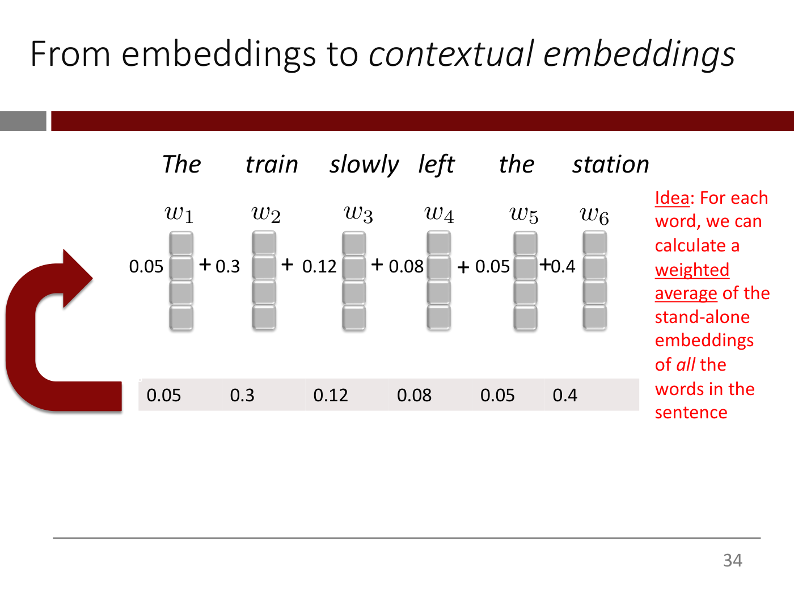
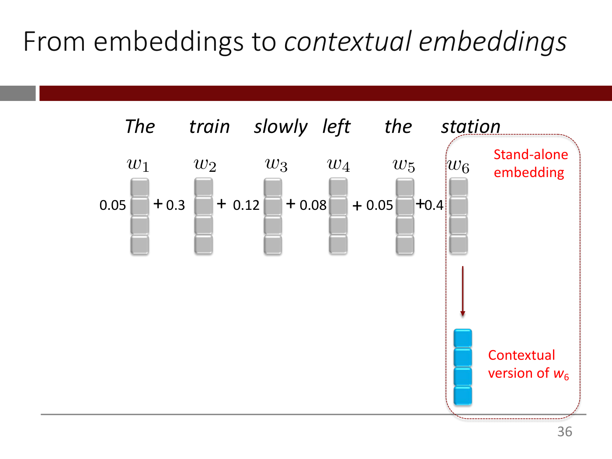
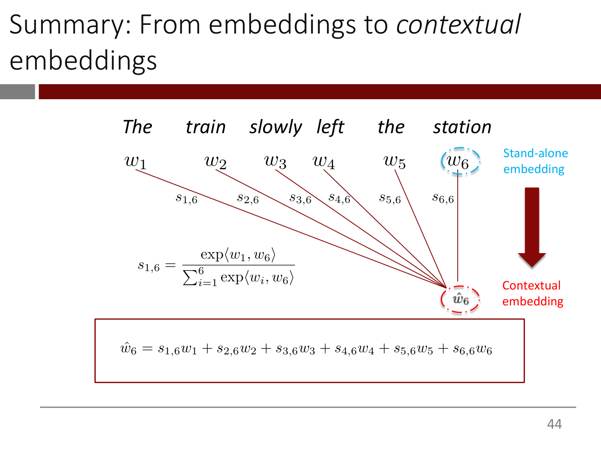
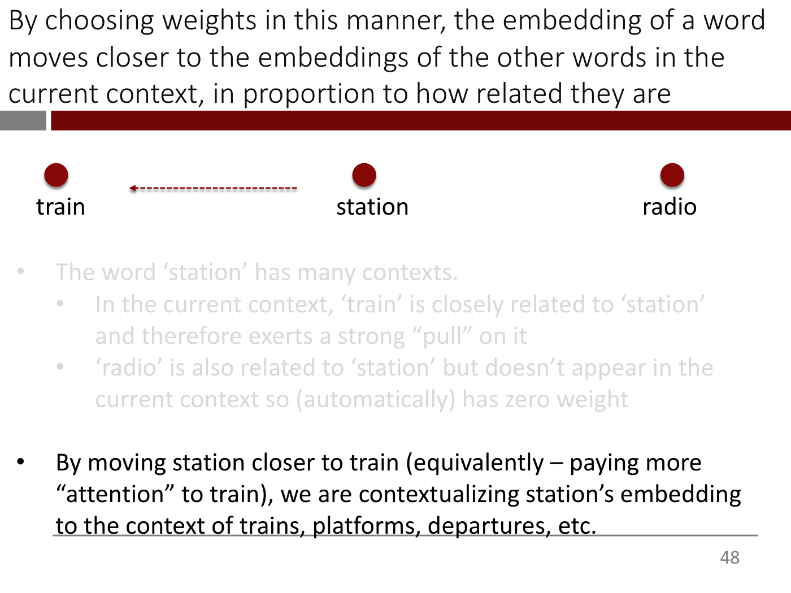
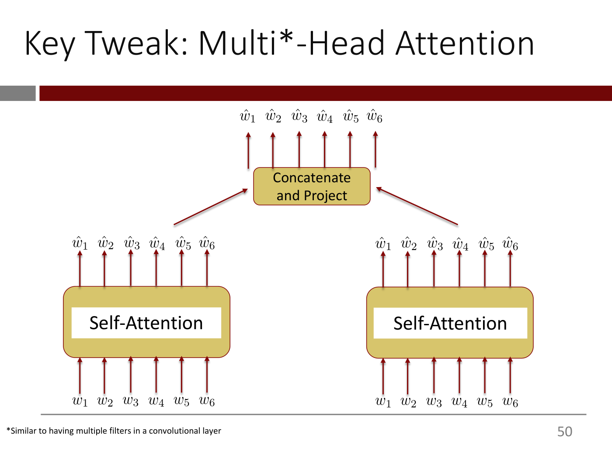
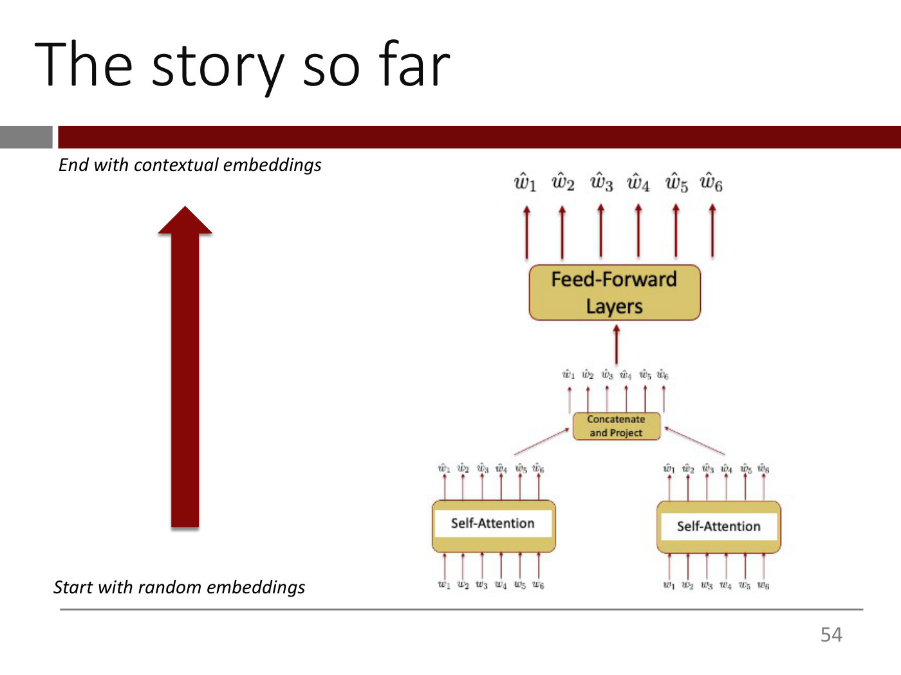
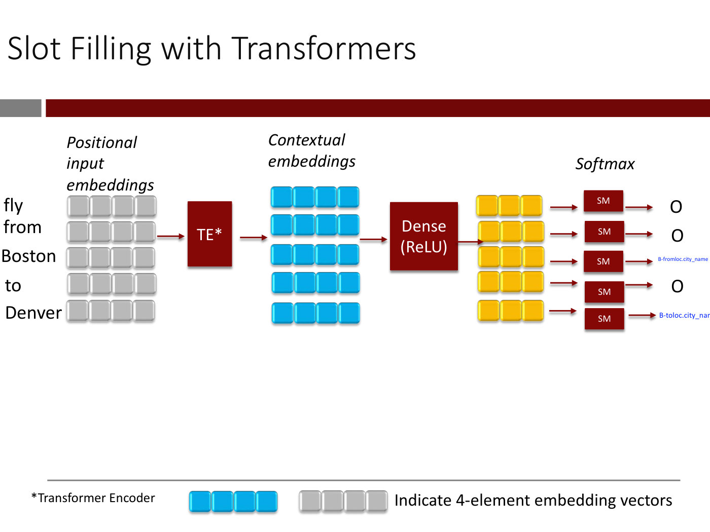

# Lecture 7 — Transformers: slide-by-slide

Text and figures of all 78 slides of
[`mit15_773_s24_lec07.pdf`](https://ocw.mit.edu/courses/15-773-hands-on-deep-learning-spring-2024/mit15_773_s24_lec07.pdf)
(MIT 15.773 Hands-On Deep Learning, Spring 2024; lecturer Rama Ramakrishnan), transcribed from the deck. The roadmap on slide 1 calls this lecture "Transformers (1/2)". Lecture 7's video presents slides 2 (0:00) to 71 (≈1:01:01), opens the Colab, comes back to slides 72–76 (≈1:08:01–1:11:06) and returns to the Colab. Cite these slides as "slide N", where N is the PDF page number. Diagrams, tables and screenshots are described in prose since the KB is read as text.

Slides marked with an `*OCW notice: …*` line (23, 51, 64, 65, 66, 67, 68 and 69) carry figures from "Attention Is All You Need" (Vaswani et al., https://arxiv.org/abs/1706.03762), which OCW excludes from its Creative Commons licence: the paper's model-architecture figure (23), its attention-head visualisation (51) and its encoder block (64–69, one figure reused). They are described in prose and never rendered as images. Slides 21–22 show screenshots from Google's blog post on BERT in search (https://blog.google/products/search/search-language-understanding-bert/), which carry no notice. Slide 7 cites the ATIS data set paper, https://aclanthology.org/H90-1021/. Slide 40 holds only the word "iPad": the lecturer draws the dot product on an iPad there (video ≈28:42–31:00), and that drawing is not in the deck. Words the slides print in red are given plainly, with a note in parentheses. The Colab hyperlink on slide 77 points to a notebook that is not published on OCW; its target is not printed on the slide.

**Images.** Seven figure slides carry a 1400px render under their heading: 33, 35, 43, 47, 49, 53 and 75. The other figure-bearing slides are not rendered. Slides 23, 51 and 64–69 carry OCW exclusion notices. Slides 21–22 are unmarked third-party screenshots, whose text is transcribed below. Slide 11 is a list of slot labels transcribed below. Build steps and repeats are superseded by a rendered slide: 26–32 → 33; 34 → 35; 36, 41 and 42 → 43, which carries both of their formulas; 44–46 → 47; 48 → 49, which draws its self-attention box twice; 52, 54–56 and 62–63 → 53, whose stack they repeat beside a checklist given in their text; 72–74 and 76 → 75, of which 76 adds only dashed outlines and a sentence. The positional-encoding tables (58–61) are reproduced exactly below. Everything else is text.

## Numbering: slide numbers vs PDF pages

Headings use the PDF page number. The deck's printed numbers (bottom right) agree with it on pages 2–9 and run one ahead from page 10 to page 77: page 10 prints "11" and page 77 prints "78", because a hidden slide numbered 10 was not exported. Pages 1 (the roadmap title) and 78 (OCW's end page) print none. Cite the heading number, not the printed one.

## Contents

| Slides | Section |
| ------ | ------- |
| 1 | Roadmap of the "Deep Learning for NLP" lectures, with lecture 7, Transformers (1/2), highlighted |
| 2 | Transformers across domains: search, translation, speech, vision, reinforcement learning, generative AI, AlphaFold |
| 3–6 | Search as the use case: "Find me all flights from BOS to LGA tomorrow morning"; natural-language query → structured (SQL) query; extract the travel entities |
| 7–13 | The ATIS data set and slot filling: each word gets one of 123 slot types (B-, I- and O labels); 18 words, 18 outputs, a 123-way softmax on each |
| 14–18 | What the model must take into account: output as long as the input, context ("see", "bank", "it", "station"), word order |
| 19–23 | The transformer architecture (2017); its effect on Google search; "Attention Is All You Need" |
| 24–36 | Taking context into account: "The train slowly left the station", weights on the other words, the weighted average as the contextual embedding $\hat{w}_6$ |
| 37–43 | Choosing the weights: relatedness, dot products (drawn on the iPad), exponentiate and normalize (softmax); summary formulas |
| 44–48 | Why it works ('train' pulls 'station'; 'radio' gets no weight); the self-attention layer |
| 49–51 | Multi-head attention: concatenate and project; different heads learn different patterns |
| 52–56 | Feed-forward layers; the story so far; two of three requirements met; word order is ignored |
| 57–61 | Positional encoding: a position embedding added to the stand-alone embedding, worked on "cat sat mat" |
| 62–70 | The transformer encoder; the paper's encoder block; summary; stacking; what the next lecture adds |
| 71–76 | Slot filling with a transformer encoder: positional input embeddings → TE → Dense (ReLU) → a softmax per word |
| 77 | Colab |
| 78 | MIT OpenCourseWare end page |

---

## Slide 1 — Lecture 7: Transformers (1/2)

The "Deep Learning for NLP" Lecture Roadmap (red, bold, underlined)

- Lecture 5: Text Vectorization and the Bag-of-Words Model (struck through)
- Lecture 6: Embeddings (struck through)
- Lecture 7: Transformers (1/2) (large, bold, red; the current lecture)
- Lecture 8: Transformers – (2/2)
- Lecture 9-10: LLMs

(All roadmap lines are red bold text.)

Below a dark red horizontal rule: the MIT Management Sloan School of Management logo at left, and at right "15.S04: Hands-on Deep Learning", "Spring 2024", "Farias, Ramakrishnan" (the last line in red).

*Figure: no*

## Slide 2 — Transformers have proven to be an effective DNN architecture across a vast array of domains

Two columns of text.

Left column:

- Information Retrieval/Search
- Machine Translation
- Speech Recognition
- Text-to-Speech
- Computer Vision

Right column:

- Reinforcement Learning
- Generative AI (LLMs, Text-to-image models, Image Captioning, …)
- Numerous special-purpose systems (e.g., AlphaFold)
- …

*Figure: no*

## Slide 3 — We will use Search/Information Retrieval as the motivating use-case

- Find me all flights from BOS to LGA tomorrow morning
- How many customers abandoned their shopping carts?
- Find all contracts that are up for renewal next month

*Figure: no*

## Slide 4 — We will focus on this travel-related example today

"Find me all flights from BOS to LGA tomorrow morning" (red). The rest of the slide is empty.

*Figure: no*

## Slide 5 — We will focus on this travel-related example today

"Find me all flights from BOS to LGA tomorrow morning" (now black)

In these sorts of use-cases, a common approach is as follows: *Convert the natural language query into a structured query (i.e., SQL) that can be used to search/lookup info in a database.* (The whole paragraph is red; the sentence after "follows:" is italic.)

*Figure: no*

## Slide 6 — We will focus on this travel-related example today

"Find me all flights from BOS to LGA tomorrow morning"

In these sorts of use-cases, a common approach is as follows: *Convert the natural language query into a structured query (i.e., SQL) that can be used to search/lookup info in a database.* (Now black.)

*To enable this, we need to automatically* <u>extract</u> *travel-related* <u>entities</u> *from the natural language query.* (New; red italic, with "extract" and "entities" underlined.)

*Figure: no*

## Slide 7 — We will use the Airline Travel Information Systems (ATIS) dataset*

Title only in the middle of the slide. Footer at bottom left: https://aclanthology.org/H90-1021/

*Figure: no*

## Slide 8 — Extracting "entities" from natural language

*Given a query in natural language …* (italic)

Input: I want to fly from boston at 7 am and arrive in denver at 11 in the morning (the query is blue)

Footer: Dataset: Airline Travel Information Systems (ATIS)

*Figure: no*

## Slide 9 — Extracting "entities" from natural language

*Given a query in natural language …* (greyed out)

Input: I want to fly from boston at 7 am and arrive in denver at 11 in the morning (blue)

*… classify each word in the query to a corresponding "slot"* (new, italic)

Footer: Dataset: Airline Travel Information Systems (ATIS)

*Figure: no*

## Slide 10 — Classify each word in the query to a corresponding "slot" - Example

A two-column alignment of the query's words with their slot labels. Words and labels that carry a slot are blue; the "O" labels and the words they cover are light grey. Rows, left word(s) then right label(s):

| Words | Slot labels |
| --- | --- |
| I want to fly from (grey) | O O O O O (grey) |
| boston | B-fromloc.city_name |
| at (grey) | O (grey) |
| 7 am | B-depart_time.time I-depart_time.time |
| and arrive in (grey) | O O O (grey) |
| denver | B-toloc.city_name |
| at (grey) | O (grey) |
| 11 | B-arrive_time.time |
| in the (grey) | O O (grey) |
| morning | B-arrive_time.period_of_day |

*Figure: no*

## Slide 11 — Slot Types in the ATIS dataset

At left, a screenshot-like block of monospace text listing slot labels, each in single quotes followed by a comma, one per line. The first block, in order: 'B-aircraft_code', 'B-airline_code', 'B-airline_name', 'B-airport_code', 'B-airport_name', 'B-arrive_date.date_relative', 'B-arrive_date.day_name', 'B-arrive_date.day_number', 'B-arrive_date.month_name', 'B-arrive_date.today_relative', 'B-arrive_time.end_time', 'B-arrive_time.period_mod', 'B-arrive_time.period_of_day', 'B-arrive_time.start_time', 'B-arrive_time.time', 'B-arrive_time.time_relative', 'B-city_name', 'B-class_type'. Then a bold ellipsis "…" (a gap in the list). Then the last block: 'I-round_trip', 'I-stoploc.city_name', 'I-time', 'I-today_relative', 'I-toloc.airport_name', 'I-toloc.city_name', 'I-toloc.state_name'. The list runs down to the bottom edge of the slide and crosses the footer rule.

At right, large text: "123 possible slots!"

*Figure: yes — monospace excerpt of the ATIS slot-label list (B-… and I-… labels) beside the text "123 possible slots!"*

## Slide 12 — How can we solve this word-to-slot multi-class classification problem?

I want to fly from boston at 7 am and arrive in denver at 11 in the morning (blue)

A dark red downward arrow.

O O O O O B-fromloc.city_name O B-depart_time.time I-depart_time.time O O O B-toloc.city_name O B-arrive_time.time O O B-arrive_time.period_of_day (blue; the slot labels for the 18 words, as one running line)

*Figure: no*

## Slide 13 — How can we solve this word-to-slot multi-class classification problem?

Same as slide 12 (the blue query, the dark red downward arrow, and the blue string of slot labels). New below:

<u>Each</u> of the 18 words above must be assigned to one of 123 slot types! ("Each" underlined.)

<u>If</u> we could run the query sentence through a DNN and generate 18 outputs (one for each input word in the query), we could attach a 123-way softmax to <u>each</u> of those 18 outputs. ("If" and "each" underlined.)

*Figure: no*

## Slide 14 — What must we take into account?

We want to generate an output that has the same length as the input (so that we can classify each output element to the right slot type) (the words "output that has the same length as the input" are red)

*Figure: no*

## Slide 15 — What must we take into account?

The previous paragraph is greyed out.

In addition, we would like to

- Take the surrounding context of each word into account ("context" in red)
- Take the order of the words into account ("order" in red)

*Figure: no*

## Slide 16 — Context matters

The meaning of a word can change dramatically depending on the context. <u>A single embedding – like GloVe - for all contexts a word can appear in isn't good enough</u> (the second sentence is underlined)

*Figure: no*

## Slide 17 — Context matters

The sentence from slide 16 is greyed out. New below it: a two-column table with a dark red header row, "Word" and "Example Contexts". In the example contexts the word under discussion is printed in red. The first row's Word cell is empty in the render; the text layer holds "see" there, hidden.

| Word | Example Contexts |
| --- | --- |
| (empty; "see" in the text layer) | I will **see** you soon; I will **see** this project to its end; I **see** what you mean (one per line; "see" in red) |
| bank | I went to the **bank** to apply for a loan; I am **banking** on the job offer coming through; I am standing on the left **bank** (one per line; the bold word in red) |
| it | The animal didn't cross the street because **it** was too tired; The animal didn't cross the street because **it** was too wide (one per line; "it" in red) |
| station | The train left the **station** on time; The radio **station** was playing 60s hits; I was **stationed** on a remote island in Polynesia (one per line; the bold word in red) |

*Figure: no*

## Slide 18 — Order matters

<add your own examples [a smiling-face emoji]> (placeholder text, centred vertically; the emoji is a yellow slightly smiling face)

*Figure: no*

## Slide 19 — The Transformer Architecture

- Meets ALL the requirements we identified earlier
  - ✓ Takes the surrounding context of each word into account
  - ✓ Takes the order of the words into account
  - ✓ Can generate an output that has the same length as the input

*Figure: no*

## Slide 20 — The Transformer Architecture

Same as slide 19. New:

- Developed in 2017. Dramatic and on-going impact on DL

*Figure: no*

## Slide 21 — Effect of the Transformer on Google Search

A search-box graphic centred near the top containing the query "2019 brazil traveler to usa need a visa". Below it, on the left, the label "BEFORE" above a pale phone-shaped mockup of a Google results screen (status bar "9:00", "google.com"). The result shown is from Washington Post › 2019/03/21, with the blue headline "U.S. citizens can travel to Brazil without the red tape of a visa ..." and the snippet "Mar 21, 2019 · Starting on June 17, you can go to Brazil without a visa and ... Australia, Japan and Canada will no longer need a visa to ... washingtonpost.com; © 1996-2019 The Washington Post ...". The right half of the figure area is empty (the "AFTER" panel appears on the next slide).

Footer: https://blog.google/products/search/search-language-understanding-bert/

*Figure: yes — "BEFORE" phone mockup of a Google result for the query "2019 brazil traveler to usa need a visa" (Washington Post article)*

## Slide 22 — Effect of the Transformer on Google Search

Same as slide 21. New: on the right, the label "AFTER" above a second phone mockup (status bar "9:00", "google.com"). Its result is from USEmbassy.gov › br › Visas, with the blue headline "Tourism & Visitor | U.S. Embassy & Consulates in Brazil" and the snippet "In general, tourists traveling to the United States require valid B-2 visas. That is unless they are eligible to travel visa ...".

Footer: https://blog.google/products/search/search-language-understanding-bert/

*Figure: yes — BEFORE and AFTER phone mockups of Google results for "2019 brazil traveler to usa need a visa"*

## Slide 23 — The Transformer Architecture

This is a section-style slide: the title sits in white text on a wide dark red band with a grey block at its left.

Left: a rendering of the first page of the paper's header, titled "Attention Is All You Need" (between a thick black rule above and a thin rule below), with the author block: Ashish Vaswani* (Google Brain, avaswani@google.com), Noam Shazeer* (Google Brain, noam@google.com), Niki Parmar* (Google Research, nikip@google.com), Jakob Uszkoreit* (Google Research, usz@google.com), Llion Jones* (Google Research, llion@google.com), Aidan N. Gomez* † (University of Toronto, aidan@cs.toronto.edu), Łukasz Kaiser* (Google Brain, lukaszkaiser@google.com), Illia Polosukhin* ‡ (illia.polosukhin@gmail.com). Under it, the link https://arxiv.org/abs/1706.03762

Right: the paper's Figure 1 with its caption "Figure 1: The Transformer - model architecture." It is a block diagram of two stacks side by side. Left stack (labelled "N×"): at the bottom "Inputs" feeds a pink "Input Embedding" box, which joins a "Positional Encoding" (a sine-wave circle with a plus sign) and goes into a grey-outlined block holding an orange "Multi-Head Attention" box with a yellow "Add & Norm" above it, then a blue "Feed Forward" box with another yellow "Add & Norm" above. Right stack (labelled "N×"): at the bottom "Outputs (shifted right)" feeds a pink "Output Embedding" box, joined with a "Positional Encoding" circle, into a block holding an orange "Masked Multi-Head Attention" with "Add & Norm", then an orange "Multi-Head Attention" with "Add & Norm", then a blue "Feed Forward" with "Add & Norm". An arrow carries the left stack's output into the right stack's middle Multi-Head Attention box. Above the right stack: a "Linear" box (lavender), a "Softmax" box (green), and the label "Output Probabilities". Residual (skip) arrows loop around each attention and feed-forward box.

*OCW notice: Figures from "Attention is All You Need" © Ashish Vaswani, Noam Shazeer, Niki Parmar, Jakob Uszkoreit, Llion Jones, Aidan N. Gomez, Lukasz Kaiser, Illia Polosukhin. All rights reserved. This content is excluded from our Creative Commons license. For more information, see https://ocw.mit.edu/help/faq-fair-use.* (printed at the bottom of the slide)

*Figure: yes — "Attention Is All You Need" title-and-authors excerpt and Figure 1, the Transformer model-architecture diagram (OCW-excluded)*

## Slide 24 — We will focus on this first

Three lines of large text. The first, in red: "How to take the surrounding context of each word into account". The other two are greyed out: "How to take the order of the words into account" and "How to generate an output that has the same length as the input".

*Figure: no*

## Slide 25 — How to take the surrounding context of each word into account

Title only; the slide body is empty.

*Figure: no*

## Slide 26 — From embeddings to contextual embeddings

Six words in italics across the top, each with a subscripted symbol below it: "The" $w_1$, "train" $w_2$, "slowly" $w_3$, "left" $w_4$, "the" $w_5$, "station" $w_6$. Under each word is a vertical stack of four grey rounded squares, representing that word's embedding vector (each stack is a column of four cells). On $w_2$'s stack the second cell from the top has a slightly different, textured look; on $w_4$'s and $w_6$'s stacks the top cell has that textured look; nothing on the slide explains the difference.

- We can easily get stand-alone embeddings for all the words ("stand-alone embeddings" in red)

*Figure: yes — six words $w_1$ to $w_6$ ("The train slowly left the station"), each above a four-cell grey vector*

## Slide 27 — From embeddings to contextual embeddings

The same six words and four-cell grey vectors as slide 26 ("The" $w_1$, "train" $w_2$, "slowly" $w_3$, "left" $w_4$, "the" $w_5$, "station" $w_6$).

- We can easily get stand-alone embeddings for all the words (greyed out)
- How can we modify station's embedding so that it incorporates the other words? (new; red text and red bullet)

*Figure: yes — six words $w_1$ to $w_6$, each above a four-cell grey vector*

## Slide 28 — From embeddings to contextual embeddings

The six words and their grey four-cell vectors are shown again, spaced slightly wider than before (the word labels now sit a little higher, with more space between the words and the $w_i$ symbols). The bullets from slide 27 are gone. New: a narrow red text block at the far left, running down the left edge: "Imagine that we somehow know how much <u>attention</u> to give the other words i.e., how much <u>weight</u> to give the other words" ("attention" and "weight" underlined).

*Figure: yes — six words $w_1$ to $w_6$, each above a four-cell grey vector*

## Slide 29 — From embeddings to contextual embeddings

Same diagram and the same left-hand block of text as slide 28; the left-hand text is now black (still with "attention" and "weight" underlined). New, in the lower middle in red: "<u>Intuitively</u>: *Which word(s) should get the most weight, which word(s) the least?*" ("Intuitively" underlined, followed by a colon in plain red; the question in red italics).

*Figure: yes — six words $w_1$ to $w_6$, each above a four-cell grey vector*

## Slide 30 — From embeddings to contextual embeddings

Same diagram and left-hand black text block as slide 29. The red "Intuitively" question is replaced by: "We should give a lot of weight to 'train', a little to 'slowly' and 'left', and hardly anything to 'the'." (red)

*Figure: yes — six words $w_1$ to $w_6$, each above a four-cell grey vector*

## Slide 31 — From embeddings to contextual embeddings

The left-hand text block is gone and the six words and vectors are as in slides 28 to 30. New: a light grey horizontal strip under the vectors holding one number under each word, in the order of the words: 0.05 (The), 0.3 (train), 0.12 (slowly), 0.08 (left), 0.05 (the), 0.4 (station). Below the strip, in red: "Maybe something like this?"

*Figure: yes — six words $w_1$ to $w_6$ with a four-cell vector each and a strip of weights 0.05, 0.3, 0.12, 0.08, 0.05, 0.4*

## Slide 32 — From embeddings to contextual embeddings

Same diagram and weight strip as slide 31 (0.05, 0.3, 0.12, 0.08, 0.05, 0.4). The red text now reads: "How can we use these weights to "contextualize" the stand-alone embedding w₆ for "station"?" (red, with a subscript 6 on w).

*Figure: yes — six words $w_1$ to $w_6$ with a four-cell vector each and a strip of weights 0.05, 0.3, 0.12, 0.08, 0.05, 0.4*

## Slide 33 — From embeddings to contextual embeddings

The six words, symbols $w_1$ to $w_6$ and four-cell grey vectors again, with the weight strip (0.05, 0.3, 0.12, 0.08, 0.05, 0.4) underneath. New: each weight is also printed beside its vector in the row of cells, joined into a sum — "0.05" to the left of $w_1$'s vector, then "+ 0.3" between $w_1$'s and $w_2$'s vectors, "+ 0.12", "+ 0.08", "+ 0.05", and "+0.4" just before $w_6$'s vector, so each weight reads as multiplying the vector to its right. A large dark red curved arrow at the far left starts at the weight strip and sweeps up and to the right, pointing at the row of vectors. At the right, in red: "<u>Idea</u>: For each word, we can calculate a <u>weighted average</u> of the stand-alone embeddings of *all* the words in the sentence" ("Idea" and "weighted average" underlined, "all" italic).

*Figure: yes — vectors for "The train slowly left the station" with weights 0.05, 0.3, 0.12, 0.08, 0.05, 0.4 written beside them as a weighted sum, and a large curved arrow*

## Slide 34 — From embeddings to contextual embeddings

Same words, vectors and "weight +" annotations as slide 33. The weight strip, the large curved arrow and the red text are gone. New: a thin dark red arrow runs down from $w_6$'s grey vector to a blue four-cell vector below it (at the lower right).

*Figure: yes — weighted-sum annotation over the six word vectors, with an arrow from the $w_6$ vector down to a blue four-cell vector*

## Slide 35 — From embeddings to contextual embeddings

Same as slide 34. New: a red dashed rounded rectangle enclosing the $w_6$ column and the blue vector at the right side. Inside it, red labels: "Stand-alone embedding" next to the grey $w_6$ vector, and "Contextual version of $w_6$" next to the blue vector.

*Figure: yes — the grey stand-alone vector of $w_6$ with an arrow to the blue contextual vector, both labelled and boxed by a red dashed outline*

## Slide 36 — Let's write it more formally

The six words "The train slowly left the station" with $w_1$ to $w_6$ beneath them. Six dark red lines run from the $w_i$ symbols down and to the right, converging at a point near the bottom right marked $\hat{w}_6$. Each line carries a label: $s_{1,6}$ (on the line from $w_1$), $s_{2,6}$, $s_{3,6}$, $s_{4,6}$, $s_{5,6}$ and $s_{6,6}$ (the last line is vertical, from $w_6$). To the right of the $w_i$ row, in red: "Stand-alone embedding".

Below, in a dark red rectangle, the equation:

$$\hat{w}_6 = s_{1,6}w_1 + s_{2,6}w_2 + s_{3,6}w_3 + s_{4,6}w_4 + s_{5,6}w_5 + s_{6,6}w_6$$

To the right of the box, in red: "Contextual version of $w_6$".

*Figure: yes — six lines from $w_1 \ldots w_6$, labelled $s_{1,6} \ldots s_{6,6}$, converging on $\hat{w}_6$, with the weighted-sum equation boxed below*

## Slide 37 — For a given word (e.g., 'station'), how should the weights be chosen?

Title only; the slide body is empty.

*Figure: no*

## Slide 38 — For a given word (e.g., 'station'), how should the weights of the other words be chosen?

Intuition

- The weight of a word should be proportional to how related it is to the word "station"

*Figure: no*

## Slide 39 — For a given word (e.g., 'station'), how should the weights of the other words be chosen?

Intuition

- The weight of a word should be proportional to how related it is to the word "station" (greyed out)
- One way to quantify how "related" two words are: the *dot-product* of their stand-alone embeddings (new)

*Figure: no*

## Slide 40 — How dot products measure "relatedness"

The body holds only the word "iPad" at top left, followed by empty space. In the video the lecturer switches to his iPad here and draws the dot product of two vectors as the product of their lengths and the cosine of the angle between them (≈28:42–31:00); the drawing is not in the deck.

*Figure: no*

## Slide 41 — Dot-products between embeddings are a key ingredient but we need to do one more thing to make them proper* weights

A sentence is laid out left to right in black italics: "The", "train", "slowly", "left", "the", "station". Beneath each word is its stand-alone embedding in LaTeX-style italics: $w_1$, $w_2$, $w_3$, $w_4$, $w_5$, $w_6$. From the bottom of each $w_i$ a thin dark-red line runs diagonally down and to the right, and all six lines converge on a single point at lower right, labelled $\hat{w}_6$. Each line carries a score label near its start: $s_{1,6}$, $s_{2,6}$, $s_{3,6}$, $s_{4,6}$, $s_{5,6}$, $s_{6,6}$. The line from $w_6$ is vertical. In large red text at lower left: "How should we do this?"

Footnote: \* non-negative, and summing to 1.0

*Figure: yes — six words $w_1 \ldots w_6$ of "The train slowly left the station" with lines labelled $s_{1,6} \ldots s_{6,6}$ converging on $\hat{w}_6$*

## Slide 42 — Since dot-products can be negative, we can exponentiate them and then normalize (remember softmax?)

Same diagram as slide 41 (words, $w_1 \ldots w_6$, lines labelled $s_{1,6} \ldots s_{6,6}$ converging on $\hat{w}_6$), without the red question. New at lower left, the formula:

$$s_{1,6} = \frac{\exp\langle w_1, w_6 \rangle}{\sum_{i=1}^{6} \exp\langle w_i, w_6 \rangle}$$

(The title runs off the right edge of the page image: it reads "…we can exponentiat" and the rest of the word is cut off.)

*Figure: yes — the same six-word fan diagram with the softmax formula for $s_{1,6}$*

## Slide 43 — Summary: From embeddings to *contextual* embeddings

Same diagram and formula as slide 42, now with additions on the right and bottom. New: $w_6$ is circled with a dashed light-blue ellipse, labelled in light blue "Stand-alone embedding"; $\hat{w}_6$ is circled with a dashed red ellipse, labelled in red "Contextual embedding"; between the two labels a large dark-red arrow points downward from the stand-alone to the contextual embedding. Below the diagram, in a dark-red outlined box, the equation:

$$\hat{w}_6 = s_{1,6} w_1 + s_{2,6} w_2 + s_{3,6} w_3 + s_{4,6} w_4 + s_{5,6} w_5 + s_{6,6} w_6$$

The formula for $s_{1,6}$ is the same as on slide 42 (shifted slightly up).

*Figure: yes — the fan diagram with $w_6$ (blue, stand-alone) and $\hat{w}_6$ (red, contextual) circled, a downward arrow between them, and the weighted-sum equation in a box*

## Slide 44 — By choosing weights in this manner, the embedding of a word moves closer to the embeddings of the other words in the current context, in proportion to how related they are

Three dark-red dots in a row, labelled below them "train" (left), "station" (centre) and "radio" (right). A dashed dark-red arrow runs leftwards from near the "station" dot towards "train", ending in an arrowhead just right of the "train" dot (it stops well short of "train").

- The word 'station' has many contexts.

*Figure: yes — three points "train", "station", "radio" with a dashed arrow from "station" towards "train"*

## Slide 45 — By choosing weights in this manner, the embedding of a word moves closer to the embeddings of the other words in the current context, in proportion to how related they are

Same diagram as slide 44. Build step: a sub-bullet is added.

- The word 'station' has many contexts.
  - In the current context, 'train' is closely related to 'station' and therefore exerts a strong "pull" on it

*Figure: yes — three points "train", "station", "radio" with a dashed arrow from "station" towards "train"*

## Slide 46 — By choosing weights in this manner, the embedding of a word moves closer to the embeddings of the other words in the current context, in proportion to how related they are

Same diagram as slide 44. Build step: the earlier bullets are greyed out and a new sub-bullet appears in black.

- (grey) The word 'station' has many contexts.
  - (grey) In the current context, 'train' is closely related to 'station' and therefore exerts a strong "pull" on it
  - 'radio' is also related to 'station' but doesn't appear in the current context so (automatically) has zero weight

*Figure: yes — three points "train", "station", "radio" with a dashed arrow from "station" towards "train"*

## Slide 47 — By choosing weights in this manner, the embedding of a word moves closer to the embeddings of the other words in the current context, in proportion to how related they are

Same diagram as slide 44. Build step: all three earlier bullets are greyed out and a new top-level bullet appears in black.

- (grey) The word 'station' has many contexts.
  - (grey) In the current context, 'train' is closely related to 'station' and therefore exerts a strong "pull" on it
  - (grey) 'radio' is also related to 'station' but doesn't appear in the current context so (automatically) has zero weight
- By moving station closer to train (equivalently – paying more "attention" to train), we are contextualizing station's embedding to the context of trains, platforms, departures, etc.

*Figure: yes — three points "train", "station", "radio" with a dashed arrow from "station" towards "train"*

## Slide 48 — This operation is referred to as a 'Self Attention' layer and can be done very efficiently with matrix operations

A large rounded gold box in the centre containing a white label "Self-Attention". Six dark-red arrows enter it from below, from the stand-alone embeddings $w_1 \ldots w_6$ (row labelled at left "Stand-alone embeddings"), and six arrows leave it upward to the contextual embeddings $\hat{w}_1 \ldots \hat{w}_6$ (row labelled at left "Contextual embeddings").

*Figure: yes — Self-Attention box taking $w_1 \ldots w_6$ in and producing $\hat{w}_1 \ldots \hat{w}_6$*

## Slide 49 — Key Tweak: Multi*-Head Attention

Two gold boxes side by side at the bottom, each labelled "Self-Attention", each with six arrows in from $w_1 \ldots w_6$ below and six arrows out to $\hat{w}_1 \ldots \hat{w}_6$ above. Two diagonal dark-red arrows run from the tops of the two outputs up and inward to a smaller gold box at top centre labelled "Concatenate and Project". Six arrows leave its top, to $\hat{w}_1 \ldots \hat{w}_6$.

Footnote: \*Similar to having multiple filters in a convolutional layer

*Figure: yes — two parallel Self-Attention blocks whose outputs feed a "Concatenate and Project" box*

## Slide 50 — This helps us "attend to" the multiple patterns that may be present in a single sentence

- Patterns related to "tense"
- Patterns related to "tone"
- Patterns related to the relationships between entities in the sentence
- …

*Figure: no*

## Slide 51 — Different attention 'heads' learn different patterns

Two attention-visualisation panels stacked at the right of the slide, each over the same tokenised sentence: "The Law will never be perfect , but its application should be just - this is what we are missing , in my opinion . <EOS> <pad>" (the tokens are printed rotated 90 degrees). In each panel the sentence is printed twice, as a top row and a bottom row, and lines of varying strength join tokens in one row to tokens in the other.

- Top panel (green lines): many faint lines cross the whole sentence, and the strong lines converge from far-apart words on a few tokens of the bottom row — "Law", "application", "missing" and "opinion" among them. A strong line joins top-row "perfect" to bottom-row "Law".
- Bottom panel (red lines): most strong lines are short and nearly vertical, joining a token to itself or to a near neighbour (top-row "perfect" to bottom-row "perfect", for example), with a few fainter diagonals.

In both panels the two "<pad>" tokens are joined by a vertical line. The figure shows that two heads attend to different token pairs in the same sentence. Bottom left: the URL https://arxiv.org/abs/1706.03762

*OCW notice: Figure from "Attention is All You Need" © Ashish Vaswani, Noam Shazeer, Niki Parmar, Jakob Uszkoreit, Llion Jones, Aidan N. Gomez, Lukasz Kaiser, Illia Polosukhin. All rights reserved. This content is excluded from our Creative Commons license. For more information, see https://ocw.mit.edu/help/faq-fair-use.*

*Figure: yes — two attention-weight panels (green and red) over the sentence "The Law will never be perfect, but its application should be just - this is what we are missing - in my opinion. <EOS> <pad>", showing different heads attending to different tokens (excluded OCW figure)*

## Slide 52 — Key Tweak: Inject some non-linearity with feed-forward layers at the end

The multi-head diagram of slide 49, shrunk and placed at the bottom: two "Self-Attention" boxes, each taking $w_1 \ldots w_6$ in and giving $\hat{w}_1 \ldots \hat{w}_6$ out, joined by diagonal arrows into a small "Concatenate and Project" box, which outputs six arrows to $\hat{w}_1 \ldots \hat{w}_6$. New: above that, a larger gold box labelled "Feed-Forward Layers" takes a single arrow from the Concatenate and Project outputs and sends six arrows up to a top row $\hat{w}_1 \ldots \hat{w}_6$.

*Figure: yes — two Self-Attention blocks into "Concatenate and Project", then a "Feed-Forward Layers" box producing $\hat{w}_1 \ldots \hat{w}_6$*

## Slide 53 — The story so far

The same stack as slide 52 (two Self-Attention boxes, Concatenate and Project, Feed-Forward Layers), now at right. New: at left a large dark-red upward arrow spanning the height of the stack, with the italic caption "Start with random embeddings" at its foot and "End with contextual embeddings" at its head.

*Figure: yes — the stack of two Self-Attention blocks, Concatenate and Project, and Feed-Forward Layers, with a tall upward arrow from "Start with random embeddings" to "End with contextual embeddings"*

## Slide 54 — We have satisfied 2 of the 3 requirements

The same stack diagram at right. At left, a three-item checklist in red (the middle item greyed out):

- ✓ Takes the surrounding context of each word into account (red)
- ? Takes the order of the words into account (grey)
- ✓ Can generate an output that has the same length as the input (red)

*Figure: yes — the Self-Attention / Concatenate and Project / Feed-Forward Layers stack*

## Slide 55 — Does this architecture take word order into account?

The same stack diagram at right. The checklist from slide 54, with emphasis reversed: the first and third items are greyed out and the middle item is red.

- (grey) ✓ Takes the surrounding context of each word into account
- ? Takes the order of the words into account (red)
- (grey) ✓ Can generate an output that has the same length as the input

*Figure: yes — the Self-Attention / Concatenate and Project / Feed-Forward Layers stack*

## Slide 56 — The architecture does not take word order into account

(The word "not" in the title is underlined.) The same stack diagram at right. At left, in italics: "We can scramble the order of the words in a sentence, and we'd get the exact same contextual embeddings at the end."

*Figure: yes — the Self-Attention / Concatenate and Project / Feed-Forward Layers stack*

## Slide 57 — The Fix: Positional Encoding

- Add each word's position in the sentence to its stand-alone embedding.
- Our input word embeddings will be the sum of two things:
  - the usual "stand-alone" embedding +
  - a *position embedding*, which represents the position of the word in the sentence.

*Figure: no*

## Slide 58 — Positional Encoding - Example

Two tables side by side. Left, captioned "Stand-alone embedding":

| Word | Dimension 1 | Dimension 2 |
| --- | --- | --- |
| [UNK] | 6.1 | -3.2 |
| cat | 0.5 | 7.1 |
| mat | -2 | -3.1 |
| I | 0.1 | 3.4 |
| sit | 1.2 | 5.3 |
| love | 6.1 | 7.2 |
| the | 0.1 | 0.1 |
| you | 5.0 | 3.2 |
| on | 2.0 | 4.1 |

Right, captioned "Position embedding":

| Position | Dimension 1 | Dimension 2 |
| --- | --- | --- |
| 0 | 1.3 | 3.9 |
| 1 | 6.3 | 3.7 |
| 2 | 0.6 | 8.1 |
| 3 | -2.3 | -4.1 |
| 4 | 0.14 | 5.4 |
| 5 | 1.29 | 3.3 |
| 6 | 6.12 | -2.2 |
| 7 | 0.11 | 2.1 |
| 8 | 5.03 | -5.2 |
| 9 | 2.05 | -4.1 |

*Figure: no*

## Slide 59 — Positional Encoding - Example

The two tables of slide 58 are shifted left and the column headers "Dimension 1" and "Dimension 2" are blanked (only "Word" and "Position" remain in the header rows). In the stand-alone table "mat" now reads -2.0 (previously -2) and the word "sit" now reads "sat"; every value is unchanged. New: a third table at right, captioned "cat sat mat" (in quotation marks), whose header row is blank and which runs off the right edge of the slide:

| (blank) | (blank) | (blank) |
| --- | --- | --- |
| cat | 0.5 | 7.1 |
| 0 | 1.3 | 3.9 |
| sum | 1.8 | 11.0 |

The "cat" row in the stand-alone table is outlined with a dashed red box, and the position-0 row in the position table with a dashed blue box; the matching "cat" row (red dashed) and "0" row (blue dashed) are outlined in the new table. The sum row is not outlined. Only the first word of "cat sat mat" is worked.

*Figure: no*

## Slide 60 — Positional Encoding - Example

Same layout as slide 59 (stand-alone table with "mat" = -2.0, position-embedding table, header cells other than "Word" and "Position" blank). The "cat" and "0" highlight boxes are gone from the first worked table, and a second worked table is added beneath it at right, both running off the right edge of the slide. The "sat" row (1.2, 5.3) in the stand-alone table has a dashed red box and the position-1 row (6.3, 3.7) in the position table a dashed blue box; the same two rows are outlined in the new table.

First worked table (captioned "cat sat mat"):

| (blank) | (blank) | (blank) |
| --- | --- | --- |
| cat | 0.5 | 7.1 |
| 0 | 1.3 | 3.9 |
| sum | 1.8 | 11.0 |

Second worked table (no caption):

| (blank) | (blank) | (blank) |
| --- | --- | --- |
| sat | 1.2 | 5.3 |
| 1 | 6.3 | 3.7 |
| sum | 7.5 | 9.0 |

A third table's header and "mat", "2", "sum" rows are also visible at the bottom right (see slide 61 for its values). On this page the third table's rows are not yet outlined. (Its "mat" row reads -2.0, -3.1, its "2" row 0.6, 8.1 and its "sum" row -1.4, 5.0; the bottom of the third table overlaps the footer line and the last rows reach the page's bottom edge.)

*Figure: no*

## Slide 61 — Positional Encoding - Example

Same as slide 60, with the highlight moved to the third word. The "mat" row (-2.0, -3.1) of the stand-alone table has a dashed red box and the position-2 row (0.6, 8.1) of the position table a dashed blue box; the "sat" and "1" rows in the second worked table are no longer outlined, and the "mat" (red dashed) and "2" (blue dashed) rows are outlined in the third worked table.

Worked tables at right, all three now filled (blank header cells; they run off the right edge):

| (blank) | (blank) | (blank) |
| --- | --- | --- |
| cat | 0.5 | 7.1 |
| 0 | 1.3 | 3.9 |
| sum | 1.8 | 11.0 |

| (blank) | (blank) | (blank) |
| --- | --- | --- |
| sat | 1.2 | 5.3 |
| 1 | 6.3 | 3.7 |
| sum | 7.5 | 9.0 |

| (blank) | (blank) | (blank) |
| --- | --- | --- |
| mat | -2.0 | -3.1 |
| 2 | 0.6 | 8.1 |
| sum | -1.4 | 5.0 |

*Figure: no*

## Slide 62 — We have satisfied all 3 requirements

The same stack diagram as slide 54 (two Self-Attention boxes into Concatenate and Project, then Feed-Forward Layers, outputs $\hat{w}_1 \ldots \hat{w}_6$) at right, now captioned beneath in red "Positional Input Embeddings". At left, all three checklist items in red with check marks:

- ✓ Takes the surrounding context of each word into account
- ✓ Takes the order of the words into account
- ✓ Can generate an output that has the same length as the input

*Figure: yes — the Self-Attention / Concatenate and Project / Feed-Forward Layers stack captioned "Positional Input Embeddings"*

## Slide 63 — This is called a Transformer Encoder

The same stack diagram, moved to the left of the slide and captioned in red "Positional Input Embeddings" below it. The right half is empty.

*Figure: yes — the Self-Attention / Concatenate and Project / Feed-Forward Layers stack captioned "Positional Input Embeddings"*

## Slide 64 — This is called a Transformer Encoder\*

The left-hand stack from slide 63 (outputs $\hat{w}_1 \ldots \hat{w}_6$, "Feed-Forward Layers", "Concatenate and Project", two "Self-Attention" boxes, inputs $w_1 \ldots w_6$), now with a red dash-dot rounded outline around the two Self-Attention boxes and the Concatenate and Project box, and the caption "Positional Input Embeddings" in red at the bottom. At right, a block diagram of the transformer encoder from the paper: from bottom to top, "Inputs" with an upward arrow to a pink "Input Embedding" box; a circled "+" fed by a circled sine-wave symbol labelled "Positional Encoding"; then a grey rounded container, labelled "N×" at its left, holding an orange "Multi-Head Attention" box (three arrows enter it from below, with a residual arrow bypassing it) topped by a pale-yellow "Add & Norm" box, then a blue "Feed Forward" box (with a residual bypass) topped by a second pale-yellow "Add & Norm" box; a black arrow leaves the container's top. Three dark-red arrows link the two figures: from the "Feed-Forward Layers" box to the "Feed Forward" box, from the red dash-dot outline to the "Multi-Head Attention" box, and from the "Positional Input Embeddings" caption to the "Input Embedding"/positional-encoding region.

Footnote at bottom left: \*with layernorm and residual connections (details in the next lecture). Also, at bottom: https://arxiv.org/abs/1706.03762

*OCW notice: Figure from "Attention is All You Need" © Ashish Vaswani, Noam Shazeer, Niki Parmar, Jakob Uszkoreit, Llion Jones, Aidan N. Gomez, Lukasz Kaiser, Illia Polosukhin. All rights reserved. This content is excluded from our Creative Commons license. For more information, see https://ocw.mit.edu/help/faq-fair-use.*

*Figure: yes — the lecture's encoder stack beside the paper's encoder block diagram (Input Embedding, Positional Encoding, N× Multi-Head Attention and Feed Forward with Add & Norm), linked by arrows (excluded OCW figure)*

## Slide 65 — This is called a Transformer Encoder

The title no longer has the asterisk. The slide shows only the paper's encoder block diagram at right (Inputs, Input Embedding, circled "+" with Positional Encoding, N× container with Multi-Head Attention, Add & Norm, Feed Forward, Add & Norm, as described on slide 64), enlarged. At left, a heading "Summary" and one bullet; a dark-red line runs from the bullet's right-hand end down to the "Input Embedding" box. The URL https://arxiv.org/abs/1706.03762 sits beneath the figure.

- The input embedding can simply be random embeddings or pretrained

*OCW notice: Figure from "Attention is All You Need" © Ashish Vaswani, Noam Shazeer, Niki Parmar, Jakob Uszkoreit, Llion Jones, Aidan N. Gomez, Lukasz Kaiser, Illia Polosukhin. All rights reserved. This content is excluded from our Creative Commons license. For more information, see https://ocw.mit.edu/help/faq-fair-use.*

*Figure: yes — the paper's transformer-encoder block diagram with an arrow to "Input Embedding" (excluded OCW figure)*

## Slide 66 — This is called a Transformer Encoder

Same figure as slide 65. Build step: the first bullet is greyed out and a second appears; the dark-red arrow now points from that bullet to the circled "+" where the positional encoding joins the input embedding.

- (grey) The input embedding can simply be random embeddings or pretrained
- Add in a position dependent embedding to represent the position of each word in sentence

*OCW notice: Figure from "Attention is All You Need" © Ashish Vaswani, Noam Shazeer, Niki Parmar, Jakob Uszkoreit, Llion Jones, Aidan N. Gomez, Lukasz Kaiser, Illia Polosukhin. All rights reserved. This content is excluded from our Creative Commons license. For more information, see https://ocw.mit.edu/help/faq-fair-use.*

*Figure: yes — the paper's transformer-encoder block diagram with an arrow to the "+" of Positional Encoding (excluded OCW figure)*

## Slide 67 — This is called a Transformer Encoder

Same figure as slide 65. Build step: the first two bullets are greyed out and a third appears; the dark-red arrow now points to the "Multi-Head Attention" box.

- (grey) The input embedding can simply be random embeddings or pretrained
- (grey) Add in a position dependent embedding to represent the position of each word in sentence
- Pass through multi-headed attention to get a context dependent representation

*OCW notice: Figure from "Attention is All You Need" © Ashish Vaswani, Noam Shazeer, Niki Parmar, Jakob Uszkoreit, Llion Jones, Aidan N. Gomez, Lukasz Kaiser, Illia Polosukhin. All rights reserved. This content is excluded from our Creative Commons license. For more information, see https://ocw.mit.edu/help/faq-fair-use.*

*Figure: yes — the paper's transformer-encoder block diagram with an arrow to "Multi-Head Attention" (excluded OCW figure)*

## Slide 68 — This is called a Transformer Encoder

Same figure as slide 65. Build step: the first three bullets are greyed out and a fourth appears; the dark-red arrow now points to the "Feed Forward" box.

- (grey) The input embedding can simply be random embeddings or pretrained
- (grey) Add in a position dependent embedding to represent the position of each word in sentence
- (grey) Pass through multi-headed attention to get a context dependent representation
- Finally, pass all this through a simple feed-forward network

*OCW notice: Figure from "Attention is All You Need" © Ashish Vaswani, Noam Shazeer, Niki Parmar, Jakob Uszkoreit, Llion Jones, Aidan N. Gomez, Lukasz Kaiser, Illia Polosukhin. All rights reserved. This content is excluded from our Creative Commons license. For more information, see https://ocw.mit.edu/help/faq-fair-use.*

*Figure: yes — the paper's transformer-encoder block diagram with an arrow to "Feed Forward" (excluded OCW figure)*

## Slide 69 — This is called a Transformer Encoder

Same figure as slide 65, with no arrow. Build step: the first four bullets are greyed out and a fifth, in black italics, appears.

- (grey) The input embedding can simply be random embeddings or pretrained
- (grey) Add in a position dependent embedding to represent the position of each word in sentence
- (grey) Pass through multi-headed attention to get a context dependent representation
- (grey) Finally, pass all this through a simple feed-forward network
- *Since encoders have the same-sized inputs and outputs, they can be daisy-chained (i.e., stacked) to get more modeling capacity*

*OCW notice: Figure from "Attention is All You Need" © Ashish Vaswani, Noam Shazeer, Niki Parmar, Jakob Uszkoreit, Llion Jones, Aidan N. Gomez, Lukasz Kaiser, Illia Polosukhin. All rights reserved. This content is excluded from our Creative Commons license. For more information, see https://ocw.mit.edu/help/faq-fair-use.*

*Figure: yes — the paper's transformer-encoder block diagram (excluded OCW figure)*

## Slide 70 — Elements of the Transformer Encoder that will be covered in the next lecture\*

- Linear projections of the incoming embeddings into three different spaces before the self-attention operation is carried out
- Residual connections
- Layer normalization

Footnote: \*please see the textbook if you can't stand the suspense (followed by a smiley-face emoji)

*Figure: no*

## Slide 71 — Let's apply a Transformer Encoder to the word-to-slot problem!

Title text only, large, in the middle of an otherwise empty slide.

*Figure: no*

## Slide 72 — Slot Filling with Transformers

At the left edge, a column of five input words, one per row: "fly", "from", "Boston", "to", "Denver". At the right edge, a column of five output labels aligned with them: "O" (for fly), "O" (from), "B-fromloc.city_name" (Boston, small blue text), "O" (to), "B-toloc.city_name" (Denver, small blue text). The two blue labels run off the right edge of the slide: the first reads in full, the second is cut off after "B-toloc.city_nar" (the last letters are not on the page). The space between is empty.

*Figure: yes — five input words (fly from Boston to Denver) at left and their five slot labels (O, O, B-fromloc.city_name, O, B-toloc.city_name) at right, with nothing between*

## Slide 73 — Slot Filling with Transformers

Same words and labels as slide 72. New: a first stage of the pipeline. Beside each word is a row of four small grey rounded squares (a 4-element embedding vector), five rows in all, under the italic heading "Positional input embeddings". A dark-red arrow leads from these rows to a dark-red box labelled "TE\*", and a second arrow leads from the box to five rows of four light-blue squares under the italic heading "Contextual embeddings". At the bottom: "\*Transformer Encoder", a row of four blue squares, a row of four grey squares, and the text "Indicate 4-element embedding vectors".

*Figure: yes — grey 4-element positional input embeddings for fly/from/Boston/to/Denver flow through a "TE\*" (Transformer Encoder) box into blue contextual embeddings, with a legend that blue and grey rows are 4-element embedding vectors*

## Slide 74 — Slot Filling with Transformers

Same as slide 73. New: an arrow from the blue contextual embeddings into a dark-red box labelled "Dense (ReLU)", and an arrow from that box to five rows of three yellow/orange squares (3-element vectors).

*Figure: yes — the slide 73 pipeline extended by a "Dense (ReLU)" box producing five rows of three yellow squares*

## Slide 75 — Slot Filling with Transformers

Same as slide 74. New: each yellow row has an arrow to its own small dark-red box labelled "SM", under the italic heading "Softmax", and each SM box has an arrow to that word's output label at the right (O, O, B-fromloc.city_name, O, B-toloc.city_name as on slide 72).

*Figure: yes — the full pipeline: embeddings, TE\*, contextual embeddings, Dense (ReLU), five yellow rows, five SM (Softmax) boxes, output labels*

## Slide 76 — Slot Filling with Transformers

Same diagram as slide 75. New: red dashed rounded outlines are drawn around (1) the grey input embeddings and the TE\* box, (2) the Dense (ReLU) box, and (3) the column of five SM boxes, and a fourth dashed box at the bottom centre, empty on its left part, holds the large text "The weights in all these layers will get optimized by backprop". (The text sits half inside the dashed box, which is too small for it, and is not boxed on its right.)

*Figure: yes — the slot-filling pipeline with dashed boxes around the Transformer Encoder, Dense (ReLU) and Softmax stages and the caption "The weights in all these layers will get optimized by backprop"*

## Slide 77 — Colab

A dark-red title band with the white word "Colab" (the gap in the band at its left is grey). Body: the word "Link" in orange, underlined (a hyperlink), followed by "to colab". The link's target is not printed on the slide.

*Figure: no*

## Slide 78 — MIT OpenCourseWare end page

MIT OpenCourseWare
https://ocw.mit.edu

15.773 Hands-on Deep Learning
Spring 2024

For information about citing these materials or our Terms of Use, visit: https://ocw.mit.edu/terms.

*Figure: no*
