# Lecture 8 — Transformers (2/2) and Self-Supervised Learning: slide-by-slide

Text and figures of all 99 slides of
[`mit15_773_s24_lec08.pdf`](https://ocw.mit.edu/courses/15-773-hands-on-deep-learning-spring-2024/mit15_773_s24_lec08.pdf)
(MIT 15.773 Hands-On Deep Learning, Spring 2024; lecturer Rama Ramakrishnan), transcribed from the
deck. The roadmap on slide 1 calls this lecture "Transformers (2/2)". Lecture 8's video presents
slides 2 to 93: it reviews slides 2–11, spends ≈3:53–5:25 finishing lecture 7's Colab, and draws the
matrix form of self-attention on an iPad (≈7:46–24:08) in place of slides 15–19, which the lecturer
says to read afterwards. He opens the Hugging Face Colab at slide 87 (≈59:53–1:06:53) and ends on
slide 93. The "Contrastive Learning (time permitting)" section, slides 94–98, is **not presented**.
Cite these slides as "slide N", where N is the PDF page number. Diagrams, tables and screenshots are
described in prose since the KB is read as text.

Slides marked with an `*OCW notice: …*` line (28, 41, 50, 51, 56, 79, 80, 81, 82, 83, 90, 93, 96, 97
and 98) carry material that OCW excludes from its Creative Commons licence: the encoder figure of
"Attention Is All You Need" (28), the ResNet-34 layer diagram (41, 56), learned-feature
visualizations from Zeiler and Fergus (50) and Lee et al. (51), the BERT paper's first page,
architecture section and figures (79–83), the Vision Transformer paper's Figure 1 (90), a desk-chair
product photo and review (93), and the SimCLR paper's dog photographs (96–98). They are described in
prose and never rendered as images. Slide 81's notice names a BERT figure, but the page shows only the
course's own diagram from slide 38; see its entry. Slides 84 (the Sentence-Transformers logo) and 86
(a screenshot of the Hugging Face Hub) are unmarked third-party graphics. Slide 79 credits its BERT
cartoon to Jay Alammar under CC BY-NC-SA, and slide 91 prints "Figure license: CC0 1.0" for the
TabTransformer paper's figure. Slide 15 refers students to a handout, "HODL-SP24-Section-A-The
Self-Attention Layer.pdf", which is not published on OCW. The "Huggingface Colab" hyperlink on slide
87 points to a notebook that is not published on OCW; its target is not printed on the slide. Words
the slides print in colour are given plainly, with a note in parentheses.

**Images.** Nineteen figure slides carry a 1400px render under their heading: 8, 21, 23, 25, 27, 30, 35,
38, 45, 47, 60, 62, 63, 69, 70, 71, 74, 77 and 91. The other figure-bearing slides are not rendered.
Slides 28, 41, 50, 51, 56, 79–83, 90, 93 and 96–98 carry OCW exclusion notices. Slides 84 and 86 are an
unmarked logo and screenshot. Four repeat figures already rendered for earlier lectures: slide 10 is
lecture 7's slide 75 (slot filling), slide 13 is lecture 7's slide 43 (self-attention for one word),
slide 29 is lecture 7's slide 76 beside a list transcribed below, and slides 42, 43 and 57 are lecture
4's slide 75 (a small network on headless ResNet). Build steps and repeats are superseded by a rendered
slide: 4–7 → 8; 14 → 21; 22, 24 and 26 → 27, which carries the residual arrows, the normalization
arrows and the stacking label (23 is rendered for the residual connection on its own); 31–32 → 30;
34 and 36–37 → 35; 46 → 47; 58–59 → 60; 61 → 62; 75 → 63, which draws the same new output layer
and fine-tuning; 76 → 71; 78 → 77. Slides 9, 11 and 33 are single-box drawings of the encoder, its
input and output vectors, which slides 27, 35 and 38 also show.

## Numbering: slide numbers vs PDF pages

Headings use the PDF page number. Every page that prints a number in the bottom-right corner prints its
own page number, so the two agree throughout. These pages print none: 1, 39, 40, 44–55, 58–63, 68–76,
86 and 93–99.

## Contents

| Slides | Section |
| ------ | ------- |
| 1 | Roadmap of the "Deep Learning for NLP" lectures, with lecture 8, Transformers (2/2), highlighted |
| 2–11 | Review: why transformers; stand-alone plus positional embeddings; the encoder; word-to-slot classification revisited |
| 12–14 | Three further elements of the encoder; self-attention reviewed; heads without weights all give the same output |
| 15–20 | Making self-attention tunable: a matrix $A$, then key and query matrices $A^K$, $A^Q$, then a value matrix $A^V$; the paper's matrix formula |
| 21–22 | Multi-head attention, each head with its own $A^K$, $A^Q$, $A^V$; the encoder as an attention layer and a feed-forward layer |
| 23 | Residual connections |
| 24–25 | Layer normalization |
| 26–28 | The transformer encoder; encoders are stackable; the paper's encoder figure |
| 29 | What is optimized by backprop |
| 30–32 | Common use cases: sequence classification, sequence labeling, sequence generation |
| 33–38 | Sequence classification: summarizing the contextual embeddings, averaging, and the `<CLS>` token |
| 39–43 | Learning from all the text out there; Self-Supervised Learning; the handbags-and-shoes example recalled |
| 44–51 | Neural networks are representation learners; a DNN contains many encoders; representations capture general knowledge |
| 52–57 | Leveraging general representations; headless ResNet as an encoder |
| 58–63 | The general approach: chop off the output layer, attach a new one, freeze the encoder or fine-tune |
| 64–67 | A pretrained model needs labels; text is plentiful, labels are not |
| 68–73 | Self-supervised learning: masking, filling in the blanks, and why it learns a representation |
| 74–75 | Extract the encoder and fine-tune it |
| 76–78 | Masked self-supervised learning with a transformer encoder is sequence labeling |
| 79–83 | BERT: the paper, its sizes, `<CLS>` for sequence classification, sequence labeling |
| 84–87 | BERT's variants and Sentence Transformers; pretrained encoders and hubs; the Hugging Face Hub; Hugging Face Colab |
| 88–93 | Transformers beyond text: the Vision Transformer, the TabTransformer, embeddings as a common language, a multi-modal classifier |
| 94–98 | Contrastive learning (time permitting; not presented): augmented pairs, SimCLR's augmentations, extracting the encoder |
| 99 | MIT OpenCourseWare end page |

---

## Slide 1 — Lecture 8: Transformers (2/2)

The "Deep Learning for NLP" Lecture Roadmap (red, underlined)

Lecture 8: Transformers (2/2) (large, bold, red)

Roadmap list (red, bold): "Lecture 5: Text Vectorization and the Bag-of-Words Model", "Lecture 6: Embeddings", "Lecture 7: Transformers – (1/2)" (these three are struck through), and "Lectures 9-10: LLMs" (not struck through).

Below a dark red rule: MIT Management Sloan School logo at left. At right: 15.S04: Hands-on Deep Learning / Spring 2024 / Farias, Ramakrishnan (the last line in red).

*Figure: no*

## Slide 2 — Review – Why Transformers?

We want to generate an output that has the same length as the input (so that we can classify each output element to the right slot type) ("output that has the same length as the input" is red.)

*Figure: no*

## Slide 3 — Review – Why Transformers?

The slide 2 paragraph, now greyed out. New below:

In addition, we would like to

- Take the surrounding context of each word into account ("context" red)
- Take the order of the words into account ("order" red)

*Figure: no*

## Slide 4 — Review –Transformer Architecture (1)

Six words across the top left, each with a short black downward arrow beneath it: "the", "train", "slowly", "left", "the", "station". The rest of the slide is empty.

*Figure: yes — the six input words "the train slowly left the station" with a downward arrow under each*

## Slide 5 — Review –Transformer Architecture (1)

Same as slide 4. New: a pink rounded box under the arrows, labelled "Input stand-alone embeddings", with the six arrows ending at its top edge. A pink arrow runs from its right end up to pink italic text at top right: "initially random or  pretrained (e.g., GloVe) weight vectors of embedding dimension D".

*Figure: yes — input words feeding a pink "Input stand-alone embeddings" box with an annotation*

## Slide 6 — Review –Transformer Architecture (1)

Same as slide 5. New: an olive-green italic line "initially random of embedding dimension D" under the pink annotation, and an olive-green rounded box at right labelled "Positional embeddings". (No connectors from it yet.)

*Figure: yes — pink "Input stand-alone embeddings" box and olive "Positional embeddings" box with annotations*

## Slide 7 — Review –Transformer Architecture (1)

Same as slide 6. New: six grey circles each containing "+", staggered diagonally down and to the right (one per word). Into each "+" come a pink arrow from the corresponding position of the "Input stand-alone embeddings" box (running down from the box's bottom edge) and an olive-green arrow from the "Positional embeddings" box (six olive lines leave the bottom of that box, run left along horizontal lines, then down into the six circles in order). From each "+" a grey arrow points right, ending at x about 700, with nothing at the end yet.

*Figure: yes — stand-alone and positional embeddings added word by word in six "+" nodes*

## Slide 8 — Review –Transformer Architecture (1)

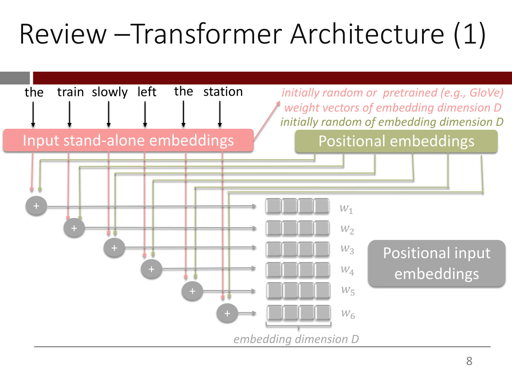

Same as slide 7. New: at the end of each of the six grey arrows is a row of four grey squares (a vector), labelled at right $w_1$ through $w_6$ top to bottom (italic). A bracket under the last row is labelled "embedding dimension D" (italic grey). A grey rounded box at right is labelled "Positional input embeddings".

*Figure: yes — the six "+" outputs shown as vectors w1 to w6 of dimension D, labelled "Positional input embeddings"*

## Slide 9 — Review –Transformer Architecture (2)

Left: a grey rounded box "Positional input embeddings" above six rows of grey 4-square vectors labelled $w_1$ to $w_6$ (grey italic), each followed by a grey arrow pointing right into a large dark red rectangle in the middle labelled "Transformer Encoder". Right: a blue rounded box "Contextual embeddings" above six rows of blue 4-square vectors labelled (blue) $\hat w_1$ to $\hat w_6$, each preceded by a blue arrow pointing right from the red rectangle to the vector. The figure shows the encoder mapping six positional input embeddings to six contextual embeddings.

*Figure: yes — Transformer Encoder block mapping six grey positional input embeddings w1 to w6 to six blue contextual embeddings w-hat 1 to w-hat 6*

## Slide 10 — Word-to-Slot Classification with Transformers (Revisited)

Three column headers: grey "Positional input embeddings", blue "Contextual embeddings", yellow "Output layer (Softmax)".

Left column: five words, "fly", "from", "Boston", "to", "Denver", each beside a row of four grey squares (a 4-element vector). Under the grey vectors a bracket labelled "embedding dimension" (grey italic). A dark red arrow leads from the grey vectors to a small dark red box "TE\*". A dark red arrow leads from TE\* to five rows of four blue squares (middle column), with a blue bracket and blue italic "embedding dimension" beneath. A dark red arrow leads from the blue vectors to a dark red box "Dense (ReLU)". Arrows from the Dense box go to five rows of three yellow squares (output layer column; each yellow vector has three squares). From each yellow row a dark red arrow points to a small dark red box "SM", and from each SM box an arrow points to a label. Labels top to bottom: "O", "O", "B-fromloc.city_name" (tiny blue text), "O", "B-toloc.city_name" (tiny blue text). (The label rows align with fly, from, Boston, to, Denver in order.)

Footer: "\*Transformer Encoder" at bottom left. Legend at bottom: a row of four blue squares and a row of four grey squares, followed by "Indicate 4-element embedding vectors".

*Figure: yes — pipeline from five word embeddings through TE, Dense (ReLU), and per-word softmax (SM) boxes to slot labels O, O, B-fromloc.city_name, O, B-toloc.city_name*

## Slide 11 — Transformer Encoder

Same diagram as slide 9 (grey "Positional input embeddings" vectors $w_1$ to $w_6$ into a dark red "Transformer Encoder" box, out to blue "Contextual embeddings" vectors $\hat w_1$ to $\hat w_6$). Only the title differs ("Transformer Encoder" instead of "Review –Transformer Architecture (2)").

*Figure: yes — Transformer Encoder block mapping six grey positional input embeddings to six blue contextual embeddings*

## Slide 12 — We will now cover three (further) important elements of the Transformer Encoder\*

- Making self-attention "tunable"
- Residual connections
- Layer normalization

Footer: \* not covered in lecture 7

*Figure: no*

## Slide 13 — Review: Self-Attention

Across the top, in italic, the words "The", "train", "slowly", "left", "the", "station". Below each, in grey, its positional input embedding $w_1$ to $w_6$; $w_6$ is circled with a dashed grey ellipse. Grey label at right: "Positional input embedding". Six dark red lines run from $w_1$, $w_2$, $w_3$, $w_4$, $w_5$ and $w_6$ down to a point at bottom right, a dashed blue ellipse around $\hat w_6$ (blue). Each line carries an olive-green label near it: $s_{1,6}$, $s_{2,6}$, $s_{3,6}$, $s_{4,6}$, $s_{5,6}$, $s_{6,6}$ (the last line from $w_6$ is vertical). A thick dark red downward arrow at right points toward the blue label "Embedding after self-attention".

Left, the weight formula (the $s$ in olive, $w$ terms in grey):

$$s_{1,6} = \frac{\exp\langle w_1, w_6\rangle}{\sum_{i=1}^{6}\exp\langle w_i, w_6\rangle}$$

At the bottom, inside a red-outlined box:

$$\hat w_6 = s_{1,6}w_1 + s_{2,6}w_2 + s_{3,6}w_3 + s_{4,6}w_4 + s_{5,6}w_5 + s_{6,6}w_6$$

*Figure: yes — fan of six weighted lines (s1,6 to s6,6) from word embeddings w1 to w6 into the self-attention output w-hat 6 for "station"*

## Slide 14 — As it stands, the self-attention heads don't have any internal weights so all the heads will produce the same output embeddings. We need to make each of them "tunable".

(Title as printed above, three lines of text in the title area.)

Left, grey "Positional input embeddings" with grey vectors $w_1$ to $w_6$ and arrows into a red-outlined region; right, blue "Contextual embeddings" with blue vectors $\hat w_1$ to $\hat w_6$ and arrows leading out from it. Inside the red-outlined box are gold/tan rounded blocks: two boxes labelled "Attention Head" (one at top, one at bottom); each has a bundle of about six gold arrows pointing to or from a middle box labelled "Concatenate and Project" (the top head's arrows point down-right into it; the bottom head's arrows point up-right into it). A bundle of gold arrows runs from "Concatenate and Project" right into a tall box labelled "Feed-Forward Layer". The figure shows the encoder's inner structure: multiple attention heads, concatenate and project, then a feed-forward layer.

*Figure: yes — inside the Transformer Encoder: two Attention Head blocks into Concatenate and Project, then a Feed-Forward Layer*

## Slide 15 — How can we make this representation more "tunable"?

Please see
*HODL-SP24-Section-A-The Self-Attention Layer.pdf* (italic)

*Figure: no*

## Slide 16 — Making Self-Attention Tunable

("Tunable" in the title is purple.) Two formulas with a large dark red right arrow between them (the $s$ olive, $w$ grey, and the matrix $A$ bold italic purple in the right formula):

$$s_{1,6} = \frac{\exp\langle w_1, w_6\rangle}{\sum_{i=1}^{6}\exp\langle w_i, w_6\rangle} \quad\Longrightarrow\quad s_{1,6} = \frac{\exp\langle A w_1, A w_6\rangle}{\sum_{i=1}^{6}\exp\langle A w_i, A w_6\rangle}$$

- We can multiply the positional input embeddings by a matrix **A** before their dot-product is computed. ("A" in purple bold italic.)
  - Multiplying by a matrix **A** = a dense layer with a linear activation

*Figure: no*

## Slide 17 — Making Self-Attention Tunable

("Tunable" in the title is purple.) Same as slide 16 (the two $s_{1,6}$ formulas with the dark red right arrow, the first bullet and its sub-bullet). New below:

- The key point: The numbers in the matrix **A** are "learnable" weights i.e., weights that we will optimize with backprop. This is what we mean by "tunable" ("The key point" underlined; "A" purple bold italic.)

*Figure: no*

## Slide 18 — Making Self-Attention Tunable

("Tunable" in the title is purple.) Two formulas with a dark red right arrow between them. Left is the slide 16/17 right-hand formula; right is the new one (the matrices in purple bold italic, $w$ terms grey, $s$ olive):

$$s_{1,6} = \frac{\exp\langle A w_1, A w_6\rangle}{\sum_{i=1}^{6}\exp\langle A w_i, A w_6\rangle} \quad\Longrightarrow\quad s_{1,6} = \frac{\exp\langle A^K w_1, A^Q w_6\rangle}{\sum_{i=1}^{6}\exp\langle A^K w_i, A^Q w_6\rangle}$$

(K and Q are printed as superscripts on the bold A here.)

- We use two different matrices (called *a key matrix and a query matrix*) before computing the similarities. (The phrase "two different matrices (called a key matrix and a query matrix)" is purple, partly italic.)
- We now have two matrices $A^K$ and $A^Q$ of "learnable" weights -> twice as tunable as before!

*Figure: no*

## Slide 19 — Tweak: Making Self-Attention Tunable

("Tunable" in the title is purple.)

In the final step, we apply a (third) matrix $A^V$ of learnable weights and *then* compute the contextual embedding! ("then" italic; $A^V$ purple bold italic.)

In a red-outlined box (the box runs off the right edge of the slide):

$$\hat w_6 = s_{1,6}A^V w_1 + s_{2,6}A^V w_2 + s_{3,6}A^V w_3 + s_{4,6}A^V w_4 + s_{5,6}A^V w_5 + s_{6,6}A^V w_6$$

"instead of"

In a second red-outlined box:

$$\hat w_6 = s_{1,6}w_1 + s_{2,6}w_2 + s_{3,6}w_3 + s_{4,6}w_4 + s_{5,6}w_5 + s_{6,6}w_6$$

*Figure: no*

## Slide 20 — Summary: Making Self-Attention Tunable

("Tunable" in the title is purple.) Top: the formula pair from slide 18's right side, i.e. on the left the original

$$s_{1,6} = \frac{\exp\langle w_1, w_6\rangle}{\sum_{i=1}^{6}\exp\langle w_i, w_6\rangle}$$

then a dark red right arrow, then

$$s_{1,6} = \frac{\exp\langle A^K w_1, A^Q w_6\rangle}{\sum_{i=1}^{6}\exp\langle A^K w_i, A^Q w_6\rangle}$$

A large dark red downward arrow points from the right formula to a red-outlined box holding

$$\hat w_6 = s_{1,6}A^V w_1 + s_{2,6}A^V w_2 + s_{3,6}A^V w_3 + s_{4,6}A^V w_4 + s_{5,6}A^V w_5 + s_{6,6}A^V w_6$$

Text: The values in matrices $A^K$, $A^Q$, $A^V$ are weights learned through optimization (SGD). This makes them "tunable" and (as we will see shortly) enable the attention "heads" to learn different patterns in the input (The word "and" ends its line at the right edge of the text area; the sentence is complete.)

Footer (small text, below the footer rule): This entire operation can be written compactly in this matrix equation (https://arxiv.org/pdf/1706.03762.pdf):

$$\text{Attention}(Q, K, V) = \text{softmax}\left(\frac{QK^T}{\sqrt{d_k}}\right)V$$

(Printed as a small image of the equation.)

*Figure: no*

## Slide 21 — Summary: Multi-Head Attention

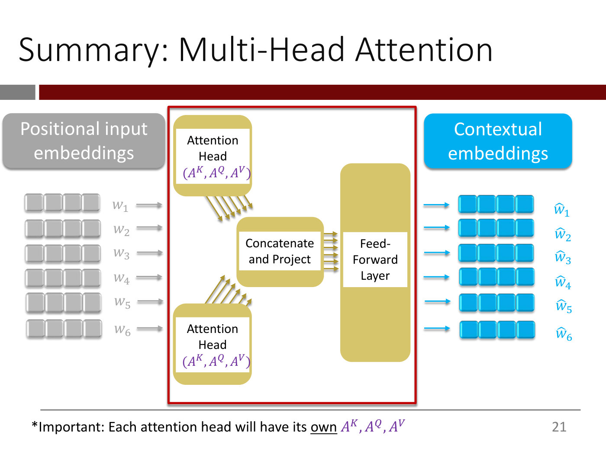

Same layout as slide 14 (grey "Positional input embeddings" vectors $w_1$ to $w_6$ at left; blue "Contextual embeddings" vectors $\hat w_1$ to $\hat w_6$ at right; red-outlined region in the middle holding two "Attention Head" blocks, a "Concatenate and Project" block and a tall "Feed-Forward Layer" block, connected by bundles of gold arrows). New: each "Attention Head" label now has a second line in purple, $(A^K, A^Q, A^V)$, in both heads. Footer: \*Important: Each attention head will have its own $A^K, A^Q, A^V$ ("own" underlined; the matrices in purple).

*Figure: yes — two Attention Head blocks, each labelled with its own (A^K, A^Q, A^V), feeding Concatenate and Project, then a Feed-Forward Layer*

## Slide 22 — Transformer Encoder

Grey "Positional input embeddings" (vectors $w_1$ to $w_6$ with grey arrows) at left and blue "Contextual embeddings" (vectors $\hat w_1$ to $\hat w_6$ with blue arrows) at right, as on slide 9. In the middle a red-outlined region holds two gold blocks side by side: "Multi-head Attention Layer" and "Feed-Forward Layer". Six gold arrows run from the left of the first block's outputs into the second block (one per word). The grey arrows enter the Multi-head Attention Layer; the blue arrows leave the Feed-Forward Layer. The figure condenses slide 21's inner structure into two stacked layers.

*Figure: yes — Transformer Encoder as a Multi-head Attention Layer followed by a Feed-Forward Layer, both inside a red outline*

## Slide 23 — Another tweak: Residual Connection

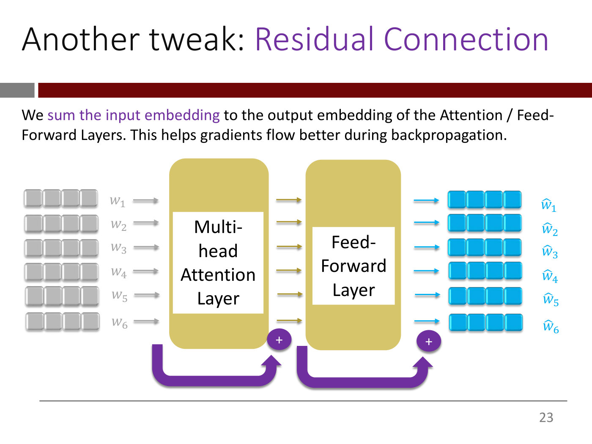

("Residual Connection" in the title is purple.)

We sum the input embedding to the output embedding of the Attention / Feed-Forward Layers. This helps gradients flow better during backpropagation. ("sum the input embedding" purple.)

Diagram: same as slide 22 without the red outline, the "Positional input embeddings" and "Contextual embeddings" header boxes, or the title text, and with two additions: a thick purple curved arrow runs from below the left edge of the "Multi-head Attention Layer" block, along the bottom, and up into a small purple circle containing "+" at the lower right of that block, and a second thick purple arrow does the same around the "Feed-Forward Layer" block, ending in a purple "+" circle at its lower right. So each layer's input is routed around it and added to its output.

*Figure: yes — Multi-head Attention Layer and Feed-Forward Layer each with a purple skip arrow around the block into a "+" circle*

## Slide 24 — A final tweak: Layer Normalization

("Layer Normalization" in the title is purple.)

After the Attention / Feed-Forward Layers, we standardize (i.e., subtract mean and divide by std) each embedding. This ensures that the weights stay small. ("standardize" purple.)

Diagram: same as slide 23 (Multi-head Attention Layer, Feed-Forward Layer, grey $w_1$ to $w_6$ in, blue $\hat w_1$ to $\hat w_6$ out, purple skip arrows into "+" circles). New: a thin red upward arrow just after each "+" circle, one to the right of the first "+" (between the two layers) and one to the right of the second "+" (before the blue output arrows). The "+" circles sit slightly differently (the second "+" is nearer the red arrow). The red arrows are unlabelled.

*Figure: yes — residual-connection diagram with a red upward arrow after each "+" circle marking where standardization is applied*

## Slide 25 — Layer Normalization

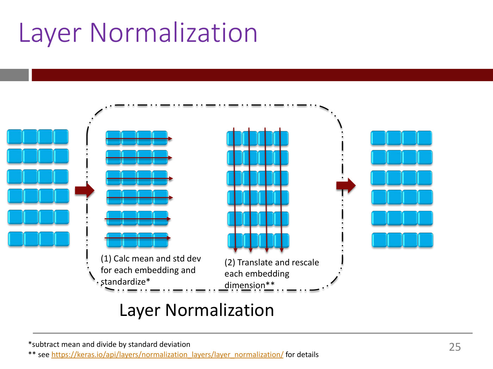

("Layer Normalization" title in purple.)

Diagram, left to right: six rows of four blue squares (six embedding vectors); a thick dark red right arrow into a large dashed rounded box; inside the box two panels. Panel 1 shows the six blue vectors again, each with a thin dark red horizontal arrow running left to right along its row, captioned "(1) Calc mean and std dev for each embedding and standardize\*". Panel 2 shows the six vectors again with four thin dark red vertical arrows running top to bottom through the four columns, captioned "(2) Translate and rescale each embedding dimension\*\*". A thick dark red right arrow leaves the dashed box into six blue vectors at the right. Below the dashed box, the label "Layer Normalization".

Footers: \*subtract mean and divide by standard deviation
\*\* see https://keras.io/api/layers/normalization_layers/layer_normalization/ for details (the URL is an orange hyperlink)

*Figure: yes — six embedding vectors passing through layer normalization: step 1 standardizes each row, step 2 translates and rescales each column*

## Slide 26 — Transformer Encoder

Same as slide 24's diagram (grey vectors $w_1$ to $w_6$ in, Multi-head Attention Layer, Feed-Forward Layer, blue vectors $\hat w_1$ to $\hat w_6$ out, purple skip arrows into "+" circles) with these changes: the slide title is "Transformer Encoder", there is no explanatory sentence, a red rectangle now encloses the two layers, both skip arrows and both "+" circles (but not the grey input vectors or blue output vectors), and the thin upward arrows after each "+" circle are now purple rather than red.

*Figure: yes — Transformer Encoder with attention and feed-forward layers, residual skip arrows and "+" circles, inside a red box*

## Slide 27 — Transformer Encoders are stackable!

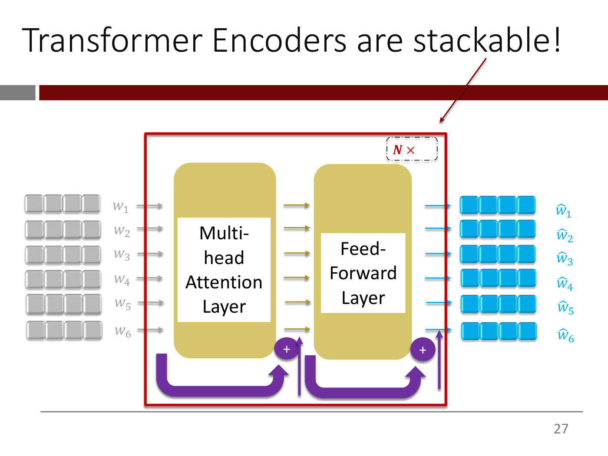

Same as slide 26. New: a dashed rounded label "N ×" (N bold italic dark red, followed by a red times sign) at the top right inside the red rectangle, and a dark red arrow from the title area pointing down-left at the top right corner of the red rectangle. The red rectangle is drawn slightly larger than on slide 26. The label means the boxed encoder block is repeated N times.

*Figure: yes — the encoder block in a red box marked "N ×" with an arrow, showing encoders can be stacked*

## Slide 28 — The Transformer Encoder

Two panels separated by a thin vertical red line. Left: a miniature copy of slide 26's diagram (grey $w_1$ to $w_6$ in, the red-boxed Multi-head Attention Layer and Feed-Forward Layer with residual arrows, blue $\hat w_1$ to $\hat w_6$ out). Right: a figure from the "Attention is All You Need" paper, drawn rotated 90 degrees (text reads top to bottom). It shows an "Inputs" arrow into a pink "Input Embedding" box, then a circled "+" where a "Positional Encoding" input joins, then a large grey rounded block labelled "Nx" containing an orange "Multi-Head Attention" box followed by a yellow-green "Add & Norm" box (with a skip connection looping over them), then a light blue "Feed Forward" box followed by a second yellow-green "Add & Norm" box (again with a skip connection over them); an arrow leaves the block at the right. Under it: https://arxiv.org/abs/1706.03762

Footer text as printed: Figures from "Attention is All You Need" © Ashish Vaswani, Noam Shazeer, Niki Parmar, Jakob Uszkoreit, Llion Jones, Aidan N. Gomez, Lukasz Kaiser, Illia Polosukhin. All rights reserved. This content is excluded from our Creative Commons license. For more information, see https://ocw.mit.edu/help/faq-fair-use.

*OCW notice: Figures from "Attention is All You Need" © Ashish Vaswani, Noam Shazeer, Niki Parmar, Jakob Uszkoreit, Llion Jones, Aidan N. Gomez, Lukasz Kaiser, Illia Polosukhin. All rights reserved. This content is excluded from our Creative Commons license. For more information, see https://ocw.mit.edu/help/faq-fair-use.*

*Figure: yes — the course's encoder diagram beside the encoder figure from the Attention is All You Need paper (excluded third-party figure)*

## Slide 29 — Review: What is Optimized?

Diagram (same pipeline as slide 10) with italic black column labels: "Positional input embeddings" (above the grey vectors), "Contextual embeddings" (above the blue vectors), "Softmax" (above the SM boxes). Words at left: fly, from, Boston, to, Denver beside five rows of four grey squares; a dark red arrow into "TE\*"; arrow to five rows of four blue squares; arrow to a dark red box "Dense (ReLU)"; arrow to five rows of three yellow squares; arrows to five dark red "SM" boxes; output labels O, O, B-fromloc.city_name (tiny blue), O, B-toloc.city_name (tiny blue; cut off at the right edge as "B-toloc.city_nar"). Red dashed outlines enclose: the grey vectors together with TE\* (the grey and TE\* group; the word column overlaps its left edge), the Dense (ReLU) box, and the five SM boxes. A fourth empty red dashed rounded box at lower left sits above the italic black text "Weights optimized by backprop" (it works as a legend key for the dashed outlines).

A numbered list in red italic at lower right:

1. Positional embeddings
2. Stand-alone embeddings (unless pretrained and Trainable=False)
3. Matrices $A^K$, $A^Q$, $A^V$ for each attention head (inside TE)
4. Layer norm scale and bias parameters (inside TE)
5. Weights in Feed-Forward layers (inside TE)
6. Weights in Dense layers outside TE
7. Weights in final Softmax layer

Footer: \*Transformer Encoder; a legend of four blue squares and four grey squares followed by "Indicate 4-element embedding vectors".

*Figure: yes — slot-tagging pipeline from word embeddings through TE, Dense (ReLU) and softmax with red dashed outlines marking the parts whose weights are optimized by backprop*

## Slide 30 — Applying the Transformer – Common Use-Cases

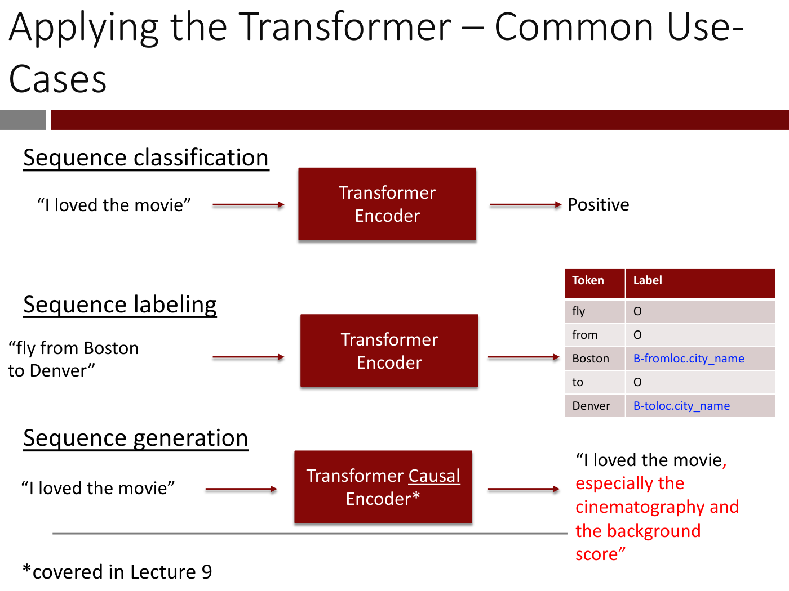

Three use-cases, each with an underlined heading, an input, a dark red box and an output:

- "Sequence classification": input "I loved the movie" -> dark red box "Transformer Encoder" -> output "Positive".
- "Sequence labeling": input "fly from Boston to Denver" -> "Transformer Encoder" -> a table with columns Token and Label (dark red header row, light grey-pink rows): fly / O; from / O; Boston / B-fromloc.city_name (blue); to / O; Denver / B-toloc.city_name (blue).
- "Sequence generation": input "I loved the movie" -> dark red box "Transformer Causal Encoder\*" ("Causal" underlined) -> output: "I loved the movie" in black followed by a red comma and the red words "especially the cinematography and the background score" with closing quotation mark (the opening quote, "I loved the movie" and the quote marks are black; the continuation is red).

Footer: \*covered in Lecture 9

*Figure: yes — three use-case diagrams (classification, labeling, generation) each with a Transformer Encoder box, and a Token/Label table for slot tagging*

## Slide 31 — We saw how to do Sequence Labeling

Same as slide 30 with these changes: the title is "We saw how to do Sequence Labeling"; a green checkmark in a green box sits at the left of the "Sequence labeling" heading; the "Transformer Causal Encoder" box no longer carries an asterisk; the generation output is now rendered with the continuation in the same black-and-red scheme as before ("I loved the movie," black with a red comma, then red "especially the cinematography and the background score""); and the footer "\*covered in Lecture 9" is gone.

*Figure: yes — the three use-case diagrams with a green checkmark beside Sequence labeling*

## Slide 32 — How can we do this?

Same as slide 30/31 diagrams (classification, labeling with the Token/Label table, generation with the Transformer Causal Encoder box without an asterisk). New: a red dashed ellipse is drawn around the "Sequence classification" heading, the input "I loved the movie" and the left part of the "Transformer Encoder" box. The checkmark is gone. The generation output text is now entirely black (no red words): "I loved the movie, especially the cinematography and the background score". There is no footer.

*Figure: yes — the three use-case diagrams with a red dashed ellipse around sequence classification*

## Slide 33 — Recall: The Transformer Encoder produces a contextual embedding for each token in the input

Italic labels: "Positional input embeddings" (top left) and "Contextual embeddings" (top right). Left: four words "i", "loved", "the", "movie", each beside a row of four grey squares. A dark red arrow leads to a dark red box "Transformer Encoder", and another arrow leads to four rows of four blue squares. The rest of the slide is empty.

*Figure: yes — four word embeddings (i, loved, the, movie) into a Transformer Encoder box and four contextual embeddings out*

## Slide 34 — If we could "summarize" the multiple contextual embeddings into a single embedding that represents the whole sentence …

Title (the top line is partly clipped at the slide's top edge): If we could "summarize" the multiple contextual embeddings into a single embedding that represents the whole sentence … ("single" underlined)

Same diagram as slide 33: the words "i", "loved", "the", "movie" run down the left, each beside a row of four grey boxes (labelled in italics "Positional input embeddings"); a red arrow leads to a dark red box "Transformer Encoder"; a red arrow leads to four rows of four light-blue boxes (labelled in italics "Contextual embeddings"). New: a further red arrow from the blue rows points to a single horizontal row of four green boxes, with no label.

*Figure: yes — Transformer Encoder diagram: four word rows of grey positional embeddings, encoder box, four rows of blue contextual embeddings, and a new single row of four green boxes to the right*

## Slide 35 — … we can feed the sentence embedding into a dense ReLU layer, followed by a sigmoid (or softmax)

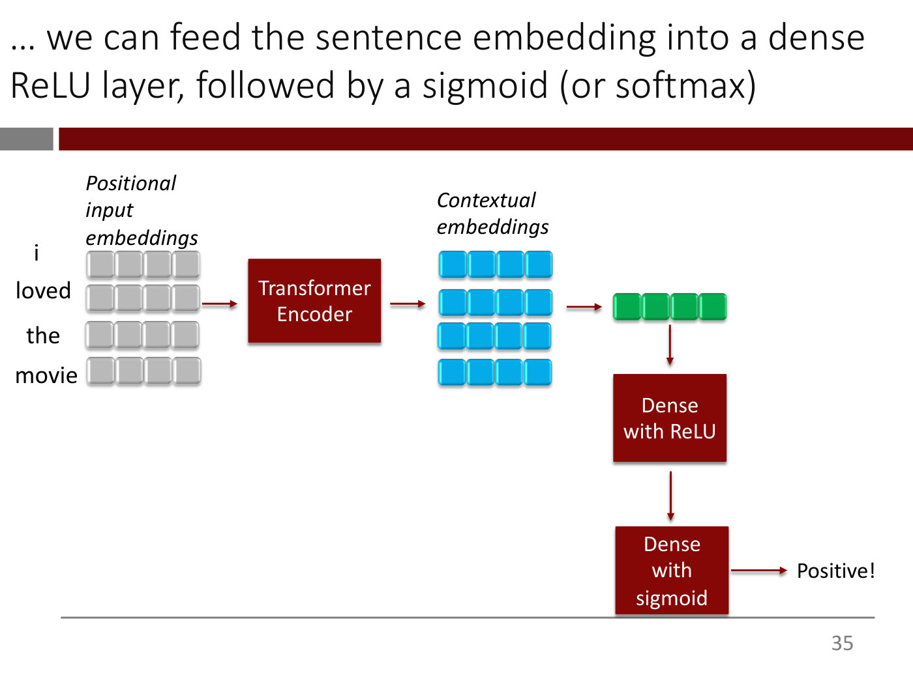

Title: … we can feed the sentence embedding into a dense ReLU layer, followed by a sigmoid (or softmax)

Same as slide 34. New: a red arrow runs down from the green row to a dark red box "Dense with ReLU", then another red arrow down to a dark red box "Dense with sigmoid" (its text on three lines: "Dense", "with", "sigmoid"). A red arrow from that box points right to the text "Positive!".

*Figure: yes — Encoder pipeline from the words to blue contextual embeddings, green sentence embedding, Dense with ReLU, Dense with sigmoid, and the output Positive!*

## Slide 36 — How can we do this?

Title: How can we do this?

Same as slide 35. New: a red dashed rounded rectangle encloses the four blue contextual-embedding rows (with their label), the arrow from them, and the green row of four boxes; the rectangle's bottom edge passes through the lower blue row and just touches the top of the "Dense with ReLU" box. The rest of the slide is unchanged: the encoder box, the dense layers, "Positive!" and every label match slide 35.

*Figure: yes — Same encoder and classifier diagram as slide 35 with a red dashed outline around the contextual embeddings and the green sentence embedding, marking the step to be worked out*

## Slide 37 — We *can* average the four [blue boxes] to get [green boxes]

Title: We *can* average the four (a row of four blue boxes drawn inline) to get (a row of four green boxes drawn inline). "can" is italic.

Same diagram as slide 36, including the red dashed outline. New: red text at lower left, "Any shortcomings?".

*Figure: yes — Same diagram as slide 36 with the red question Any shortcomings? added at lower left*

## Slide 38 — A better approach: Add a special token at the beginning of each sentence and just use its output embedding as the sentence-embedding

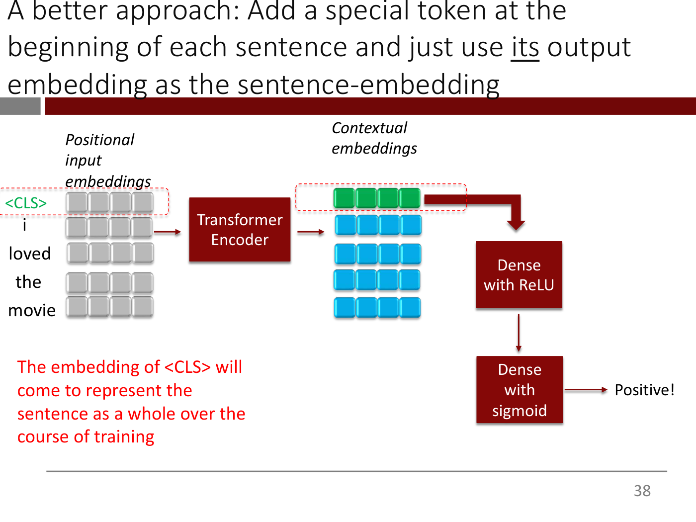

Title (top line partly clipped): A better approach: Add a special token at the beginning of each sentence and just use its output embedding as the sentence-embedding ("its" underlined)

Diagram, redrawn. Left column: a new first row labelled "<CLS>" (green text, inside a red dashed outline that also covers its row of four grey boxes), followed by "i", "loved", "the", "movie", each beside a row of four grey boxes (five rows of grey boxes in all; label "Positional input embeddings" in italics above). A red arrow leads to the dark red "Transformer Encoder" box, then a red arrow to five rows of four boxes labelled "Contextual embeddings". The top row is green (inside a red dashed outline); the lower four rows are light blue. There is no averaging step and no separate green sentence row. A thick dark red arrow leaves the green top row, runs right, and turns down into "Dense with ReLU"; a thin arrow goes down to "Dense with sigmoid", then a red arrow right to "Positive!". Red text at lower left: "The embedding of <CLS> will come to represent the sentence as a whole over the course of training".

*Figure: yes — Encoder diagram with a <CLS> token prepended, its green output embedding feeding Dense with ReLU, Dense with sigmoid and Positive!*

## Slide 39 — If the input data for a task is natural language text, we don't have to restrict ourselves

If the input data for a task is natural language text, we don't have to restrict ourselves to just the text we have.

Wouldn't it be great to learn from "all the text that's out there"? ("all the text that's out there" is in red.)

(The slide has no title; the heading above is a short title in the page's words.)

*Figure: no*

## Slide 40 — Self-Supervised Learning

Section title slide: "Self-Supervised Learning" in white text on a dark red band with a grey block at its left.

*Figure: no*

## Slide 41 — Recall the Transfer Learning example from Lecture 4

Title: Recall the Transfer Learning example from Lecture 4

Label: ResNet 34\*

A wide diagram of the ResNet-34 layer stack, inside a red dashed rectangle that spans the slide. It is labelled "34-layer residual" (rotated) at the far left. An "image" arrow enters a first block "7x7 conv, 64, /2" and then "pool, /2". These are followed by a long row of narrow vertical blocks, each labelled with a "3x3 conv, N" label rotated to vertical (64, then 128 with a "/2" on the first, then 256 with a "/2" on the first, then 512 with a "/2" on the first), grouped by pale colours (purple for 64, green for 128, pink for 256, blue-grey for 512). Curved skip-connection arcs run over pairs of blocks. Most arcs are solid and the ones where the width changes are dotted. At the right end are "avg pool" and a final block "fc 1000". The label text is small but legible.

Text below the diagram: We fed the output of "headless Resnet" to a small NN

Footer: \*https://arxiv.org/abs/1512.03385

*OCW notice: ResNet34 layers image © Kaiming He, Xiangyu Zhang, Shaoqing Ren, Jian Sun/arXiv. All rights reserved. This content is excluded from our Creative Commons license. For more information, see https://ocw.mit.edu/help/faq-fair-use.* (The notice is printed on the slide above the footer rule.)

*Figure: yes — ResNet-34 layer diagram (34-layer residual) from conv and pool layers through coloured 3x3 conv stages with skip arcs to avg pool and fc 1000; excluded by OCW notice*

## Slide 42 — We built a very accurate handbags/shoes classifier with only 100 examples

Title: We built a very accurate handbags/shoes classifier with only 100 examples

A small network diagram in three columns. Left, labelled "Input Layer = smart representations from "headless" ResNet" ("Input Layer =" in black, the rest in red): a circle "x1", three vertical dots, and a circle "xn". Middle, labelled "Hidden layer": a circle with a ReLU-shaped symbol at top, three vertical dots, and another ReLU circle at the bottom. Right, labelled "Output layer": a single circle with a sigmoid-shaped symbol and a red arrow to the text "Handbag/ Shoe". No connecting lines between layers are drawn.

*Figure: yes — Three-column schematic of the small classifier: input circles x1 to xn, ReLU hidden circles, and one sigmoid output circle labelled Handbag/Shoe, with no connecting edges*

## Slide 43 — We built a very accurate handbags/shoes classifier with only 100 examples

Title: We built a very accurate handbags/shoes classifier with only 100 examples

Same as slide 42. New: large red text at the bottom, "Why was this so effective?".

*Figure: yes — Same small classifier schematic as slide 42 with the red question Why was this so effective? added*

## Slide 44 — Neural networks are Representation learners

Section title slide: "Neural networks are Representation learners" in white text on a dark red band with a grey block at its left.

*Figure: no*

## Slide 45 — The output of every layer in a DNN can be thought of as a transformed version of the "raw" input. These transformed versions of the input are called representations

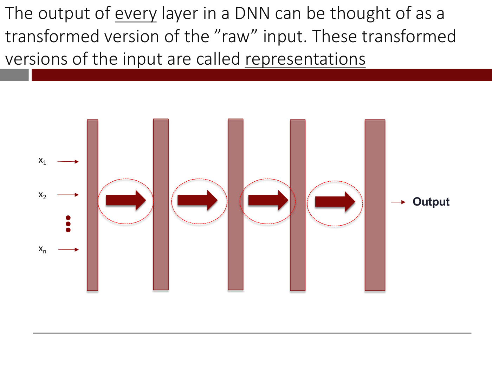

Title (top line partly clipped; "every" and "representations" underlined): The output of every layer in a DNN can be thought of as a transformed version of the "raw" input. These transformed versions of the input are called representations

Diagram: inputs x1, x2, three vertical dots, xn on the left, each with a small arrow pointing into the first of five tall rose-coloured vertical bars (the layers). Between each pair of neighbouring bars sits a thick dark red right-pointing arrow, circled by a thin red dashed ellipse (four arrows, four ellipses). The fifth bar is followed by a small arrow and the bold word "Output".

*Figure: yes — Five vertical layer bars with inputs x1 to xn at left, a circled right arrow between each pair of layers, and Output at right*

## Slide 46 — From this perspective, a deep NN trained with Supervised Learning learns many representations and a final regression model

Title (top line partly clipped; "and" underlined): From this perspective, a deep NN trained with Supervised Learning learns many representations and a final regression model

Same layers as slide 45 but redrawn with only four rose bars on the left, drawn closer together and with the inputs x1, x2, dots, xn at the slide's left edge, and with a thick arrow after the fourth bar. The four bars and their arrows are enclosed in a large red dashed rounded rectangle. To its right is a bold "+" sign, then a thick arrow into a fifth, wider bar with the rotated white label "Regression", inside its own red dashed rounded rectangle. A small arrow leaves the Regression bar at the right edge. The "Output" label of slide 45 is gone.

*Figure: yes — Four layer bars with arrows in a red dashed box, plus a separate Regression bar in a second red dashed box, joined by a plus sign*

## Slide 47 — If we think of a representation as an encoding of the raw input, the part of the NN that produces that encoding can be viewed as an encoder. A DNN "contains" many encoders.

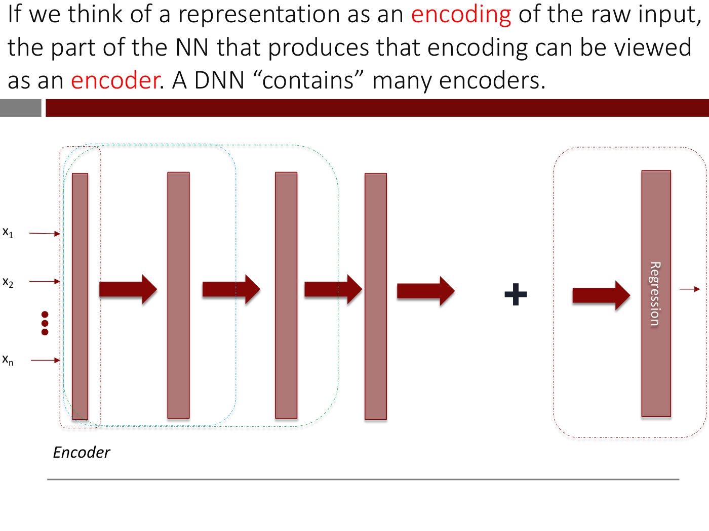

Title (top line partly clipped; "encoding" and "encoder" in red): If we think of a representation as an encoding of the raw input, the part of the NN that produces that encoding can be viewed as an encoder. A DNN "contains" many encoders.

Same as slide 46 (four bars with arrows, "+", Regression bar in its red dashed box). New: the large red dashed box around the four bars is removed, and three nested thin dashed outlines, all starting at the left edge, enclose growing prefixes of the stack. A small red dashed rectangle encloses only the first bar. A light-blue dashed rounded outline encloses the first two bars. A green dashed rounded outline encloses the first three bars. The fourth bar is outside all three. An italic label "Encoder" sits below the left of the stack.

*Figure: yes — Layer-stack diagram with three nested dashed outlines (red around layer 1, blue around layers 1 to 2, green around layers 1 to 3) labelled Encoder, plus the Regression box*

## Slide 48 — What do representations/encoders capture?

Title: What do representations/encoders capture?

- Is it <u>specific</u> knowledge needed to connect the input to the *particular* output the NN was trained to predict?
- Or is it <u>general</u> knowledge about the input data that can be useful to predict <u>other</u> outputs? (the whole bullet is red)

*Figure: no*

## Slide 49 — Turns out representations do capture a lot of general knowledge about the input data

Title (partly clipped at the top; "do" and "general" italic): Turns out representations *do* capture a lot of *general* knowledge about the input data

The rest of the slide is empty.

*Figure: no*

## Slide 50 — In a deep network trained to classify "everyday" objects into one of 1000 categories, the representations from the first three layers correspond to lines, then edges, then more complex shapes

Title: In a deep network trained to classify "everyday" objects into one of 1000 categories, the representations from the first three layers correspond to lines, then edges, then more complex shapes

Three image panels left to right, each labelled with a layer name. "Layer 1" (label to the right of a small image): a small square 3 by 3 grid of tiny feature visualisations, with diagonal stripe and colour-blob patterns. "Layer 2" (label at the bottom left of its panel): a larger grid split by thick black lines into 4 by 4 blocks of small 3 by 3 tiles, on a dark background, showing line, stripe, curve and ring-like patterns of various colours. "Layer 3" (label at the bottom left of its panel): a still larger grey grid, also divided by thicker lines into blocks of 3 by 3 tiles, showing more intricate patterns, some with colour. The individual tile contents are too small to describe reliably.

Footer: https://cs.nyu.edu/~fergus/papers/zeilerECCV2014.pdf

*OCW notice: ImageNet training image © unknown. All rights reserved. This content is excluded from our Creative Commons license. For more information, see https://ocw.mit.edu/help/faq-fair-use.* (The notice is printed on the slide above the footer rule.)

*Figure: yes — Three grids of learned CNN feature visualisations labelled Layer 1, Layer 2 and Layer 3, from a Zeiler and Fergus paper; excluded by OCW notice*

## Slide 51 — In a deep network trained to detect faces, the representations correspond to lines, edges, circles and finally faces

Title (top part partly clipped): In a deep network trained to detect faces, the representations correspond to lines, edges, circles and finally faces

Three grids of small grey image tiles in a row, joined by red arrows: one arrow enters the first grid from the left, one points from the first to the second, and one from the second to the third. The first grid (4 rows by 6 columns) shows small oriented dark and light strokes and blobs. The second grid (4 rows by 6 columns) shows larger partial shapes that look like parts of faces such as eyes, brows and outlines, and several nearly blank bright tiles. The third grid (4 rows by 6 columns) shows whole face images. There are no layer labels on the grids.

Caption below, large text: lines => edges, circles => faces!

Footer (the first part is an orange underlined link): Convolutional Deep Belief Networks for Scalable Unsupervised Learning of Hierarchical Representations by Lee at al (2009)

*OCW notice: Convolutional layers images © Honglak Lee, Roger Grosse, Rajesh Ranganath, Andrew Y. Ng. All rights reserved. This content is excluded from our Creative Commons license. For more information, see https://ocw.mit.edu/help/faq-fair-use.* (The notice is printed on the slide above the footer rule.)

*Figure: yes — Three grids of feature visualisations joined by arrows, from line and stroke detectors to face parts to whole faces; excluded by OCW notice*

## Slide 52 — Leveraging the general knowledge in these representations

Title: Leveraging the general knowledge in these representations

- Since these representations are capturing various <u>intrinsic</u> aspects of the images, they could be used for prediction tasks other than the ones they were initially trained for. (The part from "they could be used" onward is red.)

*Figure: no*

## Slide 53 — Leveraging the general knowledge in these representations

Title: Leveraging the general knowledge in these representations

- Since these representations are capturing various <u>intrinsic</u> aspects of the images, they could be used for prediction tasks other than the ones they were initially trained for. (now all black)
  - For example, the representations from the face-detection DNN could be plausibly used to build an emotion-detection DNN. (new; red)

*Figure: no*

## Slide 54 — Leveraging the general knowledge in these representations

Title: Leveraging the general knowledge in these representations

- Since these representations are capturing various <u>intrinsic</u> aspects of the images, they could be used for prediction tasks other than the ones they were initially trained for. (greyed out)
  - For example, the representations from the face-detection DNN could be plausibly used to build an emotion-detection DNN. (greyed out)
- If we can "somehow" get an encoder that generates good representations of our input data, we can simply build a regression model with the representations as input and labels as output (new; black)

*Figure: no*

## Slide 55 — Leveraging the general knowledge in these representations

Title: Leveraging the general knowledge in these representations

- Since these representations are capturing various <u>intrinsic</u> aspects of the images, they could be used for prediction tasks other than the ones they were initially trained for. (greyed out)
  - For example, the representations from the face-detection DNN could be plausibly used to build an emotion-detection DNN. (greyed out)
- If we can "somehow" get an encoder that generates good representations of our input data, we can simply build a regression model with the representations as input and labels as output (greyed out; the text is re-wrapped slightly differently from slide 54)
- Since we won't have to "spend" precious data on learning good representations any more, we won't need as much labeled data in the first place. (new; red)

*Figure: no*

## Slide 56 — This is exactly what happened with the handbags-shoes example

Title: This is exactly what happened with the handbags-shoes example

Same ResNet-34 diagram, "ResNet 34\*" label and red dashed outline as slide 41. New: red text below it, "We used "headless Resnet" as an encoder that can take raw input and transform it into useful representations" ("encoder" underlined). The line "We fed the output of "headless Resnet" to a small NN" of slide 41 is gone. The footer "\*https://arxiv.org/abs/1512.03385" is the same.

*OCW notice: ResNet34 layers image © Kaiming He, Xiangyu Zhang, Shaoqing Ren, Jian Sun/arXiv. All rights reserved. This content is excluded from our Creative Commons license. For more information, see https://ocw.mit.edu/help/faq-fair-use.* (The notice is printed on the slide above the footer rule.)

*Figure: yes — ResNet-34 layer diagram as on slide 41, labelled as an encoder; excluded by OCW notice*

## Slide 57 — By using these smart representations, we could build a very accurate handbags/shoes classifier with only 100 examples

Title: By using these smart representations, we could build a very accurate handbags/shoes classifier with only 100 examples ("only 100 examples" underlined)

Same schematic as slides 42 and 43: "Input Layer = smart representations from "headless" ResNet" above circles x1 and xn with vertical dots, "Hidden layer" with two ReLU circles and dots, "Output layer" with one sigmoid circle and an arrow to "Handbag/ Shoe". No connecting edges. No red question at the bottom.

*Figure: yes — Same small classifier schematic as slides 42 and 43 (input x1 to xn, ReLU hidden circles, sigmoid output labelled Handbag/Shoe)*

## Slide 58 — The general approach is to find a deep NN built on similar inputs but different outputs

Title: The general approach is to find a deep NN built on similar inputs but different outputs

Diagram: at left, bold text "Same inputs as our problem …" ("Same" underlined), with a small arrow pointing right into a stack of ten tall dark red vertical bars: six bars close together, then three dark red dots, then four bars. Ten bars in total. A small arrow leaves the right group to the bold text "… but different outputs" ("different" underlined).

*Figure: yes — Deep network drawn as ten dark red layer bars with an ellipsis, labelled Same inputs as our problem on the left and but different outputs on the right*

## Slide 59 — What comes out of the last layer (before the output layer) of this deep NN is likely to be an excellent representation of the input

Title (top line partly clipped): What comes out of the last layer (before the output layer) of this deep NN is likely to be an excellent representation of the input

Diagram, redrawn with five tall dark red bars. An italic label "Input" at left has a small arrow into the first bar. Thick dark red right arrows sit between bar 1 and bar 2 and between bar 2 and bar 3, then three dots, then a green thick arrow circled by a thin red dashed ellipse between bar 4 and bar 5 (the last bar). A thin vertical red line with an arrowhead comes down from the top of the slide onto the green arrow. A small arrow leaves the last bar to the italic label "Output".

*Figure: yes — Five-layer network with Input and Output labels, the arrow between the last two layers coloured green and circled, and a vertical pointer arrow from above*

## Slide 60 — So we "chop off" the output layer and use the resulting "headless model" as an encoder

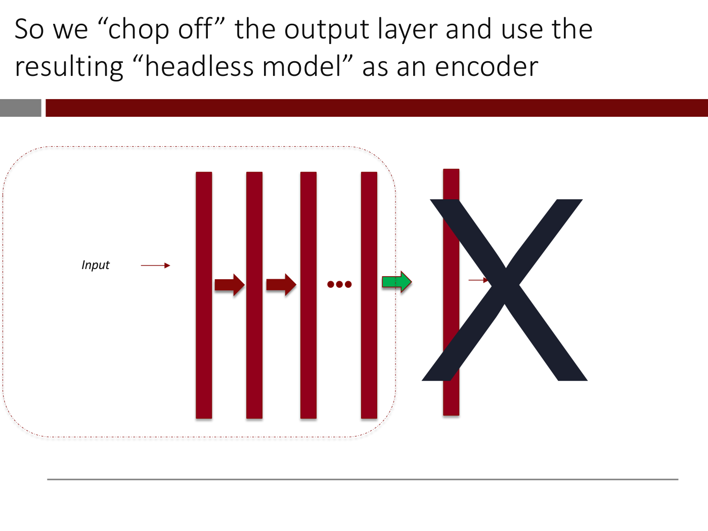

Title: So we "chop off" the output layer and use the resulting "headless model" as an encoder

Same layers and arrows as slide 59 (Input arrow, bar 1 to bar 2 to bar 3 arrows, dots, green arrow after bar 4; the red dashed ellipse and the vertical pointer are gone). New: a large red dashed rounded rectangle encloses the "Input" label, the first four bars (three bars, dots, and the fourth bar) and the arrows between them, and its right edge crosses the green arrow. The fifth bar, the output layer, sits outside the rectangle, and a very large dark navy "X" is drawn over it. The small arrow leaving the output layer is partly hidden by the X, and the "Output" label of slide 59 is gone.

*Figure: yes — Layer-stack diagram with the first four layers boxed in a red dashed outline and the final output layer struck out by a large X*

## Slide 61 — We can "attach" a new output layer to this encoder and train the network with the actual output labels we care about!

Title: We can "attach" a new output layer to this encoder and train the network with the *actual output labels* we care about! ("new" underlined; "actual output labels" italic)

Same dashed rectangle as slide 60 around "Input", three dark red bars, dots and a fourth dark red bar. The old output bar and the X are gone. New: a thick dark red arrow leaves the rectangle to a new light-green bar, outside the rectangle. A small arrow leaves the green bar to the green italic label "New Output".

*Figure: yes — Encoder of four dark red layers in a red dashed outline with a new light-green output layer attached, labelled New Output*

## Slide 62 — We can keep the encoder fixed and learn only the weights of the new final layer.

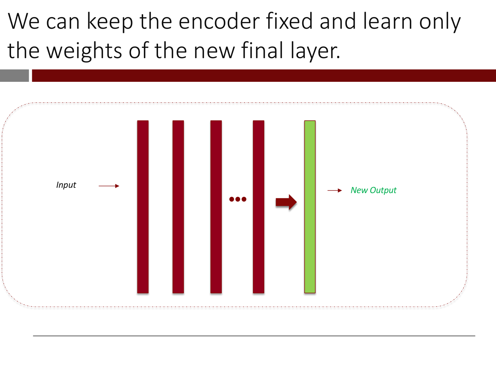

Title: We can keep the encoder fixed and learn only the weights of the new final layer.

Same layers as slide 61 (dark red bars, dots, thick arrow, light-green new bar, "Input" and green "New Output" labels). New: the red dashed rounded rectangle is now larger, extending to the right to enclose the whole diagram, the green bar and the "New Output" label included.

*Figure: yes — Same diagram as slide 61 with the red dashed outline enlarged to enclose all layers including the green new output layer*

## Slide 63 — … or fine-tune all the layers

Title: … or fine-tune all the layers

Same as slide 62 (the large red dashed rectangle around everything, the thick arrow, "Input" and "New Output"). New: all five bars, including the four that were dark red, are now light green.

*Figure: yes — Same diagram as slide 62 with every layer bar coloured light green to show all layers being trained*

## Slide 64 — To build such a generally useful pretrained model, we need labeled data.

To build such a generally useful pretrained model, we need <u>labeled</u> data.

For example, ResNet was trained on everyday images which were labeled with one of 1000 categories

(The slide has no title; the heading above is a short title in the page's words.)

*Figure: no*

## Slide 65 — To build a generally useful model (like ResNet) for text data, we need to (1) collect a lot of text data

To build a generally useful model (like ResNet) for *text* data, we need to (1) collect a lot of text data. This is no problem – there's plenty of text data on the Internet e.g., Wikipedia. (The words "(1) collect a lot of text data." are red; "text" in the first line is italic.)

(The slide has no title; the heading above is a short title in the page's words.)

*Figure: no*

## Slide 66 — To build a generally useful model (like ResNet) for text data, we need to (1) collect and (2) define output labels

To build a generally useful model (like ResNet) for text data, we need to (1) collect a lot of text data. This is no problem – there's plenty of text data on the Internet e.g., Wikipedia. (2) we need to define output labels for every piece of text we feed into the model. (Both numbered items begin in red: "(1) collect a lot of text data." and "(2) we need to define output labels"; the rest is black. "text" is no longer italic. The last word, "model.", touches the footer rule.)

(The slide has no title; the heading above is a short title in the page's words.)

*Figure: no*
## Slide 67 — For an input sentence, what should the output label be?

For an input sentence, what should the output label be?

*Figure: no*

## Slide 68 — A powerful approach to building pretrained models without labeled data: Self-supervised Learning

A powerful approach to building pretrained models <u>without labeled data</u>: *Self-supervised Learning*

In a thin red-outlined box: *The key idea behind self-supervised learning:* (dark italic) then, in bold red italic: ***Predict a subset of the input data using the rest of the input***

*Figure: no*

## Slide 69 — Masking: A Self-supervised Learning Technique

*1. We modify the original input data to create "fake" (input, label) pairs by masking a part of the input and making it the label* (red italic)

Three horizontal panels separated by dark red rules. In each panel, at left a long blue bar labelled (first panel only) "Original input"; a dark red block arrow points right to two bars at right. The upper right bar is labelled "Masked Input" and is the same blue bar with a white gap cut out of it. The lower right bar is labelled "Fake" Label (written "“Fake” Label") and is a red-outlined empty bar with a blue segment only where the gap is in the masked input. The gap position differs in each panel: roughly the middle of the bar in panel 1, near the left in panel 2, and near the right end in panel 3 (where a small blue stub remains to the right of the gap).

*Figure: yes — three examples of an original input bar turned into a masked input bar (gap cut out) plus a "fake" label bar holding only the removed segment*

## Slide 70 — Masking: A Self-supervised Learning Technique

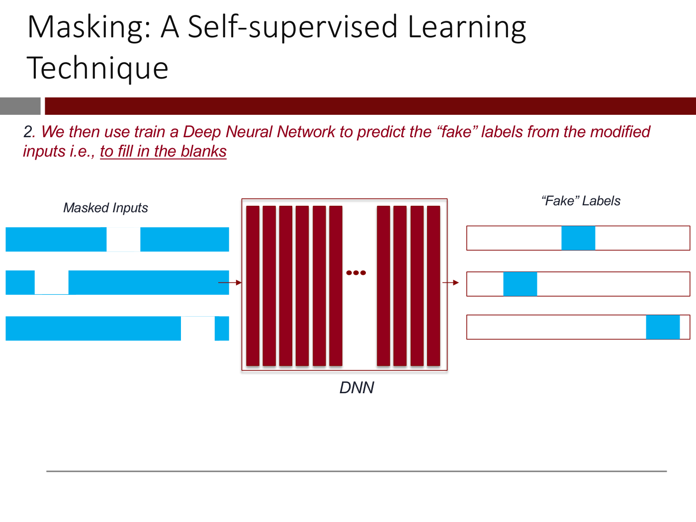

*2. We then use train a Deep Neural Network to predict the "fake" labels from the modified inputs i.e., <u>to fill in the blanks</u>* (red italic; "2." in dark; "to fill in the blanks" underlined; the slide prints "use train" as written)

Diagram. At left, under the label "Masked Inputs", the three masked-input bars from slide 69 stacked (blue bars with a white gap at middle, near-left and near-right respectively). A thin dark red arrow leads into a box labelled "DNN" below it: a red-outlined box holding a row of tall dark red vertical bars (six, then a gap with a three-dot ellipsis, then four more). A thin arrow leaves the box to the right toward three stacked red-outlined bars under the label ""Fake" Labels", each with a blue segment at the position of the corresponding gap.

*Figure: yes — masked-input bars feed a DNN (columns of layers) that outputs the "fake" label bars holding the masked segments*

## Slide 71 — Masking Example

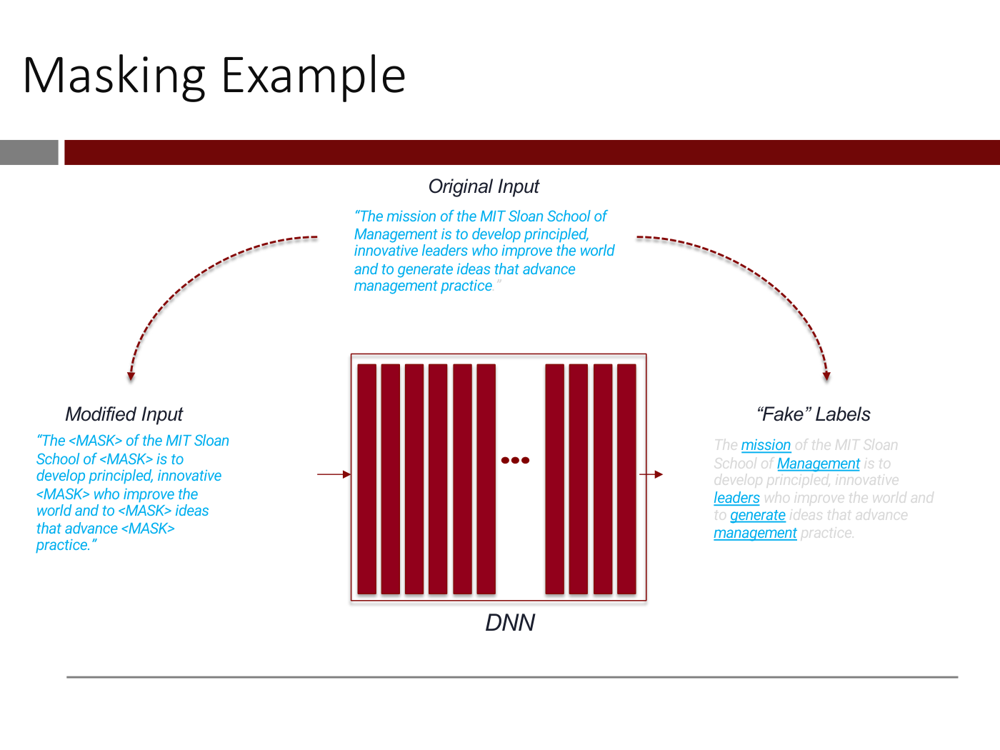

Diagram with a DNN box (red-outlined box of tall dark red vertical bars, six then an ellipsis "…" then four, labelled "DNN" beneath). Three text regions in blue italics:

Top centre, "Original Input": "The mission of the MIT Sloan School of Management is to develop principled, innovative leaders who improve the world and to generate ideas that advance management practice."

Left, "Modified Input": "The `<MASK>` of the MIT Sloan School of `<MASK>` is to develop principled, innovative `<MASK>` who improve the world and to `<MASK>` ideas that advance `<MASK>` practice."

Right, ""Fake" Labels": the full sentence "The mission of the MIT Sloan School of Management is to develop principled, innovative leaders who improve the world and to generate ideas that advance management practice." in light grey, with the five masked words (mission, Management, leaders, generate, management) in blue and underlined.

A dashed dark red curved arrow runs from the original input down-left to the modified input, and another from it down-right to the fake labels. A thin arrow leads from the modified input into the DNN, and another from the DNN to the fake labels.

*Figure: yes — masking example: original sentence, same sentence with five words replaced by MASK, a DNN, and the five masked words as the fake labels*

## Slide 72 — Now for the amazing part

Now for the amazing part.

In the process of learning to "fill in the blanks”" successfully, the Deep Neural Network learns a good <u>representation</u> of the input data. (red text; the slide prints a doubled closing quotation mark after "blanks")

*Figure: no*

## Slide 73 — This intuitively makes sense

Now for the amazing part. (greyed out)

In the process of learning to "fill in the blanks", the Deep Neural Network learns a good <u>representation</u> of the input data. (greyed out)

This intuitively makes sense. To fill in the blanks successfully, the model has to learn how the variables are related to each other. (new, red)

*Figure: no*

## Slide 74 — Once a self-supervised model is built, we can extract an encoder from it …

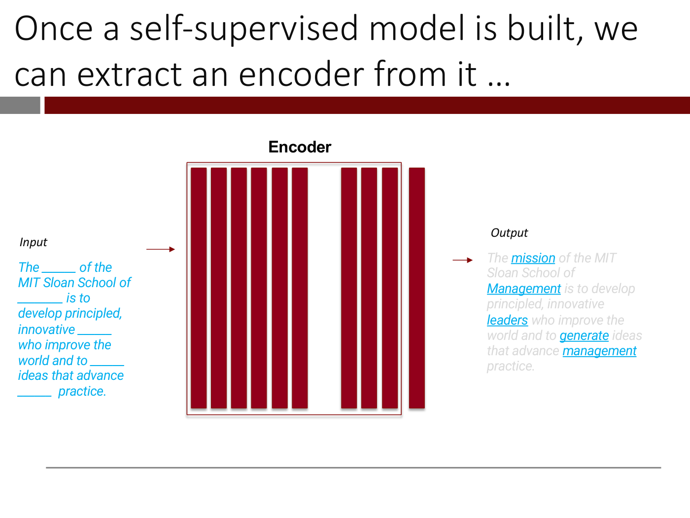

Once a self-supervised model is built, we can extract an encoder from it …

Diagram. Centre: a red-outlined box labelled "Encoder" (bold, above) holding a row of tall dark red vertical bars (six, a gap, then three), with one further dark red bar just outside the box to its right. At left, label "Input" and blue italic text with blanks: "The ______ of the MIT Sloan School of _______ is to develop principled, innovative ______ who improve the world and to ______ ideas that advance ______ practice." with a thin arrow into the box. At right, label "Output" and a thin arrow from the box to the sentence "The mission of the MIT Sloan School of Management is to develop principled, innovative leaders who improve the world and to generate ideas that advance management practice." in light grey, with mission, Management, leaders, generate and management in blue and underlined.

*Figure: yes — an encoder (bars of layers plus one extra bar outside the box) taking the sentence with blanks and producing the filled-in sentence*

## Slide 75 — … and fine-tune it like we did in Transfer Learning

… and fine-tune it like we did in Transfer Learning (the title runs to the right edge of the slide)

Diagram inside a large rounded rectangle with a dotted dark red outline. A thin dark red arrow labelled "Input" (black italic) points at a row of green vertical bars (three bars, then a three-dot ellipsis, then a fourth bar), all with dark red outlines. A thick dark red block arrow points from the ellipsis region to one more green bar standing alone at the right. A thin arrow leaves that last bar toward "Output" (green italic).

*Figure: yes — a stack of green layers (the encoder) followed by a separate new green output layer, with Input and Output labels, inside a dotted rounded box*

## Slide 76 — We can use a Transformer Encoder to build this Self-supervised Learning model for text

We can use a Transformer Encoder to build this Self-supervised Learning model for text

Same diagram as slide 71 (title differs; slide 71 is "Masking Example"): "Original Input", "Modified Input" with five `<MASK>` tokens, "Fake" Labels with the five masked words highlighted, the DNN box, dashed curved arrows, and the thin arrows into and out of the DNN. New: only the title. The text of the three passages is the same as on slide 71.

*Figure: yes — masking example: original sentence, sentence with five words replaced by MASK, a DNN, and the five masked words as the fake labels*

## Slide 77 — Masked Self-Supervised Learning is just a sequence labeling problem

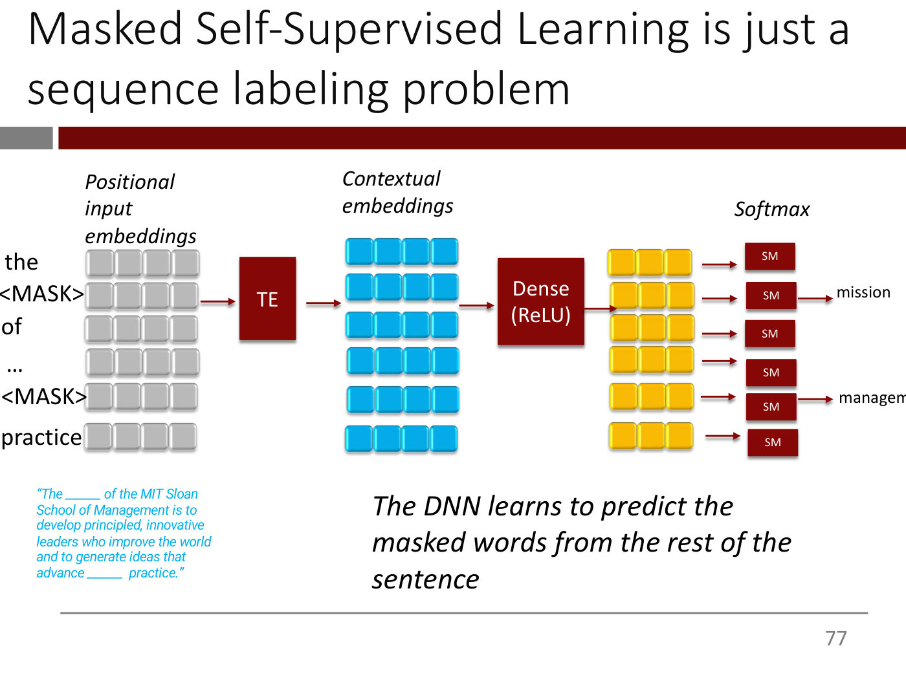

Masked Self-Supervised Learning is just a sequence labeling problem

Diagram, left to right. Column of input tokens at far left (some text is clipped at the slide's left edge): "the", "`<MASK>`", "of", "…", "`<MASK>`", "practice". Beside them, under the italic label "Positional input embeddings", six rows of four grey boxes each (one row per token). A thin arrow leads to a dark red box "TE", then an arrow to six rows of four blue boxes under the label "Contextual embeddings". An arrow leads to a dark red box "Dense (ReLU)", then to six rows of three yellow boxes. From each yellow row a thin arrow goes to a small dark red box "SM", under the label "Softmax" (six SM boxes). From the SM box in row 2 an arrow leads to the word "mission"; from the SM box in row 5 an arrow leads to the word "managem…" (cut off at the right slide edge, presumably "management"). The rows 1, 3, 4 and 6 SM boxes have no output word.

Bottom left, small blue italic text: "The ______ of the MIT Sloan School of Management is to develop principled, innovative leaders who improve the world and to generate ideas that advance ______ practice."

Bottom right, large italic: *The DNN learns to predict the masked words from the rest of the sentence*

Printed page number 77.

*Figure: yes — token rows go through positional embeddings, a TE block, contextual embeddings, a Dense ReLU block and per-token softmax (SM) units; masked positions output "mission" and "management"*

## Slide 78 — If we pretrain a Transformer model like this on massive amounts of English text, we get …

If we pretrain a Transformer model like this on massive amounts of English text, we get …

Same as slide 77. New: the title; the bottom-right italic sentence "The DNN learns to predict the masked words from the rest of the sentence" is gone. All diagram labels (the, `<MASK>`, of, …, `<MASK>`, practice; TE; Dense (ReLU); SM; mission; managem…) and the bottom-left blue sentence are as on slide 77. Printed page number 78.

*Figure: yes — the same masked-token model diagram as slide 77 (TE, Dense ReLU, softmax units)*

## Slide 79 — … BERT!

… BERT!

A rounded yellow tile in the style of a cartoon character: a flame-like swirl at left, a pair of angry eyes with a heavy brow and an orange oval bearing the word "BERT". Beneath it the URL https://jalammar.github.io/illustrated-bert/ and the credit "BERT figure by Jay Alammar on GitHub. License: CC BY-NC-SA."

Below, a paper title page: "BERT: Pre-training of Deep Bidirectional Transformers for Language Understanding"; authors "Jacob Devlin  Ming-Wei Chang  Kenton Lee  Kristina Toutanova"; "Google AI Language"; "{jacobdevlin,mingweichang,kentonl,kristout}@google.com". URL https://arxiv.org/pdf/1810.04805.pdf

*OCW notice: BERT paper & figures © Jacob Devlin, Ming-Wei Chang, Kenton Lee, Kristina Toutanova/ArXiv. All rights reserved. This content is excluded from our Creative Commons license. For more information, see https://ocw.mit.edu/help/faq-fair-use.*

*Figure: yes — cartoon BERT illustration (Jay Alammar) above the first-page header of the BERT paper*

## Slide 80 — BERT uses the Transformer architecture

BERT uses the Transformer architecture

At lower left the URL https://arxiv.org/pdf/1810.04805.pdf. The right half of the slide (bleeding past the slide's right edge) is a screenshot of a page of the BERT paper with highlighted passages (yellow-orange highlight). Legible text:

"**Model Architecture** BERT's model architecture is a multi-layer bidirectional Transformer encoder based on the original implementation described in Vaswani et al. (2017) and released in the tensor2tensor library.¹ Because the use of Transformers has become common and our implementation is almost identical to the original, we will omit an exhaustive background description of the model architecture and refer readers to Vaswani et al. (2017) as well as excellent guides such as "The Annotated Transformer."²"

"In this work, we denote the number of layers (i.e., Transformer blocks) as L, the hidden size as H, and the number of self-attention heads as A.³ We primarily report results on two model sizes: BERT_BASE (L=12, H=768, A=12, Total Parameters=110M) and BERT_LARGE (L=24, H=1024, A=16, Total Parameters=340M)."

"BERT_BASE was chosen to have the same model size as OpenAI GPT for comparison purposes. Critically, however, the BERT Transformer uses bidirectional self-attention, while the GPT Transformer uses constrained self-attention where every token can only attend to context to its left.⁴"

Footnotes: "¹https://github.com/tensorflow/tensor2tensor"; "²http://nlp.seas.harvard.edu/2018/04/03/attention.html"; "³In all cases we set the feed-forward/filter size to be 4H, i.e., 3072 for the H = 768 and 4096 for the H = 1024." (highlighted); "⁴We note that in the literature the bidirectional Trans-" (cut off at the slide bottom).

Highlighted: the first three lines of the first paragraph (through "Transformer encoder"), the whole second paragraph, and footnote 3.

*OCW notice: BERT paper © Jacob Devlin, Ming-Wei Chang, Kenton Lee, Kristina Toutanova/ArXiv. All rights reserved. This content is excluded from our Creative Commons license. For more information, see https://ocw.mit.edu/help/faq-fair-use.*

*Figure: no*

## Slide 81 — Earlier, we recommended adding a special token at the beginning of each sentence and just using its output embedding as the sentence-embedding

Earlier, we recommended adding a special token at the beginning of each sentence and just using <u>its</u> output embedding as the sentence-embedding

Diagram, left to right. Input tokens at left: `<CLS>` (green, inside a dashed red rounded box together with the first row of the embedding), "i", "loved", "the", "movie". Under the italic label "Positional input embeddings", five rows of four grey boxes (one per token). An arrow goes to a dark red box "Transformer Encoder", then an arrow to five rows of four boxes under the label "Contextual embeddings": the first row is green (inside a dashed red box), the other four rows are blue. From the green row a thick dark red bent arrow goes right and then down to a dark red box "Dense with ReLU", then a thin arrow down to a dark red box "Dense with sigmoid", then an arrow to the word "Positive!".

Red text at lower left: "The embedding of `<CLS>` will come to represent the sentence as a whole over the course of training"

*OCW notice: BERT figure © Jacob Devlin, Ming-Wei Chang, Kenton Lee, Kristina Toutanova/ArXiv. All rights reserved. This content is excluded from our Creative Commons license. For more information, see https://ocw.mit.edu/help/faq-fair-use.*

(The notice names a BERT figure, but the page shows only the course's own diagram from slide 38 under a new title; nothing from the BERT paper is visible. The notice is kept as printed, and this slide is not rendered.)

*Figure: yes — sentence classification with a CLS token: encoder, green CLS output embedding feeding Dense ReLU then Dense sigmoid to give "Positive!"*

## Slide 82 — Conveniently, BERT was trained with the `<CLS>` token so it can be used for sequence classification "out of the box"\*

Conveniently, BERT was trained with the `<CLS>` token so it can be used for sequence classification “out of the box”\* (the title's last line is partly overlapped by the red header band)

Figure from the BERT paper: a large light-blue box labelled "BERT". Along its top, output boxes "C", "T₁", "T₂", "…", "T_N" (green); along its bottom, input embedding boxes "E_[CLS]", "E₁", "E₂", "…", "E_N" (yellow), with grey up-arrows from pink token boxes "[CLS]", "Tok 1", "Tok 2", "…", "Tok N" beneath. A bracket under Tok 1 to Tok N is labelled "Single Sentence". Faint circles and crossing lines inside the BERT box suggest the layers' connections. A dashed red circle with the words "Class Label" and a red arrow points at the "C" output; a second dashed red circle surrounds the "[CLS]" input token.

Below: *Sequence classification* (large italic). Bottom left: "Image credit: https://arxiv.org/pdf/1810.04805.pdf". Bottom right: "\*HW2 colab".

*OCW notice: BERT figure © Jacob Devlin, Ming-Wei Chang, Kenton Lee, Kristina Toutanova/ArXiv. All rights reserved. This content is excluded from our Creative Commons license. For more information, see https://ocw.mit.edu/help/faq-fair-use.*

*Figure: yes — BERT paper figure for single-sentence classification: CLS token in, class label read off the C output*

## Slide 83 — BERT is an excellent pretrained model for sequence labeling problems as well

BERT is an excellent pretrained model for sequence labeling problems as well

Figure from the BERT paper, same layout as slide 82: a light-blue box "BERT" with green output boxes "C", "T₁", "T₂", "…", "T_N" on top and yellow input embedding boxes "E_[CLS]", "E₁", "E₂", "…", "E_N" at the bottom, grey up-arrows from pink token boxes "[CLS]", "Tok 1", "Tok 2", "…", "Tok N", and a bracket under Tok 1 to Tok N labelled "Single Sentence". New compared with slide 82: no dashed red circles; red up-arrows leave the T₁, T₂, "…" and T_N outputs (none above C), labelled above them "O", "B-PER", "…" and "O" respectively, i.e. one tag per token. Caption: *Sequence labeling* (large italic). Bottom left "Image credit: https://arxiv.org/pdf/1810.04805.pdf". No "HW2 colab" note. Printed page number 83.

*OCW notice: BERT figure © Jacob Devlin, Ming-Wei Chang, Kenton Lee, Kristina Toutanova/ArXiv. All rights reserved. This content is excluded from our Creative Commons license. For more information, see https://ocw.mit.edu/help/faq-fair-use.*

*Figure: yes — BERT paper figure for sequence labeling: per-token outputs T1..TN each emitting a tag such as O or B-PER*

## Slide 84 — A number of variations/improvements of BERT have appeared over the years

A number of variations/improvements of BERT have appeared over the years and these can be used for many tasks.

The Sentence Transformers library is a good resource

At lower right of the text, a blue logo tile: a hexagonal molecule-like drawing of nodes in red, orange and blue, with the text "SBERT.net" and, beneath it, a house icon and "Sentence-Transformers". Footer left: https://www.sbert.net/index.html. Printed page number 84.

*Figure: yes — SBERT.net (Sentence-Transformers) logo tile*

## Slide 85 — Pretrained encoders for any sequence classification or labeling problem

To solve <u>any</u> sequence classification or sequence labeling problem where the input is natural language text, we can use a model like BERT as a pre-trained encoder.  Label “a few hundred” examples, attach the right final layers to BERT and fine-tune.

But if your particular problem is a “standard” NLP problem, this may not be necessary. Numerous pretrained models are available on various Hubs for all the “standard” NLP problems and you can start using them <u>without any fine-tuning at all.</u>

Printed page number 85.

*Figure: no*

## Slide 86 — The Hugging Face Hub is very popular

The Hugging Face Hub is very popular

A screenshot of the Hugging Face models page. Top bar: the Hugging Face smiley logo and "Hugging Face", a search box "Search models, datasets, users...", and links "Models" and "Datasets" at right. Left sidebar: tabs "Tasks" (selected, black), "Libraries", "Datasets", "Languages", "Licenses", "Other"; a box "Filter Tasks by name"; heading "Multimodal" with entries "Image + Text to Text (VLLMs)", "Visual Question Answering", "Document Question Answering". Right panel: "Models 525,416" inside a dashed red rounded box, with a "Filter by name" box beside it; two model cards: "google/gemma-7b", "Text Generation · Updated 2 days ago · 142k downloads · 1.46k likes"; and "google/gemma-7b-it", "Text Generation · Updated 4 days ago · 53.4k downloads · 712 likes" (the download and like counts are shown with small icons).

Large text: "Over 500,000 pretrained models available!! (as of Feb 27, 2024)"

Footer left: https://huggingface.co/models

*Figure: yes — screenshot of the Hugging Face Hub models list showing "Models 525,416" highlighted by a dashed red box*

## Slide 87 — Huggingface Colab

Huggingface Colab (centred, underlined, orange-brown; a hyperlink whose target is not printed on the slide)

Printed page number 87.

*Figure: no*

## Slide 88 — Transformers have proven to be an effective DNN architecture across a vast array of domains

Transformers have proven to be an effective DNN architecture across a vast array of domains

Left column: Information Retrieval/Search; Machine Translation; Speech Recognition; Text-to-Speech; Computer Vision

Right column: Reinforcement Learning; Generative AI (LLMs, Text-to-image models, Image Captioning, …); Numerous special-purpose systems (e.g., AlphaFold); …

Printed page number 88.

*Figure: no*

## Slide 89 — Transformers have proven to be an effective DNN architecture across a vast array of domains

Transformers have proven to be an effective DNN architecture across a vast array of domains

- The architecture of the Transformer block can be used as-is for a wide range of applications
- What tends to vary from application to application is how the inputs are encoded/tokenized in a form that can be fed to the Transformer

Printed page number 89.

*Figure: no*

## Slide 90 — Vision Transformer: A Transformer for Image Classification

Vision Transformer: A Transformer for Image Classification

Figure 1 of the Vision Transformer paper. Left part, titled "Vision Transformer (ViT)": at the bottom a 3-by-3 grid of small photo patches (a building) from one image; an arrow leads to a row of nine flattened patch thumbnails inside a box "Linear Projection of Flattened Patches"; above them a row of small tokens "0\*", "1", "2", "3", "4", "5", "6", "7", "8", "9" (each a purple and pink pair), labelled "Patch + Position Embedding" with the footnote "\* Extra learnable [class] embedding"; arrows go up from each token into a grey box "Transformer Encoder"; from that a line goes up to an orange box "MLP Head", and an arrow from it to a rounded orange box "Class: Bird, Ball, Car, …". Right part, after a dashed vertical divider, titled "Transformer Encoder": a grey box labelled "L ×" containing, bottom to top, "Embedded Patches" (pink, at the base), "Norm" (yellow), "Multi-Head Attention" (green, with three arrows into it from the Norm), a "+" circle (with a skip connection around the attention block), "Norm" (yellow), "MLP" (blue), and a second "+" circle (with a skip connection around the MLP block), with an arrow up out of the box.

Caption: "Figure 1: Model overview. We split an image into fixed-size patches, linearly embed each of them, add position embeddings, and feed the resulting sequence of vectors to a standard Transformer encoder. In order to perform classification, we use the standard approach of adding an extra learnable “classification token” to the sequence.  The illustration of the Transformer encoder was inspired by Vaswani et al. (2017)."

URL: https://arxiv.org/pdf/2010.11929.pdf

*OCW notice: Vision transformer/encoder figure © Alexey Dosovitskiy,Lucas Beyer, Alexander Kolesnikov, Dirk Weissenborn, Xiaohua Zhai, Thomas Unterthiner, Mostafa Dehghani, Matthias Minderer, Georg Heigold, Sylvain Gelly, Jakob Uszkoreit, Neil Houlsby/ArXiv. All rights reserved. This content is excluded from our Creative Commons license. For more information, see https://ocw.mit.edu/help/faq-fair-use.*

*Figure: yes — Vision Transformer paper Figure 1: image split into patches, linearly projected, fed with a class token to a Transformer encoder and MLP head; encoder block detail at right*

## Slide 91 — The Tab Transformer: : A Transformer for Tabular Data

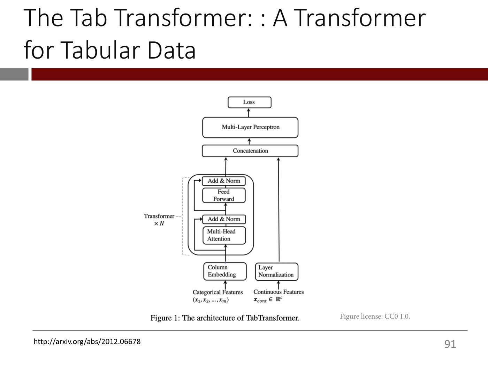

The Tab Transformer: : A Transformer for Tabular Data (the doubled colon is as printed)

Figure 1 of the TabTransformer paper, a block diagram drawn bottom to top. At the bottom, two inputs: "Categorical Features (x₁, x₂, …, x_m)" with an arrow up into a box "Column Embedding", and "Continuous Features x_cont ∈ ℝ^c" with an arrow up into a box "Layer Normalization". From Column Embedding an arrow goes up into a rounded box labelled at its left "Transformer × N" (with a dashed bracket); inside, bottom to top: "Multi-Head Attention", "Add & Norm" (with a skip connection around the attention), "Feed Forward", "Add & Norm" (with a skip connection around the feed-forward). The Layer Normalization output goes straight up on a long arrow, bypassing the Transformer. Both arrows (Transformer output and the continuous branch) enter a wide box "Concatenation", then an arrow up to "Multi-Layer Perceptron", then an arrow up to "Loss".

Caption: "Figure 1: The architecture of TabTransformer." Grey text at right: "Figure license: CC0 1.0." Footer left: http://arxiv.org/abs/2012.06678. Printed page number 91.

*Figure: yes — TabTransformer paper Figure 1: categorical features through column embedding and N Transformer layers, concatenated with layer-normalized continuous features, then MLP and loss*

## Slide 92 — Once the input has been transformed into the "common language" of embeddings

Once the input has been transformed into the “common language” of embeddings, we can process them without changing the architecture of the Transformer Encoder block.

This turns out to very useful for multi-modal data (the words "multi-modal data" are in red; the slide prints "very useful")

Printed page number 92.

*Figure: no*

## Slide 93 — Example: A Transformer-based classifier for multi-modal data

Example: A Transformer-based classifier for multi-modal data ("multi-modal data" in red)

Diagram, left to right. Three inputs stacked at far left: (1) a small block of text, a product review, legible on a zoomed render: "Not pleased with this chair - put in my office as I work from home and it wobbles from side to side - back support is non existent . Had to purchase another chair. This one is sitting in the basement now (", with "wobbles from side to side" underlined in red; (2) a photo of a black mesh office chair beside a white desk; (3) a table with header "Variable | Value" and rows "Age | 37 months", "Supplier | Acme", "# parts | 13", "… | …". Each input has a thin dark red arrow into its own trapezoid (narrow end at right): a dark red "Language Embeddings", a yellow "Image Embeddings", a green "Tabular Data Embeddings". From each trapezoid an arrow leads to a column of grey four-box embedding rows: a `<CLS>` row (green label `<CLS>`) at the top, then three rows for the language part, three for the image part, one more row and two rows for the tabular part (about ten rows plus the `<CLS>` row in all). These feed a tall dark red box "Transformer Encoder Stack". At right, a row of four green boxes (the output embedding for `<CLS>`) with an arrow down to a dark red box "Dense with ReLU", then an arrow down to "Dense with sigmoid/ softmax", then an arrow down to the text "Predicted Label".

*OCW notice: Desk chair image © Wayfair LLC. All rights reserved. This content is excluded from our Creative Commons license. For more information, see https://ocw.mit.edu/help/faq-fair-use.*

*Figure: yes — multi-modal classifier: text, image and tabular inputs each get their own embedding block, all token embeddings plus CLS go through a Transformer encoder stack, and the CLS output feeds Dense layers to a predicted label*

## Slide 94 — Contrastive Learning (time permitting)

Contrastive Learning (time permitting) (white text on the dark red band; section-title layout with a larger grey block at left)

*Figure: no*

## Slide 95 — Pretraining on unlabeled image data

We can pretrain models on unlabeled text data by using self-supervised learning to create artificial labels (e.g., by masking words and recovering them).

How can we pretrain models on unlabeled image data? (the words "unlabeled image data" are red)

*Figure: no*

## Slide 96 — Contrastive Learning

Contrastive Learning

For self-supervised learning with image inputs, a technique called *contrastive learning* has been found to be very effective\*

The basic approach: (brown text)
- For every original image, artificially construct a pair of “augmented” images
- Train the network to “maximize agreement” i.e., make the learned representations of each augmented pair “close” to each other but “far” from the representations of the other pairs

Diagram at right: a small photo labelled "Original image" (a yellow Labrador standing on grass, facing left). Two dark red arrows go from it to two "Augmented images" (labelled above the upper one): the upper is a crop of the dog facing right, the lower a version of the dog with noisy colouring. Each augmented image has an arrow into a dark red rounded box "DNN"; the lower box has the small note "(same as the one above)". Light green arrows from both DNN boxes, together labelled "Representations" (green text), converge on a dark red box "Maximize agreement".

Below the diagram: "Image credit: http://arxiv.org/abs/2002.05709". Footer: "\*A Simple Framework for Contrastive Learning of Visual Representations by Chen et al (2020)" (the title part is a hyperlink in orange, underlined).

*OCW notice: Dog images © Ting Chen, Simon Kornblith, Mohammad Norouzi, Geoffrey Hinton/ArXiv. All rights reserved. This content is excluded from our Creative Commons license. For more information, see https://ocw.mit.edu/help/faq-fair-use.*

*Figure: yes — contrastive learning schematic: one original dog image, two augmented versions each passed through the same DNN, representations compared by "Maximize agreement"*

## Slide 97 — Data augmentation examples

Data augmentation examples

A 2-by-5 grid of dog photos from the SimCLR paper, each with a caption. Top row: (a) Original; (b) Crop and resize; (c) Crop, resize (and flip); (d) Color distort. (drop); (e) Color distort. (jitter). Bottom row: (f) Rotate {90°, 180°, 270°}; (g) Cutout; (h) Gaussian noise; (i) Gaussian blur; (j) Sobel filtering. Visible effects: (b) a zoomed crop of the dog's hindquarters; (c) a zoomed crop of the front half; (d) greyscale; (e) a green colour cast; (f) the dog rotated onto its side; (g) a grey rectangle covering part of the dog; (h) speckled noise; (i) slightly blurred; (j) a grey edge-relief image.

Below: "Image credit: http://arxiv.org/abs/2002.05709"

*OCW notice: Dog images © Ting Chen, Simon Kornblith, Mohammad Norouzi, Geoffrey Hinton/ArXiv. All rights reserved. This content is excluded from our Creative Commons license. For more information, see https://ocw.mit.edu/help/faq-fair-use.*

*Figure: yes — grid of ten augmentations of one dog photo (original, crop, flip, colour distortion, rotate, cutout, noise, blur, Sobel filter)*

## Slide 98 — Once the contrastive learning model is built, we can extract an encoder from it easily and fine-tune it

Once the contrastive learning model is built, we can extract an encoder from it easily and fine-tune it

The slide 96 diagram is shown on a grey panel, mostly faded, with only the upper "DNN" box (dark red, full strength) and the thick arrow leaving it to the right highlighted. Faded elements: "Original image" photo, the two "Augmented images", the lower "DNN (same as the one above)" box, the green "Representations" label and arrows, the "Maximize agreement" box and the credit "Image credit: http://arxiv.org/abs/2002.05709". New compared with slide 96: the highlighting (everything except the upper DNN is greyed out), and a dark red arrow now leaves the upper DNN to the right, ending at the "Representations" label.

*OCW notice: Dog images © Ting Chen, Simon Kornblith, Mohammad Norouzi, Geoffrey Hinton/ArXiv. All rights reserved. This content is excluded from our Creative Commons license. For more information, see https://ocw.mit.edu/help/faq-fair-use.*

*Figure: yes — the contrastive learning schematic from slide 96 greyed out except for one DNN encoder box, marking the part to extract and fine-tune*

## Slide 99 — MIT OpenCourseWare end page

MIT OpenCourseWare
https://ocw.mit.edu

15.773 Hands-on Deep Learning
Spring 2024

For information about citing these materials or our Terms of Use, visit: https://ocw.mit.edu/terms.

*Figure: no*
