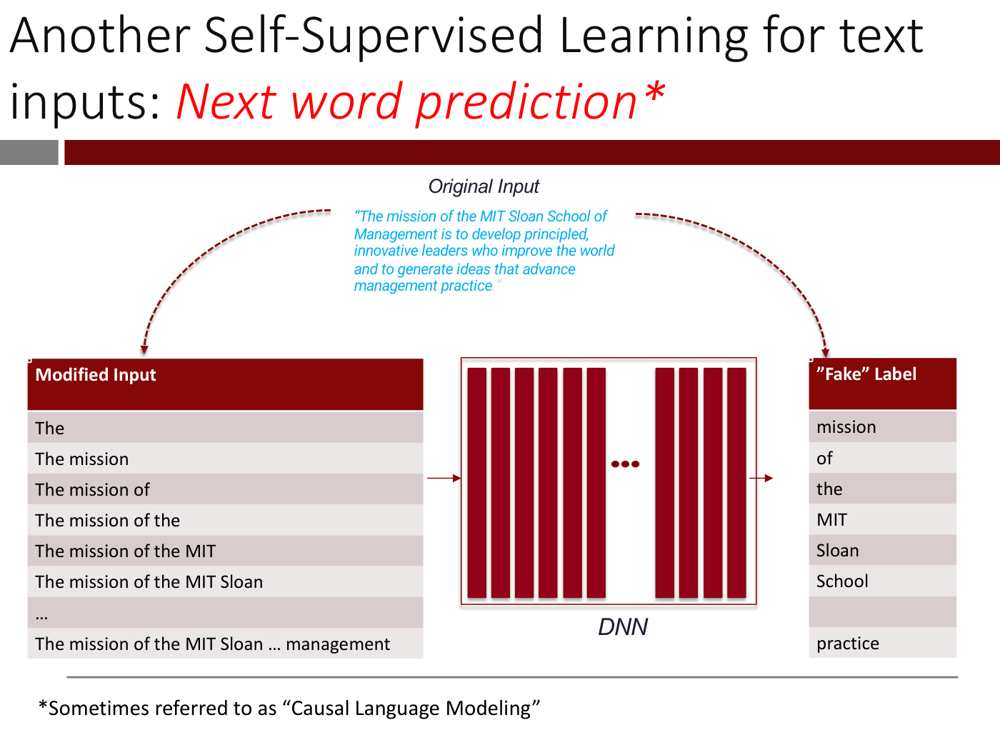
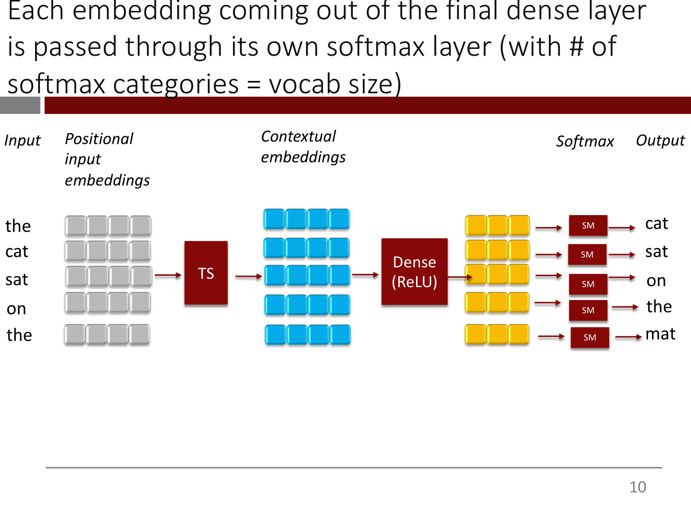
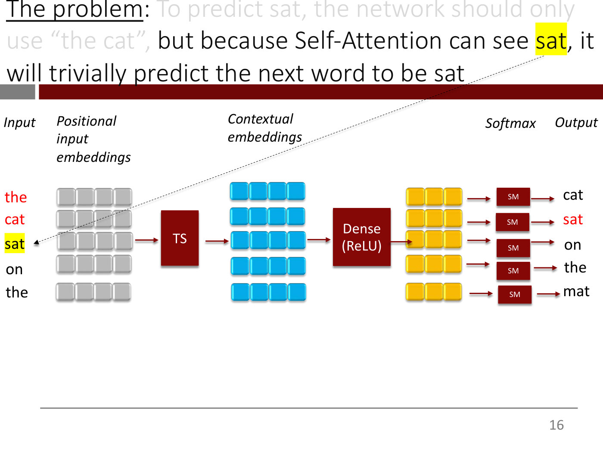
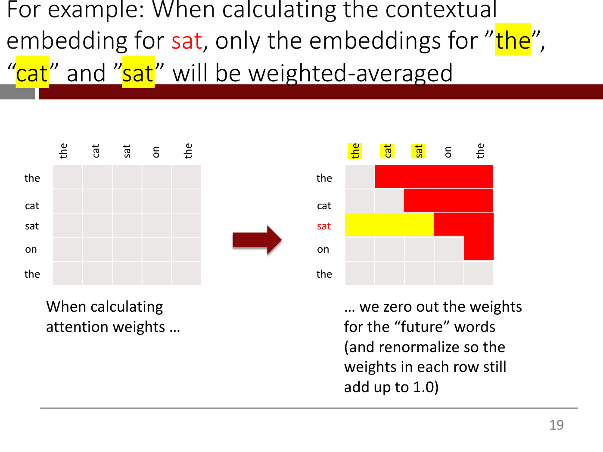
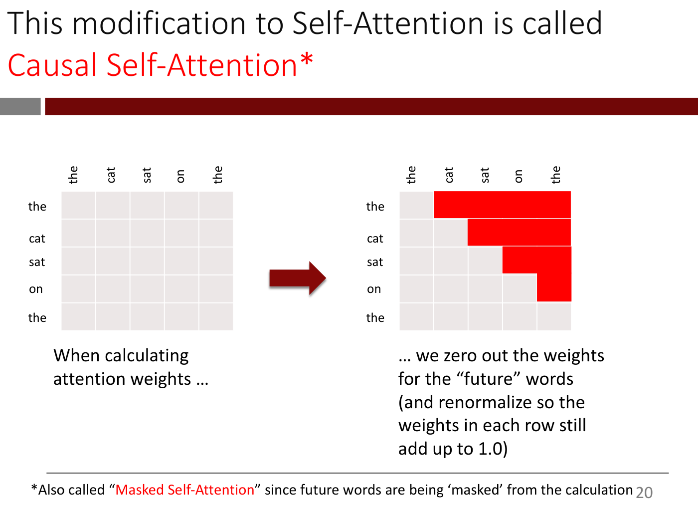
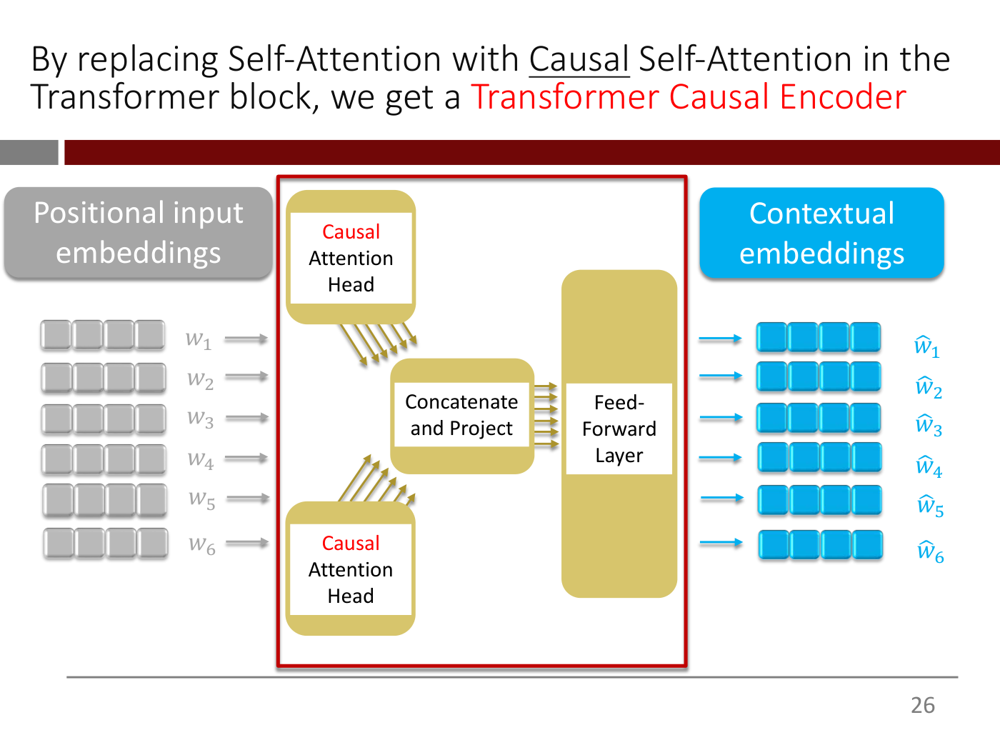
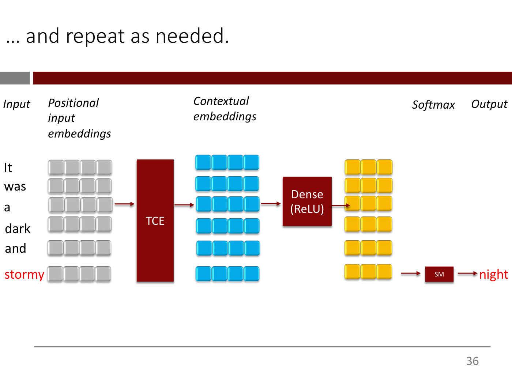
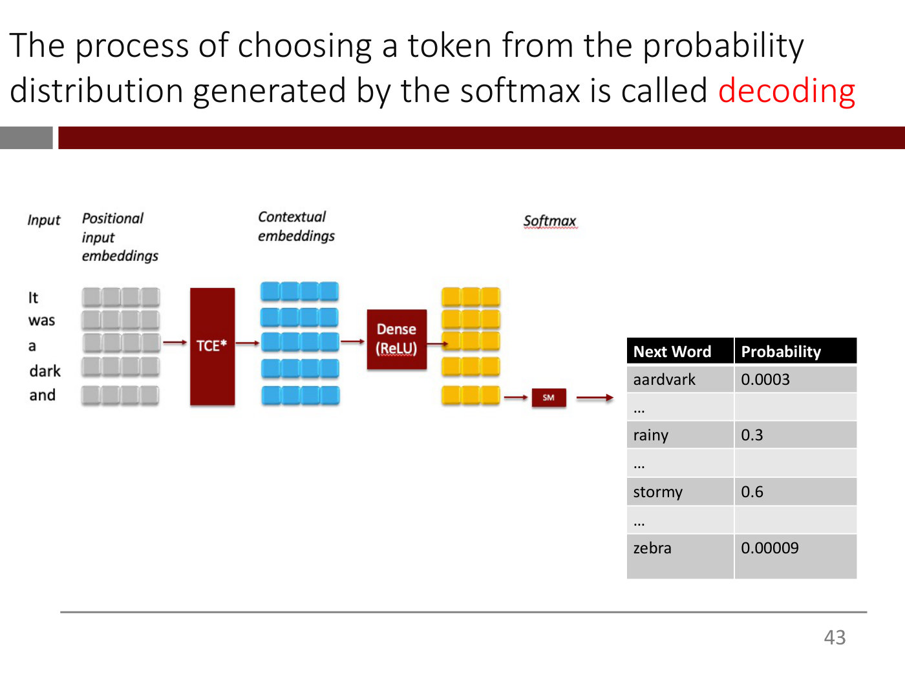
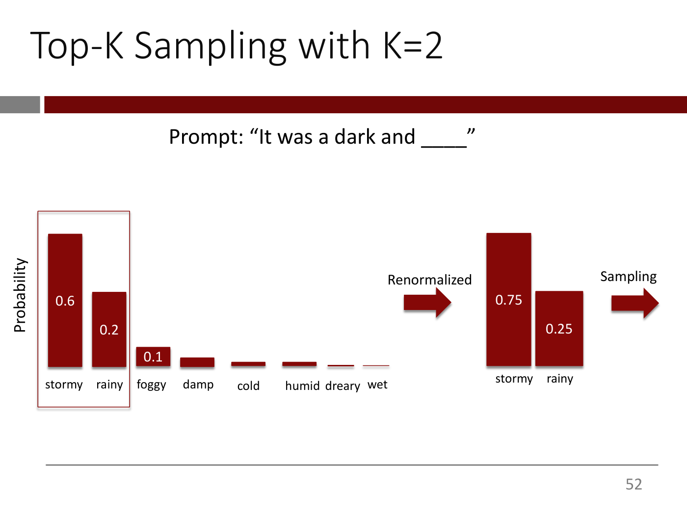
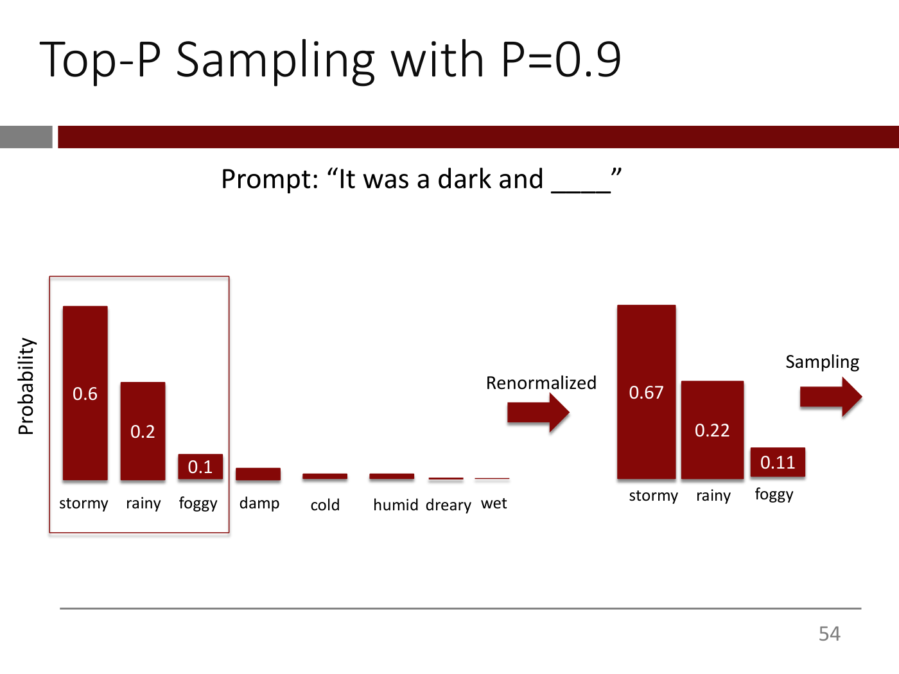

# Lecture 9 — Large Language Models (1/2): slide-by-slide

Text and figures of all 68 slides of
[`mit15_773_s24_lec09.pdf`](https://ocw.mit.edu/courses/15-773-hands-on-deep-learning-spring-2024/mit15_773_s24_lec09.pdf)
(MIT 15.773 Hands-On Deep Learning, Spring 2024; lecturer Rama Ramakrishnan), transcribed from the
deck. The roadmap on slide 1 calls this lecture "Large Language Models (1/2)". Lecture 9's video
presents slides 2 to 66 in order: the masking review and next word prediction (slides 2–12,
0:00–≈11:47, where the lecturer unhides slide 11, the loss, at ≈10:58), causal self-attention and the
Transformer Causal Encoder (13–30, ≈11:47–18:02), generating text one word at a time and
autoregressive language models such as GPT-3 (31–41, ≈20:19–30:26), decoding and sampling strategies
(42–57, ≈30:26–1:00:45, with temperature drawn on an iPad at slide 56 and the OpenAI Playground demo at
slide 57), and byte pair encoding (58–66, ≈1:00:45 to the end). It ends on the token-visualizer demo
of slide 66. Slide 67, a sidebar, is not mentioned. The catalog's title for this video, "Generative AI –
Large Language Models (LLMs) and Retrieval Augmented Generation (RAG)", overstates it: retrieval-augmented
generation is in deck 10, not here. Cite these slides as "slide N", where N is the PDF page number.
Diagrams, tables and screenshots are described in prose since the KB is read as text.

Slides marked with an `*OCW notice: …*` line (27, 29, 41 and 67) carry material that OCW excludes from
its Creative Commons licence: the encoder-decoder architecture figure of "Attention is All You Need"
(27), two copies of its encoder figure (29), screenshots of a blog post and a video about building GPT
(41), and two link-card thumbnails about BPE (67). They are described in prose and never rendered.
Slide 41's notice credits Andrej Karpathy, but its upper screenshot is the header of Jay Mody's blog
post. Unmarked third-party material, not rendered: slide 39's table of GPT-3's training data, from the
GPT-3 paper, which is transcribed below; and the OpenAI Playground screenshots on slides 47–50, whose
prompts, continuations and probabilities are transcribed. The "Source" hyperlink on slide 61 and the
two "Link" hyperlinks on slide 67 do not print their targets. Words the slides print in colour are
given plainly, with a note in parentheses. The next lecture's deck corrects the "Dense (ReLU)" box of this
deck's pipeline diagrams: its slide 3 is titled "Correction: The contextual embeddings flow into a Dense
layer with linear activations (not ReLU) followed by a Softmax"
([`mit15_773_s24_lec10.pdf`](https://ocw.mit.edu/courses/15-773-hands-on-deep-learning-spring-2024/mit15_773_s24_lec10.pdf)).

**Images.** Ten figure slides carry a 1400px render under their heading: 3, 10, 16, 19, 20, 26, 36,
43, 52 and 54. The other figure-bearing slides are not rendered. Slides 27, 29, 41 and 67 carry OCW
exclusion notices. Slides 39 and 47–50 are unmarked third-party content (above). Two repeat figures
already rendered for lecture 8: slide 2 is lecture 8's slide 71 (the masking example) under a review
title, and slide 37 is lecture 8's slide 30 (the three use cases) with sequence generation ticked. Slide
59 is lecture 5's text-vectorization pipeline, rendered there as slide 27. Build steps and repeats are
superseded by a rendered slide: 4 → 3; 5–9, 12, 14 and 30 → 10 (30 relabels the transformer stack
"TCE"); 15 → 16; 18 → 20 and 19; 31 and 34 → 36 and 43. Slide 11 adds only the loss formula to slide
10, and slides 32, 33, 35 and 44 are next-word probability tables; the entries below reproduce both
exactly. Slides 21–25 are columns of input and output words with a bracket and one arrow, which the
entries describe fully. Slide 13 is a single-box drawing of self-attention. The BPE slides 61–65 are
text and tables, transcribed in full.

## Numbering: slide numbers vs PDF pages

Headings use the PDF page number. Every page that prints a number in the bottom-right corner prints its
own page number, so the two agree throughout. These pages print none: 1–4, 44, 45 and 68.

## Contents

| Slides | Section |
| ------ | ------- |
| 1 | Roadmap of the "Deep Learning for NLP" lectures, with lecture 9, Large Language Models (1/2), highlighted |
| 2–4 | Masking reviewed; next word prediction as another self-supervised task; trying it with the transformer encoder |
| 5–12 | Next word prediction set up: input-output pairs, embeddings, the transformer stack, dense layers, a softmax over the vocabulary for each word, and the cross-entropy loss |
| 13–16 | The problem: self-attention sees the whole sentence, so the next word can simply be copied |
| 17–25 | The solution: causal (masked) self-attention, which zeroes the weights of "future" words |
| 26–29 | The Transformer Causal Encoder; the paper's encoder-decoder; the causal encoder is also called the Transformer Decoder; summary |
| 30–36 | Training for next word prediction, then generating text one word at a time |
| 37–41 | Sequence generation; autoregressive (causal) language models; GPT-3; use cases; sidebar on building GPT from scratch |
| 42–50 | Decoding: greedy decoding and random sampling, when to use each, and how sampling from the tail goes off the rails |
| 51–57 | Tuning random sampling: top-K, top-P (nucleus) sampling and temperature; the OpenAI Playground demo |
| 58–67 | LLM tokenization: what the earlier pipeline loses, byte pair encoding worked through, the token-visualizer demo, sidebar |
| 68 | OCW end page |

## Slide 1 — Lecture 9: Large Language Models (1/2)

Title slide. Underlined dark red heading: "The “Deep Learning for NLP” Lecture Roadmap". Large bold dark red title: "Lecture 9: Large Language Models (1/2)".

Below, a dark red list with a strikethrough through every line (the earlier lectures, shown as already covered): "Lecture 5: Text Vectorization and the Bag-of-Words Model", "Lecture 6: Embeddings", "Lecture 7: Transformers – (1/2)", "Lecture 8: Transformers – (2/2)". (The first entry wraps over two lines.)

A dark red horizontal rule, then the MIT Sloan School of Management logo at lower left and the text "15.S04: Hands-on Deep Learning", "Spring 2024", and in red "Farias, Ramakrishnan".

*Figure: no*

## Slide 2 — [Review] Masking\*: A Self-Supervised Learning technique for text data

Diagram. Top centre, italic black label "Original Input" above a blue italic quotation: "The mission of the MIT Sloan School of Management is to develop principled, innovative leaders who improve the world and to generate ideas that advance management practice."

Left, italic black label "Modified Input" above blue italic text: "The `<MASK>` of the MIT Sloan School of `<MASK>` is to develop principled, innovative `<MASK>` who improve the world and to `<MASK>` ideas that advance `<MASK>` practice."

Right, italic black label "“Fake” Labels" above the full sentence in light grey ("The mission of the MIT Sloan School of Management is to develop principled, innovative leaders who improve the world and to generate ideas that advance management practice.") with the five words mission, Management, leaders, generate, management in blue and underlined.

Centre: a red-outlined box holding a row of tall dark red vertical bars (six, then a gap with a three-dot ellipsis, then four more), labelled "DNN" beneath in italics. A thin dark red arrow leads from the Modified Input into the box and another from the box to the Fake Labels. A dashed dark red curved arrow runs from the Original Input down-left to the Modified Input, and another down-right to the Fake Labels.

Footnote: \*Sometimes referred to as “Masked Language Modeling”

*Figure: yes — masking example: original sentence, the sentence with five words replaced by MASK, a DNN, and the five masked words as the fake labels*

## Slide 3 — Another Self-Supervised Learning for text inputs: Next word prediction\*

Title: "Another Self-Supervised Learning for text inputs: Next word prediction\*" ("Next word prediction\*" in red italic).

Diagram. Top centre, italic black "Original Input" above the same blue italic quotation as slide 2: "The mission of the MIT Sloan School of Management is to develop principled, innovative leaders who improve the world and to generate ideas that advance management practice." Dashed dark red curved arrows run from it down-left to the "Modified Input" table and down-right to the "“Fake” Label" table.

Left table (dark red header cell "Modified Input", white bold text; rows alternate light grey shades):

| Modified Input |
| --- |
| The |
| The mission |
| The mission of |
| The mission of the |
| The mission of the MIT |
| The mission of the MIT Sloan |
| … |
| The mission of the MIT Sloan … management |

Centre: a red-outlined "DNN" box of tall dark red vertical bars (six, an ellipsis, then four), with a thin arrow from the left table into it and another from it to the right table.

Right table (dark red header cell "”Fake” Label"):

| ”Fake” Label |
| --- |
| mission |
| of |
| the |
| MIT |
| Sloan |
| School |
| (empty cell, matching the "…" row) |
| practice |

Footnote: \*Sometimes referred to as “Causal Language Modeling”

*Figure: yes — next-word prediction: each growing prefix of the sentence as modified input, a DNN, and the following word as the fake label*

## Slide 4 — Let’s try to use the Transformer Encoder to implement Next Word Prediction

Same as slide 3, with these changes: the title is "Let’s try to use the Transformer Encoder to implement Next Word Prediction" (all black), and the footnote about "Causal Language Modeling" is absent. The diagram, both tables (identical cell for cell: left rows "The", "The mission", "The mission of", "The mission of the", "The mission of the MIT", "The mission of the MIT Sloan", "…", "The mission of the MIT Sloan … management"; right rows "mission", "of", "the", "MIT", "Sloan", "School", empty, "practice"), the DNN box and the arrows are otherwise unchanged.

*Figure: yes — same next-word-prediction diagram as slide 3*

## Slide 5 — First, each sentence gets transformed into an input-output pair

Mostly empty diagram. Italic black column labels: "Input" at far left and "Output" at far right. Under "Input", a column of five words: the, cat, sat, on, the. Under "Output", a column of five words, each beside the input row it follows: cat, sat, on, the, mat (so the output is the input shifted by one word). Nothing between the two columns.

*Figure: yes — input words "the cat sat on the" at left and output words "cat sat on the mat" at right, with an empty middle*

## Slide 6 — The raw input gets tokenized\* and converted into embeddings

Same as slide 5, with these additions: a new italic black column label "Positional input embeddings" (wrapped over three lines) above a new column of five rows of four grey rounded squares each, one row per input word (the, cat, sat, on, the). Footnote: \*not shown (the title's asterisk refers to tokenization, which the diagram does not show).

*Figure: yes — input words, five rows of four grey squares (positional input embeddings), output words*

## Slide 7 — The embeddings are passed through several transformer blocks

Same as slide 6, with these additions: a dark red box with white text "TS\*" in the middle (vertically beside the third row), a short dark red arrow from the grey embedding rows into it, and a short dark red arrow leaving it to the right (ending in empty space; no output vectors yet). Footnote changed to: \*Transformer stack

*Figure: yes — grey input embeddings feeding a dark red "TS\*" box (Transformer stack)*

## Slide 8 — The output of the transformer stack are contextual embeddings (as we have learned earlier)

Same as slide 7, with these changes: the box text is "TS" with no asterisk and the footnote is gone. New: an italic black column label "Contextual embeddings" (two lines) above a new column of five rows of four blue rounded squares, one row per word, with the arrow from TS now ending at the blue rows.

*Figure: yes — grey input embeddings through TS to blue contextual embeddings, with the words at left and right*

## Slide 9 — The contextual embeddings are passed through one or more dense-RELU layers

Same as slide 8, with these additions: a dark red box with white text "Dense (ReLU)" (two lines) to the right of the blue rows, a dark red arrow from the blue rows into it, and a dark red arrow from it into a new column of five rows of three yellow rounded squares each (one row per word; each row is shorter than the four-square blue rows). The "Output" words cat, sat, on, the, mat remain at far right with nothing yet connecting them to the yellow rows.

*Figure: yes — grey embeddings, TS, blue contextual embeddings, Dense (ReLU), yellow three-element rows*

## Slide 10 — Each embedding coming out of the final dense layer is passed through its own softmax layer (with # of softmax categories = vocab size)

Same as slide 9, with these additions: a new italic black column label "Softmax" above the output column's left; five small dark red boxes labelled "SM" (white text), one per yellow row; a dark red arrow from each yellow row into its SM box, and a dark red arrow from each SM box to its output word (cat, sat, on, the, mat respectively). The title wraps over three lines.

*Figure: yes — full pipeline: words, grey embeddings, TS, blue contextual embeddings, Dense (ReLU), yellow rows, five SM boxes, output words cat sat on the mat*

## Slide 11 — We use the categorical cross entropy loss function for training

Same as slide 10 (identical diagram), with one addition: a line of black text at the bottom, printed as plain text:

$$-(1/7)\thinspace[\log(\mathrm{prob}(\text{“the”})) + \log(\mathrm{prob}(\text{“cat”})) + \dots + \log(\mathrm{prob}(\text{“}\lt\text{E}\gt\text{”}))]$$

(As printed on the slide: -(1/7) [log(prob(“the”)) + log(prob(“cat”)) + … + log(prob(“`<E>`”))]. The diagram shows only five output words, while the formula's factor is 1/7 and its terms start with “the” and end with an end marker `<E>`; the slide does not explain this.)

*Figure: yes — same pipeline diagram as slide 10 with the cross-entropy loss expression beneath it*

## Slide 12 — Notice any problems with this setup?

Same diagram as slide 10 (identical, with no loss formula). Only the title changes, to the question "Notice any problems with this setup?" (one line, no extra text).

*Figure: yes — same pipeline diagram as slide 10*

## Slide 13 — Clue: Recall how self-attention works

Title: "Clue: Recall how self-attention works" ("self-attention" in red).

Diagram, centred. A khaki (olive-yellow) rounded rectangle with a dark red outline holds the text $\text{Attention}(A^Q, A^K, A^V)$. Six dark red arrows enter it from below, labelled underneath $w_1, w_2, w_3, w_4, w_5, w_6$, and six dark red arrows leave it at the top, labelled above $\hat w_1, \hat w_2, \hat w_3, \hat w_4, \hat w_5, \hat w_6$.

Large text below: "The contextual embedding for a word is based on ALL the words in the sentence" ("ALL" in red).

*Figure: yes — self-attention block Attention(A^Q, A^K, A^V) taking w1 to w6 and producing ŵ1 to ŵ6*

## Slide 14 — The problem: To predict the next word, the architecture below can simply copy it from the input since it can “see” the whole sentence!

Title in three lines: "The problem: To predict the next word, the architecture below can simply copy it from the input since it can “see” the whole sentence!" ("The problem" underlined). Diagram identical to slide 10 (words the cat sat on the at left; grey positional input embeddings; TS; blue contextual embeddings; Dense (ReLU); yellow rows; five SM boxes; outputs cat, sat, on, the, mat), with no loss formula and no other additions.

*Figure: yes — same pipeline diagram as slide 10*

## Slide 15 — The problem: To predict sat, the network should only use “the cat”

Title: "The problem: To predict sat, the network should only use “the cat”" ("The problem" underlined; "sat" and "the cat" in red). Diagram the same as slide 14, with these additions: the input words "the" and "cat" are now red (the other input words stay black), the output word "sat" is red, a thin dotted black arrow runs from the red "sat" in the title down to the output word "sat", and another thin dotted black arrow runs from the red "the cat" in the title down-left to the input words "the" and "cat".

*Figure: yes — same pipeline diagram with input words "the cat" and output word "sat" in red, linked by dotted arrows from the title*

## Slide 16 — The problem: To predict sat, the network should only use “the cat”, but because Self-Attention can see sat, it will trivially predict the next word to be sat

Title in three lines: "The problem:" (underlined, black) then "To predict sat, the network should only use “the cat”," in light grey (faded), then "but because Self-Attention can see sat, it will trivially predict the next word to be sat" in black, with the first "sat" of that clause highlighted in yellow. Diagram the same as slide 15 (input "the" and "cat" red, output "sat" red), with these changes: the input word "sat" now has a yellow highlight, the earlier dotted arrows are replaced by one thin dotted black arrow from the yellow-highlighted "sat" in the title down-left to the highlighted input word "sat".

*Figure: yes — same pipeline diagram with the input word "sat" highlighted in yellow and linked by a dotted arrow from the title*

## Slide 17 — The solution: When calculating the contextual embedding of a word, give zero weight to “future” words

Text-only slide. The title area at the top is empty; the text sits in the body in three lines: "The solution: When calculating the contextual embedding of a word, give zero weight to “future” words" ("The solution" underlined; "give zero weight to “future” words" in red).

*Figure: no*

## Slide 18 — We can easily modify the Self-Attention layer to do this

Two 5×5 grids of attention weights, left and right, with a thick dark red arrow pointing right between them. Both grids have the same row labels (top to bottom) the, cat, sat, on, the, and the same column labels (left to right, written vertically) the, cat, sat, on, the.

Left grid: all 25 cells plain light grey. Caption under it (black): "When calculating attention weights …".

Right grid: a bright red staircase covers the upper-right triangle strictly above the diagonal, and the diagonal and everything below it stay light grey. Red cells by row: row "the": columns cat, sat, on, the (4 cells); row "cat": columns sat, on, the (3 cells); row "sat": columns on, the (2 cells); row "on": column the (1 cell); row "the": none. That is 10 red cells. Caption under it in red: "… we zero out the weights for the “future” words (and renormalize so the weights in each row still add up to 1.0)".

*Figure: yes — plain 5×5 attention-weight grid beside the same grid with the upper-right triangle (future words) in red*

## Slide 19 — For example: When calculating the contextual embedding for sat, only the embeddings for ”the”, “cat” and ”sat” will be weighted-averaged

Title in three lines: "For example: When calculating the contextual embedding for sat, only the embeddings for ”the”, “cat” and ”sat” will be weighted-averaged" ("sat" after "for" in red; the words "the", "cat" and "sat" inside quotes highlighted in yellow).

Same as slide 18 (left grid plain; right grid with the same red staircase; same captions, but the right caption is now black rather than red), with these changes in the right grid: the row label "sat" (third row) is now red; the row "sat" has its first three cells (columns the, cat, sat) filled bright yellow, while its columns on and the remain red as before; and the first three column labels "the", "cat", "sat" are highlighted in yellow.

*Figure: yes — same grids as slide 18 with the "sat" row's first three cells highlighted yellow*

## Slide 20 — This modification to Self-Attention is called Causal Self-Attention\*

Title: "This modification to Self-Attention is called Causal Self-Attention\*" ("Causal Self-Attention\*" in red).

Same as slide 18 (plain left grid; right grid with the same ten red cells; the right caption in black, as on slide 19), with no yellow highlights and the "sat" row label black. Footnote: \*Also called “Masked Self-Attention” since future words are being ‘masked’ from the calculation ("Masked Self-Attention" in red).

*Figure: yes — same pair of attention-weight grids as slide 18*

## Slide 21 — This ensures that the prediction for a word will only depend on “past” words

Same layout as slide 5: italic labels "Input" (left) and "Output" (right); input words the, cat, sat, on, the at left; output words cat, sat, on, the, mat at right. New: a thin dashed black bracket around the first input word "the", and a thin dotted black arrow running horizontally from the bracket across the slide to the first output word "cat".

*Figure: yes — input words and output words with a dotted arrow from input "the" to output "cat"*

## Slide 22 — This ensures that the prediction for a word will only depend on “past” words

Same as slide 21, except the dashed bracket now encloses the first two input words ("the", "cat") and the dotted arrow runs from the bracket to the second output word "sat".

*Figure: yes — dotted arrow from the input words "the cat" to output "sat"*

## Slide 23 — This ensures that the prediction for a word will only depend on “past” words

Same as slide 21, except the dashed bracket now encloses the first three input words ("the", "cat", "sat") and the dotted arrow runs from the bracket to the third output word "on".

*Figure: yes — dotted arrow from the input words "the cat sat" to output "on"*

## Slide 24 — This ensures that the prediction for a word will only depend on “past” words

Same as slide 21, except the dashed bracket now encloses the first four input words ("the", "cat", "sat", "on") and the dotted arrow runs from the bracket to the fourth output word "the".

*Figure: yes — dotted arrow from the input words "the cat sat on" to output "the"*

## Slide 25 — This ensures that the prediction for a word will only depend on “past” words

Same as slide 21, except the dashed bracket now encloses all five input words and the dotted arrow runs from the bracket to the fifth output word "mat".

*Figure: yes — dotted arrow from all five input words to output "mat"*

## Slide 26 — By replacing Self-Attention with Causal Self-Attention in the Transformer block, we get a Transformer Causal Encoder

Title: "By replacing Self-Attention with Causal Self-Attention in the Transformer block, we get a Transformer Causal Encoder" ("Causal" in the first part underlined; "Transformer Causal Encoder" in red).

Diagram, left to right. At left, a grey rounded label "Positional input embeddings" (white text) above six rows of four grey rounded squares, each row followed by a pale grey label and a pale grey arrow pointing right: $w_1, w_2, w_3, w_4, w_5, w_6$ (top to bottom). In the centre, a large rectangle with a thick red outline encloses the Transformer block, built from khaki (olive-yellow) rounded boxes with white inner text areas: at top a box "Causal Attention Head" ("Causal" in red, "Attention Head" in black); at bottom a second, identical box "Causal Attention Head"; between them, slightly right, a box "Concatenate and Project"; and at right a tall khaki box with a white text area "Feed-Forward Layer" (printed as "Feed- / Forward / Layer"). Five thin khaki arrows leave each Causal Attention Head diagonally toward the "Concatenate and Project" box (top head's arrows point down-right, bottom head's point up-right), and five short khaki arrows run from "Concatenate and Project" right into the Feed-Forward box. At right, a bright blue rounded label "Contextual embeddings" (white text) above six rows of four blue rounded squares, each row preceded by a thin blue arrow pointing right from the red box and followed by a blue label $\hat w_1, \hat w_2, \hat w_3, \hat w_4, \hat w_5, \hat w_6$.

*Figure: yes — Transformer Causal Encoder block: two Causal Attention Heads, Concatenate and Project, and a Feed-Forward Layer inside a red box, with grey inputs w1 to w6 and blue outputs ŵ1 to ŵ6*

## Slide 27 — The original Transformer paper has what’s called an encoder-decoder architecture

Title: "The original Transformer paper has what’s called an encoder-decoder architecture" ("encoder-decoder architecture" in red).

Left: the architecture figure from the "Attention is All You Need" paper, split into two columns by red dashed rounded outlines. Left column, labelled "Encoder" (yellow highlight): from bottom to top, "Inputs" arrow, pink "Input Embedding" box, circled "+" joined by a sine-wave symbol labelled "Positional Encoding", then a grey block marked "Nx" containing an orange "Multi-Head Attention" box with "Add & Norm" above it (skip connection around the pair) and a blue "Feed Forward" box with "Add & Norm" above it (skip connection around the pair); an output line from the top of the encoder block bends right and enters the decoder's middle attention box. Right column, labelled "Decoder" (yellow highlight): from bottom to top, "Outputs (shifted right)", pink "Output Embedding", circled "+" with "Positional Encoding", then a grey block marked "Nx" containing an orange "Masked Multi-Head Attention" box with "Add & Norm", an orange "Multi-Head Attention" box with "Add & Norm" (fed also by the encoder's output), and a blue "Feed Forward" box with "Add & Norm"; above the block, a "Linear" box, a green "Softmax" box and the label "Output Probabilities". A dark red arrow points from the text at right to the "Masked Multi-Head Attention" box of the decoder.

Right, three paragraphs of black text: "This architecture was designed to solve sequence-to-sequence problems like Machine Translation." / "We won’t cover sequence-to-sequence due to time constraints." / "But note that the Decoder uses “Masked (aka Causal) Multi-Head Attention”. As a result …"

Under the figure: https://arxiv.org/abs/1706.03762

Footer text as printed: Figures from "Attention is All You Need" © Ashish Vaswani, Noam Shazeer, Niki Parmar, Jakob Uszkoreit, Llion Jones, Aidan N. Gomez, Lukasz Kaiser, Illia Polosukhin. All rights reserved. This content is excluded from our Creative Commons license. For more information, see https://ocw.mit.edu/help/faq-fair-use.

*OCW notice: Figures from "Attention is All You Need" © Ashish Vaswani, Noam Shazeer, Niki Parmar, Jakob Uszkoreit, Llion Jones, Aidan N. Gomez, Lukasz Kaiser, Illia Polosukhin. All rights reserved. This content is excluded from our Creative Commons license. For more information, see https://ocw.mit.edu/help/faq-fair-use.*

*Figure: yes — the encoder-decoder architecture figure from the Attention is All You Need paper, with Encoder and Decoder outlined in red dashed boxes (excluded third-party figure)*

## Slide 28 — The Transformer Causal Encoder is also referred to as the Transformer Decoder

Text-only slide with no title above the red bar; two paragraphs of black text in the body: "The Transformer Causal Encoder is also referred to as the Transformer Decoder." and "It is usually clear from context which version of the Decoder is being referred to." The slide shows no figure from the paper and no OCW notice (the page is plain text only).

*Figure: no*

## Slide 29 — Summary

Title: "Summary". Two figures from the "Attention is All You Need" paper side by side, separated by a thin vertical dark red line. Each is the encoder stack drawn bottom to top: "Inputs" with an arrow up into a pink "Input Embedding" box; a circled "+" joined to a sine-wave symbol labelled "Positional Encoding"; then a grey rounded block marked "Nx" containing, bottom to top, an orange "Multi-Head Attention" box with a yellow-green "Add & Norm" box above it (skip connection looping around the pair), and a blue "Feed Forward" box with a second "Add & Norm" box above it (skip connection looping around the pair); an output line leaves the top and bends right.

Left figure, with a red-outlined label at upper left: "Transformer Encoder" (red text). The attention box reads "Multi-Head Attention" (black text), as in the paper.

Right figure, with a red-outlined label at upper right: "Transformer Causal Encoder/ Transformer Decoder" (red text, five lines: "Transformer", "Causal", "Encoder/", "Transformer", "Decoder"). Identical to the left figure except that a white overlay with red text "Causal Multi-Head Attention" (three lines: "Causal", "Multi-Head", "Attention") covers the attention box. (The text layer holds only these overlay words, not the paper's own "Multi-Head Attention" label, so the original label is hidden or an image.)

Under the left figure: https://arxiv.org/abs/1706.03762

Footer text as printed: Figures from "Attention is All You Need" © Ashish Vaswani, Noam Shazeer, Niki Parmar, Jakob Uszkoreit, Llion Jones, Aidan N. Gomez, Lukasz Kaiser, Illia Polosukhin. All rights reserved. This content is excluded from our Creative Commons license. For more information, see https://ocw.mit.edu/help/faq-fair-use.

*OCW notice: Figures from "Attention is All You Need" © Ashish Vaswani, Noam Shazeer, Niki Parmar, Jakob Uszkoreit, Llion Jones, Aidan N. Gomez, Lukasz Kaiser, Illia Polosukhin. All rights reserved. This content is excluded from our Creative Commons license. For more information, see https://ocw.mit.edu/help/faq-fair-use.*

*Figure: yes — two encoder-stack figures from the Attention is All You Need paper, one labelled Transformer Encoder and one with "Causal Multi-Head Attention" labelled Transformer Causal Encoder/Transformer Decoder (excluded third-party figures)*

## Slide 30 — Using Transformer Causal Encoders, we can train models for next word prediction

Same pipeline as slide 10 (words the cat sat on the at left; grey positional input embeddings; blue contextual embeddings; Dense (ReLU); yellow rows; five SM boxes; outputs cat, sat, on, the, mat), with this change: the "TS" box is replaced by a taller dark red box "TCE\*" (white text) spanning all five rows. Footnote: \*Transformer Causal Encoder stack ("Causal" in red). No loss formula.

*Figure: yes — next-word-prediction pipeline with a TCE\* box in place of TS*

## Slide 31 — After training such a model, given any input sequence, the softmax for the last token …

Title: "After training such a model, given any input sequence, the softmax for the last token …" ("any" underlined; "softmax for the last token …" in red).

Same as slide 30, with these changes: the input words are now "It", "was", "a", "dark", "and" (top to bottom); the box reads "TCE" with no asterisk and the footnote is gone; only the last (fifth) yellow row continues to a softmax box: there is a dark red arrow from it to one "SM" box and a dark red arrow from "SM" to a red question mark "?" in the Output column. The first four yellow rows have no SM boxes, arrows or output words.

*Figure: yes — pipeline for input "It was a dark and" with only the last token's softmax leading to a red "?"*

## Slide 32 — … is a probability distribution over the vocabulary

Title: "… is a probability distribution over the vocabulary". A centred table with a black header row (white bold text) and alternating grey rows, with 7 body rows:

| Next Word\* | Probability |
| --- | --- |
| aardvark | 0.0003 |
| … | |
| rainy | 0.3 |
| … | |
| stormy | 0.6 |
| … | |
| zebra | 0.00009 |

Footnote: \*Using ‘word’ instead of ‘token’ for simplicity

*Figure: yes — drawn table of next-word probabilities (aardvark, rainy, stormy, zebra with ellipsis rows)*

## Slide 33 — We choose\* a token from this table ...

Same as slide 32 (identical table: header "Next Word\*" / "Probability"; rows aardvark 0.0003; …; rainy 0.3; …; stormy 0.6; …; zebra 0.00009), with these changes: the title is "We choose\* a token from this table ..." and a red dash-dot rounded outline now encloses the "stormy / 0.6" row. Footnote changed to: \*Details on how to do this coming shortly

*Figure: yes — the next-word probability table with the "stormy 0.6" row outlined in red*

## Slide 34 — ... append it to the input and run it through the model ...

Same as slide 31, with these changes: the title is "... append it to the input and run it through the model ..." (all black). The input column gains a sixth word, "stormy" (red), below "and" (so the input reads It, was, a, dark, and, stormy); there is a sixth row of four grey squares for it, a sixth row of four blue squares, and a sixth row of three yellow squares. The TCE box is taller, spanning all six rows. The SM box and its arrows now sit on the sixth row, and the arrow leaving SM ends at the Output column with no label (the red "?" is gone). The box reads "TCE" (no asterisk); no footnote.

*Figure: yes — pipeline with six input words ending in red "stormy", with only the sixth row's softmax shown and an unlabelled output arrow*

## Slide 35 — … generate a new softmax and choose the next word …

A table with a black header row "Next Word\*" and "Probability", and grey body rows. A dashed red rounded outline encloses the "night" row.

| Next Word\* | Probability |
| --- | --- |
| aardvark | 0.000008 |
| … | (blank) |
| day | 0.03 |
| … | (blank) |
| night | 0.95 |
| … | (blank) |
| zebra | 0.00000003 |

Footer: \*Using 'word' instead of 'token' for simplicity

*Figure: yes — next-word probability table with "night" (0.95) outlined in red dashed line*

## Slide 36 — … and repeat as needed.

Column labels in italic black: "Input", "Positional input embeddings", "Contextual embeddings", "Softmax", "Output". Input words at left, one per row: It, was, a, dark, and, stormy (the last, "stormy", in red). Beside each word a row of four grey squares (positional input embeddings, six rows). A dark red arrow (from the "a" row) leads into a tall dark red box labelled "TCE". An arrow leads from TCE to six rows of four blue squares (contextual embeddings). An arrow from the blue "a"-height row (third row) leads into a dark red box "Dense (ReLU)". An arrow leads to six rows of three yellow squares. From the bottom (sixth) yellow row an arrow leads to a small dark red box "SM", then an arrow to the output word "night" (red). Only the last row's output is shown.

*Figure: yes — decoder-style pipeline for "It was a dark and stormy" through TCE, Dense (ReLU) and SM to the output word "night"*

## Slide 37 — In other words, we know how to do Sequence Generation!

Three use-cases, each with an underlined heading, an input phrase, a dark red box and an output; each input and output is joined to the box by a dark red arrow.

- Sequence classification: input "I loved the movie" goes into a box "Transformer Encoder" and the output is "Positive".
- Sequence labeling: input "fly from Boston to Denver" goes into a box "Transformer Encoder" and the output is a table with a dark red header row "Token" and "Label":

| Token | Label |
| --- | --- |
| fly | O |
| from | O |
| Boston | B-fromloc.city_name (blue) |
| to | O |
| Denver | B-toloc.city_name (blue) |

- Sequence generation: a green check mark sits at the left of the heading. Input "I loved the movie" goes into a box "Transformer Causal Encoder" ("Causal" underlined) and the output is "I loved the movie" (black), followed by a red comma and the red text "especially the cinematography and the background score" and a closing quotation mark.

*Figure: yes — three use-cases (classification, labeling, generation) as input, Transformer (Causal) Encoder box and output, with generation checked off*

## Slide 38 — Autoregressive (causal) language models

Such sequence generation models trained on text sequences are called *Autoregressive Language Models* or *Causal Language Models* (both terms in italics).

*Figure: no*

## Slide 39 — GPT-3 is an autoregressive LLM!

- Architecture: 96 Transformer layers and 96 heads in each multi-head attention layer!
- Training data for next word prediction: ~30 billion sentences from the Internet and books

A table in serif type (a figure from the GPT-3 paper), with horizontal rules above the header, below the header and at the bottom. A red rounded rectangle encloses the "Quantity (tokens)" column.

| Dataset | Quantity (tokens) |
| --- | --- |
| Common Crawl (filtered) | 410 billion |
| WebText2 | 19 billion |
| Books1 | 12 billion |
| Books2 | 55 billion |
| Wikipedia | 3 billion |

Footer: http://arxiv.org/abs/2005.14165

*Figure: yes — table of GPT-3 training datasets with token quantities, the quantity column circled in red*

## Slide 40 — Sequence generation via LLMs like GPT-3 covers a wide array of use-cases

- *Text generation*: convert a text prompt into a paragraph that completes the prompt.
- *Code generation*: convert a text prompt into code
- *Code documentation*: augment code with comments
- *Text summarization*: convert a long document to a shorter version that retains the most important information.
- *Question-answering*: convert an input question into its answer.
- *Chatbots*: convert a dialogue prompt into a reply to the prompt or convert the history of a conversation into the next reply in the conversation.

(The term before each colon is italic.)

*Figure: no*

## Slide 41 — Sidebar: If you would like to implement a causal LLM from scratch ☺ …

Two screenshots, one above the other. Top: the heading area of a blog post: "Jay Mody" followed by four small icons (LinkedIn, Twitter, GitHub, RSS), then the post title "GPT in 60 Lines of NumPy" in bold, the date "January 30, 2023" in grey, and below it (slide text) the URL https://jaykmody.com/blog/gpt-from-scratch/ . Bottom: a YouTube video title "Let's build GPT: from scratch, in code, spelled out." with a round channel photo of a man, the channel name "Andrej Karpathy", "181K subscribers" and a "Subscribed" button with a bell icon and a drop-down chevron; below it (slide text) the URL https://www.youtube.com/watch?v=kCc8FmEb1nY

Footer (serif): GPT Tokenizer, Byte Pair Encoding (BPE) related images, screenshots © Andrej Karpathy. All rights reserved. This content is excluded from our Creative Commons license. For more information, see https://ocw.mit.edu/help/faq-fair-use.

*OCW notice: GPT Tokenizer, Byte Pair Encoding (BPE) related images, screenshots © Andrej Karpathy. All rights reserved. This content is excluded from our Creative Commons license. For more information, see https://ocw.mit.edu/help/faq-fair-use.*

*Figure: yes — screenshots of the Jay Mody blog post header "GPT in 60 Lines of NumPy" and Andrej Karpathy's YouTube video title block "Let's build GPT" (excluded third-party screenshots)*

## Slide 42 — Decoding/Sampling Strategies

Section divider: the title "Decoding/Sampling Strategies" in white on a dark red band with a grey block at its left, on an otherwise blank slide.

*Figure: no*

## Slide 43 — The process of choosing a token from the probability distribution generated by the softmax is called decoding

(The word "decoding" in the title is red.) A pipeline diagram, smaller than slide 36's. Column labels in italic black: "Input", "Positional input embeddings", "Contextual embeddings", "Softmax" (underlined by a spell-check squiggle). Input words at left: It, was, a, dark, and. Beside each, a row of four grey squares (five rows). A dark red arrow (at the "a" row) leads into a tall dark red box "TCE\*"; an arrow leads to five rows of four blue squares; an arrow from the third row leads into a dark red box "Dense (ReLU)"; an arrow leads to five rows of three yellow squares; from the fifth (bottom) yellow row an arrow leads to a small dark red box "SM", then an arrow to a table at right with a black header row "Next Word" and "Probability":

| Next Word | Probability |
| --- | --- |
| aardvark | 0.0003 |
| … | (blank) |
| rainy | 0.3 |
| … | (blank) |
| stormy | 0.6 |
| … | (blank) |
| zebra | 0.00009 |

No footnote is printed for the asterisk on "TCE\*" on this slide.

*Figure: yes — pipeline from the input "It was a dark and" through TCE\*, Dense (ReLU) and SM to a next-word probability table (rainy 0.3, stormy 0.6)*

## Slide 44 — Every time a token needs to be chosen, there are two simple options

- Choose the highest probability token. This is called Greedy Decoding\*. ("Greedy Decoding\*" in red.)
- Randomly sample a token (in proportion to its probability)

At right, the next-word table (black header "Next Word", "Probability"):

| Next Word | Probability |
| --- | --- |
| aardvark | 0.0003 |
| … | (blank) |
| rainy | 0.3 |
| … | (blank) |
| stormy (red) | 0.6 (red) |
| … | (blank) |
| zebra | 0.00009 |

A thin red dash-dot arrow runs from the words "Greedy Decoding\*" to the "stormy" row.

Footnote: \* Not necessarily optimal. Beam Search can help. See https://www.borealisai.com/research-blogs/tutorial-6-neural-natural-language-generation-decoding-algorithms/ for more (the URL is an orange underlined hyperlink).

*Figure: yes — next-word probability table with the highest-probability row "stormy" 0.6 in red and an arrow from "Greedy Decoding"*

## Slide 45 — The decoding method should be matched to the type of response that's needed

- Greedy Decoding is appropriate when
  - Factual accuracy of response is important
  - Deterministic outputs are needed
- Random sampling is better suited when
  - Diversity and "creativity" of generated responses is important
  - Stochastic outputs are OK

*Figure: no*

## Slide 46 — Random sampling has shortcomings

- Our expectation is that the probability distribution from the softmax has a "short head" of high-probability "good" tokens and a "long tail" of low-probability "bad" tokens
- We would like random sampling to sample from the 'head' and not the 'tail'
- While the probability of choosing any individual token in the tail is small, the probability of sampling some token from the tail can still be high (red text; "some" underlined)
- If the LLM happens to sample a token from the tail, it may not be able to "recover" from its mistake and may go off the rails

*Figure: no*

## Slide 47 — Example: If the most probable token - "invited" - is chosen by random sampling …

("Example" is underlined in the title; the title's closing "…" wraps onto a line of its own just below the title bar.) The page shows two screenshot-style fragments. Left: the text "Students at the MIT Sloan School of Management are" with a dark red curly bracket above it labelled "Prompt". Right: a list of five candidate next tokens with their probabilities, the first row highlighted with a pink-red bar and white text:

| Token | Probability |
| --- | --- |
| invited (highlighted) | 3.18% |
| given | 2.69% |
| expected | 2.59% |
| required | 2.50% |
| able | 2.09% |

*Figure: yes — screenshot of the prompt "Students at the MIT Sloan School of Management are" and the top-5 next-token probabilities with "invited" highlighted*

## Slide 48 — … the response seems reasonable.

Same prompt bracket labelled "Prompt" (now a wider bracket, covering "Students at the MIT Sloan School of Management are invited"). The continuation follows the prompt, shaded word by word in pale green, yellow, orange and pink (a per-token probability heat-map): "Students at the MIT Sloan School of Management are invited to submit their original white papers to the annual MIT" (the text runs to the right edge of the slide). The candidate-token list is gone. The deep pink shading falls on "white"; the other words have paler shading.

*Figure: yes — screenshot of the prompt completed with "to submit their original white papers to the annual MIT", words shaded by token probability*

## Slide 49 — However, if a low-probability token happens to be chosen …

Same as slide 47's layout (Prompt bracket over "Students at the MIT Sloan School of Management are", list of candidate tokens at right) with these changes: the list has seven rows, no longer boxed, and the probabilities differ slightly; two new low-probability rows are each highlighted with a pink-red bar and white text.

(The slide prints each row as "invited = 3.19%" and so on.)

| Token | Probability |
| --- | --- |
| invited | 3.19% |
| given | 2.68% |
| expected | 2.58% |
| required | 2.50% |
| able | 2.09% |
| masters (highlighted) | 0.05% |
| spending (highlighted) | 0.11% |

*Figure: yes — candidate-token list showing the low-probability tokens "masters" (0.05%) and "spending" (0.11%) highlighted*

## Slide 50 — (no title; thinking-face emoji) Low-probability tokens lead to odd continuations

The title area holds only a thinking-face emoji at top left. Two stacked examples, each with a dark red bracket labelled "Prompt" above the prompt text and a shaded continuation (pale green, yellow, orange and pink per-token shading) after it:

1. Prompt "Students at the MIT Sloan School of Management are masters" continued by "of chaos. They routinely blow past deadlines, fracture" (text cut off at the right edge).
2. Prompt "Students at the MIT Sloan School of Management are spending" continued by "the semester learning life skills — through knitting socks." followed by a text cursor.

*Figure: yes — two screenshots of continuations after the low-probability tokens "masters" and "spending", producing odd text*

## Slide 51 — We can "tune" random sampling by first modifying the distribution and then sampling

(In the title, "first" and "and then " are underlined.)

- *Top-K Sampling* (italic, underlined): Consider only the *K* most probable words. Renormalize their probabilities so they add up to 1. Do random sampling from this set.

*Figure: no*

## Slide 52 — Top-K Sampling with K=2

Prompt line: "Prompt: "It was a dark and ____""

Left: a bar chart. The vertical axis is labelled "Probability" (no tick values). There are eight dark red bars, with words below them, in this order. Only the first four bar heights carry printed values; the last four bars are too small to carry a value.

- stormy: 0.6 (tallest)
- rainy: 0.2
- foggy: 0.1
- damp: no value printed (very small bar)
- cold: no value printed (very small bar)
- humid: no value printed (very small bar)
- dreary: no value printed (almost flat)
- wet: no value printed (almost flat)

A thin red rectangle encloses the first two bars, stormy and rainy (the K=2 kept words). A dark red right-pointing block arrow labelled "Renormalized" leads to a second bar chart of two dark red bars: stormy 0.75 and rainy 0.25. A second block arrow labelled "Sampling" points right from this chart.

*Figure: yes — Top-K (K=2) bar chart: stormy 0.6 and rainy 0.2 kept out of eight words, renormalized to 0.75 and 0.25, then sampled*

## Slide 53 — We can "tune" random sampling by first modifying the distribution and then sampling

Same as slide 51 (same title with the same underlines), with the Top-K bullet now greyed out (faded) and a second bullet added in black:

- *Top-K Sampling*: Consider only the *K* most probable words. Renormalize their probabilities so they add up to 1. Do random sampling from this set. (greyed out)
- *Top-P (aka Nucleus) Sampling* (italic, underlined): Consider the minimum set of words whose total probability exceeds *P.* Renormalize their probabilities so they add up to 1. Do random sampling from this set.

*Figure: no*

## Slide 54 — Top-P Sampling with P=0.9

Same as slide 52, with these changes: the title is "Top-P Sampling with P=0.9". The prompt line is the same ("Prompt: "It was a dark and ____""). The left chart has the same eight bars (stormy 0.6, rainy 0.2, foggy 0.1, then damp, cold, humid, dreary, wet with no printed values), but the red rectangle now encloses the first three bars: stormy, rainy and foggy (the minimum set whose total reaches P: 0.6 + 0.2 + 0.1 = 0.9; the slide prints no sum). After the "Renormalized" arrow the right chart has three dark red bars: stormy 0.67, rainy 0.22, foggy 0.11. The "Sampling" arrow points right from it.

*Figure: yes — Top-P (P=0.9) bar chart: stormy, rainy and foggy kept out of eight words, renormalized to 0.67, 0.22 and 0.11, then sampled*

## Slide 55 — We can "tune" random sampling by first modifying the distribution and then sampling

Same as slide 53 (same title and underlines), with the Top-P bullet now also greyed out and a third bullet added in black:

- *Top-K Sampling*: Consider only the *K* most probable words. Renormalize their probabilities so they add up to 1. Do random sampling from this set. (greyed out)
- *Top-P (aka Nucleus) Sampling*: Consider the minimum set of words whose total probability exceeds *P.* Renormalize their probabilities so they add up to 1. Do random sampling from this set. (greyed out)
- *Temperature* (italic, underlined): By adjusting this parameter, we can make the "head" of the distribution less or more important

*Figure: no*

## Slide 56 — Temperature

The title "Temperature" over a single line of body text, "iPad" (a note to the lecturer; the rest of the slide is blank).

*Figure: no*

## Slide 57 — Quick Demo – OpenAI Playground

The URL https://platform.openai.com/playground?mode=complete printed centred on an otherwise blank slide.

*Figure: no*

## Slide 58 — LLM Tokenization: Byte Pair Encoding

Section divider: the title "LLM Tokenization: Byte Pair Encoding" in white on a dark red band with a grey block at its left (the second title line is partly clipped by the bottom edge of the band), on an otherwise blank slide.

*Figure: no*

## Slide 59 — Any disadvantages to what we described earlier?

("disadvantages" is in red.) A row of four dark red rounded boxes joined by pale pink right-pointing block arrows: "Standardize", "Tokenize", "Index", "Encode". A thin dark red rounded rectangle encloses the first two boxes, "Standardize" and "Tokenize" (and the arrow between them); its right edge overlaps the arrow leading to "Index".

*Figure: yes — four-step text-vectorization pipeline Standardize, Tokenize, Index, Encode with the first two steps outlined*

## Slide 60 — Better Tokenization Schemes

- Modern generative models use tokenization schemes that try to address these disadvantages
- The GPT family uses Byte Pair Encoding (BPE). BERT uses WordPiece ("Byte Pair Encoding" and "WordPiece" in red)
- BPE finds a good "middle ground" between characters and complete words. Ending token vocabulary will be
  - Characters
  - Full words that occur frequently enough to be worth adding
  - Sub-words (i.e., word fragments) that occur frequently enough to be worth adding

*Figure: no*

## Slide 61 — How BPE works

Key Intuition ("Key Intuition" underlined): Start with each character as a token (red), and "merge" tokens that most frequently occur next to each other. Don't merge across whitespace. Stop when the size of your vocabulary reaches a user-defined limit (we will assume 12 in the example below\*)

A two-column grey table (left column in italics):

| Row | Content |
| --- | --- |
| *Training corpus* | The cat sat on the mat |
| *After Standardization* | the cat sat on the mat |
| *Starting corpus* | [t,h,e,_,c,a,t,_,s,a,t,_o,n,_t,h,e_m,a,t] |
| *Starting vocabulary* | [t] [h] [e] [c] [a] [s] [o] [n] [m] |

Footnote: \*GPT-2/3 and GPT-3.5/4 appear to have a vocab size of ~50,000 and ~100,000 respectively. Source. ("Source" is an orange underlined hyperlink; link target not printed.)

(As printed, the starting corpus string has no comma after the underscore before "o" and "t" and none between "e_" and "m"; the underscore stands for the space between words.)

*Figure: no*

## Slide 62 — How BPE works\*

Key Intuition ("Key Intuition" underlined): Start with each character as a token, and "merge" tokens that most frequently occur next to each other (this phrase red). Don't merge across whitespace. Stop when the size of your vocabulary reaches a user-defined limit (we will assume 12 in the example below)

A two-column grey table (left column in italics; 1st is a superscript "st"):

| Row | Content |
| --- | --- |
| *Starting vocabulary* | [t] [h] [e] [c] [a] [s] [o] [n] [m] |
| *Starting corpus* | [t,h,e,_,c,a,t,_,s,a,t,_o,n,_t,h,e_m,a,t] |
| *Frequency of adj tokens* | [t,h] – 2   [h,e] – 2   [c,a] – 1   [a,t] – 3 (red)   [s,a] – 1   [o,n] – 1   [m,a] – 1 |
| *Vocabulary after 1st merge* | [t] [h] [e] [c] [a] [s] [o] [n] [m] [at] ("at" red) |
| *Corpus after 1st merge* | t,h,e,_,c,at,_,s,at,_,o,n,_,t,h,e_,m,at (each "at" red) |

Footnote: \*For simplicity, we are ignoring whitespace in the example

*Figure: no*

## Slide 63 — How BPE works

Same key-intuition paragraph as slide 62 (same red phrase). The table of slide 62 continues, scrolled: its first four rows (Starting vocabulary, Starting corpus, Frequency of adj tokens, Vocabulary after 1st merge) are shown faded, with these contents:

| Row (faded) | Content |
| --- | --- |
| *Starting vocabulary* | [t] [h] [e] [c] [a] [s] [o] [n] [m] |
| *Starting corpus* | [t,h,e,_,c,a,t,_,s,a,t,_,o,n,_,t,h,e,_,m,a,t] |
| *Frequency of adj tokens* | [t,h] – 2   [h,e] – 2   [c,a] – 1   [a,t] – 3   [s,a] – 1   [o,n] – 1   [m,a] – 1 |
| *Vocabulary after 1st merge* | [t] [h] [e] [c] [a] [s] [o] [n] [m] [at] |

and then, in full-strength text, the 1st-merge corpus and the 2nd merge:

| Row | Content |
| --- | --- |
| *Corpus after 1st merge* | t,h,e,_,c,at,_,s,at,_,o,n,_,t,h,e_,m,at (each "at" red) |
| *Frequency of adj tokens* | [t,h] – 2 (the "t,h" pair in light blue)   [h,e] – 2   [c,at] – 1   [s,at] – 1   [o,n] – 1   [m,at] – 1 |
| *Vocabulary after 2nd merge* | [t] [h] [e] [c] [a] [s] [o] [n] [m] [at] [th] ("at" red, "th" light blue) |
| *Corpus after 2nd merge* | th,e,_,c,at,_,s,at,_,o,n,_,th,e,_,m,at ("th" light blue, "at" red) |

The count for "[t,h]" is listed first in the frequency row, tied at 2 with "[h,e]"; the slide does not print a tie-break rule.

*Figure: no*

## Slide 64 — How BPE works

Same as slide 63, with the table scrolled one more step: the first seven rows are now faded, and the last four rows are in full-strength text.

Faded rows:

| Row (faded) | Content |
| --- | --- |
| *Starting vocabulary* | [t] [h] [e] [c] [a] [s] [o] [n] [m] |
| *Starting corpus* | [t,h,e,_,c,a,t,_,s,a,t,_,o,n,_,t,h,e,_,m,a,t] |
| *Frequency of adj tokens* | [t,h] – 2   [h,e] – 2   [c,a] – 1   [a,t] – 3   [s,a] – 1   [o,n] – 1   [m,a] – 1 |
| *Vocabulary after 1st merge* | [t] [h] [e] [c] [a] [s] [o] [n] [m] [at] |
| *Corpus after 1st merge* | t,h,e,_,c,at,_,s,at,_,o,n,_,t,h,e_,m,at |
| *Frequency of adj tokens* | [t,h] – 2   [h,e] – 2   [c,at] – 1   [s,at] – 1   [o,n] – 1   [m,at] – 1 |
| *Vocabulary after 2nd merge* | [t] [h] [e] [c] [a] [s] [o] [n] [m] [at][th] |

Full-strength rows:

| Row | Content |
| --- | --- |
| *Corpus after 2nd merge* | th,e,_,c,at,_,s,at,_,o,n,_,th,e,_,m,at ("th" light blue, "at" red) |
| *Frequency of adj tokens* | [th,e] – 2 (yellow highlight on "th,e")   [c,at] – 1   [s,at] – 1   [o,n] – 1   [m,at] – 1 |
| *Vocabulary after 3rd merge* | [t] [h] [e] [c] [a] [s] [o] [n] [m] [at][th][the] ("at" red, "th" light blue, "the" yellow-highlighted) |
| *Corpus after 3rd merge* | the,_,c,at,_,s,at,_,o,n,_,the,_,m,at ("the" yellow-highlighted twice, "at" red) |

*Figure: no*

## Slide 65 — How BPE works

The merges happened in this order:

- a,t => at
- t,h => th
- th,e => the

When a new piece of text arrives, the BPE tokenization will apply the merges in the same order. (red; "will apply the merges in the same order" underlined)

Example: [t,h,e,_,r,a,t]

- [t,h,e,_,r,at] ("at" red)
- [th,e,_,r,at] ("th" and "at" red)
- [the,_,r,at] ("the" and "at" red)

*Figure: no*

## Slide 66 — Quick Demo – Token Visualizer

The URL https://observablehq.com/@simonw/gpt-tokenizer printed centred on an otherwise blank slide.

*Figure: no*

## Slide 67 — Sidebar: If you want to see how to code BPE from scratch …

Two link cards side by side, each with an orange underlined "Link" beneath it (link targets not printed). Left card: a YouTube thumbnail with a yellow-tinted "LLM Tokenization" title banner (green highlight on "LLM"), tiny illegible lines of code and text, a speech bubble containing "SolidGoldMagikarp" over a cartoon explosion, and a photo of a smiling man at the right; below it the card title "Let's build the GPT Tokenizer" and the label "YouTube" with a three-dot menu. Right card: a GitHub repository preview titled "karpathy/minbpe" with the description "Minimal, clean, educational code for the Byte Pair Encoding (BPE) algorithm commonly used in LLM tokenization." (small grey text), a small round photo of a man, small stats (2 Contributors, 1 Issue, 179 Stars, 8 Forks) and a GitHub icon, a blue bar, then the card title "karpathy/minbpe" and the label "GitHub" with a three-dot menu.

Footer (serif): GPT Tokenizer, Byte Pair Encoding (BPE) related images, screenshots © Andrej Karpathy. All rights reserved. This content is excluded from our Creative Commons license. For more information, see https://ocw.mit.edu/help/faq-fair-use.

*OCW notice: GPT Tokenizer, Byte Pair Encoding (BPE) related images, screenshots © Andrej Karpathy. All rights reserved. This content is excluded from our Creative Commons license. For more information, see https://ocw.mit.edu/help/faq-fair-use.*

*Figure: yes — two link-card thumbnails, a YouTube "Let's build the GPT Tokenizer" video card and a GitHub "karpathy/minbpe" repository card (excluded third-party screenshots)*

## Slide 68 — MIT OpenCourseWare end page

MIT OpenCourseWare
https://ocw.mit.edu

15.773 Hands-on Deep Learning

Spring 2024

For information about citing these materials or our Terms of Use, visit: https://ocw.mit.edu/terms.

*Figure: no*
