# Lecture 10 — Large Language Models (2/2): slide-by-slide

Text and figures of all 115 slides of
[`mit15_773_s24_lec10.pdf`](https://ocw.mit.edu/courses/15-773-hands-on-deep-learning-spring-2024/mit15_773_s24_lec10.pdf)
(MIT 15.773 Hands-On Deep Learning, Spring 2024; lecturer Rama Ramakrishnan), transcribed from the
deck. The roadmap on slide 1 calls this lecture "LLMs (2/2)". Lecture 10's video presents slides 2 to
112 in order: the review of lecture 9 and its correction (slides 2–3, 0:00–≈1:32); GPT, GPT-2 and GPT-3,
and GPT-3's failure to follow instructions (4–14, ≈1:32–6:14); instruction tuning: supervised fine-tuning
(15–22, ≈6:14–8:35), ranking answers and the Reward Model (23–34, ≈8:35–17:10) and reinforcement learning
from human feedback (35–41, ≈17:10–18:42), then questions; GPT-3.5/InstructGPT and ChatGPT on the
neighbor-note prompt (42–51, ≈24:02–25:34), then questions; instruction tuning in a nutshell and helper
LLMs (52–55, ≈28:39–29:24); adaptation and its ladder (56–58, ≈29:24–30:13); zero-shot prompting and
prompt engineering (59–67, ≈30:13–34:06); few-shot prompting and in-context learning (68–74,
≈34:06–35:39); retrieval-augmented generation (75–80, ≈35:39–41:50) and its Colab (81, ≈41:50–1:02:40);
fine-tuning (82–93, ≈1:02:40–1:08:08); the cost of fine-tuning Llama-2-70b (94–103, ≈1:08:08–1:13:29);
and LoRA (104–111, ≈1:13:29–1:16:35). It ends on slide 112, the LoRA fine-tuning Colab, which the
lecturer leaves for a video walkthrough. Slides 113 (the effort-benefit curve) and 114 (the topics
covered) are not reached. Cite these slides as "slide N", where N is the PDF page number. Diagrams,
tables and screenshots are described in prose since the KB is read as text.

**The published deck is a later version than the one shown in class.** Where the lecturer reads numbers
off the screen, several differ from this PDF. He reads a "3 to 4" multiplier and 420–560 GB (he says the
multiplier "should really be 1 to 6"), 6 to 7 GPUs, 7 GPUs and about 8,000 days, an optimizer state of
"2x" and a total of 560 GB (slides 97, 98, 102). This deck prints ~3-6x, 420-840GB, 6 to 11 GPUs, 11
GPUs and about 5,261 days, 1-4x and 420-840GB. For LoRA he gives 16,192 parameters and 0.02% (slide
109). Slide 109 prints 4 x 8192 = 32,768 and 0.05%. The companion deck 10.5,
[`10-finetuning.md`](10-finetuning.md), still has the 16,192 and 0.02%. At ≈1:02:40 he also says the
fine-tuning diagram still shows a ReLU; slide 83 here prints a plain "Dense" box. The transcript marks
each difference with an `[Ed: …]` note.

Slides marked with an `*OCW notice: …*` line carry material that OCW excludes from its Creative Commons
licence: a Wayfair product review (59), the few-shot prompt from the GPT-3 paper (70–73), a ChatGPT
conversation posted by benjedwards on Twitter (78), Sebastian Raschka's retrieval-augmented generation
figure (80), product pages of rag & bone (87, 88, 92) and Urban Outfitters (89, 93), Meta's Llama 2 web
page (95) and Andrej Karpathy's effort-benefit curve (113). They are described in prose and never
rendered. Slide 96 repeats slide 95's Llama 2 screenshot with no notice of its own and is not rendered
either. Slide 114's flow chart is from "Large Language Models: A Survey" by Minaee et al., which the slide
credits under CC BY: not an exclusion. Unmarked third-party material, transcribed and not rendered: the
Jerome K. Jerome prompt and GPT-3's continuation (5–6, the continuation described rather than copied);
the GPT-3, InstructGPT and ChatGPT screenshots (9–10, 42, 44–45, 48–50, 63–64); the title block of the
InstructGPT paper (15); the lecturer's LinkedIn post (55); the OpenAI Playground screenshots (60–61); a
figure from the "Let's think step by step" paper (65); a table from the "Take a deep breath" paper (66); the
first page of a prompt-engineering survey (67); and a screenshot of an instruction-tuning dataset of
product descriptions and reviews (91). The "Colab time!" link on slide 81, the LoRA paper link on slide
109 and the survey link on slide 114 do not print their targets. Words the slides print in colour are
given plainly, with a note in parentheses.

**Images.** Thirteen figure slides carry a 1400px render under their heading: 3, 20, 31, 33, 39, 40, 52,
58, 77, 84, 85, 109 and 114. The other figure-bearing slides are not rendered. The OCW-noticed slides
and slide 96 are excluded, and the unmarked third-party screenshots are listed above. Slide 2 is
lecture 9's pipeline diagram under a review title, superseded by slide 3. Build steps and repeats are
superseded by a rendered slide: 16, 46, 47 and 51 → 40 (the GPT lineage); 30 and 32 → 31; 35–38 → 39;
53 and 54 → 52; 68, 74, 75 and 82 → 58 (the ladder with one rung boxed); 83 and 104 → 85; 108 → 109.
Slide 106's two tables of numbers are reproduced exactly below. Slides 14 (a light bulb) and 110 (two
bars drawn as skinny matrices) are single-shape drawings.

## Numbering: slide numbers vs PDF pages

Headings use the PDF page number. Most pages print no number. Pages 2, 3 and 67 print their own page
number. Every page from 76 to 114 prints a number one higher than its page (page 76 prints "77", page
114 prints "115"), so a slide hidden in the source deck sits somewhere in pages 68–75, all of which print
nothing. `slide_number_map.py` reported printed number 76 as absent and pages 68–75 as ambiguous; the
headings below follow the PDF pages.

## Contents

| Slides | Section |
| ------ | ------- |
| 1 | Roadmap: "Lecture 10: LLMs (2/2)" |
| 2–3 | Lecture 9 reviewed; correction: the Dense layer has linear activations, not ReLU |
| 4–14 | GPT, GPT-2 and GPT-3; GPT-3's completions; GPT-3 does not follow instructions |
| 15–22 | Instruction tuning, step 1: supervised fine-tuning (SFT) |
| 23–34 | Step 2: ranking answers, and the Reward Model and its loss |
| 35–41 | Step 3: reinforcement learning from human feedback (RLHF); GPT-3.5/InstructGPT |
| 42–51 | Thumbs up and down; InstructGPT and ChatGPT on the neighbor-note prompt; follow-on questions; GPT-4 |
| 52–55 | Instruction tuning in a nutshell; helper LLMs |
| 56–58 | Adapting base LLMs; the ladder of LLM adaptation |
| 59–67 | Zero-shot prompting (a product-review defect detector); prompt engineering |
| 68–74 | Few-shot prompting (a grammar corrector); in-context learning |
| 75–81 | Retrieval-augmented generation: the context window, retrieving relevant chunks, the Colab |
| 82–85 | Fine-tuning a causal LLM: what gets trained |
| 86–93 | Example: fine-tuning for synthetic product reviews |
| 94–103 | Llama 2; how hard it is to train and fine-tune Llama-2-70b; what consumes memory |
| 104–111 | LoRA: low-rank adaptation of the attention matrices; memory afterwards |
| 112 | The LoRA fine-tuning Colab (deferred to a video) |
| 113–114 | The effort-benefit curve of adaptation strategies; the topics covered (not reached in class) |
| 115 | MIT OpenCourseWare end page |

## Slide 1 — Lecture 10: LLMs (2/2)

Title slide. Underlined dark red heading: "The “Deep Learning for NLP” Lecture Roadmap". Large bold dark red title: "Lecture 10: LLMs (2/2)".

Below, a dark red list with a strikethrough through every line (earlier lectures shown as already covered): "Lecture 5: Text Vectorization and the Bag-of-Words Model" (wraps over two lines), "Lecture 6: Embeddings", "Lecture 7: Transformers – (1/2)", "Lecture 8: Transformers – (2/2)", "Lecture 9: LLMs (1/2)".

A dark red horizontal rule, then the MIT Sloan School of Management logo at lower left and the text "15.S04: Hands-on Deep Learning", "Spring 2024", and in red "Farias, Ramakrishnan".

*Figure: no*

## Slide 2 — In the last class, we saw how an autoregressive LLM like GPT-3 can be built for next-word-prediction using Transformer Causal Encoders

Title: "In the last class, we saw how an autoregressive LLM like GPT-3 can be built for next-word-prediction using Transformer Causal Encoders" (three lines).

Pipeline diagram with italic column labels: "Input", "Positional input embeddings" (three lines), "Contextual embeddings" (two lines), "Softmax", "Output". Input words, top to bottom: the, cat, sat, on, the. Next to them, five rows of four grey rounded squares (positional input embeddings). A grey-row arrow (from the "sat" row) leads into a tall dark red box "TCE\*". An arrow leaves it into five rows of four blue squares (contextual embeddings). An arrow leads into a tall dark red box "Dense (ReLU)" (two lines). From it, five rows of three yellow squares. Each yellow row has an arrow to its own small dark red "SM" box, and each SM box an arrow to an output word: cat, sat, on, the, mat.

Footnote: \*Transformer Causal Encoder stack ("Causal" in red). Printed page number 2.

*Figure: yes — GPT-3-style pipeline: input words, grey embeddings, TCE stack, blue contextual embeddings, Dense (ReLU), yellow rows, SM boxes, output words cat sat on the mat*

## Slide 3 — Correction: The contextual embeddings flow into a Dense layer with linear activations (not ReLU) followed by a Softmax

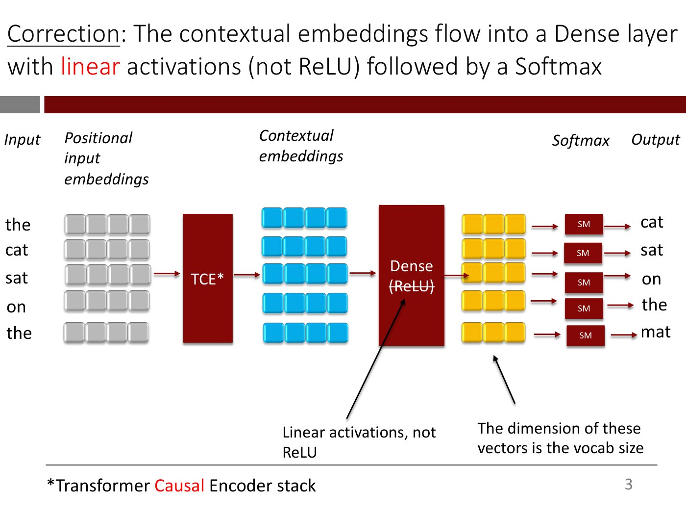

Title: "Correction: The contextual embeddings flow into a Dense layer with linear activations (not ReLU) followed by a Softmax" ("Correction" underlined; "linear" in red). Two lines.

Same diagram as slide 2, with these changes: the text in the Dense box is "Dense" with "(ReLU)" struck through; two annotations with black arrows are added at the bottom: "Linear activations, not ReLU" (two lines; its arrow points up to the struck-through "(ReLU)") and "The dimension of these vectors is the vocab size" (arrow pointing up to the yellow rows). Footnote "\*Transformer Causal Encoder stack" unchanged ("Causal" in red). Printed page number 3.

This slide corrects the "Dense (ReLU)" layer drawn in lecture 9's pipeline diagram.

*Figure: yes — same pipeline as slide 2 with Dense (ReLU) corrected to linear activations and the yellow vector dimension labelled as the vocab size*

## Slide 4 — What about GPT and GPT-2?

Title: "What about GPT and GPT-2?"

- GPT stands for Generative Pretrained Transformer (the "G", "P" and "T" underlined)
- Like GPT-3, GPT and GPT-2 were trained in a very similar “predict the next word” fashion
- Two key differences
  - GPT-3 was trained on much more data
  - GPT-3’s underlying NN was much bigger

Table at right (black header row, grey body rows):

| Model | Number of parameters |
| --- | --- |
| GPT | 117 million |
| GPT-2 | 1.5 billion |
| GPT-3 | 175 billion |

*Figure: no*

## Slide 5 — Unlike GPT and GPT-2, GPT-3 could generate amazing completions from a starting prompt

Title: "Unlike GPT and GPT-2, GPT-3 could generate amazing *completions* from a starting prompt" ("completions" in red italic). Two lines.

Diagram: at left a black-outlined box "Prompt" with a dash-dot arrow pointing right to a screenshot of a short text prompt in a serif font: the heading "The importance of being on twitter", the byline "by Jerome K. Jerome", the dateline "London, Summer 1897", and then the single word "It" (the start of the body, which the model is to continue).

Footer link (first part orange, underlined) "https://twitter.com/quasimondo/status/1284509525500989445" followed by "via" and "https://www.technologyreview.com/2023/02/08/1068068/ChatGPT-is-everywhere-heres-where-it-came-from/".

*Figure: yes — a "Prompt" box pointing to a serif-font text prompt: a title, byline and dateline in the style of a 1897 essay, ending with the word "It"*

## Slide 6 — Unlike GPT and GPT-2, GPT-3 could generate amazing completions from a starting prompt (completion)

Title: "Unlike GPT and GPT-2, GPT-3 could generate amazing *completions* from a starting prompt" ("completions" in red italic).

Same as slide 5, with these changes: the footer links are gone; the "Prompt" box and the prompt screenshot (title, byline, dateline, "It") sit higher; a horizontal black rule is drawn under "It"; below the rule a second black-outlined box "Generated by GPT-3" with a dash-dot arrow points to a block of serif text of three paragraphs that continues the sentence from "It". The generated text is a pastiche essay in period style about Twitter in Victorian London: the narrator remarks that Twitter is the last form of social life that interests Londoners, visits a seaside town "twittering like a starling-cage", and asks a sexton what the twittering means; the sexton's reply defines Twitter as a system of short, pithy sentences strung together in groups, and the last paragraph's wording repeats itself ("…and entertainment and the exercise of wits…"). The text is described rather than copied.

*Figure: yes — the prompt from slide 5 above a "Generated by GPT-3" box pointing to three paragraphs of generated period-style text*

## Slide 7 — But it was not good at following user instructions

Title: "But it was not good at following user *instructions*" ("instructions" in italic). Text-only slide, the sentence sits in the body area in two lines.

*Figure: no*

## Slide 8 — Let’s make this request* to GPT-3:

Title: "Let’s make this request\* to GPT-3:"

Italic grey-blue text: "help me write a short note to introduce myself to my neighbor"

Footnote: "\*Source: https://openai.com/blog/ChatGPT/"

*Figure: no*

## Slide 9 — GPT-3’s response

Title: "GPT-3’s response"

Screenshot of the completion in grey sans-serif text. The first line is the request, unhighlighted: "help me write a short note to introduce myself to my neighbor." Below it, three lines highlighted in light green (the model's output):

- "what is a good introduction to a resume."
- "good introduction to a resume."
- "best photos of good resume introduction example sample."

(The model does not write the note; it produces unrelated search-query-like lines.)

*Figure: yes — the request line followed by three green-highlighted lines of off-topic GPT-3 output about resume introductions*

## Slide 10 — GPT-3’s response (thumbs down)

Title: "GPT-3’s response"

Same as slide 9, with one addition: a large yellow thumbs-down emoji overlaid in the middle, partly covering the end of the first green line ("resume.") and extending down to the right of the second line.

*Figure: yes — same GPT-3 response screenshot as slide 9 with a thumbs-down emoji overlaid*

## Slide 11 — In addition to unhelpful answers, it can produce offensive or factually incorrect output as well

Text-only slide. In the body area, three lines: "In addition to unhelpful answers, it can produce offensive or factually incorrect output as well".

*Figure: no*

## Slide 12 — Why GPT-3 sometimes produced unhelpful answers

Title: "Why GPT-3 sometimes produced unhelpful answers"

- GPT-3 wasn’t *explicitly* trained to generate good answers to user instructions. ("explicitly" in italic)

*Figure: no*

## Slide 13 — Why GPT-3 sometimes produced unhelpful answers (build 2)

Title: "Why GPT-3 sometimes produced unhelpful answers"

- GPT-3 wasn’t explicitly trained to generate good answers to user instructions. (now faded to light grey)
- It is simply trying to guess the next word repeatedly, using what it has gleaned from the billions of sentences it was trained on.

*Figure: no*

## Slide 14 — Let’s explicitly train it to follow instructions!

Centred yellow light-bulb image above the text "Let’s *explicitly* train it to follow instructions!" ("explicitly" in italic). No title in the title area.

*Figure: yes — a lit light-bulb emoji-style image above the sentence*

## Slide 15 — OpenAI developed an approach called Instruction Tuning

Title: "OpenAI developed an approach called Instruction Tuning" ("Instruction Tuning" in red).

Image of the top of a paper's first page: a thick black rule, the title "Training language models to follow instructions with human feedback" (bold serif, two lines), a thinner rule, then the author list: Long Ouyang\*, Jeff Wu\*, Xu Jiang\*, Diogo Almeida\*, Carroll L. Wainwright\*; Pamela Mishkin\*, Chong Zhang, Sandhini Agarwal, Katarina Slama, Alex Ray; John Schulman, Jacob Hilton, Fraser Kelton, Luke Miller, Maddie Simens; Amanda Askell†, Peter Welinder, Paul Christiano\*†; Jan Leike\*, Ryan Lowe\*; and below, "OpenAI". (Superscript markers as printed.)

*Figure: yes — title and author block of the OpenAI paper "Training language models to follow instructions with human feedback"*

## Slide 16 — From GPT-3 to GPT-3.5

Title: "From GPT-3 to GPT-3.5"

Diagram, left to right: "GPT" → "GPT-2" → "GPT-3" → (a long arrow) → "GPT-3.5/ InstructGPT" (two lines) → "ChatGPT". Under the long arrow from GPT-3 to GPT-3.5/InstructGPT, a dash-dot brace spans the arrow, with the red label "Instruction Tuning\*" beneath it.

Footnote: "\*The approach has two main steps: (1) Supervised Fine-Tuning (2) Reinforcement Learning from Human Feedback. “Instruction Tuning” usually refers to just (1) but we will use it as a shorthand to refer to the full approach. See http://arxiv.org/abs/2203.02155 for details."

*Figure: yes — timeline GPT, GPT-2, GPT-3, GPT-3.5/InstructGPT, ChatGPT, with Instruction Tuning bracketing the GPT-3 to GPT-3.5/InstructGPT step*

## Slide 17 — Instruction Tuning – Step 1

Title: "Instruction Tuning – Step 1"

- Get humans to write (high-quality) answers to instructions. About 12,500 such instruction-answer pairs were created.

*Figure: no*

## Slide 18 — Instruction Tuning – Step 1 (example)

Title: "Instruction Tuning – Step 1"

- Get humans to write (high-quality) answers to instructions. About 12,500 such instruction-answer pairs were created. <u>Example</u>: ("Example" underlined)

Table (black header row, grey body):

| Instruction | GPT-3 Answer | Human-created answer |
| --- | --- | --- |
| *Explain the moon landing to a 6 year old in a few sentences.* (italic) | Explain the theory of gravity to a 6 year old. | People went to the moon in a big rocket, walked around and came back to Earth. They took pictures of what they saw and sent them back so we could all see them.\* |

Footnote: "\*Lightly edited version of what’s in https://openai.com/blog/instruction-following/"

*Figure: no*

## Slide 19 — Instruction Tuning – Step 1 (training)

Title: "Instruction Tuning – Step 1"

- Get humans to write (high-quality) answers to instructions. About 12,500 such instruction-answer pairs were created. (faded to light grey; the "Example:" and table of slide 18 are gone)
- Using these ~12,500 question-answer pairs as training data, train GPT-3 some more using next-word-prediction (next slide)

*Figure: no*

## Slide 20 — Instruction Tuning – Step 1 (next-word prediction on an instruction-answer pair)

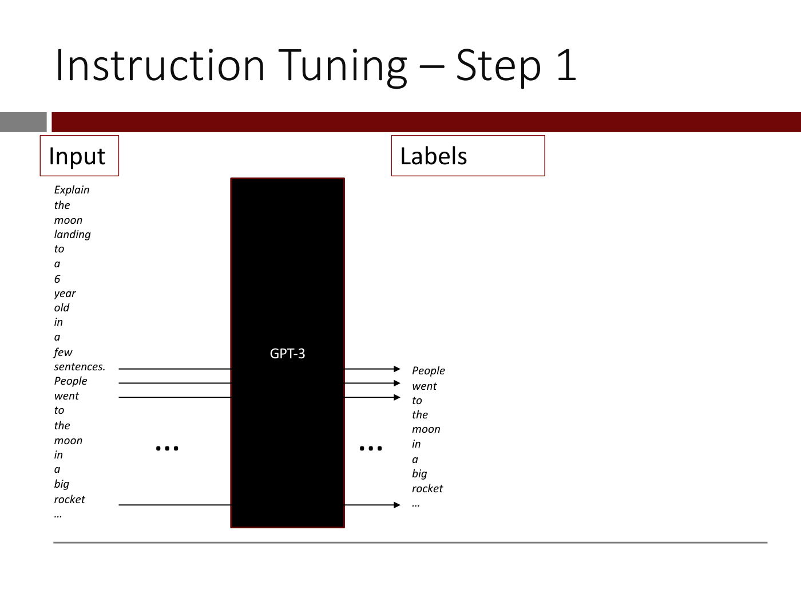

Title: "Instruction Tuning – Step 1"

Diagram. Two red-outlined labels at the top: "Input" (left) and "Labels" (right). A tall black box labelled "GPT-3" (white text) sits in the middle. Down the left, the input text is written one word per line in italics: "Explain the moon landing to a 6 year old in a few sentences. People went to the moon in a big rocket …" (the instruction followed by the human-written answer). Down the right, the label column lists, one word per line in italics, only the answer: "People went to the moon in a big rocket …", starting level with the arrow from the input word "sentences."

Arrows run from input words into the GPT-3 box and out to label words: three arrows at the rows where the inputs are "sentences.", "People" and "went" (leading out to the labels "People", "went", "to"), then a gap marked with a black "…" on each side of the box, then one more arrow at the last input row (after "rocket") leading to the final "…" label. So each answer word is the label for the input word before it (next-word prediction), and nothing is predicted for the instruction words.

*Figure: yes — GPT-3 box with the instruction plus answer words as input at left and the answer words (People went to the moon in a big rocket …) as labels at right*

## Slide 21 — This step – called “Supervised Fine Tuning” (SFT) - helped

Title: "This step – called “Supervised Fine Tuning” (SFT) -  helped" (one line, running to the right edge; the title as rendered ends at "helped").

- GPT-3 did much better on instructions. We would like to do more SFT. (the first sentence in smaller type than the second)

*Figure: no*

## Slide 22 — This step – called “Supervised Fine Tuning” (SFT) - helped (build 2)

Title: "This step – called “Supervised Fine Tuning” (SFT) -  helped"

- GPT-3 did much better on instructions. We would like to do more SFT. (now faded to light grey)
- *But writing high-quality answers to thousands of instructions is difficult and expensive* (italic)

*Figure: no*

## Slide 23 — What’s easier than writing a good answer?

Title: "What’s easier than writing a good answer?" (two lines). The body is empty.

*Figure: no*

## Slide 24 — What’s easier than writing a good answer? (answer)

Title: "What’s easier than writing a good answer?"

- *Ranking* answers written by somebody else! ("Ranking" in red italic; the rest italic black)

*Figure: no*

## Slide 25 — What’s easier than writing a good answer? (build 3)

Title: "What’s easier than writing a good answer?"

- *Ranking answers written by somebody else!* (now faded to light grey)
- We can ask GPT-3 to generate <u>several</u> answers to a question … ("several" underlined)

*Figure: no*

## Slide 26 — What’s easier than writing a good answer? (how to get several answers)

Title: "What’s easier than writing a good answer?"

Same as slide 25, with these changes: the first bullet is faded further; a short vertical black line drops from the underlined "several" to a new italic annotation at lower right: "How? If we ask GPT-3 to <u>sample</u> the next word, remember that it can generate several next-words for the same input." ("sample" underlined; "How?" on its own line).

*Figure: no*

## Slide 27 — What’s easier than writing a good answer? (build 5)

Title: "What’s easier than writing a good answer?"

- *Ranking answers written by somebody else!* (faded)
- We can ask GPT-3 to generate several answers to a question … (faded; the "several" underline and the "How?" annotation of slide 26 are gone)
- … and have humans simply rank them from most useful to least useful!

*Figure: no*

## Slide 28 — Instruction Tuning – Step 2

Title: "Instruction Tuning – Step 2"

- Open AI collected 33,000 instructions, fed them to GPT-3 and generated several answers to each instruction, and *had humans simply rank the answers for each instruction from most helpful to least helpful* (the last part in italic)

*Figure: no*

## Slide 29 — Instruction Tuning – Step 2 (reward model data)

Title: "Instruction Tuning – Step 2"

- Open AI collected 33,000 instructions, fed them to GPT-3 and generated several answers to each instruction, and had humans simply rank the answers for each instruction from most helpful to least helpful (faded to light grey; no longer italic)
- Using this data, a training dataset was assembled ….
  - Given an Instruction and two answers A and B, let’s say the human ranks A as better than B. The resulting data point is [Instruction, Preferred answer = A, Other answer = B]
- …. and a Reward model was trained\*

Footnote: "\*For ease of exposition, we are describing the slightly simpler version in http://arxiv.org/abs/2009.01325"

*Figure: no*

## Slide 30 — The Reward Model has a single numerical output. We want this number to indicate how good the answer is for that particular instruction

Title: "The Reward Model has a single numerical output. We want this number to indicate how good the answer is for that particular instruction" (three lines; the top line is partly cut off by the slide edge in the render).

Diagram. Two parallel branches. Top branch: a box "Instruction" and a box "Preferred Answer" (stacked, white boxes with black outline), each with a black arrow pointing right into a black box "Reward Model" (white text). From the Reward Model a diagonal arrow runs down-right to a meeting point, labelled "$r_P$" (written r with subscript P). Bottom branch: a box "Instruction" and a box "Other Answer", each with an arrow into a second black box "Reward Model", from which a diagonal arrow runs up-right to the same meeting point, labelled "$r_O$". The two arrows converge but nothing is yet drawn at the meeting point.

Footnote under the rule: "The two models are exact copies"

*Figure: yes — two copies of a Reward Model, one scoring Instruction plus Preferred Answer (output r_P), the other Instruction plus Other Answer (output r_O)*

## Slide 31 — We want the model to give a lower rating for the Other answer compared to the Preferred answer, so we define a loss function that encourages this …

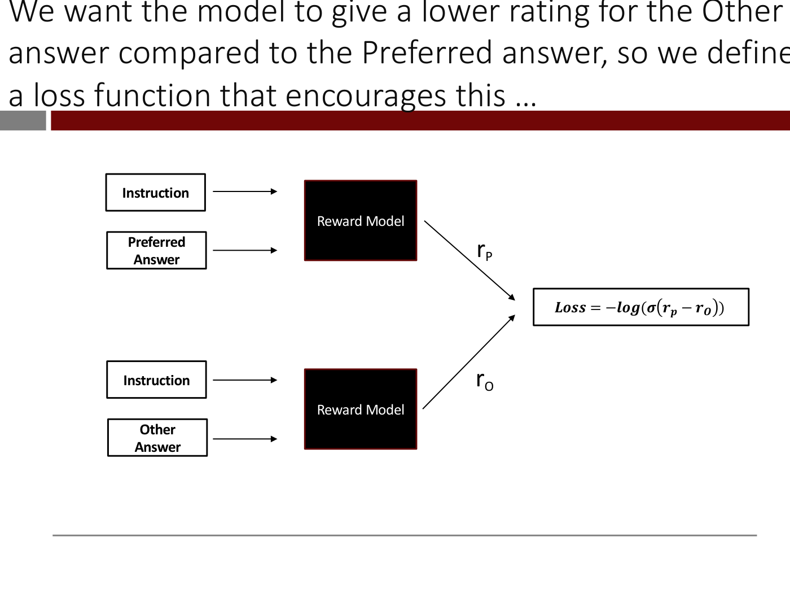

Title: "We want the model to give a lower rating for the Other answer compared to the Preferred answer, so we define a loss function that encourages this …" (three lines; the render clips the end of the first two lines at the right edge, e.g. "define" is cut off).

Same diagram as slide 30, with these changes: a new white box with black outline to the right of the converging arrows holds the formula (printed in bold italic serif):

$$\text{Loss} = -\log(\sigma(r_p - r_O))$$

where $\sigma$ is as printed in the formula (the slide does not define it on this page). The footnote "The two models are exact copies" is gone.

*Figure: yes — the two-branch Reward Model diagram with the loss formula Loss = -log(sigma(r_p - r_O)) at right*

## Slide 32 — … and train this model using SGD (or variants)

Title: "… and train this model using SGD (or variants)"

Same diagram and loss box as slide 31 (identical: the same boxes, arrows, labels r_P and r_O, and formula). Only the title changes.

*Figure: yes — same two-branch Reward Model diagram with the loss formula as slide 31*

## Slide 33 — After training, Reward Model can provide a numerical rating for any [instruction, answer] pair

![Slide 33 — After training, Reward Model can provide a numerical rating for any [instruction, answer] pair](../images/10-adapting-llms/slide-33.png)

Title: "After training, Reward Model can provide a numerical *rating* for *any* [instruction, answer] pair" ("rating" and "any" in italic). Two lines.

Diagram in two halves separated by a horizontal dash-dot line. A box "“Rating”" sits at top right above the output column.

Upper half: a box "Instruction" beside the text "Explain the moon landing to a six year old"; below it a box "Answer" beside the text "Explain the theory of gravity to a 6 year old." (the GPT-3 answer from the earlier example). Each text has an arrow pointing right into a black box (in the render the box has no visible label), and an arrow from the box leads to the number "1.5".

Lower half: a box "Instruction" beside "Explain the moon landing to a six year old"; a box "Answer" beside "People went to the moon in a big rocket, walked around and came back to Earth. They took pictures of what they saw and sent them back so we could all see them" (the human-written answer). Each has an arrow into a black box labelled "Reward Model" (white text), and an arrow from it leads to the number "3.2".

(The upper black box's label is not visible in the render, probably black text on black; the slide implies it is the same Reward Model.)

*Figure: yes — the Reward Model rating two answers to the same instruction: the GPT-3 answer gets 1.5 and the human-written answer gets 3.2*

## Slide 34 — In essence, the Reward Model has learned how humans rank responses.

Text-only slide, in the body area: "In essence, the Reward Model has learned how humans rank responses." then, after a blank line, "This can be used to improve GPT-3 further."

*Figure: no*

## Slide 35 — We send an instruction into GPT-3 and get an answer

Title: "We send an instruction into GPT-3 and get an answer"

Diagram. Two labelled boxes at top: "Instruction" (left) and "Answer" (centre). Below, the text "Explain the moon landing to a six year old" (three lines) with an arrow to a black box "GPT-3" (white text), and an arrow from it to the text "Explain the theory of gravity to a 6 year old." (three lines, under the "Answer" label).

*Figure: yes — instruction text into a GPT-3 box producing the answer "Explain the theory of gravity to a 6 year old."*

## Slide 36 — Next, we feed the question and the answer to the Reward Model

Title: "Next, we feed the question *and* the answer to the Reward Model" ("and" in italic). Two lines.

Same as slide 35, with these changes: the GPT-3 box and its two arrows are faded to near-invisible light grey; the "Instruction" box shifts slightly right and the "Answer" box shifts slightly right; a black line runs from the instruction text up, across the top, and down with an arrowhead into a new black box "Reward Model" (two lines, white text) at right; a black arrow also runs from the answer text into the same Reward Model box. No output yet.

*Figure: yes — instruction and answer both feeding a Reward Model box, with the GPT-3 step faded*

## Slide 37 — Next, we feed the question and the answer to the Reward Model which outputs a rating

Title: "Next, we feed the question *and* the answer to the Reward Model which outputs a rating" ("which outputs a rating" in red). Two lines.

Same as slide 36, with these changes: a new box "Rating" at upper right, an arrow from the Reward Model to the number "1.5" in red under it. The GPT-3 box and arrows stay faded.

*Figure: yes — the Reward Model fed the instruction and the answer outputs the rating 1.5*

## Slide 38 — We use this rating to “nudge”* GPT-3 in the right direction

Title: "We use this rating to “nudge”\* GPT-3 in the right direction" (two lines).

Same as slide 37, with these changes: the GPT-3 box and its arrows are restored to full black (no longer faded); a red dash-dot curved arrow runs from the red "1.5" at right, sweeping below the diagram, back to the GPT-3 box (arrowhead below GPT-3).

Footnote in red: "\* Using a <u>Reinforcement Learning</u> algorithm called <u>Proximal Policy Optimization</u>" (the phrases "Reinforcement Learning" and "Proximal Policy Optimization" underlined).

*Figure: yes — the pipeline instruction, GPT-3, answer, Reward Model, rating 1.5, with a red dashed arrow feeding the rating back to GPT-3*

## Slide 39 — This is repeated thousands of times with instruction-answer pairs

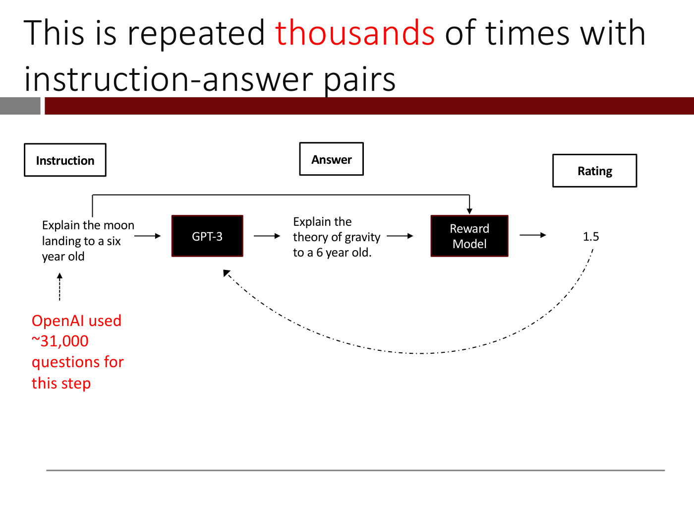

Title: "This is repeated thousands of times with instruction-answer pairs" ("thousands" in red).

Diagram, left to right, with three black-outlined label boxes across the top: "Instruction" (above the first text), "Answer" (above the middle text), "Rating" (above the right end). Text "Explain the moon landing to a six year old" has a black arrow to a black box "GPT-3", which has an arrow to the text "Explain the theory of gravity to a 6 year old." (the answer), which has an arrow to a black box "Reward Model", which has an arrow to the rating "1.5". A thin black line runs from above the instruction text, across the top, and down with an arrowhead into the Reward Model box (the instruction also goes to the Reward Model). A dash-dotted curved arrow runs from the rating "1.5" back down and left to the GPT-3 box. Below the instruction text, a dotted arrow points up to it from red text: "OpenAI used ~31,000 questions for this step" (red).

*Figure: yes — instruction goes to GPT-3, its answer goes to the Reward Model with the instruction, the rating 1.5 feeds back to GPT-3; ~31,000 questions used*

## Slide 40 — That’s how GPT-3 became GPT-3.5/ InstructGPT

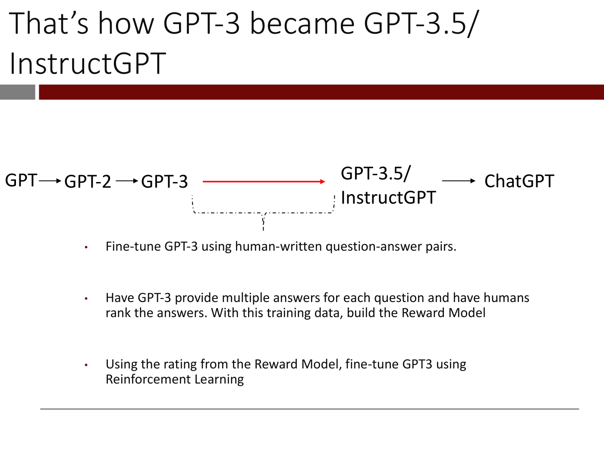

Title: "That’s how GPT-3 became GPT-3.5/ InstructGPT"

Diagram: a row "GPT" → "GPT-2" → "GPT-3" (black arrows), then a long red arrow from GPT-3 to "GPT-3.5/ InstructGPT" (two lines), then a black arrow to "ChatGPT". A dash-dotted bracket under the red arrow's span (from GPT-3 to GPT-3.5/InstructGPT) points down to three bullets:

- Fine-tune GPT-3 using human-written question-answer pairs.
- Have GPT-3 provide multiple answers for each question and have humans rank the answers. With this training data, build the Reward Model
- Using the rating from the Reward Model, fine-tune GPT3 using Reinforcement Learning

*Figure: yes — GPT to GPT-2 to GPT-3 to GPT-3.5/InstructGPT to ChatGPT, with the red arrow (GPT-3 to InstructGPT) explained by the three steps*

## Slide 41 — BTW, Steps 2 and 3 are referred to as “Reinforcement Learning from Human Feedback”

Title: "BTW, Steps 2 and 3 are referred to as “Reinforcement Learning from Human Feedback”" ("Reinforcement Learning" highlighted yellow; "Human Feedback" in red).

- Fine-tune GPT-3 using human-written question-answer pairs.
- Have GPT-3 provide multiple answers for each question and have humans rank the answers. With this training data, build the Reward Model ("have humans rank the answers" in red)
- Using the rating from the Reward Model, fine-tune GPT3 using Reinforcement Learning ("Reinforcement Learning" highlighted yellow)

*Figure: no*

## Slide 42 — BTW, you are providing training data for the Reward Model when you do this …

Title: "BTW, you are providing training data for the Reward Model when you do this …"

Screenshot of ChatGPT. User message (avatar "RA"): "explain the difference between polysemy and synonymy". Response (green OpenAI avatar): "Polysemy and synonymy are two concepts that are often used in linguistics to describe the relationships between words. Polysemy refers to the phenomenon where a single word has multiple related meanings, while synonymy refers to the phenomenon where two or more words have the same or nearly the same meaning." At the response's right are thumbs-up and thumbs-down icons circled by a red dashed ellipse, with a thin black arrow from above pointing at it.

*Figure: yes — ChatGPT screenshot with the thumbs-up/thumbs-down feedback icons circled in red*

## Slide 43 — OK, let’s see how GPT 3.5/InstructGPT does on this prompt

Title: "OK, let’s see how GPT 3.5/InstructGPT does on this prompt"

Screenshot text of a prompt only: "help me write a short note to introduce myself to my neighbor."

*Figure: no*

## Slide 44 — OK, let’s see how GPT 3.5/InstructGPT does on this prompt

Same title as slide 43. Screenshot of the prompt "help me write a short note to introduce myself to my neighbor." (with a small green microphone icon at right), followed by the response, shown with a light green highlight:

"Hello Neighbor,

My name is [Name] and I recently moved into the neighborhood. I am excited to get to know my new neighbors and am looking forward to getting to know you. If you ever need anything, please don't hesitate to reach out.

Best,
[Name]"

*Figure: yes — screenshot of the prompt and InstructGPT's neighbor-note response (light green highlight)*

## Slide 45 — Clearly better than GPT-3!

Title: "Clearly better than GPT-3!"

Same screenshot as slide 44 (the prompt and the identical neighbor note, slightly smaller), with one addition: a large yellow thumbs-up emoji at the right.

*Figure: yes — same neighbor-note screenshot as slide 44 with a thumbs-up emoji*

## Slide 46 — From GPT-3.5 to ChatGPT

Title: "From GPT-3.5 to ChatGPT"

Diagram: "GPT" → "GPT-2" → "GPT-3" → (a long black arrow) "GPT-3.5/ InstructGPT" (two lines) → "ChatGPT". The short arrow between GPT-3.5/InstructGPT and ChatGPT sits inside a red dashed rounded box. All arrows are black here (the long arrow is not red as in slide 40).

*Figure: yes — model lineage GPT to ChatGPT with the final arrow (GPT-3.5/InstructGPT to ChatGPT) boxed in red dashes*

## Slide 47 — From GPT-3.5 to ChatGPT

Title: "From GPT-3.5 to ChatGPT"

Same diagram as slide 46 (moved up the page; red dashed box around the GPT-3.5/InstructGPT to ChatGPT arrow), with these additions: a dash-dotted bracket from the bottom of the red box pointing down to the text below, and three paragraphs:

"This is very similar to the 3-step process we followed to get from GPT-3 to GPT-3.5/InstructGPT but with a key difference"

"Instead of just instruction-answer pairs, use conversations as the training data" ("conversations" underlined)

"With this conversational dataset, the same process was followed – Supervised Fine-tuning, Reward Model, Reinforcement Learning etc."

*Figure: yes — model lineage with the InstructGPT-to-ChatGPT arrow boxed in red, explained by the text beneath*

## Slide 48 — ChatGPT does much better on our prompt

Title: "ChatGPT does much better on our prompt"

ChatGPT screenshot at left. User (avatar "RA"): "help me write a short note to introduce myself to my neighbor." Response:

"Dear [Neighbor's Name],

I hope this note finds you well. My name is [Your Name], and I am your new neighbor. I recently moved into the [apartment/house] next to yours and wanted to take a moment to introduce myself.

I am a [profession/hobby] and enjoy spending my free time [activity/interest]. I also love meeting new people and getting to know my community. If you ever need anything or would like to chat, please don't hesitate to stop by and say hello.

I look forward to getting to know you and being a part of this wonderful neighborhood.

Best regards,
[Your Name]"

At right, a large yellow thumbs-up emoji.

*Figure: yes — ChatGPT's response to the neighbor-note prompt, with a thumbs-up emoji*

## Slide 49 — But because ChatGPT is trained on conversations , we can ask follow-on questions

Title: "But because ChatGPT is trained on conversations , we can ask follow-on questions" ("conversations" and "follow-on" in red).

Same ChatGPT screenshot as slide 48 (identical text) at left; the thumbs-up emoji is gone and the right half is empty.

*Figure: yes — the ChatGPT neighbor-note screenshot from slide 48, without the emoji*

## Slide 50 — But because ChatGPT is trained on conversations , we can ask follow-on questions

Same title (same red words) and same left screenshot as slide 49, with these additions: a second ChatGPT screenshot at right. User (avatar "RA"): "can you make it more formal?" Response: "Certainly, here's a more formal version:

Dear [Neighbor's Name],

I hope this letter finds you in good health and spirits. My name is [Your Name], and I am your new neighbor. I recently moved into the [apartment/house] adjacent to yours and wanted to take a moment to introduce myself formally.

As a [profession/hobby], I value building strong relationships with my neighbors and am excited to get to know the community. In my free time, I enjoy [activity/interest], and I am always open to discovering new hobbies and interests.

I wanted to extend an invitation to stop by anytime if you need any assistance or if you would like to have a friendly conversation. I look forward to getting to know you and being a part of this wonderful neighborhood.

Thank you for taking the time to read my letter. Please accept my warmest regards.

Sincerely,"

(The right screenshot is cut off after "Sincerely,".) A black dash-dotted arrow runs from the lower part of the left screenshot up to the top of the right one, linking the original answer to the follow-on.

*Figure: yes — two ChatGPT screenshots: the original neighbor note and the follow-on "can you make it more formal?" reply, linked by an arrow*

## Slide 51 — The journey continues …

Title: "The journey continues …"

Diagram: black text "GPT" → "GPT-2" → "GPT-3" → "GPT-3.5/ InstructGPT" → "ChatGPT" → (black arrow) a red stacked list at right: "GPT-4", "ChatGPT Plugins" (two lines), "GPT-4 V", "…".

*Figure: yes — model lineage from GPT to ChatGPT, then GPT-4, ChatGPT Plugins, GPT-4 V in red*

## Slide 52 — This is Instruction Tuning in a nutshell

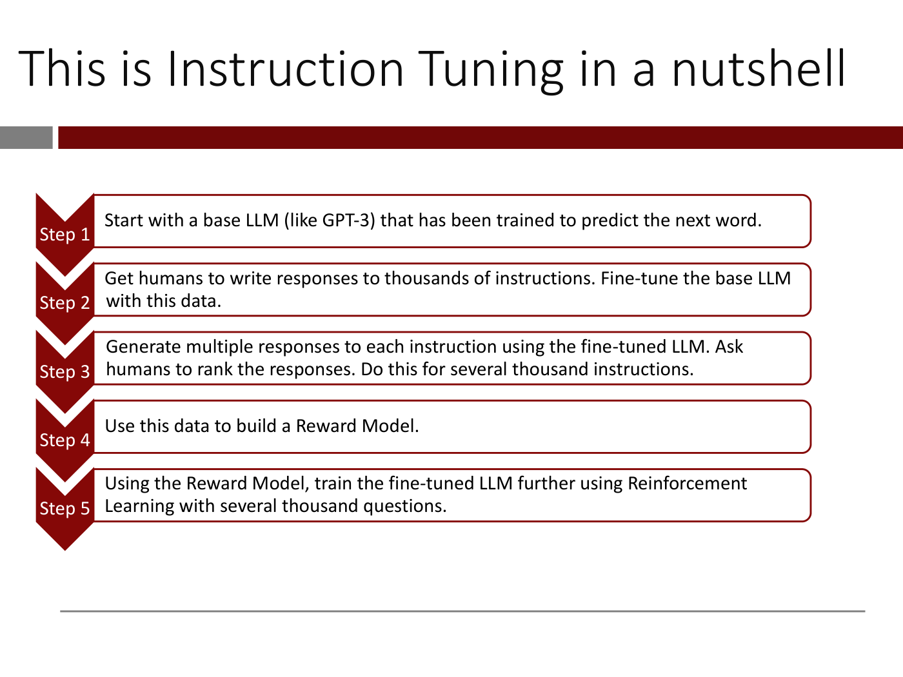

Title: "This is Instruction Tuning in a nutshell"

Five stacked dark red chevron labels "Step 1" to "Step 5" (pointing down), each beside a rounded white box with a dark red outline:

- Step 1: "Start with a base LLM (like GPT-3) that has been trained to predict the next word."
- Step 2: "Get humans to write responses to thousands of instructions. Fine-tune the base LLM with this data."
- Step 3: "Generate multiple responses to each instruction using the fine-tuned LLM. Ask humans to rank the responses. Do this for several thousand instructions."
- Step 4: "Use this data to build a Reward Model."
- Step 5: "Using the Reward Model, train the fine-tuned LLM further using Reinforcement Learning with several thousand questions."

*Figure: yes — five-step chevron list summarising instruction tuning*

## Slide 53 — As you saw, significant human effort was involved in Steps 2 and 3

Title: "As you saw, significant human effort was involved in Steps 2 and 3" ("human" in red).

Same five-step chevron list as slide 52, with Steps 1, 4 and 5 text faded to light grey and these text changes. Step 2 is in black, with "humans" and "thousands" in red, and its second sentence faded: "Get humans to write responses to thousands of instructions." then faded "Fine-tune the base LLM with this data." Step 3: the first sentence is faded ("Generate multiple responses to each instruction using the fine-tuned LLM."); then in black "Ask humans to rank the responses. Do this for several thousand instructions." with "humans" and "several thousand" in red. Step 5 (faded) now reads "Using the Reward Model, train the fine-tuned LLM further using Reinforcement Learning with another thousand questions." (changed from "several thousand questions" on slide 52). Steps 1 and 4 (faded) read as on slide 52.

*Figure: yes — the five-step list with the human-effort parts of Steps 2 and 3 emphasised and the rest faded*

## Slide 54 — Using “helper LLMs”, researchers have automated these steps as well!

Title: "Using “helper LLMs”, researchers have automated these steps as well!" ("helper LLMs" in red).

Same chevron list, with Steps 1, 4 and 5 faded grey. Step 2 (black): "Get ~~humans~~ an instruction-following LLM to write responses to thousands of instructions. Fine-tune the base LLM with this data." ("humans" struck through in black; "an instruction-following LLM" in red). Step 3 (black): "Generate multiple responses to each instruction using the fine-tuned LLM. Ask ~~humans~~ a helper LLM to rank the responses. Do this for several thousand instructions." ("humans a helper LLM" in red, with "humans" struck through). Step 5 (faded) now reads "Using the Reward Model, train the LLM further using Reinforcement Learning with another several thousand questions." A red dashed rounded outline encloses Steps 2 and 3, and a green check-mark emoji sits to its right. Steps 1 and 4 read as on slide 52.

*Figure: yes — the five-step list with Steps 2 and 3 circled in red dashes, humans replaced by LLMs, and a green check mark*

## Slide 55 — If you are curious to learn more…

Title: "If you are curious to learn more…" (large text at left).

At right, a screenshot of a LinkedIn post by "Rama Ramakrishnan (He/Him) · You", "Professor of the Practice at MIT Sloan School of Management", "1mo", with his photo. Post text: "Over the past year, researchers have invented clever ways to use LLMs as "helpers" to create other LLMs cheaper and faster. It has made me realize just how versatile LLMs can be and I wanted to share what I have learned. Please see in full-screen mode. Link to PDF below. #chatgpt #gpt4 #genai". Below it, the first page of an attached document: "How to use LLMs as “helpers” to build and customize other LLMs", "A quick non-technical intro", "Prof. Rama Ramakrishnan", "MIT Sloan School of Management", "January 10, 2023". (The post says "1mo" but the document page is dated January 10, 2023, as printed.) Beneath, the URL: https://www.linkedin.com/feed/update/urn:li:activity:7150937271251136514/

*Figure: yes — LinkedIn post screenshot by the lecturer, with the first page of his "LLMs as helpers" PDF*

## Slide 56 — The importance of adapting base LLMs

Title: "The importance of adapting base LLMs" ("adapting" in red).

- To make a base LLM like GPT-3 useful at understanding language and responding to instructions, we had to adapt it with high-quality data (using Supervised Fine-Tuning with and Reinforcement Learning with Human Feedback (RLHF)) ("adapt" in red)
- This holds true more generally. To make a base LLM useful for specific business applications, we may need to adapt them with business/domain-specific data.  In the next section, we will look at techniques for doing so.

*Figure: no*

## Slide 57 — [Definition: Adaptation]

No title in the title area. Large text in the body: "“Adaptation” is the process of taking a base (aka foundation or base) LLM and tailoring it for a specific task" ("Adaptation" and "tailoring it for a specific task" in red). (The slide prints "base" twice in the parenthesis, as shown.)

*Figure: no*

## Slide 58 — The Ladder of LLM Adaptation

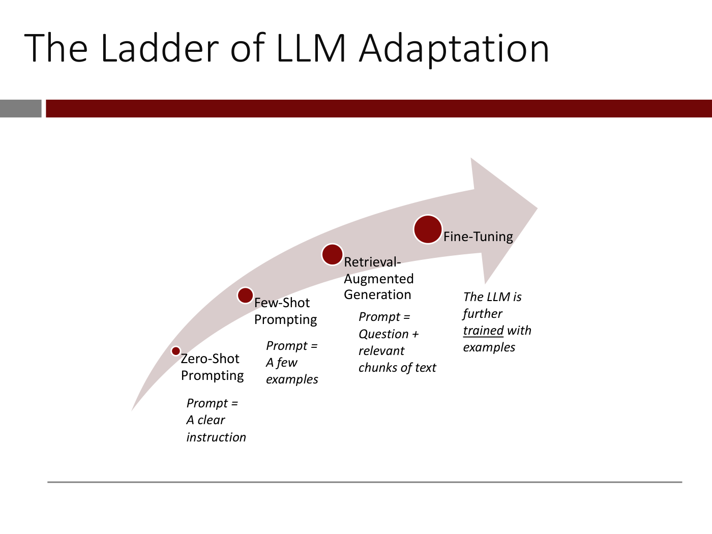

Title: "The Ladder of LLM Adaptation"

Diagram: a large light pink-grey curved arrow rising from lower left to upper right. Four dark red dots of increasing size sit along it, each with a label and an italic description:

- Smallest dot (lowest): "Zero-Shot Prompting"; below it, italic: "Prompt = A clear instruction"
- Next: "Few-Shot Prompting"; italic: "Prompt = A few examples"
- Next: "Retrieval- Augmented Generation" (three lines); italic: "Prompt = Question + relevant chunks of text"
- Largest dot (highest): "Fine-Tuning"; italic: "The LLM is further trained with examples" ("trained" underlined)

*Figure: yes — rising arrow with four steps of increasing size: zero-shot prompting, few-shot prompting, retrieval-augmented generation, fine-tuning, each described by what the prompt or training contains*

## Slide 59 — Example of zero-shot prompting: We want to build a product review defect detector

Title: "Example of zero-shot prompting: We want to build a product review defect detector" ("zero-shot prompting" in red).

A small thumbnail photo of a black mesh office chair at upper left. Beneath it, in a red dash-dotted rounded box, a product review from a retail site: one filled star out of five (one star filled, four empty), "Frame Finish: Black" ("Frame Finish:" bold), and the review text "The curve of the back of the chair does not leave enough room to sit comfortably". Under the box, the credit line and a product page URL: https://www.wayfair.com/furniture/pdp/latitude-run-alori-task-chair-w005270016.html

*OCW notice: © Wayfair LLC. All rights reserved. This content is excluded from our Creative Commons license. For more information, see https://ocw.mit.edu/help/faq-fair-use.*

*Figure: yes — third-party product photo and one-star review of an office chair (excluded; not rendered)*

## Slide 60 — We can directly “instruct” the LLM to check if the review describes a defect

Title: "We can directly “instruct” the LLM to check if the review describes a defect"

Screenshot of the OpenAI Playground page (header with logo and tabs "Overview", "Documentation", "Examples", "Playground" (green, selected); heading "Playground"). In the text box, circled by a red dashed outline, the prompt reads: "Tell me if a product defect in being described in this product review:" and below it "The curve of the back of the chair does not leave enough room to sit comfortably". At left, the label "Prompt" with a dark red arrow pointing at the box. (The prompt says "in being", as printed.)

*Figure: yes — Playground screenshot with the zero-shot defect-detection prompt outlined in red*

## Slide 61 — The LLM gets it right!

Title: "The LLM gets it right!"

Same Playground screenshot as slide 60, with these changes: the red dashed outline no longer surrounds the prompt; the prompt text is unchanged ("Tell me if a product defect in being described in this product review:" and "The curve of the back of the chair does not leave enough room to sit comfortably"); a new line below it, highlighted light green, reads ">Yes, this is a product defect." and is circled by the red dashed outline. At left, the label "Prompt" with an arrow to the prompt, and a new label "Response" with an arrow to the response.

*Figure: yes — Playground screenshot showing the LLM's response "Yes, this is a product defect."*

## Slide 62 — [Definition: Prompt engineering]

No title in the title area. Italic text in the body: "When adapting an LLM to a specific task using zero-shot, we may need to carefully design the prompt so that the LLM gives you the desired response. This is called “prompt engineering”" ("prompt engineering" in red).

*Figure: no*

## Slide 63 — Example: A simple question that ChatGPT sometimes gets wrong

Title: "Example: A simple question that ChatGPT sometimes gets wrong" (italic).

A black-outlined italic label "No prompt engineering". ChatGPT screenshot: user (avatar "RA"): "what is the fifth word of this sentence?"; response: "The fifth word of this sentence is "is."" Below: "(HT: Twitter user @deanbuono)".

*Figure: yes — ChatGPT screenshot with no prompt engineering, answering the fifth-word question with "is"*

## Slide 64 — With a little prompt engineering, it can answer the question reliably

Title: "With a little prompt engineering, it can answer the question reliably"

Two ChatGPT screenshots side by side.

Left, under the label "No prompt engineering": user (avatar "RA"): "What is the fifth word of this sentence?"; response: "The fifth word of the sentence is "the."" with a yellow thumbs-down emoji beside it.

Right, under the label "A “little” prompt engineering", with the user message circled in a red dashed outline: user: "i will give you a sentence. First, list all the words that are in the sentence. Then tell me the fifth word.  Sentence: what is the fifth word of this sentence?"; response: "The words in the sentence are: "what," "is," "the," "fifth," "word," "of," "this," "sentence."" and then "The fifth word of the sentence is "word."" with a yellow thumbs-up emoji beside it.

*Figure: yes — side-by-side ChatGPT screenshots: the plain question answered wrongly, and the same question with a list-the-words-first prompt answered correctly*

## Slide 65 — Researchers are “discovering” some simple and widely-applicable prompt engineering strategies

Title: "Researchers are “discovering” some simple and widely-applicable prompt engineering strategies"

Two rounded boxes side by side, figure from a paper, with the red italic caption "“Let’s think step by step”" above the right box and the source URL at lower left: http://arxiv.org/abs/2205.11916

Left box: "Q: A juggler can juggle 16 balls. Half of the balls are golf balls, and half of the golf balls are blue. How many blue golf balls are there?" "A: The answer (arabic numerals) is", a rule, then "(Output) 8" followed by a red X mark.

Right box: the same question; "A: Let’s think step by step." (the sentence in bold, highlighted pink), a rule, then in blue text: "(Output) There are 16 balls in total. Half of the balls are golf balls. That means that there are 8 golf balls. Half of the golf balls are blue. That means that there are 4 blue golf balls." followed by a green check mark.

*Figure: yes — chain-of-thought prompt comparison: the plain prompt outputs 8 (wrong), the "Let's think step by step" prompt reasons to 4 (right)*

## Slide 66 — Here’s a recent ”discovery” 🤔

Title: "Here’s a recent ”discovery”" followed by a thinking-face emoji.

At left in red italic: "“Take a deep breath and work on this problem step by step”". At right, a table image from a paper, with the URL at lower left: https://arxiv.org/pdf/2309.03409.pdf. The table caption reads "Table 4: Test accuracies on GSM8K. We show the instruction with the highest test accuracy for each scorer-optimizer pair." Columns: Scorer, Optimizer / Source, Instruction position, Top instruction, Acc. Rows are in two groups.

Baselines (as read from the render):

| Scorer | Optimizer / Source | Instruction position | Top instruction | Acc |
| --- | --- | --- | --- | --- |
| PaLM 2-L | (Kojima et al., 2022) | A_begin | Let’s think step by step. | 71.8 |
| PaLM 2-L | (Zhou et al., 2022b) | A_begin | Let’s work this out in a step by step way to be sure we have the right answer. | 58.8 |
| PaLM 2-L |  | A_begin | Let’s solve the problem. | 60.8 |
| PaLM 2-L |  | A_begin | (empty string) | 34.0 |
| text-bison | (Kojima et al., 2022) | Q_begin | Let’s think step by step. | 64.4 |
| text-bison | (Zhou et al., 2022b) | Q_begin | Let’s work this out in a step by step way to be sure we have the right answer. | 65.6 |
| text-bison |  | Q_begin | Let’s solve the problem. | 59.1 |
| text-bison |  | Q_begin | (empty string) | 56.8 |

Ours:

| Scorer | Optimizer / Source | Instruction position | Top instruction | Acc |
| --- | --- | --- | --- | --- |
| PaLM 2-L | PaLM 2-L-IT | A_begin | Take a deep breath and work on this problem step-by-step. | 80.2 (bold) |
| PaLM 2-L | PaLM 2-L | A_begin | Break this down. | 79.9 |
| PaLM 2-L | gpt-3.5-turbo | A_begin | A little bit of arithmetic and a logical approach will help us quickly arrive at the solution to this problem. | 78.5 |
| PaLM 2-L | gpt-4 | A_begin | Let’s combine our numerical command and clear thinking to quickly and accurately decipher the answer. | 74.5 |
| text-bison | PaLM 2-L-IT | Q_begin | Let’s work together to solve math word problems! First, we will read and discuss the problem together to make sure we understand it. Then, we will work together to find the solution. I will give you hints and help you work through the problem if you get stuck. | 64.4 |
| text-bison | text-bison | Q_end | Let’s work through this problem step-by-step: | 68.5 (bold) |
| text-bison | gpt-3.5-turbo | Q_end | A long instruction beginning "Analyze the given information, break down the problem into manageable steps, apply suitable mathematical operations, …" | 66.5 |
| text-bison | gpt-4 | Q_begin | A long instruction beginning "Start by dissecting the problem to highlight important numbers and their relations. …" | 62.7 |

The first "Ours" row ("Take a deep breath and work on this problem step-by-step.", 80.2) is circled by a red dashed outline. (The table image is cut off at the right edge of the page by the slide's red bar.)

*Figure: yes — table of GSM8K test accuracies per instruction, with the "Take a deep breath ..." row at 80.2 circled in red*

## Slide 67 — There are many “prompt engineering” resources online. Here’s a recent one.

Title: "There are many “prompt engineering” resources online. Here’s a recent one."

Image of the first page of a paper: title "PROMPT DESIGN AND ENGINEERING: INTRODUCTION AND ADVANCED METHODS", author "Xavier Amatriain", "xavier@amatriain.net", date "February 12, 2024", and an abstract: "Prompt design and engineering has rapidly become essential for maximizing the potential of large language models. In this paper, we introduce core concepts, advanced techniques like Chain-of-Thought and Reflection, and the principles behind building LLM-based agents. Finally, we provide a survey of tools for prompt engineers." Beneath it: https://arxiv.org/abs/2401.14423. This page prints the number "67" at bottom right (the only page in this range that prints a number, matching the PDF page).

*Figure: yes — first page of the Amatriain prompt-engineering survey paper (title, author, abstract)*

## Slide 68 — Let’s look at Few-Shot Prompting next

Title: "Let’s look at Few-Shot Prompting next"

Same ladder diagram as slide 58 (rising arrow; Zero-Shot Prompting "Prompt = A clear instruction"; Few-Shot Prompting "Prompt = A few examples"; Retrieval- Augmented Generation "Prompt = Question + relevant chunks of text"; Fine-Tuning "The LLM is further trained with examples"), with one addition: a black dash-dotted rounded box around the "Few-Shot Prompting" dot and its label.

*Figure: yes — the ladder of LLM adaptation with Few-Shot Prompting boxed*

## Slide 69 — Let’s say we want to build a “grammar corrector”

Title: "Let’s say we want to build a “grammar corrector”". The body is empty (a build-step start; the content appears on the following slides).

*Figure: no*

## Slide 70 — We collect a few examples of what we want the LLM to do

Title: "We collect a few examples of what we want the LLM to do"

A black-outlined box labelled "Prompt" at left, beside monospaced grey text (a few-shot prompt from the GPT-3 paper). It is a series of "Poor English input:" / "Good English output:" pairs. The first pair turns a sentence with "eated" into "ate" (purple berries). The second turns a thanks-for-picking-me-as-your-designer sentence into one using "choosing" and "I appreciate it". The third pair corrects a sentence about requested changes (the poor version begins "The mentioned changes have done." and the good one begins "The requested changes have been made."). The prompt ends with a fourth "Poor English input:" line, "I’d be more than happy to work with you in another project.", with no output given. Source URL at lower left: http://arxiv.org/abs/2005.14165

*OCW notice: Prompt examples © Tom B. Brown, et al./ArXiv. All rights reserved. This content is excluded from our Creative Commons license. For more information, see https://ocw.mit.edu/help/faq-fair-use.*

*Figure: yes — few-shot grammar-correction prompt with three worked examples and a fourth input left open (excluded; not rendered)*

## Slide 71 — Notice the Good English – Poor English pattern

Title: "Notice the Good English – Poor English pattern"

Same prompt text, "Prompt" box, notice and URL as slide 70, with these additions: red dashed outlines around each of the three complete input/output pairs (the first pair, the second pair, the third pair as three separate boxes). The last, open "Poor English input:" line is not outlined.

*OCW notice: Prompt examples © Tom B. Brown, et al./ArXiv. All rights reserved. This content is excluded from our Creative Commons license. For more information, see https://ocw.mit.edu/help/faq-fair-use.*

*Figure: yes — the same few-shot prompt with the three example pairs outlined in red dashes (excluded; not rendered)*

## Slide 72 — We end with a “Poor English” sentence and …

Title: "We end with a “Poor English” sentence and …"

Same prompt text, "Prompt" box, notice and URL as slides 70 and 71. Changes: the three example pairs are now outlined with thin black dashed boxes instead of red ones, and the final open line ("Poor English input:" followed by "I’d be more than happy to work with you in another project.") is outlined with a thick red dashed box.

*OCW notice: Prompt examples © Tom B. Brown, et al./ArXiv. All rights reserved. This content is excluded from our Creative Commons license. For more information, see https://ocw.mit.edu/help/faq-fair-use.*

*Figure: yes — the same few-shot prompt with the examples in black dashes and the final open "Poor English" line in red dashes (excluded; not rendered)*

## Slide 73 — … and the LLM has learned to fix the error!

Title: "… and the LLM has learned to fix the error!"

Same prompt text, "Prompt" box, notice and URL as slides 70 to 72, with no dashed boxes around the examples. Additions: a second black-outlined box labelled "GPT-3", beside a bold monospaced line below the prompt: "Good English output: I’d be more than happy to work with you on another project." In the prompt's last line, the word "in" is circled with a small red dashed circle; in the GPT-3 line the word "on" is circled likewise, and a red arrow runs from the circled "on" up to the circled "in", showing the preposition that GPT-3 changed.

*OCW notice: Prompt examples © Tom B. Brown, et al./ArXiv. All rights reserved. This content is excluded from our Creative Commons license. For more information, see https://ocw.mit.edu/help/faq-fair-use.*

*Figure: yes — the few-shot prompt plus GPT-3's output line, with the corrected word (in changed to on) circled in red (excluded; not rendered)*

## Slide 74 — The ability of LLMs to learn how to do a task with just instructions/examples in the prompt is called In-Context Learning

Title: "The ability of LLMs to learn how to do a task with just instructions/examples in the prompt is called In-Context Learning" ("In-Context Learning" in red).

The ladder diagram of slide 58 (Zero-Shot Prompting "Prompt = A clear instruction"; Few-Shot Prompting "Prompt = A few examples"; Retrieval- Augmented Generation "Prompt = Question + relevant chunks of text"; Fine-Tuning "The LLM is further trained with examples"), with a black dash-dotted rounded rectangle enclosing the first two rungs, Zero-Shot Prompting and Few-Shot Prompting, and their descriptions.

*Figure: yes — the ladder of LLM adaptation with the zero-shot and few-shot rungs enclosed (in-context learning)*

## Slide 75 — Let’s look at Retrieval Augmented Generation* next

Title: "Let’s look at Retrieval Augmented Generation\* next"

The same ladder diagram as slide 58, with a black dash-dotted rounded box around the "Retrieval- Augmented Generation" dot and label (the box reaches up to touch the edge of the Fine-Tuning dot). Footnote: \*sometimes referred to as “indexing”

*Figure: yes — the ladder of LLM adaptation with Retrieval-Augmented Generation boxed*

## Slide 76 — Leveraging proprietary/custom data

Title: "Leveraging proprietary/custom data"

- Sometimes we want to leverage proprietary databases and content based on the specific question we want the LLM to answer (e.g., a customer support representative resolving a customer issue).
- Can’t we just include the entire dataset in the prompt? (red)

(The page prints the number "77" at bottom right, one more than its PDF page, as expected from the hidden slide.)

*Figure: no*
## Slide 77 — For any LLM, the prompt + output cannot exceed a predefined limit (the Context Window)

Title: "For any LLM, the prompt + output cannot exceed a predefined limit. This is called the Context Window (and it varies from LLM to LLM). This limits how much information you can “pack” into your prompt." ("Context Window" in red; title runs over three lines).

Diagram. At left a tall narrow white box with a black outline labelled "Prompt" (bold, rotated vertically). A thin black arrow points right to a large black rectangle with a dark red outline labelled "LLM" in white. A second thin black arrow points right to a tall narrow stack of two boxes: the upper box labelled "Prompt" in faded light grey (rotated), the lower box labelled "Output" in bold black (rotated); together they are the same height as the single Prompt box plus extra, i.e. the output column is taller than the input column. A large black right-hand curly brace spans the whole stack, followed by the text "This is called the ”context window”" ("context window" in red).

*Figure: yes — prompt box into LLM box into a stack of prompt plus output, bracketed as the context window*

## Slide 78 — [Screenshot: a ChatGPT conversation showing that the whole conversation so far is part of the prompt]

Text at left: "Furthermore, each time you ask a question, the entire conversation so far is part of the prompt" ("entire conversation so far" in red and underlined).

Centre: a screenshot of a ChatGPT conversation (caption in the screenshot's corner: "A conversation with ChatGPT"). Three user questions alternate with three assistant answers: "What is the square root of 17?" answered with an approximate value 4.123105625617661; "What is it exactly?" answered that it is an irrational number which can be written as the radical of 17; "Why did I choose 17 in my example?" answered with a statement that as an AI language model it has no access to why the user chose it, though 17 is a prime and a common number in examples; "My favorite number is 17." answered with a remark that 17 is a prime number with some interesting mathematical properties. Coloured rectangles are drawn over the screenshot: a red box around the first question only; a blue box around the first question, first answer and second question; a green box around everything from the first question through the third question; a violet/pink box around everything from the first question through the fourth user message ("My favorite number is 17."). Four black right-hand brackets at the right edge (continuing past the slide's red header band) match these nested boxes at growing heights, showing that each new question carries all earlier turns with it. Below the screenshot, a source URL: "https://twitter.com/benjedwards/status/1644032568772161545?s=20"

*OCW notice: Conversation prompt © benjedwards on Twitter. All rights reserved. This content is excluded from our Creative Commons license. For more information, see https://ocw.mit.edu/help/faq-fair-use.*

*Figure: yes — ChatGPT conversation screenshot with nested coloured boxes showing growing prompt (excluded third-party material)*

## Slide 79 — Leveraging proprietary/custom data

Title: "Leveraging proprietary/custom data"

- Sometimes we want to leverage proprietary databases and content based on the specific question we want the LLM to answer (e.g., a customer support representative resolving a customer issue).
- We can’t include the entire dataset in the prompt. We need to first “retrieve” relevant content and send it into the LLM, along with the question.

*Figure: no*

## Slide 80 — Retrieval-Augmented Generation

Title: "Retrieval-Augmented Generation"

- Sometimes we want to leverage proprietary databases based on the specific question we want the LLM to answer (e.g., a customer support representative resolving a customer issue).
- This can be done by selecting relevant content from an internal database, “packing” it into the prompt and sending it into the LLM.

Diagram at right (a third-party figure; described only). An orange "Query" box points down to a black "Embedding" box. A purple "External document" icon at top right splits with three arrows into purple boxes "Chunk 1", "Chunk 2", "Chunk 3"; each points down to a black box "Embedding 1", "Embedding 2", "Embedding 3" inside a rounded outline labelled "VECTOR DATABASE". The query's embedding is matched to the vector database by a line labelled "Most similar k" that arrives at Embedding 1. An arrow runs from the vector database down to an orange "Response synthesis" box, and a second arrow runs from the query's Embedding box down and around into "Response synthesis" as well.

Source URL under the figure: "https://magazine.sebastianraschka.com/p/finetuning-large-language-models"

*OCW notice: Retrieval-augmented generation figure © Sebastian Raschka. All rights reserved. This content is excluded from our Creative Commons license. For more information, see https://ocw.mit.edu/help/faq-fair-use.*

*Figure: yes — retrieval-augmented generation flow diagram (excluded third-party material)*

## Slide 81 — Colab time!

Title: "Colab time!"

One underlined orange hyperlink: "HODL-SP24-Section-A-Lec-10-Retrieval-Augmented-Generation" (the link target is not printed on the slide).

*Figure: no*

## Slide 82 — Let’s look at Fine Tuning next

Title: "Let’s look at Fine Tuning next"

Diagram. A wide, pale grey-pink curved arrow sweeps from lower left up to the right. Four dark red dots of increasing size sit along it, each with a label and an italic description beneath:

- Smallest dot: "Zero-Shot Prompting"; italic: "Prompt = A clear instruction"
- Next: "Few-Shot Prompting"; italic: "Prompt = A few examples"
- Next: "Retrieval-Augmented Generation"; italic: "Prompt = Question + relevant chunks of text"
- Largest dot, at the arrow's head: "Fine-Tuning"; italic: "The LLM is further trained with examples" ("trained" underlined). A dash-dot black rounded rectangle is drawn around the Fine-Tuning dot and label.

*Figure: yes — arrow of increasingly heavy techniques: zero-shot prompting, few-shot prompting, retrieval-augmented generation, fine-tuning (highlighted)*

## Slide 83 — In Fine-Tuning, we take a causal LLM (like GPT) and …

Title: "In Fine-Tuning, we take a causal LLM (like GPT) and …"

Diagram, in the style of the lecture 9 pipeline diagrams but with four rows. Italic column labels: "Input" (far left), "Positional input embeddings", "Contextual embeddings", "Softmax", "Output" (far right). Four short dark red arrows enter, one per row, into a column of four rows of four grey squares (positional input embeddings). A dark red arrow leads into a dark red box labelled "TCE\*" (white text), and another leaves it into four rows of four blue squares (contextual embeddings). Another arrow leads into a dark red box labelled "Dense", then out to four rows of three yellow squares. Each yellow row has an arrow into its own dark red "SM" box (four boxes), and the last SM box has a dark red arrow leaving it to the right toward the (empty) output area. No words are printed in the input or output columns.

Footnote at the bottom: "\*Transformer Causal Encoder stack" ("Causal" in red).

*Figure: yes — causal LLM pipeline: input, positional embeddings, TCE stack, contextual embeddings, Dense, yellow rows, four SM boxes, with no words filled in*

## Slide 84 — … train it further on domain-specific input-output examples …

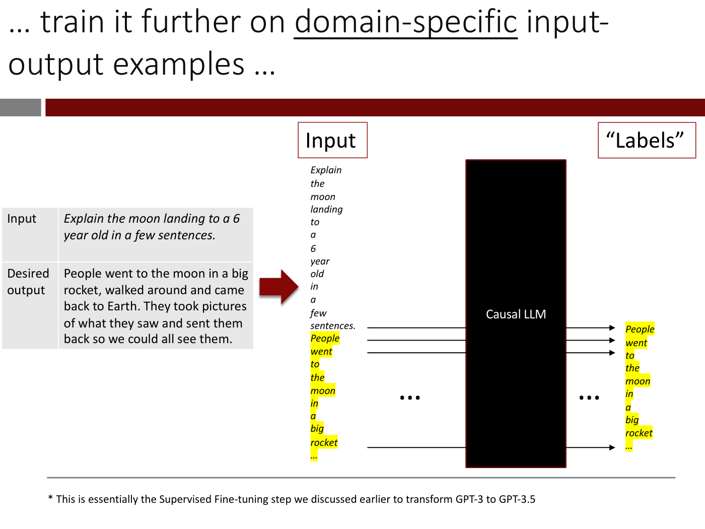

Title: "… train it further on domain-specific input-output examples …" ("domain-specific" underlined; title runs over two lines).

Left, a two-row grey table:

| Input | *Explain the moon landing to a 6 year old in a few sentences.* |
| --- | --- |
| Desired output | People went to the moon in a big rocket, walked around and came back to Earth. They took pictures of what they saw and sent them back so we could all see them. |

(The Input cell text is italic.) A thick dark red arrow points right from the table to the diagram.

Diagram, right. Boxed headings "Input" (above the left column) and "“Labels”" (above the right column). The input column lists, one word per line in italic: "Explain", "the", "moon", "landing", "to", "a", "6", "year", "old", "in", "a", "few", "sentences." and then, highlighted in yellow, "People", "went", "to", "the", "moon", "in", "a", "big", "rocket", "…". A tall black rectangle labelled "Causal LLM" (white text) sits in the middle with an ellipsis ("…") drawn on each side. Black arrows run from the input rows at "sentences.", "People" and "went" through the LLM to the output column, and one more arrow from the last "…" row to the last output row. The output ("Labels") column lists in yellow highlight: "People", "went", "to", "the", "moon", "in", "a", "big", "rocket", "…". The first three output words ("People", "went", "to") are level with the three arrows from "sentences.", "People" and "went"; that is, each output word is the next word after the input row it is aligned with.

Footnote: "\* This is essentially the Supervised Fine-tuning step we discussed earlier to transform GPT-3 to GPT-3.5"

*Figure: yes — instruction example table and causal LLM diagram where the prompt tokens are inputs and the desired-output tokens are the labels*

## Slide 85 — … and update the weights

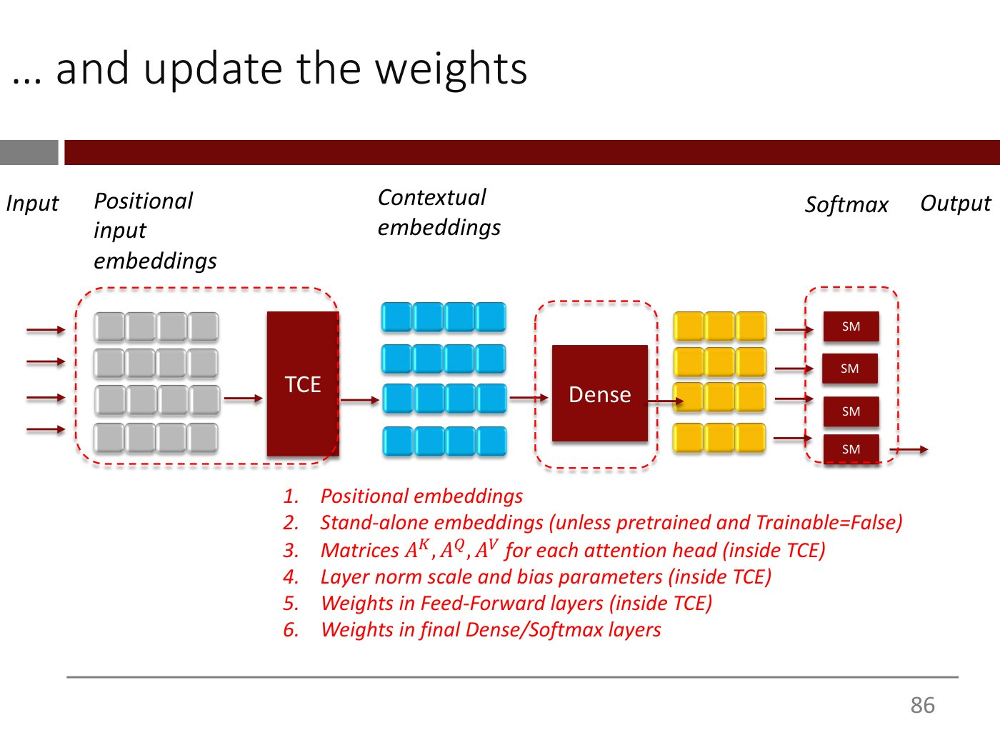

Title: "… and update the weights"

Same diagram as slide 83 (column labels Input, Positional input embeddings, Contextual embeddings, Softmax, Output; four rows; no words), with these changes: the box label is "TCE" (no asterisk) and the footnote is gone; three red dashed rounded outlines are added: one around the grey positional-embedding squares together with the TCE box, one around the Dense box, and one around the four SM boxes (the blue and yellow squares are not outlined). Below the diagram, a numbered list in red italics:

1. Positional embeddings
2. Stand-alone embeddings (unless pretrained and Trainable=False)
3. Matrices $A^K, A^Q, A^V$ for each attention head (inside TCE)
4. Layer norm scale and bias parameters (inside TCE)
5. Weights in Feed-Forward layers (inside TCE)
6. Weights in final Dense/Softmax layers

*Figure: yes — causal LLM pipeline with the trainable parts outlined in red dashes, plus a numbered list of the weights that get updated*

## Slide 86 — Before we discuss the mechanics of fine-tuning, let’s look at a quick example of its usefulness

Text-only slide with the title area empty; body text: "Before we discuss the mechanics of fine-tuning, let’s look at a quick example of its usefulness"

*Figure: no*

## Slide 87 — Let’s say we ask an LLM to generate synthetic product reviews from product descriptions

Title: "Let’s say we ask an LLM to generate synthetic product reviews from product descriptions" (two lines).

Left, inside a red-outlined box: the underlined word "Prompt" followed by "Write a positive product review using the following information:", beside a screenshot of a clothing retailer's product page (rag & bone, New York): a product blurb beginning "Timeless. Authentic. Iconic.", feature lines (an "Authentic Stretch" icon, "Machine Washable"), collapsed "Size & Fit", expanded "Features & Details" with fabric content and care text, and a product ID (third-party page; described only). A thick dark red arrow points right to the response.

Right: heading "LLM Response" and, in a red-outlined box, italic text: "Timeless. Authentic. Iconic. One of the building blocks of a perfect wardrobe. The Fit 2 - our most loved slim-fitting jean. For good reason. Mid-rise, tailored through the hip and thigh with a narrow leg opening. Here in Authentic Stretch: selvedge-inspired denim with an optimal, shape-holding touch of comfort stretch. Featured in raw Japanese unwashed denim. Authentic Stretch. Machine Washable. Mid rise slim fit, tailored through hip and thigh"

Below, in red: "Do you think this reads like a review?"

*OCW notice: © rag & bone. All rights reserved. This content is excluded from our Creative Commons license. For more information, see https://ocw.mit.edu/help/faq-fair-use.*

*Figure: yes — product-page screenshot as prompt and the LLM's marketing-style response (excluded third-party material)*

## Slide 88 — Let’s say we ask an LLM to generate synthetic product reviews from product descriptions

Same as slide 87, with one change: the red text at lower right now reads "No, this reads like Marketing copy." (instead of "Do you think this reads like a review?"). The prompt, product-page screenshot and LLM response text are identical.

*OCW notice: © rag & bone. All rights reserved. This content is excluded from our Creative Commons license. For more information, see https://ocw.mit.edu/help/faq-fair-use.*

*Figure: yes — same as slide 87 with the answer "No, this reads like Marketing copy." (excluded third-party material)*

## Slide 89 — Another example

Title: "Another example"

Same layout as slide 88. Left, in a red-outlined box: underlined "Prompt", then "Write a positive product review using the following information:", beside a screenshot of an Urban Outfitters product page (logo "URBAN OUTFITTERS"; a "Details" section with a product SKU line, a blurb about a crew neck jersey tank top by Champion, "Features" (sleeveless tee from Champion, boxy and cropped silhouette, crew neckline), "Content + Care" (100% cotton, machine wash, imported), "Size + Fit" (model measurements) and a "Champion" brand paragraph; third-party page, described only). A thick dark red arrow points right.

Right: heading "LLM Response" and, in a red-outlined box (plain, non-italic text): "Champion's Crew Neck Jersey Tank Top is a great addition to any wardrobe. The boxy and cropped silhouette is flattering on all body types, and the cotton fabrication is soft and comfortable. The crew neckline is classic and timeless, and the sleeveless design makes it perfect for warmer weather. The Heritage style tee is an exclusive from Urban Outfitters, and the 100% cotton fabrication and machine washability make it easy to care for."

Below, in red: "This too reads like Marketing copy."

*OCW notice: © UrbanOutfitters. All rights reserved. This content is excluded from our Creative Commons license. For more information, see https://ocw.mit.edu/help/faq-fair-use.*

*Figure: yes — Urban Outfitters product page as prompt and the LLM's marketing-style response (excluded third-party material)*

## Slide 90 — Let’s fine-tune the LLM with [Instruction, Product description, Product review] examples!

Text-only slide, title area empty. A light-bulb emoji at upper left, then large text in four lines: "Let’s fine-tune the LLM with [Instruction, Product description, Product review] examples!"

*Figure: no*

## Slide 91 — A dataset for instruction tuning (example)

Title: "A dataset for instruction tuning (example)"

A screenshot of three JSON records in monospace on a pale cream background, each with the keys "instruction", "input" and "output" (small print; transcribed as legibly as possible):

1. "instruction": "Write a positive review for the following product". "input": a long product description beginning "The Workwear Pocket Long Sleeve T-Shirt.Wear it as a layer, wear it by itself, wear it with pride. It's as rugged and dependable as your favorite hammer offering 6.75-ounce, 100% cotton jersey knit, …" and ending with the package dimensions "12.4 x 7.6 x 1.8 inches" and shipping weight "1 pounds (View shipping rates and policies)". "output": "The Best! Carharrt t-shirts are my husband's favorite. They fit well, the fabric is very substantial, they wear well, and he especially likes the pocket. He wears these alone, with a light t-shirt under, or under a long sleeve button down Carharrt work shirt."
2. "instruction": "Write a neutral review for the following product". "input": a description beginning "These overalls are made of 12-ounce, firm-hand 100 percent ring-spun cotton duck and have adjustable front-elastic suspenders, …" ending with dimensions "15.6 x 6.3 x 3.5 inches" and shipping weight "2.95 pounds (View shipping rates and policies)". "output": "\"... a little leary about a new pair being as good because. I have a 15 year old pair of these that got a hole burned through them when using a cut off saw and was a little leary about a new pair being as good because... well, I am in my 50's and have seen the vast majority of consumer/professional goods turn to crap. So far so good.\""
3. "instruction": "Write a negative review for the following product". "input": a description beginning "The iconic, timeless chuck taylor all star sneaker. Perfect in its simplicity since 1917. Lightweight, breathable canvas construction. …" ending with dimensions "5 x 5 x 0.7 inches" and shipping weight of 12 ounces. "output": "I love the classic look of Chuck Taylors I love the classic look of Chuck Taylors, but wow, these are legitimately the most uncomfortable shoes I've ever worn. I wore them recently to my work where I'm on my feet for 10 hours and am moving around a lot and lifting stuff, climbing up and down ladders, and by the end of the night I was limping and my feet were throbbing. I have another pair of Chuck Taylors, mid tops, and those have some padding in the sole and I can wear them all night and feel fine. I guess I'm going to have to get some inserts for these if I want to wear them longer than an hour."

(The product descriptions and reviews in the screenshot are reproduced here only in outline; the three records are the example the lecture shows of the instruction / input / output format, with the instruction varying between positive, neutral and negative.)

*Figure: yes — three JSON instruction-tuning records with instruction, input and output fields*

## Slide 92 — The results of (Supervised) Finetuning

Title: "The results of (Supervised) Finetuning"

Left: the rag & bone product-page screenshot from slides 87–88 (logo "rag & bone NEW YORK", blurb beginning "Timeless. Authentic. Iconic.", "Authentic Stretch", "Machine Washable", "Size & Fit", "Features & Details" with "98% Cotton 2% Polyurethane", care text, and "Product ID: MED23S1223KCRA"; no red outline box this time, third-party page, described only).

Right: heading "LLM Responses" and two outputs:

"Write a review:
These are the best jeans I've ever owned. I'm 5'10" and 160 lbs. I bought a size 32 and they fit perfectly. I've been wearing them for a few months now and they still look brand new. I've washed them a few times and they've held up great. I've never owned a pair of jeans that fit this well and look this good after a few months of wearing them. I'll definitely be buying more of these in the future."

"Write a horrible review:
These are the worst jeans I've ever owned. I'm 5'10" and 160 lbs. I ordered a 32 and they fit like a 30. They're too tight in the thighs and too loose in the waist. I'm going to return them and try a 30, but I'm not optimistic. I've been wearing Levi's 501s for 30 years and these are not even close to the quality of those jeans. I'm going to stick with Levi"

Below, in red: "These read like real reviews!"

*OCW notice: © rag & bone. All rights reserved. This content is excluded from our Creative Commons license. For more information, see https://ocw.mit.edu/help/faq-fair-use.*

*Figure: yes — product-page screenshot beside two fine-tuned model reviews (excluded third-party material)*

## Slide 93 — The results of (Supervised) Finetuning

Title: "The results of (Supervised) Finetuning"

Left: the Urban Outfitters product-page screenshot from slide 89 (no red outline box; third-party page, described only). Right, two fine-tuned model outputs, with no "LLM Responses" heading and no "Write a review:" prefixes:

"Champion's Crew Neck Jersey Tank Top is a great addition to any wardrobe. The boxy and cropped silhouette is flattering on all body types, and the cotton fabrication is soft and comfortable. The crew neckline is classic and timeless, and the sleeveless design makes it perfect for warmer weather. The Heritage style tee is an exclusive from Urban Outfitters, and the 100% cotton fabrication and machine washability make it easy to care for. The boxy and cropped silhouette is flattering on"

"I love this tank top! It's so soft and comfy, and the fit is perfect. I'm 5'7" and 120 lbs, and I got a small. It's not too tight, but it's not too loose either. It's a great tank top to wear to the gym or just around the house. I would definitely recommend this tank top to anyone who is looking for a comfy tank top to wear around the house or to the gym."

Below, in red: "These read like real reviews!" (The first paragraph is the same text as the "LLM Response" on slide 89, extended by a repeated clause; the slide does not say which model produced which text.)

*OCW notice: © UrbanOutfitters. All rights reserved. This content is excluded from our Creative Commons license. For more information, see https://ocw.mit.edu/help/faq-fair-use.*

*Figure: yes — Urban Outfitters product page beside a marketing-style output and a real-review-style output (excluded third-party material)*

## Slide 94 — For small causal LLMs (like GPT-2), fine-tuning isn’t difficult but for larger LLMs, we will face computational challenges.

Text-only slide, title area empty. Body: "For small causal LLMs (like GPT-2), fine-tuning isn’t difficult but for larger LLMs, we will face computational challenges."

"We will explain the nature of these challenges and describe an alternative approach that addresses these challenges."

*Figure: no*

## Slide 95 — The Llama 2 family of open LLMs are widely used for fine-tuning

Title: "The Llama 2 family of open LLMs are widely used for fine-tuning" (two lines).

A screenshot of Meta's Llama 2 web page (third-party; described only). At left: a small label "Large language model", the headline "Llama 2: open source, free for research and commercial use", a short paragraph beginning "We're unlocking the power of these large language models.", and a blue "Download the model" button. At right: a pale-blue graphic of a glass-like panel with a card labelled "Llama 2" and a second card listing "Llama-2-7B", "Llama-2-13B", "Llama-2-70B". Below it, a URL: "https://llama.meta.com/llama2"

*OCW notice: Llama 2 screenshots © Meta. All rights reserved. This content is excluded from our Creative Commons license. For more information, see https://ocw.mit.edu/help/faq-fair-use.*

*Figure: yes — Llama 2 web page screenshot listing the 7B, 13B and 70B models (excluded third-party material)*

## Slide 96 — Let’s first understand how “hard” it is to build the biggest model in the family: Llama-2-70b

Title: "Let’s first understand how “hard” it is to build the biggest model in the family: Llama-2-70b" (two lines).

The page shows the same Llama 2 web-page screenshot as slide 95 (headline "Llama 2: open source, free for research and commercial use", the "Download the model" button, the pale-blue graphic with cards "Llama 2" and "Llama-2-7B / Llama-2-13B / Llama-2-70B", and the URL "https://llama.meta.com/llama2"). No OCW notice is printed on this page, but the screenshot is the excluded Meta material from slide 95, so it is not to be rendered. The one addition is a thin dark red line with an arrowhead running from the end of the title, over the screenshot, to the "Llama-2-70B" line of the card.

*Figure: yes — repeat of slide 95's Llama 2 screenshot with a red arrow from the title to Llama-2-70B (same excluded material, no notice printed)*

## Slide 97 — How hard is it to train Llama-2-70b?

Title: "How hard is it to train Llama-2-70b?"

- The model is gigantic
  - 70 billion parameters x 2 bytes per parameter x ~3-6 = 420-840GB ("420-840GB" in red)
    - 2 bytes/parameter assuming we use “fp16” (i.e., 16-bit numbers)
    - Overall, 3-6x multiplier for each parameter since we need to store gradient, optimizer states etc. in addition to the weights themselves, and some require higher precision (more on this later) (all in red except the final "(more on this later)", which is black)
- An A100 (or H100) GPU has 80GB of RAM and so we need between 6 and 11 GPUs to accommodate 420-840GB ("we need between 6 and 11 GPUs to accommodate 420-840GB" in red)

*Figure: no*

## Slide 98 — How hard is it to train Llama-2-70b?

Title: "How hard is it to train Llama-2-70b?"

- Llama-2-70b was trained on 2 trillion (2 x $10^{12}$) tokens
- An A100 GPU can (optimistically) process just about 400 tokens/GPU per second
- 11 GPUs will take 2 x $10^{12}$/(11x400) seconds which is about 5,261 days.
- Let’s say we want to do it in about a month.
  - With 2048 GPUs, we would need about 28 days
  - A simple cost estimate (at \$2.5/ GPU-hr) for this training run is \$4M
  - We would expect the actual cost to be a lot higher since it takes multiple runs to get things right

*Figure: no*

## Slide 99 — To fine-tune Llama-2-70b with fewer resources, we need to do two things

Title: "To fine-tune Llama-2-70b with fewer resources, we need to do two things" ("fewer resources" in red; two lines).

- Reduce the size of the dataset
- Reduce the memory required so that we can process the data using fewer GPUs (ideally, just one GPU)

*Figure: no*

## Slide 100 — To fine-tune Llama-2-70b with fewer resources, we need to do two things

Title: "To fine-tune Llama-2-70b with fewer resources, we need to do two things" (all black this time).

Same as slide 99, with these changes: a green check-mark emoji appears to the left of the first bullet, the first bullet is expanded, and the font is smaller:

- Reduce the size of the dataset: We are in luck here! Finetuning datasets can be much smaller than the original corpus used to train the LLM in the first place
  - The famous Alpaca fine-tuning dataset has 50k instruction-answer pairs at 4096 tokens each, so ~ 200M tokens in total, which is <<<< 2T tokens used to train Llama-2-70b
  - Assuming we can process 400 tokens/GPU per second, 7 GPUs will take 2 x 108/(7x400) seconds which is only about 20 hours (as opposed to 28 days for training Llama-2-70b)!
- Reduce the memory required so that we can process the data using fewer GPUs (ideally, just one GPU)

(The "108" is printed at normal size with no superscript; it is presumably $10^8$, but the slide prints "108".)

*Figure: no*

## Slide 101 — Next, let’s discuss how to reduce the memory requirements

Title: "Next, let’s discuss how to reduce the memory requirements" (two lines).

Same text as slide 100 (the expanded first bullet with its two sub-bullets, and the second bullet), with these changes: the green check mark is gone, the first bullet and both its sub-bullets are faded to light grey, and only the second bullet, "Reduce the memory required so that we can process the data using fewer GPUs (ideally, just one GPU)", is in black. The faded text still reads "2 x 108/(7x400)" as on slide 100.

*Figure: no*

## Slide 102 — What consumes memory?

Title: "What consumes memory?"

| | Naive Memory Usage | Optimized |
| --- | --- | --- |
| **Model parameters** | #Params x 2Bytes = 140GB | (empty) |
| **Gradient computations** | Same as above = 140 GB | (empty) |
| **Optimizer state** | 1-4x the memory needed for parameters = 140-560GB | (empty) |
| **Total** | 420-840GB | (empty) |

A thick dark red bracket-arrow at the left edge runs from beside the bottom bullets up to the "Optimizer state" row, pointing at it.

- It turns out that state-of-the-art optimizers (like Adam) need to store information related to past gradients
- In fact, this requires approximately 1-4x the amount of memory in addition to the parameters and the gradient

*Figure: no*

## Slide 103 — What consumes memory?

Title: "What consumes memory?"

Same table as slide 102, with these changes: the "Optimized" column is now filled, the red bracket-arrow and the two bullets are gone, and two footnotes are added.

| | Naive Memory Usage | Optimized |
| --- | --- | --- |
| **Model parameters** | #Params x 2Bytes = 140GB | 140GB\* |
| **Gradient computations** | Same as above = 140 GB | ~ zero by computing ’just in time’\*\* |
| **Optimizer state** | 1-4x the memory needed for parameters = 140-560GB | We will show how to reduce this to ~ zero! (in red) |
| **Total** | 420-840GB | 140GB |

Footnotes: "\*This can be reduced with ‘quantization’ but this often can result in performance degradation" and "\*\* This requires an old trick called ‘gradient checkpointing’ that is beyond the scope of our discussion here."

*Figure: no*

## Slide 104 — We will fine-tune only the matrices inside the causal self-attention blocks, and will keep everything else frozen

Title: "We will fine-tune only the matrices inside the causal self-attention blocks, and will keep everything else frozen" (two lines).

Same diagram as slide 85 (four rows; labels Input, Positional input embeddings, Contextual embeddings, Softmax, Output; box "TCE"; box "Dense"; SM boxes; no words), with these changes: only one red dashed outline remains, around the TCE box alone (the outlines around the grey squares, the Dense box and the SM boxes are gone). The numbered list below is the same six items as slide 85 in black italics, except that item 3, "Matrices $A^K, A^Q, A^V$ for each attention head (inside TCE)", is in red:

1. Positional embeddings
2. Stand-alone embeddings (unless pretrained and Trainable=False)
3. Matrices $A^K, A^Q, A^V$ for each attention head (inside TCE) (red)
4. Layer norm scale and bias parameters (inside TCE)
5. Weights in Feed-Forward layers (inside TCE)
6. Weights in final Dense/Softmax layers

*Figure: yes — causal LLM pipeline with only the TCE box outlined, and item 3 of the weights list highlighted*

## Slide 105 — Consider the weight matrix A^K

Title: "Consider the weight matrix $A^K$" (K as a superscript).

- In Llama-2-70b, there are 64 self-attention heads in every self-attention layer.
- The $A^K$ matrix for each head is 8192 x 128 but since there are 64 heads, we can imagine combining all 64 matrices into one big 8192 x (128 \* 64) = 8192 x 8192 matrix
- Thus, in each self-attention layer, we have ~64 M parameters to store just for $A^K$.

*Figure: no*

## Slide 106 — An update to A^K can be thought of as the sum of the original A^K and the change ΔA^K

Title: "An update to $A^K$ can be thought of as the sum of the original $A^K$ and the change $\Delta A^K$" (two lines).

Two 5x5 tables of numbers side by side, with the labels "$A^K$", a plus sign, and "$\Delta A^K$" beneath them.

Left table ($A^K$):

| 1.1 | 0.2 | -0.7 | 2.3 | -0.3 |
| --- | --- | --- | --- | --- |
| -0.4 | -0.9 | 2.0 | 3.7 | 2.1 |
| 0.4 | -1.2 | 0.3 | 2.8 | 1.3 |
| 2.3 | -0.3 | -0.9 | 2.0 | 0.1 |
| 0.2 | -0.7 | -0.5 | -1.2 | 0.3 |

Right table ($\Delta A^K$):

| 0.01 | 0.02 | 0.04 | -.01 | -.03 |
| --- | --- | --- | --- | --- |
| -.04 | -.09 | -.04 | -.09 | 0.02 |
| 0.01 | -.02 | 0.04 | -.08 | .07 |
| -.05 | -.01 | -.09 | .02 | 0.01 |
| 0.07 | -.01 | -.05 | -.12 | .03 |

- In general, the change matrix $\Delta A^K$ will be as big as $A^K$
- Can we make it smaller? (in red)

*Figure: yes — two 5x5 number tables, the original weight matrix and a small change matrix, joined by a plus sign*

## Slide 107 — [A finetune will likely make very small changes to the original model weights]

Text-only slide. A light-bulb emoji at upper left; the title area is empty. In a thin red-outlined box, in large italic: "A finetune will likely make very small changes to the original model weights. This suggests that we can “force” the change matrix $\Delta A^K$ to be “simple” and it will still get the job done."

*Figure: no*

## Slide 108 — We can force ΔA^K to be “simple” by forcing to be “low rank”

Title: "We can force $\Delta A^K$ to be “simple” by forcing to be “low rank”" (two lines).

Diagram. At left a large dark red square labelled "8192" along its top and "8192" along its left side. Then "=~" and, to its right, a tall thin dark red rectangle labelled "8192" at its left and "2" (red) above it, then "x", then a short wide thin dark red rectangle labelled "8192" above it and "2" (red) at its right end. So the square is approximated by an 8192 x 2 matrix times a 2 x 8192 matrix.

*Figure: yes — a large 8192 by 8192 square approximated by the product of a tall 8192 by 2 sliver and a wide 2 by 8192 sliver*

## Slide 109 — The number of parameters in “simple” ΔA^K

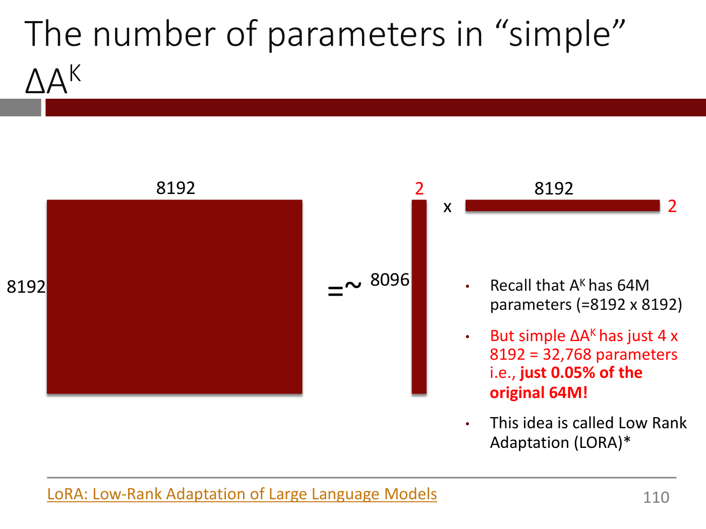

Title: "The number of parameters in “simple” $\Delta A^K$" (two lines).

Same diagram as slide 108 (large 8192 x 8192 square, "=~", tall thin rectangle, "x", short wide thin rectangle; "2" in red above the tall one and at the right end of the wide one; "8192" above the wide one), with these changes: the label to the left of the tall thin rectangle now reads "8096" (printed as such; slide 108 prints "8192" there), and a bulleted text block appears at lower right:

- Recall that $A^K$ has 64M parameters (=8192 x 8192)
- But simple $\Delta A^K$ has just 4 x 8192 = 32,768 parameters i.e., just 0.05% of the original 64M! (in red; "just 0.05% of the original 64M!" in bold)
- This idea is called Low Rank Adaptation (LORA)\*

Footer: an underlined orange hyperlink reading "LoRA: Low-Rank Adaptation of Large Language Models" (the link target is not printed on the slide).

*Figure: yes — the 8192 by 8192 square approximated by 8192 by 2 and 2 by 8192 slivers, with the parameter count comparison*

## Slide 110 — LoRA Optimization

Title: "LoRA Optimization"

- Freeze all base model parameters
- Initialize $\Delta A^K$ $\Delta A^Q$ $\Delta A^v$ to zero in each self attention layer (the third matrix is printed with a lowercase "v" superscript)
- Update $\Delta A^K$ $\Delta A^Q$ $\Delta A^v$ (via SGD as usual) by updating the two “skinny” matrices for each

(The sentence ends there. Below it, at the bottom centre, two thin dark red bars are drawn: a short horizontal bar and a taller vertical bar, standing for the "skinny" wide and tall matrices; they form a bracket-like shape with a gap between them, and nothing else is drawn. The page looks like a build step that is cut short.)

*Figure: no*

## Slide 111 — What does memory look like now?

Title: "What does memory look like now?"

| | Naive Memory Usage | Optimized |
| --- | --- | --- |
| **Model Parameters** | #Params x 2Bytes = 140GB | The same\* |
| **Gradient Computations** | ~#Neurons ~ #Params ~140GB | Roughly zero by computing these ’just in time’\*\* |
| **Optimizer State** | #Params x 1-4Bytes x 2 = 140-560GB | Using LoRA, we only need to optimize the two “skinny” matrices so # of parameters ~0 (in red) |
| **Total** | 420-840GB | 140GB |

Below the table: "Now, Llama-2-70b can be comfortably be finetuned on 2 GPUs and Llama-2-7b and Llama-2-13b can comfortably be finetuned on a single GPU."

(The asterisks in the "Optimized" column are printed with no footnote text on this page.)

*Figure: no*

## Slide 112 — LoRA Finetuning Colab

Title: "LoRA Finetuning Colab"

Centred text: "Stay tuned for video and colab."

*Figure: no*

## Slide 113 — The effort-benefit curve for adaptation strategies depends on the size of the base LLM

Title: "The effort-benefit curve for adaptation strategies depends on the size of the base LLM" (two lines).

Chart (third-party figure; described only). Y axis labelled "task accuracy", running from "0%" at the bottom to "100%" at a horizontal line near the top. X axis is an arrow labelled at its end "effort/ complexity", divided into four equal coloured vertical bands with these labels beneath: "zero-shot prompts" (light blue band), "few-shot prompts" (light pink band), "retrieval-augmented few-shot prompting" (light green band), "finetuning" (light yellow band). Text inside the bands: "prompt engineering" in the blue band, and "model training (finetuning, RLHF) data engine" in the yellow band. Two series, each a connected line of arrows:

- Blue line labelled "big base model" at its right end: starts at 0% at the origin, rises steeply to about 50% mid-way through the blue band, about 55% at its end; about 65% at the start of the pink band, about 72% at its end; about 78% at the start of the green band, about 83% at its end; about 88% at the start of the yellow band, rising slowly to about 100% at the right edge.
- Red line labelled "small base model" at its right end: starts at 0%, stays near 0% through the blue band (about 1% at its end), about 10% at the end of the pink band, about 14% at the end of the green band, about 25% mid-way through the yellow band, about 30% at the right edge.

Below the chart, a source URL: "https://twitter.com/karpathy/status/1655994367033884672?s=20"

*OCW notice: Effort-benefit curve figure © Andrej Karpathy on Twitter. All rights reserved. This content is excluded from our Creative Commons license. For more information, see https://ocw.mit.edu/help/faq-fair-use.*

*Figure: yes — chart of task accuracy against effort for a big and a small base model across prompting, retrieval and finetuning (excluded third-party material)*

## Slide 114 — We have covered all these topics!

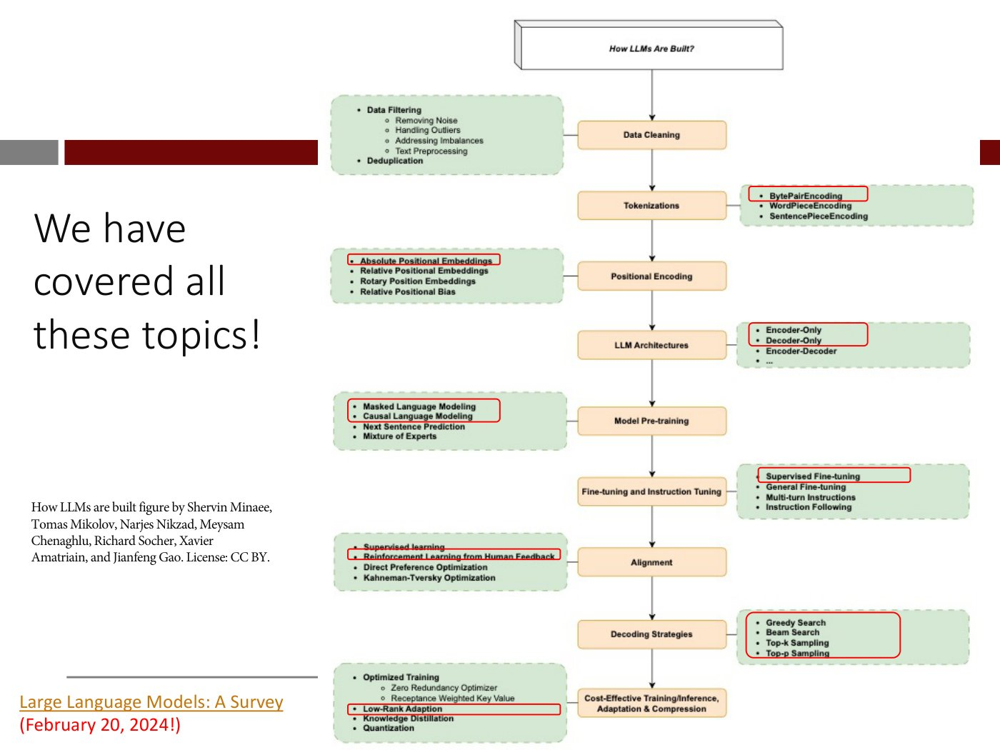

Title: "We have covered all these topics!" (large text at the left, three lines; no separate title bar text).

Left, small serif text: "How LLMs are built figure by Shervin Minaee, Tomas Mikolov, Narjes Nikzad, Meysam Chenaghlu, Richard Socher, Xavier Amatriain, and Jianfeng Gao. License: CC BY." At the bottom left, an underlined orange hyperlink "Large Language Models: A Survey" followed by, in red, "(February 20, 2024!)" (the link target is not printed).

Right: a vertical flow chart titled in a 3-D box "How LLMs Are Built?" with a column of nine orange boxes joined by downward arrows: "Data Cleaning", "Tokenizations", "Positional Encoding", "LLM Architectures", "Model Pre-training", "Fine-tuning and Instruction Tuning", "Alignment", "Decoding Strategies", "Cost-Effective Training/Inference, Adaptation & Compression". Each orange box has a green dashed side box listing its sub-topics; red outline boxes mark the items covered:

- Data Cleaning: "Data Filtering" (sub-items "Removing Noise", "Handling Outliers", "Addressing Imbalances", "Text Preprocessing") and "Deduplication". No red outline.
- Tokenizations: "BytePairEncoding" (red outline), "WordPieceEncoding", "SentencePieceEncoding".
- Positional Encoding: "Absolute Positional Embeddings" (red outline), "Relative Positional Embeddings", "Rotary Position Embeddings", "Relative Positional Bias".
- LLM Architectures: "Encoder-Only" and "Decoder-Only" (one red outline around both), "Encoder-Decoder", "...".
- Model Pre-training: "Masked Language Modeling" and "Causal Language Modeling" (one red outline around both), "Next Sentence Prediction", "Mixture of Experts".
- Fine-tuning and Instruction Tuning: "Supervised Fine-tuning" (red outline), "General Fine-tuning", "Multi-turn Instructions", "Instruction Following".
- Alignment: "Supervised learning", "Reinforcement Learning from Human Feedback" (red outline around the second line), "Direct Preference Optimization", "Kahneman-Tversky Optimization".
- Decoding Strategies: "Greedy Search", "Beam Search", "Top-k Sampling", "Top-p Sampling" (one red outline around all four).
- Cost-Effective Training/Inference, Adaptation & Compression: "Optimized Training" (sub-items "Zero Redundancy Optimizer", "Receptance Weighted Key Value"), "Low-Rank Adaption" (red outline), "Knowledge Distillation", "Quantization".

The credit "License: CC BY" is not an OCW exclusion notice.

*Figure: yes — flow chart of how LLMs are built with the topics covered in the course outlined in red (CC BY)*

## Slide 115 — MIT OpenCourseWare end page

OCW's end page, not lecture content: "MIT OpenCourseWare https://ocw.mit.edu", "15.773 Hands-on Deep Learning", "Spring 2024", "For information about citing these materials or our Terms of Use, visit: https://ocw.mit.edu/terms."

*Figure: no*
