# Lecture 11 — Diffusion Models for Image Generation: slide-by-slide

Text and figures of all 90 slides of
[`mit15_773_s24_lec11.pdf`](https://ocw.mit.edu/courses/15-773-hands-on-deep-learning-spring-2024/mit15_773_s24_lec11.pdf)
(MIT 15.773 Hands-On Deep Learning, Spring 2024; the title slide credits "Farias, Ramakrishnan"),
transcribed from the deck. The title slide prints the course number of the time, "15.S04". Lecture 11's
video presents slides 2 to 89 in order, and calls this "the last lecture of the class". In order: text-to-image and
text-to-video examples, ChatGPT (DALL-E 3), Midjourney and OpenAI's Sora (slides 2–6, 0:00–≈2:58); the
two-part journey (7); generating images of "stately college buildings" from random noise, and the reverse,
adding noise to an image, shown in a Colab (8–16, ≈3:13–≈10:58); training pairs cut from an image's noisier
and noisier versions, and the de-noising model (17–28, ≈10:58–≈17:54); generating by repeatedly denoising
pure noise (29–35, ≈17:54–≈18:40, then questions to ≈27:51); the diffusion-model paper and the key
improvement, predicting the noise (36–37, ≈27:51–≈29:50); the U-Net (38–41, ≈30:09–≈36:13); part two,
steering generation with a text prompt (42–46, ≈36:13–≈39:50); text and image embeddings that must be close
for a matching caption and far for an unrelated one, measured by cosine similarity (47–56, ≈39:50–≈42:50);
CLIP, its closeness-score grid and its loss (57–71, ≈42:50–≈49:00); CLIP's text encoder on its own, and
zero-shot image classification (72–73, ≈49:00–≈54:10); a denoiser that also takes the CLIP text embedding
of the caption, and generation from a prompt (74–81, ≈54:10–≈56:22, then questions to ≈1:00:59); inside the
denoising network: the latent diffusion model (82–85, ≈1:00:59–≈1:02:34); applications in art and protein
design (86–87, ≈1:02:34–≈1:04:07); the Hugging Face Diffusers Colab (88, ≈1:04:07–≈1:09:49); and a
lightning tour of Hugging Face computer-vision pipelines (89, ≈1:09:49 to the end). Slide 1 is the title
page. Cite these slides as "slide N", where N is the PDF page number. Diagrams and photographs are
described in prose since the KB is read as text.

Slides marked with an `*OCW notice: …*` line carry material that OCW excludes from its Creative Commons
licence: the Google Image Search grid of college buildings (9); the U-Net figure from the University of
Freiburg (38–41); the Labrador retriever photo (47, 48, 50, 51) and the Labrador, blue jay and train photos
of the closeness-score grids (59, 62–64, 68); the CLIP paper's two figures (70, 73); the latent diffusion
paper's figure (82–85); the New York Times article on protein design (87); and the Hugging Face Diffusers
page (88). They are described in prose and never rendered. The photos the deck uses for its own diagrams
are credited without an exclusion: the MIT Dome "Photo by Muzammil Soorma on Unsplash" (credited on 8, 10–16, 18–25, 28, 30,
35 and 76; slides 32–34, 75 and 79–81 show it without the credit) and the Rotunda at UVA, "in the public domain" via Wikimedia Commons (10, 11). Slides 2, 3, 5 and 6
carry OCW's credits for AI-generated images: ChatGPT (DALL-E 3) from the instructor's prompt (2), Midjourney
from Alex Serban's prompt on MSPowerUser (3), and Sora from the prompt of Brooks, Peebles et al. at OpenAI
(5, 6). Unmarked third-party material, transcribed and not rendered: the title blocks of the diffusion and
CLIP papers (36, 57) and a screenshot of lexica.art (86). Slide 37's diagram is the course's own, with the
DDPM paper's title block beside it. The "(Colab link)" on slides 15 and 16 and the "Colab" and "Colab link"
of slides 88 and 89 do not print their targets. Words the slides print in colour are given plainly, with a
note in parentheses.

**Images.** Sixteen figure slides carry a 1400px render under their heading: 2, 3, 5, 11, 14, 15, 16, 20,
24, 28, 34, 35, 37, 72, 77 and 81. The other figure-bearing slides are not rendered. The 22 OCW-noticed slides
are excluded, and the paper title blocks and the lexica.art screenshot are unmarked third-party material.
Build steps and repeats are superseded by a rendered slide: 6 → 5 (the same frame beside a quotation
transcribed below); 8, 10, 12, 13 and 30 → 11; 18, 19, 25 and 75 → 16, 20 and 24; 21–23 → 20 and 24; 26
and 27 → 28; 32 and 33 → 34; 60 → 72; 76 → 77; 79 and 80 → 81. Slide 4 is a single box with an empty
output area, where the class saw the Sora video.

## Numbering: slide numbers vs PDF pages

Headings use the PDF page number. Pages 2, 3 and 6–48 print their own page number. Every page from 49 to
89 prints a number one higher than its page (page 49 prints "50", page 89 prints "90"), so a slide hidden in
the source deck sits between pages 48 and 49. Pages 1, 4, 5 and 90 print nothing. The printed numbers were
read from the text layer's span positions, and the headings were checked as a plain 1..90 sequence.

## Contents

| Slides | Section |
| ------ | ------- |
| 1 | Title: "Lecture 11: Diffusion Models for Image Generation (Gen AI)" |
| 2–6 | Text-to-image and text-to-video: ChatGPT (DALL-E 3), Midjourney, OpenAI Sora |
| 7 | Our journey: generate a good image; control it with a text prompt |
| 8–16 | Generating stately college buildings from noise; the reverse, adding noise to an image (Colab) |
| 17–28 | Training pairs from an image's noisy versions; the de-noising model |
| 29–35 | Start with pure noise and repeatedly denoise it |
| 36–37 | "This is called a diffusion model"; key improvement: predict the noise |
| 38–41 | The U-Net: left half, right half (up-convolution), cross-connections |
| 42–46 | Part 2: controlling generation with a text prompt; the intuition |
| 47–56 | Text and image embeddings; the two requirements; cosine similarity |
| 57–71 | CLIP: the encoders, the image-caption closeness scores, the loss, 400 million pairs |
| 72–73 | Using CLIP's text encoder by itself; zero-shot image classification |
| 74–81 | Adding the CLIP text embedding of the caption to the denoiser's input; generating from a prompt |
| 82–85 | Inside the denoising DNN: the latent diffusion figure (U-Net, cross-attention, latent space) |
| 86–87 | Applications: the art world (lexica.art), protein design |
| 88 | Colab: the Hugging Face Diffusers library |
| 89 | Lightning tour of Hugging Face computer-vision models (Colab) |
| 90 | MIT OpenCourseWare end page |

## Slide 1 — Lecture 11: Diffusion Models for Image Generation (Gen AI)

Title: "Lecture 11: Diffusion Models for Image Generation (Gen AI)" (large dark red text, two lines).

Below a dark red horizontal rule, the MIT Sloan School of Management logo at left ("MIT" in red and grey blocks, "MANAGEMENT" and "SLOAN SCHOOL" beneath). At right: "15.S04: Hands-on Deep Learning", "Spring 2024", and "Farias, Ramakrishnan" (in red).

*Figure: no*

## Slide 2 — [ChatGPT image-generation example]

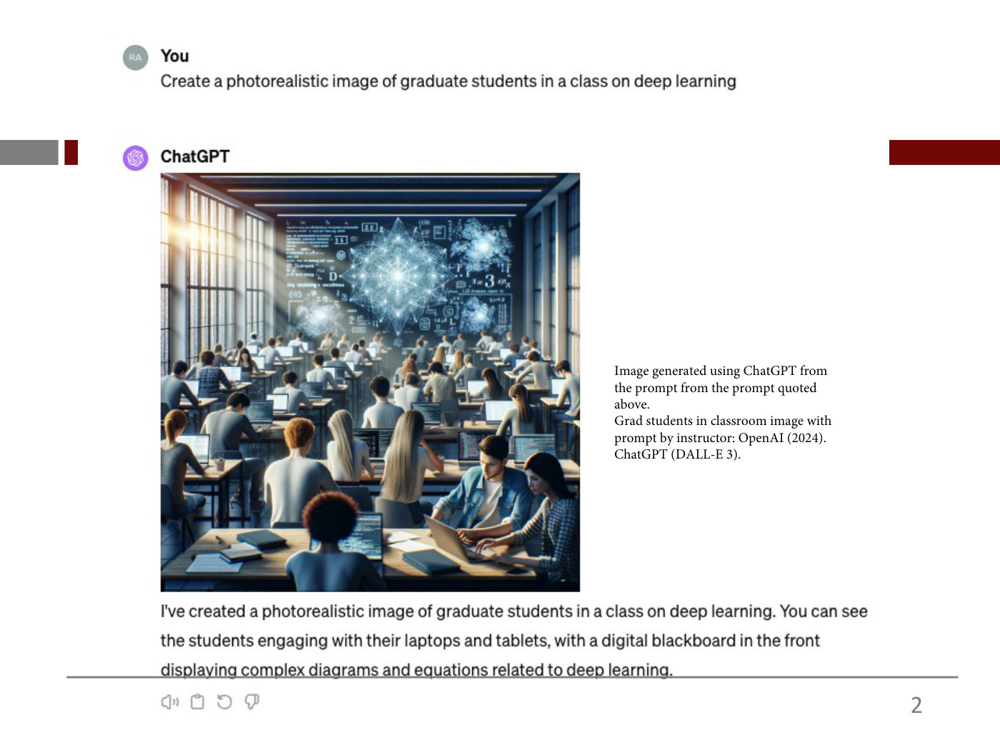

No title. A screenshot of a ChatGPT conversation. User message ("You", avatar "RA"): "Create a photorealistic image of graduate students in a class on deep learning". ChatGPT reply: a square-ish generated image of a large lecture hall with many students seated at desks with laptops, seen from behind and the side, tall windows with sunlight streaming in at left, and a large digital blackboard at the front showing a glowing network-like starburst graphic and equations. Beside the image, in small serif text: "Image generated using ChatGPT from the prompt from the prompt quoted above. Grad students in classroom image with prompt by instructor: OpenAI (2024). ChatGPT (DALL-E 3)." Below the image, ChatGPT's reply text: "I've created a photorealistic image of graduate students in a class on deep learning. You can see the students engaging with their laptops and tablets, with a digital blackboard in the front displaying complex diagrams and equations related to deep learning." Small ChatGPT feedback icons (speaker, clipboard, regenerate, thumbs-down) below.

*Figure: yes — ChatGPT screenshot with the prompt "Create a photorealistic image of graduate students in a class on deep learning" and the generated classroom image (DALL-E 3)*

## Slide 3 — Text-to-image

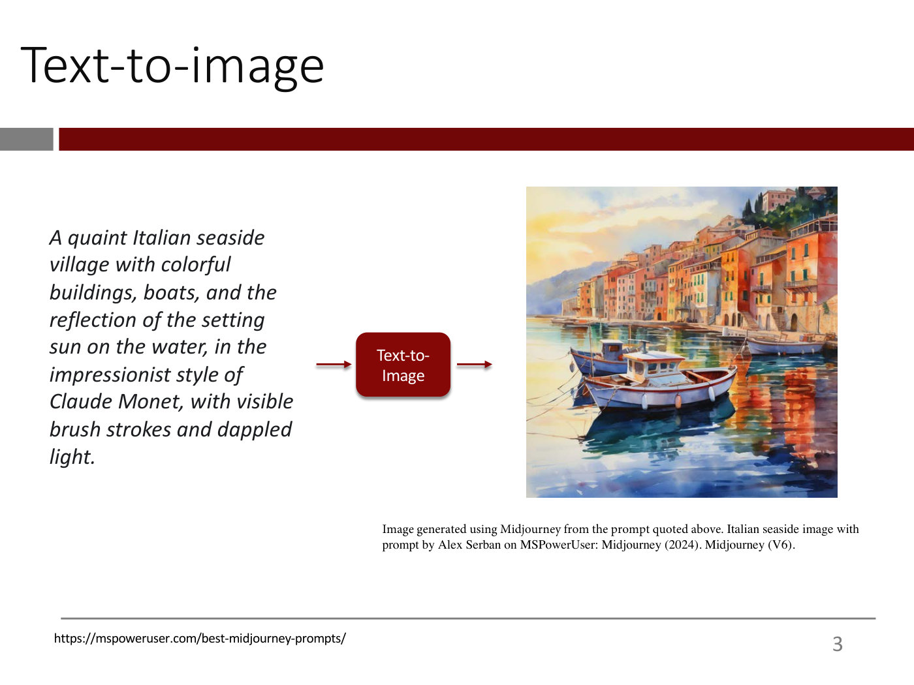

Title: "Text-to-image"

At left, an italic prompt: "A quaint Italian seaside village with colorful buildings, boats, and the reflection of the setting sun on the water, in the impressionist style of Claude Monet, with visible brush strokes and dappled light."

In the middle, a dark red rounded box labelled "Text-to-Image", with an arrow entering from the left (from the prompt) and an arrow leaving to the right. At right, a watercolour-style generated image of a seaside village with orange, pink and yellow buildings climbing a hillside at upper right, two small boats in the foreground water, and colourful reflections of the buildings and sunset in the water.

Credit in small serif text under the image: "Image generated using Midjourney from the prompt quoted above. Italian seaside image with prompt by Alex Serban on MSPowerUser: Midjourney (2024). Midjourney (V6)." Footer URL: https://mspoweruser.com/best-midjourney-prompts/

*Figure: yes — the Monet-style seaside village prompt feeding a "Text-to-Image" box, with the generated Midjourney painting at right*

## Slide 4 — Text-to-Video

Title: "Text-to-Video"

At left, an italic prompt: "In an ornate, historical hall, a massive tidal wave peaks and begins to crash. Two surfers, seizing the moment, skillfully navigate the face of the wave."

In the middle, a dark red rounded box labelled "Text-to-Video" with an arrow entering from the left and an arrow leaving to the right. The area to the right of the box is blank in the render (the output was presumably a video that does not show in the static page).

Footer: "\*Released February 15, 2024 (https://openai.com/sora)" ("Released February 15, 2024" in red).

*Figure: yes — prompt feeding a "Text-to-Video" box with an empty output area at right (no picture is shown on this page)*

## Slide 5 — [Image: Sora wave and surfers]

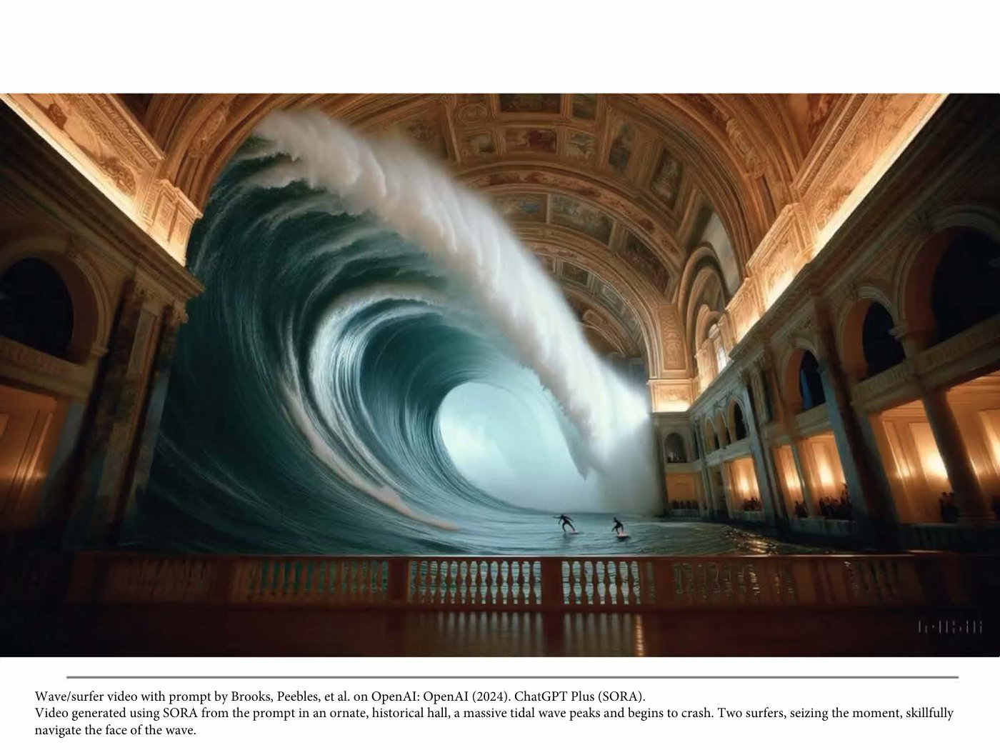

No title and no slide number. A full-width generated frame: the interior of a grand ornate hall with painted vaulted ceiling and arched balconies lit by warm lights, and an enormous curling tidal wave occupying the left and centre, about to crash; two tiny surfers on the water near the centre bottom; a balustrade railing along the bottom. A faint watermark at lower right.

Caption under a rule, in small serif text: "Wave/surfer video with prompt by Brooks, Peebles, et al. on OpenAI: OpenAI (2024). ChatGPT Plus (SORA). Video generated using SORA from the prompt in an ornate, historical hall, a massive tidal wave peaks and begins to crash. Two surfers, seizing the moment, skillfully navigate the face of the wave."

*Figure: yes — a full-slide Sora-generated frame of a giant wave and two surfers inside an ornate hall*

## Slide 6 — OpenAI Sora

Title: "OpenAI Sora"

At left, a smaller copy of the wave-and-surfers frame from slide 5. At right, an italic quotation: "“… we train text-conditional diffusion models jointly on videos and images of variable durations, resolutions and aspect ratios. We leverage a transformer architecture that operates on spacetime patches of video and image latent codes …”" ("text-conditional diffusion models" and "transformer architecture" highlighted in yellow).

Credit in small serif text: "Wave/surfer video with prompt by Brooks, Peebles, et al. on OpenAI: OpenAI (2024). ChatGPT Plus (SORA). Video generated using SORA from the prompt in an ornate, historical hall, a massive tidal wave peaks and begins to crash. Two surfers, seizing the moment, skillfully navigate the face of the wave." Footer URL: https://openai.com/research/video-generation-models-as-world-simulators

*Figure: yes — the Sora wave frame beside a quotation from OpenAI's description, with "text-conditional diffusion models" and "transformer architecture" highlighted*

## Slide 7 — Our journey

Title: "Our journey"

- How to generate a good image
- How to “control” the image generation process with a text prompt ("text prompt" underlined)

(The two bullets sit far apart, one near the top and one in the lower middle of the body.)

*Figure: no*

## Slide 8 — Let’s say we want to build a model that can be used to generate images of stately college buildings

Title: "Let’s say we want to build a model that can be used to generate images of stately college buildings"

A dark red rounded box labelled "Model" at centre, with an arrow pointing right to a photograph of the MIT Dome (the Great Dome and columned facade of Building 10, with trees on both sides, a green lawn, and a blue sky with clouds). No input arrow enters the Model box. Caption under the photo: "MIT Dome: Photo by Muzammil Soorma on Unsplash." Footer: "MIT Dome: Photo by Muzammil Soorma on Unsplash" ("Muzammil Soorma" and "Unsplash" underlined in orange as links).

*Figure: yes — a "Model" box with an arrow to a photograph of the MIT Dome*

## Slide 9 — Assume we have millions of training images at our disposal

Title: "Assume we have millions of training images at our disposal"

A screenshot of a Google Image Search results page in three rows of five thumbnails, each with a source name and headline beneath for the first two rows (e.g. "PxHere: college, oxford, classical architecture ...", "Architectural Digest: 15 College Campuses with the Best ...", "ArchDaily: 6 Classical Buildings That Are Y...", "Architectural Digest: The 53 Prettiest College Campuses in ...", "Architectural Digest: 15 College Campuses with the Best ...", "Conde Nast Traveler: 56 Prettiest College Campuses in th...", "BIMsmith Blog: Americans Prefer Classical Architecture ...", "PxHere: buildings, england, stately home ...", "Architecture Here and There: New HQ for classical revival ...", "Travel + Leisure: 25 Most Beautiful College Campuses in..."). The thumbnails show stately college buildings: a quadrangle with arches, a domed rotunda with columns, a stone Gothic building, a gold-domed building, an ivy-covered brick wall with windows, a brick building among trees, a classical stone building, a collegiate Gothic quadrangle, a distant campus with towers, a walkway leading to a gold-domed building, and a columned domed building (Columbia-like) at lower right. The third row's captions are cut off by the credit block.

Credit block in small serif text under the screenshot:

*OCW notice: Rendering of new School of Architecture building at Notre Dame © John Simpson Architects. Princeton, Whitman College image by Joe Shlabotnik on Flickr (License: CC BY). Notre Dame image © Michael Hickey. Toeldo Courthouse image is in the public domain. Notre Dame image © Getty Images. University of South Carolina image © University of South Carolina. Christ Church College image © Rex Harris on Flickr. Columbia image © iStock Images. All other © sources unknown. All rights reserved. This content is excluded from our Creative Commons license. For more information, see https://ocw.mit.edu/help/faq-fair-use.*

Footer: "Source: Google Image Search with query = “stately college buildings”"

*Figure: yes — Google Image Search results grid for "stately college buildings" (excluded; not rendered)*

## Slide 10 — Each time we generate an image from the model, we would like it to be different. How can we guarantee this?

Title: "Each time we generate an image from the model, we would like it to be different. How can we guarantee this?"

Two rows, each a dark red "Model" box with an arrow pointing right to an output photograph and no input. Top row: the MIT Dome photograph, captioned "MIT Dome: Photo by Muzammil Soorma on Unsplash." (under the box) and "MIT Dome: Photo by Muzammil Soorma on Unsplash" (under the photo, name and "Unsplash" as orange links). Bottom row: a photograph of the Rotunda at the University of Virginia (white dome, columned portico, red brick, steps, green lawn), with caption under the box: "The Rotunda at UVA image is in the public domain. Source: Wikimedia Commons. https://commons.wikimedia.org/wiki/File:University_of_Virginia_Rotunda_2006.jpg" and below the photo a footer URL: https://en.wikipedia.org/wiki/Rotunda_%28architecture%29

*Figure: yes — two "Model" boxes, one outputting the MIT Dome photo and one outputting the UVA Rotunda photo, with no inputs*

## Slide 11 — We will create a “noise” image by setting each pixel value to a random number and input that. Since “noise” images are random, the inputs will vary

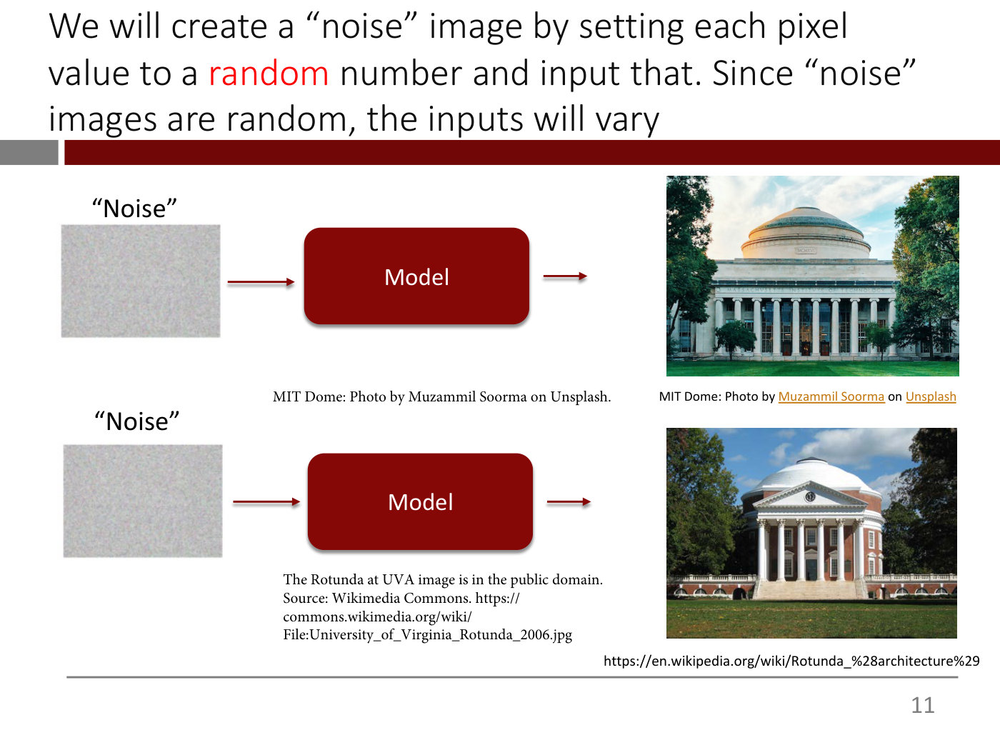

Title: "We will create a “noise” image by setting each pixel value to a random number and input that. Since “noise” images are random, the inputs will vary" ("random" in red).

Same two-row layout as slide 10, with new content: each row now has, at the left, a label "“Noise”" above a grey speckled rectangle (a noise image), with an arrow pointing right into the "Model" box. Top row outputs the MIT Dome photo, bottom row outputs the UVA Rotunda photo. The two noise images look alike (grey static) but are separate inputs. Captions and URL as on slide 10 (MIT Dome: Photo by Muzammil Soorma on Unsplash; the Rotunda at UVA image in the public domain, Wikimedia Commons file University_of_Virginia_Rotunda_2006.jpg; https://en.wikipedia.org/wiki/Rotunda_%28architecture%29).

*Figure: yes — two rows of noise image -> Model -> building photo (MIT Dome, UVA Rotunda)*

## Slide 12 — How can we train a model to generate an image from pure noise?

Title: "How can we train a model to generate an image from pure noise?" ("How" in italics).

A single row: a grey speckled noise image at left, an arrow to a dark red "Model" box, an arrow to the MIT Dome photograph. Caption: "MIT Dome: Photo by Muzammil Soorma on Unsplash." No labels on the noise image on this slide.

*Figure: yes — noise image -> Model -> MIT Dome photograph*

## Slide 13 — It is not clear how to do this ...

Title: "It is not clear how to do this ..."

Same single-row diagram as slide 12, now with the label "“Noise”" above the grey speckled noise image at left: noise image -> dark red "Model" box -> MIT Dome photograph. Caption: "MIT Dome: Photo by Muzammil Soorma on Unsplash."

*Figure: yes — "Noise" image -> Model -> MIT Dome photograph*

## Slide 14 — ... but how about the reverse?

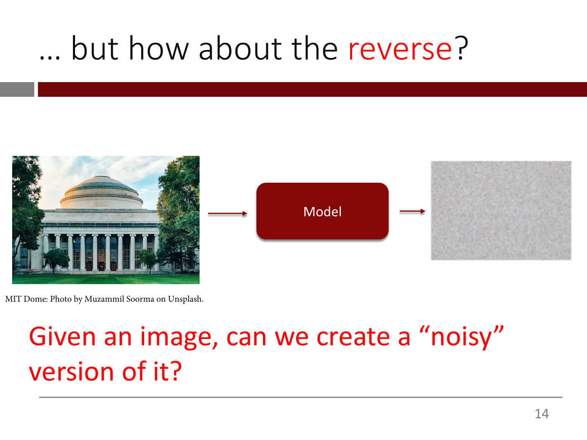

Title: "... but how about the reverse?" ("reverse" in red).

The diagram is reversed: the MIT Dome photograph at left, an arrow to a dark red "Model" box, an arrow to a grey speckled noise image at right. Caption under the photo: "MIT Dome: Photo by Muzammil Soorma on Unsplash." Below, large red text: "Given an image, can we create a “noisy” version of it?"

*Figure: yes — MIT Dome photograph -> Model -> noise image (the reverse direction)*

## Slide 15 — Yes! We know how to add noise to an image!

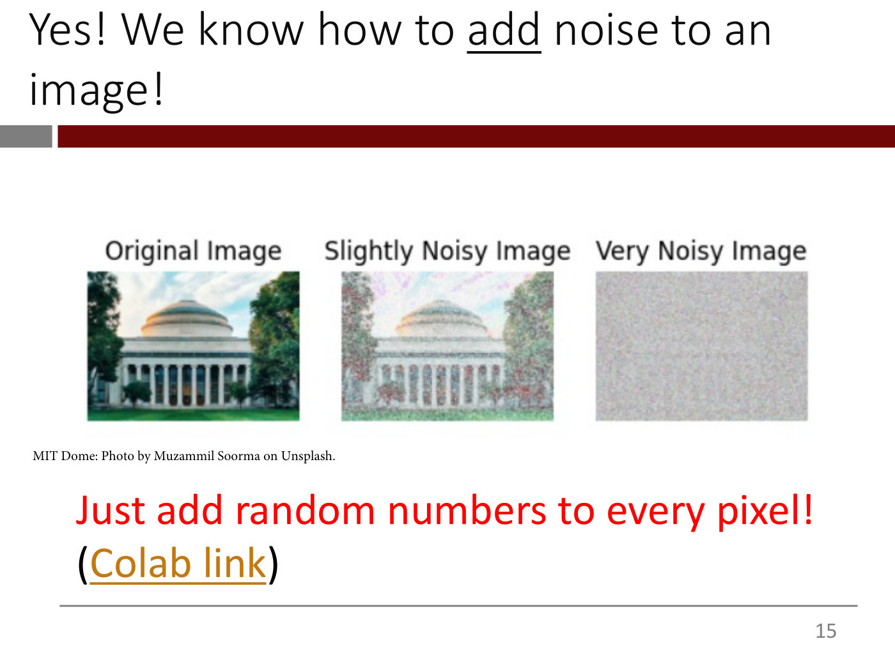

Title: "Yes! We know how to add noise to an image!" ("add" underlined).

Three images in a row, each with a heading above: "Original Image" (the MIT Dome photo, clean), "Slightly Noisy Image" (the same photo with visible coloured speckle over it, still recognisable), "Very Noisy Image" (uniform grey speckle, the building not visible). Caption: "MIT Dome: Photo by Muzammil Soorma on Unsplash." Below, large red text: "Just add random numbers to every pixel!" and on the next line "(Colab link)" (the link's target is not printed).

*Figure: yes — the MIT Dome photo shown original, slightly noisy and very noisy, left to right*

## Slide 16 — By increasing the magnitude of these random numbers, we can make the image noisier

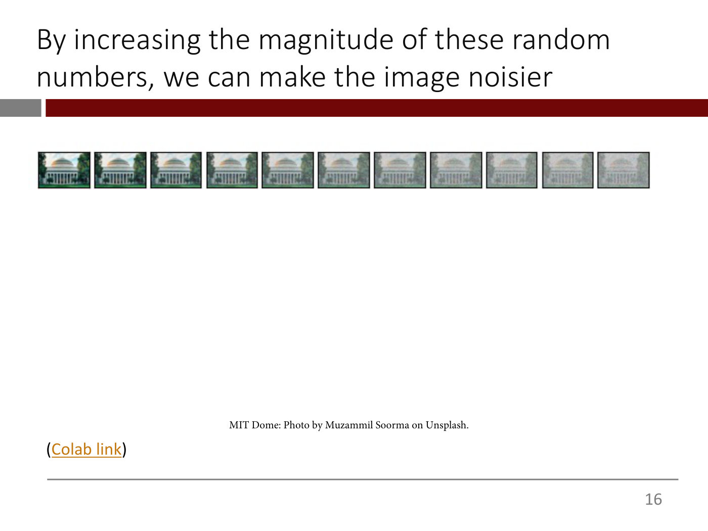

Title: "By increasing the magnitude of these random numbers, we can make the image noisier"

A single row of eleven small thumbnails of the MIT Dome photo across the top of the body, with noise increasing steadily left to right: the first is clear and colourful, and by the last the building is faint and washed out in grey (the building is still faintly visible in the last one). The rest of the body is blank. Caption: "MIT Dome: Photo by Muzammil Soorma on Unsplash." At lower left: "(Colab link)" (the link's target is not printed).

*Figure: yes — eleven thumbnails of the MIT Dome photo with progressively more noise, left to right*

## Slide 17 — That suggests an idea!

Title: "That suggests an idea!"

The body is blank (nothing else is visible; this is a build-up placeholder).

*Figure: no*

## Slide 18 — We can take each image in the training set and create many noisy versions of it

Title: "We can take each image in the training set and create many noisy versions of it"

The same row of eleven thumbnails of the MIT Dome photo as slide 16, noise increasing steadily from left (clean) to right (very faint, washed out). Caption: "MIT Dome: Photo by Muzammil Soorma on Unsplash."

*Figure: yes — row of eleven MIT Dome thumbnails with increasing noise, left to right*

## Slide 19 — We can create (x,y) training data from these images!

Title: "We can create (x,y) training data from these images!" (title in red on this slide).

The same row of eleven noisy-Dome thumbnails as slide 18. Below the row, in the middle of the slide, a single black "?" . Caption: "MIT Dome: Photo by Muzammil Soorma on Unsplash."

*Figure: yes — row of eleven MIT Dome thumbnails with increasing noise and a "?" beneath*

## Slide 20 — We can create (x,y) training data from these images!

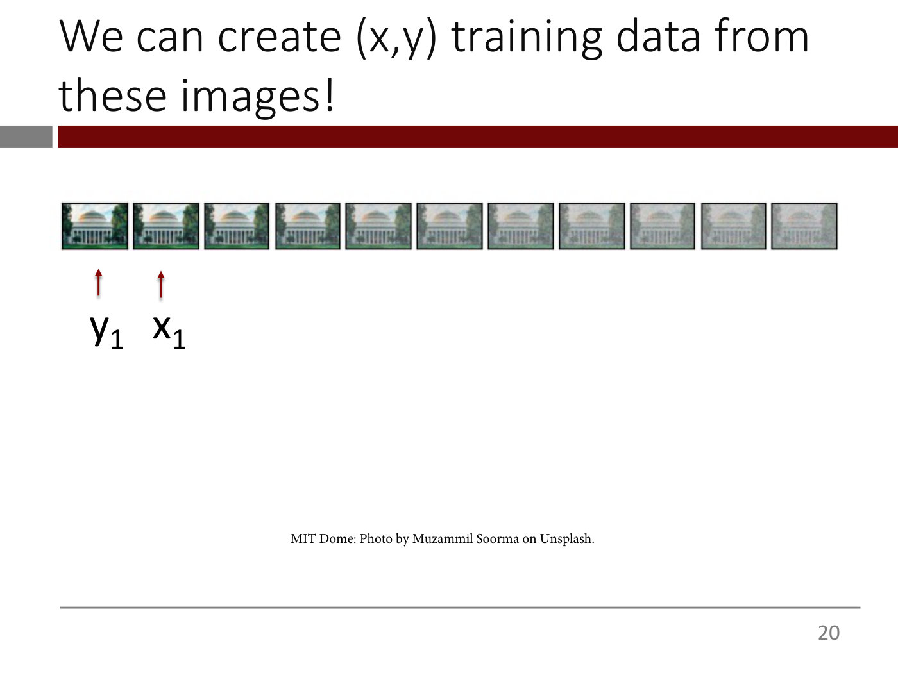

Title: "We can create (x,y) training data from these images!" (title in black).

The same row of eleven thumbnails. New compared with slide 19: the "?" is gone; two dark red up-arrows point at the first and second thumbnails, with labels beneath: $y_1$ under the arrow pointing at the first (cleanest) image and $x_1$ under the arrow pointing at the second image (slightly noisier). Caption: "MIT Dome: Photo by Muzammil Soorma on Unsplash."

*Figure: yes — row of eleven noisy-Dome thumbnails with the first labelled y1 and the second labelled x1*

## Slide 21 — We can create (x,y) training data from these images!

Title: "We can create (x,y) training data from these images!"

The same row of eleven noisy-Dome thumbnails. New compared with slide 20: the arrows and labels have moved one place right: $y_2$ under an arrow at the second thumbnail and $x_2$ under an arrow at the third thumbnail. Caption: "MIT Dome: Photo by Muzammil Soorma on Unsplash."

*Figure: yes — row of eleven noisy-Dome thumbnails with y2 at the second and x2 at the third*

## Slide 22 — We can create (x,y) training data from these images!

Title: "We can create (x,y) training data from these images!"

The same row of eleven thumbnails. New: the arrows now point at the tenth and eleventh (last) thumbnails, labelled $y_{10}$ (tenth) and $x_{10}$ (eleventh, the noisiest). Caption: "MIT Dome: Photo by Muzammil Soorma on Unsplash."

*Figure: yes — row of eleven noisy-Dome thumbnails with y10 at the tenth and x10 at the eleventh*

## Slide 23 — We can create (x,y) training data from these images!

Title: "We can create (x,y) training data from these images!"

Same as slide 22 (row of eleven thumbnails, $y_{10}$ and $x_{10}$ labelled at the last two). New: red text below, "What’s the relationship between x and y?" Caption: "MIT Dome: Photo by Muzammil Soorma on Unsplash."

*Figure: yes — row of eleven noisy-Dome thumbnails with y10 and x10 labelled, plus a red question*

## Slide 24 — We can create (x,y) training data from these images!

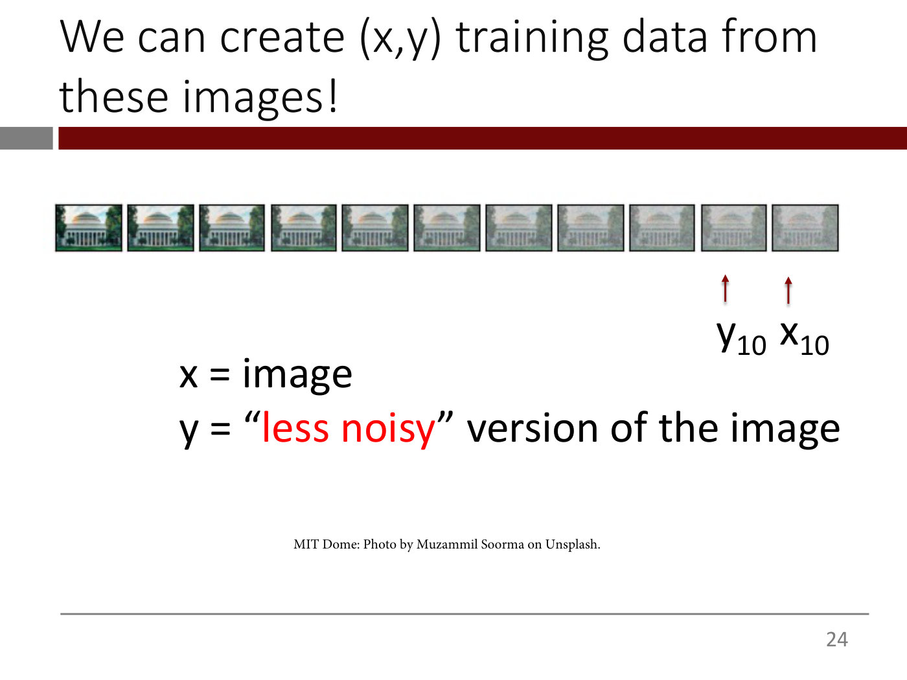

Title: "We can create (x,y) training data from these images!"

Same row and $y_{10}$, $x_{10}$ labels as slide 23. New: the red question is replaced by two lines of black text: "x = image" and "y = “less noisy” version of the image" ("less noisy" in red). Caption: "MIT Dome: Photo by Muzammil Soorma on Unsplash."

*Figure: yes — row of eleven noisy-Dome thumbnails with y10 and x10 labelled, plus the definitions x = image, y = "less noisy" version*

## Slide 25 — What can we do with these (x,y) pairs?

Title: "What can we do with these (x,y) pairs?" ("do" in red).

The same row of eleven noisy-Dome thumbnails (no arrows or labels now). Below, two lines of text: "x = image" and "y = “less noisy” version of the image" ("less noisy" in red). Caption: "MIT Dome: Photo by Muzammil Soorma on Unsplash."

*Figure: yes — row of eleven noisy-Dome thumbnails with increasing noise, left to right*

## Slide 26 — We can build a de-noising model ...

Title: "We can build a de-noising model ..." ("de-noising model" in red).

A diagram: "x" with the label "image" beneath it at left, an arrow to a dark red rounded box labelled "DNN", an arrow to "y" with the label "“less noisy” version of the image" beneath it ("less noisy" in red).

*Figure: yes — x (image) -> DNN -> y ("less noisy" version of the image)*

## Slide 27 — ... by running stochastic gradient descent on the training data (as usual)

Title: "... by running stochastic gradient descent on the training data (as usual)" (title in red).

The same diagram as slide 26 (x "image" -> DNN -> y "“less noisy” version of the image", "less noisy" in red); only the title differs.

*Figure: yes — x (image) -> DNN -> y ("less noisy" version of the image)*

## Slide 28 — An “image de-noising” model!

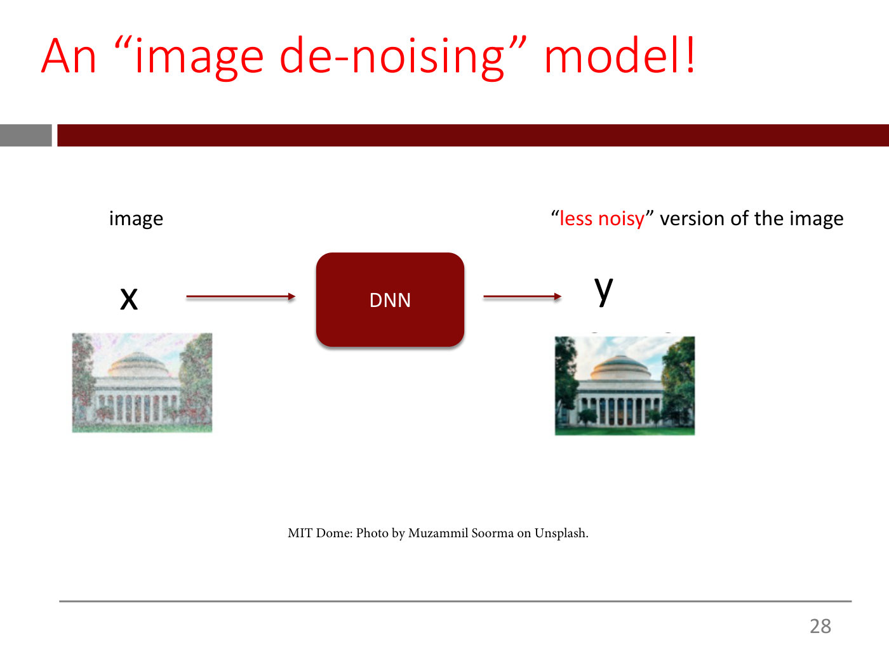

Title: "An “image de-noising” model!" (title in red).

The same diagram with pictures added. Labels "image" and "“less noisy” version of the image" ("less noisy" in red) sit above; "x" -> "DNN" box -> "y". Beneath x is a slightly noisy MIT Dome photo (coloured speckle visible), and beneath y is the clean MIT Dome photo. Caption: "MIT Dome: Photo by Muzammil Soorma on Unsplash."

*Figure: yes — slightly noisy Dome photo as x -> DNN -> clean Dome photo as y*

## Slide 29 — After this de-noising model is trained ...

Title: "After this de-noising model is trained ..." (the "..." wraps to a second line).

The body is blank (build-up placeholder).

*Figure: no*

## Slide 30 — ... we can solve this problem.

Title: "... we can solve this problem."

Single-row diagram as on slide 13: label "“Noise”" above a grey speckled noise image, an arrow to a dark red "Model" box, an arrow to the MIT Dome photograph. Caption: "MIT Dome: Photo by Muzammil Soorma on Unsplash." New: large red text below, "How?"

*Figure: yes — "Noise" image -> Model -> MIT Dome photograph, with a red "How?"*

## Slide 31 — Start with “pure” noise and repeatedly denoise it!

Title: "Start with “pure” noise and repeatedly denoise it!" (title in red; "repeatedly" underlined).

The body is empty; this is the first build step of the diagram that appears on slides 32 to 34.

*Figure: no*

## Slide 32 — Start with “pure” noise and repeatedly denoise it!

Title: "Start with “pure” noise and repeatedly denoise it!" (red; "repeatedly" underlined).

Diagram, one row: a small grey square image (grey static, pure noise) at left, a right-pointing dark red arrow, a dark red rounded box labelled "Denoising DNN", another dark red arrow, and a second small grey noisy square at right. New compared with slide 31: the whole first row.

*Figure: yes — one row showing a noisy image going into a "Denoising DNN" box and a noisy image coming out*

## Slide 33 — Start with “pure” noise and repeatedly denoise it!

Title: "Start with “pure” noise and repeatedly denoise it!" (red; "repeatedly" underlined).

Same first row as slide 32. New: a black dashed arrow runs from the output image of row 1 down and to the left to a second grey noisy image at the left of a new second row. That row repeats the pattern: arrow, a second "Denoising DNN" box, arrow, a grey noisy output image (slightly less noisy-looking than the first).

*Figure: yes — two stacked rows of noisy image into "Denoising DNN" into image, with a dashed arrow feeding row 1's output into row 2's input*

## Slide 34 — Start with “pure” noise and repeatedly denoise it!

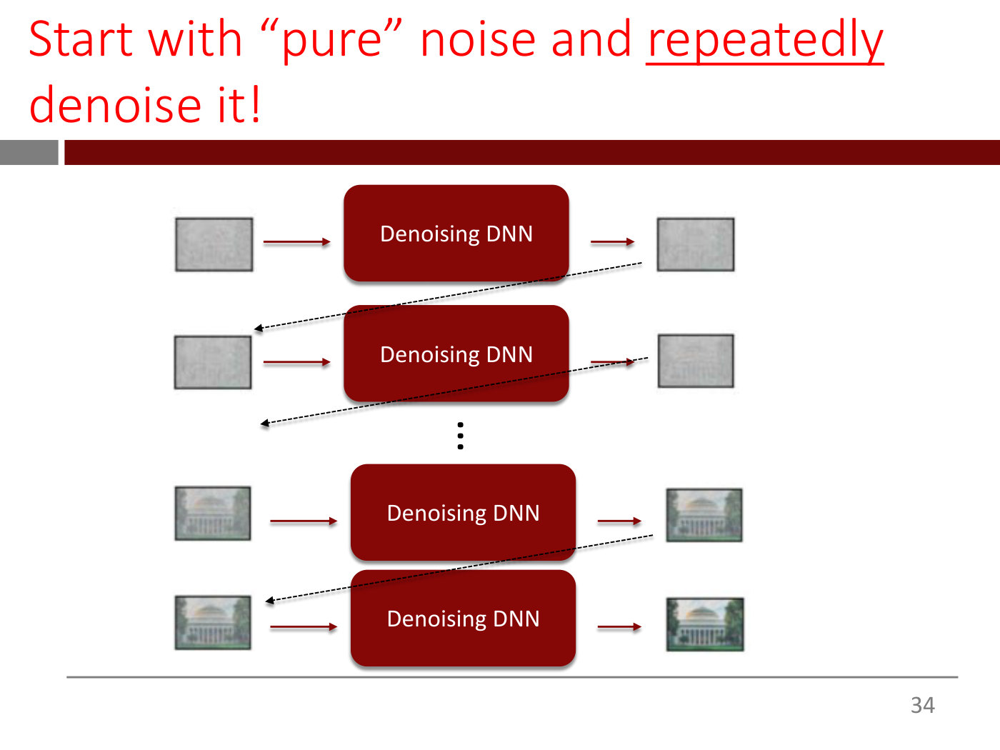

Title: "Start with “pure” noise and repeatedly denoise it!" (red; "repeatedly" underlined).

Same two rows as slide 33, plus a second dashed arrow from row 2's output down to the left. Below row 2 are three vertical black dots (an ellipsis). Below them are two more rows, each with a "Denoising DNN" box. In the third row (after the ellipsis) the input and output are both faint, noisy images of the MIT Dome building (columned facade, dome, trees); in the last row the input is the same faint noisy Dome and the output is a clearer, more saturated Dome image. A dashed arrow joins the output of the third row to the input of the fourth. New compared with slide 33: the second dashed arrow, the ellipsis and the last two rows with the emerging Dome image.

*Figure: yes — stack of four denoising steps with an ellipsis, the noise gradually resolving into a photo of the MIT Dome, dashed arrows chaining each output into the next input*

## Slide 35 — The model will generate a sequence of “less noisy” images. The final one is the “answer”.

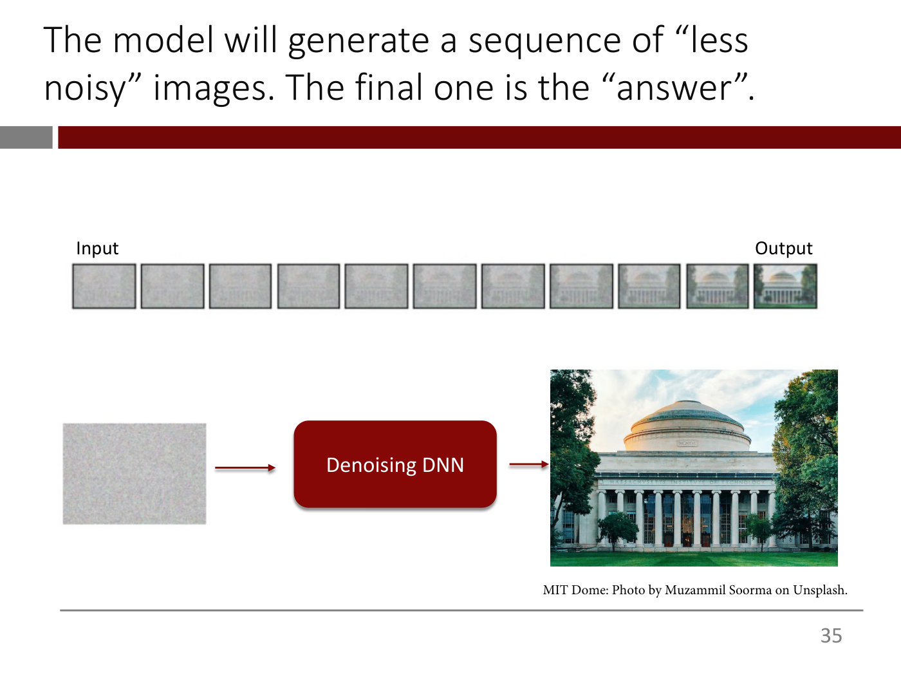

Title: "The model will generate a sequence of “less noisy” images. The final one is the “answer”." (black).

Top: a horizontal strip of eleven small images labelled "Input" above the first (left) and "Output" above the last (right). The first is grey noise; each image to the right is less noisy, with the MIT Dome becoming visible and the last one clear.

Bottom: a larger noise image (grey static) at left, an arrow, a dark red rounded box "Denoising DNN", an arrow, and a large colour photograph of the MIT Dome (domed building with a columned portico, green lawn in front, trees at both sides, blue sky with clouds). Caption under the photo: "MIT Dome: Photo by Muzammil Soorma on Unsplash."

*Figure: yes — a strip of eleven progressively less noisy images from pure noise to the MIT Dome, and a noise image going through "Denoising DNN" to the Dome photograph*

## Slide 36 — This is called a diffusion model

Title: "This is called a *diffusion* model" ("diffusion" in italics).

A screenshot of the first page of a paper: title "Deep Unsupervised Learning using Nonequilibrium Thermodynamics", between two horizontal rules. Authors and affiliations at left with email at right: "Jascha Sohl-Dickstein, Stanford University, JASCHA@STANFORD.EDU"; "Eric A. Weiss, University of California, Berkeley, EAWEISS@BERKELEY.EDU"; "Niru Maheswaranathan, Stanford University, NIRUM@STANFORD.EDU"; "Surya Ganguli, Stanford University, SGANGULI@STANFORD.EDU". Bottom-left of the slide, the printed URL: https://arxiv.org/pdf/1503.03585.pdf

(No OCW notice is printed on this page.)

*Figure: yes — screenshot of the title block of the Sohl-Dickstein et al. diffusion paper*

## Slide 37 — Key Improvement: Instead of training the model to predict the “less noisy” version of the image, we ask it to predict the “noise” and then subtract the noise from the input

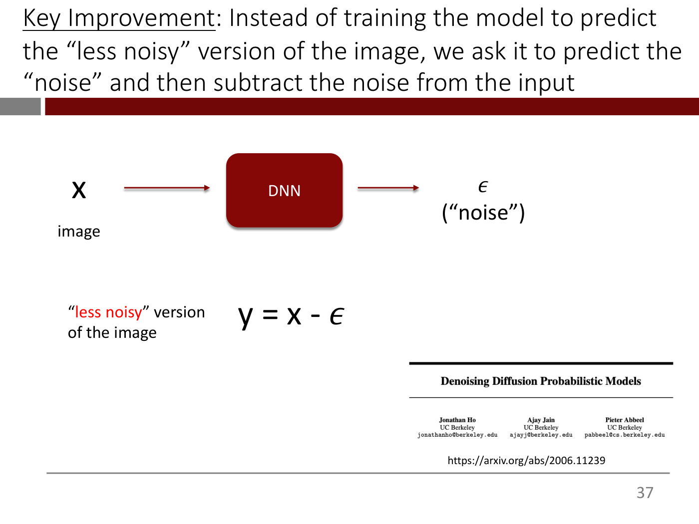

Title: "Key Improvement: Instead of training the model to predict the “less noisy” version of the image, we ask it to predict the “noise” and then subtract the noise from the input" ("Key Improvement" underlined).

Diagram, top row: the letter "x" with the label "image" beneath it, a dark red arrow, a dark red rounded box labelled "DNN", a dark red arrow, and the Greek letter epsilon $\epsilon$ with the label "(“noise”)" beneath it. (The text layer shows "�" for the epsilon; the render draws a Greek letter epsilon.)

Below left: the words "“less noisy” version of the image" ("less noisy" in red). Beside it, the large formula $y = x - \epsilon$.

Bottom right: a screenshot of the first page of a paper, titled "Denoising Diffusion Probabilistic Models", with authors "Jonathan Ho, UC Berkeley, jonathanho@berkeley.edu", "Ajay Jain, UC Berkeley, ajayj@berkeley.edu" and "Pieter Abbeel, UC Berkeley, pabbeel@cs.berkeley.edu". Under it the printed URL: https://arxiv.org/abs/2006.11239

*Figure: yes — DNN diagram mapping image x to predicted noise epsilon, the formula y = x - epsilon, and a screenshot of the title block of the "Denoising Diffusion Probabilistic Models" paper*

## Slide 38 — The U-Net architecture is commonly used for image-to-image models like the diffusion model

Title: "The U-Net architecture is commonly used for image-to-image models like the diffusion model".

The U-Net figure from the original U-Net paper: a U-shaped diagram of blue feature-map bars. Left (contracting) side from the top: an input bar labelled "input image tile" (1 channel, 572 x 572), then bars of 64 channels at 570 x 570 and 568 x 568 (the last with a dotted outline), then a max-pool down to 128 channels (284², 282², 280²), down to 256 (140², 138², 136²), down to 512 (68², 66², 64²), and to the bottom level 1024 channels (32², 30², 28²). Right (expanding) side climbs back up through 1024/512 (56², 54², 52²), 512/256 (104², 102², 100²), 256/128 (200², 198², 196²), and to the top: 128, 64, 64 and a final 2-channel bar labelled "output" (392 x 392, 390 x 390, 388 x 388, 388 x 388). Horizontal grey arrows at the four upper levels carry the left-side maps across to the right side ("copy and crop"). Legend at right: dark blue right arrow "conv 3x3, ReLU"; grey right arrow "copy and crop"; dark red down arrow "max pool 2x2"; green up arrow "up-conv 2x2"; teal right arrow "conv 1x1". Printed URL under it: https://lmb.informatik.uni-freiburg.de/people/ronneber/u-net

*OCW notice: UNet image-to-image model figures © LMB, University of Freiburg. All rights reserved. This content is excluded from our Creative Commons license. For more information, see https://ocw.mit.edu/help/faq-fair-use.*

*Figure: yes — the full U-Net architecture diagram with channel counts, image sizes and legend (excluded; not rendered)*

## Slide 39 — The “left half” of the U uses standard convolutional and pooling layers

Title: "The “left half” of the U uses standard convolutional and pooling layers".

The same U-Net figure as slide 38 (same labels, sizes, legend; no URL line). New: a red dash-dotted rounded outline encloses the left half, from the input tile down to the bottom-level 1024 bar's left end.

*OCW notice: UNet image-to-image model figures © LMB, University of Freiburg. All rights reserved. This content is excluded from our Creative Commons license. For more information, see https://ocw.mit.edu/help/faq-fair-use.*

*Figure: yes — the U-Net figure with its left (contracting) half outlined in red (excluded; not rendered)*

## Slide 40 — The “right half” of the U uses a new kind of convolutional layer

Title: "The “right half” of the U uses a new kind of convolutional layer".

Text at left: "We need to “enlarge” back to the original size." Then: "We use an ‘inverse’ of the convolution layer called an Up-Convolution (or De-Convolution) layer\*". Footnote at bottom: "\*implemented as `Conv2DTranspose` in Keras (see 9.2 in the textbook)" (`Conv2DTranspose` in a monospace font). Under the footnote a printed link: https://lmb.informatik.uni-freiburg.de/people/ronneber/u-net

Right: the same U-Net figure, partly cropped at the left so that only the right half is visible (bottom level and the expanding path to the output, with the grey copy arrows and the legend). A red dash-dotted rounded outline encloses the expanding path, and a second red dash-dotted box surrounds the legend entry "up-conv 2x2".

*OCW notice: UNet image-to-image model figures © LMB, University of Freiburg. All rights reserved. This content is excluded from our Creative Commons license. For more information, see https://ocw.mit.edu/help/faq-fair-use.*

*Figure: yes — the right half of the U-Net figure outlined in red, with the "up-conv 2x2" legend entry boxed (excluded; not rendered)*

## Slide 41 — The U-Net uses cross-connections as well (like residual connections)

Title: "The U-Net uses cross-connections as well (like residual connections)".

The same U-Net figure as slide 38 (all labels, sizes and legend as there), with the printed URL https://lmb.informatik.uni-freiburg.de/people/ronneber/u-net under it. New: the three upper grey "copy and crop" arrows (top level, second level, third level) are each enclosed in a red dash-dotted rounded box; the lowest grey arrow is not boxed.

*OCW notice: UNet image-to-image model figures © LMB, University of Freiburg. All rights reserved. This content is excluded from our Creative Commons license. For more information, see https://ocw.mit.edu/help/faq-fair-use.*

*Figure: yes — the U-Net figure with the three upper grey copy-and-crop cross-connections boxed in red (excluded; not rendered)*

## Slide 42 — Our journey

Title: "Our journey".

- How to generate a good image (faded light grey, i.e. already covered)
- How to “control” the image generation process with a text prompt ("text prompt" underlined; black, the current topic)

*Figure: no*

## Slide 43 — Intuition

Title: "Intuition".

- We want to take the text prompt into account when generating the image
- If we had a “rough” image that corresponds to the text prompt, we can feed it in and try to denoise it. But we don’t!

(The text layer of this page also holds the next two bullets, which the render does not show: they appear on slides 44 and 45.)

*Figure: no*

## Slide 44 — Intuition

Title: "Intuition".

- We want to take the text prompt into account when generating the image (faded grey)
- If we had a “rough” image that corresponds to the text prompt, we can feed it in and try to denoise it. But we don’t! (faded grey)
- But what if we had an embedding for the prompt that is “close” to the embeddings of all the images that correspond to that prompt? (red; new)

(The text layer of this page also holds the fourth bullet, which the render does not show, with "“close” to the image" where slide 45 prints "“close” to the embedding of the image".)

*Figure: no*

## Slide 45 — Intuition

Title: "Intuition".

- We want to take the text prompt into account when generating the image (faded grey)
- If we had a “rough” image that corresponds to the text prompt, we can feed it in and try to denoise it. But we don’t! (faded grey)
- But what if we had an embedding for the prompt that is “close” to the embeddings of all the images that correspond to that prompt? (faded grey)
- If we feed this embedding to our de-noising model, maybe it can use it to “steer” the generation process? After all, this embedding is already “close” to the embedding of the image we want to generate? (black; new)

*Figure: no*

## Slide 46 — [Transition statement]

No title. Large text: "We will describe an approach to calculate an embedding for any text prompt that is “close” to the embeddings of the images that correspond to that prompt"

*Figure: no*

## Slide 47 — Let’s say we have an image and a caption. How can we compute embeddings from them?

Title: "Let’s say we have an image and a caption. How can we compute embeddings from them?"

Two rows. Top row: the caption text "A yellow Labrador retriever on a cushion" at left, a dark red arrow into a dark red rectangle containing a white "?", a dark red arrow out to a row of three light-blue squares (a text embedding vector). Bottom row: a small colour photograph of a pale yellow Labrador retriever lying on a cushion/sofa with patterned pillows, a dark red arrow into a second dark red rectangle labelled "?", a dark red arrow out to a row of three yellow-orange squares (an image embedding vector).

*OCW notice: Photo of Labrador Retriever © unknown. All rights reserved. This content is excluded from our Creative Commons license. For more information, see https://ocw.mit.edu/help/faq-fair-use.*

*Figure: yes — caption into an unknown "?" box giving a blue three-square vector, and a Labrador photo into an unknown "?" box giving a yellow three-square vector (excluded; not rendered)*

## Slide 48 — We can use standard architectures!

Title: "We can use standard architectures!"

Same layout as slide 47 with the same caption, Labrador photo, arrows and blue and yellow vectors. New: the "?" boxes are now labelled: top box "Text encoder (like BERT)", bottom box "Image encoder (like ResNet)".

*OCW notice: Photo of Labrador Retriever © unknown. All rights reserved. This content is excluded from our Creative Commons license. For more information, see https://ocw.mit.edu/help/faq-fair-use.*

*Figure: yes — caption into a text encoder (like BERT) and Labrador photo into an image encoder (like ResNet), each producing a three-square embedding (excluded; not rendered)*

## Slide 49 — [Transition statement]

No title. Large text: "But these embeddings need to satisfy two important requirements" ("two" underlined).

*Figure: no*

## Slide 50 — Given an image and a caption that describes it, the embeddings should be “close” to each other

Title: "Given an image and a caption that describes it, the embeddings should be “close” to each other" ("a caption that describes it" underlined; "close" in red).

Layout as slide 48 but with the boxes labelled only "Text encoder" and "Image encoder". The caption now reads "A yellow Labrador retriever on a sofa" beside the same Labrador photo. The output arrows no longer go to separate right-hand vectors: the text encoder's arrow points down-right and the image encoder's arrow points up-right, and both end at the same spot, where the blue three-square vector sits stacked directly above the yellow three-square vector, touching or nearly touching.

*OCW notice: Photo of Labrador Retriever © unknown. All rights reserved. This content is excluded from our Creative Commons license. For more information, see https://ocw.mit.edu/help/faq-fair-use.*

*Figure: yes — text encoder and image encoder outputs (blue and yellow vectors) placed next to each other for a matching caption and photo (excluded; not rendered)*

## Slide 51 — Given an image and an unrelated caption, we want their embeddings to be “far” from each other

Title: "Given an image and an unrelated caption, we want their embeddings to be “far” from each other" ("unrelated" underlined; "far" in red). (The third title line, "other", runs up against the dark red band.)

Same layout as slide 50, but the caption is now "A train rounding a bend with beautiful Fall foliage all around" beside the same Labrador photo (the photo sits slightly lower than before). The text encoder's arrow points up-right to the blue three-square vector at upper right; the image encoder's arrow points down-right to the yellow three-square vector at lower right, so the two vectors are far apart.

*OCW notice: Photo of Labrador Retriever © unknown. All rights reserved. This content is excluded from our Creative Commons license. For more information, see https://ocw.mit.edu/help/faq-fair-use.*

*Figure: yes — text and image encoders whose outputs (blue and yellow vectors) are placed far apart for an unrelated caption and photo (excluded; not rendered)*

## Slide 52 — [Statement on concept space]

No title. Large text: "This ensures that the text embedding and the image embedding are referring to the same underlying concept i.e., “live” in the same “concept space”"

*Figure: no*

## Slide 53 — [Statement on concept space, continued]

No title. Large text, first paragraph faded grey (as on slide 52): "This ensures that the text embedding and the image embedding are referring to the same underlying concept i.e., “live” in the same “concept space”". New, in black below it: "i.e., it ensures that the embedding for any text prompt is “close” to the embeddings of the images that correspond to that prompt"

*Figure: no*

## Slide 54 — [Question on closeness]

No title. Large text: "Question: How can we tell how “close” two embeddings are?"

*Figure: no*

## Slide 55 — [Answer: cosine similarity]

No title. Large text: "Question: How can we tell how “close” two embeddings are?" followed by "Answer: Their cosine similarity" ("cosine similarity" in red; new compared with slide 54).

*Figure: no*

## Slide 56 — [Transition: computing embeddings]

No title. Large text: "OK, we know how to measure “closeness”." and then "How can we compute embeddings that satisfy the two requirements?"

*Figure: no*

## Slide 57 — OpenAI built a model called CLIP (Contrastive Language-Image Pretraining) to solve this problem

Title: "OpenAI built a model called CLIP (Contrastive Language-Image Pretraining) to solve this problem".

A screenshot of the first page of a paper: title "Learning Transferable Visual Models From Natural Language Supervision", between two horizontal rules. Author list beneath: "Alec Radford\* 1, Jong Wook Kim\* 1, Chris Hallacy 1, Aditya Ramesh 1, Gabriel Goh 1, Sandhini Agarwal 1, Girish Sastry 1, Amanda Askell 1, Pamela Mishkin 1, Jack Clark 1, Gretchen Krueger 1, Ilya Sutskever 1" (asterisks and superscripts as printed). Bottom left, printed URL: https://arxiv.org/pdf/2103.00020.pdf

(No OCW notice is printed on this page.)

*Figure: yes — screenshot of the title block of the CLIP paper*

## Slide 58 — How CLIP works

Title: "How CLIP works".

1. Set a 12-layer, 8-head Transformer Causal Encoder stack as the text encoder. Set ResNet-50 as the image encoder.\*
2. Initialize with random weights

Footnote at bottom left: "\*with some small tweaks"

*Figure: no*

## Slide 59 — How CLIP works

Title: "How CLIP works".

1. Set a 12-layer, 8-head Transformer Causal Encoder stack as the text encoder. Set ResNet-50 as the image encoder.\* (faded grey)
2. Initialize with random weights (faded grey)
3. Grab a batch of <image, caption> pairs (black; new)

Below item 3, three rows, each a small photograph at left and its caption at right: (a) the pale yellow Labrador retriever on a sofa with patterned pillows, "A yellow Labrador retriever on a sofa"; (b) a blue jay in flight seen from above, wings spread, against a blurred brown background, "A blue jay with an acorn in its mouth"; (c) a red train on a curved track through a forest of orange and red autumn foliage, "A train rounding a bend with beautiful Fall foliage all around". (The slide's list is positioned higher than on slide 58; the footnote "\*with some small tweaks" is not shown here.)

*OCW notice: Photo of Labrador Retriever and image of train rounding bend © Source unknown. Bluejay with acorn photo © Timber Press. All rights reserved. This content is excluded from our Creative Commons license. For more information, see https://ocw.mit.edu/help/faq-fair-use.*

*Figure: yes — three photographs (Labrador on a sofa, blue jay, train in autumn foliage) each paired with a caption (excluded; not rendered)*

## Slide 60 — How CLIP works

Title: "How CLIP works".

1. Set a 12-layer, 8-head Transformer Causal Encoder stack as the text encoder. Set ResNet-50 as the image encoder.\* (faded grey)
2. Initialize with random weights (faded grey)
3. Grab a batch of <image, caption> pairs (faded grey)
4. Run the images through the image encoder and the captions through the text encoder and get embeddings (black; new)

Diagram at the bottom: a dark red box "Text encoder" with an input arrow from the left (no caption text shown) and an output arrow to three light-blue squares; below it a dark red box "Image encoder" with an input arrow from the left (no image shown) and an output arrow to three yellow-orange squares. The lower box overlaps and runs past the footer rule at the bottom of the slide. The slide contains no photograph (only the black/dark red PowerPoint box shapes) and prints no OCW notice.

*Figure: yes — text encoder and image encoder boxes each with an input arrow and a three-square output embedding (blue and yellow), without the photos*

## Slide 61 — How CLIP works

Title: "How CLIP works".

A numbered list of five steps. Steps 1 to 4 are faded light grey; step 5 is black (the current step).

1. Set a 12-layer, 8-head Transformer Causal Encoder stack as the text encoder. Set ResNet-50 as the image encoder.\* (faded)
2. Initialize with random weights (faded)
3. Grab a batch of <image, caption> pairs (faded)
4. Run the images through the image encoder and the captions through the text encoder and get embeddings (faded)
5. With the embeddings, calculate the "closeness score" (i.e., cosine similarity) for every image-caption pair ("every" underlined)

(The asterisk in step 1 has no footnote on this page.)

*Figure: no*

## Slide 62 — Image-Caption Closeness Scores

Title: "Image-Caption Closeness Scores".

An empty 3 by 3 grid with black borders. Along the top, above the columns, are three images in order: a photo of a yellow Labrador retriever on a cushion, a photo of a blue jay in flight with an acorn in its beak, and a photo of a red train rounding a bend among orange autumn foliage. Under each image sits a small row of three yellow blocks (the image's embedding, drawn as a short yellow vector). Down the left, beside the rows, are three captions in order, each followed by a row of three blue blocks (the caption's embedding): "A yellow Labrador retriever on a cushion", "A blue jay with an acorn in its mouth", "A train rounding a bend with beautiful Fall foliage all around". So images are on the columns, captions on the rows, in the same order. All nine cells are empty, with no colouring.

*OCW notice: Photo of Labrador Retriever and image of train rounding bend © Source unknown. Bluejay with acorn photo © Timber Press. All rights reserved. This content is excluded from our Creative Commons license. For more information, see https://ocw.mit.edu/help/faq-fair-use.*

*Figure: yes — empty 3x3 grid with three images (Labrador, blue jay, train) as columns and their three captions as rows, each with a small embedding-block icon (excluded; not rendered)*

## Slide 63 — Image-Caption Closeness Scores

Title: "Image-Caption Closeness Scores".

Same layout as slide 62 (images as columns: Labrador, blue jay, train; captions as rows in the order Labrador, blue jay, train; yellow image-embedding blocks and blue caption-embedding blocks). New: every one of the nine cells now prints "cosine sim(" followed by a small blue vertical column of three blocks (the caption's embedding), a comma, a yellow vertical column of three blocks (the image's embedding), and ")". No cell is coloured; all borders are black.

*OCW notice: Photo of Labrador Retriever and image of train rounding bend © Source unknown. Bluejay with acorn photo © Timber Press. All rights reserved. This content is excluded from our Creative Commons license. For more information, see https://ocw.mit.edu/help/faq-fair-use.*

*Figure: yes — the 3x3 image-caption grid with every cell showing a cosine similarity of the caption embedding and the image embedding (excluded; not rendered)*

## Slide 64 — We want these scores to be as high as possible

Title: "We want these scores to be as high as possible" ("high" in green). The title wraps onto two lines.

Same grid as slide 63. New: the three diagonal cells (row 1 column 1: Labrador caption with Labrador image; row 2 column 2: blue jay caption with blue jay image; row 3 column 3: train caption with train image) are outlined with a thick green border and are the only cells that still print "cosine sim( [blue vector], [yellow vector] )". The six off-diagonal cells are now empty. No cells are red.

*OCW notice: Photo of Labrador Retriever and image of train rounding bend © Source unknown. Bluejay with acorn photo © Timber Press. All rights reserved. This content is excluded from our Creative Commons license. For more information, see https://ocw.mit.edu/help/faq-fair-use.*

*Figure: yes — the 3x3 grid with the three diagonal (matching image-caption) cells outlined in green and the rest blank (excluded; not rendered)*

## Slide 65 — [We want to: maximize the sum of the green cells]

No title in the title area. Body text, large:

"We want to:" then "*maximize* the sum of the green cells" ("maximize" in italics).

"Equivalent loss function:" ("loss function" highlighted in yellow) then "minimize [– sum of green cells]" (the minus sign is printed in red).

*Figure: no*

## Slide 66 — [Will this loss function do the trick?]

No title in the title area. Same body as slide 65 ("We want to: *maximize* the sum of the green cells"; "Equivalent loss function:" with "loss function" highlighted in yellow; "minimize [– sum of green cells]", minus sign in red). New: a line in red at the bottom, "Will this loss function do the trick?"

*Figure: no*

## Slide 67 — Will this loss function do the trick?

Title-style black line at the top: "Will this loss function do the trick?"

Red text below: "No. The optimizer can simply ignore the input, make all the embeddings the same and achieve a perfect cosine similarity of 1.0 for all pairs of embeddings!"

*Figure: no*

## Slide 68 — We want the scores of the off-diagonal cells to be as small as possible as well

Title: "We want the scores of the off-diagonal cells to be as small as possible as well" ("small" in red). The title wraps onto two lines.

The same 3 by 3 image-caption grid as slides 62 to 64: images as columns in the order Labrador, blue jay, train (each with a row of three yellow blocks beneath it), captions as rows in the order "A yellow Labrador retriever on a cushion", "A blue jay with an acorn in its mouth", "A train rounding a bend with beautiful Fall foliage all around" (each followed by three blue blocks). All nine cells now print "cosine sim( [blue vector], [yellow vector] )". New: the three diagonal cells (row 1 column 1, row 2 column 2, row 3 column 3) have green borders, and the six off-diagonal cells (row 1 columns 2 and 3, row 2 columns 1 and 3, row 3 columns 1 and 2) have red borders.

*OCW notice: Photo of Labrador Retriever and image of train rounding bend © Source unknown. Bluejay with acorn photo © Timber Press. All rights reserved. This content is excluded from our Creative Commons license. For more information, see https://ocw.mit.edu/help/faq-fair-use.*

*Figure: yes — the 3x3 image-caption grid with three diagonal cells outlined green and six off-diagonal cells outlined red (excluded; not rendered)*

## Slide 69 — [We want to: maximize green, minimize red]

No title in the title area. Body text, large:

"We want to:" then "*maximize* the sum of the green cells" then "and *minimize* the sum of the red cells" ("and" underlined, "minimize" in italics).

"Equivalent loss function:" ("loss function" highlighted in yellow) then "minimize [sum of red cells – sum of green cells]".

*Figure: no*

## Slide 70 — Here's the official picture from the CLIP paper

Title: "Here's the official picture from the CLIP paper" followed by a smiling-face emoji. The title wraps onto two lines.

Diagram from the CLIP paper. At upper left, a stack of text cards reading "Pepper the aussie pup" feeds (dotted arrow) into a purple trapezoid labelled "Text Encoder". Its output runs along a horizontal line with downward arrows into a purple row of text-embedding cells labelled $T_{1}$, $T_{2}$, $T_{3}$, "...", $T_{N}$. At lower left, a stack of photos (the top one a puppy on grass) feeds an arrow into a green trapezoid labelled "Image Encoder", whose output arrows go to a green column of cells labelled $I_{1}$, $I_{2}$, $I_{3}$, a vertical ellipsis, $I_{N}$. To the right is an N by N grid of cells, row i and column j printing the dot product "$$I_{i}$ \cdot $T_{j}$$" ($$I_{1}$ \cdot $T_{1}$$, $$I_{1}$ \cdot $T_{2}$$, $$I_{1}$ \cdot $T_{3}$$, ..., $$I_{1}$ \cdot $T_{N}$$; $$I_{2}$ \cdot $T_{1}$$ and so on; the last row $$I_{N}$ \cdot $T_{1}$$, $$I_{N}$ \cdot $T_{2}$$, $$I_{N}$ \cdot $T_{3}$$, ..., $$I_{N}$ \cdot $T_{N}$$; ellipses in the fourth row and column). The diagonal cells ($$I_{1}$ \cdot $T_{1}$$, $$I_{2}$ \cdot $T_{2}$$, $$I_{3}$ \cdot $T_{3}$$, the diagonal ellipsis, $$I_{N}$ \cdot $T_{N}$$) are shaded light blue; all others are white.

Beneath the figure, the printed URL: https://arxiv.org/pdf/2103.00020.pdf

*OCW notice: CLIP paper figure © Alec Radford, et al./ArXiv. All rights reserved. This content is excluded from our Creative Commons license. For more information, see https://ocw.mit.edu/help/faq-fair-use.*

*Figure: yes — the CLIP paper's contrastive-pretraining figure: text encoder and image encoder producing the text embeddings T and the image embeddings I, with an N by N grid of dot products and a shaded diagonal (excluded; not rendered)*

## Slide 71 — [CLIP built by minimizing the loss]

No title in the title area. Large body text: "By minimizing this loss function on a training dataset of 400 million <image, caption> pairs scraped from the Internet, CLIP was built!" ("400 million" highlighted in yellow).

*Figure: no*

## Slide 72 — [Using CLIP's text encoder by itself]

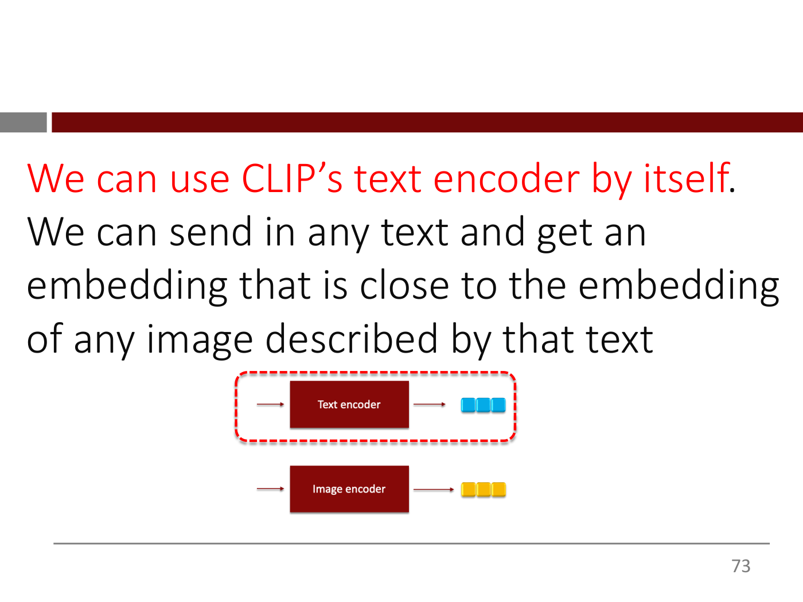

No title in the title area. Large text: "We can use CLIP's text encoder by itself." (first sentence in red) then, in black, "We can send in any text and get an embedding that is close to the embedding of any image described by that text".

Below the text, a small diagram of two rows. Top row: an arrow into a dark red box "Text encoder", then an arrow to three blue blocks (a text embedding); this row is enclosed in a red dashed rounded outline. Bottom row: an arrow into a dark red box "Image encoder", then an arrow to three yellow blocks (an image embedding).

*Figure: yes — two dark red boxes, Text encoder producing a blue embedding and Image encoder producing a yellow embedding, with the text-encoder row circled in red dashes*

## Slide 73 — BTW, CLIP can be used for zero-shot image classification

Title: "BTW, CLIP can be used for zero-shot image classification" ("zero-shot" in red). The title wraps onto two lines.

Diagram from the CLIP paper (zero-shot prediction). At upper left, a list of class-name boxes "plane", "car", "dog", a vertical ellipsis, "bird"; each feeds a box "A photo of a {object}." (the placeholder printed in light colour), which feeds a purple "Text Encoder" trapezoid. Its output goes along a line with arrows down to purple cells $T_{1}$, $T_{2}$, $T_{3}$, "...", $T_{N}$. At lower left, a photo of a black dog on grass feeds a green "Image Encoder" trapezoid, which outputs a green cell $I_{1}$. Beside it, a single row of cells $$I_{1}$ \cdot $T_{1}$$, $$I_{1}$ \cdot $T_{2}$$, $$I_{1}$ \cdot $T_{3}$$, "...", $$I_{1}$ \cdot $T_{N}$$, with $$I_{1}$ \cdot $T_{3}$$ shaded light blue. An arrow from that cell points down to a box reading "A photo of a dog."

Beneath the figure, the printed URL: https://arxiv.org/pdf/2103.00020.pdf

*OCW notice: CLIP paper figure © Alec Radford, et al./ArXiv. All rights reserved. This content is excluded from our Creative Commons license. For more information, see https://ocw.mit.edu/help/faq-fair-use.*

*Figure: yes — the CLIP paper's zero-shot classification figure: class names turned into "A photo of a {object}." prompts, encoded, and compared with an image's embedding, picking "A photo of a dog." (excluded; not rendered)*

## Slide 74 — [Next: control image generation with the CLIP text embedding]

No title in the title area. Large text: "Next: We will see how to "control" the image generation process using the CLIP text embedding of a text prompt" ("Next" underlined).

*Figure: no*

## Slide 75 — Recall the training (x,y) pairs we assembled to train the noise-to-image diffusion model

Title: "Recall the training (x,y) pairs we assembled to train the noise-to-image diffusion model". The title wraps onto two lines.

A horizontal strip of 11 small thumbnails of the same photo of the MIT Dome (the Great Dome and colonnade, with trees at the sides), left to right getting progressively noisier: the leftmost is clean and the rightmost is nearly pure grey noise. Below the strip, small dark red upward arrows point at four thumbnails: under the first thumbnail the label "$y_{1}$" (y with subscript 1), under the second "$x_{1}$", under the tenth "$y_{10}$", and under the eleventh "$x_{10}$". (So $x_{1}$ is thumbnail 2 and $y_{1}$ the less noisy thumbnail 1 before it; $x_{10}$ is thumbnail 11 and $y_{10}$ thumbnail 10.)

Text at the bottom: "x = image" and "y = "less noisy" version of the image".

(The MIT Dome photo is credited on slide 76 to Unsplash; this page prints no credit.)

*Figure: yes — strip of 11 progressively noisier MIT Dome thumbnails with arrows marking the (x1, y1) and (x10, y10) pairs*

## Slide 76 — What if expand x to include its caption …

Title: "What if expand x to include its caption" with a second line "…" (as printed, "What if expand").

The same strip of 11 progressively noisier MIT Dome thumbnails as slide 75, now with no arrows or labels. Text: "x = [image, CLIP text embedding of caption]" ("CLIP text embedding of caption" in red) and "y = "less noisy" version of the image". Small credit line: "MIT Dome: Photo by Muzammil Soorma on Unsplash." (a photo credit, not an OCW exclusion notice).

*Figure: yes — strip of 11 progressively noisier MIT Dome thumbnails (the photo credited to Muzammil Soorma on Unsplash)*

## Slide 77 — … and train the model like before!

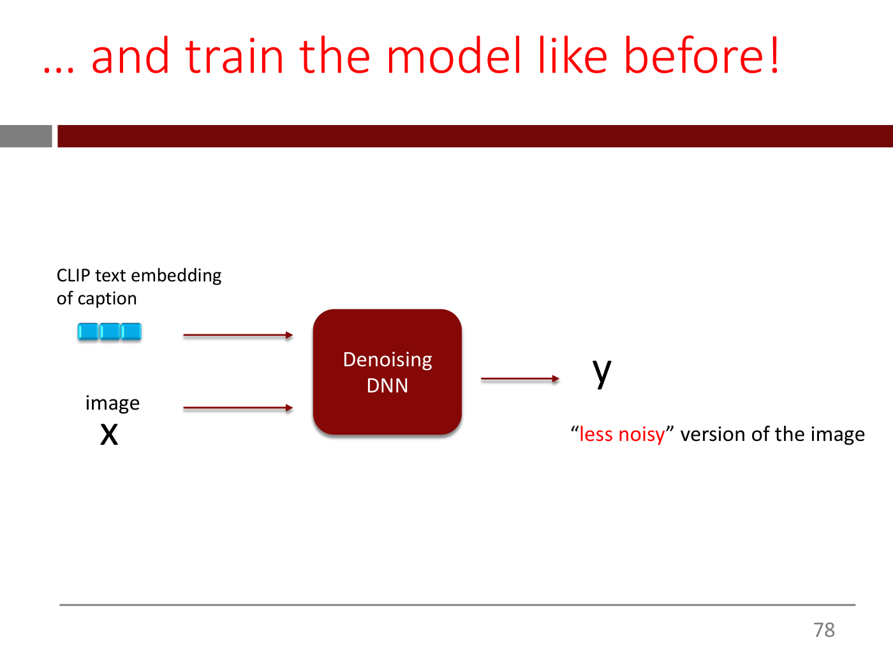

Title: "… and train the model like before!" (in red).

Diagram: two inputs on the left feed a dark red rounded box "Denoising DNN" by arrows. Upper input: the label "CLIP text embedding of caption" above three blue blocks. Lower input: the label "image" with a large "x" beneath it. An arrow from the box goes right to a large "y", with the caption ""less noisy" version of the image" ("less noisy" in red).

*Figure: yes — Denoising DNN taking x = [image, CLIP text embedding of caption] and producing y, the less noisy image*

## Slide 78 — After this model is trained …

Title: "After this model is trained …". The body of the slide is empty.

*Figure: no*

## Slide 79 — … start with "pure" noise and a prompt and repeatedly denoise it!

Title: "… start with "pure" noise and a prompt and repeatedly denoise it!" (in red, "and a prompt" underlined). The title wraps onto two lines.

One row of a diagram at the top: a grey square-ish thumbnail of pure noise at left; two arrows into a dark red rounded box "Denoising DNN", one straight from the noise thumbnail and one slanting down from the small text label "Killian court at MIT during springtime" (two lines); an arrow out of the box to a second grey noise thumbnail at right. The rest of the slide is empty.

*Figure: yes — one Denoising DNN step taking a pure-noise image and the prompt "Killian court at MIT during springtime" and outputting a slightly less noisy image*

## Slide 80 — … start with "pure" noise and a prompt and repeatedly denoise it!

Title: same as slide 79 ("… start with "pure" noise and a prompt and repeatedly denoise it!", red, "and a prompt" underlined).

New compared with slide 79: a second row is added below the first. It has the label "Killian court at MIT during springtime", a grey noise thumbnail (very slightly changed, equal to the first row's output), a second dark red "Denoising DNN" box, and an output thumbnail that is still noisy grey but with a faint hint of structure. A vertical ellipsis (three dots) is drawn below the second box.

*Figure: yes — two stacked Denoising DNN steps with the same prompt, followed by a vertical ellipsis*

## Slide 81 — … start with "pure" noise and a prompt and repeatedly denoise it!

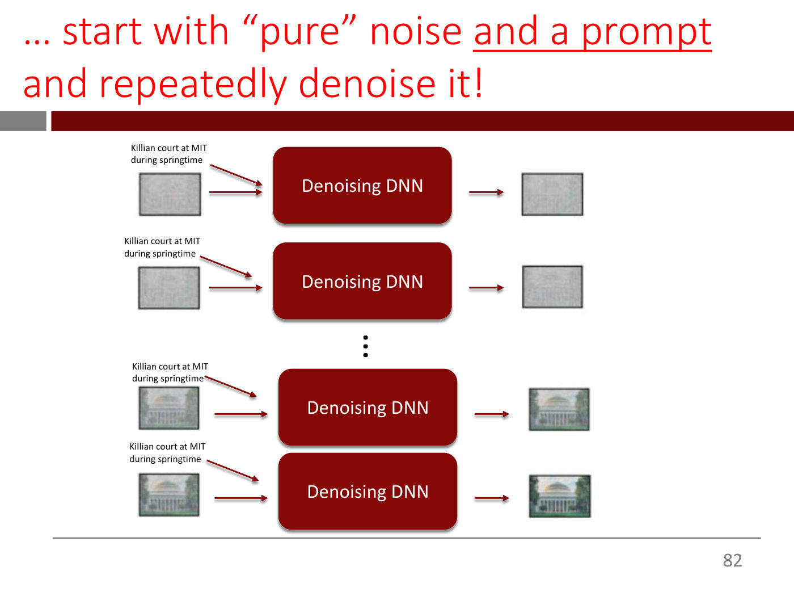

Title: same as slides 79 and 80.

New compared with slide 80: below the vertical ellipsis, two more rows are added. Each has the label "Killian court at MIT during springtime", an input thumbnail, a dark red "Denoising DNN" box and an output thumbnail. In the third row the input and output both show a fairly clear picture of the MIT Dome (the output slightly clearer); in the fourth (last) row the input is that picture and the output is the fully clear, colourful MIT Dome. So the stack reads: noise to noise, noise to faint structure, ellipsis, nearly clear to clear, clear to final clean image.

*Figure: yes — four Denoising DNN steps with an ellipsis between, going from pure noise to a clean MIT Dome image, all with the same prompt*

## Slide 82 — Let's take a quick look inside the [Denoising DNN]

Title: "Let's take a quick look inside the" followed, at the upper right of the title area, by a small dark red rounded box reading "Denoising DNN" (the box is part of the title phrase).

A figure from the latent diffusion paper (Rombach et al.). On the left, a pink "Pixel Space" box holding an input $x$ with an encoder trapezoid $\mathcal{E}$ at top and a decoder trapezoid $\mathcal{D}$ producing $\tilde{x}$ at the bottom. A large green "Latent Space" box holds a "Diffusion Process" arrow from $z$ to $z_T$, and below it a "Denoising U-Net $\epsilon_\theta$" box containing a U-shaped pair of trapezoids with four orange boxes marked Q, K, V (cross-attention), with skip connections (dashed arrows), and a switch and a concatenation. Along the bottom of the latent space, the U-Net's output runs left to $z_{T-1}$, then through a denoising-step icon marked with a loop "×(T−1)" to $z$, which the decoder $\mathcal{D}$ turns into $\tilde{x}$; a second $z_T$ on the right feeds the U-Net. At right, a grey "Conditioning" box lists "Semantic Map", "Text", "Representations" and "Images", feeding a trapezoid $\tau_\theta$ whose output joins the K, V inputs of the U-Net. A legend under the diagram names the symbols: "denoising step", "crossattention", "switch", "skip connection", "concat". Beneath the figure, the paper's header: "High-Resolution Image Synthesis with Latent Diffusion Models", authors "Robin Rombach, Andreas Blattmann, Dominik Lorenz, Patrick Esser, Björn Ommer" with affiliations "Ludwig Maximilian University of Munich & IWR, Heidelberg University, Germany" and "Runway ML", and the code address printed in the header, https://github.com/CompVis/latent-diffusion. Printed below that: https://arxiv.org/abs/2112.10752

*OCW notice: Denoising figure © Robin Rombach, et al./ArXiv. All rights reserved. This content is excluded from our Creative Commons license. For more information, see https://ocw.mit.edu/help/faq-fair-use.*

*Figure: yes — the latent diffusion paper's architecture figure (pixel-space encoder and decoder, latent-space denoising U-Net with cross-attention, conditioning inputs) (excluded; not rendered)*

## Slide 83 — (1) Notice that it uses the U-Net architecture

Title: "(1) Notice that it uses the U-Net architecture".

The same latent diffusion paper figure as slide 82 (pixel space with $x$, $\mathcal{E}$, $\mathcal{D}$, $\tilde{x}$; latent space with the diffusion process, the "Denoising U-Net $\epsilon_\theta$" with four Q, K, V cross-attention boxes; the "Conditioning" box with "Semantic Map", "Text", "Representations", "Images" and $\tau_\theta$; the legend "denoising step", "crossattention", "switch", "skip connection", "concat"), drawn slightly larger and without the paper header or authors. New: a thin dark red line runs from the title area down to the "Denoising U-Net $\epsilon_\theta$" box, with an arrowhead pointing at it. The URL printed beneath the figure: https://arxiv.org/abs/2112.10752

(The same latent-diffusion figure as slide 82's, which carries an OCW notice; this page prints its own copy of the notice.)

*OCW notice: Denoising figure © Robin Rombach, et al./ArXiv. All rights reserved. This content is excluded from our Creative Commons license. For more information, see https://ocw.mit.edu/help/faq-fair-use.*

*Figure: yes — latent diffusion architecture figure with a red arrow pointing at the Denoising U-Net box (excluded; not rendered)*

## Slide 84 — (2) The CLIP embedding of the text prompt is "woven" into the U-Net through an attention mechanism

Title: "(2) The CLIP embedding of the text prompt is "woven" into the U-Net through an attention mechanism (the Q, K, V should look familiar" followed by a smiling-face emoji and ")". The words from "attention mechanism" to the end are in red. The title wraps onto three lines.

The same latent diffusion figure as slide 83 (pixel space, latent space, Denoising U-Net with four Q, K, V boxes, Conditioning box, legend). New: the four orange Q, K, V cross-attention boxes inside the U-Net are enclosed by a red dash-dotted rounded outline, and a thin dark red arrow from the title area points down to that outline. URL printed beneath: https://arxiv.org/abs/2112.10752

*OCW notice: Denoising figure © Robin Rombach, et al./ArXiv. All rights reserved. This content is excluded from our Creative Commons license. For more information, see https://ocw.mit.edu/help/faq-fair-use.*

*Figure: yes — latent diffusion architecture figure with the four Q, K, V attention boxes circled in red dashes (excluded; not rendered)*

## Slide 85 — (3) Instead of working with images in "pixel space", the diffusion process operates in "latent space"

Title: "(3) Instead of working with images in "pixel space", the diffusion process operates in "latent space", and this speeds things up dramatically" (black; the printed text has a double space in "speeds  things"). The title wraps onto three lines.

The same latent diffusion figure as slides 83 and 84, with no outline. New: a thin dark red arrow runs from the title area down to the top of the green "Latent Space" region (near its "Latent Space" heading and the "Diffusion Process" bar). URL printed beneath: https://arxiv.org/abs/2112.10752

*OCW notice: Denoising figure © Robin Rombach, et al./ArXiv. All rights reserved. This content is excluded from our Creative Commons license. For more information, see https://ocw.mit.edu/help/faq-fair-use.*

*Figure: yes — latent diffusion architecture figure with a red arrow pointing at the Latent Space region (excluded; not rendered)*

## Slide 86 — These models are transforming the art world …

Title: "These models are transforming the art world …".

A screenshot of the home page of the Lexica image-search site: dark grey background, the large white word "Lexica", the small line "Lexica is hiring! Learn more", a rounded search bar reading "Search for an image" (with a magnifier icon at left and an image icon at right, and a sliders icon beside the bar), and two buttons below it, a blue "Search" and an outlined "Generate". Beneath the screenshot, the printed URL: https://lexica.art/

(Third-party website screenshot; this page prints no OCW notice.)

*Figure: yes — screenshot of the Lexica (lexica.art) home page with its search bar and Search and Generate buttons (third-party screenshot, no OCW notice printed)*

## Slide 87 — … but their applicability is far-reaching. Example: Protein design using diffusion models

Title: "… but their applicability is far-reaching." (italic, large) with a second italic line "Example: Protein design using diffusion models".

Left: a screenshot of a New York Times article header, headline "A.I. Turns Its Artistry to Creating New Human Proteins" and standfirst "Inspired by digital art generators like DALL-E, biologists are building artificial intelligences that can fight cancer, flu and Covid." Right: a grid of eight colourful ribbon-style 3D protein structure renderings (helices and strands, rainbow-coloured), four across the top, one wide structure in the middle and three or four below, with the printed caption "A protein diffusion model doing unconditional generation, converting noise into plausible structures. Video by Namrata Anand".

Below, in italic, with the first sentence highlighted in yellow: "Much as DALL-E leverages the relationship between captions and photographs, similar systems can leverage the relationship between a description of what the protein can do and the shape it adopts. Researchers can provide a rough outline for the protein they want, then a diffusion model can generate its three-dimensional shape."

Printed URL at the foot: https://www.nytimes.com/2023/01/09/science/artificial-intelligence-proteins.html

*OCW notice: Protein diffusion model generated images © Namruta Anand/The New York Times Company. All rights reserved. This content is excluded from our Creative Commons license. For more information, see https://ocw.mit.edu/help/faq-fair-use.*

*Figure: yes — New York Times article headline and a grid of protein structures generated by a diffusion model (excluded; not rendered)*

## Slide 88 — Colab

Title: "Colab" (underlined, orange, styled as a hyperlink; the link's target is not printed).

At left, large text: "We will use the Diffusers library". At right, a screenshot from the Hugging Face documentation: the "Diffusers" logo (a smiling hugging-face emoji followed by "D", a red firework-like icon in place of "i", and "ffusers"), a heading "Diffusers", and the text "Diffusers is the go-to library for state-of-the-art pretrained diffusion models for generating images, audio, and even 3D structures of molecules. Whether you're looking for a simple inference solution or want to train your own diffusion model, Diffusers is a modular toolbox that supports both. Our library is designed with a focus on usability over performance, simple over easy, and customizability over abstractions." (the three phrases "usability over performance", "simple over easy", "customizability over abstractions" underlined, and a hugging-face emoji precedes each "Diffusers is"). Printed URL beneath: https://huggingface.co/docs/diffusers/index

*OCW notice: Logo/screenshot © Hugging Face. All rights reserved. This content is excluded from our Creative Commons license. For more information, see https://ocw.mit.edu/help/faq-fair-use.*

*Figure: yes — Hugging Face Diffusers logo and documentation text screenshot (excluded; not rendered)*

## Slide 89 — Lightning Tour of HuggingFace Computer Vision Models

Title: "Lightning Tour of HuggingFace Computer Vision Models". The title wraps onto two lines.

In the centre of the body, the underlined orange link text "Colab link"; the link's target is not printed.

*Figure: no*

## Slide 90 — [MIT OpenCourseWare end page]

OCW's end page, no slide title. Text: "MIT OpenCourseWare", "https://ocw.mit.edu", "15.773 Hands-on Deep Learning", "Spring 2024", "For information about citing these materials or our Terms of Use, visit: https://ocw.mit.edu/terms."

*Figure: no*
