# Lecture 1 — Introduction to Neural Networks and Deep Learning

**Lecturer:** Rama Ramakrishnan ·
**Video:** [youtube.com/watch?v=kyQ0CRkYhy4](https://www.youtube.com/watch?v=kyQ0CRkYhy4) (57 min) ·
**Slides:** [`mit15_773_s24_lec01.pdf`](https://ocw.mit.edu/courses/15-773-hands-on-deep-learning-spring-2024/mit15_773_s24_lec01.pdf)
(110 pages; transcribed slide by slide in [`raw/slides/01-introduction.md`](../raw/slides/01-introduction.md)) ·
**Transcript:** [`raw/transcripts/01-introduction.md`](../raw/transcripts/01-introduction.md)

## What this lecture establishes

The lecture has two halves. The first (0:00–24:41) is a fast tour of where deep learning sits: AI
began as hand-written rules, machine learning replaced the rules with learning from input–output
examples, deep learning removed the need to hand-craft *representations* of unstructured data such
as images and text, and generative AI added the ability to *produce* unstructured data. The second
half (24:41–end) builds a neural network from scratch, starting from logistic regression. A network
is "nothing more than repeatedly transformed inputs which are finally fed to a linear or logistic
regression model" (≈36:15). The half closes with a worked example, a 2-3-1 network for predicting
job-interview calls: count its 13 parameters, then run numbers through it by hand.

The catalog titles this recording "…; Training Deep NNs", but training is not covered here. The
video ends on the last slide of the lecture 1 deck. Loss functions, gradient descent and training
begin in [lecture 2](02-training-deep-nns.md).

The recording begins at slide 10. Slides 1–9 cover course logistics and appear only in the deck;
they are summarised at the end of this page.

## From rules to learning: the AI landscape

### Traditional AI, and why it mostly failed

The field of AI was founded at a 1956 workshop at Dartmouth, with MIT "well represented" by Marvin
Minsky, John McCarthy and Claude Shannon (≈0:00; slides 11–12). The lecturer frames the decades
since as a sequence of breakthroughs: traditional AI, then machine learning, then deep learning,
then generative AI (≈0:46; slide 13).

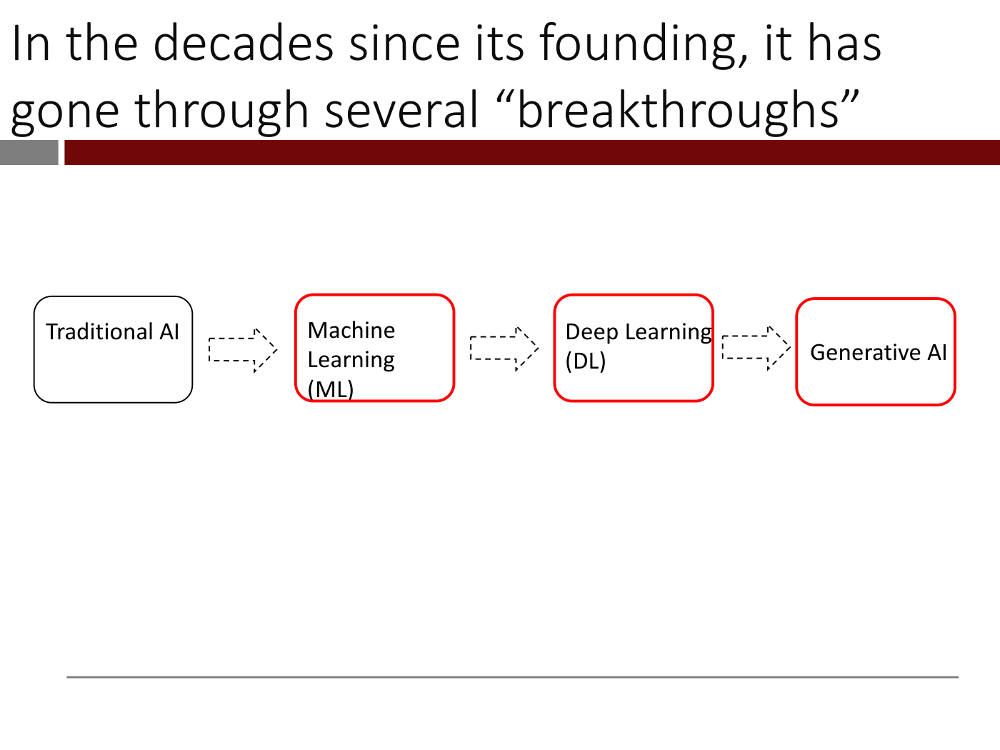

*Slide 13 — the lecture's map of AI's history: each box is a breakthrough that fixed the previous one's bottleneck.*

The **traditional approach** is to ask human experts how they do a task, such as chess
grandmasters or a cardiologist reading an ECG, write their knowledge down as IF-THEN rules, and
program the rules into a computer (≈1:34; slide 14). It succeeded "in only a few areas". Asked why,
a student suggested it is time-intensive. The lecturer agreed but set that aside, since computers
keep getting faster. The key problem is that rules **do not generalize** to new situations: the
world is full of edge cases, and any rule set is a small sample of them (≈2:20–3:06).

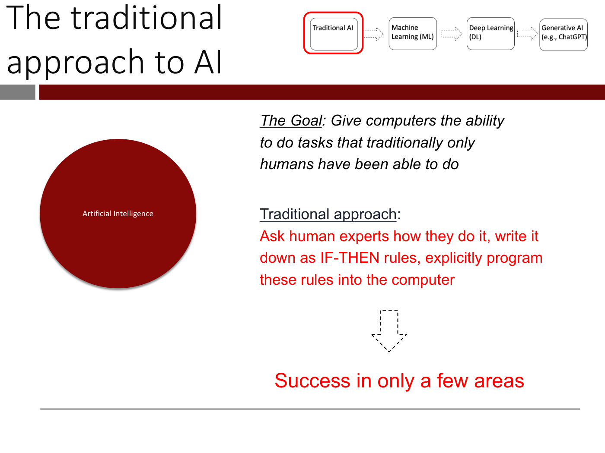

*Slide 14 — The traditional approach to AI. [Deck](https://ocw.mit.edu/courses/15-773-hands-on-deep-learning-spring-2024/mit15_773_s24_lec01.pdf)*

The deeper reason is **Polanyi's paradox**: "we know more than we can tell" (≈3:06; slide 15). You
can tell a dog from a cat in milliseconds, but you cannot really articulate how. And even when you
try, your account often has nothing to do with how your brain actually does it. If experts cannot
say how they do something, their knowledge cannot be written down as rules.

### Machine learning: learn the mapping from examples

The response was to stop telling the computer what to do. Instead you "give it lots of examples of
inputs and outputs" (chess position → next move, ECG → diagnosis) and use statistical techniques to
learn a function from input to output. That is **machine learning**: "learn from input-output
examples using statistical techniques" (≈3:53–4:40; slides 16–18). There are many ways to build
such a model: linear and logistic regression, classification and regression trees, support vector
machines, random forests, gradient boosted machines, and neural networks, which are just one method
among them (slide 19). "If you have ever done linear regression, congratulations, you've been doing
machine learning" (≈4:40).

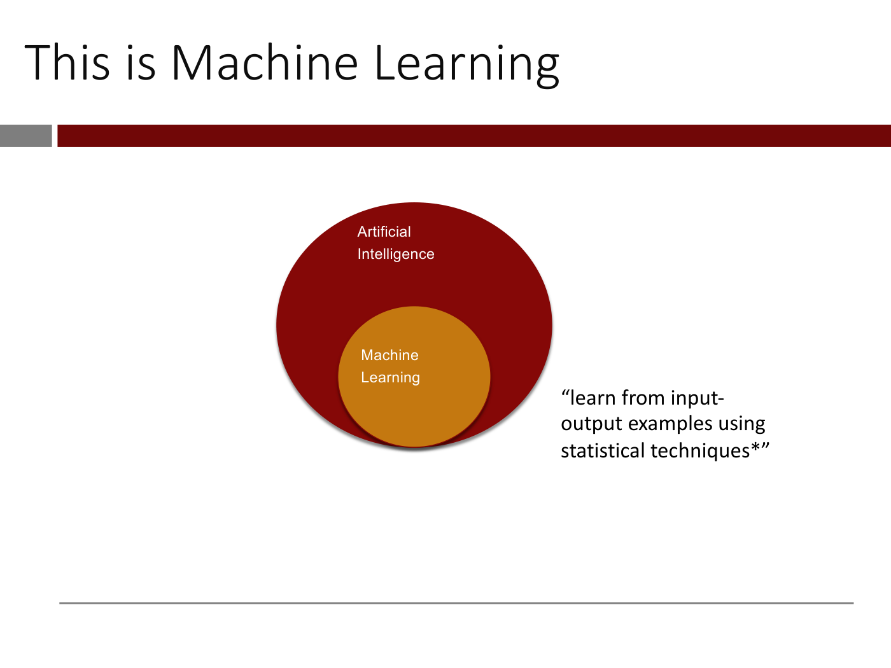

*Slide 18 — This is Machine Learning. [Deck](https://ocw.mit.edu/courses/15-773-hands-on-deep-learning-spring-2024/mit15_773_s24_lec01.pdf)*

*Slide 19 — neural networks are one entry in a long list of ways to learn an input-to-output mapping.*

### Structured data, unstructured data, and representations

Machine learning works well when the input is **structured**: data that can be "numericalized" into
the rows and columns of a spreadsheet (≈5:26; slides 20–21). The lecture's example is a patient
table with age, smoker, exercise, cholesterol, family history and blood pressure as inputs, and
cardiac arrest as the output. Categorical columns are easy to numericalize, for instance by one-hot
encoding (≈6:13).

**Unstructured** data (images, video, text, audio) is different (≈6:13; slide 22). A colour image is
stored as three tables of numbers, the red, green and blue light in each pixel on a 0–255 scale
(≈6:59; slide 23). The trouble is that the raw numbers have **no intrinsic meaning**: a blue value
of 251 could come from sky, water or blue paint. "The raw form of the data has no intrinsic meaning
with the underlying thing", so no algorithm can do much with it directly (≈7:45).

The traditional fix was **feature engineering** (or feature extraction): manually turning raw data
into a table. For a bird classifier you would measure beak length, wingspan and primary colour from
each photo (≈8:31; slide 24). The lecturer stresses the word **representation** for this. "We take
the raw data, and we represent the data in a different form", and he flags that the word will matter
throughout the course (≈8:31–9:18; slide 25). Once a good representation exists, plain linear or
logistic regression is often enough. So "the whole name of the game is the representations". PhD
students in computer vision could spend four years designing one representation for one narrow
problem, such as detecting a kind of stroke in CAT scans (≈9:18–10:03). This manual work was a
"massive **human bottleneck**" that sharply limited where machine learning could reach (slide 26).
See [representation learning](representation-learning.md).

### Deep learning: representations learned automatically

**Deep learning** sits inside machine learning and handles unstructured input "without upfront manual
preprocessing": it **automatically learns the representations** from the raw input (≈10:03–10:51;
slides 27–29). The resulting pipeline is raw data in, a stack of learned representations in the
middle, and "a little linear regression or logistic regression at the end". "That, in a nutshell,
is deep learning" (≈10:51). The lecturer credits this simple idea with ChatGPT, AlphaGo and AlphaFold,
and says it still gives him goosebumps after about ten years of working in the field (≈11:37).

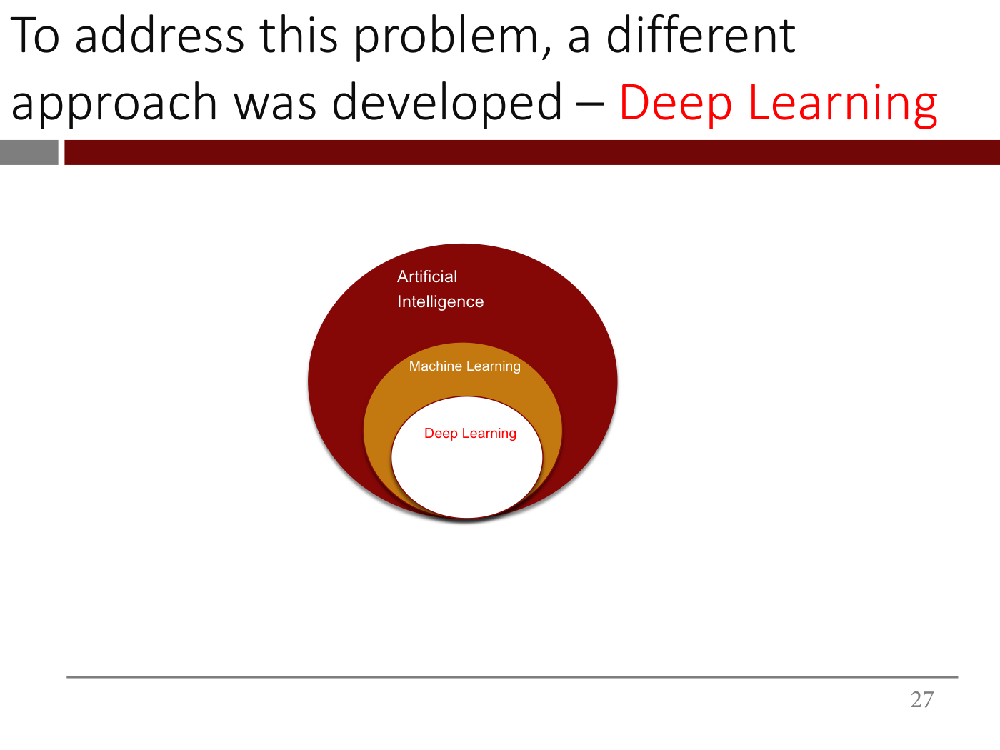

*Slide 27 — To address this problem, a different approach was developed – Deep Learning. [Deck](https://ocw.mit.edu/courses/15-773-hands-on-deep-learning-spring-2024/mit15_773_s24_lec01.pdf)*

The breakthrough came from three forces arriving together: new algorithmic ideas, unprecedented
amounts of data, and parallel computing hardware in the form of GPUs. They were applied to an old
idea, **neural networks** (≈12:24; slides 31–32).

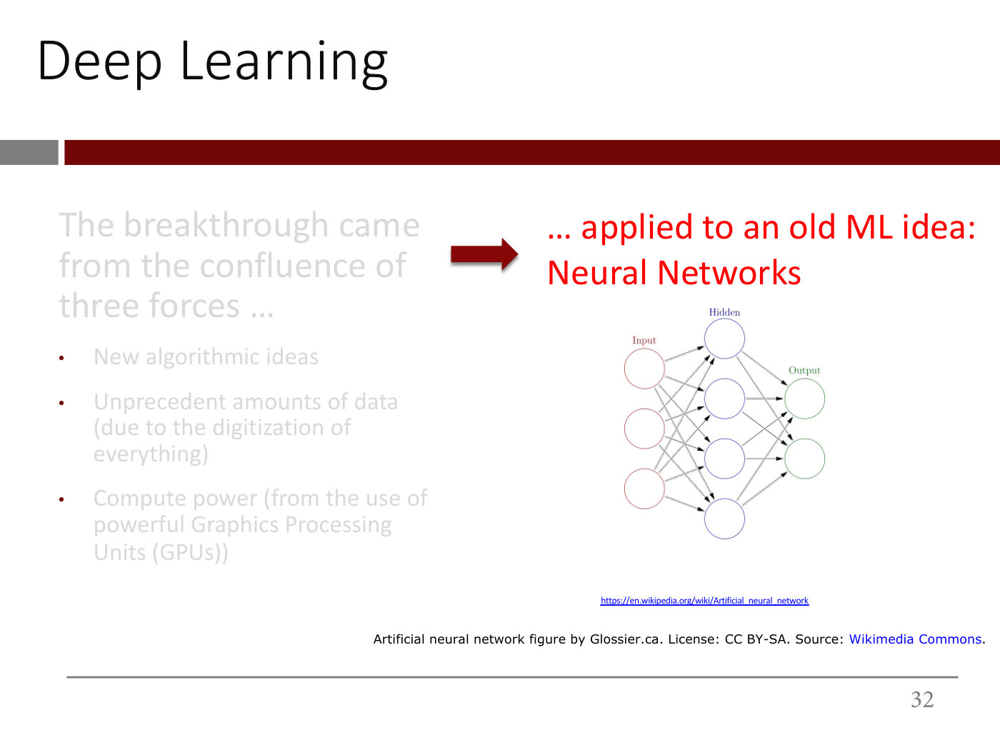

*Slide 32 — Deep Learning. [Deck](https://ocw.mit.edu/courses/15-773-hands-on-deep-learning-spring-2024/mit15_773_s24_lec01.pdf)*

### The immediate application: put DL behind every sensor

Asked for the "no-brainer" application, a student said image classification. The lecturer
generalized it: **every sensor can be given the ability to detect, recognize and classify what it
is sensing**, because a sensor is just "a receptacle for unstructured data". A camera collects
images and a microphone collects audio, so you attach a deep learning system behind it (≈13:10–13:56;
slide 34). His examples are on slide 35:

- **Face ID**: the iPhone camera is the sensor, with an image classifier behind it (≈13:56–14:42).
- **Mammography**: Regina Barzilay, an MIT EECS professor and breast-cancer survivor, built a
  detection system that is deployed at Mass General Hospital. Run on her own mammogram from years
  earlier, which a radiologist had passed as fine, it flagged a problem (≈14:42–15:29).
- Pedestrian, stoplight and zebra-crossing detection in self-driving systems, and dent and scratch
  detection in manufacturing visual inspection (≈15:29).

His newest example was "the world's first smart binoculars", which name the bird you are looking
at (≈16:15; slides 37–38). The business lesson: look at the world, find the sensors, and ask whether
a deep learning system behind one would do something useful. Being first gives "a little monopoly
window", but "there are no long-term monopoly windows in the world" (≈16:15–17:01).

### The output side: generative AI

Turning to outputs (≈17:01; slide 39): deep learning could always produce **structured outputs**,
such as one number (the probability a borrower repays, next week's demand) or a few numbers (four
furniture-class probabilities, a taxi's two GPS coordinates) (≈17:46; slide 40). What it could not
do well was *generate* unstructured data: pictures, text, audio (slide 41).

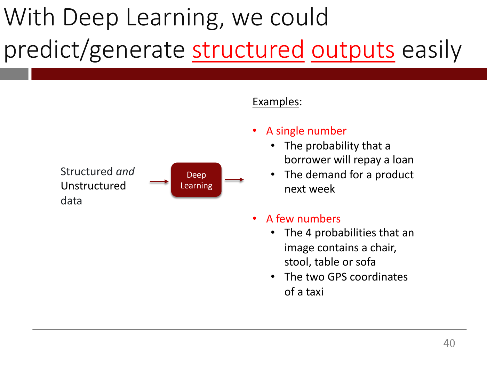

*Slide 40 — With Deep Learning, we could predict/generate structured outputs easily. [Deck](https://ocw.mit.edu/courses/15-773-hands-on-deep-learning-spring-2024/mit15_773_s24_lec01.pdf)*

**Generative AI** is the ability to create unstructured output, and it sits inside deep learning
(≈18:32; slides 42–43). It "still runs on deep learning, but it's just one kind of deep learning",
and plenty of deep learning has nothing to do with it. The examples run through image-to-text
captioning (slide 44), text-to-image with a Stable Diffusion prompt (slide 45), text-to-music with
MusicLM (slide 46), text-to-text as in ChatGPT (slide 47), and **multimodal** input (slide 48). In
that example someone sends GPT-4 a photo of a tangle of San Francisco parking signs and asks "It's
Wednesday at 4 pm. Can I park at this spot right now? Tell me in 1 line." It answers that you can
park for up to an hour from 4 pm. The lecturer double-checked it, warning that "these things
hallucinate" (≈20:04; slides 49–50).

*Slide 42 — And then Generative AI happened. [Deck](https://ocw.mit.edu/courses/15-773-hands-on-deep-learning-spring-2024/mit15_773_s24_lec01.pdf)*

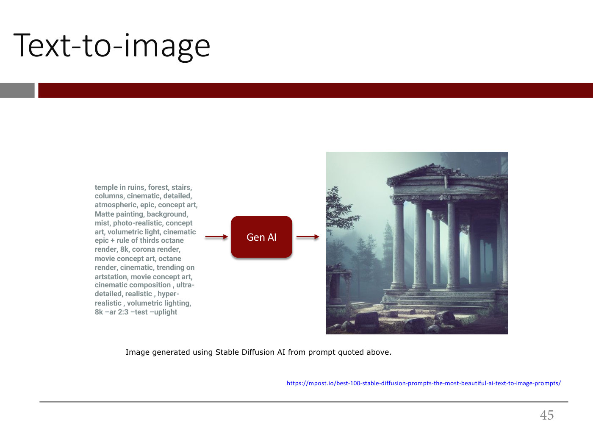

*Slide 45 — Text-to-image. [Deck](https://ocw.mit.edu/courses/15-773-hands-on-deep-learning-spring-2024/mit15_773_s24_lec01.pdf)*

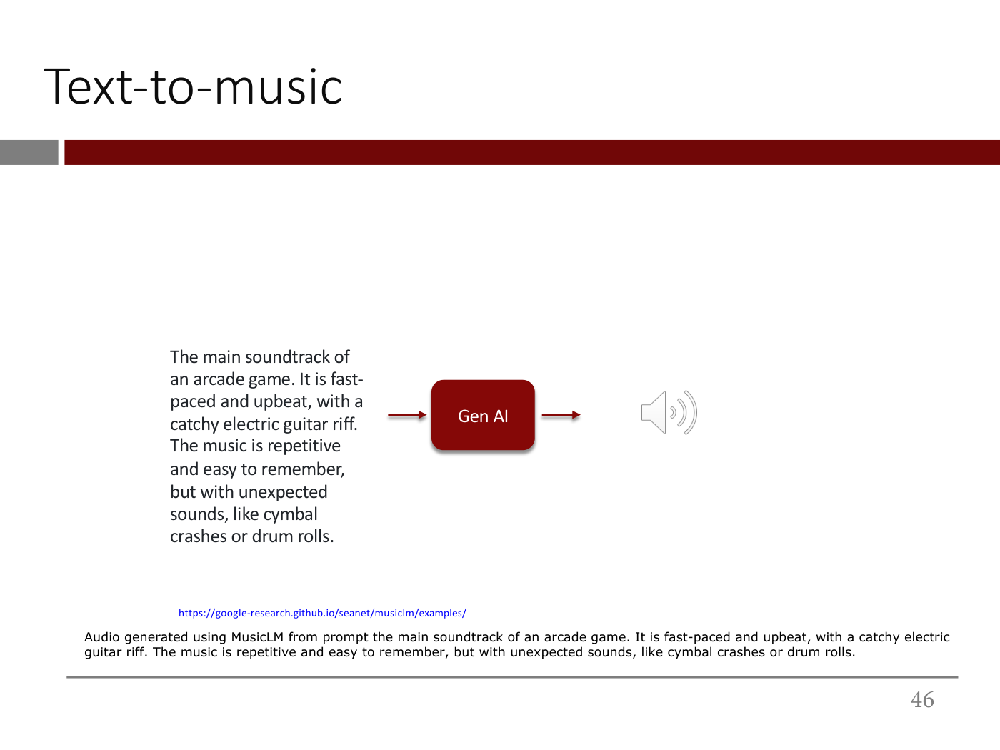

*Slide 46 — Text-to-music. [Deck](https://ocw.mit.edu/courses/15-773-hands-on-deep-learning-spring-2024/mit15_773_s24_lec01.pdf)*

*Slide 51 — the landscape: Gen AI ⊂ DL ⊂ ML ⊂ AI, with the separate text-to-X circles inside Gen AI beginning to merge.*

The separate circles inside generative AI (text-to-text, text-to-image, text-to-music) are merging,
and the lecturer predicted in early 2024 that by the end of the year a text-only model would seem
"quaint" (≈20:49; slide 51). The summary is **X-to-Y**: "X and Y can be anything and it can be
multi-modal!" Given enough data, you can learn a mapping from anything to anything (≈23:54;
slide 52). And "all this excitement … stems from deep learning" (≈23:54–24:41; slide 53). See
[AI, ML, deep learning and generative AI](ai-ml-dl-genai.md).

### Questions from the floor: noisy labels, ground truth, embodiment

- **What if the labels were wrong?** The mammogram that the deep learning system flagged had been
  labelled "no problem" by a radiologist, a wrong training label. Labels are wrong a small fraction
  of the time, so data must be complete, comprehensive and correctly labelled as far as possible.
  "With neural networks, even with some amount of noise in the labels, they still do a pretty good
  job" (≈21:35–22:20).
- **Where does verification come from?** From humans. The input (say a mammogram) and the label a
  radiologist assigned together form the **ground truth** the model is trained on (≈23:06).
- **Embodiment and robotics** are out of scope, though the deep learning building blocks in the
  course underpin modern robotic systems (≈23:06–23:54).

## What is a neural network?

### Logistic regression, drawn as a network

The construction starts from **logistic regression** (≈24:41; slides 56–57). It takes a vector of
numbers, passes them through a linear function, and passes the result through the sigmoid
$\frac{1}{1+e^{-a}}$, which always lands between 0 and 1 and can be read as a probability:

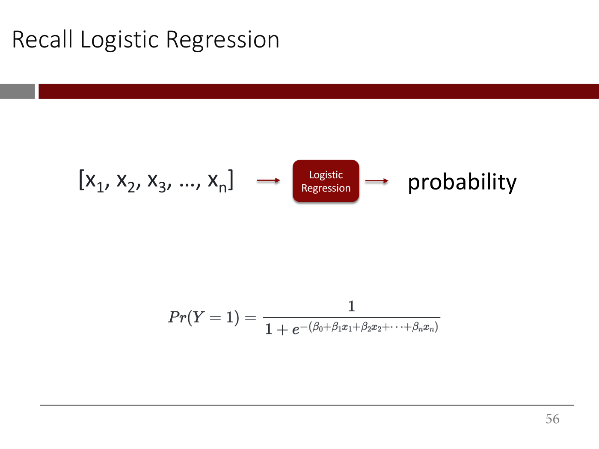

*Slide 56 — Recall Logistic Regression. [Deck](https://ocw.mit.edu/courses/15-773-hands-on-deep-learning-spring-2024/mit15_773_s24_lec01.pdf)*

$$\Pr(Y=1) = \frac{1}{1+e^{-(\beta_0+\beta_1 x_1+\beta_2 x_2+\cdots+\beta_n x_n)}}$$

Here $x_1, \dots, x_n$ are the inputs, $\beta_0$ is the intercept and $\beta_1, \dots, \beta_n$ are
the coefficients.

The running example predicts whether a graduate is **called for a job interview** (1) or not (0)
from **GPA** and years of **experience** (≈25:27–26:13; slide 58). It is a two-input, one-output
classification problem. Fitting a logistic regression (R's `glm`, Python's statsmodels or
scikit-learn, "whatever favorite methods you have") gives an intercept of 0.4 and coefficients of
0.2 for GPA and 0.5 for experience (≈27:00; slide 59):

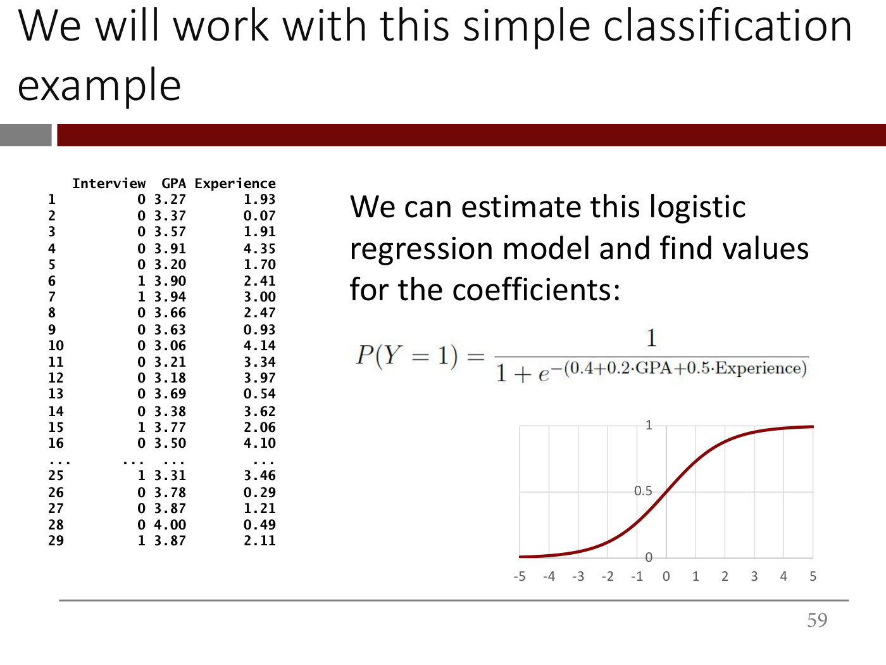

*Slide 59 — the interview data (Interview, GPA, Experience) beside the fitted model and its sigmoid curve.*

$$P(Y=1) = \frac{1}{1+e^{-(0.4+0.2\cdot\text{GPA}+0.5\cdot\text{Experience})}}$$

The same formula can be redrawn as a little **network of operations** (≈27:00–27:45; slides 60–61).
GPA and experience sit in input circles on the left. Each value flows along an arrow and is
multiplied by its coefficient on the way. A node marked "+" adds the arriving values plus the
intercept, drawn as a green arrow of its own. The sum flows into a sigmoid node, and out pops the
probability.

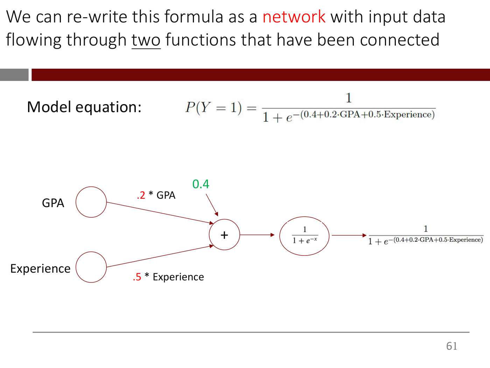

*Slide 61 — logistic regression redrawn as a network: GPA and Experience weighted by .2 and .5, summed with bias 0.4, then the sigmoid.*

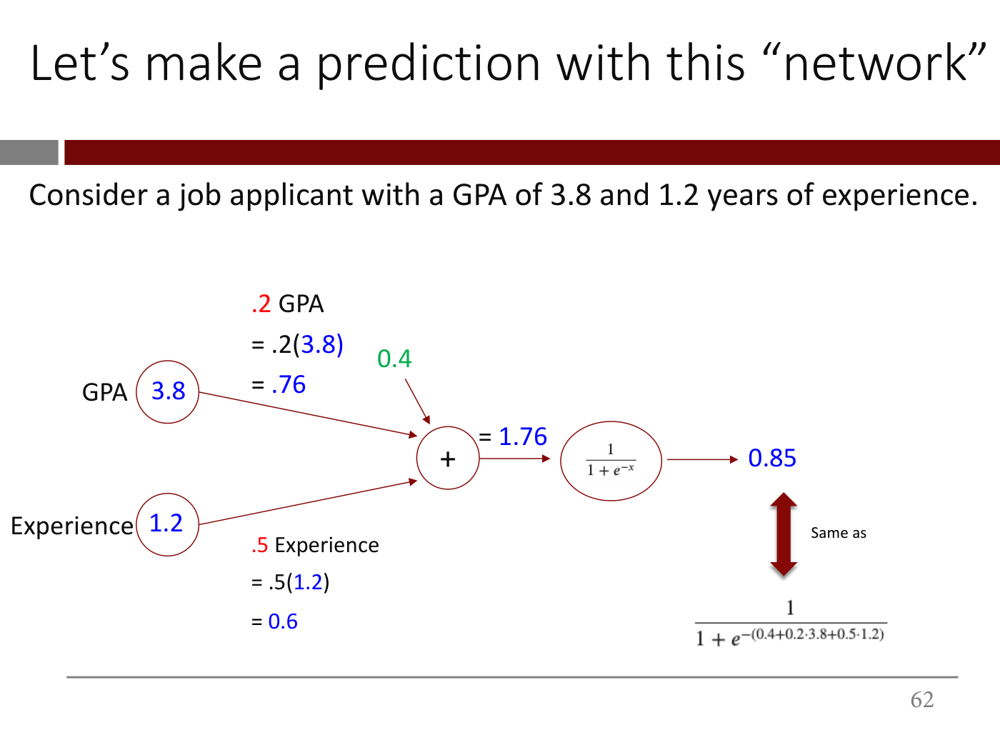

*Slide 62 — logistic regression as a network: inputs flow left to right, get weighted, summed with the bias, and squashed by the sigmoid.*

To predict, push numbers through it. An applicant with a 3.8 GPA and 1.2 years of experience gives
$0.2 \times 3.8 = 0.76$ and $0.5 \times 1.2 = 0.6$. Adding the intercept makes $1.76$, and the
sigmoid of $1.76$ is $0.85$, the probability of an interview call (≈28:31; slide 62). With $k$
inputs the picture is the same: each input has a coefficient, all are summed with an intercept, and
the sum goes through a sigmoid. "Notice how the data flows from left to right" (slide 63).

### Weights and biases

Neural-network vocabulary renames familiar things (≈29:16; slide 64). The **coefficients** of a
regression are called **weights**, and the **intercept** is called the **bias**. Sometimes everything
is loosely called "the weights". That is what a headline about a model's weights "leaking" means:
once you know the weights and the architecture, you can reconstruct the model (≈29:16–30:04).

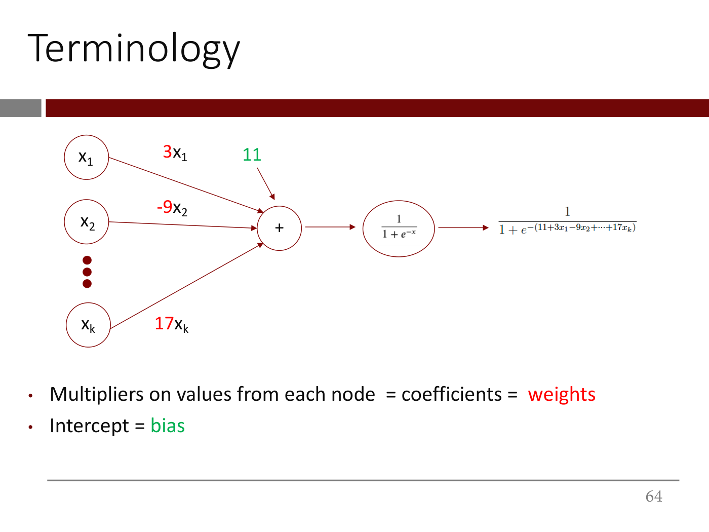

*Slide 64 — the same network with the vocabulary: multipliers on edges are weights (red), the intercept is the bias (green).*

### The key idea: transform the input before predicting

Why redraw a formula as a network (≈30:04; slide 65)? Students suggested that it is easier to read,
and that different layers might use different functions. The lecturer's "larger, more basic point"
is that once it is drawn, "you suddenly realize that I could have lots of things in the middle"
(≈30:51). The output is fixed, since it is either a dog or a cat. The only agency you have is to
**transform the raw input before the final logistic regression**, and that is where deep learning's
automatically learned representations come from (≈30:51–31:38; slides 66–67).

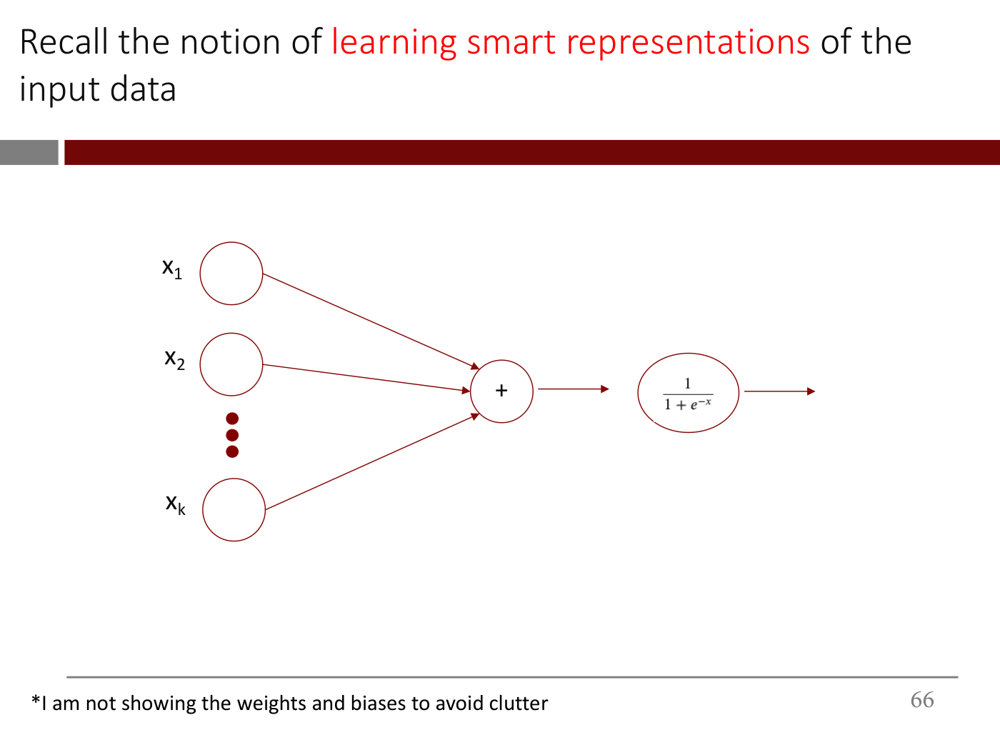

*Slide 66 — the starting point: logistic regression with the weights hidden, every input feeding one + node and a sigmoid.*

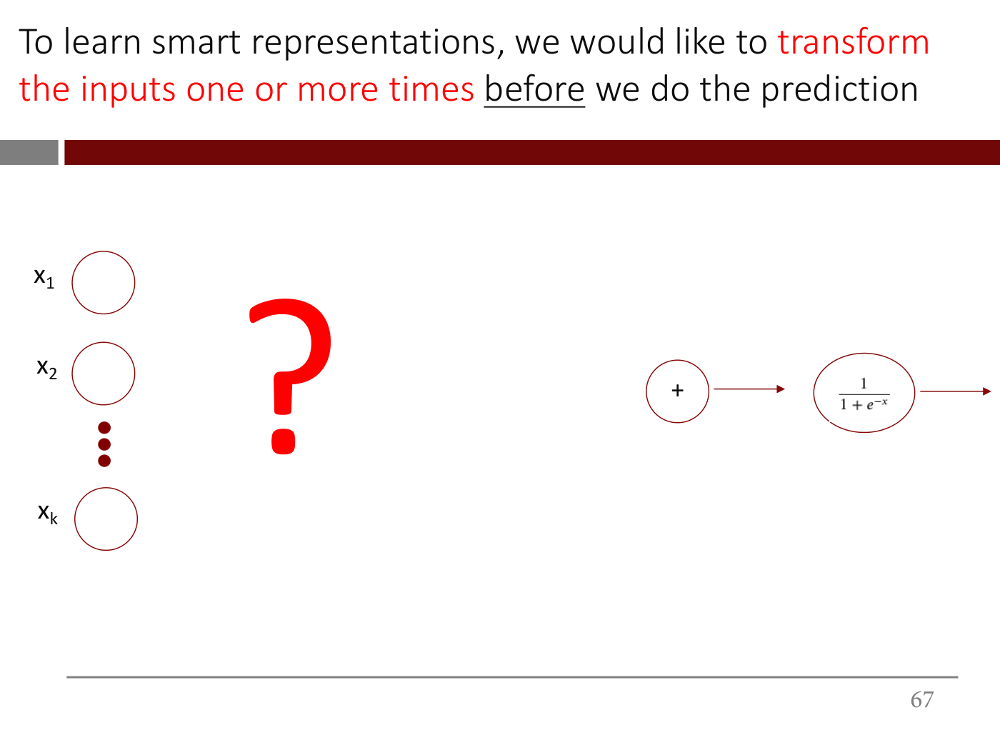

*Slide 67 — the question mark is the gap the construction fills: something between the raw inputs and the final logistic regression.*

The construction then proceeds step by step:

1. **Insert a linear function.** "The most basic thing in math is a linear function", so feed all
   $k$ inputs into one, drawn as a circle with a "+" (≈32:26; slides 68–70). That compresses $k$
   numbers into one.
2. **Stack several linear functions.** With three of them, the $k$-dimensional input becomes a
   3-dimensional vector (≈33:11; slides 71–72). Whether 3, 4 or 10 is the right number comes later.
3. **Pass each result through a nonlinear function** $f(x)$, called an **activation function**. The
   vector is still 3-dimensional (≈33:58; slides 73–74). It *must* be nonlinear, "because if you
   don't choose it to be a nonlinear function, all the effort we're doing is going to be a total
   waste of time". The reason is deferred: "for now, just take it on faith".
4. **Repeat** as many times as you like (≈34:43; slide 75). Each transformation gives the network
   more *capacity* to learn an interesting representation: "if I give you 10 chances to transform
   things, you have 10 shots at doing something useful" (≈35:28). Whether it lives up to that
   potential depends on training, which comes later.
5. **Feed the final vector to logistic regression as usual** (≈35:28; slide 76).

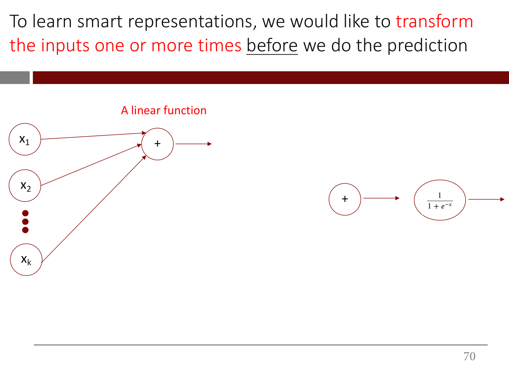

*Slide 70 — step 1: one linear function (a + node) fed by every input compresses k numbers into one.*

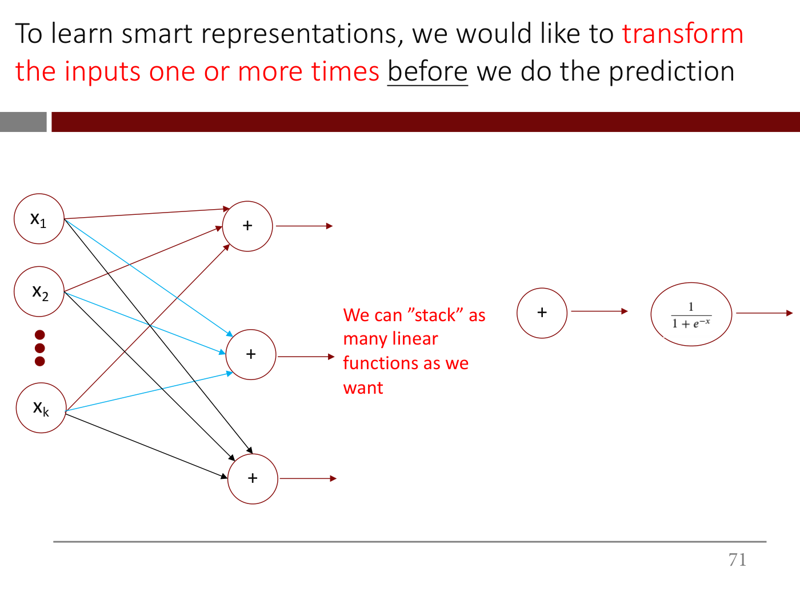

*Slide 71 — step 2: three stacked linear functions turn the k-dimensional input into a 3-dimensional vector.*

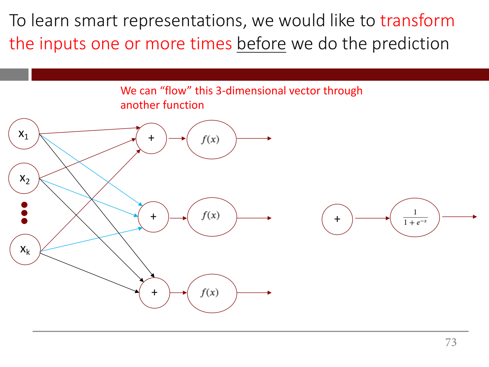

*Slide 73 — step 3: each linear output passes through a nonlinear function f(x); the vector is still 3-dimensional.*

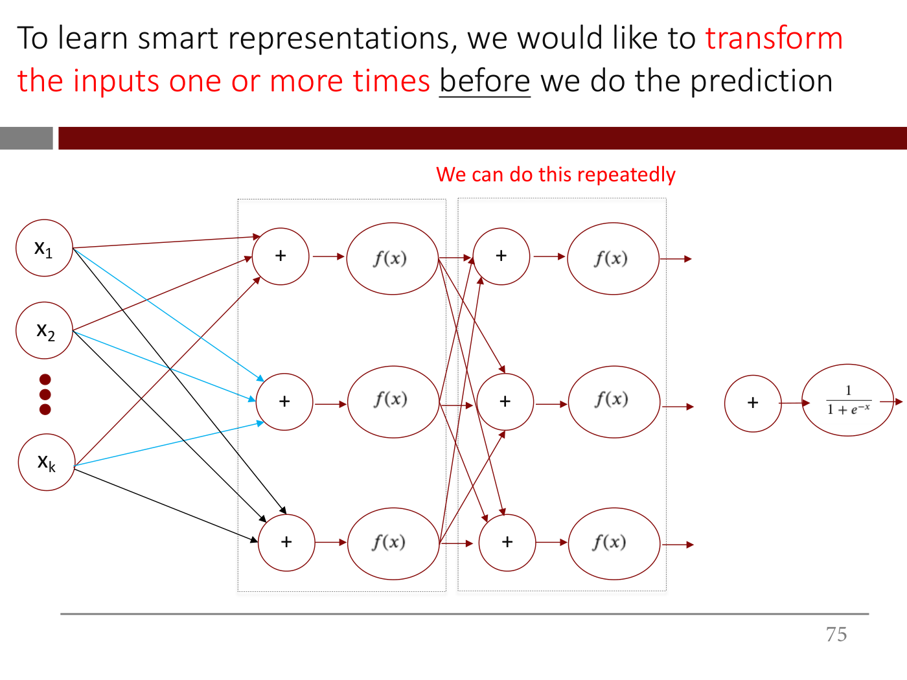

*Slide 75 — step 4: the same transformation repeated as a second stage, fully connected to the first.*

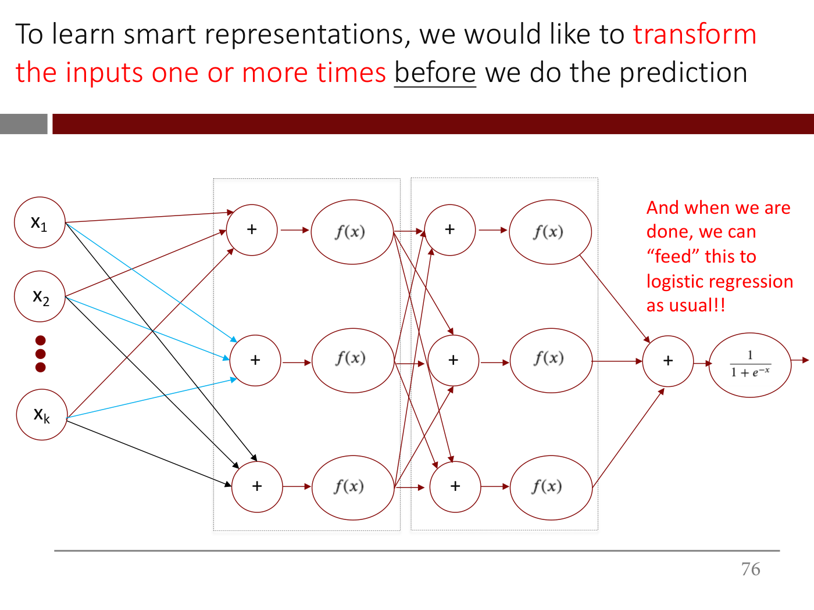

*Slide 76 — step 5: the second stage feeds the final + node and sigmoid, which is ordinary logistic regression.*

*Slide 77 — the key takeaway: instead of feeding the raw input to logistic regression, feed a repeatedly transformed input. The inputs and output are unchanged.*

"That's all we have done, and this is a neural network" (≈36:15; slide 78).

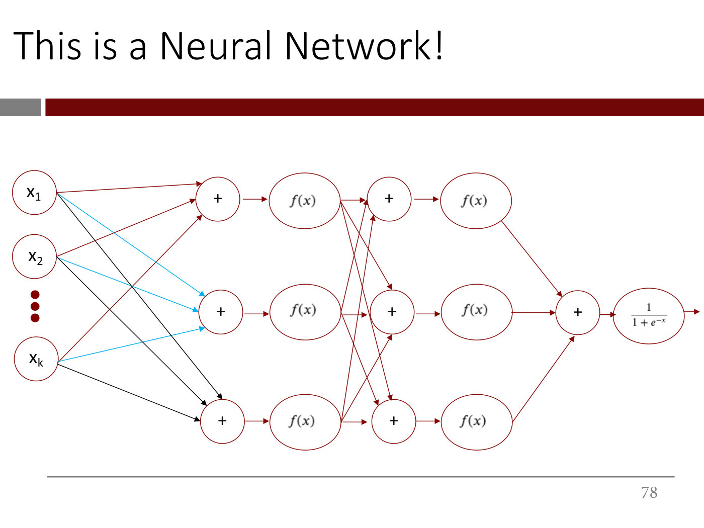

*Slide 78 — the finished picture: this is a neural network.*

Two questions followed (≈36:15–37:49). **Is a network unexplainable?** For any given input you know
exactly how it flows through the network. What you cannot easily do is give credit to any one input
attribute, because the attributes "all get enmeshed together". Explainability and interpretability
come later in the semester. **Who decides how many layers?** You do: some things are given to you
and some you design.

### Terminology: neurons, layers, activation functions, dense

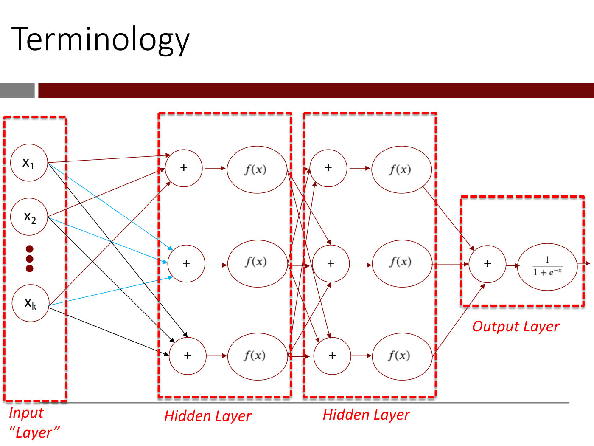

*Slide 83 — input "layer", two hidden layers, output layer. The input layer is in quotes because it does nothing.*

- A **neuron** (or **node**) is a linear function followed by a nonlinear activation (≈37:49;
  slide 79). It receives many numbers but sends out exactly one, which may be copied to every node
  in the next layer (≈48:46). The name is loosely inspired by brains (slide 80), where dendrites
  connect to other neurons' axons at synapses to form a network. But the link between neuroscience
  and deep learning is "very heavily argued", and the lecturer stays out of it (≈38:38).
- A **layer** is a vertical stack of neurons (≈38:38; slide 81).
- The little nonlinear functions are **activation functions** (slide 82).
- The inputs form the **input "layer"**, in quotes because it does not compute anything. The final
  layer is the **output layer**, and everything in between is a **hidden layer** (≈39:25; slide 83).
- A layer is **dense**, or **fully connected**, when every neuron in it is connected to every neuron
  in the next layer (≈39:25–40:11; slide 84).

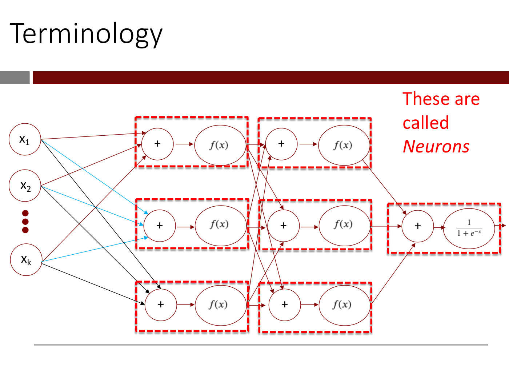

*Slide 79 — each dashed box is one neuron, a + node (linear function) followed by an activation.*

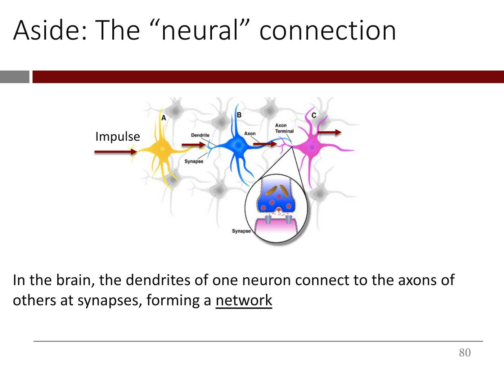

*Slide 80 — Aside: The "neural" connection. [Deck](https://ocw.mit.edu/courses/15-773-hands-on-deep-learning-spring-2024/mit15_773_s24_lec01.pdf)*

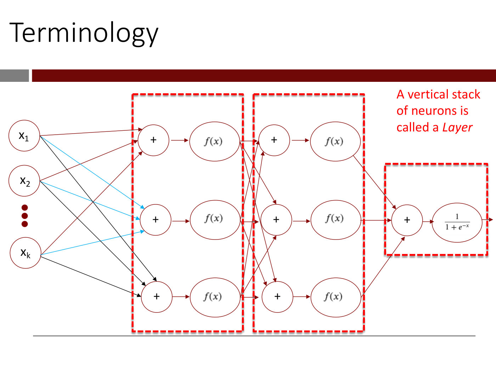

*Slide 81 — each dashed box is a layer, a vertical stack of neurons.*

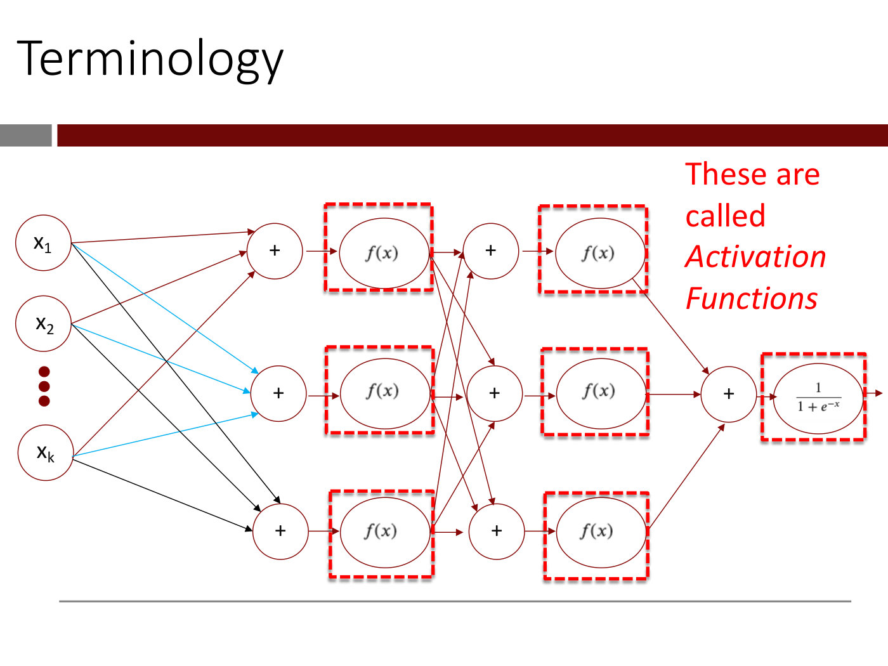

*Slide 82 — the boxed f(x) nodes and the final sigmoid are the activation functions.*

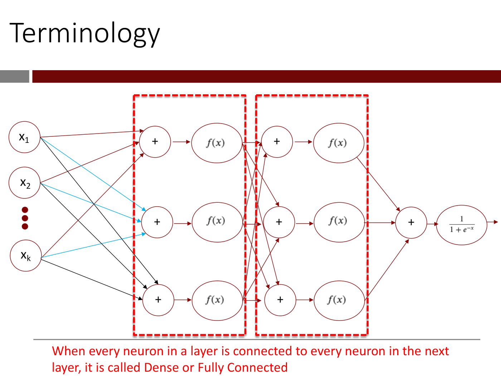

*Slide 84 — the two hidden stacks are dense (fully connected): every neuron feeds every neuron of the next layer.*

So **logistic regression is a neural network with no hidden layers**, "barely a neural network"
(≈40:11; slide 85). **Deep learning** is just neural networks with lots and lots of **hidden layers**
(≈40:58; slides 86–87). Slide 87 shows the ResNet paper's 34-layer architectures beside VGG-19. The
lecturer describes ResNet as, "I think, the first network to surpass human-level performance in
image classification", and the class will fine-tune it in a later session. See
[anatomy of a neural network](neural-network-anatomy.md).

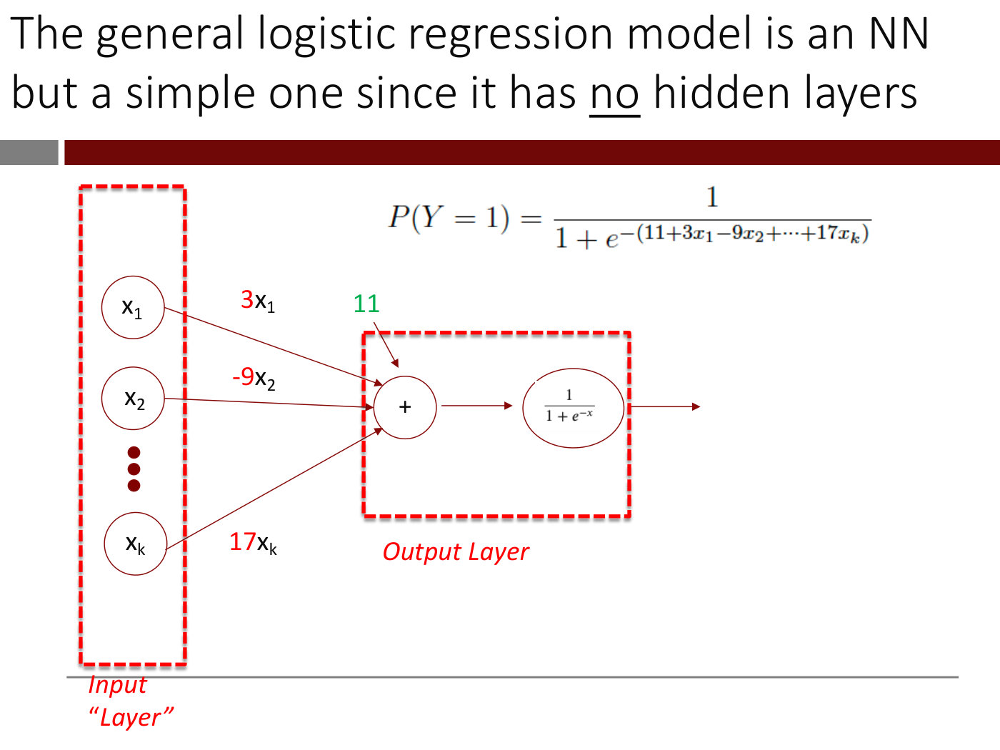

*Slide 85 — The general logistic regression model is an NN but a simple one since it has no hidden layers. [Deck](https://ocw.mit.edu/courses/15-773-hands-on-deep-learning-spring-2024/mit15_773_s24_lec01.pdf)*

## Activation functions

An activation function receives a **single number and outputs a single number**: "scalar in →
scalar out" (≈41:45; slide 89). The neuron's linear part may take 10 or 1,000 inputs, but it outputs
one number, and the activation transforms only that. Three are introduced (slides 90–92):

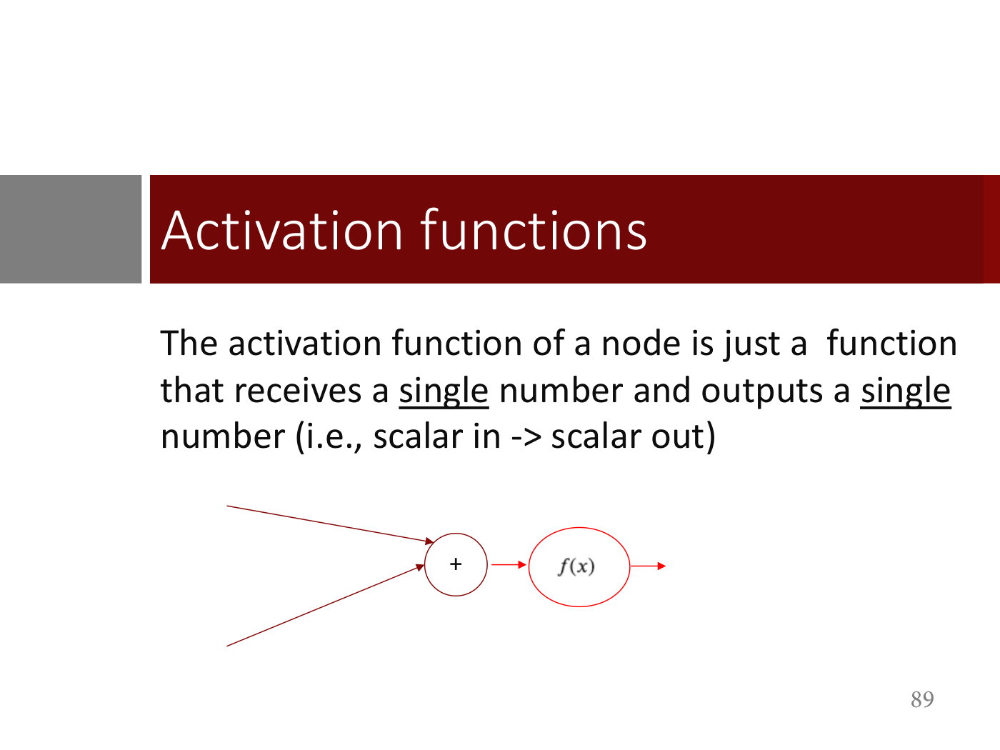

*Slide 89 — Activation functions. [Deck](https://ocw.mit.edu/courses/15-773-hands-on-deep-learning-spring-2024/mit15_773_s24_lec01.pdf)*

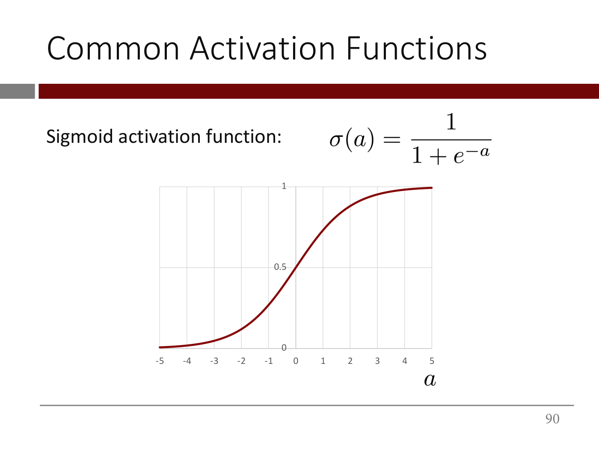

*Slide 90 — sigmoid: near 0 for very negative a, 0.5 at a = 0, near 1 for very positive a.*

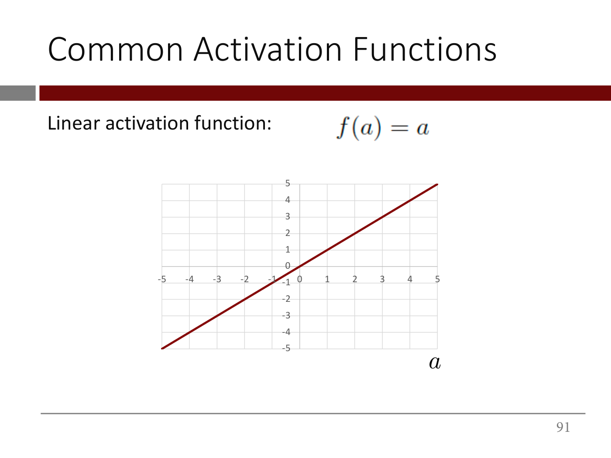

*Slide 91 — the linear activation passes its input straight through.*

- **Sigmoid**, $\sigma(a) = \frac{1}{1+e^{-a}}$. It is close to 0 for very negative $a$ (the node
  "won't get activated") and close to 1 for very large $a$, with "all the action" in the middle
  (≈41:45–42:32).
- **Linear**, $f(a) = a$, which passes the number straight through. The lecturer is "almost
  embarrassed to call it an activation function" and includes it for completeness (≈42:32–43:17).
- **ReLU**, the rectified linear unit, $g(a) = \max(0, a)$: positive numbers pass unchanged and
  negative ones become 0. "The ReLU is not impressed" if a million-variable linear function happens
  to output a negative number (≈43:17–44:03). He calls it "the hero of deep learning", and many
  long-time practitioners consider it one of the key factors in deep learning's success. He
  promises its properties for the next class. Lecture 2 gives one: its gradient is 1 for positive
  inputs, so gradients pass through it unharmed ([lecture 2](02-training-deep-nns.md) ≈1:15:48).

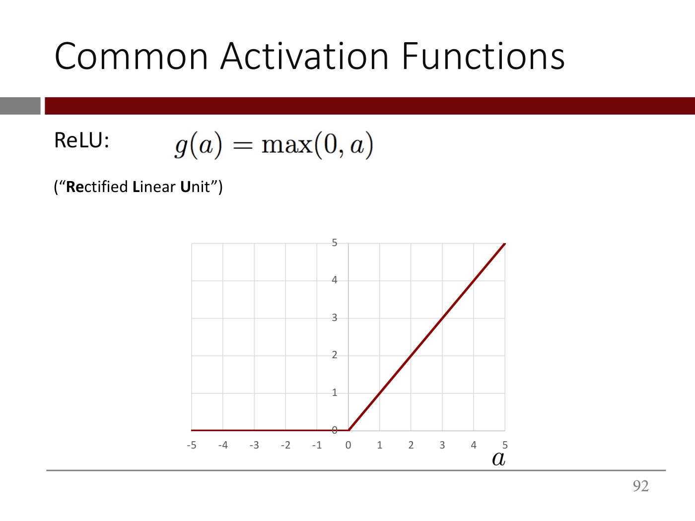

*Slide 92 — ReLU, the default activation for hidden layers: zero for negative inputs, the identity for positive ones.*

From here on a node is drawn with a small icon of its activation: a diagonal line for linear, a
hinge for ReLU, an S-curve for sigmoid (≈44:03–44:48; slide 93). Many other activations exist
(tanh, leaky ReLU, GELU, swish), "a menagerie", but "if you just stick to the ReLU for your hidden
layers, you can basically get anything done" (≈44:48).

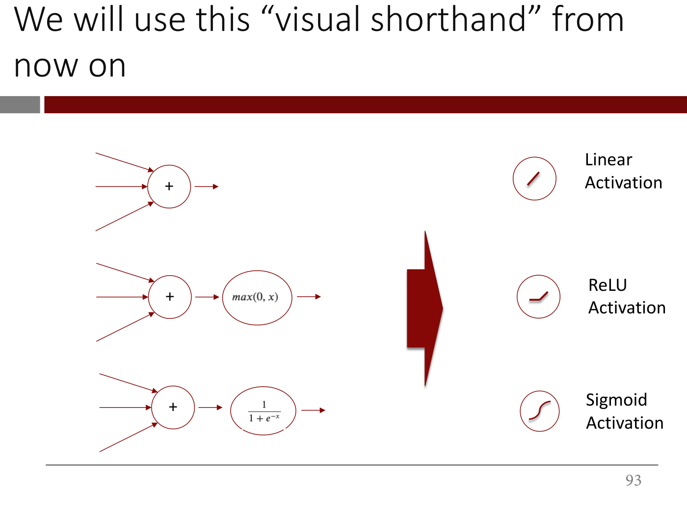

*Slide 93 — We will use this "visual shorthand" from now on. [Deck](https://ocw.mit.edu/courses/15-773-hands-on-deep-learning-spring-2024/mit15_773_s24_lec01.pdf)*

**How to choose** (≈45:37): use ReLU in the hidden layers, because empirically it does "an amazing
job". For the output layer you have no choice, because the kind of output dictates it. A single
probability between 0 and 1 needs a sigmoid, and ten probabilities that must sum to 1 need a
**softmax**, which he promises for the next class. Lecture 2 defers it again (≈17:54 there). See
[activation functions](activation-functions.md).

## Designing a deep neural network

"The input is the input, the output is the output", and you choose everything in between (≈45:37–46:27;
slide 94): the **number of hidden layers**, the **number of neurons in each**, and the **activation
functions** for the hidden layers, while making sure the output layer matches the kind of output you
need.

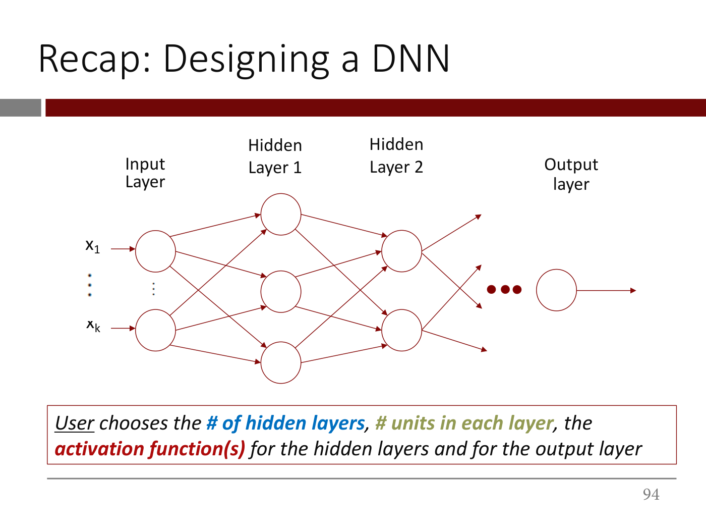

*Slide 94 — Recap: Designing a DNN. [Deck](https://ocw.mit.edu/courses/15-773-hands-on-deep-learning-spring-2024/mit15_773_s24_lec01.pdf)*

Three follow-up questions (≈46:27–48:46):

- **Can the network choose its own layers?** There is a field called **neural architecture search**
  (NAS) that searches over architectures, sometimes with reinforcement learning. But changing the
  number of layers between passes over the data during training is not done, because of how the
  optimization works. The closest thing is **dropout**, which randomly drops some nodes of a layer
  on each pass through the network. It is "a very effective technique to prevent overfitting" and
  comes later.
- **Who sets the weights?** The network does. Training data, a **loss function** and an optimization
  algorithm let the network find the weights that minimize prediction error. "We only have to set
  it up, sit back — often for many hours — and watch it do its thing." The details are in [lecture 2](02-training-deep-nns.md).
- **What exactly is a node?** A linear function followed by a nonlinear activation: many numbers in,
  one number out.

## Worked example: the interview classifier as a neural network

### The design

Return to the interview problem (≈49:33; slides 95–96). There are two inputs, GPA and experience,
and the output must lie between 0 and 1. Starting simple: **one hidden layer of 3 neurons with
ReLU**, since ReLU is the default for hidden layers, and a **sigmoid output**, because the output is
a probability (≈49:33–50:19).

### Counting parameters

How many parameters, weights plus biases, does this 2-3-1 network have (≈50:19; slide 98)? Students
guessed 12 and 9 before someone said **13**. The usual mistake is forgetting the biases (≈51:11).
There are $2 \times 3 = 6$ input-to-hidden weights and $3 \times 1 = 3$ hidden-to-output weights,
which makes 9. Add one bias for each of the three hidden neurons and one for the output neuron, and
the total is 13 (slide 99). The lecturer's advice: hand-count parameters the first few times you
meet a complex network, until it is automatic (≈51:59).

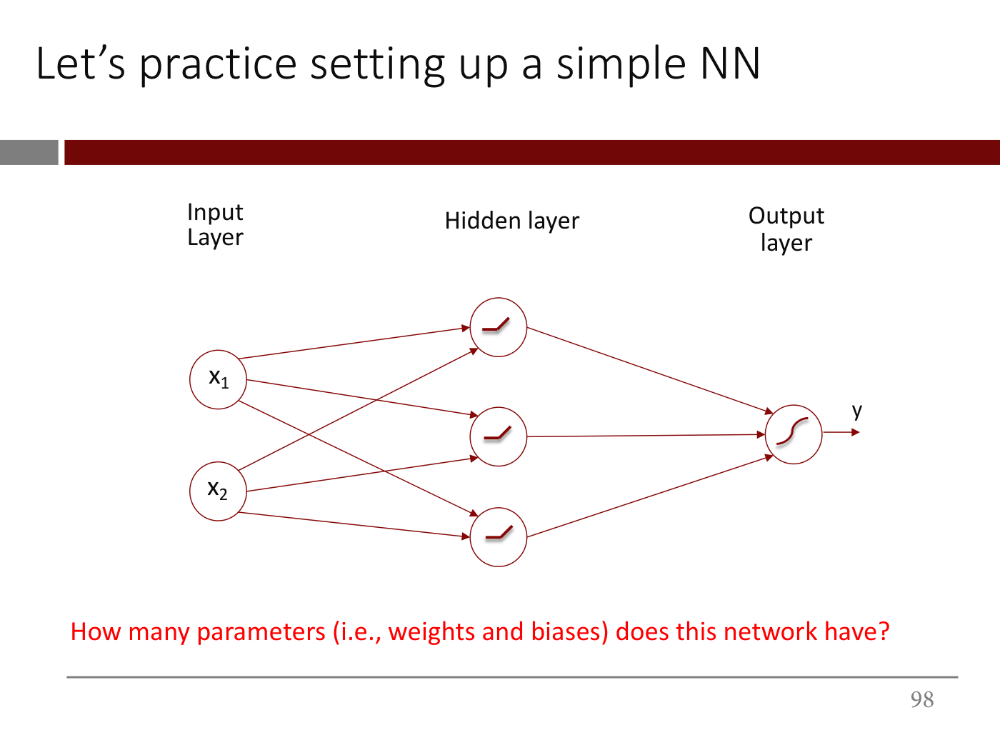

*Slide 98 — the 2-3-1 design: two inputs, three ReLU hidden neurons, one sigmoid output.*

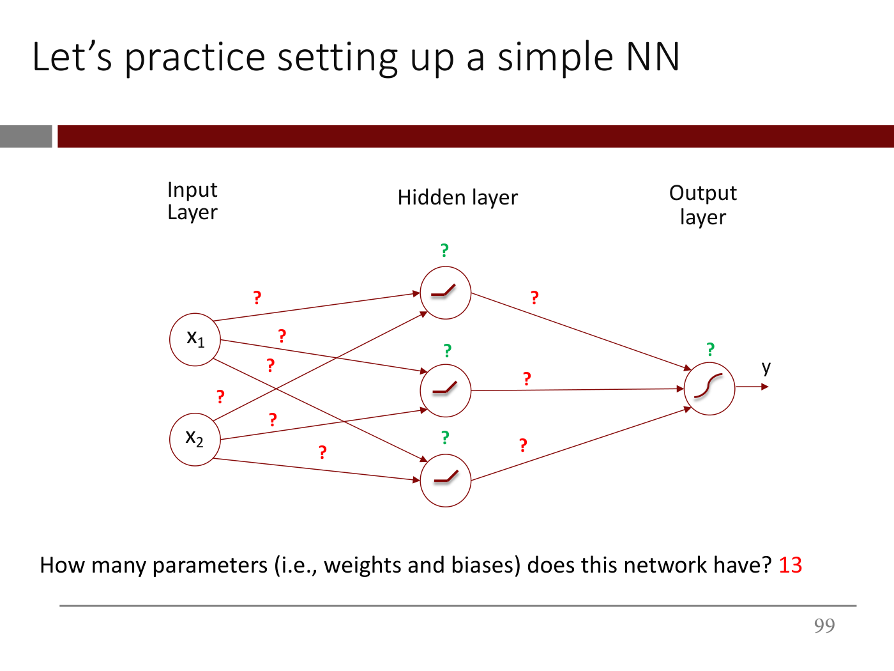

*Slide 99 — where the 13 parameters live: nine weights on the edges (red) and four biases on the hidden and output nodes (green).*

### Predicting with the trained network

Suppose training, covered in [lecture 2](02-training-deep-nns.md), has produced these values (≈51:59; slide 100):

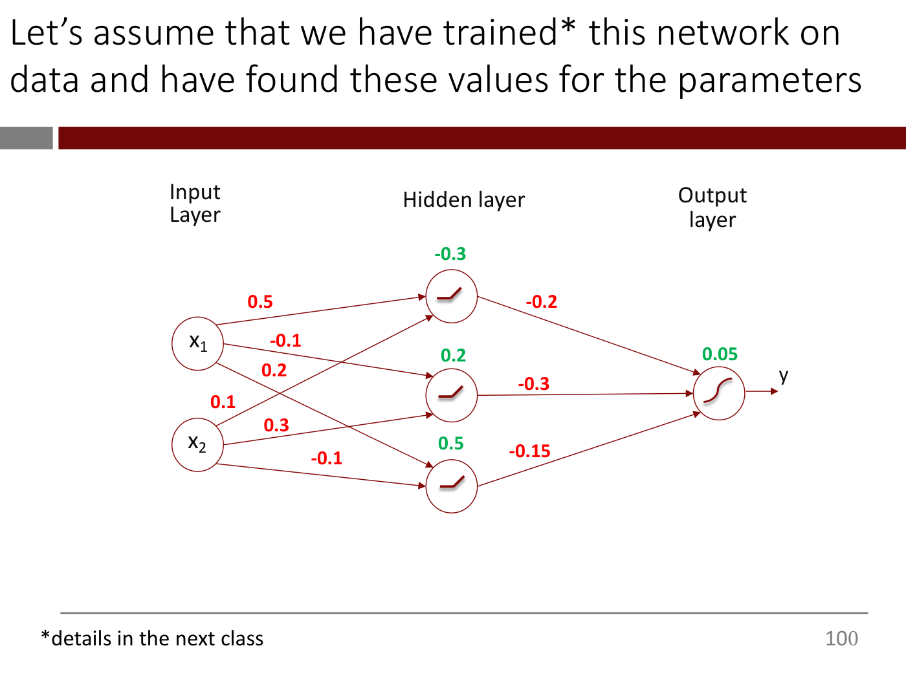

*Slide 100 — the trained network. Red numbers are weights on edges, green numbers are biases on nodes.*

Each hidden node computes a linear function of $x_1$ and $x_2$ and applies ReLU. Call their outputs
$a_1$, $a_2$, $a_3$ (≈52:45; slide 101):

$$a_1 = \max(0, -0.3 + 0.5x_1 + 0.1x_2)$$

$$a_2 = \max(0, 0.2 - 0.1x_1 + 0.3x_2)$$

$$a_3 = \max(0, 0.5 + 0.2x_1 - 0.1x_2)$$

The output node takes a weighted sum of those three, adds its bias, and applies the sigmoid
(slide 102):

$$y = \frac{1}{1+e^{-(0.05-0.2a_1-0.3a_2-0.15a_3)}}$$

The slides' worked input is $x_1 = 2.3$, $x_2 = 10.2$ (slide 103). Then
$a_1 = \max(0, -0.3 + 1.15 + 1.02) = 1.87$ and $a_2 = \max(0, 0.2 - 0.23 + 3.06) = 3.03$. The third
node's linear part is $0.5 + 0.46 - 1.02 = -0.06$, so ReLU outputs $a_3 = 0$. The output is
$y = 0.226$ (slide 104):

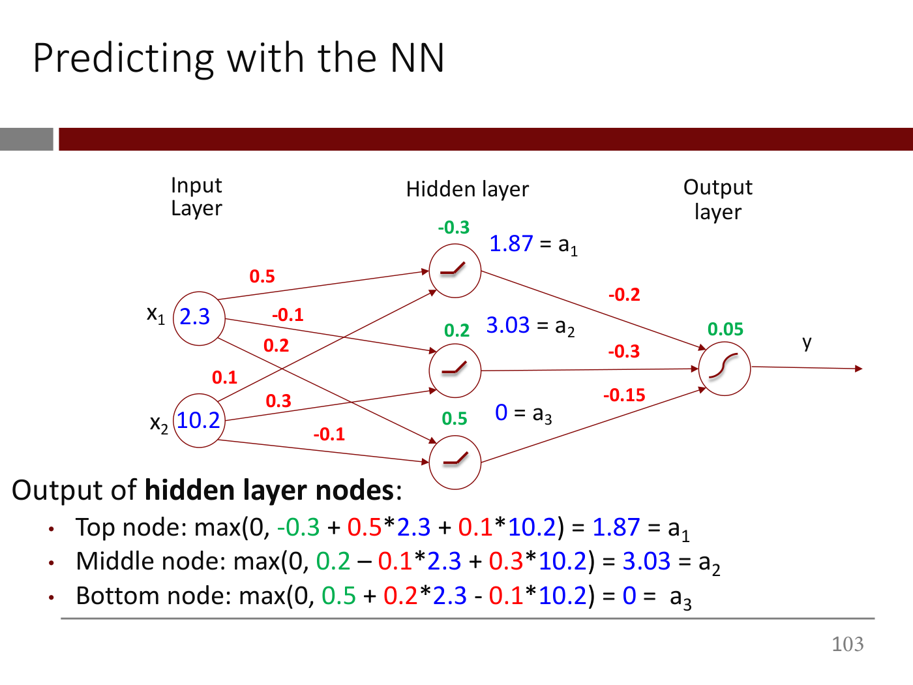

*Slide 103 — the hidden layer for x1 = 2.3, x2 = 10.2: a1 = 1.87, a2 = 3.03, and a3 = 0 after ReLU clips −0.06.*

$$y = \frac{1}{1+e^{-(0.05-0.2\cdot 1.87-0.3\cdot 3.03-0.15\cdot 0)}} = 0.226$$

The lecturer reads the result aloud as "22.6", meaning a 22.6% probability (≈53:31). He asks
students to go over slides 101–104 until the mechanics are "reflexive", because "when we get to
things like transformers, it's going to get hard" if they are not (≈52:45–53:31).

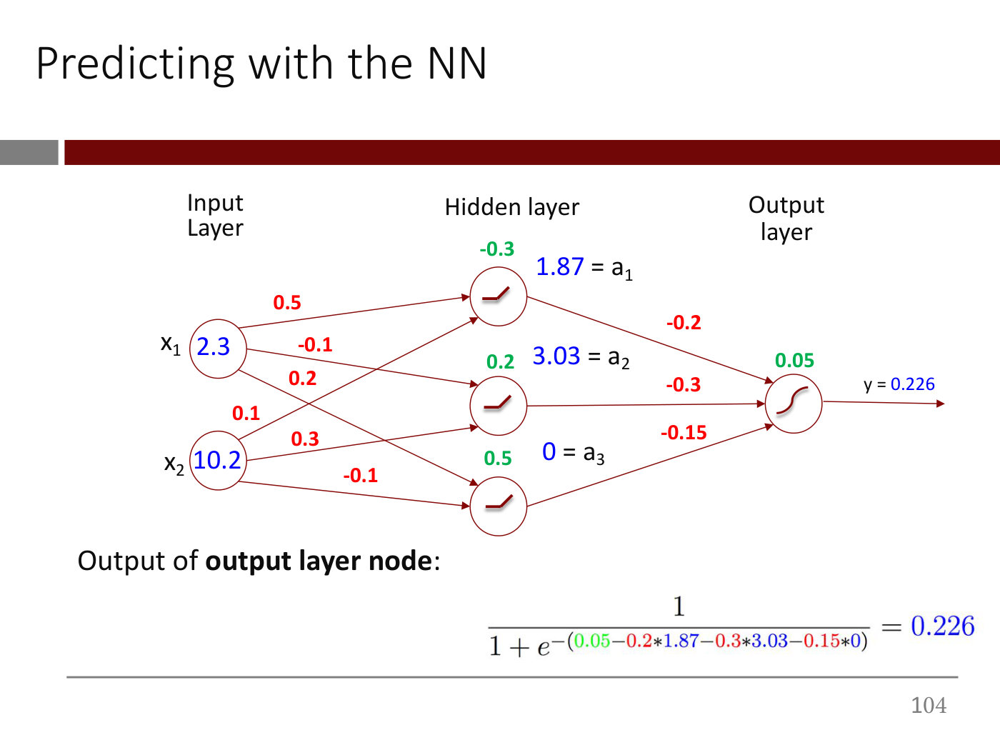

*Slide 104 — the full forward pass. The bottom hidden node outputs 0 because ReLU clips its negative input.*

### The network is a complicated function

Written out as one formula, the network is far messier than logistic regression (≈53:31–54:17;
slides 105–107). "Super interpretable, right?" is the lecturer's joke, and it is why the graphical
layout is easier to reason with. With the same two inputs, logistic regression is the simple
$\frac{1}{1+e^{-(0.4+0.2x_1+0.5x_2)}}$, while even this three-neuron network is a nest of `max`
terms inside a sigmoid. "It is from this complexity" that these networks get their ability to do
"magical things", provided you know how to train them, "the secret sauce" (≈54:17–55:02).

## Feedforward networks and architecture

A network in which data flows only from left to right is a **feedforward neural network**, in
contrast to **recurrent networks**. The course skips recurrent networks because transformers have
proven more capable (≈55:02; slide 108). The arrangement of neurons into layers, the activation
functions and the connections between layers are together called the network's **architecture**.
Transformers, the course's main focus later, and convolutional networks, coming soon for computer
vision, are particular architectures (≈55:02–55:49). Slide 109 restates the design rule: inputs and
outputs are given, and you choose the hidden layers, the neurons per layer and the activations.

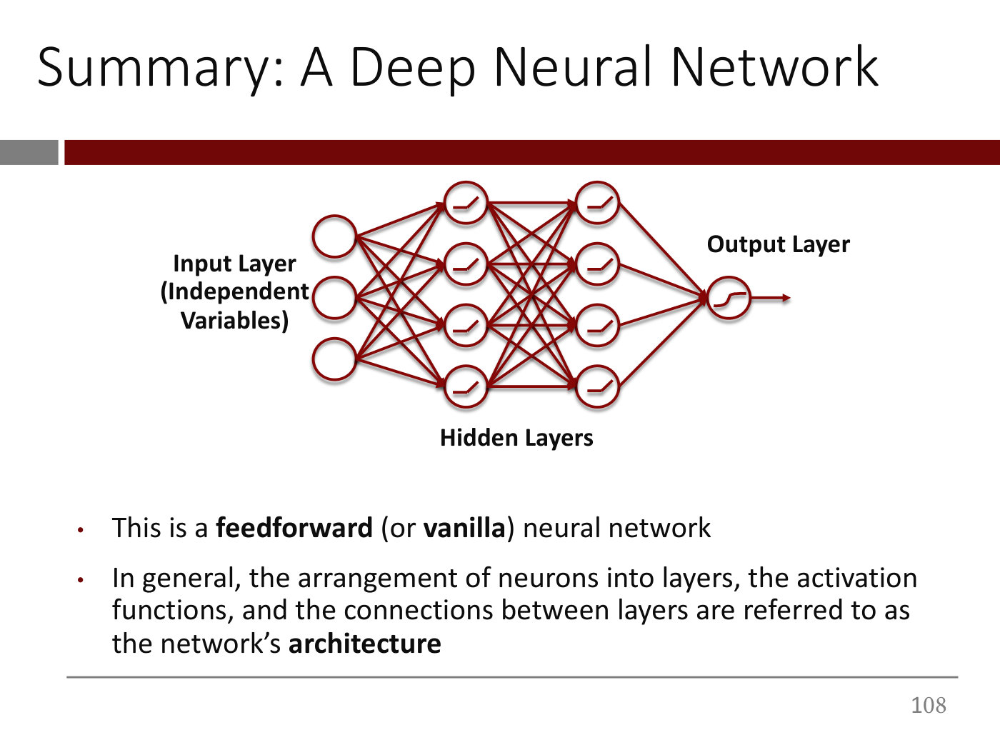

*Slide 108 — Summary: A Deep Neural Network. [Deck](https://ocw.mit.edu/courses/15-773-hands-on-deep-learning-spring-2024/mit15_773_s24_lec01.pdf)*

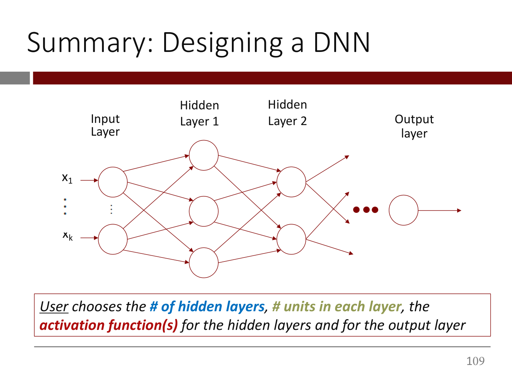

*Slide 109 — Summary: Designing a DNN. [Deck](https://ocw.mit.edu/courses/15-773-hands-on-deep-learning-spring-2024/mit15_773_s24_lec01.pdf)*

## Printed slips

- Slides 105 and 107 print the third hidden node as $\max(0.5+0.2x_1-0.1x_2)$, without the leading
  "0," argument, and the exponent's parentheses do not balance. The intended term is
  $\max(0, 0.5+0.2x_1-0.1x_2)$, as on slides 101 and 103.
- Slide 18 marks "statistical techniques" with an asterisk that has no footnote on that slide.
- Slide 44's generated caption reads "two cats laying on a pink blanket" (sic).

## Course logistics (slides 1–9, not in the recording)

The title slide credits the course to "Farias, Ramakrishnan" (slide 1). The prerequisites are
Python at the level of Kaggle's introductory Python course, plus basic machine learning concepts:
training, validation and testing, overfitting and underfitting, and regularization. 15.071 or
15.072, or equivalent experience, is enough (slide 2). Grading is 10% class participation, 50% for
two homework assignments at 25% each, and 40% for a final project (slide 3). Slide 4 introduces the
lecturer: Professor of the Practice in AI/ML, with an MIT PhD in operations research and several ML
startups behind him.

The course ("HODL") exists because deep learning is "one of the most exciting and profound
technology developments of our lifetimes", and Sloan students should know how to use it to build
products and transform businesses (slide 6). Its philosophy (slides 7–9): focus on concepts, skip
the math ("If you are looking for a 'mathy' DL course, this course won't be a good fit"), and focus
on coding, because that is the only way to get a "visceral" understanding. The aim is not to train
ML engineers, but to make you able to "build a V1.0 DL model by yourself".

## Related pages

- [AI, ML, deep learning and generative AI](ai-ml-dl-genai.md): the landscape from the first half.
- [Representation learning](representation-learning.md): why representations are "the whole name of
  the game".
- [Anatomy of a neural network](neural-network-anatomy.md): neurons, layers, weights and biases,
  parameter counting, the forward pass.
- [Activation functions](activation-functions.md): sigmoid, linear, ReLU, and how to choose.
- [Lecture 2](02-training-deep-nns.md): how such a network is trained, with loss functions,
  gradient descent, backprop and SGD.
