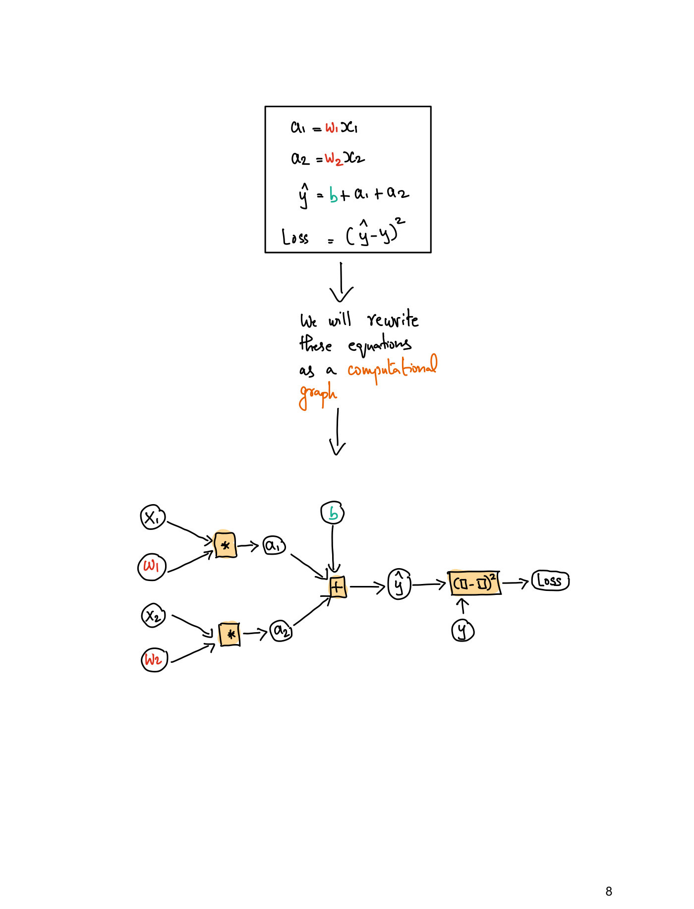
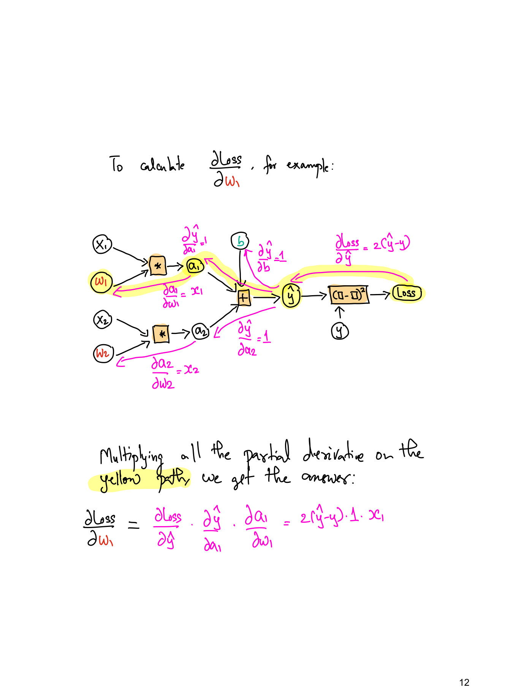

# Lecture 2 — Training Deep Neural Networks

**Lecturer:** Rama Ramakrishnan ·
**Video:** [youtube.com/watch?v=3Lr8nVUDCpk](https://www.youtube.com/watch?v=3Lr8nVUDCpk) (78 min) ·
**Slides:** [`mit15_773_s24_lec02.pdf`](https://ocw.mit.edu/courses/15-773-hands-on-deep-learning-spring-2024/mit15_773_s24_lec02.pdf)
(95 pages; transcribed in [`raw/slides/02-training-deep-nns.md`](../raw/slides/02-training-deep-nns.md)),
plus the handwritten
[`mit15_773_s24_lec02_backprop_example.pdf`](https://ocw.mit.edu/courses/15-773-hands-on-deep-learning-spring-2024/mit15_773_s24_lec02_backprop_example.pdf)
(14 pages; transcribed in [`raw/slides/02-backprop-example.md`](../raw/slides/02-backprop-example.md)) ·
**Transcript:** [`raw/transcripts/02-training-deep-nns.md`](../raw/transcripts/02-training-deep-nns.md)

## What this lecture establishes

The lecture has two parts. The first (0:00–19:25) takes a real problem, predicting heart disease
from patient records, designs a small network for it, counts its parameters, and writes the network
in four lines of Keras. The second (19:25–1:14:17) explains how such a network is trained. Training
means finding the weights and biases that minimize a **loss function**, a measure of how badly the
model's predictions miss the actual values. For a yes/no output the loss is **binary
cross-entropy**. It is minimized by **gradient descent**, which repeatedly steps each weight a
little way against its derivative. **Backpropagation** computes those derivatives efficiently
layer by layer, and **stochastic gradient descent** makes each step cheap by using a small random
minibatch of the data. The lecture closes on a one-picture summary of the whole training loop and
then takes questions until the end.

In the lecturer's words, this is "probably one of the driest" lectures of the semester, because
the concepts all have to come first (≈53:29). But the payoff is large: the same loop, he says, is
how the heart-disease model will be trained and how GPT, AlphaFold and AlphaGo were built (≈1:13:32).

The catalog titles this video "Training Deep NNs (cont.); Introduction to Keras/Tensorflow;
Application to Tabular Data". Keras appears only as the four-line model definition. The fuller
Keras/TensorFlow introduction and training the heart-disease model in a Colab are promised for
later and are not in this recording. At 1:15:03 the lecturer also defers regularization and
overfitting, for lack of time. All three open [lecture 3](03-keras-and-vision-basics.md).

**Slide numbers.** This page cites PDF pages. From PDF page 50 on, the deck prints a number one
higher than the page (page 60 prints "61"), because a hidden slide was never exported. The
handwritten backprop example is cited as "page N of the backprop example".

## Recap: designing a network

The previous lecture separated what the problem hands you from what you control. The input and the
output are given. You choose the number of hidden layers, the number of neurons in each, and the
activation functions, although for hidden layers the advice from lecture 1 stands: just use ReLU
(≈0:00–0:45; slide 2). The meta-rule for these choices is to **start with the simplest network you
can think of**. If it gets the job done, stop. If it is not good enough, make it slightly more
complicated (≈0:45–1:33). See [anatomy of a neural network](neural-network-anatomy.md).


*Slide 2 — the recap from lecture 1: inputs and outputs are given; you choose the number of hidden layers, the units in each and the activations.*

## Application: predicting heart disease

### The data

The case study uses a dataset of patients made available by the Cleveland Clinic (≈1:33–3:07;
slide 4). The patients came in for something other than a heart problem, perhaps just a physical,
and were measured: demographics such as age and sex, chest pain, blood pressure, cholesterol,
blood sugar and other biomarkers. The clinic then tracked whether each was diagnosed with heart
disease within the next year. A model could therefore flag, at an unrelated visit, someone likely to
be diagnosed soon. The slide lists 13 input columns (Age, Sex, CP, Trestbpd, Chol, FBS, RestECG,
Thalach, Exang, Oldpeak, Slope, CA, Thal), each marked numerical or categorical, plus the Target
column, "Diagnosis of heart disease (1 = true; 0 = false)". The full table is in the
[slide file](../raw/slides/02-training-deep-nns.md).

Random forests or gradient boosting could solve this just as well. Neural networks are used here
because structured data, "data sitting in the columns of a spreadsheet", is the warm-up before
images and text (≈3:07–3:53).

A student asked how to choose between logistic regression, tree-based models and a neural network
(≈3:53–5:30). The lecturer named two dimensions. One is how important it is to explain the model to
a possibly non-technical consumer: if they cannot understand it they will not use it, which favours
simpler models such as decision trees or logistic regression. The other is how much sheer
predictive accuracy matters. When it trumps everything else, use the more accurate model. Even black
boxes are not hopeless: a field called **mechanistic interpretability** tries to see inside them.

### Designing the network

With no hidden layer, a network with a sigmoid output is just logistic regression. The simplest
real neural network therefore has **one hidden layer** (≈5:30). The lecturer tried 4, 8 and 16
neurons ("for some reason, people always use powers of 2") and 16 did well. Above 16 the results got
worse, because of **overfitting**, a topic for later (≈5:30–6:15). The hidden neurons are ReLUs by
default. The output is a yes/no category, so the network emits a probability through a **sigmoid**
(≈6:15; slides 5–6).

The input layer has **29 nodes, not 13** (≈7:04; slide 7). Some of the 13 variables are categorical,
and each categorical variable is **one-hot-encoded**: a variable with five levels becomes five
columns (≈8:36). Encoding them all produces 29 inputs, and the Colab will show how. The drawing
leaves out the arrows, but every input connects to every hidden unit and every hidden unit to the
output (≈7:50–9:23). That full connectivity is the default for structured data. Image and language
models deviate from it later in the course (≈9:23).

Asked why 16 units, the lecturer said that it was trial and error. Asked why ReLU, he cited "a
mountain of empirical evidence" that ReLU is a good default for hidden layers, plus theoretical
results he returns to later (≈7:50–8:36). See [activation functions](activation-functions.md).

### Counting the parameters: 497

Get into the habit of counting parameters quickly, the lecturer says (≈9:23). One student first
answered 65, from a mistaken $2 \times 16$ for the first layer, and another worked it out correctly
(≈10:09). There are $29 \times 16$ weights from the inputs to the hidden layer, 16 hidden biases,
$16 \times 1$ weights to the output and one output bias:

$$29 \times 16 + 16 + 16 \times 1 + 1 = 497$$

(≈10:55; slide 10). The lesson he draws: between two fully connected layers of $A$ and $B$ units the
number of weights is on the order of $A \times B$. That is a "dramatic explosion" in parameters as
layers grow, and it has to be watched later to prevent overfitting (≈10:55–11:42).


*Slide 10 — the heart-disease network: 29 one-hot-encoded inputs, 16 ReLU hidden units and one sigmoid output, 497 parameters in all.*

## The network in Keras

The lecturer translates the drawing into Keras "to demonstrate how easy it is", while promising a
fuller introduction to Keras and TensorFlow, and training in Colab, later (≈11:42; slide 11). The
convention is to define the layers left to right (slide 12). The finished model is four lines:

```python
input = keras.Input(shape=29)
h = keras.layers.Dense(16, activation="relu")(input)
output = keras.layers.Dense(1, activation="sigmoid")(h)
model = keras.Model(input, output)
```

Those four lines are the whole network of slide 10, input to output (slides 27–28).


*Slide 27 — each line of Keras sits under the layer it defines, and the boxed last line wraps input and output into a model.*

Line by line (≈12:28–16:20; slides 13–27):

- `keras.Input(shape=29)` creates the input layer. It asks for a **shape** rather than a length
  because Keras inputs need not be vectors. Later they can be matrices, 3D cubes or 4D tensors.
  The layer's output is named `input`.
- `keras.layers.Dense(16, activation="relu")` defines the hidden layer. **Dense** means fully
  connected to the layers before and after it. The arguments give 16 neurons with ReLU activation.
  "See how compact and parsimonious it is", he says. A student asked whether a ReLU's bend has to
  be specified. It does not, since the bend is always at 0 (≈14:03).
- A layer defined this way does not yet know what feeds it. Calling it on `(input)` connects it to
  the input layer, and naming the result `h` makes it available to the next layer (≈14:03–14:48).
- The output layer is another `Dense`, with **one** unit, because one probability is needed, and a
  **sigmoid**. Calling it on `(h)` connects it to the hidden layer, and its result is named
  `output` (≈14:48–15:34).
- `keras.Model(input, output)` formally defines a model object from its input and output, which
  Keras can then train, evaluate and use for prediction (≈16:20).

"Four lines", and that is the whole model. Training it with real data waits until after the
conceptual building blocks (≈16:20; slide 28). See [Keras](keras.md).

Questions about the code (≈17:08–19:25):

- **Custom activation functions** are possible. These "innocent four lines" hide a lot of
  flexibility, and the lecturer promises that within two or three weeks students will be thinking
  "in building blocks like LEGOs", designing networks that fork and merge.
- **Multi-class classification**, say into 10 classes, needs 10 output units and a function called
  **softmax**, which he defers to "Monday". This lecture stays with binary classification;
  [lecture 3](03-keras-and-vision-basics.md) covers softmax.
- **Is there a default activation in Keras?** He believed it "might be ReLUs for hidden layers" but
  was "not 100% sure" and said he would double-check. The lecture does not return to it.
- **A network with 100 layers** is not typed out by hand: a little loop creates the layers. The
  `output` variable can stand at the end of a 1,000-layer stack of transformations, and Keras handles
  all of it. He calls this "a beautiful example of the power of abstraction".

## What training means

Training a neural network is the same idea as fitting a regression (≈19:25–20:58; slides 30–32).
In linear regression you supply the model's form plus data, R's `lm` (or `glm` for logistic
regression, or scikit-learn or statsmodels) returns coefficients such as 2.8 and 0.89, and you can
think of the coefficients as "a compressed version of the data". **Training means finding the values
of the coefficients so that the model's predictions are as close to the actual values as possible.**
Regression hides the optimization under the hood. For neural networks the course opens the hood,
because it matters (≈20:58).

A deep network, "even GPT-4", is trained by the same process. It is just a very complicated function
with lots of parameters: a network of question marks, plus data, gives a network of numbers (≈20:58;
slide 33). The trained values shown are the same as the 2-3-1 network lecture 1 used for its forward
pass. A student asked whether the architecture is fixed before training. It is, because without it
Keras cannot compute an output from an input (≈21:43).


*Slide 33 — training turns a network of question marks into a network of numbers: red weights on the edges, green biases on the nodes.*

## Loss functions

### What a loss function measures

"The best values" for the weights and biases are those that minimize a function measuring the
**discrepancy** between actual and predicted values (≈21:43–22:30; slide 34). The lecturer chooses
"discrepancy" over "error" on purpose. "Predicted minus actual" is too narrow, and defining a clever
measure of discrepancy is where many deep learning breakthroughs have come from. These functions are
called **loss functions**. There are hundreds, and "every paper that you read, you will find
interesting loss functions" (≈22:30).

If the predictions are close to the actual values the loss is small, and a perfect model would have
a loss of exactly zero (≈22:30–23:15; slides 36–37). Linear regression's "sum of squared errors" is
a loss function under another name (slide 38). The loss must be **matched to the kind of output**
the model produces (slide 39). See [loss functions](loss-functions.md).

### Mean squared error, for numerical outputs

If you predict next week's demand for a product as 23 and the actual value is 21, the difference
is a perfectly reasonable discrepancy (≈23:15–24:01). Square it for every data point and average to
get the **mean squared error** (slide 40):

$$\frac{1}{n}\sum_{i=1}^{n}\left(y^i - model(x^i)\right)^2$$

Here $n$ is the number of data points, $y^i$ is the actual value of the $i$-th data point and
$model(x^i)$ is the model's prediction for its inputs $x^i$. The superscript $i$ indexes data
points. It is not a power (≈24:01).

### Binary cross-entropy, for a probability output

In the heart-disease model the prediction is a probability between 0 and 1, from the sigmoid, while
the actual value is 0 or 1. How should the discrepancy between a fraction and a 0/1 label be
measured (≈24:47; slide 41)? The lecturer builds the answer on his iPad.

**A patient with heart disease, $y = 1$** (≈25:33–27:49; slide 42). If the predicted probability is
close to 1, the loss should be close to 0. If it is close to 0, the model is "screwing up badly" and
the loss should be very high. So the loss should fall as the predicted probability rises, and fall
steeply: predicting one in a million for a patient who has the disease should be "a huge rap on the
knuckles". A student asked whether the curve could be linear. It could, he said, but a curved,
steep loss is more effective for gradient descent later. The function with this shape is

$$\text{loss} = -\log(\text{predicted probability})$$

(≈28:36; slide 43). Slide 43 tabulates it: a predicted probability of 1 gives a loss of 0.0, 1/2
gives 1.0, 1/10 gives 3.32 and 1/1000 gives 9.97. (Those values are base-2 logarithms, for example
$-\log_2(1/1000) = 9.97$. Neither the slide nor the lecture names the base.)

**A patient without heart disease, $y = 0$** (≈27:49–29:22; slides 44–45). Now the loss should be
near 0 when the predicted probability is near 0 and climb steeply as it approaches 1. That is

$$\text{loss} = -\log(1 - \text{predicted probability})$$

which slide 45 tabulates as 0.001 at 1/1000, 0.15 at 1/10, 1.0 at 1/2 and 19.93 at 0.999999.
"Mathematicians, once again, saved by the logarithm" (≈29:22). Slide 46 sets the two curves side by
side: falling for $y = 1$, rising for $y = 0$.


*Slide 46 — the two halves of binary cross-entropy: −log(p) punishes a low probability when y = 1, and −log(1 − p) punishes a high one when y = 0.*

**One expression for both** (≈29:22–31:40). An if-then rule ("if $y = 1$ use this,
otherwise that") irks the lecturer, because it makes derivatives awkward, so the two cases are
combined:

$$-y^i \log\left(model(x^i)\right) - (1 - y^i)\log\left(1 - model(x^i)\right)$$

where $model(x^i)$ is now the predicted probability for the $i$-th data point. Plug in $y^i = 1$ and
the second term vanishes, leaving $-\log(model(x^i))$. Plug in $y^i = 0$ and the first term
vanishes, leaving $-\log(1 - model(x^i))$. "No if-thens." Slide 47 draws an arrow from each case to
its term.


*Slide 47 — one expression covers both cases: when y = 1 only the first term survives, and when y = 0 only the second.*

**Average over the data** (≈31:40; slides 48–49). Averaging over all $n$ data points gives the
**binary cross-entropy loss**:

$$\frac{1}{n}\sum_{i=1}^{n} -y^i \log\left(model(x^i)\right) - (1 - y^i)\log\left(1 - model(x^i)\right)$$

If a large network from Google does binary classification, "chances are they're using this thing"
(≈32:25).

Questions on this part (≈31:40–35:33):

- **Penalizing one kind of mistake more**, such as false negatives, is possible. The basic loss is
  symmetric, but you can penalize overestimates much more than underestimates. He suggests looking up
  the **pinball loss**.
- **The loss is per data point, then averaged.** One student had lost the thread, and the lecturer
  reset it: define the loss for a single data point, compute it for every point, average. The loss
  says how *bad* the model is, and optimization minimizes badness.
- **Why a logarithm** rather than some other steep curve? Other choices work too. This one is easy to
  work with, "has good gradients", is well-behaved mathematically, and is empirically very
  effective. "This is not the only game in town."

## Minimizing a function: gradient descent

Loss functions are just functions, so the lecture first asks how to minimize an arbitrary function,
then returns to the loss (≈32:25; slides 50–51). See [gradient descent](gradient-descent.md).

### One variable, and what the derivative tells you

The toy function is a quartic (slide 52):

$$g(w) = \frac{1}{50}\left(w^4 + w^2 + 10w\right)$$

Its plot has a single minimum. The lecturer eyeballs it "between minus 1 and minus 2, maybe minus
1.5", and the slide's derivative plot crosses zero a little left of $-1$ (≈35:33). "The intuition we
use here is going to be exactly what we use for GPT-4, so pay attention."

A student proposed taking the derivative and setting it to zero. The derivative is the right idea,
the lecturer said, but setting it to zero fails for complicated functions, where it is not at all
clear what makes the derivative zero (≈35:33–36:18). The derivative here is

$$\frac{\partial}{\partial w} g(w) = \frac{2}{25}w^3 + \frac{1}{25}w + \frac{1}{5}$$

and it crosses zero exactly where $g$ has its minimum (≈36:18; slides 53–55).


*Slide 55 — the quartic g(w) above and its derivative below; the derivative crosses zero where g has its minimum.*

The derivative (or slope) tells you the change in $g(w)$ for a small increase in $w$ (≈37:06; slide
55). That gives three cases (≈37:06–38:38):

| If the derivative at a point $w$ is … | What it means |
| --- | --- |
| Positive | Increasing $w$ slightly will increase $g(w)$ |
| Negative | Increasing $w$ slightly will decrease $g(w)$ |
| ~0 | Changing $w$ slightly won't change $g(w)$ |

Slides 56–58 mark each case on the plot of $g(w)$: a tangent sloping up on the right, a tangent
sloping down on the left, and a flat tangent at the minimum.


*Slide 56 — a positive derivative: the tangent slopes up, so increasing w increases g(w).*


*Slide 57 — a negative derivative: the tangent slopes down, so increasing w decreases g(w).*


*Slide 58 — a derivative of about zero at the minimum: changing w slightly leaves g(w) unchanged.*

### The algorithm

Those cases suggest an algorithm for minimizing $g(w)$ (≈37:52–39:26; slides 59–63). Start at some
point $w$ and calculate the derivative there. If it is positive, reduce $w$ slightly. If it is
negative, increase $w$ slightly. If it is close to 0, stop. Then, unless you have reached the
maximum number of iterations or run out of time, go back to the derivative step. This is
**gradient descent**, and the "PowerPointy MBA table" collapses into one line (≈40:13; slide 64):

$$w \leftarrow w - \alpha \frac{dg(w)}{dw}$$

The new $w$ is the old $w$ minus a small number $\alpha$ times the derivative. Check that the formula
reproduces the three cases: a positive derivative lowers $w$, a negative one raises it, and a
derivative near zero leaves $w$ almost where it is.

This, the lecturer stresses, "is the basic intuition behind how GPT-4 was built". Decades of
heavy-duty optimization methods are largely unused. What is used is this algorithm "with some
flavors on top of it" (≈38:38–39:26). Gradient descent was invented in **1847 by Cauchy** (≈40:59;
slide 66), so "GPT-4 is built using an algorithm invented in 1847".


*Slide 66 — gradient descent dates to Augustin-Louis Cauchy, 1847.*

### The learning rate

The number $\alpha$ is the **learning rate** (≈41:44; slide 67). It keeps each step small, because
the derivative only describes the function near the current point: "if you take a big step, all bets
are off". Typical values are small. The lecturer says 0.1 or 0.01, and the slide lists 0.1, 0.001
and 0.0001, "determined by trial and error". Researchers reading a paper often go straight to the
appendix to see which learning rates were used, because "the learning rate is part of the IP"
(≈41:44–42:30).

A student later asked whether $\alpha$ depends on the compute available (≈51:54–53:29). Not really,
the lecturer said. The step size reflects how confident you are that the function keeps going down
in the current direction: confident, take a big step; unsure, take a small one to avoid
backtracking. It does get "jumbled up" in practice, since some data allow very aggressive learning
rates.

### Gradient descent in action

Applied to $g(w)$ from a starting point of $w = 2.5$ with $\alpha = 1$, the algorithm reaches the
minimum "in, like, four or five iterations" (≈42:30–43:16; slides 68–69). The slide's markers run
from green at the start to red at the end and crowd together as they approach the minimum. The
mlrefined page cited on the slide has an animation. (From the slide's formulas, the first step
moves $w$ from 2.5 to $2.5 - 1 \cdot 1.55 = 0.95$, and the next to about 0.64. Steps shrink as the
slope flattens, which is why the markers bunch up.)


*Slide 69 — gradient descent from w = 2.5 with α = 1: circles mark w, crosses mark g(w), green at the start and red at the minimum.*

### Many variables: the gradient

A real loss function has as many variables as the network has parameters: GPT-3 has 175 billion,
and GPT-4 is "supposed to be 8 times as much" (≈43:16). With more than one variable you need
**partial derivatives** (≈44:06–44:55; slides 70–72). For

$$g(w_1, w_2) = w_1^2 + w_2^2 + 2$$

the partial derivative with respect to $w_1$ treats $w_2$ as a constant and differentiates as usual,
and likewise for $w_2$:

$$\nabla g = \left[\frac{\partial g}{\partial w_1}, \frac{\partial g}{\partial w_2}\right] = [2w_1, 2w_2]$$

The first number is the change in $g$ for a small increase in $w_1$ with $w_2$ held fixed, and the
second is the same for $w_2$. Stacked into a vector, they are the **gradient**, written with the
symbol nabla, $\nabla$ (≈44:55–45:41).

Gradient descent then simply runs on every coordinate with its own partial derivative (≈45:41–47:14;
slides 73–74):

$$w_1 \leftarrow w_1 - \alpha \left(\frac{\partial g}{\partial w_1}\right) \qquad w_2 \leftarrow w_2 - \alpha \left(\frac{\partial g}{\partial w_2}\right)$$

which in vector form is

$$w \leftarrow w - \alpha \nabla g(w)$$

Whether the vector has 2 entries or 175 billion, the formula is the same (≈47:14). Slide 75 shows
this function in two dimensions, as a bowl-shaped 3D surface and as a contour plot, with the path of
gradient descent converging on the centre (≈48:00). Those figures carry an OCW exclusion notice
and are described in the [slide file](../raw/slides/02-training-deep-nns.md) rather than shown here.

### Local minima and saddle points

Gradient descent stops where the gradient is close to zero, and that need not be the global minimum
(≈48:00–50:22; slide 76). The lecturer drew a function with many local minima on his iPad. Gradient
descent could stop at any of them, with no guarantee of reaching the lowest. It could also stop at a
**saddle point**, a place where the function flattens out, "taking a break", and then continues
downward.

In practice "it has not mattered", for several reasons (≈50:22–51:54):

- For very complex networks even a **decent** solution solves the problem well. The best possible
  solution on the training data also risks **overfitting**.
- Big models are often simply stopped when the budget runs out. Of GPT-4 he imagines someone saying, after six
  days and two million dollars, "let's stop", without getting anywhere near a local minimum. Why this works so well is still "a very hot area of research".
- In very high dimensions a true local minimum is unlikely. It requires the function to slope
  upward in every one of a billion directions at once. Far more likely, some directions go up and
  some go down, so the best you can hope for is probably a saddle point, "and it turns out, it's
  good enough".

A later question asked whether reaching the global minimum would eliminate hallucinations
(≈1:03:29–1:04:15). No. A global minimum does not mean the model is perfect, because it can still
have some loss. More importantly, the minimum is of the **training** loss. Future data effectively
has its own loss function, whose minimum is elsewhere, so the training optimum can do badly on test
data. That is overfitting.

## Minimizing the loss function itself

Back to the binary cross-entropy loss (≈53:29–56:35; slide 77). Which variables do we change to
minimize it? Not $x$ and $y$, which are just data. The variables are the weights and biases "hiding"
inside $model(x^i)$. The lecturer calls them all weights for short (≈54:15). For lecture 1's 2-3-1
network the model is

$$model(x^i) = \frac{1}{1 + e^{-(w_1 + w_2 \max(0, w_3 + w_4 x_1^i + w_5 x_2^i) + w_6 \max(0, w_7 + w_8 x_1^i + w_9 x_2^i) + w_{10}\max(0, w_{11} + w_{12} x_1^i + w_{13} x_2^i))}}$$

with $w_1, \ldots, w_{13}$ its 13 parameters and $x_1^i$, $x_2^i$ the two inputs of the $i$-th data
point (slide 79). Substitute this wherever $model(x^i)$ appears in the loss, and "your loss function is just a
'good old' function of $w_1, w_2, \ldots, w_{13}$", to which gradient descent applies as usual
(≈55:48–56:35; slides 80–81).


*Slide 79 — the loss's only variables are the 13 weights and biases inside model(xⁱ), which is lecture 1's network written as one formula.*

Those weights are what training produces. When Meta "made the weights of Llama 2" available, that
is what it published (≈54:15–55:03). The weights are "the crown jewel", the result of a lot of
money, time and smartness, so publishing them is significant.

## Backpropagation

"Never use the word backpropagation again. Only use the word backprop", the lecturer jokes, if you
want to sound "hip and cool" to the deep learning community (≈56:35). **Backprop is a very efficient
way to compute the gradient of the loss function** (slide 82). With a billion weights and, say, 10
million data points, computing the gradient is a lot of work, and it is needed for every single step
of gradient descent (≈56:35–57:22).

The efficiency comes from exploiting the network's layer-by-layer structure (≈57:22–58:10; slides
82–83). Backprop organizes the computation as a **computational graph**. It starts at the very end,
with the gradient of the loss with respect to the output, then steps left to the gradient with
respect to the previous layer's output, and so on, moving backwards. Working this way means:

- **No calculation is repeated wastefully.** Each intermediate result is computed once and reused
  many times.
- **The work becomes a sequence of matrix multiplications.**

**GPUs**, invented to accelerate video game rendering, do exactly that core operation fast. When
someone tried them for deep learning, "all hell broke loose", and that, he says, is why NVIDIA is
valued at about 1.5 trillion dollars (≈58:10–58:55; slides 84–86). Backprop plus GPUs gives fast
calculation of loss function gradients: "if this thing were not true, this class would not exist"
(≈59:40).

Asked why the calculation starts at the output (≈1:10:26–1:11:14): going the other way, many paths
from left to right would recompute the same intermediate quantities "again and again and again".
Starting from the end lets you reuse what has already been calculated. It is done **once per
gradient calculation**, not looped. Mathematically, backprop is "a way to organize the chain rule"
of calculus to fit the layer-by-layer architecture. The slides point to sections 2.4.3 and 2.4.4 of
the textbook for detail (slide 85). See [backpropagation](backpropagation.md).

### The worked example (handwritten deck)

The lecturer skipped his hand-worked example for lack of time and pointed students to it (≈59:40;
slide 87). It computes one gradient "the old-fashioned way" and then with backprop.

The network has two inputs, no hidden layer and a linear output, with a squared-error loss for one
data point (pages 1–2 of the backprop example):

$$\text{model}(x_1, x_2) = b + w_1 x_1 + w_2 x_2 \qquad \text{Loss} = (b + w_1 x_1 + w_2 x_2 - y)^2$$

Here $w_1$ and $w_2$ are weights, $b$ is the bias and $y$ the actual value. **The old-fashioned
way** differentiates directly (page 3):

$$\frac{\partial \text{Loss}}{\partial w_1} = 2(b + w_1 x_1 + w_2 x_2 - y)x_1$$

and similarly $2(b + w_1 x_1 + w_2 x_2 - y)$ for $b$ and $2(b + w_1 x_1 + w_2 x_2 - y)x_2$ for $w_2$.

**Reorganized** with intermediate variables $a_1 = w_1 x_1$, $a_2 = w_2 x_2$ and
$\hat{y} = b + a_1 + a_2$, the loss is $\text{Loss} = (\hat{y} - y)^2$ and the **chain rule** splits
each derivative into small local pieces (pages 4–5):

$$\frac{\partial \text{Loss}}{\partial w_1} = \frac{\partial \text{Loss}}{\partial \hat{y}} \cdot \frac{\partial \hat{y}}{\partial a_1} \cdot \frac{\partial a_1}{\partial w_1}$$

Each piece is easy (page 6): $\frac{\partial \text{Loss}}{\partial \hat{y}} = 2(\hat{y} - y)$, the
derivatives of $\hat{y}$ with respect to $b$, $a_1$ and $a_2$ are all 1,
$\frac{\partial a_1}{\partial w_1} = x_1$ and $\frac{\partial a_2}{\partial w_2} = x_2$. Multiplying
gives $2(\hat{y} - y) \cdot 1 \cdot x_1$, which matches the old-fashioned answer (page 7).

**Backprop** writes the same equations as a computational graph, with inputs and weights on the
left, multiply and add nodes in the middle, and the loss on the right (page 8). Each local
derivative is attached to its edge, pointing backwards (pages 9–10).



*Page 8 of the backprop example — the four equations redrawn as a computational graph, inputs on the left and the loss on the right.*

To get $\frac{\partial \text{Loss}}{\partial \text{any parameter}}$, "start from the loss and travel
backwards to the parameter, multiplying the partial derivatives as you go". This is called
backpropagation (page 11). For $w_1$ the path runs Loss → $\hat{y}$ → $a_1$ → $w_1$, and the product
along it is $2(\hat{y} - y) \cdot 1 \cdot x_1$ (page 12).



*Page 12 of the backprop example — follow the yellow path backwards from Loss to w1 and multiply the magenta derivatives on it: 2(ŷ − y) · 1 · x1.*

It matches, "YES!!", and page 13 lists why backprop is efficient. The factor
$\frac{\partial \text{Loss}}{\partial \hat{y}}$ is calculated once and used on every path. With more
than one neuron per layer, traversing backwards is a series of matrix multiplications. And "GPUs are
perfect for matrix multiplications!!"

## Weight initialization

Training starts from random weights, but "randomly doesn't mean you can just pick any random
weight" (≈1:01:56–1:02:44). Good **initialization schemes** exist and are built into Keras as
defaults. The lecturer believed Keras uses "HE initialization" or "the Xavier Glorot
initialization", and advised just going with the default. Careful initialization matters because a
badly initialized big network can have gradients that blow up or shrink to nothing in the earlier
layers: the **exploding gradient** and **vanishing gradient** problems. All the weights are
initialized at once, since a forward pass needs all of them, and a scheme takes the sizes of the
layers on either side into account (≈1:12:46).

Asked who first used GPUs for deep learning, the lecturer recalled the mid-2000s. The moment it
"burst out onto the world stage" was 2012, when a model called **AlexNet** won a famous computer
vision competition and set a record (≈1:02:44–1:03:29).

## Stochastic gradient descent

The final twist goes from gradient descent to **stochastic gradient descent (SGD)**, "the workhorse
for all deep learning", and funnily enough simpler than gradient descent (≈1:05:03; slides 88–89).
The problem is that, for a large dataset, computing the gradient of the loss at every step is very
expensive. It may not even fit in memory (≈1:06:38).

The solution (≈1:05:50–1:06:38; slides 90–91): at each iteration of gradient descent, instead of
averaging the loss over all $n$ data points, **randomly choose a small sample, called a
minibatch**. You may have 10 billion data points but use just 32 or 64 per iteration. Compute the
loss and its gradient on the minibatch alone and take the step. Strictly speaking, SGD uses one data
point and this is *minibatch* gradient descent, but the field calls it SGD and so does the course.

Because it uses only some of the points, SGD only **approximates** the true gradient. Yet it "works
extremely well in practice", and there is no definitive theory of why (≈1:06:38–1:07:24; slide 92).
"Very tantalizingly", the approximation can help it **escape local minima**: each step minimizes the
minibatch's loss rather than the full loss, so it jumps between local minima of the true loss
function (≈1:07:24–1:08:10, ≈1:12:00). "It's almost like you work less and you do better." SGD has
"a lot of siblings", and the course will use one called **Adam** as its default (≈1:08:10).

Slide 93 shows why the toy bowls are idealized: a visualization of an actual neural network's loss
landscape, all hills, valleys and cracks, from the paper at arXiv 1712.09913 (≈1:08:55).


*Slide 93 — a real neural network's loss landscape (arXiv 1712.09913), far from the smooth bowls of the toy examples.*

Questions on SGD:

- **One iteration per minibatch** (≈1:08:55–1:09:41). Take a minibatch, compute its loss and
  gradient, update the weights, and move to the next minibatch. Iterating many times on one
  minibatch would not guarantee anything, and fresh information is better. A minibatch can be
  revisited later, which leads to **epochs and batch size**, covered with the Colab in
  [lecture 3](03-keras-and-vision-basics.md#epochs-and-batches).
- **Each minibatch continues from the previous one's weights** (≈1:14:17–1:15:03). Nothing is
  averaged across minibatches. One minibatch's gradient updates $w_1$ to $w_2$, and the next
  minibatch makes its predictions with $w_2$.
- **Sampling features instead of observations** does not work in general (≈1:16:34–1:17:21). The
  prediction needs all the features. Filling the missing ones with defaults amounts to using all the
  features anyway.

## The overall training flow

Slide 94, a figure from page 61 of the textbook, puts it together (≈1:12:46–1:14:17). The input runs
through the layers, each with its weights, to produce predictions. The predictions and the true
targets go into the loss function, which gives a loss score. The **optimizer**, "SGD and its
siblings", turns the loss score into a gradient and updates every layer's weights by the gradient descent
formula, $w \leftarrow w - \alpha \nabla g(w)$ with the loss in place of $g$. Repeat. "This is how our little network is going to get
built for heart disease prediction, this is how GPT was built. And this is how AlphaFold was built.
And AlphaGo." (The textbook is François Chollet's *Deep Learning with Python*, 2nd edition, as
named on slide 2 of the next deck, `mit15_773_s24_lec03a.pdf`.) See
[training a neural network](training-neural-networks.md).


*Slide 94 — the training loop: layers make predictions, the loss function scores them against the true targets, and the optimizer updates the weights.*

## Activation functions and the flow of gradients

Asked whether any activation function would do (≈1:15:03–1:16:34), the lecturer added a
consideration that only makes sense once backprop is in view. During backprop the gradient flows
**backwards through each activation function**, and the activation must not "squish" or explode it.
That is one reason the ReLU is so popular. For positive inputs its gradient is exactly 1, so
whatever gradient arrives is multiplied by 1 and passes through unharmed. The ReLU "preserves the
gradient while injecting almost the minimum amount of non-linearity" needed to do interesting
things. See [activation functions](activation-functions.md).

## Printed slips

- Slide 78 writes $model(x_i)$ with a subscript, where the loss and slides 79–81 use $x^i$.
- Slide 45's caption is cut off at the slide edge, "loss = -log(1 - predicted probability", without
  its closing parenthesis. Slide 46 prints it in full.
- Slide 42's x-axis prints "1" at its left end, apparently a clipped −1.
- Slides 15–28 print curly quotes around `relu` and `sigmoid` in the Keras code, sometimes mixed
  with straight ones. Typed into Python they would be a syntax error. The code above uses straight
  quotes.
- Page 7 of the backprop example writes $\frac{\partial a_2}{\partial w_1}$ in the $w_2$ line, where
  the chain rule and the result $x_2$ need $\frac{\partial a_2}{\partial w_2}$. Pages 10 and 12 have
  it right.
- The learning rates differ between slide 67 (0.1, 0.001, 0.0001) and the lecturer's spoken
  examples (0.1, 0.01). Both are only examples.

## Related pages

- [Training a neural network](training-neural-networks.md): the whole loop, initialization, and what
  "training" means.
- [Loss functions](loss-functions.md): mean squared error and binary cross-entropy.
- [Gradient descent](gradient-descent.md): derivatives, the update rule, learning rate, local
  minima, and stochastic gradient descent.
- [Backpropagation](backpropagation.md): computational graphs, the chain rule, the worked example,
  GPUs.
- [Keras](keras.md): the four-line heart-disease model.
- [Anatomy of a neural network](neural-network-anatomy.md): design choices and parameter counting.
- [Activation functions](activation-functions.md): ReLU's gradient, sigmoid outputs, softmax.
- [Lecture 1](01-introduction.md): the 2-3-1 network whose trained weights reappear on slide 33.
- [Lecture 3](03-keras-and-vision-basics.md): epochs and batches, regularization, and training this
  model in Keras.
