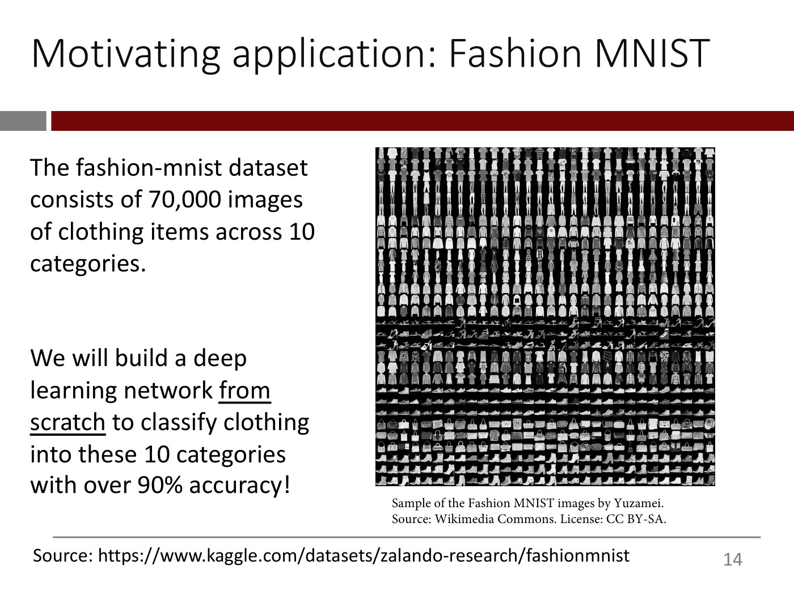
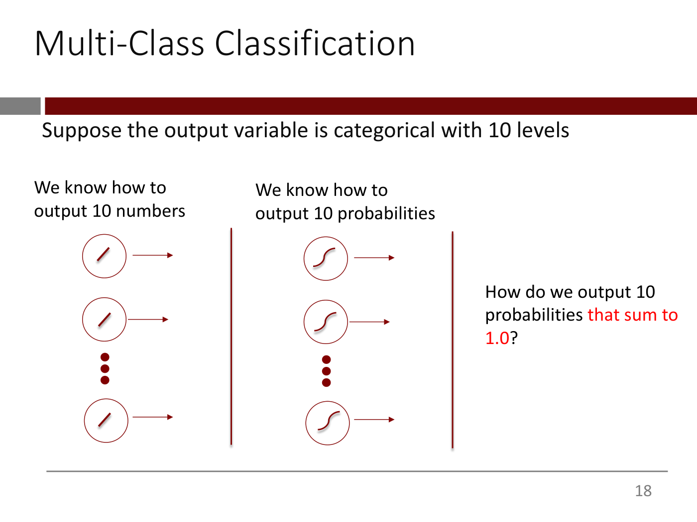
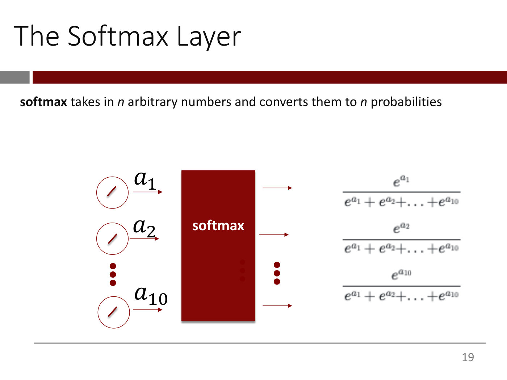

# Lecture 3 — Keras and TensorFlow, Training the Heart-Disease Model, and Computer Vision Basics

**Lecturer:** Rama Ramakrishnan ·
**Video:** [youtube.com/watch?v=8QuyDcMIdRc](https://www.youtube.com/watch?v=8QuyDcMIdRc) (77 min) ·
**Slides:** deck 3A,
[`mit15_773_s24_lec03a.pdf`](https://ocw.mit.edu/courses/15-773-hands-on-deep-learning-spring-2024/mit15_773_s24_lec03a.pdf)
(44 pages; transcribed in [`raw/slides/03-keras-tensorflow.md`](../raw/slides/03-keras-tensorflow.md)),
and deck 3B,
[`mit15_773_s24_lec03b.pdf`](https://ocw.mit.edu/courses/15-773-hands-on-deep-learning-spring-2024/mit15_773_s24_lec03b.pdf)
(29 pages; transcribed in [`raw/slides/03-vision-basics.md`](../raw/slides/03-vision-basics.md)) ·
**Transcript:** [`raw/transcripts/03-keras-and-vision-basics.md`](../raw/transcripts/03-keras-and-vision-basics.md)

## What this lecture establishes

The lecture has two halves, each with its own deck and its own Colab notebook, as the lecturer
announces at the start (≈0:00). The first half (0:00–58:08, deck 3A) finishes the training story of
lecture 2 and then trains the heart-disease model for real. An **epoch** is one pass through the
training data. Stochastic gradient descent splits that pass into **batches** and updates the weights
once per batch. Because deep networks have many parameters they risk **overfitting**, so training
holds out a **validation set** and uses a regularization strategy such as **early stopping**.
**Tensors** generalize numbers, vectors and tables to any rank. **TensorFlow** computes gradients and
spreads the work over parallel hardware, and **Keras** sits on top of it with layers and conveniences.
A Colab walkthrough then prepares the heart-disease data, compiles and fits the four-line model from
lecture 2, reads its loss and accuracy curves, and scores 83.6% on the test set against a 72.6%
baseline.

The second half (58:08–1:16:41, deck 3B) starts computer vision. An image is a table of pixel
intensities from 0 to 255, or three such tables for a colour image. The lecture lists the main vision
tasks, from classification to instance segmentation, then designs a network for **Fashion MNIST**:
flatten each 28 × 28 image into 784 numbers, use one hidden layer of 256 ReLU units, and end in a
**softmax** that turns 10 outputs into 10 probabilities summing to 1. The loss must match how the
labels are encoded: binary, sparse or one-hot cross-entropy. The lecture ends partway into the
Fashion-MNIST Colab, after loading and looking at the data and before any model is trained.

The catalog titles this video "Deep Learning for Computer Vision – Building Convolutional Neural
Networks from Scratch". Convolutional networks are not reached. They are in the next deck,
`mit15_773_s24_lec04.pdf`, and open [lecture 4](04-cnns-and-transfer-learning.md). Dropout is also
only named here; deck 3A's slide on it says "We will cover this in Lecture 4". Lecture 4 uses a
dropout layer in its transfer-learning Colab but defers the explanation again, to "early next week"
(lecture 4, ≈1:12:26). [Lecture 5](05-text-vectorization-and-bag-of-words.md) finally explains it (≈1:11:38–1:14:44).

Neither Colab notebook is published on OCW, and neither is in this knowledge base. Everything said
below about the code follows the lecturer's narration, and only the functions and arguments he names
are given.

## Part 1 — Deck 3A: training in practice

### Recap: the training flow

Training a network is no different in principle from training any other model (≈0:45–1:30). Its
parameters, the weights and biases, are chosen to minimize a loss function, the measure of
discrepancy between what the model predicts and the ground truth. The flow is the textbook figure
that ended lecture 2 (deck 3A, slide 2, the same figure as lecture 2's slide 94). The input passes
through the layers to give predictions, the predictions and the true values go into the loss
function to give a loss score, and the optimizer computes the gradient of the loss with respect to
every parameter and updates the weights (≈1:30). Gradient descent uses every data point at each
iteration, while stochastic gradient descent "randomly choose[s] a small number of points" and
pretends for a moment that those are all the data (deck 3A, slide 3; ≈1:30–2:16).

The figure itself is rendered with lecture 2:
[`raw/images/02-training-deep-nns/slide-94.jpg`](../raw/images/02-training-deep-nns/slide-94.jpg).

### Epochs and batches

An **epoch** is one pass through all the training data (deck 3A, slide 5; ≈3:03). What happens
within the pass depends on the optimizer.

In **gradient descent**, every training sample goes through the network, the gradient of the loss is
calculated from all of them, and the parameters are updated once, at the end of the epoch (deck 3A,
slide 6; ≈3:03–3:50). The update is

$$w \leftarrow w - \alpha \frac{dLoss(w)}{dw}$$

where $w$ is a weight, $\alpha$ the learning rate and $\frac{dLoss(w)}{dw}$ the derivative of the loss
with respect to it. The lecturer will write this derivative or the gradient symbol $\nabla$
interchangeably (≈3:03).


*Deck 3A, slide 6 — in gradient descent the whole training set runs through the network and the weights are updated once, at the end of the epoch. [Deck](https://ocw.mit.edu/courses/15-773-hands-on-deep-learning-spring-2024/mit15_773_s24_lec03a.pdf)*

In **stochastic gradient descent**, the training data is divided into **minibatches**, which he
calls simply **batches** from here on, as is widely done in the literature (deck 3A, slide 7;
≈3:50). For each batch in turn, its samples go through the whole network to give predictions, the
gradient of the loss is calculated on that batch alone, and the parameters are updated (deck 3A,
slide 8; ≈4:37). So when batch 2 arrives, the weights have already changed (≈4:37–5:25). One epoch
therefore contains as many weight updates as there are batches (deck 3A, slide 9; ≈6:58, ≈9:15).
That is the advantage a student names: after batch 1, the network runs batch 2 with more accurate
weights instead of waiting for the whole pass. The lecturer adds that SGD both finds better
solutions and needs less compute, for the reasons given in lecture 2 (≈10:00–10:45).


*Deck 3A, slide 9 — in SGD each batch produces its own weight update, so one epoch holds as many updates as there are batches. [Deck](https://ocw.mit.edu/courses/15-773-hands-on-deep-learning-spring-2024/mit15_773_s24_lec03a.pdf)*

A batch is a set of rows, that is of data points, not of variables: "let's say you have 1,000 data
points, 1,000 rows of observations, 1,000 patients … You take, let's say, 32 of those", then the
next 32, until you run out (≈6:10–6:58). Each batch runs through every layer, because without a
prediction there is no loss, without a loss no gradient, and without a gradient no update
(≈8:30–9:15).

How many batches make an epoch? Divide the training-set size by the batch size and round up (deck
3A, slide 10; ≈7:44–8:30). For the heart-disease model, slide 10 takes a training set of 194 and a
batch size of 32: 194/32 is 6-point-something, so 7 batches, the first six of 32 samples and the
seventh of the last 2 ($32 \times 6 + 2 = 194$). Batches need not all be the same size. Sizes such
as 32 and 64 are popular because they align well with parallel hardware (≈7:44). In the Colab the
same calculation is quoted as 193 by 32 (see [the training run](#training-and-reading-the-output)).


*Deck 3A, slide 10 — 194 samples in batches of 32 make six full batches and a seventh of 2. [Deck](https://ocw.mit.edu/courses/15-773-hands-on-deep-learning-spring-2024/mit15_773_s24_lec03a.pdf)*

### Overfitting and regularization

As a model grows more complex, its error on the training data keeps falling (deck 3A, slides 12–13;
≈10:45–11:32). Its error on data it was not trained on falls at first, bottoms out and then climbs
again (slide 14). The rising part is **overfitting**, "fitting to the idiosyncrasies of the training
data as opposed to generalizing patterns". The falling part, where there is still a lot of room to
improve, is **underfitting**, and the hope is to find the "sweet spot" between them (deck 3A, slide
15; ≈11:32–12:18). The lecturer phrases the punchline as a question about "the training data"
(≈11:32). The slides make clear that the climbing curve is the validation set's.


*Deck 3A, slide 15 — training error keeps falling as the model grows more complex; validation error falls to a sweet spot, then rises as the model overfits. [Deck](https://ocw.mit.edu/courses/15-773-hands-on-deep-learning-spring-2024/mit15_773_s24_lec03a.pdf)*

This matters more for neural networks than for most models (deck 3A, slide 16; ≈12:18–13:04). To
learn smart representations of unstructured data a network needs large capacity, many layers and
many neurons ("GPT-3, for example, has 96 layers, if I recall"). More layers mean more parameters,
more parameters mean a more complex model, and so a greater chance of overfitting. **Regularization**
is how that risk is handled, and of the many methods the course uses two (≈13:04).

**Early stopping** (deck 3A, slide 17; ≈13:04–14:34), which Geoff Hinton has called a "beautiful
free lunch". Split the training data into a training set and a **validation set**. Keep running
gradient descent, and keep track of the loss on the validation set. When the validation loss
flattens out and starts to climb, stop. In the Colab the lecturer runs to the end and then looks
where the curve flattened, but Keras has ways to do this efficiently (≈13:49). The validation set
is never used to calculate gradients, only to calculate loss and accuracy: "That's what keeps you
honest" (≈15:20–16:06).


*Deck 3A, slide 17 — early stopping: stop where the validation error bottoms out, before the training error is minimized. [Deck](https://ocw.mit.edu/courses/15-773-hands-on-deep-learning-spring-2024/mit15_773_s24_lec03a.pdf)*

**Dropout** (deck 3A, slide 18) is deferred to the next lecture, the first time it will be used
(≈14:34). In the event, [lecture 4](04-cnns-and-transfer-learning.md) uses a dropout layer without
explaining it and defers the explanation again (≈1:12:26). [Lecture 5](05-text-vectorization-and-bag-of-words.md) finally
explains it (≈1:11:38–1:14:44). The lecturer calls it "a very, very clever strategy" but does not explain it. The slide
itself says to randomly zero out the output of some of the nodes in a hidden layer, typically 50%,
implemented as a "dropout layer" in Keras, and draws a dropout layer that passes $u_1$, $u_3$ and
$u_5$ through and replaces $u_2$ and $u_4$ with 0.0.


*Deck 3A, slide 18 — a dropout layer zeroes some of a hidden layer's outputs (here u2 and u4); lecture 4 uses one, and lecture 5 explains it. [Deck](https://ocw.mit.edu/courses/15-773-hands-on-deep-learning-spring-2024/mit15_773_s24_lec03a.pdf)*

See [overfitting and regularization](overfitting-and-regularization.md).

### The checklist for creating and training a network

Deck 3A's slide 19 sums up the whole procedure (≈14:34–15:20). Get the data ready. Design the
network: the number of hidden layers, the number of neurons in each, and the right output layer for
the type of output. Pick a loss function to match the output, and an optimizer from the many flavours
of SGD with a good learning rate. Decide on a regularization strategy. Then set it up in
Keras/TensorFlow and train. Much as ReLU is the default activation for hidden layers, a flavour of SGD
called **Adam** is the default optimizer, "because it's really good", and the regularization is
typically early stopping or dropout (≈14:34–15:20).

### Tensors

A **tensor** generalizes a number, a vector and a table to higher dimensions (deck 3A, slides 21–25;
≈16:56–18:32). Every tensor has a **rank**. A number has no dimension, so it is a tensor of rank 0, a
scalar ("42"). A vector, a list of numbers, has one dimension and rank 1 ("(42, 23.4, 11.2)"). A
table has rank 2, and "a bunch of tables" has rank 3, also thought of as a cube. A student's first
answer, "the input data", was "on the right track, but not entirely", and the second, "a matrix, but
generalizable with higher dimensions", was correct but incomplete: a tensor can be *simpler* than a
matrix (≈16:06–16:56).

The examples (≈18:32–19:19; slide 26 asks for one of rank 4): a grayscale image is a table of
numbers, a colour image is three tables, and a colour **video**, a stream of colour images, is a
tensor of rank 4 whose first dimension says which frame it is.

The way the lecturer always thinks of a tensor is as a list: an open square bracket, a bunch of
things, a closed square bracket (≈20:06–21:42). Iterating over its first dimension gives tensors one
rank lower. So a list of videos has rank 5, and a tensor of rank 10 "is just a list of rank 9
tensors". The concept is "simultaneously kind of easy to understand and also slippery", and the
lecturer points to chapter 2.2 of the textbook (deck 3A, slide 27; ≈21:42–22:27). See
[tensors](tensors.md).

### TensorFlow

Tensors flow from a network's input to its output, hence the name **TensorFlow** (≈22:27–23:16). It is
a library that provides four things (deck 3A, slides 28–31; ≈23:16–24:48):

- **Automatic calculation of gradients**, of arbitrarily complicated loss functions. Slide 28 shows
  the gradient as the vector of partial derivatives,
  $\nabla Loss(w) = \left[\frac{\partial Loss}{\partial w_1}, \frac{\partial Loss}{\partial w_2}, \ldots, \frac{\partial Loss}{\partial w_n}\right]$.
  "You don't have to use the chain rule."
- **A library of optimizers**, including SGD and its variations.
- **Distribution of the computation across servers.** Parallelizing computation is hard: a few
  problems are "embarrassingly parallel", but many are not.
- **Adapting the code to parallel hardware**, GPUs and TPUs, out of the box. A TPU, a Tensor Processing
  Unit, can be thought of as Google's GPU.

### Keras

**Keras** sits on top of TensorFlow, which sits on top of the hardware (deck 3A, slide 32; ≈24:48).
It supplies conveniences (slide 33): predefined layers such as the dense layer, activation functions,
easy ways to preprocess data, to train models and to report metrics such as validation loss and
accuracy, and pretrained models to download and adapt.


*Deck 3A, slide 32 — Keras sits on top of TensorFlow, which runs on CPUs, GPUs and TPUs (from page 70 of the textbook). [Deck](https://ocw.mit.edu/courses/15-773-hands-on-deep-learning-spring-2024/mit15_773_s24_lec03a.pdf)*

The course uses TensorFlow and Keras rather than PyTorch, "a fantastic framework as well", to keep it
accessible to students without much programming background. PyTorch asks for more object-oriented
programming, while Keras is "as powerful, in many ways" and easier to get going with (≈25:33).

Keras offers three APIs, **sequential**, **functional** and **subclassing**, and the course uses the
**functional API** almost exclusively. The heart-disease model of lecture 2 is an example. Section
7.2.2 of the textbook explains it in detail (deck 3A, slide 34; ≈25:33–26:20). In his own work, the
lecturer says, the functional API is "basically all I need", "a beautifully designed LEGO-block
environment". Tutorials and Colabs are at tensorflow.org and keras.io (slide 35). See
[Keras](keras.md).

### The heart-disease model, ready to train

The model is the one designed in lecture 2: 29 inputs, one dense hidden layer of 16 ReLU neurons, and
a sigmoid output (deck 3A, slide 36; ≈26:20–27:06).


*Deck 3A, slide 36 — the heart-disease network from lecture 2 (29 inputs, 16 ReLU units, a sigmoid output) and its four lines of Keras. [Deck](https://ocw.mit.edu/courses/15-773-hands-on-deep-learning-spring-2024/mit15_773_s24_lec03a.pdf)*

```python
input = keras.Input(shape=29)
h = keras.layers.Dense(16, activation="relu")(input)
output = keras.layers.Dense(1, activation="sigmoid")(h)
model = keras.Model(input, output)
```

The checklist is then filled in (deck 3A, slides 38–40; ≈27:06–27:52). The network is 1 hidden layer
of 16 ReLU neurons with a sigmoid output. The loss is **binary cross-entropy**, because the output is
a probability compared with a 0/1 label; a student supplies it, and the lecturer recalls that an
arbitrary number would call for mean squared error. The optimizer is Adam and the regularization is
early stopping.

### Working in Colab

Before the notebook, some advice (deck 3A, slides 42–43; ≈27:52–29:25). Do not worry about
understanding every detail in class, but afterwards go through every line. Retype the code rather than
copying and pasting it: "If you retype the code as opposed to cutting and pasting, trust me, you will
learn a lot more." For any course notebook, first make your own copy (**Copy to Drive**). For a
notebook involving natural language or vision, request a GPU by changing the runtime type, then
connect. Steps 1 and 2 are needed only the first time you use a notebook.


*Deck 3A, slide 43 — Colab setup: Copy to Drive, change the runtime type to GPU, then Connect. [Deck](https://ocw.mit.edu/courses/15-773-hands-on-deep-learning-spring-2024/mit15_773_s24_lec03a.pdf)*

### The heart-disease Colab: preparing the data

The lecturer ran the notebook a few hours before class and walks through it rather than rerunning it
(≈29:25). The data are the 303 patients from lecture 2, with demographic and biomarker variables and a
0/1 heart-disease target.

**Setup** (≈30:11–32:27). Import TensorFlow, and Keras from within TensorFlow. Also load the three most
commonly used packages: NumPy for manipulating arrays and tensors, Pandas for wrangling data into a
shape Keras can take, and Matplotlib for plotting the loss and accuracy curves. Training involves
randomness in several places: the random initial weights, the random shuffle that divides the data
into batches ("you basically take the data and just shuffle it once, randomly", then take 32 at a
time), the random split into training, validation and test sets, and, later, dropout. To make results
reproducible for someone else, set a random seed with `set_random_seed`. The lecturer uses 42, "just
like everybody should", a reference to *The Hitchhiker's Guide to the Galaxy*. Even so, "bitwise
reproducibility" is not guaranteed, because of hardware and device drivers.

**Loading and a baseline** (≈33:13–34:43). François Chollet, the textbook's author, made the data
available as a CSV file, which is read into a Pandas dataframe of 303 rows and 14 columns. The first
thing the lecturer checks in any binary classification problem is the class balance: 72.6% of the
patients do not have heart disease and 27.4% do. So the obvious **baseline model**, a student's answer,
predicts 0 for everyone and is right 72.6% of the time. "Any fancy model we build, it's got to do
better than this."

**Preprocessing** (≈34:43–40:11). The variables fall into two groups, categorical and numeric.

- Categorical variables are **one-hot encoded**, because unlike a decision tree a neural network can
  only take numeric inputs. Pandas's `get_dummies` does it. A variable such as `thal`, with three
  values (fixed, normal, reversible), becomes three columns, `thal_fixed`, `thal_normal` and
  `thal_reversible` (≈34:43–35:29).
- Numeric variables are **standardized**, subtracting the mean and dividing by the standard
  deviation, because networks work best when the inputs are all in a relatively small range
  (≈35:29–36:16). Afterwards the values are "all very smallish — 0, 1, minus 1, around that range"
  (≈37:52).
- But first the data are **split** into a training set (80%) and a test set (20%): 242 and 61 rows
  (≈36:16–37:52). The test set is used once, at the very end, to measure how the model will do in the
  wild. The split must come before the standardization, because otherwise the mean and standard
  deviation would use information about the test set, and "the test set is not really kept away from
  anything" (≈37:04).
- The dataframes are converted to NumPy arrays with `to_numpy`, which Keras accepts (≈38:39). The
  target column, "column number 6 from the left", is removed into its own vector (`train_y`,
  `test_y`). That leaves 242 rows and 29 columns, the 29 inputs of the network (≈39:25–40:11).

See [preparing data for a network](data-preprocessing.md).

### The heart-disease Colab: building and compiling the model

The model is the same as before, except that its layers are given names, which is optional and only
cosmetic (≈40:11). Run `model.summary` immediately after building a model (≈40:57–41:42). For each layer it
shows what comes in, what goes out and how many parameters the layer has. Check the total by hand:
$29 \times 16$ weights plus 16 biases for the hidden layer, and $16 \times 1$ plus 1 bias for the
output, which makes 497. The `plot_model` function draws the network, which becomes handy as networks
grow (≈41:42).

**Compiling** the model fixes three choices (≈41:42–43:18): the loss, `binary_crossentropy`; the
optimizer, Adam; and the metrics to report, here accuracy, the most common one for binary
classification. Metrics are only reported and never used in the optimization, so any metric will do:
error rates, F1, "F beta", and Keras has "this dizzying list" of them (≈48:03). The compile step
itself reorganizes the model so that it can be parallelized and distributed across servers (≈42:29–43:18).

### Training and reading the output

Two more choices come before training (≈43:18–44:50). The **batch size**: 32 is a good default, and
32, 64 or 128 are worth trying. "Just use the biggest batch size that doesn't make your machine die",
as researchers tell him. The **number of epochs**: 20 to 30 is a good starting point, but because the
problem is tiny he runs 300, "just to see if any overfitting is going to happen". And 20% of the
training data is set aside as the validation set.

`model.fit` is what actually trains the network (≈44:50). It takes the x tensor, the y tensor, the
number of epochs, the batch size, `verbose=1` for descriptive output, and `validation_split`, the
fraction of the training data to set aside for validation. Its output has a pair of lines for each
epoch (≈45:41–46:30). In the 300th epoch it reports 7 of 7 batches, "the 193 by 32 rounded up"; the
time taken; the binary cross-entropy loss and the accuracy on the training data (98.5% in that line);
and, at the end of the epoch, the loss and accuracy on the validation set. Assigning
`history = model.fit(...)` keeps all of this in `history.history`, a dictionary that is used for
plotting (≈46:30–47:17).

Students' questions pin down the three data sets (≈47:17–51:09):

- The **validation set** is taken once from the training data, before training, leaving 193 samples
  to divide into batches. It is the same set in every epoch, and the model is evaluated on it at the
  end of each epoch. This is not cross-validation.
- What changes from one epoch to the next is the weights. They change after every batch, and at the
  end of an epoch every training sample has been used once.
- The validation set decides things like early stopping and, later, which hyperparameter values are
  best. The **test set** is different: at the very end "we open the safe, take out the test set, and
  use it just once with your final, final model", to get a realistic idea of how the model will do
  when deployed.

**The curves** (≈51:09–53:30). Plotted against the epoch, the training loss falls steadily. The
validation loss falls, flattens, "and then maybe gently starts to rise", so there is some overfitting.
But binary cross-entropy is chosen because it is mathematically convenient, and what you actually care
about is closer to accuracy, so plot that too. Training accuracy climbs into the mid 90s. Validation
accuracy reaches its level after about 50 epochs, flattens, and "strangely" climbs again later. Since
accuracy improves at the end, he chooses to live with the overfitting. The purist's alternative is to
restart and train for only about 50 epochs.

How do you know you have run enough epochs (≈53:30–55:04)? If the validation loss is still falling
after 30 epochs, there is more room. Keras's `fit` continues from where it left off, so run 10 more,
and 10 more, until the validation loss starts to climb, then back off. That manual procedure is for
intuition. Keras **callbacks**, to come later, can stop training when the validation loss stops
improving, or save the best model as it goes.

Why can accuracy improve while the loss gets worse (≈55:04–56:36)? Accuracy is discrete. A patient
predicted at 0.49 counts as no disease and at 0.51 as disease, so a tiny change in the binary
cross-entropy can flip the accuracy from 0 to 1. The lecturer trusts the measure closest to real-world
deployment: "Binary cross-entropy is a beautiful proxy, but an imperfect proxy for the thing we
actually care about in the real world, which is error rate and accuracy."

**The test result** (≈56:36–57:22). `model.evaluate` on `test_x` and `test_y`, the data split off at
the start and never touched since, gave **83.6% accuracy** when he ran it, against 72.6% for the
predict-everyone-is-0 baseline. The preprocessing done here in Pandas can also be done inside Keras
with preprocessing layers. Asked whether a model can be pushed towards fewer false positives or
negatives, he says yes: more complex loss functions take that asymmetry into account (≈58:08).

## Part 2 — Deck 3B: computer vision basics

### How an image is represented

A grayscale image is a rectangular array of **pixels**. Each pixel's light intensity is a number from
0, no light, to 255, "blinding white light" (deck 3B, slides 3–4; ≈58:08–58:54). The slide's example
is a handwritten 5 as a 28 × 28 table of numbers. The black regions are all zeros, and "if you just
step back and squint at this, you can actually see the 5". Asked what unit the intensity is measured
in, the lecturer explains that an analog picture is read in and mapped onto a normalized 0–255 scale.
He does not know the exact mapping from lumens (≈59:40–1:00:26).

A colour pixel takes three numbers, the intensities of red, green and blue light, each still 0–255
(deck 3B, slides 5–6; ≈1:00:26–1:01:12). So a colour image is three tables of numbers, and in deep
learning the colours are called **channels**. The slide shows a photograph, which he calls "a picture
of Killian Court", with the three 10 × 10 tables for its top-left corner. Three tables make a tensor
of rank 3. See [images and computer-vision tasks](images-and-vision-tasks.md).

### Key tasks in computer vision

The lecture lists five, each illustrated on a slide that OCW excludes from its licence and so is
described here only in words (deck 3B, slides 8–12; ≈1:01:12–1:04:16):

- **Image classification**: which of a list of possible objects the image contains. "The Dog/Cat
  classification is the canonical example."
- **Classification and localization**: also say *where* the object is, by outputting the coordinates
  of a box around it, for example its top-left and bottom-right corners.
- **Object detection**: find and box every object, as in sheep 1, sheep 2 and sheep 3. A self-driving
  car's camera system does this constantly, many times a second: "pedestrian box, zebra crossing box,
  doggy box, stroller box".
- **Semantic segmentation**: classify every pixel, here as road, sheep or grass. For each pixel it
  solves a multi-class classification problem.
- **Instance segmentation**: classify every pixel *and* tell the instances of a category apart, so
  each sheep gets its own label.

### Fashion MNIST

The motivating application is **Fashion MNIST**: 70,000 images of clothing items across 10 categories,
such as boots, sweaters and T-shirts (deck 3B, slide 14; ≈1:04:16–1:05:07). The data set is balanced,
10% of each category, so a naive baseline gets 10%. The slide promises "over 90% accuracy" from a
network built from scratch. The lecturer says a simple network can get "close to 90%". The ten
categories and their integer codes are T-shirt/top 0, trouser 1, pullover 2, dress 3, coat 4,
sandal 5, shirt 6, sneaker 7, bag 8 and ankle boot 9 (deck 3B, slide 21).



*Deck 3B, slide 14 — a sample of Fashion MNIST's 70,000 clothing images (by Yuzamei, Wikimedia Commons, CC BY-SA). [Deck](https://ocw.mit.edu/courses/15-773-hands-on-deep-learning-spring-2024/mit15_773_s24_lec03b.pdf)*

### A simple network for 28 × 28 images

Each input is a 28 × 28 picture, a tensor of rank 2, but so far networks have only taken vectors
(deck 3B, slide 15; ≈1:05:07). The answer, from the class, is to **flatten** it (≈1:05:54–1:06:40):
take each row of the table, turn it on its side and string the rows together into one long vector,
$28 \times 28 = 784$ numbers. "We've literally taken the numbers and just reorganized them in a
different way", and with a vector the problem is back in familiar territory. The hidden layer uses
ReLU neurons. The lecturer tried a few sizes and 256 did a really good job (deck 3B, slide 16;
≈1:07:27).


*Deck 3B, slide 16 — the 28 × 28 image flattened into 784 inputs and fed to 256 ReLU units; the 10-way output is still an open question. [Deck](https://ocw.mit.edu/courses/15-773-hands-on-deep-learning-spring-2024/mit15_773_s24_lec03b.pdf)*

### The output layer: softmax

The heart-disease output was a single 0 or 1. Here there are 10 possible answers, and the lecturer
flags what comes next: "pay attention to this, because this is actually how GPT-4 works" (≈1:07:27–1:08:15).

Ten outputs are easy: ten linear units give 10 numbers, and ten sigmoids give 10 probabilities (deck
3B, slide 17). But ten sigmoids will not do, because, as a student says, the probabilities would not
sum to 1. Only one of the 10 categories can be right, so the outputs must be probabilities that add up
to 1 (≈1:08:15–1:09:00).



*Deck 3B, slide 17 — linear units give 10 numbers and sigmoids give 10 probabilities, but neither gives 10 probabilities that sum to 1. [Deck](https://ocw.mit.edu/courses/15-773-hands-on-deep-learning-spring-2024/mit15_773_s24_lec03b.pdf)*

The **softmax** function, or softmax layer, does this (deck 3B, slide 18; ≈1:09:00–1:09:47). Let the
final layer's 10 linear units output $a_1, a_2, \ldots, a_{10}$. Run each through the exponential
function and divide by the total:

$$\frac{e^{a_1}}{e^{a_1} + e^{a_2} + \ldots + e^{a_{10}}}, \quad \frac{e^{a_2}}{e^{a_1} + e^{a_2} + \ldots + e^{a_{10}}}, \quad \ldots, \quad \frac{e^{a_{10}}}{e^{a_1} + e^{a_2} + \ldots + e^{a_{10}}}$$

Two things happen. Each $e^{a_i}$ is positive, whatever the sign of $a_i$, and dividing each positive
number by their total makes the 10 results add up to 1, "there's no other option". So softmax takes $n$
arbitrary numbers and converts them into $n$ probabilities.



*Deck 3B, slide 18 — softmax turns the outputs a1 … a10 into probabilities by exponentiating each and dividing by the total. [Deck](https://ocw.mit.edu/courses/15-773-hands-on-deep-learning-spring-2024/mit15_773_s24_lec03b.pdf)*

The GPT-4 connection (≈1:09:47–1:10:33): every word it emits ("it's actually a token, but we'll get to
that later") comes from a softmax over every possible word, which the lecturer describes as a
52,000-way softmax. It picks the most probable word and emits it. "This notion of a softmax is actually
very powerful. But we'll come back to that later."

Why not force the network to output 1s and 0s? You cannot: "It's going to produce what it's going to
produce." The best you can do is tame its output into a range you like, such as 0 to 1 (≈1:10:33–1:11:19).
See [multi-class classification and softmax](multiclass-classification.md).

The summary (deck 3B, slide 19; ≈1:10:33). For a single number, use a single linear output unit. For a
single probability, a sigmoid. For a vector of numbers, a stack of linear units. For a vector of
probabilities that must add up to 1, a softmax.

### Matching the loss to the label encoding

Class labels can arrive encoded in different ways (deck 3B, slides 20–22; ≈1:11:19–1:12:04). A binary
yes/no label is encoded as 1 or 0, as in the heart-disease data. A multi-class label can be **sparse
encoded**, as a single integer from 0 to 9, or **one-hot encoded**, as ten 0/1 entries with a single 1
in the position of the class.

Pick the Keras cross-entropy loss that matches the encoding of the data you are given (deck 3B, slides
23–26; ≈1:12:04–1:12:51):

| Encoding of the label | Keras loss function |
| --- | --- |
| Binary, 1 or 0 | `binary_crossentropy` |
| Multi-class, sparse (integers 0–9) | `sparse_categorical_crossentropy` |
| Multi-class, one-hot | `categorical_crossentropy` |

"These are all equivalent things." Which one to use depends only on how the people who sent you the
data happened to encode it. Fashion MNIST arrives sparse encoded, so its model uses
`sparse_categorical_crossentropy`. Categorical cross-entropy generalizes binary cross-entropy, with
"roughly the same" intuition, and the lecturer does not go into its mathematics (≈1:12:51).

The resulting table of output layers and losses (deck 3B, slide 27; ≈1:12:51):

| Output variable | Output layer | Loss function |
| --- | --- | --- |
| Single number (regression with a single output) | linear unit | Mean squared error |
| Single probability (binary classification) | sigmoid unit | Binary cross-entropy |
| Vector of $n$ numbers (regression with multiple outputs) | stack of linear units | Mean squared error |
| Vector of $n$ probabilities that add up to 1 (multi-class classification) | softmax | Categorical cross-entropy |

For a softmax output, use categorical or sparse categorical cross-entropy, whichever matches the
labels. See [loss functions](loss-functions.md).

### The Fashion-MNIST Colab, as far as it goes

The second notebook starts like the first: load TensorFlow and Keras and the usual three packages,
and set the random seed (deck 3B, slide 28; ≈1:13:36). Fashion MNIST is one of Keras's standard data
sets, loaded with its `load_data` command, and it comes already split into a training set and a test
set, so that everyone who builds a model for it is evaluated on the same test set (≈1:13:36–1:14:22).

The training input is a tensor of rank 3, or equivalently a list of rank 2 tensors: 60,000 images,
each a 28 × 28 table. The labels are a vector of 60,000 integers from 0 to 9. The test set has
10,000 images with the same structure (≈1:14:22–1:15:10). The lecturer builds a small list of the
category names, so that he can see that 9 means ankle boot, as the Fashion-MNIST GitHub page lists
them (≈1:15:10). The first training image is an ankle boot. Its raw 28 × 28 numbers include 250, 233
and "lots of zeros", and a few lines of Matplotlib plot the first 25 images. They are small and blurry:
"This, my friends, is an ankle boot. It's like, OK, can the network really make any sense out of this
thing?" (≈1:15:56–1:16:41).

The lecture stops there, to continue in the next class, which will also move on to colour images
(≈1:16:41).

## Printed slips

- Deck 3A, slide 10 gives the heart-disease training set as 194 samples, so the seventh batch holds 2.
  In the Colab the lecturer twice says 193 (≈45:41, ≈48:49). 80% of the 242 training rows is 193.6.
  Either way there are 7 batches. With 193 the last batch would hold 1 sample.
- Deck 3A's early-stopping chart wraps its x-axis label as "Iteration" / "s".
- Deck 3A prints curly quotes around `relu` and `sigmoid` in the code of its heart-disease slide, as
  lecture 2's slides did, and a mismatched pair around "adam" in the filled-in training checklist. The
  code above uses straight quotes.
- Deck 3A's Colab-instructions slide marks "Request a GPU for your notebook" with an asterisk that has
  no footnote.
- Deck 3B's Fashion MNIST slide promises "over 90% accuracy"; the lecturer says "close to 90%".
- Deck 3B prints, from page 16 on, a number one higher than the PDF page where it prints a number at
  all, because a hidden slide was not exported. This page cites PDF pages.

## Related pages

- [Training a neural network](training-neural-networks.md): the loop, the checklist, epochs, and the
  training, validation and test sets.
- [Gradient descent](gradient-descent.md): batches and epochs in stochastic gradient descent.
- [Overfitting and regularization](overfitting-and-regularization.md): underfitting, overfitting,
  early stopping and dropout.
- [Tensors](tensors.md): ranks 0 to 5 and how to think about them.
- [Keras](keras.md): TensorFlow and Keras, the functional API, compile, fit and evaluate.
- [Preparing data for a network](data-preprocessing.md): one-hot encoding, standardization, and why the
  split comes first.
- [Images and computer-vision tasks](images-and-vision-tasks.md): pixels, channels, and the five tasks.
- [Multi-class classification and softmax](multiclass-classification.md): softmax, label encodings and
  the matching losses.
- [Loss functions](loss-functions.md) and [activation functions](activation-functions.md): the summary
  of output layers and losses.
- [Lecture 2](02-training-deep-nns.md): the heart-disease model and the theory of training this
  lecture puts into practice.
