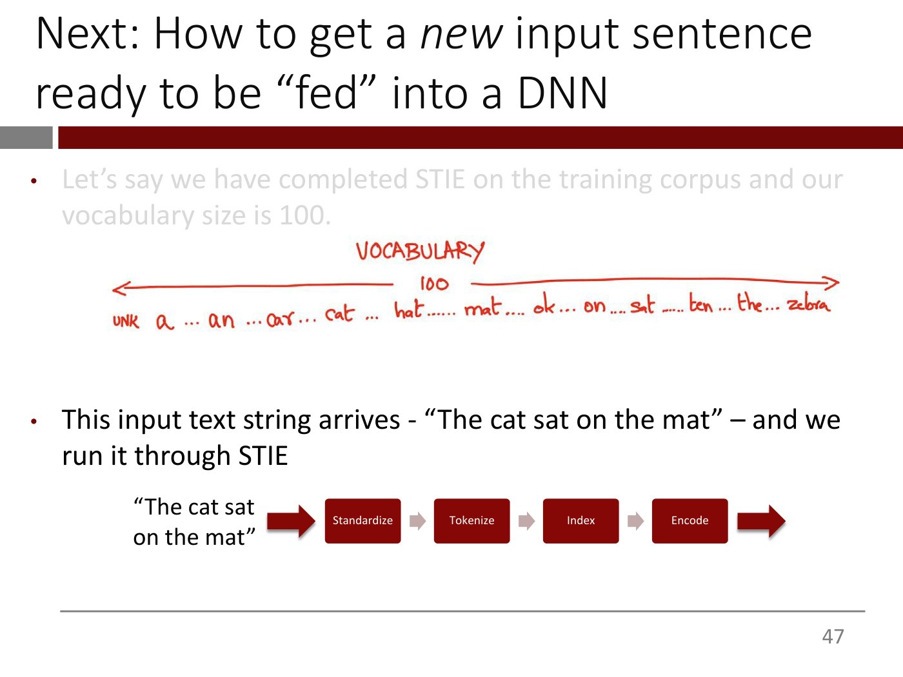

# Lecture 5 — Text Vectorization and the Bag-of-Words Model

**Lecturer:** Rama Ramakrishnan ·
**Video:** [youtube.com/watch?v=duBLxHjaecQ](https://www.youtube.com/watch?v=duBLxHjaecQ) (77 min) ·
**Slides:**
[`mit15_773_s24_lec05.pdf`](https://ocw.mit.edu/courses/15-773-hands-on-deep-learning-spring-2024/mit15_773_s24_lec05.pdf)
(67 pages; transcribed in [`raw/slides/05-text-vectorization-and-bag-of-words.md`](../raw/slides/05-text-vectorization-and-bag-of-words.md)) ·
**Transcript:** [`raw/transcripts/05-text-vectorization-and-bag-of-words.md`](../raw/transcripts/05-text-vectorization-and-bag-of-words.md)

## What this lecture establishes

This lecture opens the course's natural-language sequence. Like most of deep learning, a language
task is "fancy regression": an input $x$ goes through a deep network to an output, and here $x$ is
text. A network only takes numbers, so the whole lecture is about one question: **how do you turn a
piece of text into a vector?** (slides 22–25; ≈12:23–13:57). The answer is **text vectorization**,
four steps the lecturer abbreviates "STIE": **standardize** the text (lowercase it, strip
punctuation), **tokenize** it (split it into words), **index** the distinct tokens as integers, and
**encode** each integer as a vector, at its simplest a one-hot vector as long as the vocabulary.

A sentence then becomes a table, one one-hot row per word. To get a single fixed-length vector out
of it, add the rows up (**count encoding**) or mark which words appear at all (**multi-hot
encoding**). That is the **Bag of Words** model: it keeps which words occur and throws away their
order. It is crude, but "shockingly, for many applications, it doesn't matter" (≈35:03). In Colab, a
network with one hidden layer of eight ReLUs classifies song lyrics as hip-hop, rock or pop at 72%
test accuracy against a 55% baseline. Adding **bigrams**, pairs of adjacent words, as tokens lifts
it to 75%. Along the way the lecturer finally explains **dropout**, used in lecture 4's model and
in this one's bigram model.

The catalog titles the video "Deep Learning for Natural Language – The Basics"; the deck's roadmap
calls the lecture "Text Vectorization and the Bag-of-Words Model" (slide 1). The recording presents
the whole deck, slides 1–66, then spends its last half hour in Colab (from ≈45:53). Embeddings are
next (lecture 6), then two lectures on transformers and two on LLMs (slide 1; ≈0:00–0:46).
Byte-pair encoding, the tokenization LLMs use, is deferred twice (≈23:19, ≈1:14:44); its slides are
in deck 09 (slides 58–60), not this deck.

The Colab notebook is not published on OCW and is not in this knowledge base. Everything said below
about the code follows the lecturer's narration, and only the functions and arguments he names are
given.

## Part 1 — Why language, and how NLP got here

### Text is most of what we know

Human knowledge, the internet, human communication and cultural production are all "(mostly)
natural language text" (slide 2). Text is not just a big share of the media out there; "it also
happens to be the way in which we think and communicate". So the tantalizing possibility is a system
that could read and "understand" all of it, for instance read all of PubMed and come back with the
malfunctioning protein behind a disease and a small molecule to fix it. The lecturer thinks such
things will happen, "just … not soon enough for my lifetime" (≈0:46–2:18).

NLP is already all around us (slides 3–4; ≈2:18–3:50). According to Google, autocomplete saves 200
years of typing time every day. The lecturer was not impressed by the number, given billions of
searches a day; the more important point is that autocomplete "made mobile possible", since without
it people would be pecking at their keyboards and e-commerce would have suffered. He also passes on a
story he is "not sure … is 100% true": the first iPhone's soft keyboard predicted the next letter and
made it slightly bigger, so that after "t" and "h" the "e" key was easier to hit. Slide 4 is a
ChatGPT limerick about the beauty and power of deep learning.

### Text in, text out

NLP has "extraordinary potential for making products and services smarter" (slide 5), and even the
simplest formalism, a bunch of text in and a bunch of text out, has "an enormous, enormous range of
applicability" (slide 6; ≈3:50–4:36). Slides 7–14 go through the examples (≈4:36–7:46):

- **Classification** of text for sentiment, routing for customer support, intent in search, and
  filtering out toxic or abusive content.
- **Extraction** of entities from unstructured text. Hedge funds extract company information from
  news articles, and startups transcribe doctor–patient conversations and extract diagnosis and
  medication codes.
- **Summarization** into bullet points, abstracts or titles.
- **Generation** of marketing copy, sales emails and market summaries, "including, troublingly for
  educators, college application essays".
- **Code generation**, "a more subtle example of text out because code is just text".
- **Question-answering**: send a question together with a set of documents, all of it just text, and
  build chatbots for medical, legal, call-center, compliance and other uses.

Call centers are where "a lot of money is being spent right now" (slides 13–14). Give a model the
call transcripts and the internal product and service documentation, and it can answer questions
such as the top reasons customers were upset yesterday, which agent interventions worked, what
distinguishes the best agents, how to grade an agent's interaction or change the script, and how to
coach an agent in real time.

Two asides are not on the slides. Google had released Gemini 1.5 Pro "a couple of days ago", and
the lecturer calls it incredible (≈6:57–7:46). Asked whether all this is only English, he says there
are models specialized to other languages and truly multilingual "polyglot" models, and many modern
LLMs are trained from the start on several high-resource languages, ones spoken by many people. He
then describes the Gemini 1.5 Pro result: given a single grammar manual for a language spoken by
about 200 people (the captions render its name as "Kalimpong"; the deck does not print it) and
English passages to translate, it translated into that language "at human level proficiency" without having been
trained on it. "Two years ago, people would be like, that's impossible" (≈7:46–9:19).

### The gold rush

Slides 15–17 show LLMs in public discourse, a startup "gold rush" and enterprise vendors racing to
add NLP features (≈9:19–10:06). The lecturer's advice to anyone thinking about a startup is to "take
the plunge". Salesforce now has Einstein GPT and Microsoft has Copilot. "Everybody's scrambling …
Some of it is real, a lot of it is not." Slides 15 and 17 carry OCW exclusion notices and are
described only in prose in the slide file.

### The arc of NLP progress

Slides 18–21 tell the history in four boxes (≈10:06–12:23):

1. **Hand-crafted rules based on linguistics** (up to the early 1990s). Linguists who deeply
   understood a language's grammar wrote rules for processing and analysing text.
2. **Statistical machine learning** (1990s to early 2010s). "Never mind all that complicated
   knowledge of linguistics and grammar. Why don't we simply count things?" Count how often words
   co-occur, count a lot, and see whether it predicts. Shockingly, these methods beat "the lovingly
   hand-curated, linguistically-driven rules", hence Frederick Jelinek's quote, "Every time I fire a
   linguist, the performance of the speech recognizer goes up": made in jest, "but there is a kernel
   of truth to it".
3. **Recurrent neural networks** (2014–2017 on the slide). Deep learning arrived around 2012, and
   RNNs built on it "moved the ball forward".
4. **Transformers** (2017 to now), which "replaced everything else across the board".

The course leapfrogs straight to transformers and spends no time on RNNs. That is "not to say that
they're dead": there is interesting work trying to revive them for modern LLM tasks, "but it's still
very early days".

*Slide 21 — the four eras of NLP; the Jelinek quote sits under the rules-to-statistics switch, and the course jumps straight to transformers. [Deck](https://ocw.mit.edu/courses/15-773-hands-on-deep-learning-spring-2024/mit15_773_s24_lec05.pdf)*

### The problem in one picture

"Like most things, fancy regression!" (slides 22–23; ≈12:23–13:10). An input $x$ goes into a
function $f(x, w)$ and an output $y$ comes out, where $w$ is the weights and $f$ is a deep neural
network. Here $x$ is text, and $y$ can be text, labels, numbers or anything else. At this point in the
course "it should be blindingly obvious."

That leaves two key questions (slides 24–25; ≈13:10–13:57). **How do you represent $x$?** For images
the course simply used the pixel values, light intensities between 0 and 255. But when a sentence such
as "I love deep learning" comes in, what do you do? "This actually is a very subtle question, very
important question," and it is today's topic. **Which network architecture is best for processing
text?** That is next week's, with transformers.

## Part 2 — Text vectorization: standardize, tokenize, index, encode

### The four steps

Every piece of text that comes in is run through four steps, and the whole process is called **text
vectorization**, because "we are essentially taking text and creating vectors of numbers out of
them" (slide 27; ≈13:57–14:46). The lecturer keeps the acronym **STIE** in his head: Standardize,
Tokenize, Index, Encode. See [text vectorization](text-vectorization.md).

*Slide 27 — the four steps of text vectorization, STIE; the first two run over the training corpus, the last two over the vocabulary it yields. [Deck](https://ocw.mit.edu/courses/15-773-hands-on-deep-learning-spring-2024/mit15_773_s24_lec05.pdf)*

The setup is a **training corpus**: a big list of text documents. Whether each one is a novel or a
sentence does not matter; "we just think of them as a big list of strings". Standardization and
tokenization are applied to the entire corpus up front (slide 28; ≈14:46–15:32).

### Standardization

Slide 29 lists three standardizations, each with how often it is done (≈15:32–16:18):

- **Strip capitalization**, and often punctuation and accents: almost always.
- **Strip stop words** such as "a", "the" and "it", filler words that make sentences complete but may
  not help predict anything: often.
- **Stemming**, mapping words with the same root to one form, so that ate, eaten and eating all
  become "eats": sometimes.

Why abstract like this? The lecturer reaches back to vision (≈17:06–18:39). A CNN should detect a
vertical line wherever it appears, rather than learning separately that a line on the left and a line
on the right are the same thing, "because you would have wasted valuable capacity learning things
which actually happen to be the same". Lowercasing tells the model that the upper- and lowercase
versions of a word "are not different. They're actually the same", and the easiest way to tell it so
is to make everything lowercase. Stemming has the same reason: the forms of a word mean much the
same, so collapse them. Stop words are removed for a slightly different reason: whether "a", "and"
or "the" appears in a movie review "probably does not affect the sentiment". There are important
exceptions to all of these, which come later.

Slide 30's example turns "Hola! What do you picture when you think of traveling to Mexico? Sipping a
real margarita while soaking up the sun on a laid-back beach in Puerto Vallarta?" into "hola what do
you picture when you [thinks] of [travels] to mexico [sips] real margarita while [soaks] up sun on
laidback beach in puerto vallarta": lowercased, without punctuation, with "a" and "the" gone and the
verbs stemmed (≈18:39–19:24).

### Tokenization

**Tokenization** splits the standardized text into **tokens** (slides 31–32; ≈19:24–20:11). The most
common default treats each word as a token: split each string wherever there is whitespace, "actual
spaces or carriage returns and things like that". How many consecutive words make up a token is a
design choice, which the Colab comes back to with bigrams.

Asked for the disadvantages of splitting on spaces, the class finds several (≈20:11–22:34):

- **Order is lost.** "The cat sat on the mat" and "the mat sat on the cat" give the same set of
  words.
- **Compound words and names** such as Puerto Vallarta or father-in-law get split.
- **Some languages put no spaces between words**; native speakers chunk the text from context, and
  whitespace splitting would make a whole passage one token.
- **Some languages have very long words.** The lecturer recalls a German word for the feeling that
  something amazing is happening which the rest of the world has not woken up to yet, and the
  Japanese *komorebi*, which he glosses as "the transient beauty of sunlight going through fall
  foliage".

Despite its shortcomings, this standardization and tokenization "is actually really good for lots of
NLP use cases", text classification among them. It does not work for generating text (slide 33;
≈22:34–23:19). ChatGPT answers with perfect punctuation and correct capitals, so neither was
stripped, and it will happily use a word you just made up, so it does not recognize only a finite
set. LLMs use "a very clever scheme called byte-pair encoding". The lecturer had slides on it at the
end and does not reach them; they are deck 09's slides 58–60.

### The vocabulary, indexing and encoding

Once every document in the training corpus has been standardized and tokenized, the list of
**distinct** tokens is the **vocabulary**. Here that is all the distinct words seen. The third and
fourth steps work only with the vocabulary (slides 34–35; ≈23:19).

**Indexing** assigns a unique integer to each distinct token (slide 36; ≈23:19–24:52). Run a large
body of English literature through and you get something like a dictionary, from "a" to "zebra".
The slide numbers it 1 to 50,000 because the GPT family uses about 50,000 tokens; English has many
more words than that. A special token **`<UNK>`**, for "unknown", is given the integer 0. What it is
for comes later (see [The Bag of Words model and its shortcomings](#the-bag-of-words-model-and-its-shortcomings)).

**Encoding** assigns a vector to each integer (slides 37–43; ≈24:52–27:54). Two different words
should get vectors that look different, "that's the whole point". One student suggests using the
index itself as a one-entry vector, "creative, but it's a little cheating". Another suggests
**one-hot encoding**: treat the distinct tokens as the levels of a categorical variable. With 50,000
possible values, each vector is 50,000 long, all zeros except a 1 in the token's index position.
`<UNK>` is index 0, so its vector has a 1 in the first position; "a" has a 1 in the second.

*Slide 43 — one-hot encoding: each token's vector has a single 1 at its index, and its length, distinct tokens plus one for `<UNK>`, is the vocabulary size. [Deck](https://ocw.mit.edu/courses/15-773-hands-on-deep-learning-spring-2024/mit15_773_s24_lec05.pdf)*

The length of the encoding vector is the number of distinct tokens in the training corpus plus one
for `<UNK>`, and this is called the **vocabulary size**. At this point every distinct token in the
vocabulary has a one-hot vector, and basic preprocessing is done (slide 44; ≈27:54–28:45).

## Part 3 — From a sentence to a network input: the Bag of Words model

### A new sentence becomes a table

Now a new sentence arrives and has to be fed to a network (slides 45–49; ≈28:45–30:19). Suppose
STIE on the training corpus found 99 distinct words, so with `<UNK>` the vocabulary has 100 entries,
from `<UNK>` and "a" to "zebra". The footnote of slide 46 says this vocabulary was built by
lowercasing and stripping punctuation only, leaving stop words in and doing no stemming, "which is
why you have words like 'the' showing up in this list". The sentence "The cat sat on the mat" goes
through STIE. What comes out?

*Slide 47 — a 100-token vocabulary, and the new sentence "The cat sat on the mat" about to go through STIE. [Deck](https://ocw.mit.edu/courses/15-773-hands-on-deep-learning-spring-2024/mit15_773_s24_lec05.pdf)*

A table: one row per word and one column per vocabulary entry, $6 \times 100$ (slide 49). A student's
"100 rows and 6 columns" is equally right; the slide puts the words in rows (≈29:32–30:19). Each row is
that word's one-hot vector, with a 1 under the word and 0 everywhere else, so six words have become a
600-entry table (slide 50; ≈30:19–31:12).

*Slide 50 — "the cat sat on the mat" as a 6-by-100 table of one-hot rows; only the 1s are drawn. [Deck](https://ocw.mit.edu/courses/15-773-hands-on-deep-learning-spring-2024/mit15_773_s24_lec05.pdf)*

### Why not just flatten it?

A table is not a vector, so how do you feed it to a network (slides 51–52; ≈31:12–32:45)? One answer
from the class is to flatten it, stacking the columns into one long vector, "very akin to how we work
with images". That has two problems:

- **It is far too long.** With a realistic 50,000-token vocabulary, six words become a
  300,000-long vector. Sending that into a 100-unit hidden layer means $300{,}000 \times 100$, that is
  30 million, weights: "Too much. Can't learn anything" (≈31:59–32:45).
- **Its length varies.** A longer sentence gives a longer input, but a network's inputs "all have to
  be mapped to the same length" (slide 53; ≈32:45).

### Count encoding and multi-hot encoding

Both students who answered next were on the same trajectory: aggregate the table into one vector
(slides 54–57; ≈32:45–35:03). Two ways are common:

- **Count encoding**: sum the one-hot rows, so each position holds how often that word occurs. The
  lecturer also calls it sum encoding.
- **Multi-hot encoding**: "OR" the rows, so each position holds 1 if the word occurs at all and 0
  otherwise.

For "the cat sat on the mat" the two differ only in the column for "the", which appears twice: count
encoding puts a 2 there and multi-hot encoding a 1 (slide 56).

*Slide 56 — summing the one-hot rows gives the count encoding (2 for "the", which occurs twice); OR-ing them gives the multi-hot encoding (1). [Deck](https://ocw.mit.edu/courses/15-773-hands-on-deep-learning-spring-2024/mit15_773_s24_lec05.pdf)*

Either way, every sentence becomes one vector as long as the vocabulary. See
[the Bag of Words model](bag-of-words.md).

### The Bag of Words model and its shortcomings

This aggregation approach is called the **Bag of Words** model (slide 57; ≈34:18–35:03). The bag holds
words, counted or merely marked present, and "more importantly", the order is gone: "the cat sat on
the mat" and "the mat sat on the cat" get exactly the same count and multi-hot encodings. "That's a
huge limitation. But shockingly, for many applications, it doesn't matter. It's good enough."

Its shortcomings (slides 58–61; ≈35:03–38:55):

- **It loses sequentiality**, the meaning inherent in the order of the words (slide 59).
- **The vectors are sparse.** A student points out that they are mostly zeros, so a lot is carried
  around to hold a little information. There are computer-science tricks for handling sparsity,
  "but it is certainly an issue".
- **Every input is as long as the vocabulary**, whether it is the collected works of William
  Shakespeare or "I love you" (slide 60). That "feels a little suboptimal", and short inputs waste a
  lot of compute on long vectors.

The length can be cut by keeping only the most frequent words (slide 61). English has roughly 500,000
words, the lecturer has read, but the top 50,000 account for "just about everything you're going to
see, ever"; the rest are the long tail. Slide 61 adds that a long vocabulary also increases the number
of weights the model has to learn, and with it the compute time and the risk of overfitting.

Keeping only the frequent words is where **`<UNK>`** earns its place (≈37:25–38:55). Suppose "Hamlet"
was dropped from the vocabulary as too rare, and then someone sends "Hamlet was a bad prince. Analyze
the sentiment of the sentence." The system cannot find Hamlet in its vocabulary, so the only thing it
can do is replace it with `<UNK>`. Every unseen word becomes the same `<UNK>`: if Romeo, Juliet and
Hamlet were all dropped, the model can no longer tell them apart. Asked whether this is where
hallucination comes from, the lecturer says no: LLMs do not have the `<UNK>` problem, because their
tokenization "can handle anything you throw at it, including new stuff you just made up".

Despite all this, Bag of Words is "a really good default for many NLP tasks", and in the spirit of
"do the simple stuff first and do complicated things only if the simple stuff doesn't work", it is
what the Colab uses (≈38:55).

## Part 4 — Classifying song lyrics in Colab

### The task and the simplest network

The application is predicting a song's genre from its lyrics: hip-hop, rock or pop (slides 62–63;
≈38:55–40:29). It is a multi-class classification problem. The data set "does have lyrics which may
not be safe for work", so the lecturer does not explore them in class. It is "just some data set
that we downloaded from somewhere". Slide 63 shows two verses and asks which genre each is; the
slide file describes it rather than reproducing the copyrighted lyrics.

What is the simplest neural-network classifier for this? The lecturer builds it on the board
(slides 64–65; ≈40:29–45:08). The input is a song run through STIE with multi-hot encoding, a vector
$x_1, x_2, \ldots, x_v$, where $v$ is the size of the vocabulary. A student's first answer, predict
the most common genre, is the baseline, which comes later. For a network, the class settles on one
hidden layer of ReLUs. With no hidden layer it "could just be logistic regression", and "in this
course, we need at least one hidden layer for it to qualify as a neural network"; the lecturer
declines the "how many angels in the tip of a pin" argument over whether less would count. The output
layer has three nodes, one per genre, with a **softmax**, so it returns three probabilities that add
up to 1. Playing with it beforehand, he found eight ReLU neurons in the hidden layer "pretty good to
get the job done" (≈45:08).

*Slide 65 — the song classifier: a multi-hot vector as long as the vocabulary, eight ReLUs, and a three-way softmax over hip-hop, pop and rock. [Deck](https://ocw.mit.edu/courses/15-773-hands-on-deep-learning-spring-2024/mit15_773_s24_lec05.pdf)*

**Why a softmax, and not just the largest of three numbers?** A student asks why the network cannot
output three numbers and take the maximum (≈43:35–45:08). Finding the maximum of a bunch of numbers
"is not very friendly for differentiation". The output goes through a loss function such as
cross-entropy and then backpropagation, which "is just differentiation" and needs everything inside
it to have well-behaved gradients. The max function does not, "which is why we have a soft version of
it, softmax". Many tricks in the neural-network literature exist because the obvious function is not
well-behaved for differentiation; it is the same reason the course minimizes cross-entropy rather
than maximizing accuracy directly. See
[multi-class classification and softmax](multiclass-classification.md).

### Keras's text vectorization layer

The notebook imports TensorFlow and Keras and "the Holy Trinity of NumPy, pandas, and Matplotlib",
and sets the random seed to 42 (≈45:53). All four STIE steps "are beautifully implemented in Keras as
a single, simple layer called the text vectorization layer". The first example uses the default
standardization (strip punctuation, convert to lowercase), the default tokenization (split on
whitespace) and output mode multi-hot (≈45:53–46:40).

Defining the layer does not build anything. To create the vocabulary you feed it a training corpus
with its **`adapt`** method (≈46:40–47:28). On a tiny corpus of four sentences, the layer's
**`get_vocabulary`** returns 17 tokens, with `<UNK>` stuck at the beginning, integer 0 (≈47:28–48:14).
A programming tip: to print a Python list prettily, put it in a data frame.

Why is "arrays" second, rather than "a" or "an"? A student guesses the most meaningful words come
first, but at this point the layer "doesn't know what we're going to use it for". Keras sorts the
tokens by frequency, and "arrays" happens to be the most frequent word in those four sentences
(≈48:14–49:45). The order does not matter in itself; it is what lets you later ask for only the most
frequent 100 words. Once `adapt` is done, "the training corpus you fed it is forgotten. And the only
thing that survived this processing is just the vocabulary" (≈49:45–50:31).

Running a sentence through the adapted layer gives a multi-hot tensor 17 long, the size of the
vocabulary, with a 1 at index 0 because "still" is not in the vocabulary and became `<UNK>`
(≈50:31–51:19). The phrase "Sloan, HODL, DMD", none of whose words is in the corpus, comes out as a 1
followed by 16 zeros: three `<UNK>` tokens, which multi-hot encoding collapses into a single 1
(≈51:19–52:07).

### The data

The real data set is about 90,000 songs, already cleaned up "formatting-wise, not content-wise" and
divided into almost 49,000 for training, 16,000 for validation and roughly 22,000 for testing
(≈52:07–53:38). Rock is 55% of the songs, so guessing rock for everything is right 55% of the time:
that is the baseline (≈53:38). The genre label is one-hot encoded with pandas' `get_dummies`
(≈54:25). See [preparing data for a network](data-preprocessing.md).

Two questions are deferred. Could you use a ready-made list of the 50,000 most common words rather
than a vocabulary built from your own data? The lecturer punts: with LLMs, many NLP tasks that used
to need a model of your own can be done without further training, at the price of paying for API
calls and other issues, and transfer learning for text comes later in the NLP sequence
(≈54:25–55:59). Why does the vectorized tensor hold floats when the entries are only 0 and 1? There
are ways to optimize that, but these problems are small enough not to worry; parameter-efficient
fine-tuning, "lecture maybe 10-ish", will exploit it (≈55:59–56:44).

### Model 1: single words, multi-hot

Instead of every word in 49,000 songs, the layer is told to keep the 5,000 most frequent:
**`max_tokens`** is 5,000, still multi-hot, with the default standardization (≈56:44–57:31). This is
not only about efficiency. The number of tokens dictates the vocabulary size, the vocabulary size
dictates the length of the input vector, and the first layer has roughly input size times hidden size
parameters. "This thing becomes 10 times as long, you have 10 times as many parameters to learn. And
given a finite amount of data, the more parameters you have, the worse it's going to do," because it
overfits (≈57:31–58:17).

Adapting the layer on the 49,000 training songs takes about five seconds (≈58:17–59:51). The most
common tokens are `<UNK>`, then "the", "you", "I"; the least common of the 5,000 include "dagger",
"cheddar" and "terrified". Keras's default standardization does not stem or remove stop words, and
the lecturer's own practice is now "don't even bother to stem. Don't even bother to remove the stop
words. It's going to work well enough" (≈59:51–1:00:37). Vectorized, the training set is a table of
48,991 rows, each a 5,000-long vector (≈1:00:37).

The model is the network from the board: an input layer whose shape is `max_tokens`, a dense layer
of eight ReLUs and the softmax output, which by now "should be sort of second-nature"
(≈1:00:37–1:02:10). The summary reports about
40,000 parameters: $5{,}000 \times 8 = 40{,}000$ weights into the hidden layer plus 8 biases, 40,008.
It is compiled with Adam and plain `categorical_crossentropy`, not the sparse version, because the
labels are now one-hot, and reports accuracy. It trains for 10 epochs with a batch size of 32, and
since a validation set was supplied, Keras is given it directly rather than told to hold out 20% of
the training data (≈1:02:10–1:02:57).

How do you choose `max_tokens`? In practice, build the vocabulary without a cap first, look at how
often the very infrequent words show up, and set the cap at the point where the frequency falls off
dramatically (≈1:02:57–1:03:44).

The result is 87% accuracy on training and 73% on validation, and **72% on the test set**, against
the naive baseline (≈1:03:44). The lecturer gives the baseline here as "around 50%"; ten minutes
earlier he had read rock off as 55%.

**The page's own count of the whole model.** The lecture gives only the first layer's 40,008. If the
output layer is a dense layer of three softmax units fed by all eight hidden units, as drawn on slide
65, it adds $8 \times 3 = 24$ weights and 3 biases, 27, for a total of 40,035.

### Model 2: bigrams

Bag of Words loses all notion of order, and order clearly matters (≈1:04:29–1:05:15). Take the
review "Kate Winslet's performance as a detective trying to solve a terrible crime in a small
Pennsylvania town is anything but disappointing". Read word by word, "terrible" and "disappointing"
say negative; read in context, "terrible" refers to the crime and "anything but" flips
"disappointing", and the review is obviously positive. The words around a word "provide valuable
clues as to how to interpret that word".

**Bigrams** give the model some of that context: take each word and also every pair of adjacent
words as tokens, so "the cat sat on the mat" yields "the", "the cat", "cat", "cat sat", "sat", and so
on. Three adjacent words are trigrams, and in general **n-grams** (≈1:05:15–1:06:03). In Keras you set
**`ngrams=2`**, from which it follows that 1 is the default (≈1:06:03).

With pairs there are far more possible tokens: 5,000 possibilities for the first word and 5,000 for
the second make 25 million. Most of them will never appear (the captions have the lecturer saying
they will, which contradicts his conclusion), so the vocabulary need not grow by that much, but it
should be bigger than 5,000; the model uses 20,000, still multi-hot (≈1:06:03–1:06:51). Building it
takes longer, since "bigrams, trigrams, all of them will get much more compute-intensive". The first
ten tokens are single words, which is not surprising because single words are more frequent; the last
few are bigrams such as "your mom", "your God", "you shot" and "you hell" (≈1:07:41).

The second model takes 20,000-long inputs and is otherwise the same, except that it uses a
**dropout** layer for the first time, between the hidden layer and the output layer (≈1:07:41–1:08:28).
It is trained for only three epochs "in the interest of time" and scores **75%** on the test set, up
from 72%, "which is actually a meaningful jump, just by using bigrams"; ten epochs might do better
(≈1:09:13–1:10:00). Asked whether rerunning the same code gives the same accuracy, the lecturer says
roughly yes, with minute differences from hardware and device drivers; on his own machine it depends
on what else he has run in the notebook, and starting fresh he typically gets the same numbers, "but
for some reason, I don't get it exactly right" (≈1:09:13–1:10:00).

Under the same assumptions as above, plus the assumption that the dropout layer adds no weights,
which the lecture does not state, the page's own count for this model is
$20{,}000 \times 8 + 8 + 27 = 160{,}035$.

**The demo.** "Another One Bites the Dust" comes out rock, correctly. A student's favourite, ABBA's
"Dancing Queen", comes out pop, to applause. The lecturer notes that in his last two years of giving
this lecture, the songs the class chose "are always rock songs for some reason" (≈1:10:00–1:11:38).

## Dropout, explained at last

Dropout was named in lecture 3 (deck 3A, slide 18) and used without explanation in lecture 4. The
lecturer explains it here, without a slide (≈1:11:38–1:14:44). Dropout is a layer, used like any
other. It takes each number coming in from the previous layer and randomly decides whether to replace
it with zero: "toss a coin. If the coin comes up heads, zero. If it comes up tails, let it through."
The lecture does not say what rate its own model uses; deck 3A's slide says typically 50%.

Why it works: when the neurons of a layer overfit to a data set, "the overfitting happens because the
neurons essentially collude with each other". Spurious correlations in the data get picked up by
neurons being correlated themselves. Dropping neurons at random means "no neuron can depend on
another neuron being available", which breaks the collusion. "I know, it's a bit grim, but that's the
basic idea of dropout."

The story the lecturer tells, "true, apocryphal, I have no idea": Geoff Hinton, whose team invented it
(and who won the Turing Award for deep learning generally, not for dropout), noticed that the staff
at his bank branch kept changing. He guessed the bank was rotating them because fraud often needs the
person in the branch to collude with a customer, and that gave him the idea.

A student asks whether looking for multicollinearity, as in classical models, would be sharper than
dropping at random. These networks are massive, the lecturer answers: investigating multicollinearity
between layers is itself a problem, and even then there is no obvious next step. In linear regression
you could use principal components analysis, "here, everything is non-linear". Dropout solves the
problem in one shot. See [overfitting and regularization](overfitting-and-regularization.md).

## Questions at the end

**Byte-pair encoding** is deferred to the LLM lectures: a "very clever tokenization scheme used by,
for example, the GPT family" that keeps punctuation and case and copes with words you just made up
(≈1:14:44–1:15:30). Its slides are deck 09's 58–60.

**How do you pick the number of hidden neurons?** Trial and error, which is what the lecturer did for
the Colabs. To be more systematic, try many values with the Python package **KerasTuner**, which "comes
with very nice Colabs". This is part of **hyperparameter optimization**, in which the number of
neurons, the activation, the learning rate and so on are all varied and tried (≈1:15:30–1:16:18).

## Printed slips

- Slides 19–21 print "Hand-crated" for "Hand-crafted".
- Slide 29's stemming example lists "eaten" twice: "ate, eaten, eating, eaten".
- Slides 49, 51 and 52 describe "The cat sat on the mat" as a 6 x 100 table, and slides 53–55 and 57
  then print "8 x 100" for the same table.
- Slide 7's diagram box says "LLM" where the other application slides say "NLP".
- The lecturer puts the rock baseline at 55% (≈53:38) and later at "around 50%" (≈1:03:44).

## Related pages

- [Text vectorization](text-vectorization.md): STIE step by step, the vocabulary, `<UNK>`, one-hot
  encoding, `max_tokens` and Keras's text vectorization layer.
- [The Bag of Words model](bag-of-words.md): count and multi-hot encoding, n-grams, the shortcomings,
  and the song-genre results.
- [Natural language processing](natural-language-processing.md): why text matters, text in and text
  out, the arc of NLP progress, and the course's NLP roadmap.
- [Overfitting and regularization](overfitting-and-regularization.md): dropout, and why a longer input
  vector overfits.
- [Multi-class classification and softmax](multiclass-classification.md): the three-way softmax, and
  why not take the max.
- [Keras](keras.md): the text vectorization layer, `adapt`, `get_vocabulary`, `ngrams` and `Dropout`.
- [Preparing data for a network](data-preprocessing.md): the baseline and one-hot labels.
- [Representation learning](representation-learning.md): representing text is the open question
  that lecture 6's embeddings take up.
- [Lecture 4](04-cnns-and-transfer-learning.md): the vertical-line argument that standardization
  borrows, and the dropout layer this lecture finally explains.
