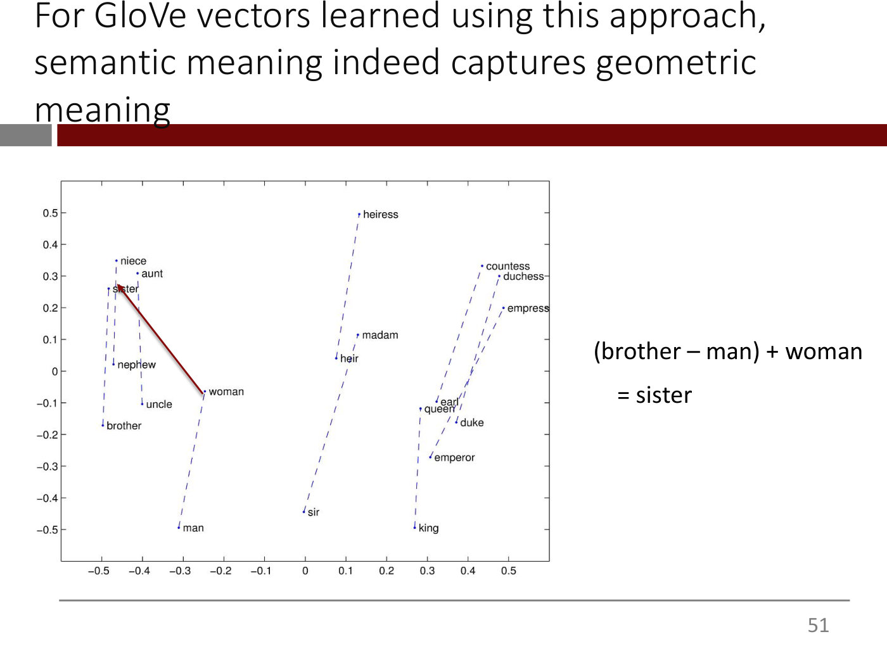
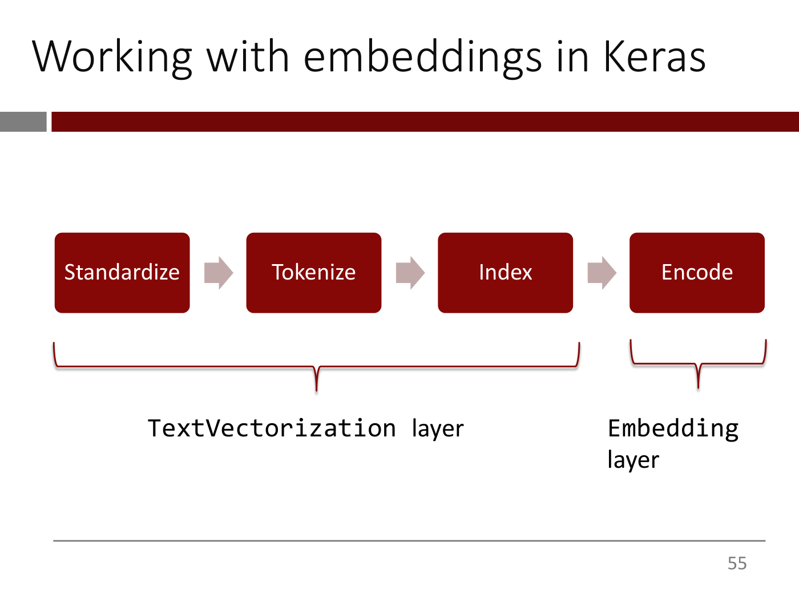

# Lecture 6 — Word Embeddings

**Lecturer:** Rama Ramakrishnan ·
**Video:** [youtube.com/watch?v=LqFc0z-pQTg](https://www.youtube.com/watch?v=LqFc0z-pQTg) (78 min) ·
**Slides:**
[`mit15_773_s24_lec06.pdf`](https://ocw.mit.edu/courses/15-773-hands-on-deep-learning-spring-2024/mit15_773_s24_lec06.pdf)
(70 pages; transcribed in [`raw/slides/06-word-embeddings.md`](../raw/slides/06-word-embeddings.md)) ·
**Transcript:** [`raw/transcripts/06-word-embeddings.md`](../raw/transcripts/06-word-embeddings.md)

## What this lecture establishes

Lecture 5 turned text into numbers with one-hot vectors. This lecture shows what is wrong with them
and replaces them with **word embeddings**: short, dense vectors, learned from data, in which the
geometry means something. Words with similar meanings sit close together, unrelated words sit far
apart, and directions carry relationships, so that the arrow from "man" to "brother" also leads
from "woman" to "sister" (slides 4–21, 48–51).

The lecture builds one way of learning such vectors, **GloVe**, from a single idea: "You shall know
a word by the company it keeps" (slide 28). Count how often every pair of words shares a sentence
across all of Wikipedia, then find a vector and a bias for each word such that a very simple
formula, the two biases plus the dot product of the two vectors, reproduces the logarithm of every
count. That is least-squares regression, solved by stochastic gradient descent (slides 36–46;
≈18:43–39:45). These are **stand-alone** embeddings: one vector per word, whatever the sentence.
A word like "bank" needs **contextual** embeddings, and computing those is what transformers are
for, which is where [the next lecture](07-transformers.md) goes (slides 22–25; ≈12:23–14:48).

The last part puts embeddings to work in Keras. The text vectorization layer now stops at the
integers and pads or truncates every input to the same length, an **Embedding layer** looks up one
vector per token, and **global average pooling** averages them into the single vector a dense
layer needs (slides 55–68; ≈50:32–55:09). In Colab, lecture 5's song-genre classifier is rebuilt on
embeddings three ways: with frozen pretrained GloVe vectors (63% accuracy), with the GloVe
vectors trained further (almost 69%), and with 64-dimensional embeddings learned from scratch
(72%). With about 50,000 training songs, the course's own embeddings do best (≈1:06:45–1:17:33).

The catalog titles the video "Deep Learning for Natural Language – Embeddings"; the deck's roadmap
calls the lecture "Embeddings" (slide 1). The recording presents slides 2–68 and then the Colab
(from ≈55:09). The Colab notebook is not published on OCW and is not in this knowledge base.
Everything said below about the code follows the lecturer's narration, and only the functions and
arguments he names are given.

## Part 1 — What is wrong with one-hot vectors

### The recap

Run a phrase through STIE, lecture 5's four steps, and every word comes out as a one-hot vector over
the vocabulary: standardize, split on whitespace, assign each word an integer, and turn each integer
into a vector of zeros with a 1 at that integer's position (slides 2–3; ≈0:49–2:21). In the deck's
example the vocabulary has 100 entries, and it includes "the", because stop words were not removed.
Add a sentence's one-hot vectors and you get count encoding; OR them and you get multi-hot encoding.
See [text vectorization](text-vectorization.md) and [the Bag of Words model](bag-of-words.md).

A detail "handy for homework": standardization historically meant stripping punctuation,
lowercasing, removing stop words and stemming, but modern practice mostly strips punctuation and
lowercases, and often skips stemming and stop-word removal. Keras's default standardization is
lowercasing and punctuation stripping only (≈1:34).

The scheme is "quite effective for simple problems", but it has "some very serious shortcomings"
(≈2:21).

### Problem 1: the vectors are as long as the vocabulary

With 500,000 words in the vocabulary, every word that comes in is a vector 500,000 long, "a gross
waste of stuff" (slide 5; ≈3:54). Keeping only the most frequent words helps somewhat, but the
length still raises the number of weights the model has to learn, and with it the compute, the data
needed and the risk of overfitting.

### Problem 2: the vectors know nothing about meaning

A student puts it first: "this house is great" and "this house is awesome" should look alike, but
"great" and "awesome" get unrelated vectors (≈3:07). The lecturer makes it exact (slides 6–9;
≈4:42–7:45). The simplest measure of closeness between two vectors is the Euclidean distance: take
the differences position by position, square them, add them up and take the square root. The
one-hot vectors for "movie" and "film" are zero everywhere except one position each. Every shared
zero contributes 0, and the two positions where one vector has a 1 and the other a 0 contribute 1
each, so the distance is

$$\sqrt{(1 - 0)^2 + (0 - 1)^2} = \sqrt{2}.$$

The vectors for "good" and "bad", which mean opposite things, are also $\sqrt{2}$ apart, and so are
any two words in the vocabulary. "If any two words have the same distance, does this even have a
notion of distance? It doesn't" (≈6:59). Slide 9 says it in red: the distance between any two
one-hot vectors is the same, regardless of the words, and has nothing to do with their meaning.

Slide 10 sums up both problems: the vectors are as long as the vocabulary, a computational and
training problem, and there is no connection between a word's meaning and its vector, "a deeper
problem" (≈6:59–7:45).

## Part 2 — What word vectors ought to do

### Close, far, and the direction between them

"Wouldn't it be nice if" the vectors for synonyms (movie and film) or related words (apple, banana)
were close to each other, and the vectors for words that mean very different things were far apart
(slides 11–13; ≈7:45)?

Two quizzes, from Cohere's article on embeddings, make this concrete (slides 14–15 and 17–18; OCW
excludes the figures, so they are described here and not shown). Suppose someone has handed us word
vectors that capture meaning, and we plot just their first two dimensions (≈7:45–9:18). In the
cartoon, factory, house and office building cluster in one corner, bicycle, truck and car in
another, fruit in a third and sports balls in a fourth. Where does "apple" go, at a, b, c or d? At
c, in the fruit cluster (slide 15).

The second quiz plots "puppy", "dog" and "calf" and asks where "cow" belongs (slides 17–18;
≈9:18–11:38). The answer, circled on slide 18, completes a parallelogram: cow sits level with calf
and above dog. A student reasons that a calf is a baby animal and a cow the adult, and the lecturer
reads the picture both ways (slide 19). "A puppy is to a dog like a calf is to a cow": moving
horizontally goes from the young animal to the grown one. Moving vertically goes across species at
roughly the same stage of maturity. "So these directions also matter. It's not just the distance"
(≈11:38).

So the wish, more generally, is that **the geometric relationship between word vectors represents
the semantic relationship between the words** (slide 16). The lecturer says "relationship" and not
"distance" deliberately: "The relationship is distance and direction. Both have to be involved"
(≈9:18, ≈11:38). **Word embeddings** are word vectors designed to achieve exactly this, and they fix
both of one-hot encoding's problems (slides 20–21).

### Context, and why transformers come next

Is that enough? A student names what is missing: context (slide 22; ≈12:23–13:58). Many words have
several meanings, and only the surrounding words tell you which. "Bank" can be a financial
institution, the side of a river, a plane turning, or someone banking on something. An embedding that
gives each word one vector gives a many-meaning word "some average version of that meaning", which
is not very good. Words with only one meaning are fine.

So word embeddings must be made **contextual**: the vector for a word should take the other words in
the sentence into account. **Contextual word embeddings** meet both requirements, the geometry and
the context (slide 23), and "the key to calculating contextual word embeddings" is the transformer
(slide 24), "which is why transformers are justifiably famous" (≈13:58). The plan: this lecture
computes **stand-alone** (uncontextual) word embeddings, and from the next lecture on transformers
make them contextual (slide 25; ≈13:58–14:48).

## Part 3 — Learning embeddings from data: GloVe

### "You shall know a word by the company it keeps"

One could collect synonyms, antonyms and related words by hand and assign vectors that satisfy the
requirements, "a long, painful, and never quite complete exercise" (slides 26–27; ≈14:48). Machine
learning people would rather learn it from data.

The key insight is a line from the linguist John Firth: **"You shall know a word by the company it
keeps"** (slide 28; ≈15:34). Take the sentence "The acting in the ____ was superb" (slides 29–32;
≈15:34–17:10). Words likely to fill the blank: movie, film, musical, play, show. Words unlikely to:
truck, banana, tensor ("I love the word tensor, so I have to find a way to use it somewhere").
Words that are interchangeable in a sentence, so that you can drop either into the blank and it
still makes sense, are probably related. "You're inferring their relatedness, not by looking at them
directly, but by seeing where they live" (≈17:10).

So if movie, film and musical appear in the same contexts very often, they are likely to be related,
and more generally related words appear in similar contexts. The plan is to quantify how often words
co-occur in similar contexts and learn embeddings from that data (slides 33–35; ≈17:10–18:43).

### The co-occurrence matrix

There are many ways to define context. The lecture takes the simplest: **context means sentence**
(≈17:57). Break all of Wikipedia into sentences, billions of them, and for every pair of words count
the number of sentences in which both appear (slides 36–37; ≈18:43–21:03). The two words need not be
next to each other, since a word at the end of a long sentence can change the meaning of one at the
beginning. The slides call the count "loosely speaking" and refer to the GloVe paper for the details.

The result is a **word-word co-occurrence matrix**. If Wikipedia has 500,000 distinct words, the
matrix has 500,000 rows and 500,000 columns, and each cell holds the number of sentences in which its
row word and its column word appear together. If "deep" and "learning" share 3,025 sentences, 3,025
goes in their cell. Most cells are 0, since most pairs of words never share a sentence. This matrix
"embodies all the context information that we can work with" (≈20:18).


*Slide 37 — the word-word co-occurrence matrix: one row and one column per word, and each cell counts the sentences two words share. [Deck](https://ocw.mit.edu/courses/15-773-hands-on-deep-learning-spring-2024/mit15_773_s24_lec06.pdf)*

**GloVe and word2vec.** This approach to stand-alone embeddings is called **GloVe**. When such
embeddings first came onto the NLP deep-learning scene there were two ways of computing them,
**word2vec** and GloVe, which "are both comparable" and use slightly different mechanisms. The
lecture goes with GloVe because it is "a little easier to understand, and equally effective"
(≈21:03).

### How would you know if embeddings were any good?

Suppose the lecturer hands you an embedding for each of the 500,000 words. How would you judge them
(≈21:49–23:20)? Checking pairs one at a time, movie close to film and far from tensor, never ends.
Instead, use the embeddings to **recreate the co-occurrence matrix**. If the recreated matrix comes
close to the real one, say 3,002 where the data has 3,000 for "deep" and "learning", and 48 where it
has 50 for "extreme" and "learning", the embeddings must have captured something, because the
matrix holds the context information.

So the idea is to find embedding vectors that approximate the observed co-occurrence matrix: chances
are those vectors capture some notion of semantic distance (slide 38). And the tool is "nothing more
than basically linear regression" (≈24:06). Think of the embedding vectors as just **weights** in a
model and the co-occurrence matrix as just **data**, then learn the weights that minimize prediction
error (slides 39–40).

### The model

The notation (slide 41; ≈24:06–25:38):

- $X_{ij}$ is the co-occurrence count of word $i$ and word $j$. "It's not a variable, it's data."
- $w_i$ is the embedding vector of word $i$, to be learned.
- $b_i$ is a **bias** for word $i$, also to be learned. Some words are inherently popular and show
  up all the time, like "the". Every word has a natural frequency of occurring ("movie" against
  "flick", "the" against "tensor"), and the vectors should capture the co-occurrence pattern
  independent of it. The bias absorbs the natural frequency.

The model assumes the count is a simple linear function of the two biases and the two vectors
(slide 42):

$$X_{ij} = b_i + b_j + w_i^T w_j$$

where $w_i^T w_j$ is the dot product of the two embedding vectors. The lecturer tells it as a story
(≈25:38–26:24). In nature there is a true embedding vector and a true bias for every word, and every
count in the matrix came about because "mother nature" added the inherent popularity of the first
word, the inherent popularity of the second, and the dot product that says how the two words connect.
"It literally can't get simpler than this."

Counts are positive and have a huge range: most are 0 and some are very large. As in ordinary
regression on something like people's net worth, with its long right tail, taking the logarithm
squashes the range and makes the model much better behaved (≈26:24–27:56). So the model is (slide 43)

$$\log(X_{ij}) = b_i + b_j + w_i^T w_j$$

The logarithm of 0 is undefined, so in practice 1 is added to every count first; the lecturer says
this aloud and the slide does not print it (≈27:56).

### Fitting it: least squares and gradient descent

How do you find the $b$'s and $w$'s (slides 44–45; ≈27:56–28:41)? As in any regression, choose the
weights with the lowest error, and the simplest error is the squared one: for every pair of words,
take the actual value minus the predicted value, square it, add them all up, and minimize:

$$\text{Minimize} \quad \sum_{i,j} \left[ \log(X_{ij}) - (b_i + b_j + w_i^T w_j) \right]^2$$

If the model nailed every number in the matrix, the sum would be 0.

Start from random values for the weights and keep improving them, which is a job for gradient
descent, and "since we are cool, we'll do stochastic gradient descent" (≈34:59–37:19). One key point:
gradient descent "doesn't care what the function is, as long as you can calculate a derivative from
it". This model is not a neural network, and gradient descent works on it anyway. See
[gradient descent](gradient-descent.md).

When it is done, **throw away the biases** and keep only the embedding vectors, because what matters
is the embeddings and how they connect to each other (slide 46; ≈37:19).

**A worked example on the board** (≈37:19–39:45). Take the pair "deep" and "learning", with
embeddings $w_1$ and $w_2$ of two dimensions each and biases $b_1$ and $b_2$, all unknown. Say they
co-occur 104 times. The prediction is $b_1 + b_2 + w_1^T w_2$, where the dot product of two
two-dimensional vectors is the product of their first components plus the product of their second
components. The term this pair adds to the error is

$$\left[ \log(104) - (b_1 + b_2 + w_1^T w_2) \right]^2$$

Do the same for every other pair, add everything up, and let gradient descent find all the $b$'s and
$w$'s.

**Questions along the way.**

- *Where is the context, if the data is only counts?* (≈28:41–34:11.) On his iPad the lecturer draws
  two rows of the matrix, for "apple" and "banana". Each row records how often its word shares a
  sentence with every word from "a" to "zebra"; it does not measure how often apple and banana
  appear together. If apple and banana are interchangeable, the two rows will look very similar.
  "Words which are similar will zig and zag together the same way through the co-occurrence
  matrix." An unrelated word, such as "tensor", has a row with a correlation of about zero with
  apple's, and antonyms that never show up in the same place "may have a highly negative
  correlation, close to minus 1". Any embedding that can recreate this correlational structure with
  great fidelity must have captured it.
- *What is on the diagonal?* It is typically ignored; "all the action is off diagonal" (≈31:53).
- *What about "going bananas"?* That is polysemy, like "bank". The embedding becomes an average
  representation of the word's meanings, which the course gets around with contextual embeddings
  (≈33:26–34:11).
- *Are the embeddings data?* No. Like the betas in a regression, they are coefficients the procedure
  produces; the only data is the $X_{ij}$ (≈34:11).
- *How can a computer produce random numbers?* It produces pseudorandom numbers, a specialized field
  of mathematics; "we just cross our fingers and hope for the best" (≈34:59–35:46).
- *Is the regression predicting the co-occurrence matrix?* Yes (≈37:19).
- *Synonyms rarely share a sentence, so how are they found?* "They won't appear in the same
  sentence, but the pattern of co-occurrence will be the same for them" (≈44:22–45:54).

### How long should the vectors be?

The two dimensions of the board example were arbitrary (≈39:45). **You choose the length of the
embedding vectors.** Longer vectors have more flexibility to reproduce the co-occurrence matrix, and
more parameters, so more risk of overfitting. Embedding vectors can be much smaller than one-hot
vectors because they are **dense** (slide 47; ≈41:17–42:49). Slide 47 reproduces a textbook figure
(François Chollet's, excluded by OCW and not shown here) that contrasts one-hot word vectors, which
are sparse, high-dimensional and hardcoded, with word embeddings, which are dense, lower-dimensional
and learned from data. Nobody knows what an embedding's dimensions mean: the first "may stand for
some combination of brightness plus speed plus animalness or something". All anyone knows is that the
vectors reproduce the co-occurrence matrix well, "so it probably has figured something out".

A student asks whether it is strange to fit more parameters than data points (≈39:45–41:17). Not
here, says the lecturer. With 10 words and two-dimensional vectors there are $10 \times 2 = 20$
vector entries plus 10 biases, 30 parameters, but the $10 \times 10$ matrix has 100 entries. The
matrix grows with the square of the vocabulary, so there is more data than parameters. In other
settings the traditional assumptions about data and overfitting can be called into question; for
the curious, he suggests searching for **double descent**.

Three more questions settle how to treat the length (≈46:40–48:59):

- **It is a hyperparameter**, like the number of hidden units in a layer. Start small; if the
  embeddings solve the problem, good, and if not, increase the length until performance flattens out
  and overfitting sets in.
- **Overfitting matters even without a test set.** There is no out-of-sample prediction here, but
  every data set has noise, and a model that captures the noise as well as the signal gives flawed
  insights, whatever you use it for.
- **Penalized regression?** There are many ways to put regularization into the estimation; the
  lecture sticks to the simplest version.

A student later compares the embedding length to the number of filters in a convolutional layer, so
that 32 filters are 32 things a layer can learn. "I think that's actually a great analogy," says the
lecturer. More dimensions can pick up more complicated things, and too many start picking up noise
(≈1:11:21). See [overfitting and regularization](overfitting-and-regularization.md).

## Part 4 — What GloVe vectors learn

Run GloVe on the data and plot the resulting embeddings (slides 48–51; ≈42:49–48:59). The plot is
not the first two dimensions: it uses a technique called **t-SNE**, which projects long vectors into
two dimensions for visualization. The lecturer believes this plot uses the 100-dimensional
embeddings (≈45:54).

Two things show up. First, similar words hang out together: brother, nephew and uncle near sister,
niece and aunt; sir and madam, heir and heiress; king, queen, duke, emperor and their counterparts
(≈42:49–43:35). Second, **directions** carry meaning. The arrow that takes "man" to "brother" has
"some notion of a person becoming a sibling". Start that same arrow at "woman" and it lands on
"sister" (≈43:35–44:22).


*Slide 49 — GloVe vectors for ten male/female word pairs, with the arrow from "man" to "brother". [Deck](https://ocw.mit.edu/courses/15-773-hands-on-deep-learning-spring-2024/mit15_773_s24_lec06.pdf)*

This is **word vector algebra**, or embedding algebra (slide 51; ≈44:22, ≈48:12):

$$(\text{brother} - \text{man}) + \text{woman} = \text{sister}$$

"Human biology reduced to a single sentence." Nobody told GloVe any of this; it was only asked to
reproduce the co-occurrence matrix. The lecturer finds it "pretty shocking" that these relationships
hold, and takes them as evidence that what was learned describes "the underlying nature of what's
going on", not "some statistically fluky artifact" (≈44:22).



*Slide 51 — the man-to-brother arrow, started at "woman", lands on "sister". [Deck](https://ocw.mit.edu/courses/15-773-hands-on-deep-learning-spring-2024/mit15_773_s24_lec06.pdf)*

Three questions about the result:

- **Bias.** If the text the counts come from is biased, does the model amplify it? "Yes, we are."
  Data scraped from the internet carries the biases of whatever produced it, the model faithfully
  learns them, and if you are not careful it perpetuates them. The topic is very important and is
  not covered in the course for lack of time (≈45:54–46:40).
- **Why not use the rows of the co-occurrence matrix as word vectors?** A row is 500,000 long, and
  its raw counts are not normalized, so dot products between rows do not land in a comparable range.
  Both objections can be handled, and that used to be a common approach, but the way embeddings are
  learned now "tends to be much more effective in practice". The embeddings are a compact
  representation of the relationships that is not tied to the size of the vocabulary and "tends to
  have a much longer shelf life" (≈1:12:07–1:13:39).
- **What do the 100 dimensions mean?** Not "how the word relates to 100 other words": every word's
  meaning is captured by a 100-dimensional vector whose dimensions mean something nobody can name.
  "The people who created it don't know what they are either." They know only that the vectors
  recreate the co-occurrence matrix, and that probing them with plots like this one gives what we
  would expect (≈1:09:50–1:11:21).

## Part 5 — Pretrained embeddings, or your own?

Embeddings like GloVe can be downloaded already trained, or learned for your own task (slides 52–54;
≈48:59–50:32).

**Use pretrained embeddings when you lack the data to learn task-specific ones** (slide 52). "The
word is the word", and there is no reason for every small use case to relearn the fundamentals of
English: learn them once, with all the data you can throw at it, then piggyback, fine-tune and adapt.
This helps most when your own data set is small.

**Their drawback is that they are not customized to your data** (slide 53). An application in
medicine or law is full of jargon that embeddings trained on Wikipedia may not capture accurately, so
you may want to take them and fine-tune them on your jargon-heavy data. The slide adds that this is
not necessarily bad, since word features can be expected to be fairly generic in most cases.

**You can also learn embeddings from scratch** (slide 54), and the Colab demonstrates all three
options.

This is the same reasoning as [transfer learning](transfer-learning.md) for images, and the lecturer
draws the parallel himself in the Colab: lecture 4 classified handbags and shoes from about 100
examples by starting from ResNet, and "the same logic applies here" (≈1:07:32).

## Part 6 — Embeddings in Keras

### Splitting the four steps between two layers

Keras divides STIE between two layers (slide 55; ≈50:32). The **text vectorization layer**
(`TextVectorization`) does only the first three steps, standardize, tokenize and index, and a new
**Embedding layer** does the encoding: it turns integers into embedding vectors, learned or taken
from GloVe, where lecture 5 turned them into one-hot vectors.



*Slide 55 — the text vectorization layer now stops at the integers, and the Embedding layer does the encoding. [Deck](https://ocw.mit.edu/courses/15-773-hands-on-deep-learning-spring-2024/mit15_773_s24_lec06.pdf)*

### The text vectorization layer stops at the integers

Two things change from lecture 5 (slides 57–58; ≈51:18–52:51). The deck's code is:

```python
max_length = 300 #90% of songs
max_tokens = 5000

text_vectorization = keras.layers.TextVectorization(
    max_tokens=max_tokens,
    output_mode="int",
    output_sequence_length=max_length,
)
```

First, **`output_mode="int"`** in place of multi-hot: the layer does only STI and returns the
integers. Second, **`output_sequence_length`**: sentences arrive with different lengths, so you
choose a maximum length and the layer truncates or pads every input to it.

### Truncating and padding

With a maximum length of 5 (slide 59; ≈52:06): "cat sat on the mat" fits exactly. "I love you" is
only three tokens, so it is **padded** with a special **pad token**, which Keras represents as 0, out
to five. "Four score and seven years ago" is six, so it is **truncated** to its first five words and
"ago" is dropped.


*Slide 59 — every input is cut or padded to the same length; padding uses token 0. [Deck](https://ocw.mit.edu/courses/15-773-hands-on-deep-learning-spring-2024/mit15_773_s24_lec06.pdf)*

### The Embedding layer is just a lookup table

An embedding is just a vector, and the layer needs one for every token in the vocabulary (slide 61;
≈52:51–53:37). Think of it as a table with one row per token and one column per embedding
dimension. The code names both sizes:

```python
embedding_dim = 100

keras.layers.Embedding(max_tokens,
                       embedding_dim)
```

`max_tokens` is the number of rows, the vocabulary size (5,000 in the example), and `embedding_dim`
is the length of each vector, which you choose. In the slide's table, row 0 is the pad token and row
1 is the unknown token.


*Slide 61 — the Embedding layer is a table of max_tokens rows, each a vector embedding_dim long. [Deck](https://ocw.mit.edu/courses/15-773-hands-on-deep-learning-spring-2024/mit15_773_s24_lec06.pdf)*

### From a table to a vector

When a sentence arrives (slides 62–64; ≈53:37–54:22), the text vectorization layer runs STI and
truncates or pads it: with a maximum length of 5, "I love you" becomes "i love you PAD PAD", the
integers 23, 9, 5, 0, 0. The Embedding layer looks up the row for each integer and gathers the five
vectors into a table, a tensor of shape (`max_length`, `embedding_dim`).

A network needs a vector, not a table (slides 65–66; ≈54:22). The options are those of lecture 5:
flatten the table into one long vector, or sum or average the embedding vectors. The simplest is to
average, which is what **`GlobalAveragePooling1D`** does: it averages each column of the table, so
the result is one vector as long as the embedding, and that is what feeds the first hidden layer
(slide 67).


*Slide 67 — global average pooling averages each column of the table into one vector for the hidden layers. [Deck](https://ocw.mit.edu/courses/15-773-hands-on-deep-learning-spring-2024/mit15_773_s24_lec06.pdf)*

The whole flow, on one slide (slide 68; ≈55:09): the phrase comes in, STI with padding or truncation
gives integers, the Embedding layer looks up their vectors, and global average pooling turns the
table into a vector that "can then be passed into hidden layers just like we normally do". The
lecturer goes through this fast and asks the class to check each step afterwards; the Colab mirrors
it.


*Slide 68 — the overall flow: integers, lookup, a (max_length, embedding_dim) table, and its column averages. [Deck](https://ocw.mit.edu/courses/15-773-hands-on-deep-learning-spring-2024/mit15_773_s24_lec06.pdf)*

A student asks whether averaging the embeddings of very different words loses meaning (≈1:03:41).
It does: "anytime you average anything, you're going to lose some nuance". The question is whether
the result is good enough, and very often it is. Contextual embeddings do better, at the price of
bigger and more powerful models (≈1:04:27).

## Part 7 — The Colab: song genres on embeddings

The task is lecture 5's: classify about 50,000 training songs (the lecturer says "roughly 49,000")
as hip-hop, rock or pop from their lyrics, with one-hot encoded labels (≈55:55). The notebook also
brings in plotting functions from earlier Colabs for the loss and accuracy curves.

### Getting GloVe

The GloVe vectors are available for download at a URL the notebook gives, which the lecturer does not
read out; he downloaded and unzipped them before class because that takes a few minutes
(≈55:55–56:41). They come in several lengths. The course uses the 100-dimensional ones: 400,000 word
vectors, "calculated from Wikipedia using the model we described" (≈56:41). Asked about the length,
he says GloVe comes prepackaged at 100, and "I think they have 200 and 300 as well, if I recall"
(≈1:15:12–1:16:00). The vector for "movie" is a row of numbers no one can interpret, but "the proof
is in the pudding".

### Setting up the layers

- **Maximum length 300.** All the inputs must have the same length. Look at the distribution of song
  lengths and choose something like an 80–20 cut: 90% of the songs have at most 300 words. The
  longest song might have 3,000 words, and padding everything to that "you're just wasting a lot of
  capacity" (≈57:28–58:13).
- **`max_tokens` 5,000**, the most frequent words, and **`output_mode` int**, as on the slides; then
  `adapt` on all the lyrics (≈58:13–58:59).
- **Pad is 0 and unknown is 1.** In lecture 5's multi-hot setup the unknown token was index 0. Here
  index 0 is the pad token, which Keras prints as the empty string, and the unknown token moves to 1
  (≈58:59). "HODL, you're the best" vectorizes to 1 for the unknown "HODL", then the integers of the
  other words, then zeros all the way to 300 (≈59:46).

### Model 1: frozen GloVe embeddings

The **embedding matrix** takes, for each of the 5,000 words in the vocabulary, its GloVe vector: 5,000
rows of 100 numbers, not 400,000, because Keras kept only the 5,000 most frequent words of the lyrics
(≈1:00:32–1:01:21). The first two rows are all zeros, since GloVe knows nothing of pad and unknown.

The Embedding layer gets the vocabulary size as its number of rows and 100 as its dimension, is
initialized with that embedding matrix, and is **frozen**: backpropagation must not change weights
"somebody spent a lot of money to create", Stanford in this case (≈1:02:07). The layer also sets a
mask-zero option, which the lecturer says he will come back to; he does not return to it in this
lecture.

The model: a Keras input of length 300; the Embedding layer, which turns it into a $300 \times 100$
table; average pooling down to a 100-element vector; a dense layer of eight ReLU neurons; and a
three-way softmax over hip-hop, rock and pop (≈1:02:53). The summary reports **500,835 parameters, of
which only 835 are trainable**, because the GloVe embeddings are frozen (≈1:03:41). Listing
`model.layers` and looking at the Embedding layer's weights confirms that the first two vectors are
zeros (≈1:05:59). It is compiled as usual with Adam, cross-entropy and accuracy.

**The page's own check of those counts.** The frozen table is $5{,}000 \times 100 = 500{,}000$
weights. The dense layer has $100 \times 8 = 800$ weights and 8 biases, 808. The softmax layer has
$8 \times 3 = 24$ weights and 3 biases, 27. Pooling has no weights. So the trainable parameters are
$808 + 27 = 835$ and the total is 500,835, as the summary says.

The loss curves are "very well-behaved", with no massive overfitting, and the accuracy is
**63%**, "which is not great" (≈1:08:17). It is below lecture 5's bag-of-words model trained from
scratch on the same 50,000 songs. Why don't the embeddings help (≈1:06:45–1:07:32)? Averaging may be
hurting. A student suggests a mismatch between Wikipedia, which GloVe was trained on, and song
lyrics, and the lecturer agrees that is one big reason. The other is that 50,000 examples is a lot
of data. Pretrained embeddings shine when your data set is small, so you can piggyback on what they
learned from all of Wikipedia.

### Model 2: let backpropagation train GloVe too

A student asks why the embeddings should not be optimized along with everything else (≈1:04:27).
Start frozen because it is much faster, says the lecturer, then train everything and see whether it
helps: sometimes it does and sometimes it does not, and since it may start to overfit "you just have
to empirically see". The only change is **`trainable=True`** on the Embedding layer (≈1:09:04). The
accuracy from `evaluate` rises to "68-- 69%, almost" (≈1:13:39).

While it trains, a student notes that the first model's training accuracy was still rising. The
lecturer agrees there may be room to train longer, and adds that the curve to watch is validation:
while validation improves there is "a little bit more gas left in the tank", and when it flattens or
falls, pull back (≈1:09:50).

### Model 3: embeddings trained from scratch

If training GloVe helps, why not train embeddings from scratch (≈1:13:39–1:14:25)? This needs no
co-occurrence matrix, because the objective is specific: predict the genre accurately. GloVe's
creators wanted embeddings that were generally useful; these only have to be useful for this task.
The model is the same except that the Embedding layer starts untrained and its dimension is 64, an
arbitrary choice that runs faster than 100. The accuracy is **72%** (≈1:16:47).

GloVe as is was OK, GloVe trained further helped a lot, and the course's own embeddings did better
still, because there are 50,000 examples. "GloVe is a general purpose tool", a good starting point
when you do not have much data, "but when you have a lot of data, you should always try to do your
own thing and see if it's any better" (≈1:16:00–1:17:33).

| Model | Embedding | Trainable parameters | Accuracy |
| --- | --- | --- | --- |
| 1 | GloVe, 100 dimensions, frozen | 835 of 500,835 | 63% |
| 2 | GloVe, 100 dimensions, trained further | all of them | almost 69% |
| 3 | Learned from scratch, 64 dimensions | all | 72% |

The figures are from ≈1:03:41, ≈1:08:17, ≈1:13:39 and ≈1:16:47. The lecturer does not say which split
they are measured on; model 2's comes from an `evaluate` call. For comparison, lecture 5's
multi-hot bag-of-words model reached 72% on the test set, and 75% with bigrams (see
[the Bag of Words model](bag-of-words.md#results-on-song-lyrics)). The lecture gives no epochs or
batch sizes for these runs, and no parameter count for model 3. **The page's own count for model 3,**
assuming the same vocabulary of 5,000 and the same eight-ReLU dense layer and three-way softmax,
which the lecturer describes as "the same thing": $5{,}000 \times 64 = 320{,}000$ embedding weights,
$64 \times 8 + 8 = 520$ in the dense layer and 27 in the output, 320,547 in all, every one trainable.

## Printed slips

- Slide 59 gives "love" the index 62, and slides 62–68 give it 9 in the same sentence, "I love you".
- Slides 22 and 23 print "the the other words in the sentence".

## Related pages

- [Word embeddings](word-embeddings.md): the problems with one-hot vectors, what embeddings should
  do, GloVe, word-vector algebra, pretrained or your own, and contextual embeddings.
- [Text vectorization](text-vectorization.md): STIE, the vocabulary and one-hot encoding, and the
  text vectorization layer's integer output, padding and truncation.
- [The Bag of Words model](bag-of-words.md): lecture 5's song-genre results, against which the
  embedding models are compared.
- [Keras](keras.md): `TextVectorization` with `output_mode="int"`, `Embedding`,
  `GlobalAveragePooling1D` and freezing a layer.
- [Natural language processing](natural-language-processing.md): the course's NLP roadmap, and why
  contextual embeddings lead to transformers.
- [Representation learning](representation-learning.md): embeddings as the learned representation of
  words.
- [Transfer learning](transfer-learning.md): pretrained embeddings follow the same logic as a
  pretrained ResNet.
- [Gradient descent](gradient-descent.md): it fits any differentiable function, GloVe included.
- [Overfitting and regularization](overfitting-and-regularization.md): the embedding length as a
  hyperparameter, and why noise matters without a test set.
- [Lecture 5](05-text-vectorization-and-bag-of-words.md): one-hot vectors, the Bag of Words model and
  the song-genre task this lecture revisits.
- [Lecture 7](07-transformers.md): transformers, which turn stand-alone embeddings into contextual
  ones.
