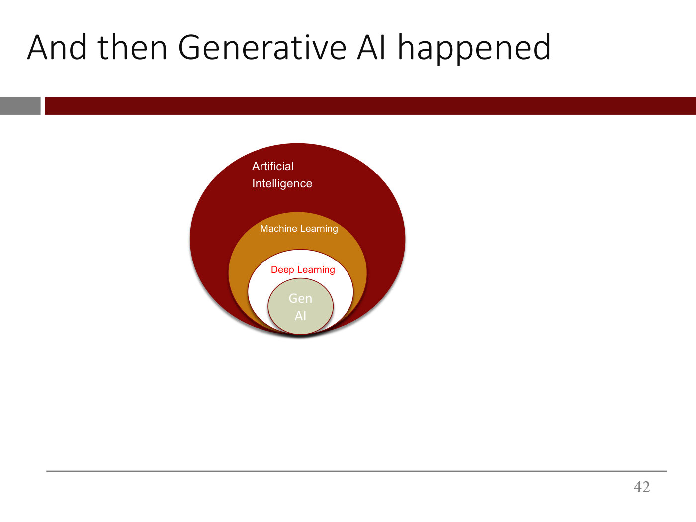

# AI, machine learning, deep learning and generative AI

How 15.773 relates the four terms, and why each one arose. The course's picture is a set of nested
circles: **generative AI ⊂ deep learning ⊂ machine learning ⊂ artificial intelligence**. Each inner
circle removed a bottleneck of the one around it ([lecture 1](01-introduction.md), slides 13, 18,
27, 42 and 51).

*Lecture 1, slide 42 — the nesting the course uses throughout.*

## Artificial intelligence and the traditional approach

AI, informally, is giving computers the ability to do tasks that only humans have traditionally
been able to do ([lecture 1](01-introduction.md) ≈0:46–1:34; slide 14). The field dates from a
1956 workshop at Dartmouth. The **traditional approach** interviews experts and encodes what they
say as IF-THEN rules. It worked in only a few areas, for two reasons. Rules do not generalize to
the endless edge cases of the real world. And by **Polanyi's paradox** ("we know more than we can
tell") experts cannot actually articulate how they do much of what they do (≈2:20–3:53; slide 15).

## Machine learning

**Machine learning** replaces hand-written rules with **examples of inputs and outputs**, and uses
statistical techniques to learn the function that maps one to the other ([lecture 1](01-introduction.md)
≈3:53–4:40; slides 16–19). Linear and logistic regression, trees, random forests, gradient boosting,
support vector machines and neural networks are all ways of doing it. When people say "AI" today
they usually mean machine learning, "it's just that AI sounds cooler" (≈5:26).

Its bottleneck is the input. Machine learning works well on **structured** data, which can be
numericalized into a spreadsheet. **Unstructured** data such as images, text and audio first had to
be turned into a structured **representation** by hand, which is slow, expert work (≈5:26–10:03;
slides 20–26). See [representation learning](representation-learning.md).

## Deep learning

**Deep learning** is the part of machine learning that **learns the representation automatically**
from raw, unstructured input, then feeds it to a linear or logistic regression at the end
([lecture 1](01-introduction.md) ≈10:03–10:51; slides 27–29). That "demolishes the human bottleneck"
for unstructured data. It came from new algorithmic ideas, vast amounts of data and GPU computing,
all applied to the old idea of neural networks (≈12:24; slides 30–32). Technically, deep learning
is neural networks with many hidden layers (≈40:58; slides 86–87); see
[anatomy of a neural network](neural-network-anatomy.md).

Its "no-brainer" application is to put a deep learning system behind any sensor (a camera, a
microphone) so that it can detect, recognize and classify what it senses. Examples are Face ID,
mammography screening, self-driving perception, manufacturing inspection and smart binoculars
(≈13:10–17:01; slides 33–38).

## Generative AI

Deep learning could always *predict* structured outputs, such as a probability, a demand forecast
or a few class probabilities. It could not *generate* unstructured outputs well
([lecture 1](01-introduction.md) ≈17:01–17:46; slides 39–41). **Generative AI** can: image-to-text,
text-to-image, text-to-music, text-to-text, and multimodal combinations such as an image plus a
question in, text out (≈18:32–20:49; slides 42–50). It is one kind of deep learning, not a synonym
for it: "there's plenty of stuff going on in deep learning that's got nothing to do with generative
AI" (≈18:32).

The circles inside generative AI are merging into multimodal models (slide 51), and the summary is
**X-to-Y**: with enough data you can learn a mapping from any kind of input to any kind of output,
including mixtures (≈23:54; slide 52).

[Lecture 11](11-diffusion-models.md) explains how text-to-image models work. A
[diffusion model](diffusion-models.md) learns to turn random noise into an image by removing a little
noise at a time, and [CLIP](clip.md) gives it an embedding of the prompt that lives in the same space as
the images the prompt describes. Text-to-video models such as Sora are "text-conditional diffusion
models" built on a transformer (lecture 11, slide 6). The lecturer calls CLIP's shared space the basis of
"the modern multimodal large language models" (≈56:22).

## Where this comes up

- [Lecture 1](01-introduction.md): the whole landscape, in the first 25 minutes.
- [Lecture 11](11-diffusion-models.md): text-to-image and text-to-video: diffusion models steered by CLIP.
- See also [large language models](large-language-models.md), the LLM circle as lecture 9 builds it.
