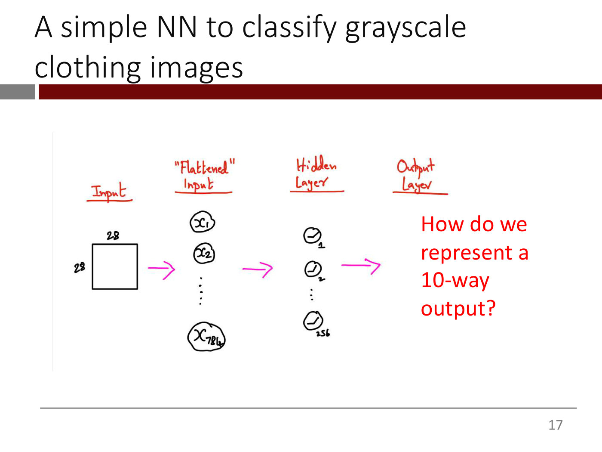

# Images and computer-vision tasks

Computer vision starts from a simple fact: to a computer an image is a table of numbers
([lecture 3](03-keras-and-vision-basics.md) ≈58:08–1:01:12; deck 3B, slides 2–6). This page collects
how images are represented, the main tasks deep learning solves on them, and how a basic network takes
an image as input. Convolutional networks, the course's main tool for images, have their own page,
[convolutional neural networks](convolutional-neural-networks.md).

## Grayscale images

A grayscale (black-and-white) image is a rectangular array of **pixels**. Each pixel holds its light
intensity, a number from 0, no light, to 255, "blinding white light". As the number rises from 0 to
255 the pixel goes from black through gray to white (deck 3B, slides 3–4; ≈58:08–58:54). The slides'
example is a handwritten 5 stored as a $28 \times 28$ table. Its black background is all zeros, and "if you
just step back and squint at this, you can actually see the 5".

The scale is relative. An analog picture is read in and mapped onto the normalized range 0 to 255. The
lecturer does not know the exact mapping from lumens, and suspects there are "a dizzying number of
variations" (≈59:40–1:00:26).

## Colour images and channels

A colour pixel is represented by three intensities, for red, green and blue light, each still between 0
and 255 (deck 3B, slides 5–6; ≈1:00:26). A colour image is therefore three tables of numbers, and in
deep learning these colours are called **channels**. The slide's example, which the lecturer calls a
picture of Killian Court, shows the three $10 \times 10$ tables for the photograph's top-left corner. The
three tables together are a tensor of rank 3 (≈1:01:12). See [tensors](tensors.md).

## Five tasks

The lecture names five of "the most prevalent and useful categories of image-processing problems" for
deep learning (deck 3B, slides 7–12; ≈1:01:12–1:04:16). The slides illustrate them with photographs
that OCW excludes from its licence, so they are described here in words only.

- **Image classification.** Given a list of possible objects, decide which one the image contains. "The
  Dog/Cat classification is the canonical example."
- **Classification and localization.** Also say where the object is. The network outputs the
  coordinates of a box around it, for example its top-left and bottom-right corners.
- **Object detection.** Find every object in the image and put a box around each: sheep 1, sheep 2,
  sheep 3. A self-driving car's camera system does this constantly, many times a second.
- **Semantic segmentation.** Classify every pixel, for example as road, sheep or grass. Instead of one
  classification for the image, there is a multi-class classification problem for each pixel.
- **Instance segmentation.** Classify every pixel *and* tell apart different instances of the same
  category, so that each sheep gets its own label.

For segmentation, the output must have the same dimensions as the input, so the output side of the
network gets "much more complicated" than a classifier's. It needs a different architecture, such as one called U-Net
([lecture 4](04-cnns-and-transfer-learning.md) ≈51:30–52:15). Lecture 11 explains the U-Net as the
dominant architecture for image-to-image problems, from colorizing to classifying every pixel (slides
38–41; see [diffusion models](diffusion-models.md#the-network-a-u-net)).

Lecture 11 also runs three of these tasks off the shelf with Hugging Face pipelines (slide 89;
≈1:09:49–1:14:58): **image classification** ("Egyptian cat" at 94%), **object detection**, which draws
a **bounding box** around each object it finds (a cat, remotes, a couch), and **image segmentation**,
which gives each object a **mask**, the set of pixels that belong to it. See
[lecture 11, Part 16](11-diffusion-models.md#part-16--a-lightning-tour-of-hugging-face-computer-vision-pipelines).

The course's first vision problem is image classification, on Fashion MNIST (deck 3B, slide 14). Its
70,000 small grayscale images show clothing items in 10 balanced categories, so a naive baseline
scores 10% (≈1:04:16–1:05:07).

## Feeding an image to a basic network

The networks so far take vectors, but an image is a table, a tensor of rank 2. The simplest answer is to
**flatten** it: take each row, turn it on its side, and string the rows together into one long vector
(lecture 3 ≈1:05:54–1:06:40). A $28 \times 28$ image becomes $28 \times 28 = 784$ inputs. Nothing has been
computed, "we've literally taken the numbers and just reorganized them", and the problem is back in
familiar territory. Lecture 3's Fashion-MNIST network then uses one hidden layer of 256 ReLU units and
a 10-way softmax output (deck 3B, slides 15–18). See
[multi-class classification and softmax](multiclass-classification.md).

*Lecture 3, deck 3B, slide 16 — flatten the 28 × 28 image into 784 inputs, then use an ordinary dense network.*

In a Keras data set the images arrive stacked into one tensor. Fashion MNIST's training input is 60,000
tables of $28 \times 28$, a tensor of rank 3, and its test input 10,000 more (≈1:14:22–1:15:10).

Flattening works, reaching the high 80s on Fashion MNIST, but it throws away what makes the input an
image. It needs far too many parameters for a real photograph, about 2.7 billion to connect a phone
photo to 100 neurons, loses which pixels are neighbours, and learns the same feature separately in
every place it appears ([lecture 4](04-cnns-and-transfer-learning.md), slides 3–9). Convolutional layers
fix all three; see [convolutional neural networks](convolutional-neural-networks.md). A convolutional
layer expects a channel dimension even for grayscale, so Fashion MNIST's images become $28 \times 28 \times 1$
(lecture 4 ≈45:15–46:01).

## Loading colour images from folders

Lecture 4's handbags-and-shoes data shows the usual way to organize your own images: one folder per
class (`handbags`, `shoes`) inside each of the training, validation and test folders. You can then
"just point Keras at it. It'll automatically figure out those are the labels"
([lecture 4](04-cnns-and-transfer-learning.md) ≈56:11–57:46). A Keras utility, not named in the
narration, reads the JPEGs, converts them to tensors, resizes them to a common size, since
web-scraped images come in different shapes and sizes, and batches them. The course resizes to $224 \times 224 \times 3$ because ResNet expects that size (≈57:46–58:32). The textbook explains this in detail.

## An image as a sequence of patches

[Lecture 8](08-transformers-and-self-supervised-learning.md)'s **Vision Transformer** hands an image to a transformer by chopping it into small
squares, nine in the lecture's example (slide 90; ≈1:07:40–1:10:45). Each patch is three tables of RGB
numbers, flattened into one long vector and run through a dense layer, a "linear projection", to give
the patch's embedding. Because a top-left patch is not a middle one, each of the nine positions gets a
position embedding, added just as with words, and a `<CLS>` token's output is classified. Unlike words,
patches have no vocabulary: every image simply gives nine embeddings (≈1:11:31). See
[transformers](transformers.md#beyond-text).

## Where this comes up

- [Lecture 1](01-introduction.md): images as one of the kinds of unstructured data that deep learning
  handles.
- [Lecture 3](03-keras-and-vision-basics.md): pixels, channels, the five tasks, and the
  Fashion-MNIST network.
- [Lecture 4](04-cnns-and-transfer-learning.md): why flattening falls short, convolutional networks,
  colour images from folders, and transfer learning.
- [Lecture 8](08-transformers-and-self-supervised-learning.md): the Vision Transformer, which treats an image as a sequence of patches.
- [Lecture 11](11-diffusion-models.md): an image as a NumPy array scaled to 0–1 and made noisy pixel by pixel, the U-Net for
  image-to-image problems, and Hugging Face pipelines for classification, object detection and
  segmentation (see [diffusion models](diffusion-models.md)).
