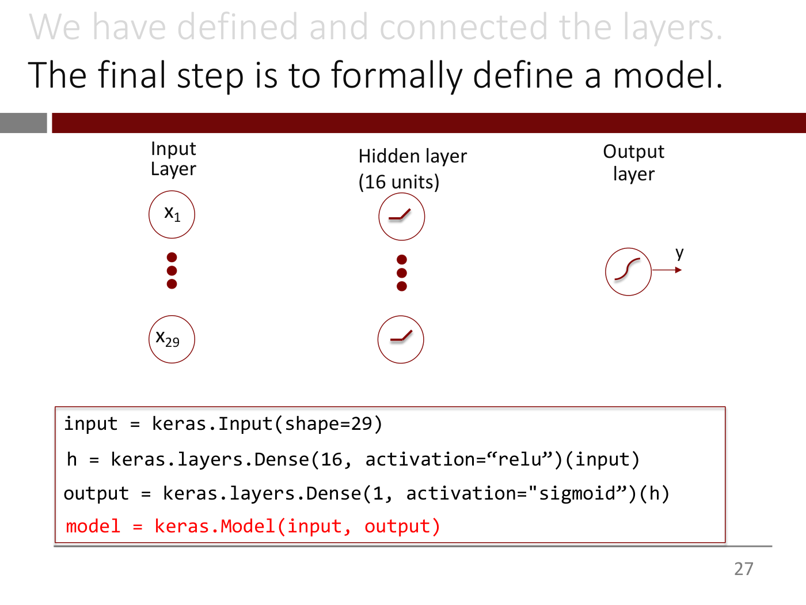

# Keras

**Keras** is the library the course uses to build and train networks. Its appeal is how little code a
network takes: lecture 2's heart-disease model is four lines, and the lecturer calls the result "a
beautiful example of the power of abstraction" ([lecture 2](02-training-deep-nns.md) ≈16:20–19:25).
Lecture 2 shows only how to *define* a model. Its fuller introduction to Keras and TensorFlow, and
training in a Colab, are promised for later and are not in this knowledge base yet.

## Defining a model, layer by layer

The model is lecture 2's heart-disease network: 29 inputs, one hidden layer of 16 ReLU units and one
sigmoid output (slides 13–28):

```python
input = keras.Input(shape=29)
h = keras.layers.Dense(16, activation="relu")(input)
output = keras.layers.Dense(1, activation="sigmoid")(h)
model = keras.Model(input, output)
```

Layers are written left to right, as the network is drawn (slide 12):

- **`keras.Input(shape=29)`** is the input layer. It takes a *shape* because inputs can be matrices,
  3D cubes or 4D tensors as well as vectors (≈12:28).
- **`keras.layers.Dense(units, activation=...)`** is a fully connected layer. "Dense" means connected
  to every unit of the layers before and after (≈13:13–14:03).
- **Calling a layer on a previous output**, as in `(input)` or `(h)`, connects it to that layer,
  which it otherwise knows nothing about. The result gets a name so the next layer can use it
  (≈14:03–15:34).
- **`keras.Model(input, output)`** wraps everything from the input to the output into a model object
  that can be trained, evaluated and used for prediction (≈16:20).



*Lecture 2, slide 27 — each line of Keras sits under the layer it defines.*

## Answers from the lecture

- **Custom activation functions** can be defined (≈17:08).
- **Multi-class outputs** use one unit per class with a softmax, which lecture 2 defers (≈17:54).
- **Deep networks** are built with a loop rather than typed out layer by layer (≈18:39–19:25).
- **The default activation** of a `Dense` layer was asked about. The lecturer was not sure, guessed
  ReLU, and said he would double-check (≈17:54–18:39). The lecture does not settle it. The slides always pass
  `activation=` explicitly.
- **Initialization schemes** are built in as defaults, and the lecturer advises keeping them
  (≈1:01:56).
- **Printed quotes.** Slides 15–28 print curly quotes in the code. Use straight quotes when typing it.

## Where this comes up

- [Lecture 2](02-training-deep-nns.md): the four-line heart-disease model.
- See also [anatomy of a neural network](neural-network-anatomy.md) for the design choices the code
  expresses.
