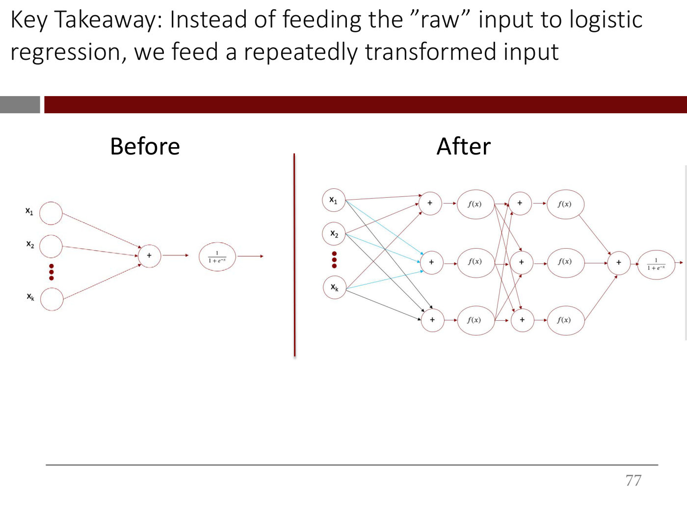

# Representation learning

A **representation** is the form in which data is handed to a model. 15.773 treats it as the
central idea of deep learning: "the whole name of the game is the representations"
([lecture 1](01-introduction.md) ≈9:18).

## Why raw unstructured data needs a representation

A colour image is stored as three tables of pixel intensities (red, green and blue, each 0–255), but
those numbers have **no intrinsic meaning**. A blue value of 251 could be sky, water or blue paint
([lecture 1](01-introduction.md) ≈6:59–7:45; slide 23). A model given raw pixels has nothing
meaningful to work with. Structured data does not have this problem: its columns already mean
something, such as age or cholesterol (slide 21).

## The old way: hand-made features

Before deep learning, researchers built representations by hand. This is **feature engineering**
or feature extraction. For bird photos you might measure beak length, wingspan and primary colour,
which turns images into a table (≈8:31; slide 24). With a good representation, even linear or
logistic regression performs well (slide 25). But designing one was expert work: a computer-vision
PhD could take four years to build the representation for one narrow problem (≈9:18–10:03). This
**human bottleneck** limited where machine learning could be used (slide 26).

## The deep learning way: learn it

Deep learning **learns representations automatically** from raw input. The raw data goes in, a
stack of learned transformations builds the representation, and a linear or logistic regression at
the end makes the prediction ([lecture 1](01-introduction.md) ≈10:03–10:51; slides 27–29).

Mechanically, the representation is what the hidden layers compute. Starting from logistic
regression, you insert linear functions between the input and the output, pass each through a
nonlinear activation, and repeat. Each transformation gives the network more capacity to learn a
useful representation of the input before the final prediction (≈30:51–36:15; slides 66–78). In the
lecture's words, a neural network is "repeatedly transformed inputs which are finally fed to a
linear or logistic regression model" (≈36:15). Whether the learned representation is actually good
depends on training.

*Lecture 1, slide 77 — the hidden layers are where the learned representation lives. The input and output are unchanged.*

## Hierarchies of features

In a convolutional network the learned representation is visibly **hierarchical**. Each layer sees
more of the image than the one before, so a network trained to detect faces learns lines and edges
in its first layer, combines them into parts in the next, and assembles whole faces after that
([lecture 4](04-cnns-and-transfer-learning.md), slides 40–41; ≈28:56–30:29). Nobody tells it to
do this. It is told only to minimize the loss, and the hierarchy is what peeking inside an accurate
network reveals (≈41:23–42:09). See [convolutional neural networks](convolutional-neural-networks.md).

## Reusing someone else's representation

If the representation is what the hidden layers compute, a network trained on a large, general data
set has already computed a good one. Lecture 4 takes ResNet, trained on ImageNet's millions of
everyday images, removes its final layer, and treats what comes out as "a 'smart representation' of
the (everyday) image", as if each image were tagged with lots of general tags (slides 72–73;
≈1:08:37–1:09:22). A small network on top of that representation learns to tell handbags from shoes
from fewer than 100 examples each, with 100% test accuracy, because its inputs are already at a high
level of abstraction (slide 75; ≈1:13:14–1:14:01). This is the representation-learning idea of
lecture 1 put to work. See [transfer learning](transfer-learning.md).

## Representing text

For language the question returns in its sharpest form. An image can go in as its pixel values, but
"when a sentence comes in, like, 'I love deep learning', what do you do? How do you actually represent
it?" ([lecture 5](05-text-vectorization-and-bag-of-words.md), slides 22–25; ≈12:23–13:57). Lecture 5's answer involves no
learning: one-hot vectors from a vocabulary, combined into a [bag of words](bag-of-words.md). [Lecture 6](06-word-embeddings.md) takes up **[word embeddings](word-embeddings.md)**, which the
lecturer says "form the core atomic unit of all modern natural language processing, and for that
matter, vision processing as well" (lecture 5 ≈0:00). They are a learned representation of words.
GloVe learns a vector for every word such that the vectors reproduce how often words share a
sentence, and related words end up close together, with relationships as directions (lecture 6,
slides 36–51). Nobody can say what an embedding's individual dimensions mean (≈1:10:36). A network
can also learn its own embeddings as part of a task, and on lecture 6's 50,000 songs those beat
pretrained GloVe (≈1:16:47).

[Lecture 7](07-transformers.md) makes the representation depend on the sentence. A
[transformer](transformers.md) encoder takes stand-alone embeddings in and returns **contextual**
ones, the same number and the same length, so that encoders can be stacked; as the vectors flow up
the stack they get "more and more and more contextualized" (lecture 7, ≈27:09), and deeper encoders
work at higher levels of abstraction, as later layers of a convolutional network do (≈1:02:34).

## Where this comes up

- [Lecture 1](01-introduction.md): why representations matter, and how hidden layers learn them.
- [Lecture 4](04-cnns-and-transfer-learning.md): hierarchical features in a CNN, and headless ResNet's
  output as a reusable representation.
- [Lecture 5](05-text-vectorization-and-bag-of-words.md): how to represent text, and one-hot vectors and the bag of words as
  the first answer.
- [Lecture 6](06-word-embeddings.md): word embeddings, learned from co-occurrence counts or from the
  task itself.
- [Lecture 7](07-transformers.md): contextual embeddings from a transformer encoder.
