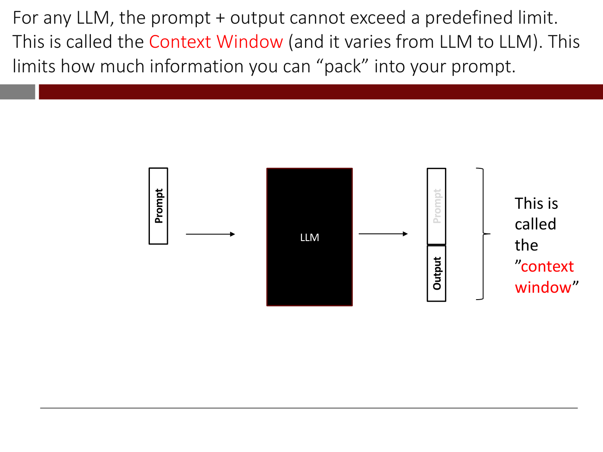

# Retrieval-augmented generation (RAG)

**Retrieval-augmented generation** answers a question with the help of your own documents. It retrieves
the passages most relevant to the question and sends them to the LLM along with it ([lecture 10](10-adapting-llms.md),
slides 75–81; ≈35:39–1:02:40). It is the third rung of the [ladder of adaptation](adapting-llms.md):
"Prompt = Question + relevant chunks of text" (slide 58). It is "also called indexing sometimes" (slide
75), and in the lecturer's view it "is … the most prevalent business application of LLMs that I've seen
up to date" (≈42:36).

## Why not just put everything in the prompt?

Take a customer-support operation with a massive FAQ database. "Can't we just include the entire dataset
in the prompt?" (slide 76). The obstacle is the **context window**: "for any LLM, the prompt plus the
output, the length cannot exceed a predefined limit" (slide 77; ≈36:26). It is like the maximum sequence
length of the course's earlier models, and it counts input and output together. Its size varies from LLM
to LLM. In the Colab the lecturer gives 16,385 tokens "for GPT-4 and 3.5-turbo", then GPT-4's as "up to
128,000 tokens" and Google Gemini 1.5 Pro's as 1 million (≈49:32–50:20).

*Lecture 10, slide 77 — the context window holds the prompt and the output together. [Deck](https://ocw.mit.edu/courses/15-773-hands-on-deep-learning-spring-2024/mit15_773_s24_lec10.pdf)*

A chatbot also has no memory of its own. "The entire conversation is fed in every single time. That's how
it actually remembers what's going on earlier in the conversation" (slide 78; ≈37:13). So every follow-up
uses up more of the window. Text that will not fit is handled by "a whole research cottage industry",
from a moving window over the last tokens to having another LLM summarize what falls outside (≈38:01).

## Retrieve, then generate

So "we first retrieve the relevant content from the database or the FAQ and then send it to the LLM along
with the question" (slide 79; ≈38:46–40:17):

1. Split the documents into **chunks**, for example one per question and answer of an FAQ.
2. Compute a **contextual embedding** of every chunk, for instance by running it through something like
   BERT ([lecture 8](08-transformers-and-self-supervised-learning.md)).
3. When a question comes in, compute its embedding.
4. Find the chunks whose embeddings are most similar to the question's, measured by
   **cosine similarity** (the dot product of vectors of length about 1, explained in
   [lecture 7](07-transformers.md)).
5. Pack the top few into the prompt with the question: "Maybe you have 10,000 questions, but you can only
   accommodate 5 of them in your prompt", so take the 5 most relevant.

Slide 80 draws this with a figure by Sebastian Raschka (excluded from OCW's licence, described in the
[slide file](../raw/slides/10-adapting-llms.md)). The query and the chunks of an external document are
embedded, the chunk embeddings sit in a "vector database", the "most similar k" are found, and they go to
"response synthesis".

Choosing 5 chunks out of 10,000 is itself a weighting, "a weight of 0 and these a weight of 1" (≈41:50).
How to chunk (by section, by paragraph) is "a whole empirical cottage industry", and some information is
lost whatever you do (≈41:04). The documents need only be "relatively clean" (≈41:50). RAG pays off for
data the model cannot know because it is "not in the public internet". It is not needed for things it
learned in pretraining (≈40:17–41:04). The extra information placed in a prompt is called **context**
(≈48:00).

## The Olympics Colab

The lecture's notebook (slide 81) is not on OCW; this summary follows the narration (≈41:50–1:02:40). It
uses the OpenAI library, **GPT-3.5-turbo** for answers and an OpenAI embedding model for the embeddings,
plus **tiktoken** to count tokens.

- **The failure.** GPT-3.5-turbo's training data ends in September 2021. Asked who won the gold in
  curling at the 2022 Winter Olympics, it names Sweden's men and South Korea's women. The women's gold
  went to Great Britain. A "very eloquent, confident, wrong answer" is a **hallucination** (≈45:44–46:29).
  Telling it to answer truthfully and say "sorry, I don't know" if unsure makes it decline instead
  (≈47:14).
- **Context by hand.** Pasting the Wikipedia article on curling into the prompt gets Great Britain right,
  and also "Oskar Eriksson won multiple medals in curling" (≈48:00–49:32).
- **Retrieval.** OpenAI supplies the Olympics articles already chunked and embedded. The embeddings are
  1536 long, and "HODL is amazing!" and "HODL is incredible" come out at a cosine similarity of 0.9934
  (≈51:51–53:25). A helper, `strings_ranked_by_relatedness`, returns the five chunks most related to a
  question; for curling their similarities run from 0.88 to 0.867 (≈54:14–54:59). The prompt is a header
  ("Use the below articles to answer the subsequent question. … say I'm sorry, I don't know"), then chunks
  in order of relatedness until a token budget of 3,700 is reached, then the question (≈55:47–57:18).
- **The lessons.** One run left out the British team ("Welcome to stochasticity"). A question about the
  2016 Winter Olympics, which did not happen, gets "Sorry, I don't know". Without the instruction to be
  truthful, the model answered about 2022 instead (≈58:04–58:51). "Small wording changes in the prompt can
  actually dramatically alter behavior", which makes quality assurance hard. The lecturer cites the Air
  Canada chatbot that gave a customer wrong advice and lost in court. "Without a human in the loop
  checking these answers, it's kind of dangerous" (≈58:51–59:36).

## RAG in the products you use

Uploading a PDF to GPT-4 is not RAG: GPT-4-Turbo's 128,000-token window holds the whole document. In RAG
the chunking "you have to do. The LLM doesn't even know you're doing it". When GPT-4 says it is "doing a
Bing search", a program is searching, chunking, embedding and packing the results into the prompt before
the model sees it (≈1:00:23–1:01:08).

## Where this comes up

- [Lecture 10](10-adapting-llms.md): the context window, retrieving chunks by embedding similarity, and the
  2022 Winter Olympics Colab.
- [Lecture 7](07-transformers.md) and [lecture 8](08-transformers-and-self-supervised-learning.md): the
  dot product and cosine similarity, and contextual embeddings from a transformer encoder such as BERT.
- See also [adapting LLMs](adapting-llms.md), [large language models](large-language-models.md) and
  [word embeddings](word-embeddings.md).
