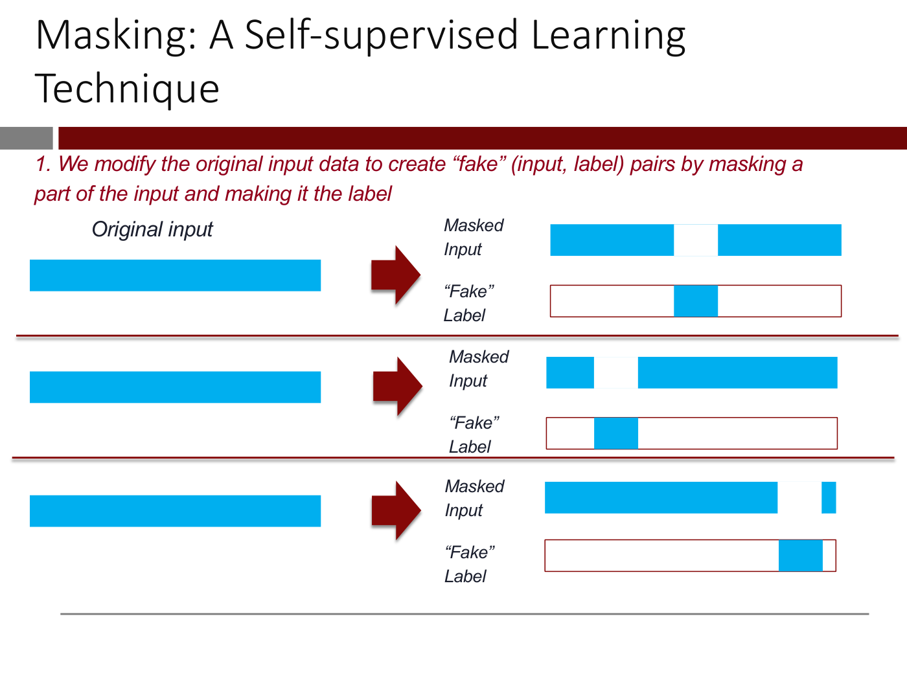

# Self-supervised learning

**Self-supervised learning** builds a pretrained model from data that has **no labels**, by making the
labels out of the data itself. Its key idea, in [lecture 8](08-transformers-and-self-supervised-learning.md)'s
words: "Predict a subset of the input data using the rest of the input" (slide 68; ≈52:51). It is how
models such as BERT learn language from raw text, and it is the step that lets transfer learning, which
the course first meets with images, work for text.

## Why it is needed

[Transfer learning](transfer-learning.md) reuses a network trained on a large, general data set. For
images, lecture 4 used ResNet, trained on ImageNet's everyday images, each labelled with one of 1,000
categories (lecture 8, slide 64; ≈52:06). A deep network's layers learn **representations** of their
input, and those capture general knowledge about it, not only what the original task needed, so a new
model on top needs far less labelled data (slides 44–57; see
[representation learning](representation-learning.md)).

For text the same approach would let a call-center routing model draw on "all the text that's out
there" rather than only its own training emails: "you shouldn't have to learn English just for your
call center application" (slide 39; ≈46:38–47:26). Collecting text is easy, since the internet is full
of it and Wikipedia can simply be downloaded. The problem is the labels. "For an input sentence, what
should the output label be?" (slides 65–67; ≈52:06–52:51).

## Masking

The answer lecture 8 gives is **masking**, "one of many techniques in self-supervised learning, but
this is very commonly used" (≈52:51). Remove a small part of an input. The input with the gap becomes
the new input, and the removed part becomes a "fake" label (slide 69). In the lecturer's analogy, make a
donut and punch a hole in it: "The donut with the hole is your new input. The munchkin is the label"
(≈53:37). Then train a deep network to predict the fake labels from the masked inputs, "to fill in the
blanks" (slide 70).

*Lecture 8, slide 69 — masking turns unlabeled data into (input, label) pairs. [Deck](https://ocw.mit.edu/courses/15-773-hands-on-deep-learning-spring-2024/mit15_773_s24_lec08.pdf)*

For text, words are replaced by a `<MASK>` token. Slide 71 masks five words of MIT Sloan's mission
statement, "The `<MASK>` of the MIT Sloan School of `<MASK>` is to develop principled, innovative
`<MASK>` who improve the world and to `<MASK>` ideas that advance `<MASK>` practice", and the hidden
words, mission, Management, leaders, generate and management, are the labels.

## Why filling in blanks teaches anything

"Now for the amazing part." In learning to fill in the blanks successfully, the network learns a good
representation of the input data (lecture 8, slide 72; ≈54:25). To do it, the model has to learn how the
variables are related to each other (slide 73). The lecturer's example: "If I say the capital of France
is dash, and you're like, Paris, OK, how did you know that?" (≈55:11). Once the model is built, extract
an **encoder** from it and fine-tune it on the labelled task, as in transfer learning (slides 74–75).
That is "how you build a generic pre-trained model on unlabeled data" (≈55:11).

## With a transformer: masking is sequence labeling

A [transformer](transformers.md) encoder returns one output for each token that goes in, so masked
self-supervised learning is "just a sequence labeling problem", the same shape as lecture 7's slot
filling (lecture 8, slide 77; ≈55:57). The masked sentence goes through positional input embeddings,
the encoder, a dense ReLU layer and a softmax per token. The outputs at unmasked positions are ignored;
at each masked position the right answer is the hidden word, and those answers make the loss.

*Lecture 8, slide 77 — masked self-supervised learning as sequence labeling. [Deck](https://ocw.mit.edu/courses/15-773-hands-on-deep-learning-spring-2024/mit15_773_s24_lec08.pdf)*

## BERT

A transformer encoder pretrained this way on massive amounts of English text is **BERT** (lecture 8,
slides 78–80; ≈56:44). Its encoder is **bidirectional**: every word can attend to every other word in
the sentence. BERT-Base has 12 transformer blocks, 768-long embeddings and 12 attention heads, about 110
million parameters; BERT-Large has 24 blocks, 1024 and 16, about 340 million (slide 80). BERT was
trained with a `<CLS>` token, so it can be used for sequence classification out of the box, and it
suits sequence labeling too (slides 82–83). To use it on a problem with natural-language input, "Label
'a few hundred' examples, attach the right final layers to BERT and fine-tune" (slide 85). See
[lecture 8](08-transformers-and-self-supervised-learning.md#part-8--bert).

Lecture 8 previews another self-supervised task: in a causal transformer, each word attends only to the
words before it, and lecture 9 covers it (≈57:36; slide 30). This knowledge base does not cover
lecture 9 yet.

## Images: contrastive learning

The deck of lecture 8 closes with a section the recording does not reach, "Contrastive Learning (time
permitting)" (slides 94–98); this is from the slides alone. Masking makes labels for unlabeled text, so
"How can we pretrain models on unlabeled image data?" (slide 95). **Contrastive learning** has been
found to be very effective (slide 96, citing Chen et al., 2020). For every original image, construct a
pair of "augmented" images, and train the network to "maximize agreement": the representations of each
augmented pair should be close to each other and far from those of the other pairs. The augmentations on
slide 97 include crops, flips, colour distortion, rotation, cutout, noise, blur and Sobel filtering
(compare [data augmentation](data-augmentation.md)). Then extract the encoder and fine-tune it, as with
masking (slide 98).

## Where this comes up

- [Lecture 8](08-transformers-and-self-supervised-learning.md): representations, the transfer-learning
  recipe, masking, BERT, and the unpresented contrastive-learning slides.
- See also [transfer learning](transfer-learning.md), [representation learning](representation-learning.md)
  and [transformers](transformers.md).
