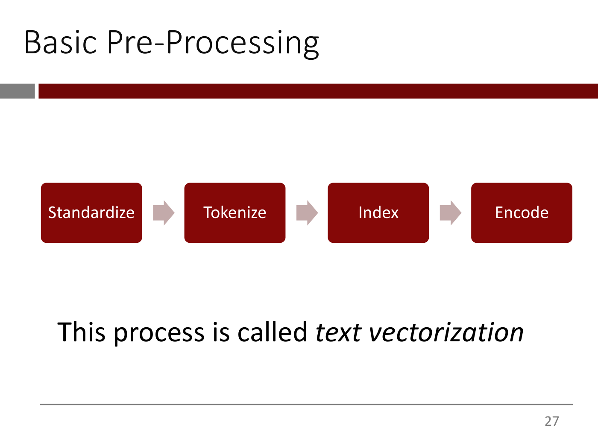
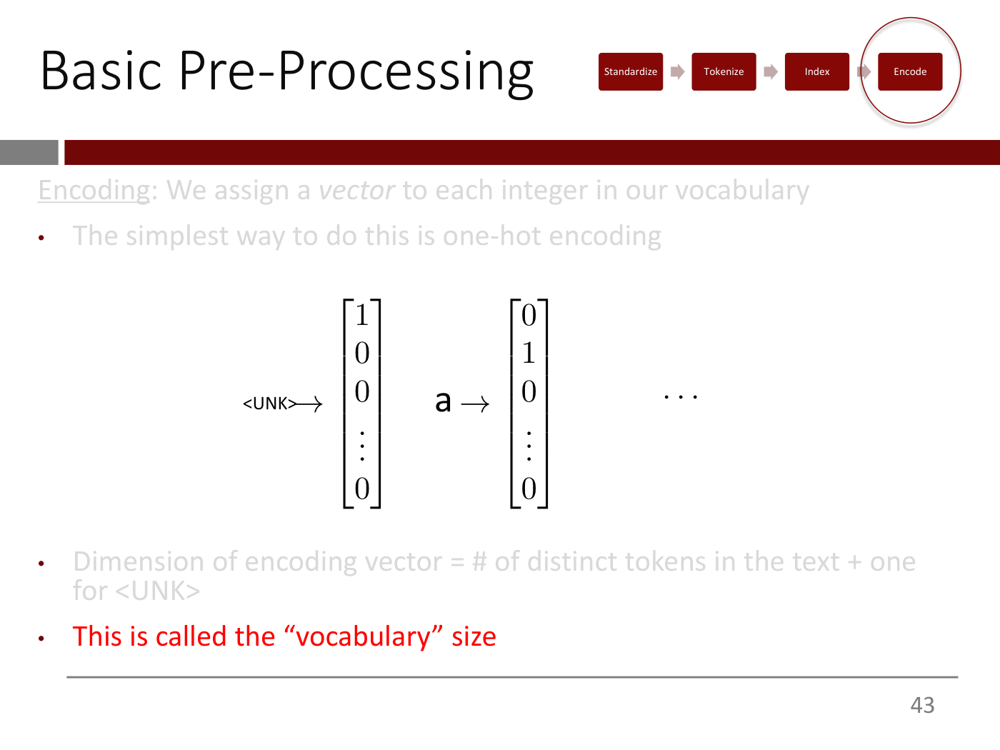

# Text vectorization

A network only takes numbers, so before a sentence can go into one it has to become a vector. The
course calls the process **text vectorization**: "we are essentially taking text and creating vectors
of numbers out of them" ([lecture 5](05-text-vectorization-and-bag-of-words.md), slide 27; ≈13:57).
It has four steps, which the lecturer keeps in his head as **STIE**: Standardize, Tokenize, Index,
Encode.

*Lecture 5, slide 27 — the four steps of text vectorization. [Deck](https://ocw.mit.edu/courses/15-773-hands-on-deep-learning-spring-2024/mit15_773_s24_lec05.pdf)*

The first two steps run over the **training corpus**, the list of text documents the system learns
from, "a big list of strings" whether each is a novel or a sentence. The last two work only on the
vocabulary those steps produce (slides 28, 34–35; ≈14:46–15:32, ≈23:19).

## 1. Standardize

Standardization removes differences that should not matter (slide 29; ≈15:32–18:39):

| Standardization | How often |
| --- | --- |
| Strip capitalization, and often punctuation and accents | almost always |
| Strip stop words such as "a", "the", "it" | often |
| Stemming: map ate, eaten, eating to one form, "eats" | sometimes |

The reason is the same as in vision. A convolutional network should recognize a vertical line
wherever it appears instead of learning separately that two lines are the same, "because you would
have wasted valuable capacity". Lowercasing is the easiest way to tell the model that the upper- and
lowercase versions of a word "are not different. They're actually the same", and stemming does the
same for a word's forms. Stop words go for a different reason: they probably do not affect, for
instance, the sentiment of a movie review. In Keras the default standardization only lowercases and
strips punctuation, and the lecturer's current practice is not to bother with stemming or stop words
at all: "It's going to work well enough" (≈59:51–1:00:37).

## 2. Tokenize

Tokenization splits standardized text into **tokens**. The common default makes each word a token by
splitting on whitespace; how many consecutive words make up a token is a design choice (slides
31–32; ≈19:24–20:11). Taking adjacent pairs as well gives **bigrams**, and in general **n-grams**; see
[the Bag of Words model](bag-of-words.md#n-grams-putting-some-order-back).

Splitting on spaces loses word order, splits compound words and names (Puerto Vallarta,
father-in-law), fails in languages that do not put spaces between words, and copes badly with
languages that have very long words (≈20:11–22:34). It is good enough for many tasks, text
classification among them, but not for generating text (slide 33; ≈22:34–23:19). ChatGPT writes with
punctuation and capitals, so neither was stripped, and it will use a word you have just made up.
LLMs therefore use other schemes, such as **byte-pair encoding**, which lecture 5 defers to the LLM
lectures (≈23:19, ≈1:14:44) and [lecture 9](09-large-language-models.md) explains; see
[below](#beyond-stie-byte-pair-encoding).

## 3. Index: the vocabulary and `<UNK>`

The distinct tokens found in the training corpus form the **vocabulary**. **Indexing** gives each one
a unique integer (slides 34–36; ≈23:19–24:52). Slide 36 numbers an English vocabulary from 1 ("a") to
50,000 ("zebra"), the figure chosen because the GPT family uses about 50,000 tokens.

A special token, **`<UNK>`** for "unknown", gets the integer 0. A word that arrives later and is not
in the vocabulary is replaced by `<UNK>`. That happens whenever a vocabulary is cut down to its most
frequent words: drop "Hamlet" as too rare, and "Hamlet was a bad prince" reaches the model with
`<UNK>` in its place. Every unseen word becomes the same `<UNK>`, so Romeo, Juliet and Hamlet become
indistinguishable (≈37:25–38:55). LLMs avoid this with a tokenization that "can handle anything you
throw at it" (≈38:55).

## 4. Encode: one-hot vectors

**Encoding** maps each integer to a vector, and the vectors of different words should look different.
The simplest way is **one-hot encoding**, treating the tokens as the levels of a categorical variable:
a vector of zeros with a single 1 at the token's index, so `<UNK>` has a 1 in the first position and
"a" in the second (slides 37–43; ≈24:52–27:54). The length of the vector is the number of distinct
tokens in the training corpus plus one for `<UNK>`, called the **vocabulary size**.

*Lecture 5, slide 43 — one-hot vectors, one per vocabulary entry, as long as the vocabulary. [Deck](https://ocw.mit.edu/courses/15-773-hands-on-deep-learning-spring-2024/mit15_773_s24_lec05.pdf)*

Run a sentence through all four steps and it becomes a table with one one-hot row per token: "the cat
sat on the mat" against a 100-entry vocabulary is a $6 \times 100$ table (slides 47–50). Turning that
table into a single vector is the job of [the Bag of Words model](bag-of-words.md). [Lecture 6](06-word-embeddings.md) replaces one-hot vectors with
**[word embeddings](word-embeddings.md)**, which the lecturer says "form the core atomic unit of all
modern natural language processing" (lecture 5, ≈0:00). One-hot vectors are as long as the
vocabulary, and any two of them are the same distance apart, $\sqrt{2}$, whatever the words mean
(lecture 6, slides 4–10).

## How big a vocabulary?

The vocabulary size is the input length, and the first layer has roughly input size times hidden
size weights. A vocabulary ten times as long means ten times as many parameters, and with a finite
amount of data, more parameters overfit (≈57:31–58:17; slide 61). English has roughly 500,000 words,
but the 50,000 most frequent cover "just about everything you're going to see, ever" (≈36:39–37:25).
So keep only the most frequent words. To choose the cutoff, build the vocabulary without one, look at
how often the rarest words occur, and cut where the frequency falls off dramatically
(≈1:02:57–1:03:44).

## In Keras

Keras implements all four steps "as a single, simple layer called the text vectorization layer"
(≈45:53). Lecture 5's Colab is not on OCW; what follows is what the lecturer names.

- **Settings.** The standardization (default: lowercase and strip punctuation), the split (default:
  whitespace), the output mode (multi-hot in the course's models), **`max_tokens`** (keep only the
  most frequent tokens: 5,000 for single words, 20,000 with bigrams) and **`ngrams`** (1 by default;
  2 for bigrams).
- **`adapt`** builds the vocabulary from a training corpus, a list of strings. Afterwards "the
  training corpus you fed it is forgotten", and only the vocabulary survives (≈46:40–47:28, ≈49:45).
- **`get_vocabulary`** returns the vocabulary, with `<UNK>` first and the other tokens sorted by
  frequency. That ordering is what makes `max_tokens` easy (≈47:28–49:45).
- **Calling the layer** on a sentence returns its vector, as long as the vocabulary
  (≈50:31–52:07).

- **Integer output and padding** (lecture 6). With `output_mode="int"` the layer stops after indexing
  and returns the integers, for an `Embedding` layer to encode, and `output_sequence_length` pads
  short inputs with the token 0 and truncates long ones to a fixed length. Index 0 then belongs to the
  pad token and `<UNK>` moves to 1 (lecture 6, slides 57–59; ≈51:18–52:51, ≈58:59).
- **Labels are text too** (lecture 7). For slot filling, the outputs are sequences of tags such as
  B-fromloc.city_name, and they are vectorized like the queries. But the default standardization
  would strip the periods and underscores and lowercase the tags, so it is set to none for the output
  side (lecture 7, ≈1:06:29–1:07:14). On the input side the ATIS queries give a vocabulary of 888
  tokens, and every query is padded or truncated to 30 (≈1:05:41, ≈1:12:41).

## Beyond STIE: byte pair encoding

[Lecture 9](09-large-language-models.md) returns to what the STIE pipeline loses (slide 59; ≈1:01:31–1:03:10). GPT keeps
punctuation and case, and it will use a word made up on the spot. Given "reldoh", "hodler backwards",
defined as "a student who understands deep learning backwards", it wrote a sentence in which "Jane was a
true reldoh". Modern generative models therefore tokenize differently: the GPT family with **Byte Pair
Encoding** (BPE), BERT with **WordPiece** (slide 60).

The idea is a middle ground between characters and words. Characters alone can spell any word but tell
the model nothing about words, while a vocabulary of every word cannot handle new ones and spends an
embedding vector on each rare one. So the vocabulary holds **characters** (letters of both cases, digits
and punctuation), **full words** frequent enough to be worth adding, and **sub-words**, fragments such as
"ize" that are frequent enough to be worth adding (slide 60; ≈1:03:10–1:05:30).

BPE builds this vocabulary from a training corpus. "Start with each character as a token, and 'merge'
tokens that most frequently occur next to each other. Don't merge across whitespace. Stop when the size
of your vocabulary reaches a user-defined limit" (slide 61). On the corpus "the cat sat on the mat",
with a limit of 12, the pair a,t occurs three times and is merged first, into "at". Then t,h, tied with
h,e at two ("just pick one randomly"), becomes "th", and th,e becomes "the" (slides 62–64;
≈1:06:16–1:09:23). The algorithm came from data compression. GPT-2 and GPT-3 stopped at about 50,000
tokens and GPT-4 at about 100,000 (≈1:09:23–1:10:08). New text is tokenized by applying the merges in
the same order, so "the rat" becomes "the", the space, "r" and "at" (slide 65). In GPT's tokenizer a word
usually carries the space before it, so " deep" and "deep" are different tokens, as are "Deep" and
"deep" (≈1:10:54–1:12:25). See
[lecture 9, Part 9](09-large-language-models.md#part-9--tokenization-byte-pair-encoding).

## Where this comes up

- [Lecture 5](05-text-vectorization-and-bag-of-words.md): STIE, one-hot encoding, `<UNK>` and the
  Keras layer, used to classify song lyrics.
- [Lecture 6](06-word-embeddings.md): why one-hot vectors fall short, and the layer's integer output
  and padding for an Embedding layer.
- [Lecture 7](07-transformers.md): vectorizing both the queries and their slot labels, with
  standardization turned off for the labels.
- [Lecture 9](09-large-language-models.md): what STIE loses for generation, and byte pair encoding worked through.
- See also [word embeddings](word-embeddings.md), [natural language processing](natural-language-processing.md) and
  [Keras](keras.md).
