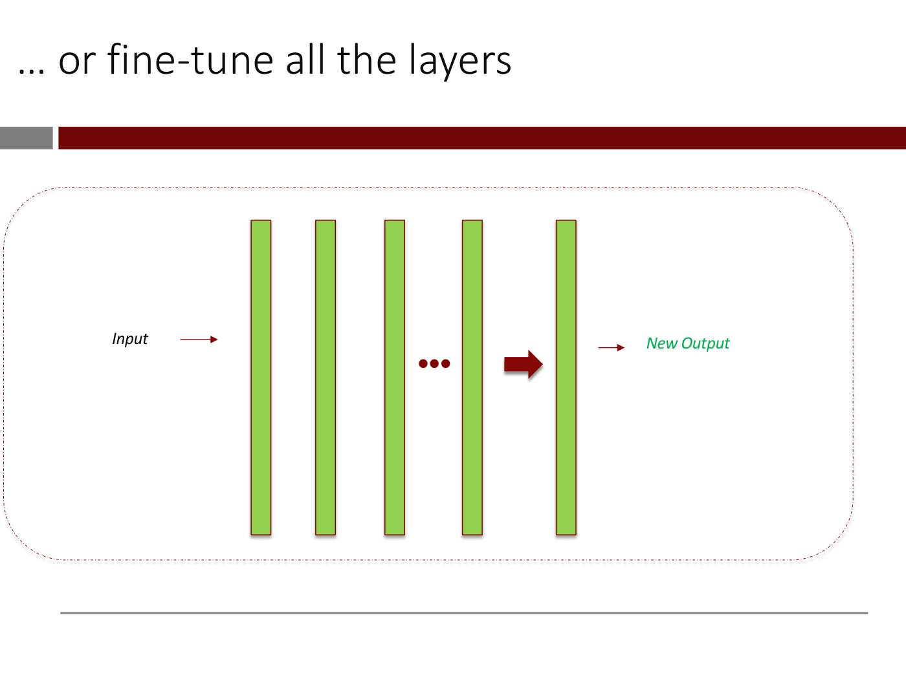

# Transfer learning

**Transfer learning** is customizing a network that someone else has already trained to your own
problem, rather than designing and training a network from scratch
([lecture 4](04-cnns-and-transfer-learning.md), slide 64; ≈1:01:37). The lecturer calls it "the
norm by which people do these things" (≈49:08). It is what lets the course classify handbags and
shoes from fewer than 100 training images.

## Why it works: two research trends

Transfer learning rests on two trends (slides 62–63; ≈1:00:05–1:01:37). First, researchers have
designed architectures matched to types of data. Slide 62's table gives residual connections for
all types, convolutional layers for images, and transformers for sequences such as natural
language, audio, video and gene sequences. Second, they have used those architectures to train
high-performance networks on vast real-world data sets, and have made many of them publicly
available.

A network that does well on a large collection of everyday images has built "a smart, hierarchical
representation of these objects across its layers": colour gradations and lines in its first
layer, edges in the second, honeycomb shapes in the third, and eventually things like a torso or a
Labrador retriever (slides 67–69; ≈1:06:15–1:07:02). Those layers hold knowledge that is useful
well beyond the task the network was trained for. See
[convolutional neural networks](convolutional-neural-networks.md) and
[representation learning](representation-learning.md).

## Choosing a pre-trained network

Look for a network trained on data like yours. Handbags and shoes are everyday objects, as opposed
to MRIs or X-rays, so look for networks trained on everyday images (slide 65; ≈1:01:37). The first
thing to check, of course, is whether someone has already built the exact classifier you need and
put it on GitHub. **ImageNet** is a database of millions of images of everyday objects in 1,000
categories. Slide 66 gives 1.2 million training images and 100,000 test images. **ResNet** is a
family of networks trained on ImageNet that did very well in its competition (slide 70;
≈1:07:49). The slides draw ResNet 34.

## Headless ResNet as a feature extractor

ResNet classifies into 1,000 categories, and the handbags problem has two, so it cannot be used as
is (slide 71). Instead, take ResNet and **stop just before its final layer**, the 1,000-way fully
connected layer. What comes out of this **"headless" ResNet** is a smart representation of the
image, as if it had been tagged with lots of general tags (slides 72–73; ≈1:08:37–1:09:22). Feed
that representation to a small network of your own, here one hidden layer and a sigmoid output.
Because its inputs are at a much higher level of abstraction than raw pixels, it can learn from very
few examples (slides 74–75).

*Lecture 4, slide 75 — the output of headless ResNet becomes the input layer of a small one-hidden-layer network.*

In the course's Colab (≈1:10:54–1:14:01; the notebook is not on OCW), Keras downloads ResNet with
`include_top=False`, "the very final layer of the thing, don't give it to me". The model has about
23 million parameters. Every image is run through it **once**, and its output, a $7 \times 7 \times 2{,}048$
tensor per image, is stored. The small model then flattens that tensor and applies a dense layer of
256 ReLU units, a dropout layer and a sigmoid. It trains in moments, because ResNet's outputs are
not recomputed every epoch, and scores **100%** on the test set, against 87% for a CNN trained from
scratch on the same 98 images. It then correctly classifies a shoe and a handbag held up to the
webcam in class.

## Fine-tuning

You can get fancier: connect headless ResNet directly to your small network and train **the whole
network end to end**. This is **fine-tuning**. You must start the training from the weights and
biases that came with ResNet, "the crown jewel that's been learned", not from scratch (slide 77;
≈1:09:22–1:10:09). The course leaves it to homework 1.

## Where to find pre-trained models

Pre-trained models are on the TensorFlow Hub, the PyTorch Hub and the Hugging Face Hub (slides
78–80). The Hugging Face Hub listed 505,594 models on February 13, 2024. The lecturer recalls about
50,000 a year earlier (≈1:10:09).

One caution came up in questions: weights that everyone can download carry "some adversarial risk" (≈1:10:09–1:10:54).

Lecture 11 uses the Hugging Face Hub for vision: its image-classification task lists 10,487 models, and
any of them, such as Microsoft's ResNet, can be named in a `pipeline` (≈1:11:03–1:11:48). It also loads
a pretrained Stable Diffusion model through Hugging Face's Diffusers library (slide 88; see
[diffusion models](diffusion-models.md#in-code-hugging-face-diffusers)).

## Pretrained word embeddings

The same logic carries over to text. [Lecture 6](06-word-embeddings.md) downloads GloVe's word
embeddings, trained on Wikipedia, and builds a song-genre classifier on top of them, first frozen and
then trained further (≈1:02:07, ≈1:09:04). The lecturer draws the parallel with handbags and shoes
himself: "when your data is really small, try to use a pre-trained model" (≈1:07:32). With about
50,000 songs, though, embeddings learned from scratch did best. A general-purpose tool like GloVe is
"a good starting point" when you do not have a lot of data, "but when you have a lot of data, you
should always try to do your own thing and see if it's any better" (≈1:16:47). See
[word embeddings](word-embeddings.md#pretrained-or-your-own).

## Why it works, and the general recipe

[Lecture 8](08-transformers-and-self-supervised-learning.md) asks why the handbags-and-shoes classifier
worked so well "with only 100 examples" (slides 41–43; ≈47:26–48:11). Neural networks are
**representation learners**: every layer's output is a representation of the input, so a deep network
is many encoders followed by a final regression model, and those representations capture general
knowledge about the input, not only what the original task needed (slides 44–51; see
[representation learning](representation-learning.md)). Because the pretrained network has already
"spent" its data learning them, "your training data is everything that the pre-trained model was
trained on plus your little 200 examples" (slides 54–57; ≈50:34–51:19).

The recipe, in general form (slides 58–63; ≈51:19–52:06): find a deep network built on **similar
inputs but different outputs**; take what comes out of its last layer before the output layer as the
representation; chop off the output layer and use the headless model as an **encoder**; attach a new
output layer for the labels you care about; then either keep the encoder fixed and learn only the new
layer's weights, or fine-tune all the layers.

*Lecture 8, slide 63 — the last step of the recipe: fine-tune all the layers, the new output layer included. [Deck](https://ocw.mit.edu/courses/15-773-hands-on-deep-learning-spring-2024/mit15_773_s24_lec08.pdf)*

## Pretrained language models

ResNet could be built because ImageNet's images come labelled. Text is plentiful, but what would a
sentence's label be (lecture 8, slides 64–67)? [Self-supervised learning](self-supervised-learning.md)
answers it: mask some words and train a network to fill them in. A transformer encoder trained that way
on massive amounts of English text is **BERT**, and the recipe above applies to it. For any sequence
classification or labeling problem on natural-language text, "Label 'a few hundred' examples, attach
the right final layers to BERT and fine-tune" (slide 85; ≈59:07).

For a "standard" NLP problem even that may be unnecessary: the hubs hold pretrained models for the
standard tasks that work without any fine-tuning (slide 85). The Hugging Face Hub had over 500,000
models on February 27, 2024 (slide 86), and lecture 8's Colab uses the Hugging Face Transformers
library's `pipeline` function to classify sentiment, extract named entities and answer a question
straight out of the box. "If it's a standard task, do not reinvent the wheel" (≈1:01:27; see
[lecture 8, Part 9](08-transformers-and-self-supervised-learning.md#part-9--the-hugging-face-colab)).

## Fine-tuning large language models

[Lecture 10](10-adapting-llms.md) applies the same idea to LLMs. Fine-tuning a causal LLM on
domain-specific input-output examples "is basically fine-tuning exactly like we saw with BERT and so on.
And even with ResNet" (slides 82–85; ≈1:02:40–1:03:26). The model is trained further by next word
prediction on the examples, and its weights change. A few hundred examples can be enough: a model
fine-tuned on a few hundred product descriptions and real reviews stops writing marketing copy and writes
reviews that read like a customer's (slides 86–93). "It took billions of sentences for pre-training …
to make it work for your narrow business use case, you only had to spend a couple of hundred examples"
(≈1:06:34). The [instruction tuning](instruction-tuning.md) that turned GPT-3 into ChatGPT began with the
same step, supervised fine-tuning. For a 70-billion-parameter model, updating every weight needs hundreds
of gigabytes of memory, so the lecture fine-tunes only low-rank changes to the attention matrices,
**LoRA** (see [adapting LLMs](adapting-llms.md#lora-low-rank-adaptation)).

## Where this comes up

- [Lecture 4](04-cnns-and-transfer-learning.md): the idea, ResNet, the Colab and the live demo.
- [Lecture 6](06-word-embeddings.md): pretrained GloVe embeddings, frozen and fine-tuned.
- [Lecture 8](08-transformers-and-self-supervised-learning.md): why transfer learning works, the general
  recipe, BERT, and the Hugging Face pipelines.
- [Lecture 10](10-adapting-llms.md): fine-tuning LLMs, supervised fine-tuning, and LoRA.
- [Lecture 11](11-diffusion-models.md): pretrained vision models from the Hugging Face Hub in pipelines, Stable Diffusion
  from the Diffusers library, and CLIP built from a transformer and ResNet-50.
- See also [data augmentation](data-augmentation.md), the other remedy for a small data set.
