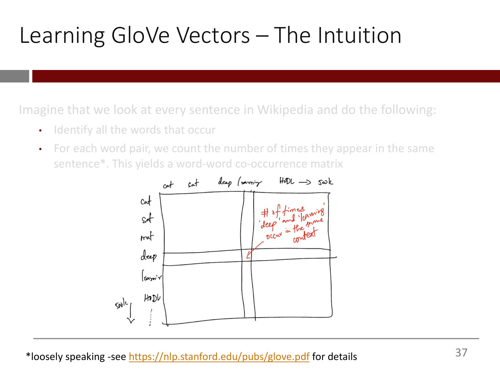

# Word embeddings

A **word embedding** is a short, dense vector of numbers that represents a word and is learned from
data, so that the geometry of the vectors reflects what the words mean. The course introduces
embeddings in [lecture 6](06-word-embeddings.md) as the replacement for the one-hot vectors of
[lecture 5](05-text-vectorization-and-bag-of-words.md). It calls them the "core atomic unit of all
modern natural language processing" (lecture 5, ≈0:00).

## What is wrong with one-hot vectors

[Text vectorization](text-vectorization.md) as lecture 5 does it ends by turning each token into a
one-hot vector: zeros everywhere except a 1 at the token's index. Lecture 6 names two problems with
this (slides 4–10; ≈2:21–7:45):

1. **Length.** Each vector is as long as the vocabulary. With 500,000 words, every word is a vector
   500,000 long. Keeping only the most frequent words helps, but long inputs still mean more weights
   to learn, more compute and more risk of overfitting.
2. **No meaning.** The Euclidean distance between any two different one-hot vectors is
   $\sqrt{(1 - 0)^2 + (0 - 1)^2} = \sqrt{2}$: the two positions where they differ contribute 1 each,
   and every other position contributes 0. So "movie" and "film" are exactly as far apart as "good"
   and "bad", or any other two words. "There's no notion of distance from one-hot vectors" (≈6:59).

## What embeddings should do

The vectors for synonyms or related words should be close together, the vectors for very different
words far apart, and more generally **the geometric relationship between word vectors should
represent the semantic relationship between the words**: direction as well as distance
(lecture 6, slides 11–21; ≈7:45–12:23). Lecture 6's example puts four words at the corners of a
parallelogram: a puppy is to a dog as a calf is to a cow, and also a puppy is to a calf as a dog is to
a cow. One direction moves from young to grown, the other across species (slide 19, from Cohere's
embedding quizzes, which OCW excludes; ≈10:50–11:38).

Embeddings designed to do this also fix the length problem, because they can be far shorter than the
vocabulary. You choose their length. One-hot vectors are sparse, high-dimensional and hardcoded,
while embeddings are dense, lower-dimensional and learned from data (slide 47; ≈41:17–42:49).

## Learning them: the idea

"**You shall know a word by the company it keeps**" (John Firth; slide 28). Words that can fill the
same blank, as movie, film and musical can in "The acting in the ____ was superb", appear in similar
contexts, and words that appear in similar contexts are likely to be related (slides 29–35;
≈15:34–18:43). So count how often words co-occur, and learn vectors from the counts.

## GloVe

Lecture 6 builds **GloVe**, one of the two early ways of computing such embeddings; the other is
**word2vec**. The two are comparable, and GloVe is "a little easier to understand, and equally
effective" (≈21:03).

**The data.** Take every sentence in Wikipedia. For every pair of words, count the sentences in which
both appear. The counts form a **word-word co-occurrence matrix** with one row and one column per
word: $X_{ij}$ is the co-occurrence count of word $i$ and word $j$ (slides 36–37, 41;
≈18:43–21:03). Context, here, simply means the sentence. Two words with the same meaning have
similar rows, because they keep the same company, even if they rarely share a sentence with each
other (≈30:18–33:26, ≈45:08).

*Lecture 6, slide 37 — the co-occurrence matrix: each cell counts the sentences two words share. [Deck](https://ocw.mit.edu/courses/15-773-hands-on-deep-learning-spring-2024/mit15_773_s24_lec06.pdf)*

**The model.** Give each word $i$ an embedding vector $w_i$ and a bias $b_i$, which absorbs how
frequent the word is by nature (slide 41). Assume each count is the sum of the two words' biases and
the dot product of their vectors, and take the logarithm because the counts have a huge range
(slides 42–43; ≈25:38–27:56):

$$\log(X_{ij}) = b_i + b_j + w_i^T w_j$$

In practice 1 is added to every count first, since $\log 0$ is undefined (≈27:56).

**The fit.** Treat the vectors and biases as weights and the matrix as data, and minimize the
squared error by stochastic gradient descent, starting from random values (slides 44–45;
≈27:56–37:19):

$$\text{Minimize} \quad \sum_{i,j} \left[ \log(X_{ij}) - (b_i + b_j + w_i^T w_j) \right]^2$$

Then throw away the biases and keep the vectors (slide 46). The idea behind it: embeddings that can
recreate the co-occurrence matrix closely must have captured the context it holds (≈21:49–23:20).

## What the vectors learn

Plotted in two dimensions with t-SNE, GloVe's vectors put related words together and turn
relationships into directions. The arrow from "man" to "brother", started at "woman", lands on
"sister" (slides 48–51; ≈42:49–44:22):

$$(\text{brother} - \text{man}) + \text{woman} = \text{sister}$$

This is **word vector algebra**. GloVe was never told any of it, only asked to reproduce the counts.

*Lecture 6, slide 51 — word vector algebra on GloVe vectors. [Deck](https://ocw.mit.edu/courses/15-773-hands-on-deep-learning-spring-2024/mit15_773_s24_lec06.pdf)*

Nobody knows what the individual dimensions mean, not even the people who trained the vectors
(≈1:10:36). The vectors learn whatever biases the text holds, and can perpetuate them (≈45:54–46:40).

## The length of an embedding

The length is a **hyperparameter**, like the number of units in a hidden layer: start small and
increase it until performance flattens out and overfitting sets in (≈46:40). Longer vectors can
capture more, and also more noise; the lecturer accepts a student's analogy with the number of
filters in a convolutional layer (≈39:45, ≈1:11:21). GloVe is distributed at 100 dimensions, and the
lecturer recalls 200 and 300 as well (≈1:16:00).

## Pretrained or your own

Pretrained embeddings such as GloVe help most when you lack the data to learn task-specific ones,
because the fundamentals of a language are the same for every task: learn them once and piggyback.
Their drawback is that they are not tailored to your data, such as a field's jargon, so you may
fine-tune them on your own text. Or you can learn embeddings from scratch as part of your model
(lecture 6, slides 52–54; ≈48:59–50:32). This is [transfer learning](transfer-learning.md) for words.

In lecture 6's Colab, on about 50,000 songs, frozen GloVe embeddings gave 63% accuracy, GloVe
trained further almost 69%, and 64-dimensional embeddings learned from scratch 72%. With that much
data, the task-specific embeddings won (≈1:08:17, ≈1:13:39, ≈1:16:47).

## In Keras

The [text vectorization layer](keras.md#layers-for-text-lecture-5) runs standardize, tokenize and
index with `output_mode="int"`, and pads or truncates every input to `output_sequence_length`,
padding with the token 0. The **`Embedding`** layer is a lookup table with `max_tokens` rows of
`embedding_dim` numbers. It turns a sentence's integers into a table of shape (`max_length`,
`embedding_dim`), and **`GlobalAveragePooling1D`** averages each column into one vector for the
hidden layers (lecture 6, slides 55–68; ≈50:32–55:09). To use GloVe, initialize the Embedding layer
with a matrix of GloVe vectors for the vocabulary and freeze it, or set `trainable=True` to train it
further (≈1:02:07, ≈1:09:04). See [Keras](keras.md#layers-for-embeddings-lecture-6).

## Stand-alone and contextual embeddings

GloVe gives each word one vector, whatever the sentence. Words with several meanings, like "bank",
then get an average of their meanings, which is not very good. **Contextual word embeddings** take
the other words of the sentence into account, and computing them is what transformers do (lecture 6,
slides 22–25; ≈12:23–14:48).

[Lecture 7](07-transformers.md) computes them with **self-attention**. The contextual embedding of a
word is a weighted average of the stand-alone embeddings of every word in the sentence, with weights
from a softmax over their dot products with that word's embedding. In "The train slowly left the
station", "train" pulls the embedding of "station" towards the world of trains, while "radio", which
is not in the sentence, gets no weight (lecture 7, slides 26–47; ≈16:15–34:50). Stand-alone embeddings
are the input to that process: random ones, GloVe, it "doesn't matter" (lecture 7, ≈47:05). See
[transformers](transformers.md).

## Where this comes up

- [Lecture 6](06-word-embeddings.md): one-hot vectors' problems, GloVe from the co-occurrence
  matrix, word vector algebra, embeddings in Keras, and the song-genre Colab.
- [Lecture 5](05-text-vectorization-and-bag-of-words.md): one-hot vectors and the Bag of Words model,
  which embeddings replace.
- [Lecture 7](07-transformers.md): contextual embeddings by self-attention, and position embeddings
  added to word embeddings.
- [Lecture 8](08-transformers-and-self-supervised-learning.md): the stand-alone and positional embeddings as weights trained with the whole
  transformer, and BERT's 768-long embeddings.
- [Lecture 10](10-adapting-llms.md): contextual embeddings of document chunks and of a question,
  compared by cosine similarity, to retrieve passages for an LLM (see
  [retrieval-augmented generation](retrieval-augmented-generation.md)); OpenAI's embeddings are 1536 long.
- [Lecture 11](11-diffusion-models.md): text and image embeddings in one space, compared by cosine similarity (see
  [CLIP](clip.md)).
- See also [text vectorization](text-vectorization.md),
  [representation learning](representation-learning.md),
  [natural language processing](natural-language-processing.md) and [transformers](transformers.md).
